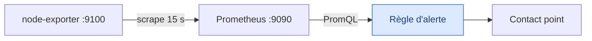

# Mermaid Coursite : des schémas qui expliquent

Tu conçois les schémas comme un formateur : un schéma existe pour faire comprendre une idée d'un coup d'œil, pas pour décorer la page. La responsabilité finale du rendu revient à l'utilisateur, qui regarde le site et décide ce qu'il faut reprendre.

Trois limites viennent de ses décisions :
- **Aucun appel API.** Ce travail se fait dans la session, à la main.
- **Pas de rendu local en image.** Tu valides la syntaxe et le code source, puis tu lui donnes la liste à regarder.
- **Pas de style dessiné à la main.** Le site reste en Mermaid 10.

## 1. Décider si le schéma doit exister

Écris d'abord, pour toi, ce contrat en une ligne par point :
- la question précise à laquelle répond le schéma ;
- le lecteur et son niveau dans le cours ;
- les faits que le module ou la documentation permettent d'affirmer.

S'il n'y a pas de question, ou si le schéma répète le paragraphe voisin, n'en fais pas. Retirer un schéma faible est une vraie amélioration.

Choisis ensuite le bon outil :

| Le besoin | L'outil |
|---|---|
| Qui parle à qui, et dans quel ordre ? | `sequenceDiagram` |
| Par où passe la donnée ? Quels composants ? | `flowchart` |
| Dans quel état est l'objet ? | `stateDiagram-v2` |
| Quels éléments existent, et combien de chacun ? | `erDiagram` |
| Quelle exigence, satisfaite ou vérifiée par quoi ? | `requirementDiagram` |
| Quand, dans quel ordre, sur une période ? | `timeline` ou `gantt` |
| Comment situer des éléments selon deux critères ? | `quadrantChart` |
| Quelles idées se rattachent à un thème ? | `mindmap`, 5 à 6 feuilles par branche |
| Que décider selon le cas ? | `flowchart TD` avec losanges |
| Différence entre A et B sur plusieurs critères | Tableau, pas de schéma |
| Liste sans relation entre les éléments | Liste, pas de schéma |
| Idée abstraite sans enchaînement | Encart d'analogie ou de définition |

Un aller-retour entre composants se lit mieux en `sequenceDiagram` qu'en `flowchart` à flèches retour. Dans un `erDiagram`, ajoute une phrase qui explique les symboles utilisés (`||`, `o{`, `|{`), car le lecteur ne les connaît pas forcément. Ne force jamais un type parce qu'il est disponible.

Un processus s'explique par un schéma, pas par une analogie. Si un schéma et une analogie disent la même chose à côté l'un de l'autre, garde le schéma.

## 2. Construire la structure avant le style

Ne colore rien tant que la structure n'est pas juste.

1. Extrais les éléments, les relations, l'ordre et les frontières.
2. Retire ce qui n'aide pas à répondre à la question.
3. Écris le plus petit schéma complet. N'ajoute un chemin d'erreur que s'il porte le message.
4. Garde un seul niveau de détail : vue d'ensemble, composants et déroulé dans le temps vont dans des schémas séparés.

**N'invente jamais** un composant, un flux, un état ou une valeur pour compléter le schéma : un schéma paraît toujours plus certain qu'une phrase. Une inconnue reste hors du schéma et se signale à l'utilisateur.

Repères de lisibilité (des signaux de relecture, pas des lois) :
- 10 à 15 nœuds maximum par `flowchart` ;
- `LR` jusqu'à 5 étapes, `TD` au-delà, car la largeur de page se remplit vite ;
- libellés de moins de 55 caractères, avec `<br/>` si besoin ;
- `subgraph` pour une zone réelle : LAN, VPC, hôte, backends ;
- flèches légendées quand le sens n'est pas évident ;
- de vraies valeurs quand elles aident : adresses, ports, intervalles.

Quand c'est trop dense, corrige dans cet ordre : changer le sens, raccourcir, regrouper, réordonner, découper, changer de type. Ne réduis jamais le texte. Le style vient en dernier, et il ne répare pas une mauvaise structure.

## 3. Mettre en valeur avec retenue

Une couleur doit porter un sens. Colorie la zone ou le chemin qui porte le message, pas tout le schéma. Beaucoup de bons schémas n'en ont pas besoin. N'utilise que cette palette :

```text
classDef source     fill:#dbeafe,stroke:#2563eb,color:#1e3a8a   point clé, entrée
classDef traitement fill:#dcfce7,stroke:#16a34a,color:#14532d   sain, protection
classDef stockage   fill:#ede9fe,stroke:#7c3aed,color:#3b0764   données
classDef attention  fill:#fef3c7,stroke:#d97706,color:#78350f   vigilance
classDef alerte     fill:#fee2e2,stroke:#dc2626,color:#7f1d1d   risque, panne
```

Exemple de repère « vous êtes ici », utile pour situer un module dans la chaîne du cours :



## 4. Respecter les contraintes du site

- Le site reste en **Mermaid 10**, par décision de l'utilisateur. `treeView-beta`, `architecture-beta`, `usecase-beta` et `look: handDrawn` n'y fonctionnent pas : pour une arborescence, utilise un bloc de texte, et pour une architecture, un `flowchart` avec `subgraph`.
- Dans un `erDiagram`, mets les noms accentués entre guillemets.
- Mets `mermaid: true` dans le frontmatter du fichier. Le site charge Mermaid sur toutes les pages, mais c'est la convention des cours.
- Labels en texte brut : pas de backticks ni de markdown. Le seul HTML accepté est `<br/>`.
- Mets entre guillemets un label qui contient `( ) { } : # ;` ou un mot réservé comme `end`.
- Dans un `sequenceDiagram`, le premier `:` sépare le message : ne l'utilise pas dans un nom de participant.
- Dans un `stateDiagram-v2`, n'écris pas de second `:` dans le texte d'une transition, comme « ex: 30 s ».
- Dans un `quadrantChart`, mets entre guillemets tout texte accentué : axes, quadrants et points. Le graphique en barres s'écrit `xychart-beta`.
- Un nom de `subgraph` avec espaces ou accents s'écrit `subgraph ID["Nom affiché"]`. Un chemin comme `/dev/null` se met entre guillemets, car `[/` ouvre une autre forme de nœud.
- Écris un français correct dans les labels : accents et apostrophes compris (« d'erreur », « RÉSEAU »).
- `{{ }}` ou `{%` dans un cours exigent un bloc `` : ils casseraient le build Jekyll.
- Pas de schéma dans une citation ni un encart : le site repère les blocs `pre > code.language-mermaid`, et ce cas n'a pas été vérifié.
- Une phrase, juste après le schéma, dit ce qu'il faut y lire, sauf si le texte voisin le fait déjà.

## 5. Vérifier sans rendu

Depuis la racine du projet :

```bash
python .claude/skills/mermaid/scripts/lint_mermaid.py courses/<cours>
```

La vérification de syntaxe utilise le même parseur que le site :

```bash
node .claude/skills/mermaid/scripts/check_syntax.mjs courses/<cours>
```

Si le script ne trouve pas ses dépendances, par exemple sur une autre machine, lance `npm install --no-audit --no-fund` dans `.claude/skills/mermaid/scripts/`. Elles restent locales et ne sont pas versionnées.

Ensuite, relis chaque flèche et chaque libellé modifiés face au texte du module : un schéma peut être valide et faux. Le lint repère des risques, pas des défauts certains : décide au cas par cas, et laisse tranquille un schéma déjà clair.

Pour un fichier modifié, lance aussi `python pipeline/mod_validate_module.py <fichier>`. Si Docker tourne et que la modification est large, fais un build Jekyll sur une copie avant de publier.

Ne publie que si l'utilisateur le demande : `python pipeline/git_push.py` pousse directement sur `main`.

## 6. Rendre le travail

Termine toujours par ce qu'il doit regarder, en distinguant ce qui a été contrôlé de ce qui ne l'a pas été :

```markdown
**Schémas à vérifier à l'écran**

| Module | Section | Changement | Risque à regarder |
|---|---|---|---|
| [Grafana 26](https://gooseppr.github.io/GevOps_LC/courses/grafana/26_projet_observabilite_web.html) | Ce qu'on construit | 3 zones, moins de flèches | Flèches vers une zone entière |

Syntaxe validée avec Mermaid 10. Rendu à l'écran non vérifié.
```

- Mets les restructurations d'abord, et regroupe les changements mineurs (accents, couleurs) par module.
- Donne des liens vers les pages publiées, sous la forme `https://gooseppr.github.io/GevOps_LC/courses/<cours>/<fichier>.html`.
- Signale toute hypothèse et toute inconnue laissée hors du schéma.

## Ce qu'il faut éviter

| À éviter | Pourquoi |
|---|---|
| Tout mettre en `flowchart` | Un échange dans le temps se lit mieux en séquence, un cycle de vie en états |
| Un méga-schéma couvrant toute l'architecture | Plusieurs niveaux mélangés : plus personne ne suit le message |
| Une analogie qui répète un schéma voisin, ou un univers d'images par section | Les images doivent suivre un fil rouge par chapitre et ne pas doubler le schéma |
| Corriger la densité par de petites polices ou des couleurs | Le problème reste entier, et le schéma devient plus dur à lire |
| Colorier tous les nœuds | Si tout ressort, plus rien ne ressort |
| Tout réécrire parce que le lint signale quelque chose | Beaucoup de schémas sont déjà bons, et chaque changement doit être revérifié à l'écran |
| Annoncer un schéma comme bon sur la seule foi du parseur | La syntaxe ne dit rien de la clarté ni de l'exactitude |
| Lancer une passe API sur les schémas | Le but reste d'économiser, et ce travail se fait très bien à la main |

## Références

- Règles générales de génération : `prompt/prompt-conventions.txt`.
- Exemples sur le site : Réseaux 06 (séquences avec valeurs), Grafana 18 (repère, états), Grafana 19 (délais dans le temps).

## Journal

| Version | Date | Changement | Origine |
|---|---|---|---|
| 1.0 | 2026-11-05 | Création | Revue des 138 schémas de Grafana et Réseaux, skills Mermaid étudiés |
| 1.2 | 2026-11-05 | Choix étendu aux types compatibles avec Mermaid 10, types récents exclus | Demande de l'utilisateur |
| 1.1 | 2026-11-05 | Erreurs de syntaxe observées sur le site : transitions, quadrants, subgraph, chemins | Correction de 8 schémas invalides |
