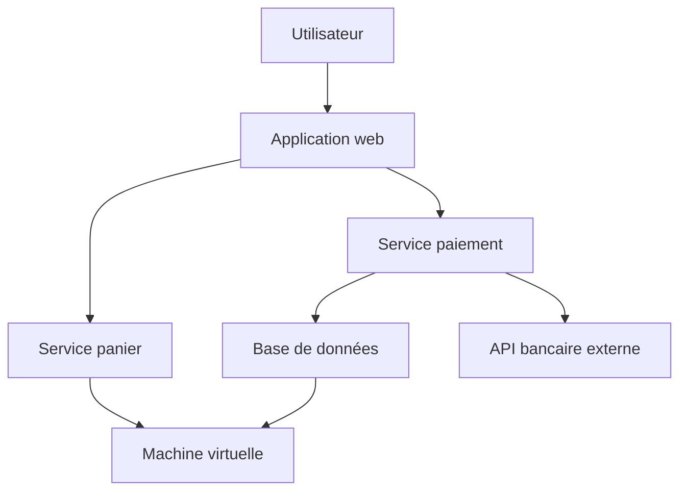
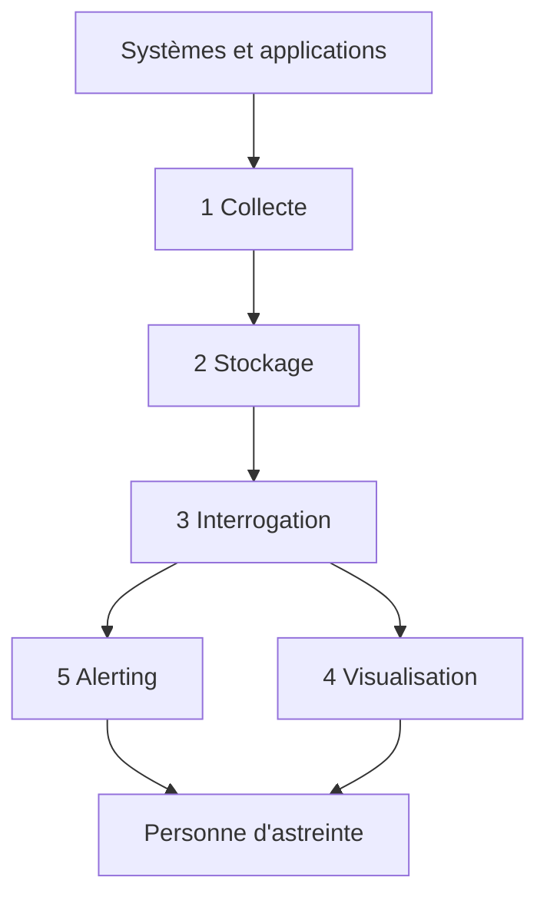

# Concepts fondamentaux de l'observabilité

## Objectifs pédagogiques

À la fin de ce module, vous serez capable de :

- **Distinguer** supervision, monitoring et observabilité, et dire quand chaque approche répond à votre question.
- **Associer** à chaque situation le bon type de signal : métrique, log, trace ou événement.
- **Appliquer** les Golden Signals, la méthode RED et la méthode USE pour décider quoi mesurer sur un service ou une ressource.
- **Décrire** la chaîne qui mène d'une donnée brute à une alerte : collecte, stockage, interrogation, visualisation, alerting.
- **Expliquer** pourquoi Grafana ne collecte rien et ne stocke pas vos métriques, et ce que cela change en cas de panne.

## Mise en situation

Vous êtes au support Cloud d'une plateforme de commande en ligne. Un lundi à 14 h 10, le support client reçoit des messages : « le paiement tourne dans le vide ». Vous ouvrez le tableau de bord de supervision. Tout est vert : les serveurs répondent, le CPU est à 35 %, la mémoire est correcte, aucune machine n'est tombée.

Pourtant, des clients n'arrivent pas à payer.

Le problème n'est pas l'absence d'outil, c'est l'absence de bonnes questions posées aux bons signaux.

Le tableau vous dit que les machines vont bien. Il ne dit rien de l'expérience réelle d'une requête de paiement : combien de temps elle prend, où elle ralentit, ce qui a changé depuis ce matin. Ce module donne le vocabulaire et les repères pour poser ces questions. Grafana viendra ensuite, comme outil pour y répondre.

## Monitoring, supervision, observabilité : trois mots, trois questions

Dans la vie courante, « supervision » et « monitoring » sont souvent employés l'un pour l'autre, et personne ne vous reprochera de les mélanger en réunion. Pour travailler proprement, distinguons-les par la question à laquelle ils répondent.

| Approche | Question posée | Exemple |
|----------|----------------|---------|
| Supervision | « Est-ce que ça tourne ? » | Le serveur répond au ping, le service est `up`, le disque n'est pas plein |
| Monitoring | « Est-ce que ça reste dans les limites que j'ai prévues ? » | Alerte si le taux d'erreur dépasse 2 % pendant 5 minutes |
| Observabilité | « Pourquoi ça se comporte ainsi, y compris pour un cas que je n'avais pas anticipé ? » | Comprendre pourquoi seuls les paiements par carte d'un certain pays sont lents depuis le déploiement de 14 h |

Le monitoring suppose que vous connaissez à l'avance les pannes possibles : vous posez des seuils sur ce que vous avez prévu. L'observabilité vise le cas que personne n'a prévu. Un système est observable quand ses signaux de sortie suffisent à comprendre son état interne sans modifier le code ni se connecter à un serveur pour « voir ce qui se passe ».

> 🧠 **Concept clé**
>
> L'observabilité n'est pas un produit qu'on installe, c'est une propriété du système. Elle dépend de la richesse et de la qualité des signaux émis, et de la capacité à les croiser. Un outil de visualisation ne la crée pas à lui seul.
{: .callout .callout-important}

> 🚗 **Analogie : le tableau de bord d'une voiture**
>
> La supervision, c'est le voyant « moteur » : allumé ou éteint. Le monitoring, ce sont les jauges avec des zones rouges. L'observabilité, c'est la valise de diagnostic du garagiste : elle lit assez de données internes pour expliquer une panne que le constructeur n'avait pas prévue.
{: .callout .callout-analogie}

Les trois ne s'opposent pas. Vous gardez des vérifications simples et des seuils, qui sont rapides et fiables, et vous ajoutez la capacité d'investigation par-dessus.

## Les quatre familles de signaux

Pour comprendre un système, on lui demande de parler. Il le fait de quatre façons, chacune adaptée à un type de question.

### Les métriques : le « combien »

Une métrique est une valeur numérique mesurée dans le temps : requêtes par seconde, pourcentage de CPU, taille d'une file d'attente. Elle est compacte et facile à agréger, donc idéale pour voir une tendance, comparer à hier ou déclencher une alerte. En revanche, elle ne raconte pas d'histoire. Elle vous dit que le taux d'erreur est monté à 4 %, pas quelle requête a échoué ni pourquoi.

### Les logs : le « quoi exactement »

Un log est une trace écrite d'un fait précis, avec un horodatage :

```text
2025-03-10T14:12:07Z level=error service=payment msg="timeout acquiring db connection" order_id=88213 duration_ms=5003
```

Il porte le détail qu'une métrique a écrasé : un identifiant de commande, un message d'erreur, un paramètre. C'est la source de vérité pour comprendre un cas précis. Son défaut est le volume : on en produit énormément, et chercher dans un texte non structuré est lent et pénible.

### Les traces : le « par où est passée la requête »

Dans une architecture à plusieurs services, une action utilisateur traverse souvent cinq ou dix composants.

> 📖 **Définition**
>
> Une trace suit une requête de bout en bout. Elle est découpée en *spans*, un par étape, avec la durée de chacun.
{: .callout .callout-definition}

```text
POST /checkout                       1 840 ms
├─ auth-service                         25 ms
├─ cart-service                         60 ms
└─ payment-service                   1 720 ms
   └─ SELECT ... FROM payments       1 650 ms   ← le goulot est ici
```

La trace répond à une question que ni la métrique ni le log ne résolvent facilement : à quel endroit de la chaîne le temps se perd-il ?

### Les événements : le « qu'est-ce qui a changé »

Un événement est un fait discret et significatif : un déploiement, un changement de configuration, une montée en charge automatique, une alerte déclenchée. Il ne mesure rien en continu et n'est pas un message technique parmi des milliers. Il marque un point sur la ligne du temps.

C'est l'un des signaux les plus rentables en incident. Une grande partie des pannes suit un changement, et savoir qu'un déploiement a eu lieu à 14 h 02 oriente l'enquête en quelques secondes.

### Comment les quatre se complètent

| Signal | Répond à | Force | Limite |
|--------|----------|-------|--------|
| Métrique | Combien ? Depuis quand ? | Léger, agrégeable, idéal pour alerter | Peu de détail |
| Log | Que s'est-il passé exactement ? | Contexte riche | Volumineux, bruyant |
| Trace | Où le temps a-t-il été perdu ? | Vue de bout en bout | Demande une instrumentation, souvent échantillonnée |
| Événement | Qu'est-ce qui a changé ? | Corrèle cause et effet | Ne dit rien de l'impact seul |

> 💡 **À retenir**
>
> En pratique, l'enquête suit presque toujours le même chemin. La métrique détecte, la trace localise, le log explique, l'événement donne le déclencheur.
{: .callout .callout-important}

> 💡 **Astuce**
>
> Ce chemin ne fonctionne que si vous pouvez passer d'un signal à l'autre. Une même heure, un même nom de service ou un identifiant de requête (`trace_id`) présent dans les logs et les traces suffisent à les relier. Sans ce fil commun, vous avez trois silos.
{: .callout .callout-astuce}

## Ce qu'on observe : de l'infrastructure aux dépendances

Un système se lit par couches, et un symptôme apparaît rarement là où se trouve la cause.



- **Infrastructure** : machines, disques, réseau, conteneurs. C'est le terrain de la supervision classique.
- **Application** : le code qui tourne, ses erreurs, sa mémoire, ses files internes.
- **Service** : ce que l'application offre aux autres, avec un contrat de comportement (réponse rapide, taux d'erreur faible).
- **Dépendances** : tout ce dont le service a besoin sans le contrôler entièrement, comme une base de données partagée ou une API bancaire externe.

Dans notre scénario, le service paiement peut être lent parce que la base répond mal, ou parce que l'API bancaire est dégradée, alors que sa propre machine est parfaitement saine. Si vous ne surveillez que les machines, vous êtes aveugle à ces cas. Il faut mesurer le comportement des services et de leurs appels sortants, pas seulement l'état de leurs hôtes.

## Savoir quoi mesurer : Golden Signals, RED et USE

Que mettre à l'écran parmi des centaines de métriques disponibles ? La tentation est de tout afficher. C'est la meilleure façon de ne rien voir. Trois grilles de lecture évitent ça.

### Les quatre Golden Signals

Issus de la pratique SRE (Site Reliability Engineering) popularisée par Google, ils décrivent la santé d'un service orienté requêtes :

- **Latence** : le temps de réponse. Distinguez les requêtes réussies des échecs. Une erreur renvoyée en 2 ms est très « rapide » et fausse la moyenne.
- **Trafic** : la demande reçue, par exemple en requêtes par seconde. Elle donne l'échelle de tout le reste.
- **Erreurs** : la part des requêtes qui échouent, explicitement (code 500) ou implicitement (réponse 200 avec un contenu faux).
- **Saturation** : à quel point le service est proche de sa limite (file d'attente qui s'allonge, pool de connexions presque plein).

> ⚠️ **Erreur fréquente**
>
> Suivre la latence moyenne. Si 95 % des requêtes durent 100 ms et 5 % durent 5 secondes, la moyenne reste « acceptable » alors qu'un utilisateur sur vingt a une expérience désastreuse. Regardez les percentiles. Le p95 signifie que 95 % des requêtes vont plus vite que cette valeur, et le p99 resserre encore la queue de distribution.
{: .callout .callout-attention}

### RED pour les services, USE pour les ressources

Deux méthodes plus courtes, utilisables comme aide-mémoire :

- **RED (Rate, Errors, Duration)** s'applique à un service qui traite des requêtes : combien par seconde, combien échouent, combien de temps ça prend.
- **USE (Utilization, Saturation, Errors)** s'applique à une ressource (CPU, disque, interface réseau, pool de connexions) : à quel point elle est occupée, combien de travail attend, combien d'erreurs elle génère.

Elles se recoupent largement avec les Golden Signals :

| Golden Signals | RED | USE | Sur quoi ça s'applique |
|----------------|-----|-----|------------------------|
| Trafic | Rate | — | Un service |
| Erreurs | Errors | Errors | Un service ou une ressource |
| Latence | Duration | — | Un service |
| Saturation | — | Saturation | Une ressource |
| — | — | Utilization | Une ressource |

> 💡 **À retenir**
>
> RED pour décrire ce que vivent les utilisateurs d'un service, USE pour comprendre pourquoi une ressource est un goulot. Vous commencez par RED (le symptôme), puis vous descendez en USE (la cause possible).
{: .callout .callout-important}

> 🧠 **Concept clé**
>
> L'indicateur de santé le plus utile est celui qui reflète l'expérience de l'utilisateur, pas celui qui reflète l'état d'une machine. Un CPU à 90 % qui n'affecte personne n'est pas un incident. Un CPU à 30 % avec 10 % de paiements en erreur en est un.
{: .callout .callout-important}

## De la donnée à la décision : la chaîne complète

Une donnée d'observabilité traverse cinq étapes avant de vous servir.



1. **Collecte** : récupérer les signaux là où ils naissent. Un composant interroge les applications, lit les fichiers de logs ou reçoit des données envoyées par le code.
2. **Stockage** : conserver ces données dans un système adapté à leur forme (séries temporelles pour les métriques, index de texte pour les logs, stockage de traces).
3. **Interrogation** : poser une question dans un langage de requête (« le taux d'erreur du service paiement sur les 30 dernières minutes »).
4. **Visualisation** : transformer le résultat en graphique, tableau ou jauge qu'un humain lit en quelques secondes.
5. **Alerting** : évaluer régulièrement une condition et prévenir quelqu'un quand elle est vraie.

Cette chaîne est la clé de tout diagnostic de plateforme. Quand un graphique est vide, la panne peut se trouver à n'importe quelle étape : rien n'est collecté, le stockage est indisponible, la requête est mal écrite, ou l'affichage est mal configuré. Savoir dans quel maillon chercher fait gagner un temps considérable.

### Le piège : Grafana n'est ni collecteur ni base de métriques

Grafana intervient aux étapes 3 et 4 (et il évalue des règles d'alerte à l'étape 5). Il se connecte à des sources de données qui détiennent réellement les signaux, lance des requêtes contre elles et dessine les résultats. Il ne va pas lire vos serveurs et il ne conserve pas vos séries temporelles. Ce qu'il stocke lui-même, c'est sa propre configuration : tableaux de bord, utilisateurs, paramètres de connexion.

> ⚠️ **Erreur fréquente**
>
> Croire que Grafana « contient » les métriques. Beaucoup de débutants installent Grafana, ouvrent un tableau de bord et s'étonnent qu'il n'y ait rien à afficher.
{: .callout .callout-attention}

Les conséquences pratiques sont immédiates :

- Un graphique vide ne signifie pas que Grafana est cassé. Cherchez d'abord du côté de la collecte et de la source.
- Si le stockage tombe, Grafana reste en ligne mais n'affiche plus rien d'utile. Votre outil de visualisation peut sembler sain pendant que votre supervision est aveugle.
- Les choix de rétention, de volume et de performance de vos données se jouent dans les systèmes de collecte et de stockage, pas dans Grafana.

La façon dont Grafana se branche à ces sources est l'objet du module suivant. Retenez pour l'instant sa place dans la chaîne : une fenêtre sur des données qui vivent ailleurs.

## Cas pratique : le paiement lent (scénario illustratif)

Reprenons le lundi de 14 h 10. Les chiffres ci-dessous sont inventés pour illustrer la démarche, mais le raisonnement est celui qu'on applique en situation réelle.

**1. Détecter par le symptôme.** Vous ignorez l'état des machines et regardez le service de paiement avec RED :

| Indicateur | 13 h 30 | 14 h 15 |
|------------|---------|---------|
| Rate (requêtes/s) | 42 | 44 |
| Errors (%) | 0,4 | 4,1 |
| Duration p95 | 380 ms | 4,8 s |

Le trafic est stable, donc ce n'est pas une surcharge de demande. Les erreurs ont été multipliées par dix et la latence p95 par plus de douze. Le problème est confirmé côté service, alors que le CPU était « vert ».

**2. Chercher le déclencheur.** Vous consultez les événements : un déploiement du service paiement a eu lieu à 14 h 02. L'hypothèse devient : quelque chose a changé dans cette version.

**3. Localiser.** Vous ouvrez une trace d'une requête lente. La quasi-totalité de la durée est passée dans un appel à la base de données.

**4. Expliquer.** Dans les logs du service, vous filtrez sur l'erreur et trouvez `timeout acquiring db connection`, répété. Un coup d'œil à la saturation du pool de connexions confirme qu'il est plein : la nouvelle version en ouvre plus qu'avant sans les libérer assez vite.

**5. Conclure sans confondre symptôme et cause.** Le symptôme est la lenteur des paiements. La cause racine probable est la gestion des connexions dans la version déployée à 14 h 02. L'action est un retour arrière puis une correction. Chaque signal a joué son rôle, et aucun n'aurait suffi seul.

> 💡 **Astuce**
>
> Notez dans votre rapport les éléments qui ont confirmé l'hypothèse, pas seulement la conclusion. Le prochain qui lira vos notes pourra refaire le raisonnement et le contester.
{: .callout .callout-astuce}

## Bonnes pratiques

**Partez d'une question, pas d'une métrique disponible.** Un panneau ne mérite d'exister que s'il aide à répondre à « le service est-il en bonne santé ? » ou « où ça coince ? ». Les listes de cinquante graphiques « au cas où » noient l'information utile.

**Alertez sur les symptômes, investiguez les causes.** Une alerte sur un taux d'erreur élevé concerne directement les utilisateurs et mérite qu'on réveille quelqu'un. Une alerte sur un CPU à 85 % est souvent du bruit : utilisez-la comme indice de diagnostic, pas comme déclencheur de nuit.

**Surveillez le silence.** Un service qui plante n'émet plus de métriques, et un graphique plat peut signifier « tout va bien » ou « plus aucune donnée ». Dès le départ, prenez l'habitude de vous demander ce qui se passe quand la donnée disparaît. C'est l'un des pièges les plus coûteux de l'exploitation.

**Préférez les percentiles aux moyennes** pour tout ce qui touche à la durée.

**Préparez la corrélation dès l'instrumentation.** Des noms de service cohérents entre métriques, logs et traces, des horloges synchronisées, un identifiant de requête propagé : ces détails coûtent peu à poser tôt et énormément à rattraper plus tard.

**Mesurez la qualité de ce que vous collectez.** Une métrique mal nommée ou mal typée reste trompeuse, même avec le plus beau des tableaux de bord. Un graphique ne vaut que ce que vaut la donnée qui le nourrit.

**Ne collectez pas tout.** Chaque signal a un coût de stockage et d'attention. Commencez par les Golden Signals de vos services critiques, puis enrichissez en fonction des incidents réellement rencontrés.

## Résumé

L'observabilité est la capacité à comprendre l'état interne d'un système à partir de ses signaux de sortie, y compris pour des pannes imprévues. La supervision vérifie qu'un composant tourne, le monitoring compare des mesures à des seuils prévus, l'observabilité permet d'enquêter.

Quatre familles de signaux se complètent : les métriques détectent, les traces localisent, les logs expliquent, les événements donnent le déclencheur. Les Golden Signals, RED et USE disent quoi mesurer pour refléter l'expérience réelle plutôt que l'état des machines.

La donnée passe par la collecte, le stockage, l'interrogation, la visualisation et l'alerting. Grafana intervient aux étapes d'interrogation et d'affichage, et évalue aussi des règles d'alerte, sur des données stockées ailleurs.

Reste à comprendre comment il s'articule avec ses sources, ce que le prochain module détaille.

<!-- snippet
id: grafana_observabilite_monitoring_vs_observabilite
type: concept
tech: grafana
level: beginner
importance: high
format: knowledge
tags: observabilite,monitoring,supervision,fondamentaux
title: Monitoring vs observabilité : la différence de question
content: Le monitoring compare des mesures à des seuils définis à l'avance (alerte si erreurs > 2 % pendant 5 min) : il couvre les pannes prévues. L'observabilité permet d'enquêter sur une panne imprévue en croisant métriques, logs et traces sans modifier le code. La supervision, elle, répond seulement à "est-ce que ça tourne ?" (up/down).
description: Supervision = ça tourne ? Monitoring = dans les limites prévues ? Observabilité = pourquoi, même pour un cas jamais anticipé ?
-->

<!-- snippet
id: grafana_observabilite_chemin_enquete_signaux
type: concept
tech: grafana
level: beginner
importance: high
format: knowledge
tags: metriques,logs,traces,evenements,diagnostic
title: Les 4 signaux et leur rôle dans une enquête
content: Ordre d'enquête typique - la métrique détecte (le taux d'erreur monte), la trace localise (quel service ou appel prend le temps), le log explique (message d'erreur exact, identifiant de commande), l'événement donne le déclencheur (déploiement, changement de config à 14h02). Aucun ne suffit seul : on passe de l'un à l'autre via l'heure, le nom de service ou un trace_id commun.
description: Chaque signal répond à une question différente ; l'enquête enchaîne détecter, localiser, expliquer, puis identifier le changement déclencheur.
-->

<!-- snippet
id: grafana_observabilite_trace_span
type: concept
tech: grafana
level: beginner
importance: medium
format: knowledge
tags: traces,spans,latence,diagnostic
title: Une trace est un arbre de spans avec leur durée
content: Une trace suit une requête à travers plusieurs services. Elle est découpée en spans (un par étape : appel de service, requête SQL) qui portent chacun une durée et un lien parent-enfant. En comparant les durées, on repère le span qui concentre le temps (ex : 1650 ms sur 1840 ms dans un appel SQL) sans deviner.
description: La trace montre où le temps se perd dans une requête distribuée, grâce à la durée de chaque span imbriqué.
-->

<!-- snippet
id: grafana_observabilite_golden_signals
type: concept
tech: grafana
level: beginner
importance: high
format: knowledge
tags: golden-signals,latence,erreurs,saturation
title: Les 4 Golden Signals d'un service
content: Latence (temps de réponse, séparer succès et échecs), trafic (demande, par ex. requêtes/s), erreurs (échecs explicites type 500 ou implicites, réponse 200 au contenu faux), saturation (proximité de la limite, comme une file qui grossit ou un pool de connexions presque plein). Ensemble, ils décrivent la santé d'un service du point de vue utilisateur.
description: Latence, trafic, erreurs, saturation : le jeu minimal d'indicateurs à poser sur tout service qui reçoit des requêtes.
-->

<!-- snippet
id: grafana_observabilite_red_vs_use
type: concept
tech: grafana
level: beginner
importance: high
format: knowledge
tags: red,use,methodes,metriques
title: RED pour les services, USE pour les ressources
content: RED (Rate, Errors, Duration) décrit un service qui traite des requêtes. USE (Utilization, Saturation, Errors) décrit une ressource comme CPU, disque, interface réseau ou pool de connexions. Démarche : commencer par RED pour voir le symptôme côté utilisateur, puis descendre en USE sur les ressources suspectes pour trouver le goulot.
description: RED se lit sur un service (ce que vit l'utilisateur), USE sur une ressource (pourquoi elle sature) ; on enchaîne RED puis USE.
-->

<!-- snippet
id: grafana_observabilite_grafana_nest_pas_stockage
type: warning
tech: grafana
level: beginner
importance: high
format: knowledge
tags: grafana,architecture,sources-de-donnees,piege
title: Grafana ne collecte pas et ne stocke pas vos métriques
content: Piège - croire que Grafana contient les données. Il interroge des sources externes et affiche le résultat ; il ne stocke que sa propre configuration (dashboards, utilisateurs, connexions). Conséquence - un graphique vide ne prouve pas que Grafana est en panne, et Grafana peut rester en ligne alors que la collecte ou le stockage est tombé. Correction - vérifier la chaîne collecte, stockage, requête avant d'accuser l'affichage.
description: Grafana est une fenêtre sur des données stockées ailleurs ; un panneau vide se diagnostique d'abord côté collecte et source.
-->

<!-- snippet
id: grafana_observabilite_moyenne_latence_trompeuse
type: warning
tech: grafana
level: beginner
importance: high
format: knowledge
tags: latence,percentiles,p95,metriques
title: La latence moyenne masque les mauvaises expériences
content: Piège - surveiller la latence moyenne. Si 95 % des requêtes durent 100 ms et 5 % durent 5 s, la moyenne reste correcte alors qu'un utilisateur sur 20 attend 5 s. Conséquence - incident invisible sur le tableau de bord. Correction - suivre le p95 ou le p99 (95 % ou 99 % des requêtes vont plus vite que cette valeur).
description: Une moyenne lisse les extrêmes ; les percentiles p95/p99 révèlent la queue de latence que vivent réellement certains utilisateurs.
-->

<!-- snippet
id: grafana_observabilite_alerter_sur_symptomes
type: tip
tech: grafana
level: beginner
importance: medium
format: knowledge
tags: alerting,symptomes,astreinte,bruit
title: Alerter sur les symptômes, pas sur les causes probables
content: Réserver les alertes qui réveillent quelqu'un aux symptômes visibles par l'utilisateur, comme un taux d'erreur > 2 % pendant 5 min ou un p95 > 2 s. Garder CPU, mémoire et disque comme indices de diagnostic affichés sur un dashboard, ou comme alertes non urgentes. Un CPU à 85 % sans impact utilisateur ne justifie pas un appel de nuit.
description: Une alerte d'astreinte doit refléter un impact utilisateur ; les métriques de ressource servent à expliquer, pas à réveiller.
-->

<!-- snippet
id: grafana_observabilite_silence_donnee_absente
type: error
tech: grafana
level: beginner
importance: high
format: knowledge
tags: no-data,pannes-silencieuses,collecte,alerting
title: Graphique plat ou vide : tout va bien ou plus de données ?
content: Symptôme - un panneau d'erreurs reste à zéro ou vide pendant un incident. Cause - le service ou la collecte est arrêté, donc plus aucune métrique n'est émise, et l'absence de donnée se lit comme une absence de problème. Correction - suivre une métrique de présence (service up, dernière donnée reçue) et traiter l'absence de données comme un état à alerter, pas comme un succès.
description: L'absence de données n'est pas l'absence de problème ; une panne de collecte ressemble à un système parfaitement calme.
-->

<!-- snippet
id: grafana_observabilite_correlation_trace_id
type: tip
tech: grafana
level: beginner
importance: medium
format: knowledge
tags: correlation,trace-id,logs,traces
title: Mettre un trace_id dans chaque ligne de log
content: Pour passer d'une trace lente aux logs de la même requête, écrire l'identifiant de trace dans chaque log (ex : trace_id=4bf92f3577b34da6a3ce929d0e0e4736 dans la ligne d'erreur) et garder des noms de service identiques entre métriques, logs et traces. Ce fil commun se pose à l'instrumentation ; le rattraper après coup oblige à retoucher le code de tous les services.
description: Un identifiant de requête partagé et des noms de service cohérents rendent la corrélation métriques, logs, traces possible dès le premier jour.
-->
