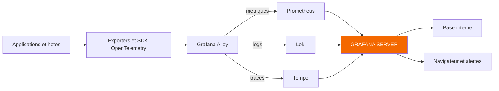
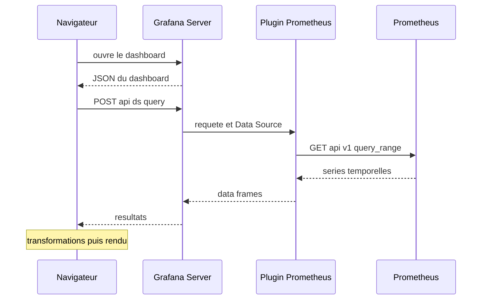

# Architecture et écosystème Grafana

## Objectifs pédagogiques

À la fin de ce module, vous saurez :

- **Distinguer** ce que Grafana fait (interroger, afficher, alerter) de ce qu'il ne fait pas (collecter, stocker la télémétrie).
- **Décrire** le rôle de Grafana Server, des Data Sources, des Dashboards, des Panels et d'Explore.
- **Situer** Prometheus, Loki et Tempo par rapport à Grafana, ainsi que les exporters, OpenTelemetry et Grafana Alloy sur le chemin de la donnée.
- **Retracer** le parcours d'une requête, du clic dans le navigateur jusqu'au graphique affiché.
- **Choisir** entre Grafana OSS, Enterprise et Cloud selon un contexte donné.

## Mise en situation

Une équipe de huit personnes exploite une API Web sur trois machines virtuelles. Un collègue a installé Grafana sur une petite VM, a branché un Prometheus à côté et a construit un tableau de bord de trente panels. Tout le monde l'adore.

Trois semaines plus tard, un lundi matin, l'écran est vide. Le premier réflexe est de dire « Grafana est cassé ». Pourtant la page se charge, les menus répondent, seuls les graphiques affichent `No data`. Le même jour, quelqu'un propose de « sauvegarder Grafana » pour ne pas perdre les métriques, et un autre demande pourquoi la VM sature quand dix personnes ouvrent le dashboard en même temps.

Ces trois questions ont la même racine : personne dans l'équipe n'a de représentation claire de ce qui vit où. Tant qu'on traite Grafana comme une boîte noire qui « fait du monitoring », on cherche les pannes au mauvais endroit, on sauvegarde la mauvaise chose et on dimensionne au hasard. Ce module construit la carte mentale qui manquait.

## Grafana est un navigateur de télémétrie, pas un entrepôt

Voici l'analogie qui sert pour tout le reste du parcours.

> 🌐 **Analogie : le navigateur Web.** Un navigateur Web n'héberge aucun site : il va chercher des pages chez des serveurs, les met en forme et vous les présente. Si un site est en panne, vous ne dites pas que Firefox est cassé. Grafana tient exactement ce rôle vis-à-vis de vos métriques, logs et traces : il interroge des systèmes qui détiennent les données et en fait quelque chose de lisible. Limite de l'image : Grafana évalue aussi lui-même des règles d'alerte, côté serveur.
{: .callout .callout-analogie}

> 🧠 **Concept clé** : Grafana ne stocke pas la télémétrie. Il stocke seulement sa propre configuration (dashboards, utilisateurs, définitions de Data Sources, règles d'alerte). Les points de métriques, les lignes de logs et les traces vivent dans les backends.
{: .callout .callout-important}

Regardons les pièces de Grafana lui-même.

**Grafana Server** est le processus central, un binaire unique avec un backend en Go et une interface Web servie par ce même processus. Il gère l'authentification, les permissions, les requêtes vers les sources et l'évaluation des règles d'alerte. Il écoute par défaut sur le port 3000. Il conserve ses propres données dans une base interne : SQLite par défaut, PostgreSQL ou MySQL si vous voulez une installation sérieuse.

Les **Data Sources** sont des connexions déclarées vers les backends : une URL, un mode d'authentification, parfois des options propres au type de source. Rien d'autre. Grafana n'importe pas la donnée, il garde l'adresse du bon interlocuteur.

Un **Dashboard** est un document JSON enregistré dans la base interne. Il décrit une page : la liste des panels, leur position, la plage de temps, les variables. Un dashboard ne contient aucun point de mesure, uniquement des questions à poser.

Un **Panel** est l'unité de base de ce document : une ou plusieurs requêtes vers une Data Source, plus le choix de visualisation (courbe, jauge, table, etc.). Un dashboard de trente panels, c'est donc trente questions posées aux backends à chaque rafraîchissement. Gardez cette idée en tête, elle revient plus bas.

**Explore** est l'espace où l'on interroge sans rien enregistrer. On choisit une Data Source, on écrit une requête, on regarde. C'est l'outil de l'investigation. Le dashboard répond aux questions qu'on avait prévues, Explore sert aux questions qu'on n'avait pas prévues. On peut aussi y afficher deux requêtes côte à côte, par exemple métriques et logs sur la même fenêtre de temps.

Vous pouvez vérifier que le serveur est vivant, indépendamment de toute source de données, avec son point de santé :

```bash
curl -s http://<GRAFANA_HOST>:3000/api/health
```

La réponse JSON indique notamment l'état de la base interne (`"database": "ok"`) et la version. Elle dit que Grafana tourne, pas que vos données sont lisibles. Nous allons voir pourquoi cette nuance compte.

## Trois éditions, un même cœur

Quand on parle de « Grafana », on désigne en réalité trois façons de l'obtenir.

| Critère | Grafana OSS (Open Source Software) | Grafana Enterprise | Grafana Cloud |
|---|---|---|---|
| Hébergement | Vous l'installez et l'exploitez | Vous l'installez et l'exploitez | Hébergé par Grafana Labs |
| Licence | Open source (AGPLv3) | Licence commerciale | Abonnement, avec un niveau gratuit limité |
| Backends | À vous de les déployer (Prometheus, Loki, Tempo) | À vous de les déployer | Backends managés inclus |
| Fonctions en plus | Socle complet : dashboards, Explore, alerting, plugins communautaires | Plugins de sources d'entreprise, authentification et gouvernance avancées, rapports, audit | Celles d'Enterprise en grande partie, plus les services managés |
| Qui gère les mises à jour et la haute disponibilité | Vous | Vous | Le fournisseur |
| Cas typique | Équipe qui veut la maîtrise et accepte de l'exploiter | Grande organisation avec exigences d'audit et de gouvernance | Équipe qui veut démarrer vite sans exploiter la plateforme |

Le contenu exact des fonctions réservées à Enterprise et des offres Cloud évolue d'une version à l'autre. Certaines fonctions ont migré d'Enterprise vers OSS avec le temps, donc vérifiez la page de comparaison officielle avant de décider.

Pour la suite du parcours, nous travaillons sur Grafana OSS : c'est le terrain commun, et ce que vous y apprenez s'applique aux deux autres éditions. La vraie différence est organisationnelle. En OSS ou Enterprise, vous êtes responsable de tout ce qui est décrit dans ce module. En Cloud, une partie de cette responsabilité (backends, stockage, disponibilité) passe au fournisseur, mais pas la qualité de vos dashboards ni la pertinence de vos alertes.

## Les backends : Prometheus, Loki, Tempo

Grafana a besoin d'interlocuteurs qui détiennent réellement les données. Dans notre fil rouge, ils sont trois, un par type de signal.

**Prometheus** stocke des métriques sous forme de séries temporelles, dans sa propre base. Il va chercher les valeurs lui-même, à intervalle régulier, en interrogeant des points d'accès HTTP exposés par les cibles (modèle *pull*). On l'interroge avec le langage PromQL, que le module 7 introduira.

**Loki** stocke des logs. Sa particularité est de n'indexer que les labels (`app`, `namespace`, `host`…), pas le contenu des lignes. Les lignes elles-mêmes sont compressées en blocs. C'est ce choix qui le rend économique, et c'est aussi la raison pour laquelle une requête efficace commence toujours par sélectionner les bons labels. Le langage de requête est LogQL (module 14).

**Tempo** stocke des traces, généralement sur du stockage objet. Il ne les indexe pas finement : on le retrouve le plus souvent par identifiant de trace, ou via le langage TraceQL pour des recherches structurées. Les traces sont donc souvent atteintes depuis un autre signal, par exemple un log qui contient un identifiant de trace.

> 💡 **À retenir** : Prometheus, Loki et Tempo sont indépendants de Grafana. Ils peuvent être déployés sans lui, interrogés par d'autres outils, et tomber sans que Grafana ne tombe.
{: .callout .callout-important}

À l'inverse, Grafana peut parler à bien d'autres sources (PostgreSQL, Elasticsearch, CloudWatch, InfluxDB…) sans changer de nature.

Notez aussi que Grafana Labs propose Mimir, un stockage de métriques compatible Prometheus conçu pour grossir à grande échelle. On le croise dans les architectures plus grandes. Pour Grafana, c'est une Data Source de type Prometheus comme une autre.

> 🔑 **Moyen mnémotechnique** : Grafana Labs désigne souvent sa pile par l'acronyme LGTM, pour Loki (logs), Grafana (visualisation), Tempo (traces) et Mimir (métriques).
{: .callout .callout-memo}

## Qui amène les données jusque-là

Si Grafana ne collecte rien et que Prometheus, Loki et Tempo ne font que stocker et répondre, qui produit et achemine la télémétrie ? C'est l'étage du dessous, et trois acteurs s'y croisent.

Un **exporter** est un petit programme qui traduit l'état d'un système qui ne parle pas Prometheus en métriques lisibles. `node_exporter`, par exemple, lit ce que Linux expose (CPU, mémoire, disque, réseau) et le publie sur une page HTTP, `/metrics`, que Prometheus vient lire. C'est un traducteur, pas un stockage.

**OpenTelemetry** est un standard ouvert qui définit comment instrumenter une application et comment transporter métriques, logs et traces. Il fournit des SDK pour les langages, un format de données et un protocole de transport, OTLP*. Son intérêt est d'être neutre : une application instrumentée une fois peut envoyer ses signaux vers différents backends.

**Grafana Alloy** est le collecteur de Grafana Labs. C'est une distribution du collecteur OpenTelemetry, enrichie de composants natifs pour l'écosystème Prometheus, Loki et Tempo. Il tourne près des applications, collecte (scrape de métriques, lecture de fichiers de logs, réception d'OTLP), peut filtrer et enrichir, puis pousse vers les backends. Il remplace Grafana Agent, désormais déprécié.

Les backends récents savent souvent recevoir de l'OTLP directement. Passer par un collecteur reste pourtant intéressant : on y filtre, on y ajoute des labels communs, on y tamponne en cas d'indisponibilité du backend, et on évite de reconfigurer chaque application quand la destination change.

\* OTLP (OpenTelemetry Protocol) : protocole de transport standard d'OpenTelemetry, utilisable en HTTP ou en gRPC, commun aux trois signaux.

Voici l'ensemble de la chaîne :



Le schéma est volontairement simplifié. Prometheus peut aussi aller chercher lui-même les métriques chez les exporters, sans Alloy. Les deux modes existent et se combinent, ce qui est une source classique de confusion : quand vous voyez une métrique, demandez-vous toujours qui l'a collectée et par quel chemin.

## Comment Grafana parle à un backend : les plugins Data Source

Grafana n'a pas de code figé pour chaque système. Chaque type de source est géré par un **plugin Data Source**, qui sait faire trois choses : se connecter (URL, authentification), traduire la requête du panel dans le langage du backend, et convertir la réponse en un format interne commun. Les plugins Prometheus, Loki, Tempo, PostgreSQL ou CloudWatch sont fournis avec Grafana. D'autres s'installent à part.

> 📖 **Définition.** Les *data frames* sont le format interne commun de Grafana : des colonnes et des lignes typées. Grâce à eux, un même panel affiche indifféremment des données venant de Prometheus ou de PostgreSQL, sans savoir d'où elles viennent.
{: .callout .callout-definition}

Il existe d'autres familles de plugins, qu'il vaut mieux savoir nommer : les **plugins de panel** ajoutent des visualisations, les **plugins d'application** regroupent pages, dashboards et sources en un ensemble thématique. Par défaut, Grafana refuse de charger un plugin non signé, ce qui est une protection utile : un plugin s'exécute dans votre serveur avec ses droits.

Qui contacte réellement Prometheus ? Par défaut, ce n'est **pas** votre navigateur. Le navigateur parle à Grafana Server, et c'est Grafana Server qui joint le backend (mode dit *Server*).

Ce détail d'architecture a de vraies conséquences : le backend n'a besoin d'être joignable que depuis le serveur Grafana, pas depuis les postes des utilisateurs. Les anciens modes où le navigateur contactait directement la source ont été dépréciés. L'interface exacte varie selon la version.

## Le parcours d'une requête, du clic au graphique

Prenons l'ouverture d'un dashboard contenant un panel de CPU alimenté par Prometheus.



En détail :

1. Le navigateur demande le dashboard. Grafana Server lit son JSON dans la base interne et l'envoie.
2. Le navigateur résout les variables et la plage de temps, puis envoie les requêtes de chaque panel à l'API interne de Grafana (`/api/ds/query`).
3. Grafana Server retrouve la définition de la Data Source (URL, identifiants, qu'il garde chiffrés), puis confie la requête au plugin correspondant.
4. Le plugin interroge réellement le backend. Pour Prometheus, c'est un appel HTTP sur `/api/v1/query_range`, avec la requête, un début, une fin et un pas.
5. La réponse revient, est convertie en data frames, puis remonte au navigateur.
6. Les éventuelles transformations (module 17) sont appliquées, et la visualisation est dessinée.

La conséquence se vérifie à la main. Vous pouvez rejouer ce que Grafana demande, sans Grafana :

```bash
curl -G 'http://<PROMETHEUS_HOST>:9090/api/v1/query_range' \
  --data-urlencode 'query=<PROMQL>' \
  --data-urlencode 'start=<DEBUT_RFC3339>' \
  --data-urlencode 'end=<FIN_RFC3339>' \
  --data-urlencode 'step=60s'
```

Si cette commande renvoie des données et que le panel reste vide, le problème est entre Grafana et le backend. Si elle ne renvoie rien non plus, Grafana n'y est pour rien.

Un autre point de ce parcours explique l'incident de notre mise en situation : **chaque rafraîchissement déclenche toutes les requêtes du dashboard**. Trente panels à 5 secondes de rafraîchissement, vus par dix personnes, font de l'ordre de 300 requêtes toutes les 5 secondes qui tombent sur les backends. Le coût d'un dashboard ne se paie pas dans Grafana mais chez Prometheus ou Loki.

L'évaluation des alertes suit un autre chemin : c'est Grafana Server qui exécute lui-même les requêtes à intervalle régulier, sans navigateur ouvert. Cela signifie que l'arrêt de Grafana arrête aussi ces alertes, point que nous reprendrons aux modules 18 et 35.

## Limites fonctionnelles et responsabilités

Pour décider où chercher une panne et qui est responsable de quoi, ce tableau suffit dans la plupart des cas :

| Composant | Rôle | Ce qu'il ne fait pas |
|---|---|---|
| Exporter | Exposer l'état d'un système en métriques | Stocker, interroger, visualiser |
| Grafana Alloy | Collecter, transformer et acheminer | Conserver les données à long terme |
| Prometheus | Stocker et interroger les métriques | Stocker des logs ou traces, dessiner des dashboards |
| Loki | Stocker et interroger les logs | Calculer des métriques complexes comme une base dédiée |
| Tempo | Stocker et interroger les traces | Collecter lui-même l'instrumentation applicative |
| Grafana Server | Interroger, afficher, alerter, gérer accès et configuration | Collecter, conserver la télémétrie, corriger une mauvaise métrique |
| Base interne de Grafana | Conserver dashboards, utilisateurs, règles | Contenir la moindre mesure |

Ce découpage explique deux choses que l'on observe en pratique. Premièrement, Grafana ne rattrape pas une mauvaise télémétrie : une métrique mal nommée ou mal instrumentée donnera un joli graphique faux. Deuxièmement, Grafana n'assure pas à lui seul l'isolation des données : ce qu'un utilisateur peut lire dépend aussi de ce que la Data Source permet. Si elle utilise un compte qui voit tout, tous ceux qui ont accès à cette source voient tout.

## Quand ça ne marche pas : trouver la couche en cause

Le modèle en couches donne une méthode de diagnostic simple : on remonte du backend vers l'affichage plutôt que de chercher au hasard.

| Symptôme | Cause probable | Correction |
|---|---|---|
| Interface inaccessible | Grafana Server arrêté, ou base interne indisponible | Vérifier `/api/health` et l'état du service |
| Interface OK, tous les panels en erreur ou `No data` | Data Source injoignable ou identifiants invalides | Ouvrir la Data Source et utiliser « Save & test », vérifier l'URL depuis le serveur Grafana |
| Un seul panel vide | Requête incorrecte, plage de temps ou labels trompeurs | Reproduire la requête dans Explore, puis la comparer avec l'appel direct au backend |
| Panels qui répondent lentement ou expirent | Backend surchargé par le nombre ou le coût des requêtes | Réduire le rafraîchissement, la plage de temps ou le nombre de panels, regarder la charge du backend |
| Données absentes depuis un moment précis | Pas de collecte pendant la période (exporter, Alloy, scrape) | Vérifier l'étage collecte, pas Grafana |

> 💡 **Astuce** : dans un panel, le menu *Inspect* (selon la version, accessible aussi par la touche `i` au survol) permet de voir la requête réellement envoyée, la réponse brute et le temps d'exécution. C'est le moyen le plus rapide de savoir si le problème vient de la requête, du backend ou de l'affichage.
{: .callout .callout-astuce}

> ⚠️ **Erreur fréquente** : conclure que « Grafana est en panne » parce que les graphiques sont vides. Un `No data` signifie qu'une requête n'a rien renvoyé, ce qui peut être normal ou provenir d'un autre composant. Le test à faire en premier est de séparer l'état de Grafana (santé) de l'état de la donnée (requête directe).
{: .callout .callout-attention}

## Scénario : un dashboard qui fait tomber Prometheus

Voici un scénario illustratif, avec des chiffres inventés pour l'exemple. Une équipe héberge Grafana et Prometheus sur la même VM de 2 vCPU. Le dashboard principal contient 30 panels, avec une plage par défaut de 30 jours et un rafraîchissement de 5 secondes. Pendant un incident, huit personnes l'ouvrent en même temps.

Le résultat est un Prometheus en pleine charge, des requêtes qui dépassent leur délai, et la VM entière qui ralentit, y compris Grafana. L'équipe voit des panels vides et croit à une panne de Grafana, alors que la cause est la charge des requêtes sur Prometheus. Le diagnostic suit la méthode du tableau précédent : Grafana répond (`/api/health` correct), la Data Source échoue par intermittence, et l'appel direct à Prometheus est lent.

Les corrections sont modestes mais efficaces. L'équipe sépare Grafana et Prometheus sur deux machines. Elle réduit la plage par défaut à 6 heures, fixe un rafraîchissement à 30 secondes et retire les panels redondants. Dans ce scénario, le dashboard principal passe à une quinzaine de panels, et le nombre de requêtes lancées par rafraîchissement baisse en proportion. Le gain ne vient d'aucune optimisation de Grafana : il vient d'avoir identifié que le coût se situait chez le backend.

## Bonnes pratiques

- **Séparer Grafana de ses backends** dès que le monitoring devient critique. Grafana consomme peu quand personne ne regarde, les backends consomment tout le temps. Sur une même machine, une requête gourmande pénalise l'outil qui sert à l'observer.
- **Remplacer SQLite par PostgreSQL ou MySQL** pour tout ce qui dépasse le test. SQLite est un fichier local : il complique les sauvegardes et interdit de faire tourner plusieurs instances Grafana qui partagent la même configuration.
- **Donner à chaque Data Source un compte en lecture seule**, avec le minimum de droits. Grafana ne protège pas ce que le compte de la source peut voir.
- **Nommer clairement les Data Sources** (par exemple `prometheus-prod`, `loki-staging`). Dès que deux environnements coexistent, un nom ambigu fait lire les données de la mauvaise plateforme.
- **Surveiller Grafana lui-même.** Grafana expose ses propres métriques en format Prometheus (route `/metrics`), qu'il est utile de collecter pour savoir s'il est lent ou en erreur. Ce sera approfondi au module 35, mais il vaut mieux le garder en tête dès maintenant.
- **N'installer que des plugins signés et utiles**, en vérifiant leur compatibilité avec votre version de Grafana. Un plugin tourne avec les droits du serveur.
- **Construire les dashboards avec une idée du coût de leurs requêtes** : plage de temps raisonnable, rafraîchissement adapté, pas de panel dupliqué. Chaque panel est une question posée au backend à chaque rafraîchissement.
- **Ne pas confondre sauvegarde de Grafana et sauvegarde des données.** Sauvegarder la base interne protège dashboards et configuration. Les métriques, logs et traces se protègent dans leurs backends respectifs.

## Résumé

Grafana est une couche d'interrogation et de visualisation : il se connecte à des backends via des plugins Data Source, leur envoie des requêtes et affiche les résultats dans des panels, des dashboards et Explore. Il garde seulement sa configuration dans une base interne. Prometheus, Loki et Tempo détiennent respectivement métriques, logs et traces, et la télémétrie y arrive grâce aux exporters, à OpenTelemetry et à Grafana Alloy. Grafana OSS, Enterprise et Cloud partagent ce même cœur, mais se distinguent par qui exploite la plateforme et par les fonctions de gouvernance. Savoir quelle couche porte quelle responsabilité permet de localiser une panne en quelques minutes. Le module suivant passe à la pratique : installer Grafana et vérifier son premier démarrage, avec cette carte en tête.

<!-- snippet
id: grafana_architecture_no_telemetry_storage
type: concept
tech: grafana
level: beginner
importance: high
format: knowledge
tags: grafana,architecture,stockage,datasource
title: Grafana ne stocke pas la télémétrie
content: Grafana Server garde uniquement sa configuration dans une base interne (SQLite par défaut, PostgreSQL ou MySQL possibles) : dashboards en JSON, utilisateurs, définitions de Data Sources, règles d'alerte. Métriques, logs et traces restent dans Prometheus, Loki ou Tempo. Sauvegarder la base de Grafana ne sauvegarde donc aucune mesure.
description: La base interne de Grafana contient dashboards, comptes et règles, jamais les données observées, qui restent dans les backends.
-->

<!-- snippet
id: grafana_architecture_query_flow
type: concept
tech: grafana
level: beginner
importance: high
format: knowledge
tags: grafana,datasource,requete,architecture
title: Parcours d'une requête de panel
content: Le navigateur envoie les requêtes du panel à Grafana Server (/api/ds/query). Le serveur retrouve la Data Source, le plugin traduit la requête dans le langage du backend (ex : appel HTTP sur /api/v1/query_range pour Prometheus), puis convertit la réponse en data frames. Le navigateur applique les transformations et dessine. Par défaut le navigateur ne contacte jamais le backend directement.
description: Le navigateur parle à Grafana Server, qui joint le backend via le plugin Data Source ; le backend n'a pas besoin d'être exposé aux utilisateurs.
-->

<!-- snippet
id: grafana_architecture_health_check
type: command
tech: grafana
level: beginner
importance: medium
format: knowledge
tags: grafana,sante,diagnostic,api
title: Vérifier que Grafana Server répond
context: À lancer depuis une machine qui peut joindre le serveur Grafana
command: curl -s http://<GRAFANA_HOST>:3000/api/health
example: curl -s http://grafana.exemple.local:3000/api/health
description: Renvoie un JSON avec la version et l'état de la base interne ; confirme que Grafana tourne, pas que ses Data Sources fonctionnent.
-->

<!-- snippet
id: grafana_architecture_replay_prometheus_query
type: command
tech: grafana
level: beginner
importance: high
format: knowledge
tags: grafana,prometheus,diagnostic,promql
title: Rejouer la requête d'un panel directement sur Prometheus
context: Permet de savoir si un panel vide vient de Grafana ou du backend
command: curl -G 'http://<PROMETHEUS_HOST>:9090/api/v1/query_range' --data-urlencode 'query=<PROMQL>' --data-urlencode 'start=<DEBUT_RFC3339>' --data-urlencode 'end=<FIN_RFC3339>' --data-urlencode 'step=60s'
example: curl -G 'http://prometheus.exemple.local:9090/api/v1/query_range' --data-urlencode 'query=up' --data-urlencode 'start=2025-01-10T08:00:00Z' --data-urlencode 'end=2025-01-10T09:00:00Z' --data-urlencode 'step=60s'
description: Reproduit l'appel que fait Grafana à Prometheus ; si la réponse est vide ici aussi, le problème n'est pas dans Grafana.
-->

<!-- snippet
id: grafana_architecture_collection_roles
type: concept
tech: grafana
level: beginner
importance: medium
format: knowledge
tags: alloy,opentelemetry,exporter,collecte
title: Exporter, OpenTelemetry et Alloy : trois rôles distincts
content: Un exporter (ex : node_exporter) traduit l'état d'un système en métriques lisibles sur une page /metrics. OpenTelemetry est un standard d'instrumentation et de transport (SDK, format de données, protocole OTLP). Grafana Alloy est un collecteur compatible OpenTelemetry qui reçoit ou scrape la télémétrie, l'enrichit puis la pousse vers Prometheus, Loki ou Tempo. Aucun des trois ne stocke durablement.
description: L'exporter traduit, OpenTelemetry standardise, Alloy collecte et achemine ; la conservation reste le travail des backends.
-->

<!-- snippet
id: grafana_architecture_loki_labels_index
type: concept
tech: grafana
level: beginner
importance: medium
format: knowledge
tags: loki,logs,labels,index
title: Loki n'indexe que les labels
content: Loki indexe uniquement les labels des flux (app, namespace, host...) et stocke le contenu des lignes dans des blocs compressés. Une requête efficace commence donc par sélectionner précisément les labels, puis filtre le texte. C'est ce qui rend Loki économique en stockage, mais lent si la sélection de labels est trop large.
description: Le coût d'une requête Loki dépend surtout de la sélection de labels, pas du texte recherché ensuite.
-->

<!-- snippet
id: grafana_architecture_inspect_panel
type: tip
tech: grafana
level: beginner
importance: medium
format: knowledge
tags: grafana,panel,inspect,diagnostic
title: Utiliser Inspect pour voir la requête réellement envoyée
content: Sur un panel suspect, ouvrir le menu du panel puis Inspect (ou la touche i au survol, selon la version) : onglet Query pour voir la requête envoyée et le temps de réponse, onglet Data pour la réponse brute, onglet JSON pour le modèle du panel. Comparer ensuite avec Explore pour isoler requête, backend ou affichage.
description: Inspect montre requête, réponse brute et durée d'un panel, ce qui sépare une erreur de requête d'un problème backend ou d'affichage.
-->

<!-- snippet
id: grafana_architecture_dashboard_query_load
type: warning
tech: grafana
level: beginner
importance: high
format: knowledge
tags: grafana,dashboard,performance,backend
title: Un dashboard lourd fait tomber le backend, pas Grafana
content: Piège : multiplier les panels, les longues plages de temps et les rafraîchissements courts. Conséquence : chaque rafraîchissement relance toutes les requêtes (30 panels x 10 utilisateurs = environ 300 requêtes par cycle) et surcharge Prometheus ou Loki. Correction : plage par défaut courte (ex : 6h), rafraîchissement de 30s ou plus, suppression des panels redondants.
description: La charge d'un dashboard se paie chez les backends ; limiter panels, plage de temps et fréquence de rafraîchissement.
-->

<!-- snippet
id: grafana_architecture_no_data_not_outage
type: error
tech: grafana
level: beginner
importance: high
format: knowledge
tags: grafana,no-data,diagnostic,datasource
title: Panels vides alors que Grafana répond
content: Symptôme : l'interface s'affiche mais les panels montrent No data ou une erreur. Cause : Grafana tourne, mais la Data Source est injoignable, le backend est lent, ou la collecte s'est arrêtée en amont. Correction : vérifier /api/health, puis Save & test sur la Data Source, puis rejouer la requête directement sur le backend avant de toucher au dashboard.
description: Un No data ne prouve pas une panne de Grafana ; on remonte du backend vers l'affichage pour trouver la couche en cause.
-->

<!-- snippet
id: grafana_architecture_sqlite_production
type: warning
tech: grafana
level: intermediate
importance: medium
format: knowledge
tags: grafana,sqlite,postgresql,production
title: SQLite par défaut ne convient pas à la production
context: Concerne la base interne de Grafana, pas les données de monitoring
content: Piège : garder SQLite, un fichier local, en production. Conséquence : sauvegarde plus délicate et impossibilité de partager la configuration entre plusieurs instances Grafana. Correction : configurer PostgreSQL ou MySQL pour la base interne dès que la plateforme devient critique.
description: SQLite est pratique pour tester mais empêche d'avoir plusieurs instances Grafana partageant la même configuration.
-->
