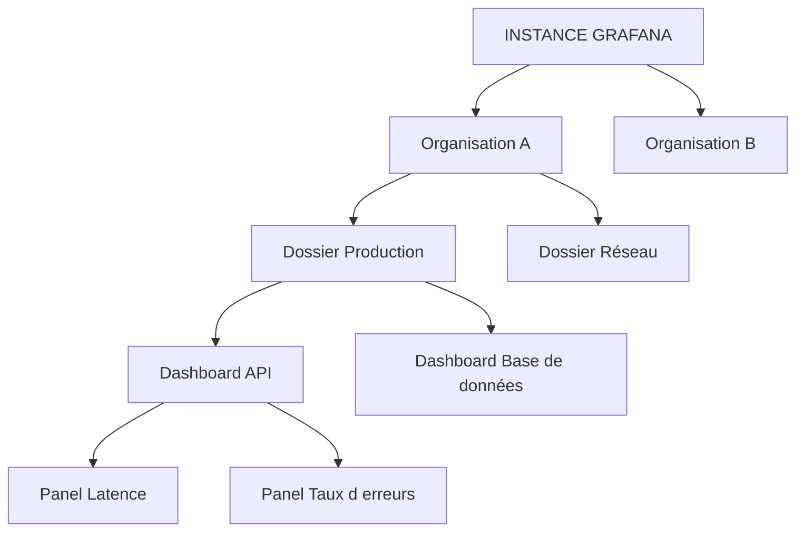

# Interface et navigation Grafana

## Objectifs pédagogiques

À la fin de ce module, vous saurez :

- **Situer** Home, Dashboards, Explore, Alerting et Administration, et choisir la bonne entrée selon la question que vous vous posez
- **Distinguer** organisation, dossier, dashboard et panel, et expliquer ce que chaque niveau change pour les permissions
- **Régler** le sélecteur temporel, l'actualisation et le fuseau horaire pour que deux personnes regardent la même chose
- **Basculer** entre View et Edit en comprenant pourquoi le bouton n'apparaît pas toujours
- **Importer** un dashboard communautaire et vérifier qu'il affiche bien des données

## Mise en situation

Vous venez de rejoindre l'équipe support Cloud d'une PME : une quinzaine de personnes, quelques dizaines de VM et un cluster Kubernetes. Grafana tourne depuis la semaine dernière, installé par un collègue. Il contient déjà une soixantaine de dashboards, dont la moitié a été créée « pour tester ».

Un lundi matin, un client signale que son application était lente samedi soir. Vous ouvrez un dashboard, vous voyez une courbe plate, vous répondez « rien d'anormal ». Votre collègue ouvre le même dashboard et voit un pic de CPU. Ni l'un ni l'autre ne se trompe : vous n'aviez pas la même période, pas le même fuseau horaire, et votre dashboard affichait « les 6 dernières heures ».

L'interface de Grafana n'est pas le problème. Mais sans la maîtriser, on lit mal ce qu'elle affiche, et une lecture erronée mène à un mauvais diagnostic. Ce module apprend à se repérer, et surtout à ne pas se tromper de période.

Une précision : les menus de Grafana évoluent d'une version à l'autre (intitulés, emplacement des boutons, nouvel éditeur de dashboards). Les principes ci-dessous restent valables, mais le libellé exact peut différer chez vous.

## Se repérer : les cinq entrées du menu

Le menu de gauche (ou le bouton hamburger en haut à gauche si le menu est replié) est votre tableau de bord de voiture. Cinq entrées font l'essentiel du travail.

| Entrée | À quoi elle sert | Vous y allez quand… |
|--------|------------------|---------------------|
| **Home** | Page d'accueil : dashboards favoris, dashboards récents, état général | vous démarrez la journée ou vous cherchez ce que vous avez consulté hier |
| **Dashboards** | Arborescence des dossiers et dashboards, recherche, import | vous savez qu'une vue existe déjà |
| **Explore** | Requêtes libres sur une source de données, sans rien sauvegarder | vous n'avez pas de dashboard adapté, ou vous voulez creuser une anomalie |
| **Alerting** | Règles d'alerte, états, silences, points de contact | vous vérifiez ce qui est en alerte ou pourquoi une alerte ne part pas |
| **Administration** | Utilisateurs, équipes, organisations, plugins, paramètres généraux | vous gérez des accès ou l'instance elle-même |

Vous verrez aussi **Connections** (là où se branchent les sources de données, sujet du prochain module) et, selon la version, d'autres entrées comme Drilldown. Ignorez-les pour l'instant.

Une règle simple pour choisir : **Dashboards pour surveiller ce qu'on connaît, Explore pour enquêter sur ce qu'on ne connaît pas.** Un dashboard répond à une question que quelqu'un a posée avant vous. Explore sert quand la question est nouvelle.

L'entrée Administration n'est visible que si votre rôle le permet. Sur un compte en lecture seule, elle disparaît, ce qui n'est pas un bug.

## Organisations, dossiers, dashboards, panels : la poupée russe

Tout ce que vous voyez dans Grafana vit dans une hiérarchie à quatre niveaux. La comprendre évite beaucoup de « où est passé mon dashboard ? ».

- **L'organisation** est le niveau le plus étanche. Dashboards, sources de données, équipes et règles d'alerte appartiennent à une organisation et n'apparaissent pas dans les autres. Pensez à des locataires dans un même immeuble. Un utilisateur peut appartenir à plusieurs organisations avec un rôle différent dans chacune ; le sélecteur d'organisation (page de profil ou en haut du menu selon la version) permet de passer de l'une à l'autre.
- **Le dossier** sert à ranger, mais aussi à protéger : c'est le niveau où l'on pose généralement les permissions. Donner à l'équipe réseau le droit d'éditer le dossier « Réseau » est bien plus maintenable que de régler dashboard par dashboard.
- **Le dashboard** est une page composée de panels, avec ses propres réglages (période, actualisation, fuseau, variables).
- **Le panel** est une visualisation individuelle : un graphique, une jauge, un tableau, un panneau de logs.

Dans une instance fraîchement installée, vous êtes très probablement seul dans l'organisation par défaut (« Main Org. »). C'est suffisant pour ce parcours ; le multi-organisation est surtout utile pour séparer des clients ou des équipes qui ne doivent rien partager.

Chaque dashboard possède un identifiant unique, l'UID (Unique Identifier), visible dans l'URL : `/d/<UID>/<nom-lisible>`. Le nom peut changer, l'UID reste stable. Quand vous partagez un lien ou que vous automatisez quelque chose plus tard, c'est lui qui compte.

## Le sélecteur temporel : le réglage qui change tout

🧠 **Concept clé** — Un panel ne « contient » pas de données. Il envoie une requête à la source de données pour une fenêtre de temps précise, puis dessine le résultat. Changez la fenêtre, vous changez la requête, donc ce que vous voyez. La barre en haut à droite du dashboard pilote cette fenêtre pour tous les panels à la fois.

Elle comporte trois contrôles, tous trois source d'erreurs d'interprétation.

### La période

Cliquez sur la période affichée (par exemple « Last 6 hours »). Deux familles de réglages :

- **Relatif** : « les 6 dernières heures ». La fenêtre glisse avec le temps. Elle s'écrit `now-6h` → `now` dans l'URL. On peut aussi arrondir : `now/d` signifie « aujourd'hui, depuis minuit », `now-1d/d` signifie « hier, la journée entière ».
- **Absolu** : « du 14 mars 22:00 au 15 mars 02:00 ». La fenêtre est figée. C'est ce qu'il faut utiliser pour analyser un incident passé ou pour qu'un collègue voie exactement ce que vous voyez.

Il y a aussi les boutons de zoom à côté : la loupe pour dézoomer, les flèches pour décaler la fenêtre. Un autre geste très utile : **cliquer-glisser sur un graphique** pour zoomer sur la zone sélectionnée. La période du dashboard devient alors absolue, ce qui a un effet de bord décrit plus bas.

### L'actualisation

À côté de la période se trouve le menu d'auto-refresh (Off, 5s, 10s, 30s, 1m, etc.). Il relance périodiquement les requêtes. Une valeur trop basse sur un dashboard chargé met la source de données sous pression sans rien apporter : une métrique collectée toutes les 15 secondes n'a aucune raison d'être rafraîchie toutes les 5. L'administrateur peut d'ailleurs fixer un plancher (paramètre `min_refresh_interval` dans la section `[dashboards]` de la configuration serveur).

💡 **Astuce** — Le bouton de rafraîchissement manuel (la flèche circulaire) fonctionne même quand l'auto-refresh est sur Off. En investigation, laissez l'auto-refresh éteint : une page qui bouge pendant que vous analysez est plus gênante qu'utile.

### Le fuseau horaire

C'est le réglage le plus sournois, parce qu'on ne pense jamais à le vérifier. Trois valeurs courantes :

- **Browser Time** : l'heure de votre navigateur (souvent la valeur par défaut) ;
- **UTC (Coordinated Universal Time)** : l'heure de référence, identique pour tout le monde ;
- un **fuseau précis** (par exemple `Europe/Paris`).

Le fuseau se règle au niveau du dashboard (Settings → General, ou « Change time settings » dans le sélecteur temporel). Si le dashboard n'impose rien, Grafana retombe sur vos préférences de profil, puis sur celles de l'équipe ou de l'organisation. Deux personnes ouvrant le même dashboard peuvent donc voir des heures différentes sur le même pic.

Quand vos serveurs, vos logs et vos collègues sont répartis sur plusieurs fuseaux, **passer en UTC** est le réflexe le plus fiable : une seule référence, pas de décalage d'heure d'été à calculer.

⚠️ **Erreur fréquente** — Conclure « rien d'anormal » en regardant une période qui ne contient pas l'événement, ou qui l'écrase. Trois mécanismes expliquent ce piège :

1. **La fenêtre est trop courte ou mal placée.** « Last 6 hours » lundi matin ne montre rien du samedi soir.
2. **La fenêtre est trop large.** Sur 30 jours, Grafana ne peut pas afficher chaque point : la requête est agrégée par pas plus grand, et un pic de deux minutes disparaît dans la moyenne. Le même incident est net sur 1 heure et invisible sur 7 jours.
3. **Le panel a sa propre période.** Dans les options de requête d'un panel, on peut définir une période relative ou un décalage qui ignore celle du dashboard. Un petit libellé apparaît alors en haut du panel (par exemple « Last 1h »). Ce panel ne bougera pas quand vous changerez la période globale, et il peut se retrouver aligné sur une autre fenêtre que ses voisins.

**Correction :** avant toute conclusion, vérifiez dans l'ordre : fuseau, période (absolue si l'événement est passé), éventuels libellés de période sur les panels, puis zoomez sur la zone suspecte pour obtenir des pas plus fins. Et quand vous partagez un constat, partagez un lien avec la période verrouillée (voir plus bas).

## Naviguer vite : recherche, favoris, historique, raccourcis

Avec 60 dashboards, la navigation par arborescence ne suffit plus. Heureusement, plusieurs outils se complètent.

**La recherche.** Dans la page Dashboards, une barre de recherche filtre par nom, et on peut filtrer par étiquettes (tags) ou par dossier. Dans les versions récentes, un raccourci global (souvent `Ctrl+K` / `Cmd+K`) ouvre une palette de recherche utilisable depuis n'importe quelle page. Une convention de nommage cohérente (`[Prod] API – Latence`, `[Infra] Linux – Vue serveur`) rend la recherche bien plus efficace que n'importe quelle arborescence.

**Les favoris.** Cliquez sur l'étoile à côté du titre d'un dashboard : il rejoint votre liste de dashboards favoris, visible sur Home et dans la page Dashboards. Ces favoris sont personnels. Selon la version, vous pouvez aussi épingler des entrées du menu lui-même (bookmarks de navigation).

**L'historique.** Home et la page Dashboards affichent les dashboards récemment consultés, très pratique pour retrouver « celui que j'avais ouvert hier ». Explore, de son côté, garde un historique des requêtes que vous avez lancées. Ça sauve quand on a trouvé une bonne requête à 3 h du matin et qu'on a oublié de la noter.

**Les raccourcis clavier.** Tapez `?` dans Grafana pour afficher la liste complète pour votre version. Ceux qui servent tout le temps :

| Raccourci | Effet |
|-----------|-------|
| `g h` | aller à Home |
| `g e` | aller à Explore |
| `t z` | dézoomer la période |
| `t ←` / `t →` | décaler la période vers le passé / le futur |
| `d r` | rafraîchir tous les panels |
| `d k` | passer en mode kiosque (plein écran, sans menu) |
| `v` (panel survolé) | afficher ce panel en grand |
| `Esc` | quitter la vue ou l'édition en cours |

Le mode kiosque est apprécié pour les écrans muraux d'une salle d'astreinte, mais gardez en tête qu'il masque aussi la période et le fuseau : un écran mural sans période visible est une bonne façon de tromper tout le monde.

## View et Edit : pourquoi le bouton n'apparaît pas toujours

Quand vous ouvrez un dashboard, vous êtes en mode **View** : vous pouvez changer la période, filtrer, zoomer, regarder en détail un panel. Le mode **Edit** (bouton en haut à droite, ou touche `e` sur un panel survolé) permet de modifier les panels, leur disposition et les réglages du dashboard. Les modifications ne sont enregistrées qu'à la sauvegarde ; sinon, vous pouvez les abandonner.

Si vous ne voyez pas le bouton, ce n'est pas un bug d'affichage, c'est une question de droits. Trois couches s'additionnent :

- **le rôle dans l'organisation** : Viewer (lecture), Editor (peut créer et modifier), Admin (gère aussi l'organisation et ses sources de données) ;
- **les permissions du dossier ou du dashboard**, qui peuvent restreindre ou étendre le rôle ;
- **la configuration de l'instance**, qui peut ajuster certains comportements des Viewers.

À ne pas confondre : le « Grafana Admin » (administrateur de toute l'instance, qui gère organisations et utilisateurs globaux) n'est pas la même chose qu'un « Admin » d'organisation. Le premier voit l'ensemble du serveur, le second seulement son organisation.

💡 **Astuce** — Pour partager une vue précise sans donner de droits d'édition, utilisez le bouton Share (ou Export, selon la version) du dashboard. Le lien généré peut inclure la période courante : cochez l'option de verrouillage de la période si elle est proposée. Votre collègue verra ce que vous voyez, pas « les 6 dernières heures » depuis son clic.

## Importer un dashboard communautaire

Grafana propose une bibliothèque publique de dashboards sur grafana.com, chacun identifié par un numéro. C'est un excellent point de départ : vous voyez comment d'autres ont organisé leur supervision avant de construire la vôtre.

Pour l'import, le chemin est le suivant (intitulés approximatifs selon la version) :

**Dashboards → New → Import**

Puis :

1. Saisissez l'ID du dashboard dans le champ prévu (par exemple `1860`, un dashboard très populaire de supervision d'un serveur Linux avec Node Exporter), ou collez un JSON, ou chargez un fichier `.json`. Cliquez sur **Load**.
2. Choisissez le **dossier** de destination. Évitez de tout laisser dans la racine « Dashboards » : rangez-le dès l'import.
3. Si le dashboard demande une **source de données**, sélectionnez-la dans la liste déroulante. Les panels interrogeront cette source.
4. Cliquez sur **Import**.

Si aucune source de données n'est configurée dans votre instance, l'import réussit mais les panels afficheront « No data » ou une erreur : le dashboard est une coquille vide tant qu'il n'est relié à rien. Brancher une source est justement le sujet du module suivant.

Une fois importé, vérifiez trois choses avant de lui faire confiance :

- les panels affichent des **valeurs** (pas « No data ») ;
- la **période** et le **fuseau** du dashboard sont ceux que vous attendez ;
- les **variables** en haut de page (instance, job, environnement) pointent vers vos propres valeurs, pas vers celles de l'auteur.

⚠️ **Erreur fréquente** — Importer un dashboard et le considérer comme fiable parce qu'il est joli et très téléchargé. Il suppose souvent que vos métriques portent les mêmes noms et les mêmes étiquettes que chez son auteur. Si ce n'est pas le cas, certains panels resteront vides, d'autres afficheront des valeurs trompeuses. **Correction :** ouvrez quelques panels en mode édition, lisez la requête, et confirmez qu'elle correspond bien à ce que le titre annonce. Traitez un dashboard communautaire comme un brouillon à relire, pas comme un produit fini.

## Diagnostic : quand l'interface semble mentir

| Symptôme | Cause probable | Correction |
|----------|----------------|------------|
| Les panels sont vides, mais le service tourne | période hors de la zone où les données existent, ou source de données mal sélectionnée | élargir la période, vérifier la source sélectionnée dans le panel |
| Deux collègues voient des heures différentes pour le même pic | fuseaux différents (navigateur, profil, dashboard) | fixer le fuseau du dashboard, ou passer tout le monde en UTC |
| Après un zoom sur un incident, les graphiques ne bougent plus | le zoom a rendu la période absolue, l'auto-refresh n'a plus de nouvelles données à afficher | repasser en relatif (par exemple « Last 1 hour ») pour reprendre le suivi en direct |
| Un panel ne réagit pas au changement de période | période propre au panel (libellé en haut du panel) | ouvrir le panel en édition, onglet Query, retirer la période relative spécifique |
| Pas de bouton Edit | rôle Viewer ou permission de dossier restrictive | demander le rôle Editor, ou la permission sur le dossier concerné |
| Un dashboard importé affiche « No data » partout | source de données non sélectionnée ou métriques différentes de celles attendues | rouvrir les réglages du panel, choisir la bonne source, adapter la requête |

Quand un panel affiche « No data », ne concluez jamais « il n'y a pas de problème ». Cela signifie seulement que la requête n'a rien renvoyé. Est-ce parce que la période est mauvaise, parce que le service est tombé, ou parce que la requête est incorrecte ? C'est à vous de le déterminer. Ce réflexe se renforcera au fil du parcours.

## Cas réel : l'incident du samedi soir (scénario illustratif)

Reprenons l'équipe du début. Les chiffres ci-dessous sont fictifs, mais la situation est courante.

Lundi, 9 h. Un client indique que son application était lente samedi entre 22 h et 23 h. Le support ouvre le dashboard « [Prod] API – Vue d'ensemble », période « Last 6 hours » : tout est normal.

Voici ce qu'un support rigoureux fait :

1. **Fixez le fuseau** du dashboard en UTC, puisque le client donne ses horaires en heure de Paris et que les logs sont en UTC. Ce samedi tombant en heure d'hiver (UTC+1), 22 h–23 h à Paris correspondent à 21 h–22 h UTC. Le décalage se calcule une seule fois, pas dans la tête de chacun.
2. **Passez en période absolue** : samedi 20:00 → 22:30 UTC.
3. **Observez le panel de latence** : un pic net apparaît entre 21:05 et 21:40, absent d'une vue sur 7 jours où il était lissé.
4. **Zoomez** sur cette plage et constatez que le pic de CPU de la base de données commence 5 minutes avant celui de la latence.
5. **Partagez le lien** avec la période verrouillée dans le ticket, pour que l'équipe base de données voie exactement la même chose.

Résultat : en dix minutes, le problème est localisé et daté, une hypothèse est formulée (saturation de la base), et l'équipe suivante dispose d'un lien qui montre l'événement. Rien de sophistiqué : simplement une période et un fuseau maîtrisés, ce qui suffit à faire la différence entre « tout va bien » et un diagnostic.

## Bonnes pratiques

- **Fixez le fuseau du dashboard** (UTC de préférence pour une équipe répartie) plutôt que de laisser chacun hériter de son navigateur. Un écart d'une heure suffit à corréler un pic avec le mauvais déploiement.
- **Utilisez une période absolue pour tout incident passé**, et notez-la (ou mieux, partagez un lien verrouillé) dans le ticket. « Hier soir » n'est pas une période.
- **Réglez l'auto-refresh à un intervalle cohérent** avec la fréquence de collecte (par exemple 30 s à 1 min pour des métriques collectées toutes les 15 s). Un refresh à 5 s multiplie la charge sur le backend sans apporter d'information.
- **Rangez dès l'import ou la création** : un dossier par équipe ou par périmètre, une convention de nom cohérente. Une instance de 60 dashboards en vrac devient inutilisable en quelques semaines.
- **Posez les permissions sur les dossiers**, pas dashboard par dashboard. C'est plus lisible, plus facile à auditer, et ça évite les oublis lors de la création d'un nouveau dashboard.
- **Relisez les requêtes d'un dashboard communautaire** avant de vous y fier, et notez l'ID et la version d'origine dans la description pour pouvoir le retrouver.
- **Ne concluez pas sur « No data »** : vérifiez d'abord période, fuseau, source de données et requête.
- **Pour un écran mural**, affichez toujours la période et le fuseau, même en mode kiosque, sinon l'écran peut présenter un état sans que personne sache à quel moment il se rapporte.

## Résumé

Grafana s'organise en cinq grandes entrées (Home, Dashboards, Explore, Alerting, Administration) et en une hiérarchie organisation → dossier → dashboard → panel, où les permissions se posent surtout au niveau du dossier. Le sélecteur temporel, avec la période, l'actualisation et le fuseau horaire, détermine ce que vous voyez et peut conduire à des conclusions opposées sur les mêmes données. Recherche, favoris, historique et raccourcis permettent de naviguer vite, et le mode View ou Edit dépend du rôle et des permissions. L'import d'un dashboard communautaire accélère la mise en route, à condition de relire ses requêtes. Une fois ces repères acquis, il reste à comprendre d'où viennent les données affichées : c'est le rôle des sources de données, objet du module suivant.

<!-- snippet
id: grafana_ui_hierarchy_objects
type: concept
tech: grafana
level: beginner
importance: high
format: knowledge
tags: grafana,organisation,dossier,permissions
title: Hiérarchie Grafana : organisation, dossier, dashboard, panel
content: Une organisation isole totalement dashboards, sources de données et équipes des autres organisations de l'instance. Dans une organisation, les dashboards sont rangés en dossiers, qui portent généralement les permissions (un dossier = un périmètre d'équipe). Un dashboard regroupe des panels, chacun étant une requête + une visualisation.
description: Les permissions se posent surtout sur le dossier ; l'organisation est la frontière étanche. Un panel n'est qu'une requête affichée, pas un stock de données.
-->

<!-- snippet
id: grafana_ui_time_range_concept
type: concept
tech: grafana
level: beginner
importance: high
format: knowledge
tags: grafana,periode,requete,dashboard
title: Le sélecteur temporel pilote la requête de chaque panel
content: Un panel n'enregistre pas de données : à chaque affichage, il envoie à la source une requête bornée par la période du dashboard (from → to) puis dessine le résultat. Changer la période change donc la requête. Plus la fenêtre est large, plus les points sont agrégés par pas plus grands, et plus les pics courts sont lissés.
description: Même données, deux périodes, deux lectures possibles : un pic de 2 minutes visible sur 1 h peut disparaître sur 7 jours à cause de l'agrégation.
-->

<!-- snippet
id: grafana_ui_time_range_warning
type: warning
tech: grafana
level: beginner
importance: high
format: knowledge
tags: grafana,periode,diagnostic,interpretation
title: Mauvaise période = mauvais diagnostic
content: Piège → analyser un incident passé avec « Last 6 hours » ou sur une fenêtre de plusieurs jours. Conséquence → le pic est hors fenêtre ou lissé par l'agrégation, et l'on conclut à tort « rien d'anormal ». Correction → passer en période absolue autour de l'événement (par exemple samedi 20:00 → 22:30 UTC), puis zoomer pour obtenir des pas plus fins.
description: Avant de conclure qu'il n'y a pas de problème, vérifier fuseau, période et libellés de période sur les panels, puis zoomer sur la zone suspecte.
-->

<!-- snippet
id: grafana_ui_timezone_warning
type: warning
tech: grafana
level: beginner
importance: high
format: knowledge
tags: grafana,fuseau-horaire,utc,collaboration
title: Fuseau horaire par défaut = heures différentes selon l'utilisateur
content: Piège → laisser le fuseau sur « Browser Time » dans une équipe répartie. Conséquence → deux personnes voient le même pic à des heures différentes, et on le corrèle avec le mauvais déploiement ou le mauvais log. Correction → fixer le fuseau du dashboard (Settings → General, ou Change time settings dans le sélecteur temporel), de préférence en UTC.
description: Le fuseau du dashboard, s'il est défini, prime sur les préférences de profil. UTC évite les calculs d'heure d'été entre logs, serveurs et collègues.
-->

<!-- snippet
id: grafana_ui_zoom_makes_absolute_error
type: error
tech: grafana
level: beginner
importance: medium
format: knowledge
tags: grafana,zoom,periode,auto-refresh
title: Après un zoom, le dashboard ne se met plus à jour
content: Symptôme → après un cliquer-glisser sur un graphique, l'auto-refresh tourne mais plus aucune nouvelle donnée n'apparaît. Cause → le zoom a transformé la période relative en période absolue (from/to figés), donc la fenêtre ne glisse plus avec le temps. Correction → rouvrir le sélecteur temporel et choisir une période relative, par exemple « Last 1 hour ».
description: Une période absolue ne suit pas le temps réel : l'auto-refresh relance la même requête sur la même fenêtre figée.
-->

<!-- snippet
id: grafana_ui_panel_own_time_error
type: error
tech: grafana
level: intermediate
importance: medium
format: knowledge
tags: grafana,panel,periode,options-requete
title: Un panel ignore la période du dashboard
content: Symptôme → un panel ne change pas quand on modifie la période globale, ou n'est pas aligné avec ses voisins. Cause → ses options de requête définissent une période relative ou un décalage propre (un libellé s'affiche en haut du panel, par exemple « Last 1h »). Correction → éditer le panel (touche e), onglet Query → options de requête, supprimer la période relative spécifique.
description: Un libellé de période dans l'en-tête d'un panel signale qu'il ne suit plus le sélecteur temporel du dashboard.
-->

<!-- snippet
id: grafana_ui_dashboard_url_time_params
type: command
tech: grafana
level: beginner
importance: medium
format: knowledge
tags: grafana,url,periode,partage
title: Fixer période et fuseau directement dans l'URL
context: À copier dans la barre d'adresse ou dans un ticket pour partager une vue précise
command: <GRAFANA_URL>/d/<UID>/<NOM>?orgId=1&from=<DEBUT>&to=<FIN>&timezone=<FUSEAU>
example: http://localhost:3000/d/a1b2c3d4/node-exporter-full?orgId=1&from=now-6h&to=now&timezone=utc
description: Les paramètres from, to et timezone de l'URL fixent la vue. Pour un incident passé, utiliser des horodatages absolus (en millisecondes) plutôt que now-6h.
-->

<!-- snippet
id: grafana_ui_import_community_dashboard
type: command
tech: grafana
level: beginner
importance: medium
format: knowledge
tags: grafana,import,dashboard,communaute
title: Importer un dashboard depuis grafana.com
context: Interface web ; intitulés variables selon la version
command: Dashboards → New → Import → saisir l'ID <ID_DASHBOARD> → Load → choisir le dossier et la source de données → Import
example: Dashboards → New → Import → saisir l'ID 1860 → Load → dossier « Infra » + source Prometheus → Import
description: L'ID vient de la page du dashboard sur grafana.com. Sans source de données configurée, l'import réussit mais les panels restent vides.
-->

<!-- snippet
id: grafana_ui_community_dashboard_warning
type: warning
tech: grafana
level: beginner
importance: medium
format: knowledge
tags: grafana,import,requetes,verification
title: Un dashboard communautaire n'est pas prêt à l'emploi
content: Piège → faire confiance à un dashboard très téléchargé sans le relire. Conséquence → il suppose des noms de métriques et d'étiquettes qui peuvent différer des vôtres : panels vides ou valeurs trompeuses. Correction → après import, ouvrir quelques panels en édition, lire la requête, vérifier les variables en haut de page et noter l'ID d'origine dans la description.
description: Valider qu'il y a des valeurs, que la période et le fuseau sont corrects, et que les variables pointent vers vos propres instances.
-->

<!-- snippet
id: grafana_ui_view_edit_permissions
type: concept
tech: grafana
level: beginner
importance: medium
format: knowledge
tags: grafana,roles,permissions,edit
title: Pourquoi le bouton Edit n'apparaît pas
content: L'accès à l'édition combine trois couches : le rôle dans l'organisation (Viewer lecture seule, Editor modification, Admin gestion de l'organisation), les permissions du dossier ou du dashboard, et la configuration de l'instance. Le Grafana Admin (administrateur de tout le serveur) est distinct de l'Admin d'organisation.
description: Absence du bouton Edit = rôle ou permission de dossier insuffisant, pas un bug d'affichage. Demander Editor, ou la permission sur le dossier concerné.
-->

<!-- snippet
id: grafana_ui_keyboard_shortcuts
type: tip
tech: grafana
level: beginner
importance: low
format: knowledge
tags: grafana,raccourcis,navigation,productivite
title: Raccourcis clavier utiles pour investiguer
content: Taper `?` affiche la liste pour votre version. Les plus utiles : `t z` dézoome la période, `t ←` et `t →` la décalent, `d r` rafraîchit tous les panels, `g e` ouvre Explore, `v` affiche en grand le panel survolé, `Esc` quitte la vue ou l'édition.
description: Combiner `t z` et les flèches temporelles évite de rouvrir le sélecteur à chaque ajustement pendant une investigation.
-->

<!-- snippet
id: grafana_ui_refresh_interval_tip
type: tip
tech: grafana
level: beginner
importance: low
format: knowledge
tags: grafana,auto-refresh,performance,configuration
title: Aligner l'auto-refresh sur la fréquence de collecte
content: Pour des métriques collectées toutes les 15 s, régler l'auto-refresh entre 30 s et 1 min suffit ; en dessous, vous multipliez les requêtes sans nouvelle donnée. L'administrateur peut imposer un plancher avec le paramètre min_refresh_interval de la section [dashboards] du fichier de configuration serveur.
description: En investigation, laisser l'auto-refresh sur Off pour que la page ne bouge pas pendant l'analyse ; utiliser le rafraîchissement manuel.
-->
