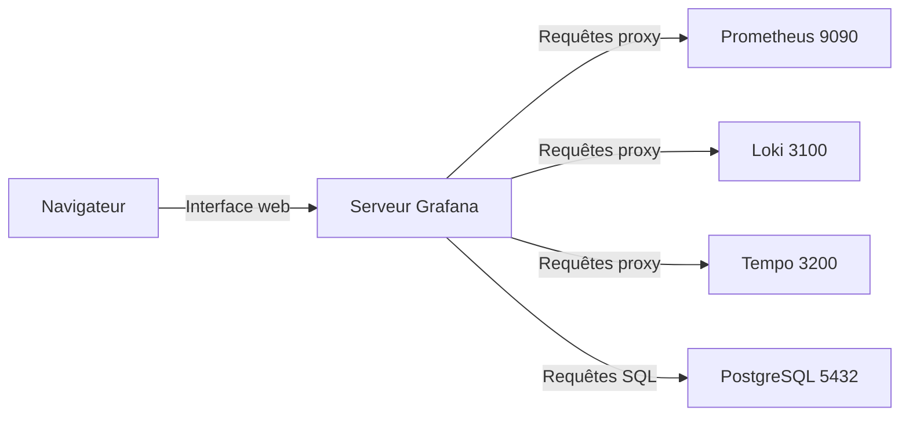

# Sources de données et connexions

## Objectifs pédagogiques

À la fin de ce module, vous serez capable de :

- **Configurer** une Data Source Prometheus dans Grafana, en interface puis par fichier de provisioning.
- **Choisir** l'URL correcte d'une source selon l'endroit où tourne Grafana (hôte, conteneur, Kubernetes).
- **Vérifier** qu'une connexion fonctionne réellement, au-delà du bouton « Save & test ».
- **Connecter** Loki et Tempo, et repérer comment les sources se retrouvent ensuite dans Explore.
- **Diagnostiquer** un `connection refused`, une erreur DNS ou un timeout depuis le bon point de vue réseau.

## Mise en situation

Léa vient de rejoindre une équipe de quatre personnes qui exploite une vingtaine de VM. Un collègue a lancé Grafana en conteneur sur l'une d'elles, et Prometheus tourne déjà sur cette même VM, installé en service système. Elle ouvre Grafana, ajoute une Data Source, tape `http://localhost:9090` puisqu'un `curl` lancé sur la VM répond très bien à cette adresse, et clique sur « Save & test ».

Résultat : une bannière rouge, `connection refused`.

Prometheus est pourtant bien là, et l'URL fonctionne depuis la VM. Le problème n'est ni Prometheus ni l'URL : c'est le point de vue. Ce module sert à apprendre qui parle à qui, depuis où, et comment le vérifier méthodiquement.

## Comment Grafana parle à ses sources

Grafana ne stocke pas vos métriques, vos logs ni vos traces. Il les demande aux systèmes qui les détiennent.

> 📖 **Définition**
>
> Une **Data Source** est la fiche de connexion d'un système à interroger : un nom, un type (`prometheus`, `loki`, `tempo`, `postgres`…), une adresse et éventuellement des identifiants.
{: .callout .callout-definition}

Quand vous ouvrez un panel ou Explore, Grafana envoie la requête à cette adresse et affiche la réponse.

> 🧠 **Concept clé**
>
> Avec le mode d'accès par défaut, appelé **Server** (ou `proxy` dans les fichiers), les requêtes ne partent pas de votre navigateur. Elles partent du **processus Grafana**. L'URL d'une source doit donc être joignable *depuis la machine ou le conteneur où tourne Grafana*, pas depuis votre poste.
{: .callout .callout-important}



Ce schéma explique à lui seul la moitié des pannes de connexion. Le navigateur n'a aucun accès direct aux backends. Cela évite d'exposer Prometheus à tous les postes, mais impose de raisonner réseau depuis Grafana.

Les ports ci-dessus sont les valeurs par défaut courantes : 9090 pour Prometheus, 3100 pour Loki, 3200 pour l'API HTTP de Tempo.

## Mise en place : un laboratoire minimal

Pour manipuler sans casser de production, on monte un petit lab Docker Compose avec Grafana, Prometheus et Loki. Créez un dossier de travail avec ces deux fichiers.

`docker-compose.yml` :

```yaml
services:
  grafana:
    image: grafana/grafana:latest
    ports:
      - "3000:3000"
    volumes:
      - grafana-data:/var/lib/grafana

  prometheus:
    image: prom/prometheus:latest
    ports:
      - "9090:9090"
    volumes:
      - ./prometheus.yml:/etc/prometheus/prometheus.yml:ro

  loki:
    image: grafana/loki:latest
    ports:
      - "3100:3100"

volumes:
  grafana-data:
```

`prometheus.yml` :

```yaml
global:
  scrape_interval: 15s

scrape_configs:
  - job_name: prometheus
    static_configs:
      - targets: ["localhost:9090"]
```

Dans ce second fichier, `localhost:9090` est correct : c'est Prometheus qui se scrute lui-même, et dans son conteneur `localhost` désigne bien lui-même. Retenez le détail, il revient plus loin.

```bash
docker compose up -d
docker compose ps
```

Vérifiez que les trois conteneurs sont `running` avant de continuer. En cas de doute sur la santé de Prometheus :

```bash
curl -s http://localhost:9090/-/ready
```

Ce `curl` est exécuté sur l'hôte, via le port publié. Il valide Prometheus, pas encore la liaison Grafana → Prometheus.

> 💡 **Astuce**
>
> Pour un vrai déploiement, remplacez `latest` par une version précise (`grafana/grafana:<VERSION>`). Une mise à jour silencieuse peut changer l'interface d'un jour à l'autre.
{: .callout .callout-astuce}

## Ajouter Prometheus dans l'interface

Dans Grafana, le chemin habituel est **Connections → Data sources → Add data source → Prometheus**. Les libellés peuvent légèrement varier selon la version. Renseignez d'abord :

- **Name** : `Prometheus`. Ce nom apparaîtra dans les sélecteurs de panels, soyez explicite si vous en avez plusieurs (`prometheus-prod`, `prometheus-staging`).
- **URL** : `http://prometheus:9090`.

Pourquoi `prometheus` et pas `localhost` ? Ce nom n'est pas magique : c'est le nom du service dans le fichier Compose. Docker Compose place tous les services sur un même réseau et fournit un DNS (Domain Name System) interne qui résout ces noms.

> 💡 **À retenir**
>
> Dans ce lab, depuis le conteneur Grafana, on désigne un autre conteneur par son nom de service, jamais par `localhost`.
{: .callout .callout-important}

Pour Léa, dont Prometheus tourne sur l'hôte en service système, la solution est `host.docker.internal`, détaillée dans la section de diagnostic.

Descendez ensuite en bas de page et cliquez sur **Save & test**. Si tout va bien, un message vert du type « Successfully queried the Prometheus API » apparaît. Le texte exact dépend de la version.

### Les paramètres HTTP qui comptent

Faut-il tout modifier ? Non, mais quelques réglages méritent d'être compris.

| Paramètre | Rôle | Quand y toucher |
|-----------|------|-----------------|
| Access (Server/proxy) | Grafana envoie les requêtes lui-même | Presque jamais : c'est le mode attendu |
| Basic auth | Identifiant et mot de passe envoyés à la source | Prometheus derrière un reverse proxy authentifié |
| TLS Client Auth / CA Cert | Certificat client ou autorité interne | Source en HTTPS avec PKI interne |
| Skip TLS Verify | Ignore la vérification du certificat | Test jetable uniquement |
| Custom HTTP Headers | En-têtes ajoutés à chaque requête | Jeton d'API, en-tête de tenant (ex. `X-Scope-OrgID` pour Loki multi-tenant) |
| Scrape interval | Pas de collecte supposé de Prometheus | Aligner sur le `scrape_interval` réel de Prometheus (15s dans ce lab, 1m si Prometheus n'en définit aucun) |
| Query timeout | Durée maximale d'une requête | Seulement si des requêtes légitimes sont lentes |

Ici, TLS (Transport Layer Security) désigne le chiffrement du lien HTTPS entre Grafana et la source. Si votre source utilise un certificat signé par une autorité interne, ajoutez cette autorité dans **CA Cert** plutôt que de cocher « Skip TLS Verify ». Ce dernier réglage fait disparaître l'erreur, mais aussi la garantie de parler au bon serveur.

> ⚠️ **Erreur fréquente**
>
> Mettre un mot de passe ou un jeton dans un fichier versionné, ou le saisir dans un champ visible par tous les éditeurs. Grafana stocke les secrets de manière chiffrée via ses champs dédiés (`secureJsonData` en provisioning). Dans un fichier de configuration, référencez une variable d'environnement plutôt qu'une valeur en clair.
{: .callout .callout-attention}

## Tester vraiment : au-delà du bouton

« Save & test » prouve que Grafana joint la source, pas que vos dashboards afficheront quelque chose. Il faut pousser le test d'un cran.

Ouvrez **Explore**, choisissez la source `Prometheus`, puis lancez la requête la plus simple qui existe :

```text
up
```

`up` renvoie une série par cible surveillée par Prometheus, avec la valeur `1` si la dernière collecte a réussi et `0` sinon. Il doit y en avoir au moins une, celle de Prometheus lui-même. Le sens précis des séries sera vu dans le module suivant ; ici, on vérifie seulement que la chaîne complète répond.

Trois résultats possibles, trois lectures différentes :

- Une erreur rouge : la connexion est cassée, voir la section de diagnostic.
- Une réponse vide : Grafana parle à Prometheus, mais Prometheus ne scrute rien, ou vous interrogez la mauvaise instance.
- Des séries à `1` : la chaîne est saine.

Quand une panne devient confuse, on peut rejouer exactement le même trajet réseau que Grafana, depuis son conteneur :

```bash
docker compose exec grafana wget -qO- -T 5 http://prometheus:9090/-/ready
```

Réponse attendue : `Prometheus Server is Ready.` Si cette commande échoue, aucun réglage de l'interface Grafana ne réparera rien : le problème est au niveau réseau. L'image Grafana n'embarque pas toujours `curl`, d'où l'usage de `wget`, présent via BusyBox.

## Brancher Loki et goûter à Tempo

Pour **Loki**, le principe est identique : **Add data source → Loki**, URL `http://loki:3100`, puis **Save & test**. Le message attendu ressemble à « Data source successfully connected ». Une vérification rapide côté service :

```bash
docker compose exec grafana wget -qO- -T 5 http://loki:3100/ready
```

Loki met parfois quelques secondes à démarrer et renvoie `ready` seulement une fois initialisé. Une erreur immédiate après `docker compose up` peut donc n'être qu'une question de patience. Sans agent de collecte, Loki restera vide : l'exploration réelle des logs viendra dans les modules dédiés, ici on valide la connexion.

Pour **Tempo**, le principe est le même, avec un point d'attention : c'est l'**API HTTP** qu'il faut viser, pas le port de réception des traces. Une URL courante est `http://tempo:3200`. Tempo demande un fichier de configuration non trivial, nous ne le déployons pas dans ce lab.

Dans un environnement existant, après connexion, Explore permet de rechercher une trace par son identifiant ou de parcourir des résultats ; les paramètres « Traces to logs » et « Traces to metrics » relient ensuite chaque span aux sources voisines. Ce lien entre sources est un réglage de la Data Source, ce qui explique pourquoi la configuration des connexions précède l'investigation.

## Au-delà de Prometheus : SQL et plugins

Grafana embarque nativement plusieurs sources relationnelles : **PostgreSQL**, **MySQL** et **Microsoft SQL Server**, entre autres. Elles servent à croiser métriques et données métier, par exemple le nombre de commandes par heure. Les réglages sont ceux d'une connexion de base classique : hôte et port (`postgres:5432`), nom de base, utilisateur, mode TLS.

> ⚠️ **Erreur fréquente**
>
> Brancher Grafana sur une base avec un compte applicatif aux droits d'écriture. Grafana exécute les requêtes SQL qu'on lui donne, et un éditeur de dashboard peut donc, en théorie, écrire n'importe quoi. Créez un compte dédié en **lecture seule**, limité aux tables utiles.
{: .callout .callout-attention}

Pour d'autres systèmes (Elasticsearch, CloudWatch, Zabbix, MongoDB…), regardez dans le catalogue : **Connections → Add new connection**, puis recherche par nom. Certains plugins sont installables depuis l'interface, d'autres en ligne de commande, avec un redémarrage de Grafana :

```bash
docker compose exec grafana grafana cli plugins install <PLUGIN_ID>
docker compose restart grafana
```

Dans un conteneur, une variable d'environnement d'installation de plugins évite de refaire cette manipulation à chaque recréation : `GF_PLUGINS_PREINSTALL` dans les versions récentes, `GF_INSTALL_PLUGINS` (dépréciée) dans les plus anciennes. Vérifiez dans la documentation de votre version. Les plugins tiers ou communautaires n'ont pas tous le même niveau de maintenance ni de support : vérifiez leur origine avant de les installer en production.

## Choisir une source par défaut

Chaque organisation Grafana accepte **une seule** source par défaut, activée par l'interrupteur **Default** dans la page de la source. Elle est préselectionnée quand on crée un panel ou ouvre Explore.

La tentation est de la laisser à Prometheus et de passer à autre chose, ce qui est souvent raisonnable. Gardez néanmoins deux points en tête :

- Si vous gérez plusieurs Prometheus (prod, préprod), la source par défaut doit être celle sur laquelle on veut se tromper le moins : mieux vaut qu'un panel créé par réflexe pointe sur staging que sur prod.
- Les dashboards importés référencent parfois « la source par défaut ». Changer cette valeur peut alors modifier silencieusement ce qu'ils affichent.

## Construction progressive

**Version 1 : la source configurée à la main.** C'est ce que nous venons de faire. C'est idéal pour apprendre et valider une URL, mais si quelqu'un modifie le champ URL dans l'interface, personne ne le sait et rien n'est versionné.

**Version 2 : la source déclarée dans un fichier.** Grafana lit au démarrage les fichiers YAML placés dans `/etc/grafana/provisioning/datasources/`. Montez-les dans le conteneur :

```yaml
# docker-compose.yml, service grafana
    volumes:
      - grafana-data:/var/lib/grafana
      - ./provisioning/datasources:/etc/grafana/provisioning/datasources:ro
```

```yaml
# provisioning/datasources/datasources.yaml
apiVersion: 1

datasources:
  - name: Prometheus
    uid: prometheus-main
    type: prometheus
    access: proxy
    url: http://prometheus:9090
    isDefault: true
    jsonData:
      timeInterval: 15s

  - name: Loki
    uid: loki-main
    type: loki
    access: proxy
    url: http://loki:3100
```

Le saut est important : on passe d'une configuration qui vit dans la base interne de Grafana à une configuration décrite dans un fichier, versionnable dans Git et reproductible.

L'`uid` fixe compte beaucoup : les dashboards référencent la source par cet identifiant, et un `uid` stable permet de déplacer un dashboard d'une instance à l'autre sans casser ses panels. Le provisioning en détail sera revu dans le module qui lui est consacré.

Par défaut, une source provisionnée apparaît en lecture seule dans l'interface. C'est voulu : la vérité est dans le fichier.

**Version 3 : prêt pour la production.** Ajoutez l'authentification sans écrire de secret dans le dépôt :

```yaml
  - name: Prometheus-prod
    uid: prometheus-prod
    type: prometheus
    access: proxy
    url: https://prometheus.internal.example:9090
    basicAuth: true
    basicAuthUser: grafana-reader
    secureJsonData:
      basicAuthPassword: ${PROM_PASSWORD}
    jsonData:
      timeInterval: 15s
```

La variable `PROM_PASSWORD` est fournie à l'exécution (variable d'environnement du conteneur, secret orchestrateur). On y gagne le chiffrement TLS, une identité dédiée pour Grafana, et un fichier que l'on peut relire en revue de code sans fuite. Le compte `grafana-reader` doit n'avoir que des droits de lecture.

## Diagnostic : trois familles de pannes

Quand une connexion échoue, lisez le message d'erreur avec attention : il indique presque toujours à quelle couche s'arrêter. Les formulations exactes varient avec la version de Grafana.

> ⚠️ **Le piège central : `localhost` dans un conteneur**
>
> `localhost` désigne toujours *la machine qui exécute le processus*. Pour Grafana dans un conteneur, c'est le conteneur Grafana, pas la VM ni les autres conteneurs. Une URL `http://localhost:9090` ne peut donc réussir que si Prometheus tourne dans ce même conteneur.
{: .callout .callout-attention}

Voici les correctifs selon l'emplacement de la cible :

| Prometheus tourne… | URL à utiliser depuis Grafana en conteneur |
|--------------------|--------------------------------------------|
| Dans un autre service du même Compose | `http://prometheus:9090` (nom du service) |
| Sur l'hôte (installation système) | `http://host.docker.internal:9090` (voir ci-dessous) |
| Dans Kubernetes, autre namespace | `http://prometheus.monitoring.svc:9090` (nom du Service) |
| Sur une autre machine | `http://<IP_OU_NOM_DNS>:9090` |

`host.docker.internal` fonctionne nativement avec Docker Desktop. Sous Linux, déclarez-le dans le service Grafana :

```yaml
    extra_hosts:
      - "host.docker.internal:host-gateway"
```

Attention aussi à l'écoute côté hôte : si Prometheus n'écoute que sur `127.0.0.1`, le conteneur ne pourra pas l'atteindre via l'adresse de l'hôte. Il faut alors que le service écoute sur une interface accessible.

> 📝 **Note**
>
> Un pare-feu configuré pour rejeter activement produit lui aussi un refus immédiat, comme un service absent.
{: .callout .callout-note}

### Symptôme : `connection refused`

Message typique : `dial tcp 127.0.0.1:9090: connect: connection refused`.

**Cause** : l'adresse est joignable, mais rien n'écoute sur ce port à cet endroit. Soit le service est arrêté, soit le port est incorrect, soit (cas de Léa) l'adresse pointe vers le mauvais « localhost ». Un détail utile : une réponse *immédiate* indique en général un refus actif, par opposition à une attente silencieuse.

**Correction** : vérifiez depuis le conteneur Grafana, pas depuis votre poste.

```bash
docker compose exec grafana wget -qO- -T 5 http://<HOTE>:<PORT>/-/ready
```

Corrigez l'hôte (nom de service, `host.docker.internal`…), puis vérifiez que le service écoute bien (`docker compose ps`, `ss -tlnp` sur l'hôte).

### Symptôme : `no such host`

Message typique : `dial tcp: lookup prometheus on 127.0.0.11:53: no such host`.

**Cause** : le nom ne se résout pas. Souvent, Grafana et la cible ne sont pas sur le même réseau Docker, le nom de service est mal orthographié, ou le nom DNS d'entreprise n'est pas connu du résolveur du conteneur. Contrairement à un refus, le réseau n'a même pas été tenté.

**Correction** : testez la résolution depuis le conteneur.

```bash
docker compose exec grafana nslookup <NOM_SERVICE>
```

Contrôlez le nom exact du service dans le Compose et le réseau commun, ou utilisez un nom résolvable depuis l'environnement de Grafana.

### Symptôme : timeout

Message typique : `context deadline exceeded` ou `i/o timeout`.

**Cause** : la connexion est lancée, mais rien ne répond à temps. Le suspect habituel est un pare-feu ou un groupe de sécurité qui jette les paquets silencieusement, une route absente, ou plus rarement un backend surchargé. Le silence est l'indice : un pare-feu qui rejette poliment donnerait un `refused`.

**Correction** : testez avec un délai court (`-T 5` plus haut) pour savoir si c'est un blocage réseau ou une lenteur. Si la requête `/-/ready` répond vite mais que vos requêtes de panel dépassent le délai, le problème se situe côté requête ou volume de données, pas côté connexion.

### Autres signaux à reconnaître

Un `401` ou `403` signale que la connexion fonctionne mais que les identifiants sont refusés ou insuffisants. Un `x509: certificate signed by unknown authority` indique une autorité de certification inconnue de Grafana : ajoutez-la dans **CA Cert**. Un `404` sur le test peut venir d'un préfixe d'URL oublié derrière un reverse proxy, par exemple `https://monitoring.example/prometheus`.

> 💡 **Astuce**
>
> Suivez toujours la même séquence, du plus bas au plus haut. Le nom se résout-il ? Le port répond-il ? L'authentification passe-t-elle ? La requête retourne-t-elle des données ? On s'arrête dès qu'un maillon casse, sans toucher aux couches supérieures.
{: .callout .callout-astuce}

## Cas réel : scénario d'une migration vers Compose

*Scénario illustratif, chiffres fictifs.*

Une équipe de quatre personnes gère une plateforme interne d'une vingtaine de VM. Grafana tournait jusque-là en paquet système, avec une source `http://localhost:9090` qui fonctionnait parfaitement, puisque Grafana et Prometheus partageaient la même machine.

Lors d'une migration de Grafana vers un conteneur, toutes les sources se mettent en erreur dès le démarrage : sur 6 sources, 5 échouent avec `connection refused`. L'équipe commence par redémarrer les services, sans effet.

Elle change alors de méthode : un `wget` lancé depuis le conteneur Grafana vers `http://localhost:9090/-/ready` échoue, alors que le même test depuis l'hôte réussit. Le diagnostic tient en une phrase : l'URL n'a pas changé, mais le point de départ si. Les sources sont corrigées pour viser `host.docker.internal` (avec `extra_hosts`), et deux d'entre elles, qui écoutaient seulement sur `127.0.0.1`, sont réexposées sur l'interface adéquate.

Pour éviter que cela se reproduise, les sources passent en fichiers de provisioning versionnés, avec des `uid` stables et un test de bout en bout après chaque déploiement : un `wget` depuis le conteneur, puis `up` dans Explore. La reconfiguration d'une instance prend ensuite quelques minutes au lieu d'une demi-journée de clics.

## Bonnes pratiques

- **Testez depuis Grafana, pas depuis votre poste.** Votre navigateur n'est pas le point de vue pertinent ; `docker compose exec` ou `kubectl exec` vous place là où partent réellement les requêtes.
- **Terminez toujours par une vraie requête.** Après « Save & test », lancez `up` pour Prometheus ou une sélection de logs pour Loki dans Explore : le test d'une connexion ne garantit pas la présence de données.
- **Provisionnez dès que la source compte.** Un fichier YAML versionné et relu évite les modifications invisibles et rend l'instance reproductible ; fixez un `uid` explicite.
- **Gardez les secrets hors du dépôt.** Utilisez `secureJsonData` avec des variables d'environnement ou le gestionnaire de secrets de la plateforme, jamais une valeur en clair.
- **Appliquez le moindre privilège.** Comptes de lecture seule pour SQL, identité dédiée pour Prometheus ou Loki derrière un proxy : un compte compromis ne doit permettre que de lire.
- **Évitez `Skip TLS Verify` en dehors d'un test jetable.** Ajoutez la CA interne dans la configuration ; sinon vous perdez la garantie d'interroger le bon serveur.
- **Nommez les sources pour qu'on ne se trompe pas.** `prometheus-prod` et `prometheus-staging` plutôt que `Prometheus 2`, et choisissez avec soin celle qui est par défaut.
- **Surveillez aussi la liaison.** Une source qui répond n'est pas une source saine : notez les latences ou erreurs de vos sources, la supervision de la supervision sera abordée plus tard.

## Résumé

Une Data Source indique à Grafana où et comment interroger un backend de métriques, logs, traces ou données SQL. Avec le mode Server, les requêtes partent du processus Grafana, d'où l'importance de choisir une URL valable depuis son environnement : nom de service Compose, `host.docker.internal`, nom de Service Kubernetes ou adresse réseau. On valide d'abord avec « Save & test », puis avec une vraie requête dans Explore. Les erreurs `connection refused`, DNS et timeout désignent trois couches différentes qu'on teste dans l'ordre. Le provisioning transforme ces réglages en fichiers versionnés, avec des secrets séparés. Le module suivant s'intéresse à ce que renvoient ces sources, c'est-à-dire aux métriques et séries temporelles, et à la façon de les lire sans se tromper.

<!-- snippet
id: grafana_datasource_localhost_container
type: warning
tech: grafana
level: beginner
importance: high
format: knowledge
tags: grafana,datasources,docker,reseau
title: localhost dans un conteneur Grafana pointe sur lui-même
context: Grafana lancé en conteneur Docker ou Kubernetes
content: Piège : saisir http://localhost:9090 comme URL de Prometheus alors que Grafana tourne en conteneur. Conséquence : localhost désigne le conteneur Grafana, d'où connection refused alors que Prometheus répond depuis votre navigateur. Correction : utiliser le nom du service Compose (http://prometheus:9090), host.docker.internal pour un service sur l'hôte, ou le nom du Service Kubernetes.
description: localhost désigne toujours la machine qui exécute le processus ; en conteneur, ce n'est ni l'hôte ni les autres services.
-->

<!-- snippet
id: grafana_datasource_proxy_access
type: concept
tech: grafana
level: beginner
importance: high
format: knowledge
tags: grafana,datasources,proxy,reseau
title: En mode Server, les requêtes partent de Grafana
content: Avec le mode d'accès Server (access: proxy en provisioning), le navigateur envoie sa requête à Grafana, qui la relaie au backend. L'URL de la source est donc résolue et jointe depuis le serveur Grafana, pas depuis le poste de l'utilisateur. Conséquence : le backend n'a pas besoin d'être exposé aux postes, mais doit être joignable depuis Grafana.
description: L'URL d'une source doit être valide depuis la machine ou le conteneur Grafana, pas depuis le navigateur.
-->

<!-- snippet
id: grafana_datasource_test_from_container
type: command
tech: grafana
level: beginner
importance: high
format: knowledge
tags: grafana,datasources,docker,diagnostic
title: Tester la route réseau depuis le conteneur Grafana
context: À lancer sur l'hôte Docker, dans le dossier du fichier Compose
command: docker compose exec grafana wget -qO- -T 5 <URL>/<CHEMIN_DE_SANTE>
example: docker compose exec grafana wget -qO- -T 5 http://prometheus:9090/-/ready
description: Rejoue le trajet réseau exact de Grafana (chemin de santé : /-/ready pour Prometheus, /ready pour Loki) ; si ça échoue ici, le problème est réseau et pas dans l'interface Grafana.
-->

<!-- snippet
id: grafana_datasource_explore_up
type: tip
tech: grafana
level: beginner
importance: medium
format: knowledge
tags: grafana,prometheus,explore,verification
title: Valider une source Prometheus avec la requête up
content: Après Save & test, ouvrir Explore, choisir la source et exécuter up. Au moins une série doit apparaître, avec la valeur 1 pour une cible dont la dernière collecte a réussi. Erreur rouge : connexion cassée. Résultat vide : Grafana joint Prometheus mais aucune cible n'est scrutée, ou vous interrogez la mauvaise instance.
description: Save & test valide la connexion ; up dans Explore valide que des données arrivent réellement.
-->

<!-- snippet
id: grafana_datasource_provisioning_yaml
type: concept
tech: grafana
level: beginner
importance: medium
format: knowledge
tags: grafana,provisioning,datasources,yaml
title: Déclarer une source dans un fichier de provisioning
content: Grafana lit au démarrage les YAML de /etc/grafana/provisioning/datasources/. Un fichier commence par apiVersion: 1 puis liste des datasources avec name, uid, type, access: proxy et url. L'uid fixe est ce que les dashboards référencent, ce qui permet de les déplacer d'une instance à l'autre. Une source provisionnée apparaît en lecture seule dans l'interface.
description: Un fichier YAML versionné rend la configuration des sources reproductible ; l'uid stable évite de casser les dashboards.
-->

<!-- snippet
id: grafana_datasource_secrets_env
type: warning
tech: grafana
level: intermediate
importance: high
format: knowledge
tags: grafana,securite,provisioning,secrets
title: Ne jamais écrire un mot de passe de source en clair
content: Piège : mettre basicAuthPassword ou un jeton directement dans le YAML versionné. Conséquence : le secret se retrouve dans Git et dans l'historique. Correction : placer la valeur dans secureJsonData et la référencer par variable d'environnement, par exemple basicAuthPassword: ${PROM_PASSWORD}, fournie à l'exécution par le conteneur ou l'orchestrateur.
description: secureJsonData chiffre le secret côté Grafana, et la variable d'environnement évite qu'il apparaisse dans le dépôt.
-->

<!-- snippet
id: grafana_datasource_error_no_such_host
type: error
tech: grafana
level: beginner
importance: medium
format: knowledge
tags: grafana,dns,docker,diagnostic
title: Erreur no such host sur une source de données
content: Symptôme : dial tcp: lookup prometheus ... no such host. Cause : le nom ne se résout pas ; Grafana et la cible sont sur des réseaux Docker différents, ou le nom est mal écrit. Correction : tester avec docker compose exec grafana nslookup <NOM_SERVICE>, vérifier le nom exact du service et le réseau commun dans le Compose.
description: Une erreur DNS signifie que le réseau n'a même pas été tenté, contrairement à connection refused qui prouve que l'hôte répond.
-->

<!-- snippet
id: grafana_datasource_error_timeout
type: error
tech: grafana
level: beginner
importance: medium
format: knowledge
tags: grafana,timeout,pare-feu,diagnostic
title: Timeout sur une source de données : pare-feu ou lenteur
content: Symptôme : context deadline exceeded ou i/o timeout. Cause probable : un pare-feu ou groupe de sécurité qui abandonne les paquets sans réponse, ou une route absente ; plus rarement un backend surchargé. Correction : tester la route avec wget -T 5 depuis le conteneur. Si /-/ready répond vite mais que les requêtes de panel expirent, le souci vient de la requête, pas de la connexion.
description: Un pare-feu qui jette les paquets donne un timeout silencieux ; un refus actif donnerait connection refused immédiatement.
-->

<!-- snippet
id: grafana_datasource_default_single
type: tip
tech: grafana
level: beginner
importance: low
format: knowledge
tags: grafana,datasources,configuration
title: Une seule source par défaut par organisation Grafana
content: L'interrupteur Default de la page d'une source la préselectionne pour les nouveaux panels et Explore, et une seule source peut l'être par organisation. Avec plusieurs Prometheus, mettre par défaut celui où l'on risque le moins de se tromper (staging plutôt que prod), et nommer les sources explicitement : prometheus-prod, prometheus-staging.
description: Les dashboards qui référencent la source par défaut changent de données si on déplace ce réglage, d'où l'intérêt d'uid explicites.
-->

<!-- snippet
id: grafana_plugin_install_cli
type: command
tech: grafana
level: beginner
importance: low
format: knowledge
tags: grafana,plugins,docker,datasources
title: Installer un plugin Grafana en ligne de commande
context: Grafana en conteneur Docker Compose ; redémarrage nécessaire
command: docker compose exec grafana grafana cli plugins install <PLUGIN_ID>
example: docker compose exec grafana grafana cli plugins install grafana-clock-panel
description: Le plugin n'est actif qu'après redémarrage de Grafana ; en conteneur, GF_PLUGINS_PREINSTALL (GF_INSTALL_PLUGINS, dépréciée, sur les anciennes versions) évite de refaire l'installation à chaque recréation.
-->

<!-- snippet
id: grafana_datasource_sql_readonly
type: warning
tech: grafana
level: beginner
importance: medium
format: knowledge
tags: grafana,sql,securite,datasources
title: Connecter Grafana à une base SQL en lecture seule
content: Piège : utiliser le compte applicatif, avec droits d'écriture, pour la source PostgreSQL ou MySQL. Conséquence : un éditeur de dashboard peut exécuter des requêtes qui modifient ou suppriment des données. Correction : créer un utilisateur dédié, limité en SELECT aux tables nécessaires.
description: Grafana exécute telles quelles les requêtes SQL saisies ; seul le compte de la source limite ce qu'elles peuvent faire.
-->
