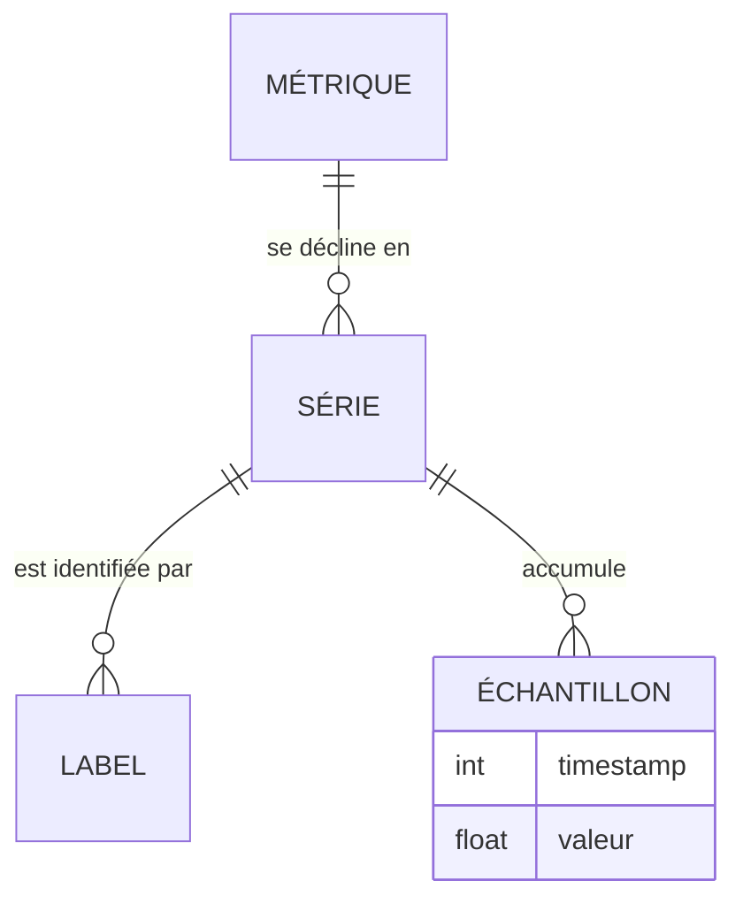

# Comprendre les métriques et séries temporelles

## Objectifs pédagogiques

À la fin de ce module, vous serez capable de :

- **Distinguer** les quatre types de métriques (Counter, Gauge, Histogram, Summary) et **choisir** celui qui correspond à ce qu'on veut mesurer.
- **Décomposer** une série temporelle en nom, labels, timestamps et valeurs.
- **Expliquer** l'effet de la fréquence de collecte et de la résolution d'affichage sur ce qu'on voit réellement dans un panel.
- **Interpréter** correctement un taux, une variation, un percentile et une agrégation, sans tomber dans les pièges classiques (moyenne de percentiles, Counter lu comme un Gauge).
- **Anticiper** l'impact d'un label sur la cardinalité, et **reconnaître** une donnée manquante, nulle ou obsolète.

## Mise en situation

Lundi matin, une équipe support ouvre son dashboard Grafana. Sur le panel « Requêtes HTTP », une belle courbe monte, monte, monte. Quelqu'un s'inquiète : « Le trafic explose ! » Une autre personne répond : « Non, la courbe monte tout le temps, depuis des semaines. » Tout le monde a raison, et tout le monde se trompe : la courbe affiche un compteur cumulatif, qui ne peut que croître. Ce que l'équipe voulait voir, c'était le nombre de requêtes *par seconde*.

Dans le même dashboard, un autre panel affiche une latence moyenne de 150 ms. Parfait sur le papier. Pourtant les utilisateurs se plaignent de lenteurs, et ils ont raison aussi, on va voir pourquoi.

Ces deux malentendus ont la même origine : la donnée affichée n'est pas celle qu'on croit. Avant d'écrire la moindre requête (c'est l'objet du module suivant), il faut comprendre ce qu'est vraiment une métrique, comment elle est stockée dans le temps, et ce qu'on peut légitimement en tirer.

## Ce qu'est une métrique, et pourquoi on raisonne en séries temporelles

Une métrique est une mesure numérique d'un comportement du système : le nombre de requêtes reçues, la mémoire utilisée, la durée d'un traitement. Une seule mesure ne dit presque rien. Ce qui est utile, c'est son évolution : est-ce que ça monte, est-ce que ça oscille, est-ce que ça a changé juste après le déploiement de 14 h ?

C'est pour cela qu'on stocke les métriques sous forme de **séries temporelles** : une suite de valeurs numériques horodatées, enregistrées à intervalles réguliers. Pensez à un électrocardiogramme : un battement isolé ne raconte rien, c'est le tracé qui permet de diagnostiquer. Les systèmes comme Prometheus utilisent pour cela une base spécialisée, une TSDB (Time Series Database), optimisée pour écrire en continu et lire de grandes plages de temps.

> 📖 **Définition**
>
> Une TSDB est une base de données conçue pour stocker et interroger efficacement des valeurs indexées par le temps.
{: .callout .callout-definition}

Et Grafana dans tout ça ? Il ne stocke rien. Il interroge la source de données (vue au module précédent) et dessine ce qu'on lui renvoie. Si la donnée est mal comprise à la source, aucun joli panel ne la rattrapera.

### Anatomie d'une série

Quand une application expose ses métriques, elle publie du texte, typiquement sur une URL `/metrics`. Voici un extrait :

```text
# TYPE http_requests_total counter
http_requests_total{method="GET",status="200",instance="api-1"} 18342
http_requests_total{method="GET",status="500",instance="api-1"} 12
http_requests_total{method="POST",status="200",instance="api-1"} 4120
```

Chaque ligne contient trois éléments : un **nom** (`http_requests_total`), des **labels** entre accolades (`method`, `status`, `instance`) et une **valeur**. Le timestamp, lui, n'est généralement pas dans le texte : c'est le collecteur qui l'ajoute au moment où il lit la page.

Ce qui définit une série, c'est la combinaison *nom + ensemble de labels*. Les trois lignes ci-dessus sont donc trois séries différentes, même si elles portent le même nom.



Ce schéma se lit ainsi : `||` signifie « exactement un » et `o{` « zéro ou plusieurs ». Une métrique se décline donc en plusieurs séries, et chaque série accumule ses propres échantillons.

> 🧠 **Concept clé**
>
> Une série = un nom + un jeu de labels précis. Changer *un seul* label, même d'une seule valeur, crée une nouvelle série distincte avec son propre historique.
{: .callout .callout-important}

## Les quatre types de métriques

Le type n'est pas un détail de présentation : il dicte la façon de lire la valeur. Une même valeur « 18342 » veut dire des choses radicalement différentes selon qu'elle vient d'un Counter ou d'un Gauge.

| Type | Ce qu'il représente | Peut diminuer ? | Exemples typiques |
|------|---------------------|-----------------|-------------------|
| Counter | Un total cumulé depuis le démarrage du processus | Non (sauf remise à zéro au redémarrage) | Requêtes traitées, erreurs, octets envoyés |
| Gauge | Un état instantané | Oui, librement | Mémoire utilisée, taille d'une file, nombre de connexions ouvertes |
| Histogram | La répartition de valeurs dans des intervalles (buckets) | Les compteurs internes suivent la logique d'un Counter | Durée des requêtes, taille des réponses |
| Summary | Des quantiles calculés par l'application elle-même | Idem pour `_count` et `_sum` | Durée de traitement, quand les quantiles sont calculés côté client |

### Counter : on ne regarde jamais sa valeur brute

Même raisonnement pour un Counter applicatif. Si `http_requests_total` vaut 1000 à une minute donnée et 1600 une minute plus tard, l'application a traité 600 requêtes en 60 secondes, soit **10 requêtes par seconde**. C'est cette vitesse qu'on veut afficher, pas le total.

> 🚗 **Analogie : le compteur kilométrique**
>
> Un Counter, c'est le compteur kilométrique d'une voiture. Savoir qu'il affiche 182 340 km ne dit pas si vous roulez vite. Ce qui vous intéresse, c'est la différence entre deux relevés : 600 km en 6 heures, soit 100 km/h.
{: .callout .callout-analogie}

Autre particularité : si le processus redémarre, le compteur repart de zéro. Les outils de calcul de taux savent détecter cette chute et compenser, ce qui est une raison de plus de ne pas manipuler la valeur brute à la main.

> ⚠️ **Erreur fréquente**
>
> Interpréter un Counter comme un Gauge. Afficher la valeur brute d'un Counter produit une courbe en escalier qui monte toujours, et qui retombe brutalement à zéro à chaque redémarrage, ce qu'on prend à tort pour une panne ou une chute de trafic. Une alerte du type « valeur > 10 000 » sur un Counter finira forcément par se déclencher, quoi qu'il se passe. *Correction* : un Counter se lit toujours à travers sa variation dans le temps (un taux, ou une augmentation sur une fenêtre).
{: .callout .callout-attention}

### Gauge : la photo à l'instant T

Un Gauge est un thermomètre. La valeur monte et descend, et sa lecture directe a du sens : « il y a 42 connexions ouvertes maintenant ». Il convient dès qu'on mesure un niveau ou un état.

Sa limite : c'est une photo prise à chaque collecte. Si la file d'attente grimpe à 5 000 éléments pendant 4 secondes puis redescend, et que la collecte passe toutes les 15 secondes, vous pouvez ne jamais voir ce pic.

### Histogram et Summary : mesurer des durées sans les écraser dans une moyenne

Reprenons le mystère de la latence moyenne de 150 ms. Imaginez 1 000 requêtes : 980 durent 50 ms, et 20 durent 5 secondes. La moyenne est de (980 × 50 + 20 × 5000) / 1000 = **149 ms**. Elle a l'air saine. Pourtant, 2 % des utilisateurs attendent 5 secondes, et c'est précisément ceux qui appellent le support.

La moyenne lisse les extrêmes, et ce sont eux qui font mal. D'où les **percentiles** : le 99ᵉ percentile (p99) est la durée en dessous de laquelle se trouvent 99 % des requêtes. Ici, le p99 est d'environ 5 secondes, et il raconte la vraie histoire.

Pour calculer un percentile, il faut conserver la *répartition* des durées, pas seulement leur moyenne. C'est le rôle de ces deux types :

- **Histogram** : l'application range chaque mesure dans des *buckets* aux bornes prédéfinies. Chaque bucket est cumulatif : il compte toutes les observations inférieures ou égales à sa borne (label `le`, pour *less or equal*). Il y a aussi un `_count` (nombre d'observations) et un `_sum` (somme des valeurs).
- **Summary** : l'application calcule elle-même ses quantiles (par exemple p50, p90, p99) et les expose tels quels.

Un histogramme ressemble à ceci :

| Bucket (`le`) | Observations cumulées |
|---------------|----------------------|
| 0,1 s | 800 |
| 0,5 s | 950 |
| 1 s | 990 |
| +Inf | 1000 |

Lecture : 95 % des requêtes (950 sur 1000) durent 0,5 s ou moins. Le percentile est *estimé* par interpolation à l'intérieur du bucket, donc sa précision dépend du choix des bornes. Si le seuil qui vous intéresse est 300 ms et qu'aucun bucket n'est placé près de cette valeur, vous aurez une estimation grossière.

> 💡 **Astuce**
>
> En pratique, on préfère souvent l'Histogram au Summary. Les quantiles d'un Summary sont calculés *par instance* et ne peuvent pas être combinés entre eux. Avec un Histogram, on additionne les buckets de toutes les instances *puis* on calcule le percentile global. Les versions récentes de Prometheus proposent aussi des histogrammes dits « natifs » qui évitent de choisir les bornes à la main ; leur disponibilité dépend de la version et de la configuration.
{: .callout .callout-astuce}

## Le temps : fréquence de collecte, intervalle et résolution

Une série temporelle n'est pas continue. C'est une suite de points espacés par l'**intervalle de collecte** (*scrape interval*). Avec Prometheus, la valeur par défaut est d'une minute, et on la règle souvent à 15 ou 30 secondes. Entre deux points, vous ne savez rien.

Trois notions se mélangent facilement, alors séparons-les :

- **Fréquence de collecte** : à quelle cadence la source est lue (par exemple toutes les 15 s). Elle est fixée côté collecteur.
- **Résolution des données** : l'espacement réel entre les points stockés. Il est égal à l'intervalle de collecte, sauf si un traitement de réduction (*downsampling*) intervient.
- **Résolution d'affichage** : le pas que Grafana demande pour dessiner le panel. Il dépend de la largeur du panel et du nombre maximum de points autorisé. Dans les options de requête, vous trouverez des réglages comme *Min interval* et *Max data points* (l'interface peut varier selon la version).

Conséquence concrète : si vous regardez 30 jours dans un panel de 800 pixels, Grafana ne va pas dessiner des centaines de milliers de points. Il demande un pas plus large, par exemple une valeur toutes les 30 minutes, et les détails fins disparaissent. Un pic de 2 minutes visible sur « 1 heure » peut être invisible sur « 30 jours ».

Quand une courbe vous semble trop calme, changez l'échelle de temps avant de conclure.

> ⚠️ **Erreur fréquente**
>
> Croire qu'une absence de pic sur le graphique prouve l'absence de problème. Avec une collecte toutes les 60 s, un pic de CPU de 10 secondes peut tomber entièrement entre deux relevés. Si un phénomène est plus court que l'intervalle, il faut soit raccourcir l'intervalle, soit exposer une métrique qui l'agrège (un Counter ou un Histogram, qui n'oublient rien entre deux collectes).
{: .callout .callout-attention}

## De la donnée brute à l'information : taux, variation, percentiles, agrégation

Les valeurs brutes servent rarement telles quelles. On les transforme presque toujours pour répondre à une question. Les quatre opérations ci-dessous couvrent l'essentiel, et on verra dans le module suivant comment les exprimer dans une requête.

**Le taux (rate)** : une vitesse de variation par seconde. C'est l'opération de base pour un Counter. Sur notre exemple, passer de 1000 à 1600 en 60 s donne 10 req/s. On calcule le taux sur une *fenêtre* de temps, qui doit contenir plusieurs échantillons : avec une collecte toutes les 15 s, une fenêtre de 15 s ne contient qu'un point et ne permet aucun calcul.

> 💡 **À retenir**
>
> En règle générale, la fenêtre de calcul d'un taux fait au moins quatre fois l'intervalle de collecte.
{: .callout .callout-important}

**La variation** : combien la valeur a changé sur une période, sans la ramener à la seconde. « 3 600 erreurs sur la dernière heure » parle plus à un humain que « 1 erreur/s ». Même source, autre lecture : on choisit selon l'usage (suivre une tendance ou compter un volume).

**Les percentiles** : ils décrivent la queue de la distribution, là où se cachent les mauvaises expériences. Le p50 (médiane) montre l'expérience typique, le p95 et le p99 montrent les cas lents. Un p50 stable avec un p99 qui grimpe indique qu'une minorité de requêtes souffre, par exemple à cause d'un seul serveur ou d'une seule dépendance.

**L'agrégation** : regrouper plusieurs séries en une seule. Vous avez 10 instances de votre API ? Additionner leurs taux donne le trafic total. Calculer la moyenne de leur mémoire donne la tendance générale. Vous pouvez aussi agréger *en conservant* certains labels : la somme du trafic « par code de statut », par exemple.

> ⚠️ **Erreur fréquente**
>
> Faire la moyenne de percentiles. Si l'instance A a un p95 de 100 ms et l'instance B un p95 de 900 ms, le « p95 moyen » de 500 ms ne correspond à rien de réel. Il dépend du volume traité par chaque instance et de la forme de leurs distributions. *Correction* : agréger d'abord les buckets de l'histogramme de toutes les instances, puis calculer le percentile sur le résultat. C'est la raison pour laquelle l'Histogram est préféré au Summary pour toute métrique distribuée sur plusieurs instances.
{: .callout .callout-attention}

## Dimensions, cardinalité et granularité

Les labels sont la richesse des métriques : ils permettent de filtrer, de regrouper, de comparer. Ils ont aussi un coût, et c'est une des causes les plus courantes de plateformes de supervision qui s'essoufflent.

> 📖 **Définition**
>
> La **cardinalité** est le nombre de séries distinctes qu'une métrique produit. Elle se calcule en multipliant le nombre de valeurs possibles de chaque label.
{: .callout .callout-definition}

Prenons un scénario :

- 50 instances × 20 endpoints × 5 codes de statut = **5 000 séries**. C'est gérable.
- On ajoute un label `user_id` avec 100 000 utilisateurs possibles : on passe à **500 millions de séries potentielles**. Le stockage, la mémoire et les requêtes s'effondrent.

Chaque série occupe de la mémoire et du disque, même si elle ne reçoit qu'un échantillon rare. La règle : un label doit avoir un nombre de valeurs *borné et raisonnable*. Les identifiants uniques (utilisateur, requête, session), les adresses IP clientes, les URLs complètes avec leurs paramètres ne doivent pas devenir des labels. Ces informations ont leur place dans les logs ou les traces.

La **granularité** est le niveau de détail auquel vous observez : par service, par instance, par endpoint, par code de statut. Une granularité fine aide à localiser un problème, mais augmente la cardinalité et complique la lecture. Une granularité grossière est lisible, mais masque les défaillances ciblées : un taux d'erreur global de 0,5 % peut cacher un endpoint à 40 % d'erreurs.

> 💡 **Astuce**
>
> Pour décider si un label mérite d'exister, posez-vous la question « Est-ce que je vais regrouper ou filtrer par ça pour diagnostiquer un incident ? » Si la réponse est non, ou si le nombre de valeurs est imprévisible, ce n'est pas un label.
{: .callout .callout-astuce}

## Quand les données manquent : absence, zéro et obsolescence

Un panel vide ou une courbe qui s'arrête ne veut pas dire la même chose selon le contexte. Il faut apprendre à distinguer trois situations.

**Une valeur à zéro.** La série existe, elle est collectée, et sa valeur est 0. Par exemple, aucune erreur depuis 10 minutes. C'est une information : tout va bien (ou l'activité est nulle, à vérifier).

**Une absence de données.** La série n'existe pas à cet instant : plus aucun échantillon n'arrive. Causes possibles : l'application est arrêtée, la collecte échoue, le réseau est coupé, le label a changé. Ici, il n'y a pas de zéro, il n'y a *rien*, et c'est un signal très différent. Grafana l'affiche généralement comme un trou dans la courbe ou un message « No data ».

**Une série obsolète (stale).** Quand une cible disparaît (pod supprimé, instance remplacée) ou qu'une série n'apparaît plus lors d'une collecte, Prometheus pose un marqueur d'obsolescence (*staleness marker*) : la série cesse immédiatement d'être prise en compte par les requêtes.

En l'absence de marqueur (par exemple après un redémarrage de Prometheus ou avec des timestamps explicites), une valeur n'est plus utilisée si le dernier échantillon date de plus de 5 minutes (valeur par défaut). C'est ce qui évite de voir pour toujours la dernière valeur d'un serveur disparu.

> ⚠️ **Erreur fréquente**
>
> Confondre « pas d'erreurs » et « plus de métriques ». Si un service plante, son compteur d'erreurs ne passe pas à zéro : il disparaît. Une alerte « erreurs > 0 » restera muette pendant que tout est cassé. Surveillez donc aussi l'*absence* de données, et prévoyez dans vos alertes un comportement explicite pour les états *No Data* et *Error* (on y reviendra dans les modules sur l'alerting).
{: .callout .callout-attention}

Côté affichage, le panel Time series propose une option pour relier ou non les trous (souvent appelée *Connect null values*, le libellé peut varier). Relier les points rend la courbe plus propre, mais peut cacher une interruption de collecte. Pendant un diagnostic, laissez les trous visibles.

## Cas réel (scénario illustratif)

Voici un scénario construit pour illustrer la démarche ; les chiffres sont fictifs.

Une API de réservation tourne sur 6 instances. Le dashboard affiche une latence moyenne autour de 120 ms, constante depuis une semaine. Pourtant le support reçoit des tickets : « la page de confirmation reste bloquée plusieurs secondes ».

1. **Constat.** Le panel de latence moyenne ne montre aucune anomalie. Le premier réflexe serait de conclure à un problème côté client.
2. **Changement de lecture.** L'équipe remplace la moyenne par le p50 et le p99, calculés à partir de l'Histogram de durée des requêtes. Le p50 reste à 80 ms, mais le p99 oscille entre 3 et 6 secondes.
3. **Localisation.** En regroupant le p99 par endpoint (label `route`), elle voit que seule la route de confirmation est concernée. Les autres restent sous 300 ms.
4. **Vérification des types.** Un autre panel affichait le nombre de requêtes totales en valeur brute. En le remplaçant par un taux par seconde, elle découvre un trafic stable. L'hypothèse « surcharge » est écartée.
5. **Conclusion.** Le problème est localisé sur un endpoint précis, indépendant du volume. Il reste à l'investiguer avec les logs et les traces (modules suivants), mais la bonne question est maintenant posée.

Ce que ce scénario illustre : une même source, lue avec la bonne opération, change complètement le diagnostic.

## Bonnes pratiques

- **Vérifiez le type avant de choisir la visualisation.** Un Counter se lit en taux ou en variation, un Gauge en valeur directe, un Histogram en percentiles. Dans le doute, regardez la ligne `# TYPE` sur la page `/metrics`.
- **Suivez les percentiles, pas seulement la moyenne.** Pour toute durée, affichez au moins p50 et p95 ou p99. La moyenne seule est trompeuse dès que la distribution a une longue queue.
- **Gardez l'intervalle de collecte en tête.** Il fixe la plus petite durée d'événement observable. Une fenêtre de calcul du taux doit contenir plusieurs échantillons.
- **Limitez les labels à des valeurs bornées.** Pas d'identifiants uniques ni d'URLs complètes. Estimez la cardinalité (multiplication des valeurs) avant d'ajouter un label.
- **Distinguez zéro et absence.** Pour toute métrique critique, prévoyez un moyen de détecter qu'elle a cessé d'arriver.
- **Ne calculez jamais de moyenne de percentiles.** Agrégez les buckets, puis calculez le percentile.
- **Nommez et documentez clairement.** Une unité dans le nom (`_seconds`, `_bytes`) et le suffixe `_total` pour les Counters évitent beaucoup d'erreurs de lecture. Une métrique mal nommée reste trompeuse même avec un bon panel.

Une façon simple de vérifier que vous avez compris : face à n'importe quel graphique, soyez capable de répondre à trois questions :

- De quel type de métrique vient-il ?
- Sur quelle fenêtre et quelle résolution est-il calculé ?
- Que verrait-on s'il n'y avait plus aucune donnée ?

## Résumé

Une métrique est une mesure numérique stockée sous forme de série temporelle : un nom, des labels, et une suite d'échantillons horodatés. Le type détermine la lecture : un Counter cumule et se lit en taux ou en variation, un Gauge donne un état instantané, un Histogram ou un Summary décrit la répartition d'une mesure comme une durée. La collecte se fait à intervalles réguliers, ce qui limite ce qu'on peut observer, et Grafana peut en plus réduire la résolution à l'affichage. Les percentiles révèlent ce que la moyenne cache, et ils doivent être calculés à partir de buckets agrégés. Les labels offrent de la précision mais font exploser la cardinalité s'ils ne sont pas bornés. Enfin, un zéro, une absence et une série obsolète sont trois situations différentes. Le module suivant montre comment exprimer ces calculs avec PromQL.

<!-- snippet
id: grafana_metriques_counter_vs_gauge
type: warning
tech: grafana
level: beginner
importance: high
format: knowledge
tags: counter,gauge,metriques,prometheus
title: Ne jamais lire un Counter comme un Gauge
description: Un Counter affiché en valeur brute monte sans fin et retombe à zéro au redémarrage, ce qui ressemble à tort à un pic de trafic puis à une panne
content: Piège : afficher un Counter (ex. http_requests_total) en valeur brute donne une courbe qui ne fait que monter. Conséquence : on croit à une explosion de trafic, et une alerte sur seuil absolu finit toujours par se déclencher. Correction : toujours lire un Counter via sa variation dans le temps (taux par seconde ou augmentation sur une fenêtre).
-->

<!-- snippet
id: grafana_metriques_types_choix
type: concept
tech: grafana
level: beginner
importance: high
format: knowledge
tags: counter,gauge,histogram,summary
title: Les quatre types de métriques et leur lecture
description: Chaque type impose une façon de lire la valeur : taux, valeur directe ou percentiles
content: Counter = total cumulé qui ne fait qu'augmenter (remis à zéro au redémarrage), lu en taux. Gauge = état instantané qui monte et descend, lu directement (mémoire, file d'attente). Histogram = compteurs par buckets cumulatifs (label le) plus _sum et _count, pour calculer des percentiles. Summary = quantiles calculés côté application, non agrégeables entre instances.
-->

<!-- snippet
id: grafana_metriques_serie_identite
type: concept
tech: grafana
level: beginner
importance: high
format: knowledge
tags: labels,series-temporelles,prometheus
title: Une série = nom + combinaison unique de labels
description: Changer un seul label crée une nouvelle série avec son propre historique, ce qui explique à la fois la puissance des filtres et le risque de cardinalité
content: Une série temporelle est identifiée par le nom de la métrique et l'ensemble exact de ses labels. http_requests_total{status="200"} et http_requests_total{status="500"} sont deux séries distinctes. Chaque série contient des échantillons (timestamp + valeur) ajoutés à chaque collecte, généralement horodatés par le collecteur.
-->

<!-- snippet
id: grafana_metriques_expose_format
type: command
tech: grafana
level: beginner
importance: medium
format: knowledge
tags: metrics,exposition,prometheus,curl
title: Lire les métriques brutes exposées par une application
context: À exécuter depuis une machine qui atteint l'application
command: curl -s http://<HOST>:<PORT>/metrics | head -n 30
example: curl -s http://localhost:8080/metrics | head -n 30
description: Affiche les lignes # TYPE et les séries avec leurs labels, utile pour confirmer le type d'une métrique avant de choisir sa visualisation
-->

<!-- snippet
id: grafana_metriques_moyenne_vs_percentile
type: concept
tech: grafana
level: beginner
importance: high
format: knowledge
tags: latence,percentile,histogram,moyenne
title: Pourquoi la moyenne masque les lenteurs
description: Une moyenne saine peut coexister avec une expérience dégradée pour une minorité d'utilisateurs, visible seulement via p95 ou p99
content: Exemple : 980 requêtes à 50 ms et 20 à 5 s donnent une moyenne de 149 ms alors que 2 % des utilisateurs attendent 5 s. Le p99 vaut environ 5 s. Afficher p50 ET p95 ou p99 pour toute métrique de durée, car la moyenne lisse les valeurs extrêmes qui génèrent les tickets.
-->

<!-- snippet
id: grafana_metriques_moyenne_percentiles_erreur
type: warning
tech: grafana
level: beginner
importance: high
format: knowledge
tags: percentile,agregation,histogram,summary
title: Ne pas faire la moyenne de percentiles
description: Moyenner des p95 par instance donne une valeur sans signification, car elle ignore le volume et la distribution de chaque instance
content: Piège : calculer la moyenne des p95 de plusieurs instances (100 ms et 900 ms donnent 500 ms). Conséquence : valeur fausse, dépendante du trafic de chaque instance. Correction : utiliser un Histogram, additionner les buckets de toutes les instances, puis calculer le percentile sur le résultat. Un Summary ne le permet pas.
-->

<!-- snippet
id: grafana_metriques_intervalle_collecte
type: concept
tech: grafana
level: beginner
importance: medium
format: knowledge
tags: scrape,intervalle,resolution,prometheus
title: L'intervalle de collecte borne ce qu'on peut observer
description: Un événement plus court que l'intervalle peut tomber entre deux relevés et rester invisible, surtout sur un Gauge
content: Prometheus lit les cibles à intervalle fixe (1 minute par défaut, souvent réglé à 15 ou 30 s). Un pic de CPU de 10 s avec une collecte à 60 s peut ne jamais apparaître. Une fenêtre de calcul de taux doit contenir plusieurs échantillons : viser environ 4 fois l'intervalle de collecte.
-->

<!-- snippet
id: grafana_metriques_resolution_affichage
type: tip
tech: grafana
level: beginner
importance: medium
format: knowledge
tags: resolution,panel,min-interval,max-data-points
title: Changer l'échelle de temps avant de conclure
context: Dans l'éditeur d'un panel, section Query options
description: Grafana ajuste le pas selon la largeur du panel, donc un pic visible sur 1 heure peut disparaître sur 30 jours
content: Si une courbe paraît trop calme, réduire la plage (ex. 30 j vers 1 h) pour retrouver le détail. Vérifier aussi Query options : Min interval (pas minimal) et Max data points (nombre de points maximum). Les libellés exacts peuvent varier selon la version de Grafana.
-->

<!-- snippet
id: grafana_metriques_cardinalite_labels
type: warning
tech: grafana
level: beginner
importance: high
format: knowledge
tags: cardinalite,labels,performance,prometheus
title: Ne pas utiliser un identifiant unique comme label
description: Chaque combinaison de labels crée une série, donc un label à valeurs illimitées fait exploser mémoire, stockage et temps de requête
content: Piège : ajouter user_id, request_id, une IP cliente ou une URL complète comme label. Conséquence : 5 000 séries (50 instances x 20 endpoints x 5 statuts) deviennent des millions avec 100 000 valeurs de user_id. Correction : garder des labels à valeurs bornées, et mettre ces identifiants dans les logs ou les traces.
-->

<!-- snippet
id: grafana_metriques_zero_vs_absence
type: concept
tech: grafana
level: beginner
importance: high
format: knowledge
tags: no-data,stale,donnees-manquantes,alerting
title: Zéro, absence de données et série obsolète
description: Trois états différents : une valeur 0 est une mesure, l'absence signale une collecte cassée, l'obsolescence retire une cible disparue
content: Valeur à 0 = la série existe et vaut zéro. Absence (No data) = aucun échantillon reçu : application arrêtée, collecte en échec ou label modifié. Série obsolète = Prometheus pose un marqueur stale quand la cible disparaît, et la série sort immédiatement des requêtes ; sans marqueur (redémarrage de Prometheus, timestamps explicites), elle n'est plus utilisée si le dernier échantillon date de plus de 5 minutes (défaut).
-->

<!-- snippet
id: grafana_metriques_panne_silencieuse
type: error
tech: grafana
level: beginner
importance: medium
format: knowledge
tags: no-data,erreurs,alerting,supervision
title: Compteur d'erreurs vide alors que le service est en panne
description: Une alerte sur erreurs supérieures à zéro reste muette quand le service est tombé, car la métrique disparaît au lieu de passer à zéro
content: Symptôme : aucune alerte ni erreur affichée alors que les utilisateurs ne peuvent plus accéder au service. Cause : le service arrêté n'exporte plus rien, la série disparaît et la condition erreurs > 0 n'est jamais vraie. Correction : surveiller aussi l'absence de données et définir explicitement le comportement sur les états No Data et Error des alertes.
-->
