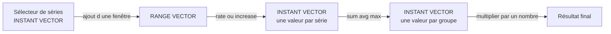

# Premières requêtes PromQL

## Objectifs pédagogiques

- Distinguer un instant vector, un range vector et un scalar, et prédire le type renvoyé par une expression.
- Écrire un sélecteur filtré par labels (`=`, `!=`, `=~`, `!~`).
- Calculer un débit ou un volume avec `rate()` et `increase()`, puis agréger avec `sum()`, `avg()` et `max()` en choisissant entre `by()` et `without()`.
- Calculer un percentile de latence avec `histogram_quantile()` en respectant ses conditions d'utilisation.
- Retrouver les métriques disponibles dans Explore et diagnostiquer une requête vide ou incorrecte.

## Mise en situation

Un ticket arrive : « l'API `orders` est lente, et certains clients voient des erreurs ». Prometheus collecte déjà les métriques de l'application, et Grafana a une data source Prometheus configurée. Vous n'avez aucun dashboard sous la main et personne n'a le temps d'en construire un.

Il vous reste Explore, la zone de Grafana où l'on interroge une source de données à la volée. Votre mission est de répondre à trois questions :

1. Combien de requêtes par seconde l'API reçoit-elle ?
2. Quelle part de ces requêtes finit en erreur serveur ?
3. Quelle est la latence vue par les 5 % de requêtes les plus lentes ?

Les noms de métriques et de labels de ce module (`http_requests_total`, `job="api"`, etc.) sont des exemples illustratifs. Chez vous, les noms diffèrent probablement, et c'est justement pour cela que la partie sur la découverte des métriques compte.

## Contexte : pourquoi un langage de requête dédié

Dans le module précédent, vous avez vu comment les métriques sont stockées : des séries temporelles identifiées par un nom et des labels, avec des counters, des gauges et des histogrammes. Il manque l'outil pour poser des questions à ces données.

PromQL (Prometheus Query Language) est ce langage. Il ressemble peu à du SQL. On ne parle pas de lignes ni de tables, mais de **séries** que l'on sélectionne, transforme et agrège. Une requête PromQL se lit presque toujours de l'intérieur vers l'extérieur :

1. on choisit d'abord les séries ;
2. puis on les transforme ;
3. puis on les agrège.

Vous n'avez rien à installer. PromQL s'écrit dans Grafana, dans Explore ou plus tard dans un panel, et c'est la data source Prometheus qui l'exécute. Grafana envoie le texte de votre requête et affiche la réponse.

## Les trois types de valeurs : la base de tout

> 🧠 **Concept clé**
>
> Chaque expression PromQL a un type, et ce type décide de ce que vous pouvez en faire. La majorité des messages d'erreur du débutant viennent d'une confusion à cet endroit.
{: .callout .callout-important}

- **Instant vector** : un ensemble de séries, avec une seule valeur par série, celle à un instant donné. C'est ce que renvoie `up` ou `http_requests_total{job="api"}`. Imaginez un tableau de bord de voiture : chaque cadran indique la valeur maintenant.
- **Range vector** : un ensemble de séries, avec pour chacune plusieurs valeurs sur une fenêtre de temps. On l'obtient en ajoutant une durée entre crochets : `http_requests_total[5m]`. C'est comme la bande d'enregistrement d'un sismographe : on a l'historique de la fenêtre, pas une valeur unique.
- **Scalar** : un simple nombre, sans label. `2`, `0.95`, `100`. On l'utilise pour des calculs (`* 100`) ou comme paramètre de fonction.

La chaîne de transformation typique ressemble à ceci :



Les fonctions comme `rate()` ont besoin d'un range vector en entrée et rendent un instant vector. C'est pour cela que `rate(http_requests_total)` échoue : il manque la fenêtre.

> 💡 **Astuce**
>
> Dans Explore, le sélecteur de type de requête (Instant, Range ou Both) reflète cette distinction. Le mode *Range* trace une courbe en évaluant l'expression à intervalles réguliers. Le mode *Instant*, souvent affiché en vue Table, donne la valeur actuelle de chaque série avec tous ses labels, ce qui est pratique pour inspecter ce que vous manipulez. Les libellés exacts peuvent varier selon la version de Grafana.
{: .callout .callout-astuce}

## Sélectionner des séries : sélecteurs et filtres de labels

Le sélecteur le plus simple est le nom de la métrique :

```promql
http_requests_total
```

Cela renvoie toutes les séries portant ce nom, donc toutes les combinaisons de labels. Pour restreindre, on ajoute des filtres entre accolades :

```promql
http_requests_total{job="api", status="500"}
```

Les virgules jouent le rôle d'un « ET » : la série doit vérifier tous les filtres. Il existe quatre opérateurs :

| Opérateur | Sens | Exemple |
|-----------|------|---------|
| `=` | égal exactement | `job="api"` |
| `!=` | différent | `method!="OPTIONS"` |
| `=~` | correspond à l'expression régulière | `status=~"5.."` |
| `!~` | ne correspond pas à l'expression régulière | `handler!~"/health.*"` |

> ⚠️ **Erreur fréquente**
>
> Les expressions régulières PromQL sont **ancrées**. `status=~"5"` ne matche pas `500`, il matche uniquement la valeur `5`. Pour toutes les erreurs serveur, il faut `status=~"5.."`. À l'inverse, il n'y a pas besoin d'écrire `^5..$`, les ancres sont implicites.
{: .callout .callout-attention}

Le nom de la métrique est lui-même un label spécial, `__name__`. `http_requests_total{job="api"}` est équivalent à `{__name__="http_requests_total", job="api"}`. Cela servira pour explorer les métriques disponibles.

## Syntaxe de base : transformer des counters en débit

Prenez un counter comme `http_requests_total`. Sa valeur brute ne fait que monter depuis le démarrage du processus, ce qui n'a aucun intérêt pour répondre à « combien de requêtes par seconde ». On calcule donc sa vitesse d'évolution avec `rate()` :

```promql
rate(http_requests_total{job="api"}[5m])
```

Ligne par ligne :

- `http_requests_total{job="api"}` sélectionne les séries du service `api`.
- `[5m]` transforme ce sélecteur en range vector couvrant les 5 dernières minutes.
- `rate(...)` calcule, pour chaque série, l'augmentation moyenne **par seconde** sur cette fenêtre. Il gère aussi les remises à zéro du counter, par exemple lors d'un redémarrage.

> 🚗 **Analogie : le compteur kilométrique**
>
> Un counter ressemble au compteur kilométrique d'une voiture : il ne fait qu'augmenter. `rate()` en déduit une vitesse moyenne, comme si vous divisiez les kilomètres parcourus pendant les 5 dernières minutes par leur durée. Limite de l'image : un counter peut repartir de zéro au redémarrage, et `rate()` sait compenser cette remise à zéro.
{: .callout .callout-analogie}

Le résultat est un instant vector avec une série par combinaison de labels (instance, method, status, etc.). Le nom de la métrique disparaît du résultat, car ce n'est plus un total mais un débit.

`increase()` est proche, mais exprime le **volume total** sur la fenêtre plutôt que la vitesse :

```promql
increase(http_requests_total{job="api", status=~"5.."}[1h])
```

Cela répond à « combien d'erreurs serveur sur la dernière heure ». Sur une fenêtre de 1 h, `increase()` vaut donc à peu près `rate()` × 3600. Le résultat peut être décimal (par exemple 41,7 erreurs) parce que PromQL extrapole sur les bords de la fenêtre. Ne vous en étonnez pas.

### Choisir la fenêtre

La fenêtre doit contenir **au moins deux échantillons** pour que `rate()` calcule quelque chose. Si Prometheus collecte toutes les 30 s, `[30s]` donne un résultat vide ou instable. La règle usuelle est de prendre au moins **4 fois l'intervalle de collecte**. Avec 15 s de collecte, `[1m]` est un minimum, `[5m]` un choix confortable et lisse.

Grafana propose la variable `$__rate_interval`, qui calcule une fenêtre cohérente avec l'intervalle de collecte configuré dans la data source. Vous pourrez écrire `rate(http_requests_total[$__rate_interval])` pour ne pas vous en soucier. Dans Explore, elle dépend de la plage de temps affichée et de la configuration de la data source, donc `[5m]` écrit à la main reste plus prévisible pour débuter.

## Agréger : sum, avg, max, avec by() et without()

Le résultat de `rate()` contient une série par instance, par route, par code de statut. C'est trop détaillé pour répondre à « combien de requêtes par seconde en tout ». On agrège :

```promql
sum(rate(http_requests_total{job="api"}[5m]))
```

`sum()` additionne toutes les séries en **une seule**, sans label. Les trois fonctions d'agrégation de ce module :

- `sum()` additionne les valeurs, utile pour un débit total.
- `avg()` fait la moyenne **entre les séries** à cet instant, pas dans le temps.
- `max()` garde la valeur la plus haute parmi les séries, utile pour repérer l'instance la plus chargée.

Sans précision, une agrégation écrase tous les labels. Deux clauses permettent de garder ceux qui vous intéressent :

```promql
# by : je liste les labels que je GARDE, tous les autres disparaissent
sum by (status) (rate(http_requests_total{job="api"}[5m]))

# without : je liste les labels que je SUPPRIME, tous les autres restent
sum without (instance) (rate(http_requests_total{job="api"}[5m]))
```

La première requête renvoie une série par code de statut : 200, 404, 500, etc. La seconde supprime seulement `instance`, donc on additionne les réplicas mais on garde `method`, `status`, `handler` et tout ce qui existe. Choisissez `by()` quand vous savez précisément ce que vous voulez voir. Choisissez `without()` quand vous voulez simplement « fusionner les réplicas » sans énumérer tous les autres labels.

> 🔑 **Moyen mnémotechnique**
>
> Lisez les clauses en français. *by* signifie « par » : `sum by (status)` se lit « la somme par statut », et seul `status` reste. *without* signifie « sans » : `sum without (instance)` se lit « la somme sans instance », et seul `instance` disparaît.
{: .callout .callout-memo}

> ⚠️ **Erreur fréquente**
>
> Agréger trop tôt, ou trop fort. Une agrégation est comme un entonnoir : on ne peut pas retrouver ensuite ce qu'on a mélangé.
{: .callout .callout-attention}

- `sum(rate(...))` sans `by` vous donne un seul chiffre. Si le problème ne touche qu'une route ou qu'un statut, il disparaît dans la masse.
- `avg(...)` sur plusieurs instances peut masquer un réplica en difficulté : neuf instances saines et une saturée donnent une moyenne qui paraît acceptable. Un `max by (instance)` ou un simple `by (instance)` le révélerait.
- On calcule `rate()` **d'abord**, puis on agrège. Faire l'inverse, ce que les sous-requêtes permettent, fausse le calcul dès qu'une instance redémarre : le counter agrégé semble reculer, et `rate()` ne peut plus corriger ce que la somme a déjà brouillé.

En pratique, commencez par la requête la plus détaillée, observez quels labels existent, puis agrégez en retirant uniquement ceux qui gênent.

## histogram_quantile : lire un percentile

Un histogramme Prometheus ne stocke pas les durées individuelles. Il compte les requêtes par seuil de durée, et `histogram_quantile()` reconstruit une estimation du percentile à partir de ces compteurs cumulés.

> 📖 **Définition**
>
> Un *bucket* est un compteur cumulé exposé dans la série `_bucket`. Son label `le` (« less than or equal ») donne le seuil : le bucket `le="0.5"` compte toutes les requêtes ayant duré 0,5 s ou moins. Chaque bucket inclut donc les précédents.
{: .callout .callout-definition}

```promql
histogram_quantile(
  0.95,                                                         # scalar : le quantile voulu (0.95 = p95)
  sum by (le) (                                                 # on additionne les séries MAIS on garde le
    rate(http_request_duration_seconds_bucket{job="api"}[5m])   # débit de chaque bucket sur 5 minutes
  )
)
```

Le résultat indique : « 95 % des requêtes ont duré moins de X secondes », où X est le chiffre renvoyé. Pour que ça fonctionne, quelques conditions sont indispensables.

- **La métrique doit être un histogramme** et on interroge ses séries `_bucket`. Appliquer `histogram_quantile()` sur une gauge ou un counter n'a pas de sens.
- **On applique `rate()` aux buckets.** Sans cela, on calcule le percentile depuis le démarrage du processus, et non sur les 5 dernières minutes.
- **Le label `le` doit survivre à l'agrégation.** Si vous l'écrasez avec `sum()` ou `sum by (instance)`, la fonction ne peut plus reconstituer la distribution et renvoie un résultat vide. Pour garder une autre dimension, écrivez `sum by (le, handler)`.
- **Il faut du trafic dans la fenêtre.** Avec peu de requêtes, l'estimation devient très instable. Sans aucune requête, tous les buckets valent 0 et le résultat est `NaN`.

> 💡 **Astuce**
>
> Le résultat est une **estimation**. PromQL suppose que les valeurs sont réparties uniformément à l'intérieur du bucket où tombe le percentile. Si vos buckets sont `0.5`, `1` et `5` secondes, un p95 renvoyé à `0.93` ne veut pas dire que 0,93 s est exact. Il veut dire que le p95 se situe entre 0,5 et 1 s. La précision dépend du découpage choisi par les développeurs.
{: .callout .callout-astuce}

> ⚠️ **Erreur fréquente**
>
> Calculer un p95 par instance, puis en faire la moyenne. La moyenne de percentiles n'est pas le percentile global. Agrégez les **buckets**, puis calculez le quantile une seule fois.
{: .callout .callout-attention}

Les histogrammes dits « natifs » existent aussi dans les versions récentes de Prometheus, avec une syntaxe différente. Ils dépassent ce module. Ici, on reste sur les histogrammes classiques à buckets.

## Trouver les métriques disponibles avec Explore

Que pouvez-vous interroger, au juste ? Avant d'écrire une requête, il faut savoir ce qui existe. Dans Grafana :

1. Ouvrez **Explore** depuis le menu de navigation.
2. Choisissez votre data source Prometheus en haut de la page.
3. Utilisez le mode **Builder** pour vous laisser guider, ou **Code** pour écrire à la main. Le basculement se fait avec un sélecteur près de la requête.

En mode Builder, la liste déroulante des métriques propose une recherche par nom, et un sélecteur de labels propose les valeurs existantes. Selon la version de Grafana, vous trouverez aussi un explorateur de métriques avec description et type. En mode Code, l'autocomplétion suggère les noms au fil de la frappe. Les libellés peuvent varier, mais le principe reste le même.

Deux requêtes de reconnaissance très utiles :

```promql
# Quelles cibles Prometheus voit-il, et sont-elles joignables ? (1 = oui, 0 = non)
up

# Quelles métriques le job "api" expose-t-il ?
count by (__name__) ({job="api"})
```

La seconde liste chaque nom de métrique avec son nombre de séries. Limitez-la toujours à un job ou à un filtre précis. Sur une grosse plateforme, lancer cette requête sans filtre peut être lent et coûteux pour Prometheus.

Une bonne habitude : exécutez le sélecteur brut en mode Instant, regardez les labels dans la table, puis ajoutez `rate()` et les agrégations.

## Construction progressive : de la métrique brute à la réponse

Reprenons le ticket de la mise en situation.

**v1 : la valeur brute.**

```promql
http_requests_total{job="api"}
```

Vous obtenez des nombres énormes qui montent en permanence. Ils ne répondent à rien, mais confirment que la métrique existe et montrent quels labels vous pouvez utiliser.

**v2 : un débit par série.**

```promql
rate(http_requests_total{job="api"}[5m])
```

La courbe devient lisible, en requêtes par seconde. Mais il y a une ligne par instance, route, méthode et statut, soit un fouillis.

**v3 : un débit par statut.**

```promql
sum by (status) (rate(http_requests_total{job="api"}[5m]))
```

Vous regroupez selon la seule dimension qui compte pour la question. On voit tout de suite si une courbe `500` apparaît ou grossit.

**v4 : la part d'erreurs.**

```promql
  sum(rate(http_requests_total{job="api", status=~"5.."}[5m]))  # débit des erreurs serveur, une seule valeur
/                                                               # division : les deux côtés n'ont plus de label
  sum(rate(http_requests_total{job="api"}[5m]))                 # débit de toutes les requêtes
* 100                                                           # scalar : on passe en pourcentage
```

Ici l'agrégation est volontaire, puisqu'on veut un ratio global. Les deux côtés de la division n'ont plus aucun label, donc ils se correspondent. Pour un ratio par route, on écrirait `sum by (handler)` des deux côtés.

**v5 : la latence ressentie.**

```promql
histogram_quantile(0.95, sum by (le, handler) (rate(http_request_duration_seconds_bucket{job="api"}[5m])))
```

On obtient le p95 par route. Ce n'est pas la même question que la moyenne, qui est souvent trop flatteuse. Le p95 décrit ce que vivent les requêtes les plus lentes.

## Cas d'utilisation

**Scénario 1 : identifier la route qui génère des erreurs.**

```promql
topk(3, sum by (handler) (rate(http_requests_total{job="api", status=~"5.."}[5m])))
```

`topk(3, ...)` garde les 3 séries les plus hautes. En mode Instant, le résultat attendu est un instant vector de 3 lignes : les routes avec le plus fort débit d'erreurs. Comme `by (handler)` a conservé le label utile, la route fautive apparaît.

**Scénario 2 : comparer les instances.**

```promql
max by (instance) (rate(http_requests_total{job="api"}[5m]))
```

On obtient une valeur par instance. Si l'une est très au-dessus des autres, l'équilibrage de charge ou une instance précise devient suspect. À l'inverse, `avg` sans `by` aurait aplati ce signal.

**Scénario 3 : vérifier la santé de la collecte.**

```promql
up{job="api"} == 0
```

Le filtre `== 0` ne garde que les séries dont la valeur est 0, donc les cibles injoignables. Résultat attendu : un instant vector vide si tout va bien, ou une série par cible en échec. C'est le premier réflexe quand les autres requêtes ne renvoient rien.

## Diagnostic : requête vide ou incorrecte

Une requête qui ne renvoie rien ne signifie pas « il n'y a pas de problème ». Elle signifie le plus souvent que vous n'avez sélectionné aucune série. Procédez par élimination, du plus simple au plus fin.

1. **Retirez tout sauf le nom de la métrique.** `http_requests_total` seul renvoie-t-il quelque chose ? Sinon, le nom est faux, la métrique n'est pas collectée, ou la data source sélectionnée n'est pas la bonne. Recherchez-la avec l'autocomplétion.
2. **Ajoutez les filtres un par un.** Dès que le résultat devient vide, vous avez trouvé le filtre fautif. Vérifiez la casse et les valeurs réelles dans la table en mode Instant.
3. **Contrôlez la plage de temps.** Si la plage affichée se situe avant l'apparition de la métrique, ou après que la série a cessé d'être exposée, il n'y a rien à montrer.
4. **Vérifiez la cible.** Lancez `up{job="api"}`. Une valeur 0 signifie que Prometheus n'arrive plus à collecter ce service.
5. **Examinez la fenêtre de `rate()`.** Une fenêtre qui ne contient pas toujours deux échantillons, par exemple inférieure à deux intervalles de collecte, produit un résultat vide ou intermittent.

Quelques symptômes courants, avec leur correction :

| Symptôme | Cause | Correction |
|----------|-------|-----------|
| Message du type « invalid expression type "range vector" for range query, must be Scalar or instant Vector » | Vous avez écrit `http_requests_total[5m]` seul : un range vector ne se trace pas | L'envelopper dans une fonction : `rate(http_requests_total[5m])` |
| `rate()` renvoie vide alors que la métrique existe | Fenêtre trop courte, par exemple `[30s]` avec une collecte toutes les 30 s | Passer à `[5m]`, soit au moins 4 intervalles de collecte |
| `status=~"5"` ne renvoie rien | Regex ancrée : seule la valeur exacte `5` correspond | `status=~"5.."` |
| `histogram_quantile` renvoie vide ou `NaN` | Vide : label `le` perdu dans l'agrégation, ou série qui n'est pas `_bucket`. `NaN` : aucun trafic dans la fenêtre | `sum by (le) (rate(..._bucket[5m]))`, sur une période avec du trafic |
| Courbe qui monte sans fin | `rate()` oublié sur un counter | Appliquer `rate()` avant toute lecture |
| Résultat chiffré mais incohérent | Gauge traitée avec `rate()` | Les gauges se lisent directement ; `rate()` est réservé aux counters |

> ⚠️ **Erreur fréquente**
>
> Une requête qui renvoie un résultat n'est pas forcément correcte. Testez votre interprétation avec une vérification simple : le total par statut doit refléter la somme globale, et un ordre de grandeur doit être plausible par rapport à ce que vous savez du trafic.
{: .callout .callout-attention}

## Bonnes pratiques

- **Commencez détaillé, agrégez ensuite.** Une requête brute vous montre les labels réels. Une agrégation écrite à l'aveugle risque d'effacer précisément la dimension qui contenait la réponse.
- **Utilisez `by()` quand vous savez ce que vous voulez garder.** Le résultat est explicite et ne change pas si l'application ajoute un nouveau label demain. Réservez `without()` aux cas où vous voulez simplement fusionner des réplicas.
- **Gardez une fenêtre de `rate()` d'au moins 4 intervalles de collecte.** Elle donne des courbes lisibles et évite les trous.
- **Filtrez dès le sélecteur.** `http_requests_total{job="api"}` est plus rapide et plus lisible qu'une agrégation qui filtre après coup.
- **Préférez un percentile à une moyenne pour la latence**, et agrégez les buckets avant de calculer le quantile.
- **Excluez le bruit assumé** (`/health`, `/metrics`) avec `handler!~"/health.*"`, pour que les routes métier ne soient pas diluées.
- **Testez en mode Instant puis en Range.** Instant pour vérifier la forme et les labels, Range pour valider l'évolution dans le temps.

## Résumé

| Concept | Ce qu'il fait | À retenir |
|---------|---------------|-----------|
| Instant vector | Une valeur par série à un instant donné | Ce que renvoie un sélecteur simple ou une agrégation |
| Range vector | Plusieurs valeurs par série sur une fenêtre `[5m]` | Ne se trace pas directement, il faut une fonction |
| Scalar | Un nombre sans label | Sert aux calculs et au paramètre de `histogram_quantile` |
| Sélecteur `{label="x"}` | Filtre les séries par labels | Les regex `=~` sont ancrées : `5..` et non `5` |
| `rate()` | Débit moyen par seconde d'un counter | Fenêtre d'au moins 4 intervalles de collecte |
| `increase()` | Volume total sur la fenêtre | Peut être décimal à cause de l'extrapolation |
| `sum` / `avg` / `max` | Agrège plusieurs séries en une | Agit entre les séries, pas dans le temps |
| `by()` / `without()` | Choisit les labels à garder ou à retirer | `by` liste ce qu'on garde, `without` ce qu'on supprime |
| `histogram_quantile()` | Estime un percentile depuis les buckets | `rate()` sur `_bucket` et `le` conservé dans l'agrégation |
| Explore | Interroge une data source à la volée | `up` et `count by (__name__)` pour découvrir ce qui existe |

Une requête PromQL se construit comme un tuyau : on sélectionne, on transforme avec `rate()`, puis on agrège en gardant les labels qui portent la réponse.

<!-- snippet
id: promql_vector_types_concept
type: concept
tech: promql
level: beginner
importance: high
format: knowledge
tags: promql,instant-vector,range-vector,scalar
title: Instant vector, range vector et scalar
content: Instant vector = une valeur par série à un instant (up, http_requests_total{job="api"}). Range vector = plusieurs valeurs par série sur une fenêtre, créé avec [5m], jamais traçable seul. Scalar = un nombre sans label (0.95). Les fonctions comme rate() prennent un range vector et rendent un instant vector.
description: Connaître le type d'une expression explique la plupart des erreurs de syntaxe : un range vector ne se trace pas sans fonction.
-->

<!-- snippet
id: promql_rate_counter_command
type: command
tech: promql
level: beginner
importance: high
format: knowledge
tags: promql,rate,counter,debit
title: Calculer un débit par seconde avec rate()
context: À saisir dans Explore (mode Code) avec la data source Prometheus sélectionnée
command: rate(<METRIC>{job="<JOB>"}[<WINDOW>])
example: rate(http_requests_total{job="api"}[5m])
description: Donne la vitesse moyenne par seconde d'un counter sur la fenêtre, en gérant les redémarrages. À réserver aux counters, pas aux gauges.
-->

<!-- snippet
id: promql_increase_vs_rate_concept
type: concept
tech: promql
level: beginner
importance: medium
format: knowledge
tags: promql,increase,rate,counter
title: increase() donne un volume, rate() une vitesse
content: increase(m[1h]) est à peu près rate(m[1h]) multiplié par 3600 : le nombre total d'événements sur la fenêtre. Le résultat peut être décimal (ex. 41.7) car PromQL extrapole aux bords de la fenêtre. Utiliser increase pour répondre à « combien en une heure », rate pour « à quelle vitesse ».
description: Même calcul sous-jacent, mais increase() exprime un total sur la fenêtre et peut renvoyer des décimaux sur des événements entiers.
-->

<!-- snippet
id: promql_sum_by_command
type: command
tech: promql
level: beginner
importance: high
format: knowledge
tags: promql,sum,by,agregation
title: Agréger un débit en gardant un label utile
command: sum by (<LABEL>) (rate(<METRIC>{job="<JOB>"}[<WINDOW>]))
example: sum by (status) (rate(http_requests_total{job="api"}[5m]))
description: Additionne les séries mais conserve une ligne par valeur de <LABEL>. Tout label non listé dans by() disparaît du résultat.
-->

<!-- snippet
id: promql_regex_anchored_warning
type: warning
tech: promql
level: beginner
importance: high
format: knowledge
tags: promql,regex,labels,selecteur
title: Les regex PromQL sont ancrées
content: Piège : status=~"5" ne matche que la valeur exacte 5, jamais 500. Conséquence : requête vide sans erreur. Correction : écrire status=~"5.." pour 500 à 599. Inutile d'ajouter ^ et $, ils sont implicites.
description: =~ et !~ comparent la valeur entière du label, pas une sous-chaîne, donc un motif incomplet ne trouve aucune série.
-->

<!-- snippet
id: promql_premature_aggregation_warning
type: warning
tech: promql
level: beginner
importance: high
format: knowledge
tags: promql,agregation,labels,diagnostic
title: Agréger trop tôt efface les labels utiles
content: Piège : sum(rate(...)) sans by écrase tous les labels, et avg() sur les instances peut masquer un réplica saturé. Conséquence : le problème d'une route ou d'une instance disparaît dans le total. Correction : lancer d'abord la requête détaillée, repérer les labels, puis agréger avec by (handler) ou by (instance).
description: Une agrégation est irréversible dans la requête : ce qui est fusionné ne peut plus être séparé en aval.
-->

<!-- snippet
id: promql_histogram_quantile_command
type: command
tech: promql
level: beginner
importance: high
format: knowledge
tags: promql,histogram,quantile,latence
title: Calculer un p95 de latence
context: Fonctionne sur un histogramme classique exposant des séries _bucket avec le label le
command: histogram_quantile(<QUANTILE>, sum by (le) (rate(<METRIC>_bucket{job="<JOB>"}[<WINDOW>])))
example: histogram_quantile(0.95, sum by (le) (rate(http_request_duration_seconds_bucket{job="api"}[5m])))
description: Estime la durée sous laquelle tombent 95 % des requêtes. Résultat interpolé à partir des buckets, donc approximatif.
-->

<!-- snippet
id: promql_histogram_le_lost_error
type: error
tech: promql
level: intermediate
importance: high
format: knowledge
tags: promql,histogram,le,diagnostic
title: histogram_quantile vide : le label le perdu
content: Symptôme : histogram_quantile renvoie un résultat vide. Cause : l'agrégation a supprimé le label le (sum() seul ou sum by (instance)), la fonction ne peut plus reconstituer la distribution. Correction : sum by (le) (rate(..._bucket[5m])), et ajouter les autres labels voulus, par exemple sum by (le, handler).
description: Le label le doit survivre à l'agrégation. Vérifier aussi qu'on cible bien les séries _bucket. Un résultat NaN signale plutôt une fenêtre sans trafic (tous les buckets à 0).
-->

<!-- snippet
id: promql_average_quantiles_warning
type: warning
tech: promql
level: intermediate
importance: medium
format: knowledge
tags: promql,histogram,percentile,agregation
title: Ne jamais moyenner des percentiles
content: Piège : calculer un p95 par instance puis en faire la moyenne. Conséquence : un chiffre qui ne correspond à aucun percentile réel. Correction : additionner les buckets de toutes les instances avec sum by (le), puis appeler histogram_quantile une seule fois.
description: Un percentile global se déduit de la distribution agrégée, pas de la moyenne des percentiles locaux.
-->

<!-- snippet
id: promql_rate_window_empty_error
type: error
tech: promql
level: beginner
importance: high
format: knowledge
tags: promql,rate,fenetre,diagnostic
title: rate() vide : fenêtre trop courte
content: Symptôme : rate() renvoie vide alors que la métrique existe. Cause : la fenêtre contient moins de deux échantillons, par exemple [30s] avec une collecte toutes les 30 s. Correction : prendre au moins 4 fois l'intervalle de collecte, soit au minimum [1m] pour une collecte toutes les 15 s, [5m] étant un choix plus confortable.
description: rate() calcule une pente et a besoin d'au moins deux points dans la fenêtre pour y parvenir.
-->

<!-- snippet
id: promql_range_vector_graph_error
type: error
tech: promql
level: beginner
importance: medium
format: knowledge
tags: promql,range-vector,explore,erreur
title: Erreur « range vector » en traçant une requête
content: Symptôme : message du type « invalid expression type range vector for range query ». Cause : la requête se termine par un sélecteur avec fenêtre, par exemple http_requests_total[5m], qu'on ne peut pas tracer. Correction : l'envelopper dans rate(), increase() ou une autre fonction qui rend un instant vector.
description: Seuls les instant vectors et les scalars se tracent ; un range vector est un état intermédiaire de calcul.
-->

<!-- snippet
id: promql_up_check_tip
type: tip
tech: promql
level: beginner
importance: high
format: knowledge
tags: promql,up,diagnostic,explore
title: Vérifier la collecte avec up avant tout diagnostic
content: Quand une requête ne renvoie rien, lancer up{job="<JOB>"} dans Explore en mode Instant : 1 = cible collectée, 0 = collecte en échec, aucune ligne = job inconnu de Prometheus ou data source erronée. Pour ne lister que les cibles en panne : up{job="<JOB>"} == 0.
description: Sépare en 10 secondes une panne de collecte d'une requête mal écrite, avant de modifier les filtres ou les fenêtres.
-->

<!-- snippet
id: promql_discover_metrics_tip
type: tip
tech: promql
level: beginner
importance: medium
format: knowledge
tags: promql,explore,metriques,decouverte
title: Lister les métriques d'un job dans Explore
context: Toujours filtrer par job, car l'exécution sans filtre peut être coûteuse sur une grosse plateforme
content: Exécuter count by (__name__) ({job="<JOB>"}) en mode Instant et vue Table : chaque ligne donne un nom de métrique et son nombre de séries. Exemple : count by (__name__) ({job="api"}). Utiliser ensuite le sélecteur brut d'une métrique trouvée pour inspecter ses labels avant d'écrire rate().
description: Permet de découvrir les noms réels exposés par un service sans documentation, en s'appuyant sur le label spécial __name__.
-->
