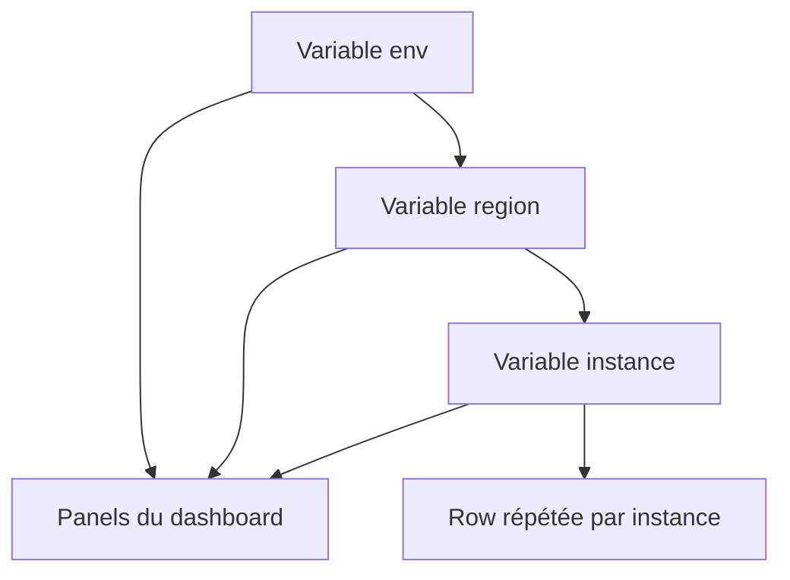

# Variables, filtres et navigation dynamique

## Objectifs pédagogiques

- Créer des variables de type Query, Custom, Constant et Text box, et choisir le bon type selon le besoin.
- Configurer le multi-value et l'option All sans casser les requêtes.
- Prévoir le texte réellement envoyé à la source de données selon le format d'interpolation.
- Construire une chaîne de filtres `env → region → instance` et répéter panels et rows à partir d'une variable.
- Relier des dashboards avec des Data links et des Dashboard links qui conservent le contexte.
- Reconnaître les pièges classiques : variables non échappées, `=` à la place de `=~`, préfixes ambigus.

## Mise en situation

Une équipe de cinq personnes exploite une quarantaine de serveurs répartis sur trois environnements (`dev`, `staging`, `prod`) et deux régions. Au début, tout le monde a fait la chose la plus naturelle : dupliquer le dashboard « Santé des hôtes » une fois par environnement et par région, avec les requêtes modifiées à la main.

Six mois plus tard, il existe six copies, et personne ne sait laquelle est à jour. Quelqu'un corrige le seuil du panel mémoire dans `prod` et oublie `staging`. Un nouveau venu ouvre la version `dev`, qui n'a plus le panel disque. Pendant un incident, on perd deux minutes à se demander si l'on regarde le bon dashboard.

Les variables résolvent ce problème : un seul dashboard, des menus déroulants en haut, et la même vue pour n'importe quel environnement, région ou serveur. Mais elles ont un coût. Une variable mal configurée ne plante pas, elle affiche des graphiques faux avec aplomb. L'essentiel du module consiste à savoir ce que Grafana envoie réellement à la source.

## Le principe : un dashboard à trous

> 🧠 **Concept clé**
>
> Grafana fait de la **substitution de texte**, rien de plus. Il ne comprend pas votre requête PromQL. Il remplace `$instance` par une chaîne de caractères, puis envoie le résultat à Prometheus. Presque tous les comportements surprenants viennent de là : si le texte substitué n'a pas la forme attendue par la source, la requête échoue ou, pire, retourne autre chose que ce que vous pensiez.
{: .callout .callout-important}

La substitution ne se limite pas aux requêtes : elle s'applique aussi aux titres de panels, aux liens, aux noms de rows et aux descriptions. Un titre comme `Latence — $service` s'adapte tout seul.

Les variables se gèrent dans les paramètres du dashboard, rubrique **Variables**. L'éditeur de dashboards a beaucoup évolué ces dernières versions : les libellés exacts des boutons peuvent différer chez vous, mais le principe reste identique.

## Les quatre types de variables du quotidien

| Type | D'où viennent les valeurs | Usage typique |
|------|---------------------------|---------------|
| Query | Une requête sur une source de données | Liste des instances, des environnements, des services |
| Custom | Une liste saisie à la main | Valeurs fixes : `prod,staging,dev`, niveaux de log |
| Constant | Une valeur unique, invisible par défaut | Paramètre partagé qu'on ne veut pas répéter dans 20 requêtes |
| Text box | Ce que l'utilisateur tape | Recherche libre, seuil, identifiant de requête |

### Query : la variable qui interroge la source

C'est celle que vous utiliserez le plus. Avec Prometheus, on s'appuie presque toujours sur `label_values`, qui renvoie les valeurs d'un label :

```promql
label_values(node_uname_info, env)
```

Cette variable `env` lit les valeurs du label `env` sur la métrique `node_uname_info`, qui existe une fois par hôte avec `node_exporter`. Selon la version de Grafana, vous saisissez cette expression telle quelle (mode « classic query ») ou vous remplissez deux champs, *Label* et *Metric*. C'est équivalent.

> 💡 **Astuce**
>
> Donnez toujours une métrique à `label_values`. La forme `label_values(env)` demande les valeurs du label `env` sur toutes les séries, sans restriction à une métrique : sur un Prometheus un peu gros, le menu peut mettre du temps à s'ouvrir et pèse inutilement sur le serveur.
{: .callout .callout-astuce}

Réglages à connaître sur une variable Query :

- **Refresh** : *On dashboard load* relance la requête à chaque ouverture ; *On time range change* la relance quand on modifie la plage de temps. Le second convient aux variables qui doivent refléter ce qui existait réellement pendant la période observée. Une variable constante dans le temps (la liste des environnements) se contente du premier.
- **Sort** : alphabétique par défaut, souvent suffisant. Le tri numérique évite que `web-10` passe avant `web-2` quand vos noms s'y prêtent.
- **Regex** : filtre les valeurs retournées. Pratique pour exclure `localhost:9090` ou ne garder que les hôtes `web-.*`.

### Custom : quand la liste est connue d'avance

Valeurs séparées par des virgules : `prod,staging,dev`. Dans les versions récentes, on peut aussi séparer le texte affiché de la valeur utilisée avec la syntaxe `Production : prod, Préproduction : staging`. Vérifiez que votre version l'accepte avant de l'utiliser dans un modèle partagé.

Le type Custom sert pour des valeurs qui ne vivent dans aucune source de données : niveaux de sévérité, fenêtres de comparaison, choix « par instance / par service » pour un `by (...)`.

### Constant : la valeur qu'on veut écrire une seule fois

Une Constant est une variable cachée, non modifiable depuis le dashboard. Son intérêt est surtout dans les dashboards destinés à être réutilisés ailleurs : au lieu de répéter `job="node-prod"` dans vingt requêtes, vous écrivez `job="$node_job"` et vous ne changez la valeur qu'à un endroit. Si vous n'avez qu'un seul dashboard, vous n'en avez probablement pas besoin.

### Text box : la saisie libre

Un champ où l'utilisateur tape ce qu'il veut. C'est utile pour une recherche, mais c'est aussi la variable la plus risquée, puisque son contenu arrive brut dans votre requête. On y revient dans la partie pièges.

Trois autres types existent : *Data source* (choisir la source elle-même, très utile pour basculer entre un Prometheus `prod` et un Prometheus `staging`), *Interval* (choisir un pas de temps) et *Ad hoc filters* (des filtres clé/valeur ajoutés à la volée). Seuls les Ad hoc filters seront mentionnés plus loin, pour leur piège.

## Multi-value et option All

Une variable simple donne une seule valeur à la fois. Cocher **Multi-value** permet d'en sélectionner plusieurs ; cocher **Include All option** ajoute une entrée « All » qui les sélectionne toutes d'un coup.

Comment la requête suit-elle ? En passant de l'égalité à la **regex** (expression régulière) :

```promql
# Une seule valeur possible
up{env="$env"}

# Plusieurs valeurs possibles
up{region=~"$region"}
```

Quand `region` contient `eu-west` et `eu-north`, Grafana substitue `(eu-west|eu-north)` et Prometheus reçoit `up{region=~"(eu-west|eu-north)"}`.

> 💡 **À retenir**
>
> C'est le cœur du sujet : avec `=` au lieu de `=~`, la requête devient `region="(eu-west|eu-north)"`, qui ne correspond à aucune série. Pas d'erreur, juste « No data ». Multi-value ou All : toujours `=~`.
{: .callout .callout-important}

### Que devient « All » ?

Par défaut, Grafana remplace All par **la liste complète des valeurs**. Avec 300 instances, la requête transporte 300 alternatives. Elle devient lourde, parfois lente, et le texte de la requête devient illisible dans l'inspecteur.

Le champ **Custom all value** permet de forcer ce qui sera substitué. Pour Prometheus, on y met typiquement `.*`. La requête devient alors courte, et surtout elle ne dépend plus de la liste des valeurs connues.

> 📝 **Note**
>
> `region=~".*"` accepte aussi les séries qui n'ont pas du tout le label `region`. C'est souvent ce qu'on veut, parfois non. Cette valeur personnalisée est aussi spécifique à la source : `.*` n'a aucun sens pour une requête SQL.
{: .callout .callout-note}

## Interpolation : le même choix, du texte différent selon la source

Quand vous écrivez `$region`, Grafana choisit un format par défaut selon la source de données. Pour Prometheus et Loki, le multi-value devient une regex `(a|b)`. Pour une source SQL, il devient une liste entre guillemets `'a','b'`, prête pour un `IN (...)`. Pour Elasticsearch, c'est une expression Lucene.

Quand le défaut ne convient pas, on impose le format avec la syntaxe `${variable:format}` :

| Format | Résultat pour `a` et `b` | Quand l'utiliser |
|--------|--------------------------|------------------|
| `regex` | `(a\|b)` | Prometheus, Loki, filtres par regex |
| `pipe` | `a\|b` | Quand les parenthèses gênent |
| `csv` | `a,b` | Fonctions qui attendent une liste |
| `glob` | `{a,b}` | Graphite |
| `lucene` | `("a" OR "b")` | Elasticsearch |
| `sqlstring` | `'a','b'` avec guillemets échappés | Sources SQL, surtout avec une Text box |
| `singlequote` | `'a','b'` | Chaînes entre apostrophes |
| `queryparam` | `var-x=a&var-x=b` | Construire un lien vers un autre dashboard |
| `text` | Libellé affiché | Titres de panels et descriptions |

La liste complète est dans la documentation officielle, et certains formats varient légèrement selon la version.

> 💡 **Astuce**
>
> Pour voir ce qui part vraiment vers la source, ouvrez le panel, puis l'inspecteur (`Inspect → Query`) et rafraîchissez. Vous y lisez la requête déjà interpolée. Quand un graphique est vide, c'est le premier geste à faire, avant de soupçonner la source de données.
{: .callout .callout-astuce}

## Construction progressive : de un menu à une navigation complète

### v1 — Une seule variable pour sortir du copier-coller

On commence petit. Variable Query `instance`, Prometheus :

```promql
label_values(node_cpu_seconds_total{job="node"}, instance)
```

Multi-value activé, All activé avec Custom all value `.*`. Le panel CPU devient :

```promql
100 - avg by (instance) (
  rate(node_cpu_seconds_total{mode="idle", instance=~"$instance"}[$__rate_interval])
) * 100
```

(`$__rate_interval` est une variable intégrée de Grafana qui adapte la fenêtre de `rate` à la résolution du graphique. Vous n'avez rien à créer.)

Un dashboard, un menu : on peut déjà isoler un serveur, ou tout voir. Mais dès qu'on a plusieurs environnements, la liste mélange des hôtes `dev` et `prod` et personne ne s'y retrouve.

### v2 — Chaîner les filtres : environnement, région, instance

On ajoute deux variables au-dessus, et on fait dépendre chacune de la précédente :

```promql
# env
label_values(node_uname_info, env)

# region
label_values(node_uname_info{env="$env"}, region)

# instance
label_values(node_uname_info{env="$env", region=~"$region"}, instance)
```

Quand vous changez `env`, Grafana recalcule `region`, qui recalcule `instance`. Le menu des instances ne propose plus que des serveurs cohérents avec les choix du dessus.



Le panel CPU devient :

```promql
100 - avg by (instance) (
  rate(node_cpu_seconds_total{mode="idle", env="$env", region=~"$region", instance=~"$instance"}[$__rate_interval])
) * 100
```

> ⚠️ **Erreur fréquente**
>
> Placez toujours une variable *en dessous* de celles qu'elle référence. Les versions récentes de Grafana détectent les dépendances entre variables, mais l'ordre de la liste reste celui de l'affichage et, selon la version, de l'évaluation initiale : une variable placée avant sa dépendance peut alors être évaluée trop tôt. Si votre menu `instance` reste vide ou affiche des valeurs d'un autre environnement, vérifiez d'abord l'ordre et les références des variables.
{: .callout .callout-attention}

Le même principe s'applique à un dashboard orienté service : `service` dépend de `env` (et éventuellement de `region`), et lit ses valeurs sur une métrique applicative comme `http_requests_total`.

Cette chaîne ne fonctionne que si les labels `env`, `region` et `service` existent partout, avec le même nom. Si un job utilise `environment` au lieu de `env`, ses séries disparaissent des filtres sans aucune alerte. C'est un problème d'instrumentation que Grafana ne peut pas corriger à votre place.

### v3 — Finitions pour un usage en production

Une fois la chaîne en place, quelques réglages font la différence entre un dashboard « qui marche chez moi » et un dashboard partagé :

- Fixer des valeurs par défaut raisonnables (`prod`, par exemple), puis enregistrer le dashboard en cochant l'option qui met à jour les valeurs par défaut des variables.
- Donner un *Label* lisible (« Environnement ») à chaque variable plutôt que le nom technique.
- Passer en *Hide → Variable* les variables purement techniques, comme une Constant.
- Savoir que l'URL porte l'état des filtres : `?var-env=prod&var-region=eu-west&var-instance=web-01&from=now-6h&to=now`. Copier cette URL dans un ticket, c'est partager exactement la vue que vous regardez.

**Ad hoc filters** : ce type de variable ajoute des filtres `label = valeur` à la volée, sans les prévoir dans les requêtes.

C'est pratique pour explorer. Mais le filtre s'applique à **toutes** les requêtes du dashboard qui utilisent cette source de données. Si un panel interroge une métrique qui n'a pas le label concerné, il peut se retrouver vide. Gardez-les pour des dashboards d'exploration, pas pour des vues d'astreinte où chaque panel doit se comporter de façon prévisible.

## Répétition de panels et de rows

Quand l'utilisateur sélectionne plusieurs valeurs, deux approches s'offrent à lui : tout agréger dans un seul graphique avec une courbe par valeur, ou **générer un panel par valeur**. La seconde donne une vue plus lisible quand chaque instance mérite son propre graphique.

- **Pour un panel** : dans l'éditeur, section **Repeat options**, choisissez la variable, la direction (horizontale ou verticale) et le nombre maximum de panels par ligne.
- **Pour une row entière** : dans les options de la row, **Repeat for**, puis la variable. La row complète, avec tous les panels qu'elle contient, est dupliquée par valeur. Mettez `$instance` dans le titre de la row pour savoir laquelle est laquelle.

Quelques règles de survie :

- La variable doit être multi-value ou avoir l'option All, sinon il n'y a rien à répéter.
- On modifie toujours le panel (ou la row) **d'origine**. Les copies sont générées, elles ne se retouchent pas individuellement.
- Chaque copie exécute ses propres requêtes. Répéter un panel lourd sur 80 instances revient à lancer 80 fois la requête.

> ⚠️ **Erreur fréquente**
>
> Répéter par une variable avec All sur une centaine de valeurs. Le dashboard devient interminable à charger et à faire défiler. Limitez la répétition à une poignée de valeurs (une dizaine est un ordre de grandeur raisonnable), et gardez All sur une vue agrégée.
{: .callout .callout-attention}

## Data links et Dashboard links : naviguer sans perdre le fil

Un dashboard utile pendant un incident permet de passer de « quelque chose cloche » à « voilà où regarder » en un clic. Deux mécanismes, qui répondent à deux besoins différents.

### Data links : un lien au niveau de la donnée

Vous le configurez dans l'éditeur du panel, section **Data links** (parfois renommée *Data links and actions* selon la version). Exemple : un tableau listant les hôtes avec leur charge, où cliquer sur un hôte ouvre le dashboard de détail filtré sur celui-ci.

> 📖 **Définition**
>
> Un Data link est un lien attaché à un panel, qui s'appuie sur la donnée cliquée.
{: .callout .callout-definition}

```text
/d/<UID>/node-detail?var-instance=${__data.fields.instance}&${env:queryparam}&${__url_time_range}
```

Chaque morceau a son rôle :

- `/d/<UID>/node-detail` : la cible. L'**UID (Unique Identifier)** du dashboard est visible dans son URL ou dans ses paramètres. Préférez-le à un chemin qui dépend du titre.
- `var-instance=${__data.fields.instance}` : la valeur du champ `instance` de la ligne cliquée devient la valeur de la variable `instance` sur le dashboard cible. Sur un graphique temporel, on utiliserait plutôt `${__field.labels.instance}`.
- `${env:queryparam}` : le format `queryparam` transforme la sélection courante en `var-env=prod`, ce qui évite d'écrire le paramètre à la main.
- `${__url_time_range}` : reporte la plage de temps (`from=...&to=...`), pour que l'on regarde la même fenêtre.

### Dashboard links : une barre de navigation

Les Dashboard links se définissent au niveau du dashboard (paramètres → **Links**) et apparaissent en haut de page. Deux modes : un lien vers une URL, ou un lien vers d'autres dashboards sélectionnés par **tags**, ce qui permet de construire un menu de navigation qui se met à jour tout seul quand on ajoute un dashboard avec le bon tag. Deux options sont à cocher consciemment :

- **Include current time range** : le dashboard cible s'ouvre sur la même période.
- **Include current template variable values** : les valeurs des filtres sont transmises.

> 🧠 **Concept clé**
>
> Le transfert de variables ne fonctionne que si le dashboard cible a une variable **portant le même nom**. Un `env` d'un côté et un `environment` de l'autre, et la valeur se perd silencieusement. La convention de nommage des variables entre dashboards est donc une vraie décision d'équipe, pas un détail.
{: .callout .callout-important}

## Quand les filtres mentent : diagnostic des pièges

| Symptôme | Cause probable | Correction |
|----------|----------------|------------|
| Panel en « No data » après avoir sélectionné deux valeurs | `label="$var"` avec une variable multi-value : la regex `(a\|b)` est comparée en égalité | Utiliser `label=~"$var"` |
| `$env` est remplacé à moitié (`prod` collé à un morceau de texte) | Un nom de variable est préfixe d'un autre (`$env` et `$environment`) | Écrire `${env}` avec accolades, ou renommer |
| Le menu d'instances est vide ou propose les hôtes d'un autre environnement | Variable placée avant sa dépendance, ou requête de variable sans filtre parent | Réordonner les variables et filtrer par `$env` |
| La requête avec All est énorme ou lente | Remplacement de All par toutes les valeurs | Renseigner une Custom all value (`.*` pour Prometheus) |
| Un panel se vide quand on ajoute un Ad hoc filter | Le filtre s'applique à toutes les requêtes de la source, même celles sans ce label | Retirer l'Ad hoc filter ou limiter son usage aux dashboards d'exploration |
| Une valeur tapée dans une Text box casse la requête | Saisie injectée brute (guillemet, antislash, caractère spécial de regex) | Imposer un format : `${search:sqlstring}` en SQL, `${search:regex}` pour une regex |
| Le lien vers un autre dashboard ouvre un filtre vide | Variable absente ou nommée différemment sur la cible | Aligner les noms de variables entre dashboards |
| Un hôte retiré depuis longtemps figure encore dans le menu | La variable lit une période large, ou n'est pas rafraîchie | Passer le refresh sur *On time range change* et filtrer la requête par un job actif |

> ⚠️ **Variables non échappées — le piège principal**
>
> Substituer du texte sans précaution, c'est faire confiance à celui qui le tape. En SQL, une Text box branchée dans `WHERE name = '$search'` permet à un utilisateur de casser la requête, voire d'y glisser des instructions. Le format `sqlstring` échappe les guillemets et résout ce cas. Même logique pour une regex : un `.` ou un `(` tapé dans une recherche de logs change le sens du filtre. Sans accès direct à la base ni à Loki, le risque est souvent de la requête fausse plutôt que du vol de données, mais le principe reste le même : jamais de saisie brute dans une requête.
{: .callout .callout-attention}

Les caractères spéciaux concernent aussi les valeurs issues d'une source, comme les points de `10.0.0.1:9100`, qui en regex signifient « n'importe quel caractère ». Pour une variable Query en multi-value ou All, la source Prometheus échappe déjà ces caractères lors de l'interpolation. Le risque porte surtout sur la Custom all value et sur les Text box. Si vous avez un doute, regardez la requête interpolée dans l'inspecteur plutôt que de raisonner de tête.

## Cas réel en entreprise (scénario illustratif)

*Scénario fictif, chiffres donnés à titre d'illustration.*

Une équipe plateforme de cinq personnes supervise trois environnements et deux régions. Elle possède six dashboards « Santé des hôtes », un par environnement et par région. Chaque évolution (par exemple un nouveau panel de saturation disque) demande six modifications manuelles, soit environ une demi-heure, avec des oublis réguliers.

Elle remplace les six copies par un dashboard unique et deux variables, `env` et `region`, plus une variable `instance` chaînée. Les étapes :

1. Vérifier que les labels `env` et `region` sont présents sur toutes les cibles Prometheus, et corriger deux jobs qui utilisaient `environment`.
2. Créer les variables dans l'ordre `env → region → instance`, avec une Custom all value `.*`.
3. Remplacer les valeurs codées en dur dans les requêtes par les variables, en passant en `=~` partout où le multi-value est autorisé.
4. Ajouter une row répétée par instance pour la vue de détail, limitée à une sélection de quelques hôtes.
5. Poser un Data link du tableau de synthèse vers le dashboard de détail, avec transmission de `env` et de la plage de temps.

Résultat attendu dans ce type de migration : une seule version à maintenir, un menu qui évite de regarder le mauvais environnement, et une URL de dashboard qu'on colle directement dans le ticket d'incident. Le gain de maintenance est la partie la plus visible ; le gain pendant un incident est de ne plus avoir à se demander quel dashboard ouvrir.

## Bonnes pratiques

- **Nommer les variables comme des labels.** `env`, `region`, `service`, `instance` : la même convention partout évite les pertes de valeur dans les liens entre dashboards.
- **Toujours utiliser les accolades** (`${env}`) dès que le nom pourrait être le préfixe d'un autre, et par habitude dans les titres.
- **Choisir `=~` dès qu'une variable est multi-value ou All.** Gardez `=` pour les variables mono-valeur.
- **Renseigner la Custom all value** pour éviter de transporter des centaines d'alternatives dans chaque requête.
- **Filtrer les requêtes de variables par métrique et par variable parente.** C'est plus rapide, et les menus restent cohérents.
- **Ne jamais injecter une Text box brute.** Appliquer `sqlstring`, `regex` ou le format adapté à la source.
- **Limiter la répétition de panels** : chaque copie est une requête de plus, et la page doit rester lisible pendant un incident.
- **Documenter les labels attendus.** Si le dashboard suppose `env` et `region`, écrivez-le dans sa description : le prochain qui branche un job sans ces labels saura pourquoi le panel reste vide.

## Résumé

Les variables transforment un dashboard figé en outil de navigation : un seul tableau, des menus `env`, `region`, `instance`, et des requêtes qui s'adaptent. Grafana ne fait que substituer du texte, donc tout se joue sur la forme de ce texte : `=~` pour le multi-value, Custom all value pour All, format explicite quand la source l'exige. La chaîne de variables dépendantes, la répétition de panels et de rows, puis les Data links et Dashboard links permettent de passer d'une vue globale à un détail sans perdre le contexte. Les pièges (variables non échappées, préfixes ambigus, Ad hoc filters trop larges) se repèrent en lisant la requête interpolée dans l'inspecteur. La suite logique consiste à appliquer cette même navigation aux journaux et aux traces, où les filtres servent à retrouver la bonne ligne ou le bon appel parmi des milliers.

<!-- snippet
id: grafana_variables_label_values_chain
type: command
tech: grafana
level: beginner
importance: high
format: knowledge
tags: grafana,variables,promql,prometheus
title: Variable Query chaînée avec label_values
context: Dashboard → Settings → Variables → New variable, type Query, source Prometheus
command: label_values(<METRIC>{<PARENT_LABEL>="$<PARENT_VAR>"}, <LABEL>)
example: label_values(node_uname_info{env="$env"}, region)
description: Liste les valeurs du label region pour l'env choisi ; toujours préciser une métrique pour éviter un scan de toutes les séries ; = suppose un parent mono-valeur, utiliser =~ si le parent est multi-value
-->

<!-- snippet
id: grafana_variables_multivalue_regex_match
type: warning
tech: grafana
level: beginner
importance: high
format: knowledge
tags: grafana,variables,promql,multi-value
title: Multi-value : utiliser =~ et non = dans PromQL
content: Piège : écrire region="$region" avec une variable multi-value. Grafana substitue (eu-west|eu-north), donc Prometheus compare cette chaîne exacte en égalité. Conséquence : aucune série, panel en No data sans erreur. Correction : region=~"$region" partout où la variable accepte plusieurs valeurs.
description: Avec plusieurs valeurs sélectionnées, la variable devient une regex (a|b) ; l'opérateur = ne correspond à rien, seul =~ fonctionne
-->

<!-- snippet
id: grafana_variables_interpolation_format
type: concept
tech: grafana
level: beginner
importance: high
format: knowledge
tags: grafana,variables,interpolation,formats
title: Interpolation : le format dépend de la source de données
content: Grafana remplace $var par du texte avant d'envoyer la requête. Format par défaut selon la source : regex (a|b) pour Prometheus et Loki, liste quotée 'a','b' pour SQL, Lucene pour Elasticsearch. Pour imposer un format, écrire ${var:format}, par exemple ${region:pipe} donne a|b et ${host:sqlstring} donne 'a','b' avec guillemets échappés.
description: La syntaxe ${var:format} force la forme du texte substitué ; sans elle, Grafana choisit un format par défaut propre à chaque source
-->

<!-- snippet
id: grafana_variables_all_custom_value
type: tip
tech: grafana
level: beginner
importance: medium
format: knowledge
tags: grafana,variables,all,prometheus
title: Définir une Custom all value pour l'option All
content: Dans la variable, activer Include All option, puis renseigner Custom all value avec .* pour Prometheus. Sans cela, All est remplacé par la liste complète des valeurs, soit 300 alternatives dans la requête pour 300 instances. Attention : .* accepte aussi les séries sans le label concerné.
description: Évite des requêtes géantes avec All ; la valeur personnalisée est propre à la source (.* en Prometheus, inutilisable telle quelle en SQL)
-->

<!-- snippet
id: grafana_variables_braces_prefix
type: warning
tech: grafana
level: beginner
importance: medium
format: knowledge
tags: grafana,variables,syntaxe,interpolation
title: $env et $environment : préférer ${env}
content: Piège : avoir deux variables dont l'une est préfixe de l'autre ($env et $environment). Conséquence : substitution partielle, texte coupé au mauvais endroit dans la requête ou le titre. Correction : toujours écrire ${env} avec accolades, ou renommer l'une des deux variables.
description: Les accolades délimitent sans ambiguïté le nom de la variable, utile aussi quand elle est collée à du texte dans un titre ou une URL
-->

<!-- snippet
id: grafana_variables_textbox_sqlstring
type: warning
tech: grafana
level: intermediate
importance: high
format: knowledge
tags: grafana,variables,securite,sql
title: Text box : ne jamais injecter la saisie brute
content: Piège : WHERE name = '$search' avec une Text box. Un guillemet tapé casse la requête, ou y glisse du SQL. Conséquence : erreur, résultat faux ou requête détournée. Correction : ${search:sqlstring} en SQL, ${search:regex} pour un filtre par regex, puis contrôler la requête dans l'inspecteur.
description: Le contenu d'une Text box est substitué tel quel dans la requête ; un format d'échappement explicite protège SQL et regex
-->

<!-- snippet
id: grafana_variables_dependency_order
type: concept
tech: grafana
level: beginner
importance: high
format: knowledge
tags: grafana,variables,dependances,dashboards
title: Variables dépendantes : l'ordre de la liste compte
content: Une variable dont la requête cite $env dépend de env. Quand env change, Grafana relance les variables dépendantes. Placer env au-dessus dans la liste des variables : les versions récentes détectent les dépendances, mais selon la version une dépendante placée avant peut s'évaluer trop tôt. Symptôme typique : menu vide ou valeurs d'un autre environnement.
description: Chaîne env → region → instance : chaque variable se recalcule quand sa parente change ; la placer plus bas dans la liste reste la règle sûre
-->

<!-- snippet
id: grafana_variables_repeat_limit
type: tip
tech: grafana
level: beginner
importance: medium
format: knowledge
tags: grafana,variables,repeat,panels
title: Répéter un panel ou une row par variable
context: Panel editor → Repeat options ; options de la row → Repeat for
content: Choisir la variable (multi-value ou All), la direction et le nombre max de panels par ligne. Éditer toujours le panel d'origine, les copies sont régénérées. Chaque copie lance ses requêtes : limiter la répétition à une dizaine de valeurs, et garder All sur une vue agrégée.
description: Une copie par valeur sélectionnée ; au-delà d'une dizaine, la page devient lente à charger et difficile à lire pendant un incident
-->

<!-- snippet
id: grafana_variables_url_state
type: tip
tech: grafana
level: beginner
importance: medium
format: knowledge
tags: grafana,variables,url,partage
title: Partager l'état des filtres via l'URL du dashboard
content: Les variables et la plage de temps sont portées par l'URL, par exemple ?var-env=prod&var-region=eu-west&var-instance=web-01&from=now-6h&to=now. Coller cette URL dans un ticket d'incident donne exactement la même vue à tous. Pour une variable multi-value, répéter le paramètre : var-instance=web-01&var-instance=web-02.
description: Le préfixe var- suivi du nom de la variable fixe la valeur ; utile pour les liens, les tickets et les runbooks
-->

<!-- snippet
id: grafana_datalink_dashboard_context
type: command
tech: grafana
level: intermediate
importance: medium
format: knowledge
tags: grafana,data-links,navigation,variables
title: Data link vers un dashboard de détail avec contexte
context: Panel editor → Data links (Data links and actions selon la version)
command: /d/<UID>/<SLUG>?var-<VARIABLE>=${__data.fields.<CHAMP>}&${<VAR_COURANTE>:queryparam}&${__url_time_range}
example: /d/abc123/node-detail?var-instance=${__data.fields.instance}&${env:queryparam}&${__url_time_range}
description: Transmet l'instance cliquée, le filtre env courant et la plage de temps ; la variable cible doit porter le même nom sur l'autre dashboard
-->

<!-- snippet
id: grafana_links_same_variable_name
type: concept
tech: grafana
level: beginner
importance: medium
format: knowledge
tags: grafana,dashboard-links,variables,navigation
title: Dashboard links : les variables passent par leur nom
content: Avec Include current template variable values, Grafana ajoute var-env=prod à l'URL du dashboard cible. Si la cible n'a pas de variable nommée env, le paramètre est ignoré sans message. Convention d'équipe : les mêmes noms (env, region, service, instance) sur tous les dashboards liés. Lier par tags permet un menu qui se met à jour seul.
description: Le transfert de filtres repose sur l'égalité des noms de variables entre les dashboards source et cible, sans erreur en cas d'absence
-->

<!-- snippet
id: grafana_variables_inspect_interpolated_query
type: tip
tech: grafana
level: beginner
importance: high
format: knowledge
tags: grafana,variables,debug,inspect
title: Lire la requête interpolée dans l'inspecteur
context: Panel → menu → Inspect → Query, puis Refresh
content: Quand un panel est vide après un changement de filtre, ouvrir l'inspecteur du panel, onglet Query, et rafraîchir. On y lit la requête avec les variables déjà remplacées, par exemple region=~"(eu-west|eu-north)". C'est le moyen le plus rapide de repérer un = à la place d'un =~ ou un préfixe mal substitué.
description: L'inspecteur affiche le texte réellement envoyé à la source ; premier réflexe avant de soupçonner Prometheus ou le réseau
-->

<!-- snippet
id: grafana_variables_adhoc_all_queries
type: error
tech: grafana
level: intermediate
importance: low
format: knowledge
tags: grafana,variables,adhoc-filters,diagnostic
title: Panel vide après ajout d'un Ad hoc filter
content: Symptôme : un panel passe en No data dès qu'un Ad hoc filter est ajouté. Cause : le filtre s'applique à toutes les requêtes du dashboard utilisant la même source, y compris celles dont la métrique n'a pas ce label. Correction : retirer le filtre, ou réserver les Ad hoc filters aux dashboards d'exploration.
description: Les Ad hoc filters touchent toutes les requêtes d'une source dans le dashboard ; un panel sans le label concerné se vide
-->
