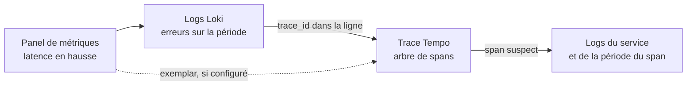


# Exploration initiale des logs et traces

## Objectifs pédagogiques

À la fin de ce module, vous serez capable de :

- **Interroger** Loki depuis Explore, en choisissant un flux (stream) par ses labels puis en affinant par filtre textuel.
- **Écrire** des requêtes LogQL (Log Query Language) de base : sélecteur, filtres de ligne, parsing JSON ou logfmt, filtre sur un champ extrait.
- **Lire** une trace dans Tempo : identifier le span racine, les spans enfants, les durées et les erreurs.
- **Retrouver** une trace à partir de son identifiant, ou la chercher par service et par durée.
- **Naviguer** à la main entre une métrique, des logs et une trace sans perdre la fenêtre de temps.

## Mise en situation

Vous êtes dans une équipe de six personnes qui exploite une API de commande en ligne : trois services derrière un reverse proxy, déployés sur quelques machines virtuelles. Les dashboards construits aux modules précédents fonctionnent bien. Ce mardi, un panel montre que le temps de réponse a doublé vers 14 h 20. La courbe vous dit **que** quelque chose se passe. Elle ne dit ni quelle requête, ni quel service, ni pourquoi.

> 🚗 **Analogie : le tableau de bord et le capot**
>
> Un panel de métriques est un tableau de bord de voiture : il signale que le moteur chauffe, pas quelle pièce lâche. Pour le savoir, il faut ouvrir le capot. En observabilité, le capot, ce sont les logs (ce que chaque composant a raconté) et les traces (le trajet d'une requête à travers les composants).
{: .callout .callout-analogie}

La solution naïve consiste à se connecter en SSH sur chaque machine et à lancer `grep` sur des fichiers. Elle s'effondre vite : trois services, plusieurs instances, des conteneurs éphémères dont les fichiers disparaissent au redémarrage. Et surtout, `grep` ne suit pas une requête qui traverse trois services. Grafana Explore avec Loki et Tempo répond à ces deux limites.

## Deux signaux, deux façons de raconter

Que contient exactement chaque signal ? Mieux vaut le savoir avant de toucher à l'interface.

Un **log** est un événement daté : « à 14:20:03, le service `checkout` a reçu un timeout en appelant le paiement ». Chaque ligne est isolée. Pour reconstituer une histoire, il faut deviner quelles lignes vont ensemble.

Une **trace** est l'histoire d'une seule requête, déjà reconstituée. Elle est composée de **spans**, organisés en arbre.

> 📖 **Définition**
>
> Un **span** représente une opération mesurée (un appel HTTP, une requête SQL, un traitement interne), avec son début, sa durée et son parent.
{: .callout .callout-definition}

> 🧠 **Concept clé**
>
> Une trace distribuée n'est pas un fichier journal. Un fichier journal est une suite chronologique de lignes écrites par un seul processus. Une trace est un graphe de spans émis par plusieurs services, rassemblés après coup grâce à un identifiant commun, le `trace_id`. Elle peut aussi être incomplète : si un service n'est pas instrumenté, ou si la requête a été écartée par l'échantillonnage (sampling), il manque des morceaux, voire toute la trace. Lire une trace comme on lit un log (de haut en bas, ligne par ligne) conduit à des conclusions fausses.
{: .callout .callout-important}

Le lien entre les deux est l'identifiant de trace, quand l'application l'écrit dans ses logs. Ce fil permet de passer d'un monde à l'autre, et tout le module y mène.



## Mise en place : vérifier que le terrain est prêt

Ce module suppose que les data sources Loki et Tempo sont déjà déclarées dans Grafana (voir le module sur les sources de données). Vérifiez-le depuis la machine qui héberge la stack, avant de chercher une erreur dans Grafana qui n'y serait pas.

```bash
# Loki répond-il ?
curl -s http://localhost:3100/ready

# Quels labels Loki connaît-il ? (JSON avec "status":"success")
curl -s "http://localhost:3100/loki/api/v1/labels"

# Tempo répond-il ?
curl -s http://localhost:3200/ready
```

Les ports (3100 pour Loki, 3200 pour Tempo) sont les valeurs par défaut des images officielles. Adaptez-les à votre déploiement.

Si votre environnement est vide, injectez un log de test à la main, ce qui est aussi un bon moyen de comprendre ce qu'est un flux :

```bash
curl -s -X POST http://localhost:3100/loki/api/v1/push \
  -H "Content-Type: application/json" \
  -d '{"streams":[{"stream":{"job":"demo","env":"lab"},"values":[["'"$(date +%s%N)"'","level=error msg=\"payment timeout\" status=502 duration=4.8s"]]}]}'
```

Une réponse vide (HTTP 204) signifie que Loki a accepté la ligne. Le timestamp est en nanosecondes, et `%N` n'existe pas dans le `date` de macOS. Si Loki tourne en mode multi-tenant, ajoutez l'en-tête `X-Scope-OrgID`.

## Logs dans Explore : flux, labels, recherche textuelle

Ouvrez **Explore** (menu de gauche), choisissez la data source Loki. Dans l'éditeur de requête, vous avez en général un mode *Builder* (formulaire) et un mode *Code* (texte libre). Les noms exacts varient selon la version de Grafana, mais le principe est constant. Commencez en Builder pour découvrir les labels disponibles, puis passez en Code dès que vous savez ce que vous voulez.

### Ce qu'est un flux, et pourquoi ça change la façon de chercher

Loki n'indexe pas le contenu des lignes. Il n'indexe que les **labels** attachés à un flux : `app`, `env`, `host`, `namespace`, etc. Un flux est l'ensemble des lignes partageant exactement la même combinaison de labels.

D'où la règle de travail de Loki : **d'abord réduire par les labels, ensuite filtrer le texte**.

Conséquence pratique, visible tout de suite : une requête Loki doit commencer par un sélecteur de flux avec au moins un critère non vide. `{}` est refusé.

> ⚠️ **Erreur fréquente**
>
> Vouloir « tout chercher » en tapant seulement un mot, comme on le ferait dans un moteur de recherche. Il faut toujours dire dans quel flux chercher (`{app="checkout"}`), puis ajouter le mot. Sans cela, soit la requête est rejetée, soit elle parcourt un volume énorme et expire.
{: .callout .callout-attention}

### Lire le résultat

Sous la requête, Explore affiche un histogramme du volume de logs dans le temps, puis la liste des lignes. Deux réflexes à prendre :

- L'histogramme montre les pics. Un pic de volume coïncide souvent avec un incident, et cliquer-glisser sur l'histogramme restreint la période.
- Cliquer sur une ligne la déplie : Grafana y affiche les labels du flux et, si le format est reconnu, les champs détectés. On peut cliquer sur un champ pour l'ajouter ou l'exclure du filtre.

> 💡 **Astuce**
>
> Le bouton *Live* (suivi en direct) est précieux quand vous reproduisez un problème : vous déclenchez la requête fautive depuis un terminal et vous voyez la ligne apparaître en quelques secondes.
{: .callout .callout-astuce}

## LogQL pour débuter : sélectionner, filtrer, extraire

LogQL se lit de gauche à droite comme un tube Unix : chaque étape (`|`) réduit ou enrichit ce que l'étape précédente a produit.

### Construction progressive d'une requête

**v1 : le sélecteur seul.** On choisit le flux, rien d'autre.

```logql
{app="checkout", env="prod"}
```

Les opérateurs de label sont `=`, `!=`, `=~` (regex) et `!~`. Exemple : `{app=~"checkout|payment"}`. C'est correct, mais vous voyez toutes les lignes, y compris le bruit.

**v2 : ajouter des filtres de ligne.** On cherche du texte dans le contenu.

```logql
{app="checkout", env="prod"} |= "timeout" != "healthcheck"
```

| Opérateur | Sens |
|-----------|------|
| `\|= "txt"` | la ligne contient `txt` |
| `!= "txt"` | la ligne ne contient pas `txt` |
| `\|~ "a\|b"` | la ligne correspond à la regex |
| `!~ "regex"` | la ligne ne correspond pas à la regex |

La recherche est sensible à la casse ; pour l'ignorer, utilisez une regex : `|~ "(?i)timeout"`. Les filtres de ligne sont rapides, placez-les **avant** tout parsing.

**v3 : extraire des champs et filtrer dessus.** Chercher « 502 » comme texte attrapera aussi un identifiant contenant 502. Si la ligne est structurée, mieux vaut extraire les champs :

```logql
{app="checkout", env="prod"} | json | status >= 500 | duration > 2s
```

`| json` transforme les clés d'un log JSON en labels temporaires utilisables dans la requête. Pour du `clé=valeur`, utilisez `| logfmt`. Pour un format fixe sans structure (log d'accès Nginx, par exemple), `| pattern` permet de nommer les morceaux. Après l'extraction, `status >= 500` et `duration > 2s` sont de vrais filtres numériques et de durée, pas de la recherche de texte.

Pour rendre le résultat lisible pendant l'investigation, reformatez la ligne :

```logql
{app="checkout"} | json | status >= 500 | line_format "{{.method}} {{.path}} {{.status}} {{.duration}} {{.trace_id}}"
```

> 💡 **Astuce**
>
> Affichez toujours le `trace_id` dans `line_format` quand il existe. C'est l'information que vous irez chercher à l'étape suivante.
{: .callout .callout-astuce}

### Passer des logs à un graphe

LogQL sait aussi compter. Une requête enveloppée dans une fonction d'agrégation produit une série temporelle, que vous pouvez afficher comme n'importe quelle métrique :

```logql
sum by (status) (count_over_time({app="checkout"} | json | status >= 500 [5m]))
```

Cette requête compte, par code de statut, les lignes en erreur sur des fenêtres glissantes de 5 minutes. Elle sert à confirmer qu'un pic visible dans les logs correspond bien à celui de votre dashboard, sans dépendre du seul aspect visuel de l'histogramme.

## Traces dans Tempo : lire l'arbre d'exécution

Dans Explore, choisissez la data source Tempo. Selon la version, vous aurez plusieurs types de requête : recherche par formulaire, TraceQL (Trace Query Language), et saisie directe d'un identifiant de trace.

### Retrouver une trace par son identifiant

C'est le cas le plus simple et le plus fiable. Vous avez un `trace_id` (copié d'un log, d'un en-tête de réponse, d'un ticket) : choisissez le mode *TraceID*, collez-le, exécutez. Au format W3C/OpenTelemetry, un identifiant de trace fait 32 caractères hexadécimaux, par exemple `4bf92f3577b34da6a3ce929d0e0e4736`. Certains systèmes, comme Jaeger, utilisent encore des identifiants de 16 caractères.

Même chose depuis un terminal, utile pour vérifier que Tempo a bien reçu la trace avant d'accuser Grafana :

```bash
curl -s http://localhost:3200/api/traces/4bf92f3577b34da6a3ce929d0e0e4736
```

Si Tempo répond « trace not found », trois causes sont possibles : l'identifiant est faux, la trace n'a pas été échantillonnée, ou elle a dépassé la rétention. Les premières secondes après la requête, elle peut aussi ne pas être encore indexée.

### Chercher sans identifiant : TraceQL

Quand vous n'avez pas d'identifiant, vous cherchez des traces par leurs propriétés :

```traceql
{ resource.service.name = "checkout" && duration > 2s }
{ status = error }
{ span.http.status_code >= 500 }
```

La première cherche les traces où le service `checkout` a un span de plus de 2 secondes. Le résultat est une liste de traces avec leur durée totale, leur span racine et leur horodatage. Cliquer sur l'une ouvre la vue détaillée.

### Lire la vue détaillée

La vue est une cascade horizontale (parfois appelée waterfall ou flame view) :

- Chaque ligne est un span, indenté sous son parent. Le span tout en haut est le **span racine**, celui par lequel la requête est entrée.
- La longueur de la barre représente la durée. Sa position horizontale indique quand le span a démarré par rapport au début de la trace.
- Un span en erreur est signalé visuellement. Cliquez dessus pour voir ses attributs : méthode HTTP, URL, code de statut, requête SQL, message d'erreur.

Il y a une subtilité qui trompe tous les débutants : pour des appels synchrones, la durée d'un span **inclut** celle de ses enfants.

Un span racine de 5 s ne veut donc pas dire que le premier service est lent : si son unique enfant (l'appel au service de paiement) dure 4,8 s, le temps est passé en aval. À l'inverse, un span long dont les enfants sont courts signale du temps passé dans le code du span lui-même, ou dans une partie non instrumentée.

Cette règle n'est pas absolue. Des enfants exécutés en parallèle se chevauchent, et un enfant asynchrone (message, appel sans attente de réponse) peut se terminer après son parent. Dans ces cas, soustraire les durées ne donne pas le temps propre du parent.

> ⚠️ **Erreur fréquente**
>
> Accuser le premier span long de la liste. Descendez toujours l'arbre jusqu'au span le plus profond qui explique l'essentiel de la durée avant de formuler une hypothèse.
{: .callout .callout-attention}

## Corrélation manuelle : relier métriques, logs et traces

Ces trois signaux répondent donc à des questions différentes. L'investigation consiste à en faire le tour dans cet ordre, en gardant la même fenêtre de temps.

> 💡 **À retenir**
>
> Les métriques disent *combien et quand*, les logs *quoi et où*, les traces *par où et en combien de temps à chaque étape*.
{: .callout .callout-important}

### Du panel aux logs

Depuis un panel, vous pouvez ouvrir la requête dans Explore. Dans Explore, le bouton *Split* ouvre deux volets côte à côte : Prometheus à gauche, Loki à droite, par exemple. La période est synchronisable entre les deux, ce qui évite la source d'erreur la plus courante de la corrélation : regarder deux périodes différentes sans le voir.

### Des logs à la trace

Si vos applications écrivent le `trace_id` dans leurs logs, deux options existent.

- **À la main** : copier l'identifiant depuis la ligne (cf. `line_format` plus haut), basculer sur Tempo, le coller. Fiable, un peu long.
- **Par un lien automatique** : dans la configuration de la data source Loki, on déclare un *derived field* (champ dérivé) : une expression régulière qui extrait l'identifiant de la ligne, et un lien interne vers Tempo qui l'utilise. À partir de là, un bouton apparaît à côté de chaque ligne contenant un `trace_id`. La même logique existe dans l'autre sens : dans la data source Tempo, la fonction « trace vers logs » ouvre les logs du service correspondant au span sélectionné.

Ces réglages se trouvent dans la configuration des data sources et leur libellé exact dépend de la version. Cela se configure une fois, par un administrateur, et profite ensuite à toute l'équipe.

### Des métriques vers les traces

Si les applications et Prometheus sont configurés pour les exemplars, un point sur un graphe de latence peut pointer directement vers une trace représentative. C'est une piste à connaître, pas un prérequis du module : tout le reste fonctionne sans.

> 💡 **Astuce**
>
> Quand les liens automatiques ne remontent rien, regardez les noms. Le même service peut s'appeler `checkout` dans le label Loki `app`, `checkout-svc` dans l'attribut `service.name` des traces, et `checkout_prod` dans une métrique. Un nommage homogène entre les trois signaux est le premier ingrédient d'une corrélation qui marche.
{: .callout .callout-astuce}

## Erreurs fréquentes

**Symptôme : « No logs found » alors que l'application écrit.**
Cause la plus courante : la période sélectionnée ne couvre pas l'événement, ou un label du sélecteur est faux d'une lettre (`env="production"` au lieu de `env="prod"`). Correction : élargir la période à 1 h, retirer tous les labels sauf un, puis les rajouter un à un. Vérifier au passage les valeurs possibles dans le sélecteur de labels du Builder.

**Symptôme : « parse error » ou requête rejetée.**
Cause : sélecteur vide, guillemets typographiques copiés depuis un document, ou accolades manquantes. Correction : réécrire le sélecteur à la main en mode Code ; les guillemets doivent être droits (`"`).

**Symptôme : la requête est très lente ou expire.**
Cause : sélecteur trop large (`{env="prod"}` sur tous les services) sur une longue période, ou regex coûteuse en premier filtre. Correction : restreindre par `app` ou `namespace`, raccourcir la période, mettre `|= "mot"` avant `| json`.

**Symptôme : le parsing `| json` n'extrait rien, ou ajoute un label `__error__`.**
Cause : la ligne n'est pas du JSON valide (préfixe de date, message tronqué), ou c'est du logfmt. Correction : afficher une ligne brute, identifier le format réel, utiliser `| logfmt` ou `| pattern`. Pour écarter les lignes mal formées : `| __error__ = ""`.

**Symptôme : « trace not found » pour un identifiant copié depuis un log.**
Cause : trace non échantillonnée, rétention dépassée, ou identifiant tronqué lors du copier-coller (32 caractères hexadécimaux au format W3C, 16 pour les identifiants 64 bits). Correction : compter les caractères, tester avec un identifiant récent, vérifier que Tempo reçoit bien les spans du service concerné.

**Symptôme : la trace s'affiche, mais incomplète (quelques spans, pas de service aval).**
Cause : un service du trajet n'est pas instrumenté ou ne propage pas le contexte de trace. Correction : ne pas conclure que « l'aval n'a rien fait » ; signaler le trou d'instrumentation à l'équipe concernée.

> ⚠️ **Erreur fréquente**
>
> Mettre un identifiant de requête, un utilisateur ou une adresse IP en **label** Loki. Chaque valeur différente crée un nouveau flux, ce qui dégrade l'index et les performances. Ces valeurs vivent dans le contenu de la ligne et se retrouvent par filtre ou par parsing, pas par label.
{: .callout .callout-attention}

## Cas réel en entreprise (scénario illustratif)

*Les chiffres ci-dessous sont inventés pour illustrer la démarche.*

Une équipe de six personnes exploite une API de commande. À 14 h 20, le panel de latence passe d'environ 400 ms à plus de 2 s pour le 95e centile (p95 : 95 % des requêtes sont plus rapides que cette valeur).

L'ingénieur d'astreinte ouvre Explore en vue partagée, avec le même intervalle des deux côtés. À gauche, la métrique ; à droite, Loki avec :

```logql
{app="checkout", env="prod"} |= "error" | json | status >= 500 | line_format "{{.status}} {{.msg}} {{.trace_id}}"
```

L'histogramme de volume montre un pic net à 14 h 20. Les lignes parlent de `payment timeout`. Il copie un `trace_id`, passe sur Tempo, le colle.

La cascade montre un span racine de 5,1 s, un seul enfant direct vers `payment-gateway` de 4,8 s, et des spans internes de quelques dizaines de millisecondes. Le temps n'est donc pas perdu dans `checkout` mais dans l'appel au paiement. Une recherche TraceQL `{ resource.service.name = "checkout" && duration > 2s }` confirme que les traces lentes ont toutes ce même profil.

En une dizaine de minutes, l'équipe a une conclusion exploitable : la dégradation est localisée au fournisseur de paiement, le service `checkout` n'est pas en cause. Elle ouvre un ticket côté prestataire avec des identifiants de trace en preuve. L'étape suivante (comment structurer ce raisonnement) fait l'objet du module sur les premiers diagnostics.

## Bonnes pratiques

- **Commencez par un sélecteur étroit, puis élargissez.** Un flux précis sur 15 minutes répond en millisecondes ; l'inverse fatigue Loki et vous noie sous le bruit.
- **Placez les filtres de ligne avant le parsing.** `|= "timeout" | json` élimine la majorité des lignes avant le coût d'extraction.
- **Gardez peu de labels, avec peu de valeurs différentes.** `app`, `env`, `namespace`, `host` conviennent ; identifiants, URL, utilisateurs n'y ont pas leur place.
- **Écrivez le `trace_id` dans chaque log applicatif**, dans un champ nommé de façon constante, par exemple `trace_id`. C'est ce qui rend la corrélation possible.
- **Logguez en JSON ou en logfmt**, de façon uniforme entre services. Le parsing devient trivial et les filtres numériques deviennent possibles.
- **Ne mettez jamais de secrets ni de données personnelles dans les logs ou les attributs de spans** : mots de passe, jetons, numéros de carte, e-mails complets. Tout ce qui est écrit est lisible par quiconque a accès à Explore.
- **Utilisez les mêmes noms de service entre métriques, logs et traces.** Sans cela, les liens automatiques et vos propres recherches se font à l'aveugle.
- **Gardez la fenêtre de temps synchronisée** entre les volets d'Explore, et élargissez-la de quelques minutes autour d'un événement avant de conclure à l'absence de données.

## Résumé

Les métriques signalent qu'un problème existe ; les logs et les traces permettent de l'expliquer.

- **Loki** : un flux est défini par ses labels, seuls indexés. On sélectionne d'abord par labels, puis on filtre le texte, puis on extrait des champs avec `| json` ou `| logfmt` pour appliquer de vrais filtres numériques.
- **Tempo** : une trace est un arbre de spans où, pour des appels synchrones, la durée d'un parent englobe celle de ses enfants. On descend jusqu'au span le plus profond qui explique le temps perdu.
- **Le pont** : le `trace_id` écrit dans les logs relie les deux, à la main ou via des liens configurés au niveau des data sources.

Une trace n'est pas un fichier log : elle peut être incomplète ou absente, et ne se lit pas ligne à ligne. La suite logique est d'organiser ces gestes en démarche d'investigation, avec hypothèses et vérifications : c'est l'objet du module suivant.

<!-- snippet
id: grafana_loki_push_test_log
type: command
tech: grafana
level: beginner
importance: medium
format: knowledge
tags: loki,logs,lab,curl
title: Injecter un log de test dans Loki avec curl
context: Utile en laboratoire quand aucun agent de collecte n'envoie encore de logs
command: curl -s -X POST http://<LOKI_HOST>:3100/loki/api/v1/push -H "Content-Type: application/json" -d '{"streams":[{"stream":{"job":"<JOB>","env":"<ENV>"},"values":[["'"$(date +%s%N)"'","<LIGNE_DE_LOG>"]]}]}'
example: curl -s -X POST http://localhost:3100/loki/api/v1/push -H "Content-Type: application/json" -d '{"streams":[{"stream":{"job":"demo","env":"lab"},"values":[["'"$(date +%s%N)"'","level=error msg=timeout status=502"]]}]}'
description: Crée un flux avec les labels indiqués ; réponse vide = HTTP 204. Timestamp en nanosecondes, %N absent du date de macOS.
-->

<!-- snippet
id: grafana_loki_check_labels_api
type: command
tech: grafana
level: beginner
importance: medium
format: knowledge
tags: loki,labels,verification,curl
title: Lister les labels connus de Loki
command: curl -s "http://<LOKI_HOST>:3100/loki/api/v1/labels"
example: curl -s "http://localhost:3100/loki/api/v1/labels"
description: Renvoie la liste JSON des labels indexés ; permet de vérifier que Loki reçoit des logs avant d'accuser Grafana.
-->

<!-- snippet
id: grafana_loki_stream_label_index
type: concept
tech: grafana
level: beginner
importance: high
format: knowledge
tags: loki,labels,stream,logql
title: Loki n'indexe que les labels, pas le contenu des lignes
content: Loki indexe uniquement les labels d'un flux (app, env, host). Un flux = toutes les lignes avec exactement la même combinaison de labels. Le sélecteur {app="checkout"} est donc quasi instantané, alors que |= "timeout" lit les lignes du flux sélectionné. D'où la méthode : sélecteur étroit d'abord, filtre texte ensuite. Un sélecteur vide {} est refusé.
description: Explique pourquoi on réduit par labels avant de filtrer le texte, et pourquoi une requête sans sélecteur est rejetée.
-->

<!-- snippet
id: grafana_logql_line_filters
type: command
tech: grafana
level: beginner
importance: high
format: knowledge
tags: logql,loki,filtres,recherche
title: Filtrer des lignes de log avec LogQL
context: À saisir dans Explore, data source Loki, mode Code
command: {app="<APP>", env="<ENV>"} |= "<MOT>" != "<EXCLU>"
example: {app="checkout", env="prod"} |= "timeout" != "healthcheck"
description: |= garde les lignes contenant le mot, != les exclut. Pour ignorer la casse, utiliser |~ "(?i)timeout".
-->

<!-- snippet
id: grafana_logql_json_status_filter
type: command
tech: grafana
level: beginner
importance: high
format: knowledge
tags: logql,json,parsing,loki
title: Extraire un champ JSON et filtrer dessus en LogQL
command: {app="<APP>"} | json | status >= <CODE> | duration > <DUREE>
example: {app="checkout"} | json | status >= 500 | duration > 2s
description: | json transforme les clés en labels temporaires ; status et duration deviennent filtrables numériquement, plus fiable qu'une recherche de texte.
-->

<!-- snippet
id: grafana_logql_line_format_trace_id
type: tip
tech: grafana
level: beginner
importance: medium
format: knowledge
tags: logql,line_format,trace_id,correlation
title: Afficher le trace_id avec line_format pour le copier
content: Ajouter en fin de requête | line_format "{{.status}} {{.msg}} {{.trace_id}}" après un | json. Chaque ligne affichée est réduite aux champs utiles avec l'identifiant de trace en bout, prêt à être copié vers Tempo en mode TraceID.
description: Rend les résultats lisibles et met le trace_id sous la main pour basculer vers Tempo sans déplier chaque ligne.
-->

<!-- snippet
id: grafana_logql_count_over_time
type: command
tech: grafana
level: beginner
importance: medium
format: knowledge
tags: logql,metriques,count_over_time,loki
title: Transformer des logs en courbe avec count_over_time
command: sum by (<LABEL>) (count_over_time({app="<APP>"} | json | <FILTRE> [<FENETRE>]))
example: sum by (status) (count_over_time({app="checkout"} | json | status >= 500 [5m]))
description: Compte les lignes par fenêtre glissante et par statut ; permet de confirmer qu'un pic de logs correspond à celui d'un dashboard.
-->

<!-- snippet
id: grafana_tempo_get_trace_by_id
type: command
tech: grafana
level: beginner
importance: medium
format: knowledge
tags: tempo,traces,trace_id,curl
title: Vérifier une trace directement dans Tempo
context: Permet d'exclure Grafana quand une trace ne s'affiche pas
command: curl -s http://<TEMPO_HOST>:3200/api/traces/<TRACE_ID>
example: curl -s http://localhost:3200/api/traces/4bf92f3577b34da6a3ce929d0e0e4736
description: Renvoie la trace si Tempo la possède ; sinon identifiant erroné, trace non échantillonnée ou rétention dépassée. Chemin d'API selon version.
-->

<!-- snippet
id: grafana_traceql_slow_service
type: command
tech: grafana
level: beginner
importance: medium
format: knowledge
tags: traceql,tempo,latence,traces
title: Chercher les traces lentes d'un service en TraceQL
context: Explore, data source Tempo, type de requête TraceQL
command: { resource.service.name = "<SERVICE>" && duration > <DUREE> }
example: { resource.service.name = "checkout" && duration > 2s }
description: Liste les traces dont un span du service dépasse la durée donnée ; { status = error } cible les spans en erreur.
-->

<!-- snippet
id: grafana_trace_not_a_logfile
type: warning
tech: grafana
level: beginner
importance: high
format: knowledge
tags: traces,spans,logs,tempo
title: Une trace distribuée n'est pas un fichier journal
content: Piège : lire une trace comme une suite de lignes de log. Une trace est un arbre de spans émis par plusieurs services et assemblés via un trace_id ; elle peut être incomplète (service non instrumenté) ou absente (échantillonnage). Conséquence : conclure à tort que l'aval n'a rien fait. Correction : lire la hiérarchie parent/enfant, signaler les trous d'instrumentation, ne pas déduire de l'absence de span l'absence d'activité.
description: Distingue un graphe de spans reconstitué d'un journal chronologique ; une trace manquante ou partielle ne prouve rien.
-->

<!-- snippet
id: grafana_span_duration_includes_children
type: concept
tech: grafana
level: beginner
importance: high
format: knowledge
tags: traces,spans,latence,tempo
title: La durée d'un span inclut en général celle de ses enfants
content: Dans la cascade Tempo, chaque span a sa propre durée. Pour des appels synchrones, celle du parent englobe celle de ses enfants. Un span racine de 5,1 s dont l'unique enfant synchrone dure 4,8 s signifie que 4,8 s sont passées en aval, pas dans le parent. Un span long dont les enfants sont courts signale du temps propre (ou du code non instrumenté). Attention : des enfants parallèles se chevauchent, et un enfant asynchrone peut se terminer après son parent. La soustraction des durées ne donne alors pas le temps propre. Il faut descendre jusqu'au span le plus profond qui explique la durée.
description: Évite d'accuser le premier span long. La soustraction de la durée des enfants à celle du parent ne vaut que pour des enfants synchrones et séquentiels.
-->

<!-- snippet
id: grafana_derived_fields_trace_link
type: tip
tech: grafana
level: beginner
importance: medium
format: knowledge
tags: loki,tempo,derived_fields,correlation
title: Créer un lien log vers trace avec un derived field
context: Réglage de la data source Loki, réservé à un administrateur ; libellés selon la version
content: Dans la configuration de la data source Loki, ajouter un derived field avec une regex qui capture l'identifiant, par exemple "trace_id":"(\w+), et un lien interne vers la data source Tempo utilisant la valeur capturée. Un bouton apparaît alors sur chaque ligne contenant un trace_id. À configurer une fois pour toute l'équipe.
description: Supprime le copier-coller du trace_id ; ne fonctionne que si les applications écrivent l'identifiant dans leurs logs.
-->

<!-- snippet
id: grafana_loki_no_logs_found
type: error
tech: grafana
level: beginner
importance: medium
format: knowledge
tags: loki,explore,depannage,labels
title: Explore Loki affiche "No logs found"
content: Symptôme : aucune ligne alors que l'application écrit. Cause fréquente : période qui ne couvre pas l'événement, ou valeur de label erronée (env="production" au lieu de "prod"). Correction : élargir à 1 h, ne garder qu'un seul label dans le sélecteur, puis rajouter les autres un à un en vérifiant leurs valeurs dans le Builder.
description: Méthode de réduction pour identifier le critère fautif ; vérifier aussi que Loki reçoit des données via l'API labels.
-->

<!-- snippet
id: grafana_loki_high_cardinality_label
type: warning
tech: grafana
level: beginner
importance: high
format: knowledge
tags: loki,labels,cardinalite,performance
title: Ne jamais mettre un identifiant variable en label Loki
content: Piège : utiliser request_id, user_id, une IP ou une URL comme label. Chaque valeur distincte crée un nouveau flux, ce qui gonfle l'index et ralentit les requêtes. Correction : garder des labels stables et peu nombreux (app, env, namespace, host) et laisser les valeurs variables dans le contenu de la ligne, retrouvées par filtre ou par | json.
description: La cardinalité des labels conditionne les performances de Loki ; les valeurs variables vivent dans la ligne, pas dans les labels.
-->

