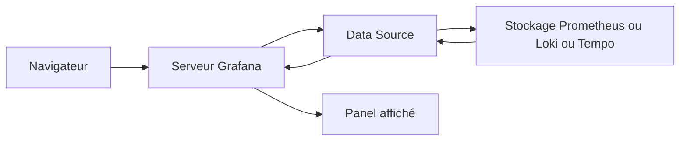
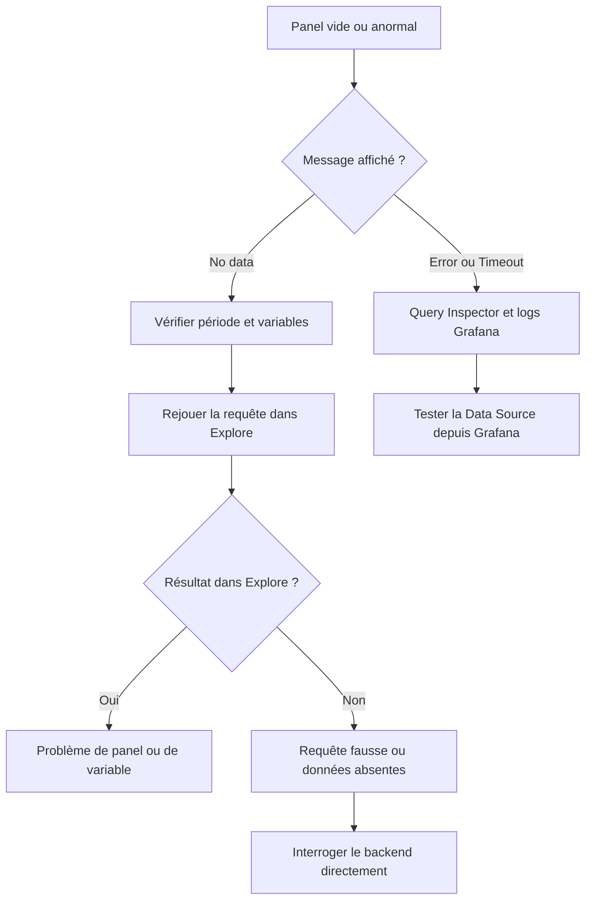

# Premiers diagnostics Grafana

## Objectifs pédagogiques

À la fin de ce module, vous saurez :

- **Distinguer** un panel qui n'a pas de données d'un panel dont la requête est fausse ou en échec
- **Interpréter** les trois messages `No data`, `Error` et `Timeout`, et savoir quelle enquête chacun déclenche
- **Localiser** une panne de Data Source ou d'accès en testant la connexion depuis le bon endroit
- **Corriger** les faux problèmes liés au fuseau horaire, à la période sélectionnée et au refresh
- **Exploiter** Query Inspector et les logs de Grafana et des backends pour trancher quand l'interface ne suffit plus

## Mise en situation

Lundi, 9 h 10. Vous êtes technicien support Cloud dans une équipe de six personnes qui exploite une vingtaine de services. Un développeur vous écrit : « Le dashboard de l'API Commandes est vide, je ne vois rien depuis ce matin. »

Votre premier réflexe est probablement de répondre « le service est tombé ». Parfois c'est vrai. Mais un dashboard vide peut aussi signifier que :

- Prometheus ne répond plus ;
- quelqu'un a renommé un label ;
- la période affichée est trop courte ;
- le fuseau horaire décale les courbes de deux heures ;
- Grafana ne joint plus sa source depuis une mise à jour du réseau Docker.

Le piège est là : les symptômes se ressemblent tous, et deviner coûte du temps. Si vous accusez le service alors que le monitoring est en panne, l'équipe applicative perd une heure. Si vous accusez le monitoring alors que le service est réellement mort, vous retardez la remise en route.

Ce module vous donne une méthode : poser les questions dans le bon ordre pour que chaque test élimine une famille entière de causes.

## Le chemin d'une requête : là où ça peut casser

Que se passe-t-il quand un panel s'affiche ? Plus de choses qu'on ne le croit. Le navigateur ne parle pas directement à Prometheus : il envoie la requête au serveur Grafana, qui la transmet à la Data Source, qui interroge son stockage et renvoie une réponse que Grafana met en forme.



> 📦 **Analogie : le colis et ses relais.** Une requête voyage comme un colis qui passe par plusieurs relais : s'il n'arrive pas, il faut savoir à quel relais il s'est arrêté. Limite : la réponse refait le chemin en sens inverse, et la panne peut survenir à l'aller comme au retour.
{: .callout .callout-analogie}

Cette chaîne donne quatre zones de panne possibles :

- **Le navigateur / l'interface** : mauvaise période, variable mal positionnée, fuseau horaire.
- **Grafana** : droits, configuration, erreur interne, délai dépassé.
- **La connexion vers la Data Source** : réseau, DNS, authentification, TLS (Transport Layer Security).
- **Le backend** : le service ne répond plus, ne contient pas les données, ou met trop de temps à calculer.

> 🧠 **Concept clé** : l'URL d'une Data Source est utilisée par le **serveur** Grafana, pas par votre navigateur (en mode d'accès `Server`, le mode courant). Tester l'URL depuis votre poste ne prouve donc rien : le test valable se fait depuis la machine ou le conteneur qui héberge Grafana.
{: .callout .callout-important}

Voici la méthode que nous allons dérouler, en détail, dans les sections suivantes :



## Dashboard vide : aucune donnée ou requête incorrecte ?

C'est le point central du module. Un panel vide peut dire deux choses très différentes : « j'ai posé la question et la réponse est vide », ou « ma question est mal formulée ».

La nuance compte : une réponse vide est une information valide (aucune série ne correspond), alors qu'une requête incorrecte ne vous apprend rien sur le système. Il faut donc décider **laquelle des deux situations vous avez sous les yeux** avant de chercher plus loin.

### Le test qui départage

Copiez la requête du panel dans **Explore** (menu du panel → Explore) et réduisez-la progressivement :

1. Gardez uniquement le nom de la métrique, sans filtre : `http_requests_total`.
2. Si des séries apparaissent, ajoutez les filtres un par un (`job="api"`, puis `status="500"`…).
3. Le filtre qui fait disparaître les résultats est le coupable : label renommé, valeur différente, faute de frappe.

Si même la métrique brute ne renvoie rien, vous avez un vrai problème de données : le service n'est plus scrapé, il est arrêté, ou la métrique n'existe plus sous ce nom. Dans ce cas, on quitte Grafana et on interroge Prometheus directement (voir plus bas).

### Les variables, coupables silencieux

Beaucoup de dashboards vides sont dus à une variable :

- une variable `$instance` qui vaut une instance supprimée ;
- une valeur `All` mal gérée dans une regex ;
- une variable restée vide après un changement de label.

Le panel est correctement construit, mais il filtre sur du vide. Avant de toucher à quoi que ce soit, regardez en haut du dashboard : changez la valeur de la variable et observez si les données reviennent.

> 💡 **Astuce** : dans l'éditeur de panel, passez la souris sur la requête ou utilisez Query Inspector (plus bas) pour voir la requête **après** substitution des variables. Ce que vous lisez dans l'éditeur contient `$instance`, mais ce que Prometheus reçoit contient la valeur réelle, et c'est celle-là qu'il faut juger.
{: .callout .callout-astuce}

### Panel de type « sans message »

Certains panels (jauges, stats) affichent `N/A` ou un tiret sans message d'erreur. Même démarche : requête brute dans Explore, puis comparaison. Vérifiez aussi l'option `Calculation` du panel : une valeur « Last (not null) » et une valeur « Last » ne donnent pas le même résultat si le dernier point est nul.

## `No data`, `Error`, `Timeout` : trois messages, trois enquêtes

Ces messages ne sont pas interchangeables. Chacun raconte une histoire différente sur ce qui s'est passé entre Grafana et son backend.

| Message | Ce que ça signifie | Première piste |
|---------|--------------------|----------------|
| `No data` | La requête a réussi, mais n'a retourné aucune série ou aucun point | Période, filtre, variable, métrique inexistante |
| `Error` (parse, 4xx, 5xx) | La requête n'a pas abouti : syntaxe invalide, accès refusé ou backend en erreur | Texte exact de l'erreur dans Query Inspector |
| `Timeout` | La requête a démarré, mais la réponse n'est pas arrivée à temps | Requête trop lourde ou backend saturé |

> 🧠 **Concept clé** : `No data` signifie que la chaîne de communication fonctionne. Prometheus, Loki ou Tempo ont répondu, simplement par un résultat vide. C'est un indice précieux : il écarte d'un coup toute une série de pannes réseau ou d'authentification.
{: .callout .callout-important}

### `No data` : ce n'est pas toujours une panne

Il y a quelques causes classiques, plus subtiles qu'une simple absence de données :

- Le service a réellement cessé d'émettre, et c'est l'information à remonter.
- La période affichée est plus courte que l'intervalle d'émission ou que la durée depuis le dernier point.
- Une fonction comme `rate()` utilise une fenêtre trop petite par rapport à l'intervalle de collecte : si Prometheus collecte toutes les 15 secondes, `rate(x[15s])` ne contient qu'un point par fenêtre et ne peut rien calculer.
- Une métrique de type compteur n'existe qu'après le premier événement. Un `http_errors_total` n'apparaît pas tant qu'aucune erreur n'a été comptée, selon la façon dont l'application est instrumentée.

> ⚠️ **Erreur fréquente** : utiliser une fenêtre `rate()` trop courte.
{: .callout .callout-attention}

- **Piège** : `rate(http_requests_total[15s])` avec un scrape toutes les 15 secondes.
- **Conséquence** : panel vide alors que les données existent.
- **Correction** : prendre au moins quatre fois l'intervalle de scrape (`[1m]` pour 15 s), ou utiliser `$__rate_interval` qui s'adapte automatiquement.

### `Error` : lisez le texte, pas seulement la couleur

Le triangle rouge d'un panel cache un message précis, visible au survol ou dans Query Inspector. Quelques familles à reconnaître :

- **Erreur de syntaxe** (`parse error`) : parenthèse manquante, crochet oublié. Le problème est dans la requête, pas dans l'infrastructure.
- **`connection refused`** : le serveur Grafana a atteint la machine, mais rien n'écoute sur ce port (service arrêté ou mauvais port).
- **`no such host`** : le nom de la Data Source ne se résout pas, souvent un nom de conteneur ou de service incorrect.
- **`401` / `403`** : la source répond, mais refuse les identifiants ou le jeton.
- **`502 Bad Gateway`** : un proxy ou Grafana n'obtient pas de réponse valide du backend.

### `Timeout` : la requête était peut-être trop ambitieuse

Un timeout (parfois visible sous la forme `context deadline exceeded`) indique que quelque part, un délai maximum a expiré. Ce délai peut se trouver dans Grafana, dans la configuration de la Data Source, dans un reverse proxy intermédiaire ou dans le backend lui-même (Prometheus a le sien).

Avant d'augmenter les délais, demandez-vous pourquoi la requête est lente. Les causes de lenteur sont traitées plus bas.

> 💡 **À retenir.** Allonger un timeout ne répare rien : cela retarde seulement l'échec.
{: .callout .callout-important}

## Quand c'est la Data Source qui est en cause

Si plusieurs panels, voire tous les dashboards qui utilisent la même source, tombent en erreur en même temps, le problème n'est probablement pas dans les requêtes. Il se situe en amont : la Data Source ne répond plus ou n'est plus joignable.

Commencez par le plus simple : **Connections → Data sources → votre source → Save & test**. Selon la version, l'intitulé peut légèrement varier. Ce bouton vérifie que Grafana joint la source et obtient une réponse valide. Un message vert ne garantit pas que *vos* requêtes fonctionnent (la source peut répondre, mais être vide), mais un message rouge localise tout de suite le problème.

### Joindre la source depuis Grafana, pas depuis votre poste

C'est le test le plus utile et le plus oublié. Si Grafana tourne dans un conteneur, entrez-y et appelez la source :

```bash
docker exec <CONTENEUR_GRAFANA> wget -qO- http://<HOTE>:<PORT>/-/healthy
```

Avec Prometheus, `/-/healthy` retourne un court message si le service est en vie. Selon l'image utilisée, `wget` ou `curl` peut ne pas être présent ; adaptez alors le test ou lancez-le depuis une autre machine du même réseau.

> ⚠️ **Erreur fréquente** : mettre `localhost` dans l'URL de la Data Source.
{: .callout .callout-attention}

- **Piège** : sur votre poste, `http://localhost:9090` fonctionne dans le navigateur.
- **Conséquence** : Grafana tourne dans un conteneur, où `localhost` désigne le conteneur lui-même. Résultat : `connection refused`.
- **Correction** : utiliser le nom du service sur le réseau Docker (`http://prometheus:9090`) si les deux conteneurs partagent un réseau, ou l'adresse de l'hôte.

### Quand ça répond, mais pas comme prévu

Un problème d'accès n'est pas toujours un refus franc. Une source peut répondre « 200 OK » avec un résultat vide si l'identité utilisée n'a accès à rien :

- **Jeton ou mot de passe expiré** : retour en `401`, facile à repérer.
- **Mauvais tenant** : avec Loki en mode multi-tenant, un en-tête `X-Scope-OrgID` incorrect renvoie un résultat vide plutôt qu'une erreur. Piège redoutable, car tout paraît sain.
- **Certificat TLS invalide ou expiré** : erreur de certificat dans les logs Grafana ; la connexion échoue avant même d'envoyer la requête.
- **Droits Grafana** : un utilisateur peut voir le dashboard sans avoir le droit de consulter la source utilisée ; l'erreur apparaît alors uniquement pour lui.

Pour savoir si le backend se porte bien, interrogez-le directement. Avec Prometheus :

```bash
curl -s 'http://<HOTE>:<PORT>/api/v1/query?query=up'
```

La métrique `up` vaut 1 pour une cible collectée avec succès et 0 sinon. Si cette requête répond correctement, Prometheus est vivant et le problème se trouve plus près de Grafana. La page `/targets` de Prometheus donne la même information de façon visuelle.

## Le temps : fuseau, période et refresh

Les problèmes de temps sont les plus frustrants, parce que tout est « correct » techniquement. C'est simplement l'affichage qui ne montre pas ce que vous cherchez.

### La période sélectionnée

Le sélecteur en haut à droite définit la fenêtre de temps pour tous les panels. Trois cas à connaître :

- **Période relative** (`Last 6 hours`) : la fenêtre glisse avec le temps. Un service arrêté depuis 8 heures n'y apparaît plus du tout, et le panel affiche `No data`.
- **Période absolue** (de 08:00 à 10:00) : elle reste figée. Le refresh recharge les données, mais sur la même fenêtre, donc rien de nouveau n'apparaît. C'est un classique après avoir zoomé sur un incident.
- **Période trop courte** : `Last 1 minute` avec un point collecté toutes les 30 secondes, le résultat est instable, voire vide.

> ⚠️ **Erreur fréquente** : croire que le refresh est cassé.
{: .callout .callout-attention}

- **Piège** : le dashboard est resté sur une période absolue après un zoom sur un incident.
- **Conséquence** : les courbes ne bougent plus, même avec l'auto-refresh à 10 s.
- **Correction** : repasser sur une période relative (`Last 1 hour`) ; le sélecteur affiche alors le mot « Last ».

### Le fuseau horaire

Prometheus, Loki et Tempo stockent des horodatages indépendants de tout fuseau (en pratique UTC (Coordinated Universal Time)). L'affichage, lui, dépend du réglage de Grafana : par défaut, le fuseau du navigateur, sauf si le dashboard impose le sien dans **Dashboard settings → Time options → Time zone**.

Le décalage apparaît quand vos sources de vérité ne parlent pas la même heure : un log applicatif en heure locale, un dashboard en UTC, un collègue dont le navigateur est réglé autrement. Vous cherchez un événement à 14 h 05 et vous ne le voyez pas, alors qu'il est affiché à 12 h 05.

> 💡 **Astuce** : en incident, mettez le dashboard en UTC et demandez aux autres de faire de même. Une seule référence de temps évite beaucoup de confusion dans les échanges avec les équipes.
{: .callout .callout-astuce}

### Le refresh

L'auto-refresh (menu à côté du sélecteur de période) relance les requêtes à intervalle régulier. Deux subtilités :

- Un refresh à `5s` sur un dashboard de vingt panels génère beaucoup de requêtes. Si les panels sont lents, les requêtes s'empilent, ce qui aggrave le problème.
- Un refresh plus rapide que l'intervalle de collecte des données n'apporte rien : rafraîchir toutes les 5 secondes des données collectées toutes les minutes ne fait que consommer des ressources.

## Panels lents : requêtes et cardinalité

Un panel lent n'est pas encore une panne, mais c'est souvent son prélude. Il faut chercher ce qui rend la requête coûteuse, et il y a généralement trois suspects.

**Trop de séries.** Chaque combinaison de labels crée une série distincte. Une requête sans agrégation sur une métrique avec un label `pod` ou `user_id` peut retourner des milliers de lignes que Grafana doit transférer, convertir puis dessiner.

> 📖 **Définition.** La **cardinalité** désigne le nombre de combinaisons uniques de labels d'une métrique ; plus elle est élevée, plus la requête et le stockage sont coûteux.
{: .callout .callout-definition}

**Une fenêtre de temps trop large.** Demander trente jours de données à haute résolution pour afficher quelques points est coûteux. Grafana limite le nombre de points avec `Max data points` et `Min interval` (options de la requête), mais le backend doit tout de même lire les données.

**Trop de panels simultanés.** Un dashboard de quarante panels envoie quarante requêtes à chaque chargement et à chaque refresh. Le goulot est alors le backend, pas une requête en particulier.

Pour mesurer l'ampleur du problème avec Prometheus, comptez les séries concernées dans Explore :

```promql
count(http_requests_total)
```

Si ce chiffre dépasse plusieurs milliers pour un seul panel, il faut agréger.

```promql
sum by (status) (rate(http_requests_total[5m]))
```

On passe ainsi de milliers de séries à une poignée (une par code de statut). Le panel est plus lisible, et surtout beaucoup plus rapide.

> 💡 **Astuce** : testez d'abord la requête dans Explore avec une période courte (15 minutes). Si elle est lente même là, le problème est dans la requête. Si elle devient lente seulement sur 7 jours, c'est la volumétrie.
{: .callout .callout-astuce}

## Query Inspector : voir ce que Grafana envoie vraiment

Quand l'interface ne suffit pas, Query Inspector est l'outil qui montre la réalité : la requête exacte après substitution des variables, la réponse brute du backend et les temps passés.

On l'ouvre depuis le menu du panel → **Inspect → Query**, ou en survolant le panel et en appuyant sur la touche `i`. L'interface peut varier selon la version, mais les grands onglets restent les mêmes :

- **Stats** : durée totale de la requête, nombre de séries et de lignes retournées. C'est ici que vous confirmez qu'un panel est lent à cause du volume.
- **Query** : la requête envoyée et la réponse brute. Après un clic sur `Refresh`, vous voyez la requête rejouée avec son statut HTTP.
- **Data** : les données telles que Grafana les a reçues. Pratique pour savoir si le problème vient de la donnée ou de l'affichage.
- **JSON** : la définition du panel et la réponse complète, utile pour comparer deux panels ou signaler un bug.
- **Error** : apparaît seulement si la requête échoue, avec le message exact du backend.

Un exemple de lecture : vous ouvrez Query, vous cliquez sur Refresh, et vous obtenez un statut 400 avec un message de parse. Vous venez d'apprendre en dix secondes que la requête est fausse, et que ce n'est ni le réseau ni le backend. À l'inverse, un statut 200 avec un tableau de résultats vide confirme que la chaîne fonctionne et que la question posée n'a pas de réponse.

> ⚠️ **Erreur fréquente** : ne regarder que la requête saisie dans l'éditeur.
{: .callout .callout-attention}

- **Piège** : l'éditeur affiche `$instance` et `$__rate_interval`.
- **Conséquence** : vous testez ailleurs une requête qui n'est pas celle que Prometheus a réellement reçue.
- **Correction** : copier la requête depuis l'onglet Query de l'inspecteur, qui contient les valeurs substituées.

## Logs de Grafana et des backends

Quand Query Inspector n'explique pas le problème (page blanche, erreur 500 sans détail, Data Source qui échoue à se connecter), on lit les logs. Ils disent ce qui s'est passé côté serveur, là où l'interface ne montre qu'une conséquence.

### Les logs de Grafana

Selon votre installation :

```bash
# Grafana en conteneur
docker logs --since 10m <CONTENEUR_GRAFANA> 2>&1 | grep "level=error"

# Grafana installé en service Linux
journalctl -u grafana-server --since "10 min ago" | grep "level=error"
```

Grafana écrit en format clé=valeur. Une ligne d'erreur ressemble à ceci (exemple illustratif) :

```text
logger=context level=error msg="Request Completed" method=POST path=/api/ds/query status=502 time_ms=30012
```

Elle apporte trois informations : l'endpoint appelé (`/api/ds/query` correspond aux requêtes de panels), le statut (502, donc le backend n'a pas répondu correctement) et la durée (30 secondes, probablement un timeout). La plupart du temps, ce simple diagnostic oriente tout de suite vers la bonne zone.

Si les logs sont trop pauvres, passez le niveau à `debug` (variable `GF_LOG_LEVEL=debug`, ou `level = debug` dans la section `[log]` de `grafana.ini`) puis redémarrez Grafana. Pensez à le remettre à `info` ensuite : le mode debug est très verbeux.

### Les logs du backend

Si Grafana indique que le backend est en cause, passez de l'autre côté. Pour Prometheus, Loki ou Tempo :

```bash
docker logs --since 10m <CONTENEUR_BACKEND> 2>&1 | tail -n 50
```

On y trouve les causes qu'un 502 ne dit pas : manque de mémoire, requête annulée, limite de volume dépassée, stockage corrompu ou plein. Pour Prometheus, la page `/targets` complète cette lecture en montrant quelles cibles ne sont plus collectées et pourquoi.

> 💡 **Astuce** : alignez les horodatages. Notez l'heure exacte de l'erreur dans Grafana (en UTC), puis cherchez la même minute dans les logs du backend. Les deux récits se recoupent presque toujours.
{: .callout .callout-astuce}

## Commandes essentielles de diagnostic

Voici les gestes à garder sous la main, dans l'ordre où on les utilise généralement.

```bash
# 1. Le backend est-il vivant ? (depuis la machine ou le conteneur Grafana)
docker exec <CONTENEUR_GRAFANA> wget -qO- http://<HOTE>:<PORT>/-/healthy

# 2. A-t-il des données ? Les cibles sont-elles collectées ?
curl -s 'http://<HOTE>:<PORT>/api/v1/query?query=up'

# 3. Que dit Grafana ?
docker logs --since 10m <CONTENEUR_GRAFANA> 2>&1 | grep "level=error"
journalctl -u grafana-server --since "10 min ago" | grep "level=error"

# 4. Que dit le backend ?
docker logs --since 10m <CONTENEUR_BACKEND> 2>&1 | tail -n 50
```

Côté interface : **Explore** pour rejouer la requête, **Inspect → Query** (touche `i`) pour voir la réponse brute, **Save & test** sur la Data Source pour valider la connexion.

## Erreurs fréquentes : repères rapides

| Symptôme | Cause probable | Correction |
|----------|----------------|------------|
| Tous les panels sont vides après une migration | URL de Data Source pointant vers l'ancienne adresse | Corriger l'URL, puis `Save & test` |
| `connection refused` depuis Grafana en conteneur | `localhost` utilisé comme adresse | Nom du service Docker ou adresse de l'hôte |
| `No data` sur un seul panel | Variable vide ou filtre obsolète | Rejouer la requête sans filtre dans Explore |
| Courbes figées malgré le refresh | Période absolue active | Repasser en période relative |
| Événement visible deux heures « trop tôt » | Fuseaux horaires différents entre sources | Aligner le dashboard sur UTC |
| `rate()` ne renvoie rien | Fenêtre contenant moins de deux points de collecte | Utiliser `[1m]` ou `$__rate_interval` |
| Timeout sur une requête de 30 jours | Trop de séries ou fenêtre trop large | Agréger avec `sum by`, réduire la période |
| Loki répond sans erreur mais sans résultat | Mauvais tenant ou mauvais label | Vérifier l'en-tête de tenant et les labels dans Explore |

## Scénario illustratif : le dashboard « API Commandes » vide

*Ce scénario est fictif ; les chiffres sont donnés à titre d'exemple.*

Une équipe de six personnes exploite une API de commandes. Un lundi matin, tous les panels de son dashboard principal affichent `No data`. L'équipe applicative pense à un crash.

**Étape 1 — Lire le message.** C'est `No data`, pas `Error`. La chaîne de communication fonctionne : Grafana a obtenu une réponse. On écarte déjà une panne réseau.

**Étape 2 — Vérifier la période.** Le sélecteur affiche `Last 6 hours`. Rien d'anormal.

**Étape 3 — Rejouer dans Explore.** La requête `rate(http_requests_total{job="api"}[5m])` ne renvoie rien. On retire le filtre : `http_requests_total` seul retourne des séries, mais avec `job="orders-api"`. L'application a été renommée pendant un déploiement le vendredi précédent.

**Étape 4 — Corriger.** On met à jour le filtre du dashboard et on remplace le `job` codé en dur par une variable alimentée par une requête sur les labels. Le dashboard se remplit.

**Étape 5 — Un second symptôme.** Le panel des latences met 40 secondes à charger. Query Inspector indique plusieurs milliers de séries retournées, à cause d'un `by (pod)` inutile. En l'agrégeant par `route`, le chargement tombe à environ 3 secondes.

Résultat : le service n'a jamais été en panne. En trente minutes, on a identifié un changement de label, évité une fausse alerte d'incident et corrigé un panel lent. Sans méthode, on aurait probablement redémarré Prometheus « pour voir ».

## Bonnes pratiques

- **Lisez le message avant d'agir.** `No data`, `Error` et `Timeout` ne se traitent pas de la même façon ; commencer par le bon test économise du temps.
- **Testez la connexion depuis Grafana.** C'est le serveur Grafana qui interroge la source ; ce que voit votre navigateur ne prouve rien.
- **Rejouez dans Explore avant de modifier un panel.** Explore élimine les variables, les transformations et les options d'affichage ; si la requête fonctionne là-bas, vous savez que le problème est dans le panel.
- **Alignez les fuseaux horaires pendant un incident.** Une référence de temps commune (UTC) évite des heures de confusion entre équipes.
- **Évitez les labels codés en dur.** Utilisez des variables de dashboard alimentées par la source ; un renommage de service ne cassera plus tout.
- **Agrégez par défaut.** Un panel de supervision n'a presque jamais besoin de la série de chaque pod ou de chaque utilisateur ; agréger protège le backend et améliore la lisibilité.
- **Ne laissez pas le niveau de log en `debug`.** Il aide à diagnostiquer, mais produit un volume important de logs ; repassez à `info` après usage, et ne copiez jamais des logs contenant des jetons dans un ticket public.
- **Consignez la cause et la correction.** Une note de deux lignes dans le ticket (« label renommé de `api` à `orders-api` ») évite que le même diagnostic soit refait le mois suivant.

## Résumé

Un panel qui ne montre rien n'est jamais un diagnostic en soi. Il faut d'abord déterminer ce que Grafana a reçu : une réponse vide (`No data`), une erreur (`Error`) ou rien dans le délai imparti (`Timeout`).

La chaîne navigateur → Grafana → Data Source → backend permet de localiser la panne : période, variable et fuseau côté interface ; URL, réseau et authentification côté connexion ; volume et cardinalité côté performance. Explore, Query Inspector et les logs de Grafana puis du backend sont les trois outils qui tranchent quand le doute persiste.

Cette méthode évite de confondre un problème de monitoring et un problème de service. Elle sera mise en pratique dans le prochain module, où vous construirez une supervision complète d'un serveur Linux, avec ses dashboards et ses points de contrôle.

<!-- snippet
id: grafana_diag_no_data_vs_error
type: concept
tech: grafana
level: beginner
importance: high
format: knowledge
tags: grafana,diagnostic,no-data,error
title: No data et Error : deux diagnostics différents
content: `No data` signifie que la requête a abouti et que le backend a répondu par un résultat vide : réseau, authentification et syntaxe fonctionnent. `Error` signifie que la requête a échoué (syntaxe invalide, 401/403, 5xx, connexion refusée). Avec `No data`, on cherche du côté des filtres, de la période et des variables ; avec `Error`, on lit le message exact dans Query Inspector.
description: Le message affiché indique si la chaîne Grafana → backend fonctionne ; il détermine par où commencer l'enquête.
-->

<!-- snippet
id: grafana_diag_localhost_container
type: error
tech: grafana
level: beginner
importance: high
format: knowledge
tags: grafana,docker,datasource,reseau
title: connection refused avec localhost dans une Data Source
content: Symptôme : `connection refused` sur la Data Source alors que `http://localhost:9090` s'ouvre dans votre navigateur. Cause : Grafana tourne dans un conteneur, où `localhost` désigne le conteneur lui-même, pas l'hôte ni Prometheus. Correction : utiliser le nom du service sur le réseau Docker partagé (`http://prometheus:9090`) ou l'adresse de l'hôte, puis cliquer sur Save & test.
description: Dans un conteneur, localhost pointe vers le conteneur Grafana lui-même ; la Data Source doit utiliser le nom du service ou l'IP de l'hôte.
-->

<!-- snippet
id: grafana_diag_test_from_grafana
type: command
tech: grafana
level: beginner
importance: high
format: knowledge
tags: grafana,docker,datasource,diagnostic
title: Tester la Data Source depuis le conteneur Grafana
context: À lancer sur l'hôte Docker ; wget ou curl doit exister dans l'image
command: docker exec <CONTENEUR_GRAFANA> wget -qO- http://<HOTE>:<PORT>/-/healthy
example: docker exec grafana wget -qO- http://prometheus:9090/-/healthy
description: Reproduit l'appel que fait réellement Grafana vers Prometheus, donc valide DNS, réseau et port depuis le bon point de vue.
-->

<!-- snippet
id: grafana_diag_prometheus_up_query
type: command
tech: grafana
level: beginner
importance: medium
format: knowledge
tags: prometheus,diagnostic,curl,up
title: Interroger Prometheus directement avec la métrique up
command: curl -s 'http://<HOTE>:<PORT>/api/v1/query?query=up'
example: curl -s 'http://prometheus:9090/api/v1/query?query=up'
description: Court-circuite Grafana : si Prometheus répond avec des valeurs 1/0 par cible, le backend vit et le problème se situe côté Grafana ou requête.
-->

<!-- snippet
id: grafana_diag_logs_docker_errors
type: command
tech: grafana
level: beginner
importance: high
format: knowledge
tags: grafana,logs,docker,diagnostic
title: Filtrer les erreurs récentes des logs Grafana en conteneur
command: docker logs --since 10m <CONTENEUR_GRAFANA> 2>&1 | grep "level=error"
example: docker logs --since 10m grafana 2>&1 | grep "level=error"
description: Isole les erreurs des dix dernières minutes ; chercher path=/api/ds/query, le statut et time_ms pour distinguer erreur de requête et timeout.
-->

<!-- snippet
id: grafana_diag_logs_journalctl
type: command
tech: grafana
level: beginner
importance: medium
format: knowledge
tags: grafana,logs,systemd,diagnostic
title: Lire les erreurs Grafana installé comme service Linux
command: journalctl -u grafana-server --since "10 min ago" | grep "level=error"
description: Équivalent de docker logs pour une installation par paquet ; ajouter -f pour suivre les logs en direct pendant que vous reproduisez le problème.
-->

<!-- snippet
id: grafana_diag_query_inspector_shortcut
type: tip
tech: grafana
level: beginner
importance: high
format: knowledge
tags: grafana,query-inspector,diagnostic,panel
title: Ouvrir Query Inspector en une touche
content: Survolez un panel et appuyez sur `i` (ou menu du panel → Inspect → Query), puis cliquez sur Refresh pour rejouer la requête. Vous voyez la requête avec variables substituées, le statut HTTP et la réponse brute. L'onglet Stats indique durée et nombre de séries : au-delà de quelques milliers de séries, le panel doit être agrégé.
description: L'inspecteur montre la requête réellement envoyée (variables résolues) et la réponse brute, ce que l'éditeur de panel ne montre pas.
-->

<!-- snippet
id: grafana_diag_rate_window_too_short
type: warning
tech: grafana
level: beginner
importance: high
format: knowledge
tags: promql,rate,no-data,grafana
title: rate() avec une fenêtre trop courte donne un panel vide
content: Piège : `rate(http_requests_total[15s])` avec un scrape toutes les 15 secondes. Conséquence : la fenêtre ne contient qu'un point, rate() ne peut rien calculer et le panel affiche No data alors que les données existent. Correction : fenêtre d'au moins quatre fois l'intervalle de scrape (`[1m]` pour 15 s) ou `$__rate_interval`.
description: Une fenêtre contenant moins de deux points de collecte rend rate() vide (minimum technique) ; en pratique, viser au moins 4 × l'intervalle de scrape ou utiliser $__rate_interval.
-->

<!-- snippet
id: grafana_diag_absolute_time_range
type: warning
tech: grafana
level: beginner
importance: medium
format: knowledge
tags: grafana,refresh,periode,dashboard
title: Période absolue : le refresh ne montre plus rien de nouveau
content: Piège : après un zoom sur un incident, le sélecteur passe en période absolue (de 08:00 à 10:00). Conséquence : l'auto-refresh recharge les mêmes données figées et les courbes semblent bloquées. Correction : repasser en période relative (`Last 1 hour`), reconnaissable au mot « Last » dans le sélecteur.
description: Une fenêtre absolue ne glisse pas avec le temps ; le refresh recharge toujours la même plage, d'où des courbes qui paraissent figées.
-->

<!-- snippet
id: grafana_diag_timezone_utc
type: tip
tech: grafana
level: beginner
importance: medium
format: knowledge
tags: grafana,fuseau-horaire,utc,incident
title: Passer le dashboard en UTC pendant un incident
content: Dashboard settings → Time options → Time zone → UTC. Les sources stockent des horodatages indépendants du fuseau ; seul l'affichage change (navigateur par défaut). En incident, tout le monde en UTC supprime les décalages de 1 à 2 heures entre dashboards, logs applicatifs et échanges d'équipe.
description: Aligner dashboard et collègues sur UTC évite de chercher un événement à la mauvaise heure ; le réglage se trouve dans les options de temps du dashboard.
-->

<!-- snippet
id: grafana_diag_cardinality_slow_panel
type: concept
tech: grafana
level: beginner
importance: high
format: knowledge
tags: grafana,cardinalite,performance,promql
title: Pourquoi une requête non agrégée ralentit un panel
content: Chaque combinaison de labels forme une série distincte. Une requête sans agrégation sur un label comme pod ou user_id renvoie des milliers de séries que le backend calcule, que Grafana transfère puis dessine. Mesurer avec `count(<METRIQUE>)` dans Explore, puis agréger : `sum by (status) (rate(http_requests_total[5m]))` réduit des milliers de lignes à quelques-unes.
description: Le coût d'un panel dépend du nombre de séries retournées ; compter avec count() puis agréger avec sum by réduit temps de chargement et charge backend.
-->

<!-- snippet
id: grafana_diag_loki_tenant_empty
type: error
tech: grafana
level: intermediate
importance: medium
format: knowledge
tags: loki,datasource,tenant,no-data
title: Loki répond sans erreur mais sans aucun log
content: Symptôme : la Data Source Loki passe Save & test, mais Explore ne renvoie aucun log. Cause : en mode multi-tenant, un en-tête X-Scope-OrgID désignant un autre tenant que celui de l'ingestion donne un résultat vide au lieu d'une erreur (un en-tête absent provoque, lui, une erreur « no org id »). Correction : vérifier dans les paramètres de la Data Source (HTTP headers) que l'identifiant de tenant correspond à celui utilisé à l'ingestion.
description: Un tenant erroné produit un résultat vide, pas une erreur ; vérifier l'en-tête X-Scope-OrgID dans les HTTP headers de la Data Source.
-->
