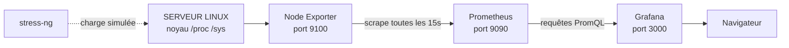


# Projet pratique — Supervision d'un serveur Linux

## Objectifs pédagogiques

À la fin de ce module, vous saurez :

- **Déployer** Grafana, Prometheus et Node Exporter avec un seul fichier Docker Compose.
- **Vérifier** le flux de métriques maillon par maillon, de l'exporter jusqu'au panel.
- **Construire** un dashboard qui répond à des questions précises sur le CPU, la RAM, le disque, le réseau et la disponibilité.
- **Paramétrer** une variable `instance` pour réutiliser le dashboard sur plusieurs serveurs.
- **Analyser** une saturation que vous aurez provoquée vous-même, puis la documenter dans une fiche de diagnostic.

## Mise en situation

Vous venez d'arriver dans une petite équipe de quatre personnes. Elle gère une dizaine de machines Linux : un serveur d'application, une base de données, quelques VM de test. Jusqu'ici, la supervision se résume à un `htop` lancé en SSH quand quelqu'un se plaint, et à un collègue qui dit « ça rame depuis ce matin ». Personne ne sait si le serveur était déjà saturé à 3 h du matin, ni depuis quand le disque se remplit.

Le `htop` ne suffit plus pour une raison simple : il montre l'instant présent, sur une seule machine, et il oublie tout dès que vous fermez le terminal. Il vous faut de l'historique, une vue unique et quelque chose que n'importe qui dans l'équipe peut lire sans connaître la machine.

Ce projet reconstruit cette brique de base de A à Z : un serveur observé, un dashboard lisible, et la preuve que vous savez l'utiliser quand quelque chose se dégrade.

## Ce qu'on construit

Trois composants, chacun avec un rôle étroit. Node Exporter lit l'état du noyau Linux (`/proc`, `/sys`) et l'expose en texte sur le port 9100. Prometheus vient chercher ce texte toutes les 15 secondes et le stocke. Grafana ne collecte rien : il pose des questions à Prometheus et dessine les réponses.



| Composant | Rôle | Port |
|-----------|------|------|
| Node Exporter | Expose les métriques système de l'hôte | 9100 |
| Prometheus | Collecte, stocke, répond aux requêtes | 9090 |
| Grafana | Visualise, explore, partage | 3000 |

Cette chaîne a un avantage pour le diagnostic : quand un panel est vide, le problème se trouve forcément sur l'un des trois maillons. La section « Vérifier le flux » sert à les tester dans l'ordre.

## Mise en place

### Les fichiers

Créez un dossier de travail, par exemple `~/supervision-linux`, avec trois fichiers : `docker-compose.yml`, `prometheus.yml` et `.env`.

```yaml
# docker-compose.yml
services:
  node-exporter:
    image: quay.io/prometheus/node-exporter:v1.8.2
    container_name: node-exporter
    command:
      - '--path.rootfs=/host'
    network_mode: host
    pid: host
    restart: unless-stopped
    volumes:
      - '/:/host:ro,rslave'

  prometheus:
    image: prom/prometheus:v2.53.0
    container_name: prometheus
    command:
      - '--config.file=/etc/prometheus/prometheus.yml'
      - '--storage.tsdb.retention.time=15d'
    volumes:
      - ./prometheus.yml:/etc/prometheus/prometheus.yml:ro
      - prometheus-data:/prometheus
    extra_hosts:
      - 'host.docker.internal:host-gateway'
    ports:
      - '127.0.0.1:9090:9090'
    restart: unless-stopped

  grafana:
    image: grafana/grafana:13.3.0
    container_name: grafana
    environment:
      - GF_SECURITY_ADMIN_PASSWORD=${GRAFANA_ADMIN_PASSWORD}
    volumes:
      - grafana-data:/var/lib/grafana
    ports:
      - '127.0.0.1:3000:3000'
    depends_on:
      - prometheus
    restart: unless-stopped

volumes:
  prometheus-data:
  grafana-data:
```

Les versions sont données à titre indicatif. Épinglez toujours un tag précis plutôt que `latest`, pour que le déploiement de demain ressemble à celui d'aujourd'hui.

```yaml
# prometheus.yml
global:
  scrape_interval: 15s

scrape_configs:
  - job_name: prometheus
    static_configs:
      - targets: ['localhost:9090']

  - job_name: node
    static_configs:
      - targets: ['host.docker.internal:9100']
        labels:
          instance: 'srv-lab-01'
```

```bash
# .env  (à ne pas versionner)
GRAFANA_ADMIN_PASSWORD=<MOT_DE_PASSE_SOLIDE>
```

Quelques choix méritent une explication, parce que ce sont eux qui font échouer ce montage quand on les omet.

🧠 **Concept clé — Node Exporter dans un conteneur observe… le conteneur, sauf si on lui ouvre l'hôte.** Par défaut, un conteneur a son propre système de fichiers et sa propre pile réseau. Les métriques de disque seraient celles de l'overlay Docker, et les interfaces réseau seraient celles du conteneur. Trois réglages corrigent cela :

- `pid: host` donne accès aux processus de l'hôte.
- `network_mode: host` expose les vraies interfaces réseau.
- Le montage `/:/host:ro` combiné à `--path.rootfs=/host` permet de lire les vrais systèmes de fichiers, en lecture seule.

Comme l'exporter tourne dans le réseau de l'hôte, Prometheus l'atteint via `host.docker.internal`, que la ligne `extra_hosts` fait pointer vers la passerelle Docker. Sur une vraie infrastructure, vous installeriez plutôt l'exporter directement sur chaque serveur, et Prometheus tournerait ailleurs.

Le bloc `labels: instance: 'srv-lab-01'` remplace le label `instance` par défaut, qui vaudrait `host.docker.internal:9100`. Un nom parlant rend la variable et les titres de panels lisibles. Dans l'équipe, chacun saura de quelle machine on parle.

⚠️ **Erreur fréquente — Node Exporter exposé sur toutes les interfaces.** Avec `network_mode: host`, le port 9100 écoute sur toutes les interfaces de la machine, et ses métriques révèlent beaucoup de choses (versions, points de montage, noms d'hôtes). Filtrez-le avec le pare-feu pour ne laisser passer que Prometheus. Les ports de Grafana et Prometheus sont déjà liés à `127.0.0.1` dans ce Compose. Pour y accéder à distance, passez par un tunnel SSH ou un reverse proxy.

### Démarrage

```bash
cd ~/supervision-linux
docker compose up -d
docker compose ps
```

Les trois services doivent apparaître en `running`. Si l'un redémarre en boucle, `docker compose logs <SERVICE>` donne presque toujours la raison dans les dix dernières lignes.

## Vérifier le flux avant de dessiner quoi que ce soit

L'erreur classique du débutant est de construire un dashboard entier, puis de découvrir que rien ne s'affiche. On teste donc la chaîne dans l'ordre, du producteur au consommateur.

**Maillon 1 : l'exporter produit-il des métriques ?**

```bash
curl -s http://localhost:9100/metrics | grep -m3 '^node_cpu_seconds_total'
```

Vous devez voir des lignes de la forme `node_cpu_seconds_total{cpu="0",mode="idle"} 48213.55`. Sinon, le problème est dans le conteneur `node-exporter`, et il est inutile d'aller plus loin.

**Maillon 2 : Prometheus récupère-t-il ces métriques ?**

Ouvrez `http://localhost:9090/targets`. La cible `node` doit être **UP**, avec un « Last scrape » de quelques secondes. Si elle est **DOWN**, le message d'erreur affiché dit généralement si c'est un problème de résolution du nom ou de connexion refusée.

**Maillon 3 : Grafana atteint-il Prometheus ?**

Connectez-vous à `http://localhost:3000` (utilisateur `admin`, mot de passe de votre `.env`). Ajoutez la source de données : *Connections → Data sources → Add data source → Prometheus*, avec l'URL `http://prometheus:9090`. Le nom `prometheus` est celui du service Compose, résolu par le réseau interne Docker. Les libellés exacts du menu peuvent varier selon la version de Grafana.

Cliquez sur **Save & test**, puis ouvrez *Explore* et exécutez :

```
up{job="node"}
```

Une valeur `1` pour `srv-lab-01` confirme que toute la chaîne fonctionne. À partir de là, un panel vide ne peut plus venir de la plomberie : il vient de la requête ou du filtre.

💡 **Astuce** — Dans Explore, tapez simplement `node_` et laissez l'autocomplétion vous montrer ce que l'exporter expose. Quelques minutes de lecture des noms de métriques vous apprendront plus que n'importe quelle liste.

## Construire le dashboard, une question à la fois

Créez un dashboard vide (*Dashboards → New → New dashboard*) et nommez-le « Serveur Linux — vue d'ensemble ». Plutôt que d'empiler des métriques disponibles, partez des questions qu'un collègue poserait à 3 h du matin : la machine répond-elle ? A-t-elle du CPU, de la mémoire, de la place ? Le réseau est-il anormalement chargé ?

Les requêtes ci-dessous utilisent déjà la variable `$instance`, que vous créerez à l'étape suivante. Si vous préférez avancer dans l'ordre, remplacez temporairement `instance=~"$instance"` par `instance="srv-lab-01"`.

### « La machine est-elle vivante ? »

Panel **Stat**, requête :

```
up{job="node", instance=~"$instance"}
```

Dans les options, ajoutez un *value mapping* : `1` → « UP » (vert), `0` → « DOWN » (rouge). Un panel Stat qui affiche un « 1 » brut ne parle à personne.

Ajoutez à côté un second Stat pour l'uptime, avec l'unité *Time → duration (s)* :

```
time() - node_boot_time_seconds{instance=~"$instance"}
```

Un uptime qui retombe à quelques minutes révèle un redémarrage, parfois inattendu.

⚠️ **Erreur fréquente — Confondre « DOWN » et « machine en panne ».** `up = 0` signifie seulement que Prometheus n'a pas réussi à lire l'exporter. La machine peut très bien tourner, avec un exporter arrêté ou un pare-feu qui bloque. Le panel dit « je ne vois plus la machine », pas « la machine est morte ».

### « A-t-on du CPU ? »

Panel **Time series**, unité *Percent (0-100)*, minimum 0, maximum 100 :

```
100 * (1 - avg by (instance) (rate(node_cpu_seconds_total{mode="idle", instance=~"$instance"}[$__rate_interval])))
```

La logique est la suivante. `node_cpu_seconds_total` est un compteur : il cumule le temps passé par chaque cœur dans chaque mode depuis le démarrage. Sa valeur brute ne signifie rien. `rate()` la transforme en « secondes de CPU consommées par seconde », ce qui donne une fraction du temps. On prend le mode `idle` (inactif), on moyenne sur les cœurs, et on retourne la valeur : 100 % moins le temps inactif donne le temps occupé, `iowait` compris. `$__rate_interval` est une variable de Grafana qui adapte la fenêtre de calcul au pas de collecte.

Ajoutez un second panel qui détaille *où* part le CPU, en barres empilées :

```
avg by (mode) (rate(node_cpu_seconds_total{mode!="idle", instance=~"$instance"}[$__rate_interval]))
```

Un CPU chargé en `user` signifie du code applicatif. Beaucoup de `system` pointe vers le noyau, et un `iowait` élevé vers un disque qui n'arrive pas à suivre. Ce second graphique oriente le diagnostic bien plus que le pourcentage global.

### « A-t-on de la mémoire ? »

Panel **Time series** ou **Gauge**, en pourcentage :

```
100 * (1 - node_memory_MemAvailable_bytes{instance=~"$instance"} / node_memory_MemTotal_bytes{instance=~"$instance"})
```

On utilise `MemAvailable` et non `MemFree`. Linux remplit volontairement la mémoire libre avec du cache de fichiers, qu'il rend dès qu'une application en a besoin. `MemFree` affiche donc presque toujours une valeur faible et alarmante, alors que le serveur va très bien. `MemAvailable` estime ce qui peut réellement être alloué sans swapper.

Pour une jauge, définissez des seuils de couleur : vert jusqu'à 70, orange jusqu'à 85, rouge au-delà.

### « A-t-on de la place ? »

Panel **Gauge** ou **Bar gauge**, pourcentage :

```
100 * (1 - node_filesystem_avail_bytes{instance=~"$instance", mountpoint="/", fstype!~"tmpfs|overlay|squashfs"} / node_filesystem_size_bytes{instance=~"$instance", mountpoint="/", fstype!~"tmpfs|overlay|squashfs"})
```

Le filtre `fstype!~` écarte les systèmes de fichiers virtuels qui noieraient le panel sous des dizaines de lignes sans intérêt. Grâce à `--path.rootfs=/host`, le point de montage racine apparaît bien comme `/`. Sans ce réglage, vous liriez le disque de l'overlay Docker, avec une valeur plausible mais fausse, ce qui est pire qu'un panel vide.

### « Que fait le réseau ? »

Panel **Time series**, unité *Data rate → bytes/sec*, avec deux requêtes :

```
rate(node_network_receive_bytes_total{instance=~"$instance", device!~"lo|veth.*|docker.*|br-.*"}[$__rate_interval])
```

```
rate(node_network_transmit_bytes_total{instance=~"$instance", device!~"lo|veth.*|docker.*|br-.*"}[$__rate_interval])
```

Renommez les séries via la légende (`{{device}} reçu` et `{{device}} émis`). L'exclusion des interfaces `lo`, `veth*`, `docker*` et `br-*` évite d'afficher du trafic interne à la machine, qui n'a rien à voir avec ce que voient vos utilisateurs.

### Un indicateur de charge, en bonus

```
node_load1{instance=~"$instance"} / on(instance) count by (instance) (node_cpu_seconds_total{mode="idle", instance=~"$instance"})
```

Un load average brut ne veut rien dire sans le nombre de cœurs : 4 est normal sur 8 cœurs et catastrophique sur 1. Divisé par le nombre de cœurs, une valeur durablement supérieure à 1 signale que des processus font la queue pour le processeur.

## Rendre le dashboard réutilisable avec une variable

Pour l'instant, le dashboard ne montre qu'une machine. Une variable le rend utilisable sur toutes celles que Prometheus connaîtra demain, sans rien dupliquer.

*Dashboard settings → Variables → Add variable* :

- **Type** : Query
- **Name** : `instance`
- **Data source** : votre Prometheus
- **Query** : `label_values(node_uname_info, instance)`
- **Multi-value** et **Include All option** : cochés
- **Refresh** : On dashboard load

`node_uname_info` est une métrique qui existe une seule fois par machine, ce qui en fait une bonne source pour lister les serveurs sans doublons.

⚠️ **Erreur fréquente — `instance="$instance"` au lieu de `instance=~"$instance"`.** Dès qu'on sélectionne plusieurs machines ou « All », Grafana remplace la variable par une alternative du type `(srv-a|srv-b)`. Avec l'opérateur `=`, Prometheus cherche une instance littéralement nommée ainsi et ne renvoie rien. Avec `=~`, c'est une expression régulière et tout fonctionne. Pour toute variable multi-valeur, utilisez toujours `=~`.

Ajoutez `{{instance}}` dans la légende des panels, pour distinguer les courbes quand plusieurs machines sont affichées.

Pour tester le multi-instance, vous pouvez ajouter un deuxième serveur dans `prometheus.yml` : une seconde entrée dans `targets` avec son propre `labels: instance`, puis un rechargement de Prometheus. Le dashboard s'adapte tout seul.

## Provoquer une saturation et la lire

Un dashboard qu'on n'a jamais vu réagir est un dashboard dont on ne sait pas s'il marche. Vous allez maintenant le mettre sous contrainte, de manière contrôlée.

Installez l'outil de charge :

```bash
sudo apt install stress-ng      # Debian/Ubuntu
```

Réglez l'affichage de Grafana sur « Last 15 minutes » avec un rafraîchissement de 10 s, puis lancez trois scénarios l'un après l'autre, en laissant retomber la courbe entre chaque.

**Scénario 1, CPU saturé :**

```bash
stress-ng --cpu 2 --timeout 300s
```

Réglez `--cpu` sur le nombre de cœurs de la machine (donné par `nproc`). Observez le panel CPU monter vers 100 %, le détail par mode se remplir de `user`, la charge par cœur atteindre ou dépasser 1, et la RAM ne pas bouger.

**Scénario 2, mémoire sous pression :**

```bash
stress-ng --vm 1 --vm-bytes 50% --vm-keep --timeout 180s
```

La mémoire monte rapidement au démarrage, puis reste stable. Le worker écrit en continu dans cette mémoire et occupe donc environ un cœur : le CPU global monte d'autant (fortement sur une machine à peu de cœurs) et le load approche 1. Ne dépassez pas 60 à 70 % : au-delà, le noyau peut déclencher l'OOM (Out Of Memory) killer. Celui-ci choisit sa victime selon un score (`oom_score`, lié surtout à la mémoire consommée) : stress-ng est le candidat le plus probable, mais pas forcément le seul.

**Scénario 3, disque qui se remplit :**

```bash
fallocate -l 3G /var/tmp/fill.bin
# ... observer le panel disque ...
rm /var/tmp/fill.bin
```

Choisissez une taille qui fait monter le pourcentage d'une dizaine de points, pas davantage. Remplir une partition racine à 100 % sur une machine réelle est le meilleur moyen de la rendre inutilisable. Et pensez au `rm`, sinon le dashboard continuera de vous le rappeler.

### Lire ce qui s'est passé

Le piège est de regarder un seul panel. Pour le scénario 1, la lecture correcte ressemble à ceci : le CPU grimpe, le mode `user` domine, le load par cœur atteint ou dépasse 1, la mémoire et le disque sont stables. Hypothèse : saturation de calcul, d'origine applicative (pas du noyau, pas des E/S disque). Pour la confirmer, on relance `stress-ng` et on vérifie que la courbe suit le début et la fin de la charge.

Pour le scénario 2, le pattern est différent : la mémoire monte d'un coup puis reste haute, le CPU n'augmente que d'environ un cœur, et le load brut approche 1. Chaque ressource a sa signature, et c'est ce que vous cherchez à reconnaître. Le jour où un vrai incident survient, vous reconnaîtrez les formes déjà vues.

## Documenter : le dashboard doit s'expliquer tout seul

Quelqu'un d'autre ouvrira ce dashboard dans six mois, probablement en pleine panne. Trois endroits à renseigner.

**La description de chaque panel** (*Panel options → Description*) : une phrase sur ce que mesure le panel et ce qui est anormal. Par exemple « % de mémoire non disponible (hors cache). Au-dessus de 85 %, risque de swap ». Elle s'affiche au survol de l'icône « i ».

**Un panel Text en haut du dashboard**, en Markdown : à quoi sert le dashboard, quelle source de données il utilise, qui le maintient, et un lien vers la fiche de diagnostic.

**Un tableau des requêtes essentielles**, à garder à côté du fichier JSON :

| Question | Requête | Seuil indicatif |
|----------|---------|-----------------|
| Machine visible ? | `up{job="node"}` | 0 = injoignable |
| CPU occupé | `100 * (1 - avg by (instance) (rate(node_cpu_seconds_total{mode="idle"}[5m])))` | > 85 % durable |
| RAM utilisée | `100 * (1 - MemAvailable / MemTotal)` | > 85 % |
| Disque `/` | `100 * (1 - avail / size)` filtré sur `mountpoint="/"` | > 80 % |
| Charge par cœur | `node_load1 / nombre de cœurs` | > 1 durable |

Les seuils sont des points de départ à calibrer avec l'historique réel de vos machines, pas des vérités universelles.

## Le livrable

Le module se conclut par trois éléments à produire.

**1. Un dashboard fonctionnel**, avec les panels de disponibilité, CPU, RAM, disque et réseau, la variable `instance`, les seuils de couleur et les descriptions.

**2. Un export JSON.** *Dashboard → Export → Export as JSON*. Cochez l'option d'export pour partage externe : elle remplace l'identifiant de la source de données par une entrée à renseigner à l'import, ce qui rend le fichier portable d'une instance Grafana à l'autre. Les intitulés exacts varient selon la version. Versionnez le fichier dans Git avec le Compose et le `prometheus.yml`.

**3. Une fiche de diagnostic** sur l'un de vos scénarios. Gabarit minimal :

```markdown
## Fiche de diagnostic — <TITRE>

- **Date et plage observée** : 
- **Symptôme visible** : (ce que montre le dashboard)
- **Panels consultés** : 
- **Hypothèse** : 
- **Vérification** : (ce qui confirme ou infirme l'hypothèse)
- **Conclusion** : (cause identifiée, ou ce qui reste inconnu)
- **Action proposée** : 
```

Une conclusion qui dit « je ne sais pas encore, il manque telle donnée » est meilleure qu'une conclusion inventée.

## Quand ça ne marche pas

| Symptôme | Cause probable | Correction |
|----------|----------------|------------|
| Cible `node` **DOWN** dans Prometheus | `host.docker.internal` non résolu ou port 9100 bloqué | Vérifier `extra_hosts` dans le Compose, tester `curl` depuis le conteneur, regarder le pare-feu |
| Panels vides, mais `up` vaut 1 | Mauvais filtre de label (`job`, `mountpoint`, `instance`) | Retirer les filtres dans Explore, puis les réintroduire un par un |
| Disque à une valeur incohérente | Exporter lancé sans `--path.rootfs` ni montage `/host` | Reprendre le Compose, recréer le conteneur |
| Réseau : seulement `eth0` d'un conteneur | `network_mode: host` absent | Ajouter l'option, recréer le conteneur |
| Plusieurs courbes quand on attend une seule | Variable sur « All » ou `avg by` oublié | Agréger avec `avg by (instance)` ou choisir une instance |
| Variable `instance` vide | Requête de variable incorrecte, ou source de données non sélectionnée | Tester `label_values(node_uname_info, instance)` dans Explore |
| Dashboard « No data » après un redémarrage | Volume Prometheus non persistant | Vérifier la section `volumes` et l'absence de `docker compose down -v` |

## Cas réel en entreprise (scénario illustratif)

Imaginons une équipe de quatre personnes qui gère un serveur d'application et une base de données. Chaque lundi, des utilisateurs signalent des lenteurs vers 9 h 30. L'équipe n'a aucune donnée : on regarde `htop` quand on y pense, c'est-à-dire souvent trop tard.

Elle déploie ce montage en une demi-journée : un Node Exporter par machine, un Prometheus, un Grafana, le dashboard de ce module. Dès le lundi suivant, le panel du détail CPU montre un pic de `iowait` autour de 9 h 25 sur le serveur de base de données, alors que le CPU `user` reste modeste. La RAM est stable. Le disque `/` est à 78 %. L'hypothèse, un disque saturé en écriture à cause d'une sauvegarde lancée trop tard, est confirmée par la planification de la tâche : elle démarre à 9 h 20 au lieu de 2 h 20, à cause d'une erreur de fuseau horaire dans un script.

Les chiffres sont fictifs, mais la démarche est celle à retenir : une hypothèse naît de la *forme* des courbes (iowait sans user, RAM plate), pas d'un seul indicateur. Le correctif tient en une ligne dans `crontab`. Sans historique, l'équipe aurait probablement incriminé l'application, voire le réseau.

## Bonnes pratiques

- **Épinglez les versions des images** (`v2.53.0`, pas `latest`). Une mise à jour silencieuse qui change un nom de métrique casse vos dashboards sans prévenir.
- **Ne laissez jamais Node Exporter ouvert à tout le réseau.** Filtrez le port 9100 pour n'autoriser que le serveur Prometheus. L'exporter n'a ni authentification ni chiffrement par défaut.
- **Changez le mot de passe admin de Grafana** dès le premier démarrage, et gardez-le dans un fichier `.env` hors du dépôt Git.
- **Gardez tout en fichiers versionnés** : Compose, `prometheus.yml`, JSON du dashboard. Recréer la plateforme doit se faire par `docker compose up -d`, l'ajout de la source de données Prometheus et l'import du JSON, pas en refaisant des clics de mémoire.
- **Surveillez votre propre supervision.** La cible `prometheus` de notre `scrape_configs` permet déjà de vérifier que Prometheus se voit lui-même. Ajoutez un panel sur `up` pour tous les jobs : une supervision silencieuse est plus dangereuse qu'une absence de supervision.
- **Fixez une rétention volontaire** (`--storage.tsdb.retention.time=15d` ici) et dimensionnez le disque en conséquence, plutôt que de découvrir à 100 % que Prometheus a rempli la machine.
- **Un panel = une question**, avec une unité, un seuil et une description. Si vous n'arrivez pas à écrire la question en une phrase, le panel n'a probablement pas sa place.
- **Testez votre dashboard sous charge** avant d'en avoir besoin. Un panel jamais vu en mouvement n'est pas validé.

## Résumé

Ce projet assemble la chaîne complète de supervision d'un serveur Linux : Node Exporter lit le noyau, Prometheus collecte et stocke, Grafana interroge et affiche. Le point de départ est de vérifier le flux maillon par maillon avant de dessiner quoi que ce soit. Le dashboard est construit autour de questions concrètes (disponibilité, CPU, RAM, disque, réseau), avec une variable `instance` qui le rend réutilisable. Une saturation simulée prouve qu'on sait lire les signatures de chaque ressource. Le livrable (dashboard, JSON versionné, fiche de diagnostic) est ce qui distingue une démonstration d'un outil que l'équipe peut réellement exploiter. La suite logique est de maîtriser le langage de requêtes lui-même, pour passer des requêtes recopiées à des analyses que vous savez construire et adapter.

<!-- snippet
id: grafana_nodeexporter_verify_metrics
type: command
tech: grafana
level: beginner
importance: high
format: knowledge
tags: node-exporter,prometheus,verification,linux
title: Vérifier que Node Exporter produit des métriques
context: À exécuter sur l'hôte avant de configurer Prometheus ou Grafana
command: curl -s http://localhost:9100/metrics | grep -m3 '^node_cpu_seconds_total'
description: Teste le premier maillon de la chaîne. Si rien ne s'affiche, le problème est dans l'exporter, inutile de regarder Prometheus ou Grafana.
-->

<!-- snippet
id: grafana_nodeexporter_docker_host_mounts
type: concept
tech: grafana
level: beginner
importance: high
format: knowledge
tags: node-exporter,docker,linux,metriques
title: Node Exporter en conteneur : ouvrir l'hôte
content: Un conteneur voit son propre système de fichiers et sa propre pile réseau, donc Node Exporter y mesurerait l'overlay Docker et les interfaces du conteneur. Pour observer l'hôte, il faut pid: host, network_mode: host, le montage /:/host:ro et l'argument --path.rootfs=/host. Sans ces réglages, les métriques existent mais décrivent le mauvais objet.
description: Sans pid host, network host et montage de la racine, les métriques disque et réseau décrivent le conteneur et pas le serveur.
-->

<!-- snippet
id: grafana_linux_cpu_percent_query
type: concept
tech: grafana
level: beginner
importance: high
format: knowledge
tags: promql,cpu,rate,node-exporter
title: Calculer le CPU occupé à partir du compteur idle
content: node_cpu_seconds_total cumule les secondes passées par chaque cœur dans chaque mode depuis le boot. rate() la convertit en fraction de temps. On prend le mode idle, on moyenne sur les cœurs, puis 100 * (1 - avg by (instance) (rate(node_cpu_seconds_total{mode="idle"}[$__rate_interval]))) donne le pourcentage occupé. Le calcul par le complément évite de sommer tous les autres modes.
description: Le compteur brut ne signifie rien : rate() donne un temps par seconde, et 1 moins la part idle donne le pourcentage de CPU non inactif (iowait compris).
-->

<!-- snippet
id: grafana_linux_memavailable_vs_memfree
type: concept
tech: grafana
level: beginner
importance: high
format: knowledge
tags: memoire,node-exporter,promql,linux
title: MemAvailable plutôt que MemFree pour la RAM
content: Linux remplit la mémoire libre avec du cache de fichiers qu'il restitue dès qu'une application le demande. MemFree reste donc faible en permanence et alarme à tort. MemAvailable estime la mémoire allouable sans swapper. Requête recommandée : 100 * (1 - node_memory_MemAvailable_bytes / node_memory_MemTotal_bytes).
description: MemFree exclut le cache et donne presque toujours une valeur effrayante. MemAvailable reflète ce qu'une application peut vraiment obtenir.
-->

<!-- snippet
id: grafana_linux_disk_wrong_filesystem
type: warning
tech: grafana
level: beginner
importance: high
format: knowledge
tags: disque,node-exporter,docker,filesystem
title: Disque faux : l'exporter lit l'overlay du conteneur
content: Piège : lancer Node Exporter en conteneur sans --path.rootfs=/host ni montage de la racine. Conséquence : node_filesystem_* décrit le disque de l'overlay Docker, avec une valeur plausible mais fausse. Correction : ajouter --path.rootfs=/host et le volume /:/host:ro,rslave, puis filtrer avec mountpoint="/" et fstype!~"tmpfs|overlay|squashfs".
description: Un pourcentage de disque plausible mais faux est plus dangereux qu'un panel vide. Vérifier que le point de montage "/" correspond bien à l'hôte.
-->

<!-- snippet
id: grafana_variable_instance_label_values
type: tip
tech: grafana
level: beginner
importance: medium
format: knowledge
tags: variables,dashboard,promql,instance
title: Créer la variable instance depuis node_uname_info
content: Dashboard settings → Variables → Add variable, type Query, name instance, requête label_values(node_uname_info, instance), puis cocher Multi-value et Include All. node_uname_info n'existe qu'une fois par machine, ce qui évite les doublons. Ajouter {{instance}} dans la légende des panels pour distinguer les courbes.
description: Une seule requête label_values sur une métrique qui n'existe qu'une fois par machine suffit à rendre tout le dashboard multi-serveurs.
-->

<!-- snippet
id: grafana_variable_regex_matcher
type: warning
tech: grafana
level: beginner
importance: high
format: knowledge
tags: variables,promql,regex,dashboard
title: Variable multi-valeur : toujours =~ et jamais =
content: Piège : écrire instance="$instance" dans une requête. Avec plusieurs valeurs ou All, Grafana injecte une alternative du type (srv-a|srv-b) que l'opérateur = prend pour un nom littéral. Conséquence : panel vide, sans erreur. Correction : utiliser instance=~"$instance" dans toutes les requêtes liées à la variable.
description: Avec l'opérateur = et une sélection multiple, la requête ne correspond à aucune série. L'opérateur =~ interprète la valeur comme une regex.
-->

<!-- snippet
id: grafana_linux_stress_ng_cpu
type: command
tech: grafana
level: beginner
importance: medium
format: knowledge
tags: stress-ng,saturation,cpu,test
title: Saturer le CPU pour tester le dashboard
context: À lancer sur une machine de test, pendant que le dashboard est affiché sur les 15 dernières minutes
command: stress-ng --cpu <NB_CPU> --timeout <DUREE>
example: stress-ng --cpu 2 --timeout 300s
description: Charge N cœurs à 100 % pour une durée donnée puis s'arrête seul. Permet de vérifier que CPU, détail par mode et load réagissent comme prévu.
-->

<!-- snippet
id: grafana_linux_target_down_host_gateway
type: error
tech: grafana
level: beginner
importance: medium
format: knowledge
tags: prometheus,docker,targets,node-exporter
title: Cible node DOWN avec host.docker.internal
content: Symptôme : la cible node est DOWN dans Prometheus (page /targets), erreur de résolution du nom. Cause : sur Linux, host.docker.internal n'existe pas par défaut dans un conteneur. Correction : ajouter extra_hosts: ['host.docker.internal:host-gateway'] au service prometheus, recréer le conteneur, puis vérifier que le pare-feu autorise le port 9100.
description: Sur Linux, le nom host.docker.internal doit être déclaré avec host-gateway. Sans cela Prometheus ne trouve pas l'exporter qui tourne sur l'hôte.
-->

<!-- snippet
id: grafana_dashboard_export_shareable_json
type: tip
tech: grafana
level: beginner
importance: medium
format: knowledge
tags: dashboard,export,json,git
title: Exporter un dashboard portable en JSON
content: Dashboard → Export → Export as JSON, puis cocher l'option d'export pour partage externe (les libellés varient selon la version). Elle remplace l'identifiant de la source de données par une entrée à renseigner à l'import, donc le fichier fonctionne sur une autre instance. Versionner le JSON dans Git, à côté du docker-compose.yml et de prometheus.yml.
description: Sans l'option de partage externe, le JSON référence l'identifiant de la source de données de votre instance et l'import ailleurs affiche des panels cassés.
-->

