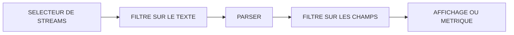
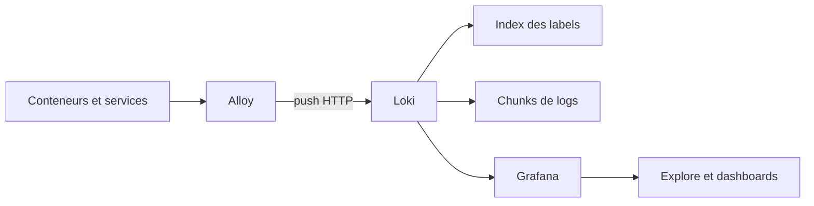


# Loki et LogQL opérationnel

## Objectifs pédagogiques

À la fin de ce module, vous saurez :

- **Sélectionner** des streams de logs avec des labels, et expliquer pourquoi Loki n'indexe pas le contenu des lignes.
- **Parser** des logs JSON, logfmt et texte libre avec `json`, `logfmt`, `pattern` et `regexp`, puis filtrer sur les champs extraits.
- **Transformer** des logs en métriques avec `count_over_time()`, `rate()` et `unwrap`.
- **Distinguer** ce qui doit devenir un label, une métadonnée structurée ou un simple champ parsé à la lecture.
- **Mener** une investigation à partir d'un message d'erreur, du premier symptôme jusqu'à une hypothèse vérifiable.

## Mise en situation

Vous rejoignez une équipe de cinq personnes qui exploite une API de commande en ligne. Elle tourne sur une douzaine de services, répartis entre trois environnements. Jusqu'ici, le diagnostic passait par `ssh` et `grep` sur les machines, ou par `kubectl logs` quand la plateforme est conteneurisée. Cela marche tant qu'il y a un seul serveur.

Un vendredi, des clients se plaignent de paiements qui échouent. Les dashboards de métriques du module précédent montrent un taux de 5xx qui monte sur la passerelle. Ils ne disent pas pourquoi.

La réponse est dans une ligne de log quelque part parmi des millions, répartie sur quatre services et sur des pods qui ont déjà été recréés deux fois depuis le début de l'incident. Un `grep` par machine ne fonctionne plus : il faudrait savoir quelle machine interroger, et les logs de celles qui ont disparu sont perdus.

Il faut un endroit central où chercher dans tous les logs, filtrer par service et par environnement, compter les erreurs dans le temps et les rapprocher de ce que montrent les métriques. C'est le rôle de Loki.

## Pourquoi Loki est construit comme ça

Les moteurs de logs classiques indexent le texte des lignes, ce qui rend la recherche rapide et le stockage cher. Loki fait le choix inverse. Il n'indexe que les **labels** attachés à un flux de logs, et stocke le contenu des lignes compressé en blocs (des *chunks*), sans index sur les mots.

> 📚 **Analogie : la bibliothèque**
>
> Imaginez une bibliothèque où seules les étiquettes des rayons sont cataloguées, sans index des mots de chaque livre. Pour retrouver une phrase, vous allez vite au bon rayon grâce à l'étiquette, puis vous feuilletez. C'est peu coûteux à maintenir, à condition que les étiquettes soient bien choisies.
{: .callout .callout-analogie}

> 🧠 **Concept clé**
>
> Un *stream* est l'ensemble des lignes qui partagent exactement la même combinaison de labels. `{service="api", env="prod"}` est un stream. Si vous ajoutez `pod="api-7f9c"`, vous obtenez un stream par pod. Chaque stream a ses propres chunks. Le nombre de streams actifs est donc la grandeur qui pilote le coût et les performances de Loki, bien plus que le volume brut de logs.
{: .callout .callout-important}

Une requête LogQL (Log Query Language) se lit toujours dans le même sens, de gauche à droite :



Le sélecteur réduit les streams grâce à l'index. Tout ce qui suit est du travail de lecture sur les chunks retenus. Plus le sélecteur est précis, moins il y a de données à lire, et plus la requête est rapide.

## Architecture de la mise en place

Pour ce module, le chemin des logs est volontairement simple :



| Composant | Rôle | Exemple |
|-----------|------|---------|
| Application | Écrit ses logs sur stdout ou dans un fichier | API en JSON, nginx en texte |
| Alloy | Collecte, enrichit avec des labels, envoie à Loki | `loki.source.docker`, `loki.process` |
| Loki | Reçoit, indexe les labels, stocke les lignes | port 3100, `/loki/api/v1/push` |
| Index | Retrouve les streams à partir des labels | `service`, `env` |
| Chunks | Contiennent les lignes compressées | lus à chaque requête |
| Grafana | Interroge Loki en LogQL | Explore, panels Logs et Time series |

Alloy est le collecteur actuel de Grafana. Promtail, l'agent historique, est en fin de vie : sur un nouveau déploiement, partez sur Alloy. Pour l'administration avancée du collecteur, un module dédié viendra plus tard. Ici, on s'en tient au nécessaire.

## Mise en place d'un environnement d'essai

Créez un dossier avec deux fichiers. Voici d'abord `docker-compose.yml`. Il lance Loki, Alloy, Grafana, et un faux service `demo-api` qui produit des logs JSON avec des erreurs régulières.

```yaml
services:
  loki:
    image: grafana/loki:3.4.2
    command: -config.file=/etc/loki/local-config.yaml
    ports:
      - "3100:3100"
    volumes:
      - loki-data:/loki

  alloy:
    image: grafana/alloy:latest   # épingler une version en production
    command: run --server.http.listen-addr=0.0.0.0:12345 --storage.path=/var/lib/alloy/data /etc/alloy/config.alloy
    ports:
      - "12345:12345"
    volumes:
      - ./config.alloy:/etc/alloy/config.alloy:ro
      - /var/run/docker.sock:/var/run/docker.sock:ro
    depends_on:
      - loki

  grafana:
    image: grafana/grafana:latest   # épingler une version en production
    ports:
      - "3000:3000"
    depends_on:
      - loki

  demo-api:
    image: alpine:3.20
    command:
      - sh
      - -c
      - |
        i=0
        while true; do
          i=$$((i+1))
          if [ $$((i % 7)) -eq 0 ]; then
            echo "{\"level\":\"error\",\"msg\":\"payment gateway timeout\",\"path\":\"/checkout\",\"status\":502,\"duration_ms\":$$((i % 900 + 2000)),\"request_id\":\"req-$$i\"}"
          elif [ $$((i % 5)) -eq 0 ]; then
            echo "{\"level\":\"warn\",\"msg\":\"slow query\",\"path\":\"/search\",\"status\":200,\"duration_ms\":$$((i % 400 + 800)),\"request_id\":\"req-$$i\"}"
          else
            echo "{\"level\":\"info\",\"msg\":\"request ok\",\"path\":\"/products\",\"status\":200,\"duration_ms\":$$((i % 150 + 20)),\"request_id\":\"req-$$i\"}"
          fi
          sleep 1
        done

volumes:
  loki-data:
```

Puis `config.alloy`, qui découvre les conteneurs Docker, leur donne un label `service` tiré du nom du service Compose, et envoie le tout à Loki :

```alloy
discovery.docker "local" {
  host = "unix:///var/run/docker.sock"
}

discovery.relabel "logs" {
  targets = discovery.docker.local.targets

  rule {
    source_labels = ["__meta_docker_container_label_com_docker_compose_service"]
    target_label  = "service"
  }
}

loki.source.docker "default" {
  host       = "unix:///var/run/docker.sock"
  targets    = discovery.relabel.logs.output
  labels     = { env = "dev" }
  forward_to = [loki.write.local.receiver]
}

loki.write "local" {
  endpoint {
    url = "http://loki:3100/loki/api/v1/push"
  }
}
```

Démarrez et vérifiez chaque maillon, dans l'ordre où circulent les données :

```bash
docker compose up -d

# Loki est-il prêt ? (peut mettre une quinzaine de secondes)
curl -s http://localhost:3100/ready

# Alloy a-t-il envoyé quelque chose ? Quels labels Loki connaît-il ?
curl -s http://localhost:3100/loki/api/v1/labels

# Quelles valeurs pour le label service ?
curl -s http://localhost:3100/loki/api/v1/label/service/values
```

Vous devez voir `service` et `env` dans les labels, et `demo-api`, `loki`, `alloy`, `grafana` dans les valeurs. Ensuite, dans Grafana (`http://localhost:3000`), ajoutez la source de données : *Connections → Data sources → Add data source → Loki*, URL `http://loki:3100`, puis *Save & test*. Les intitulés de menus varient légèrement selon les versions de Grafana.

> 💡 **Astuce**
>
> Les appels `curl` sur `/labels` et `/label/<NOM>/values` sont le meilleur réflexe quand une requête ne renvoie rien. Ils disent en une seconde si Loki a reçu des données et sous quels labels exacts, sans passer par l'interface.
{: .callout .callout-astuce}

## Lire les logs : sélecteurs et filtres de lignes

Ouvrez *Explore*, choisissez Loki et passez en mode *Code*. Tout commence par un sélecteur de streams, avec la même syntaxe de matchers que Prometheus :

```logql
{service="demo-api", env="dev"}
```

Les quatre opérateurs sont `=`, `!=`, `=~` et `!~`. Les regex sont ancrées : `service=~"api"` ne trouve pas `demo-api`, alors que `service=~".*api"` oui.

> ⚠️ **Erreur fréquente**
>
> Un sélecteur dont aucun matcher ne restreint réellement la recherche, comme `{}` ou `{service=~".*"}`, est refusé avec le message *queries require at least one regexp or equality matcher that does not have an empty-compatible value*. Loki refuse de lire tous les streams. Ajoutez au moins un matcher, d'égalité ou regex, qui ne peut pas correspondre à une valeur vide : `service="demo-api"`, `env="dev"` ou `service=~".+"` conviennent.
{: .callout .callout-attention}

Après le sélecteur viennent les filtres de lignes, qui cherchent du texte brut :

```logql
{service="demo-api"} |= "timeout"                # contient
{service="demo-api"} != "request ok"             # ne contient pas
{service="demo-api"} |~ "timeout|refused"        # regex
{service="demo-api"} |~ "(?i)error"              # insensible à la casse
```

Les filtres de lignes se chaînent, et ils sont de loin l'étape la plus rapide du pipeline. Mettez-les toujours **avant** un parser.

### Filtrer par service, sévérité et environnement

Le triptyque `service` / `env` / sévérité couvre la plupart des recherches. Les deux premiers sont des labels, la sévérité dépend de la façon dont vous avez configuré la collecte (voir plus bas). Dans un dashboard, vos variables Grafana s'écrivent ainsi :

```logql
{env="$env", service=~"$service"} | json | level=~"error|warn"
```

Notez le `=~` sur `service` : une variable multi-valeurs est développée par Grafana en regex `a|b|c`, et un `=` simple ne marcherait qu'avec une seule sélection. Selon la version, Loki peut aussi exposer un champ `detected_level` détecté automatiquement. Regardez dans Explore ce qui existe chez vous avant de choisir.

## Parser les champs structurés

Un log est une ligne de texte, mais ce qui nous intéresse, c'est `status=502` ou `path=/checkout`. Les parsers extraient ces champs à la lecture, sans les stocker comme labels, et les rendent filtrables.

**JSON.** Le cas le plus courant en application moderne :

```logql
{service="demo-api"} | json | level="error" | status >= 500
```

`| json` extrait tous les champs. Les objets imbriqués deviennent `parent_enfant`. Pour n'extraire que quelques champs, ou aller chercher un champ imbriqué, nommez-les :

```logql
{service="demo-api"} | json level="level", user="user.id", path="path"
```

**logfmt.** Les logs de Loki lui-même, et beaucoup d'outils Go, sont au format `clé=valeur`. Vous pouvez vous entraîner dessus tout de suite :

```logql
{service="loki"} | logfmt | level="warn"
```

**pattern.** Pour du texte semi-structuré comme un access log nginx. Chaque `<nom>` capture un champ, et `<_>` ignore un morceau. C'est plus lisible et plus rapide qu'une regex :

```logql
{service="nginx"} | pattern `<ip> - - <_> "<method> <uri> <_>" <status> <size>`
```

**regexp.** Le dernier recours, quand le format est vraiment irrégulier. Les groupes nommés deviennent des champs. Écrivez la regex entre backticks pour éviter de doubler tous les antislashs :

```logql
{service="legacy-app"} | regexp `user=(?P<user>\w+) .* took (?P<ms>\d+)ms`
```

Une fois les champs extraits, on filtre dessus comme sur des labels. Les comparaisons numériques fonctionnent, y compris sur des durées :

```logql
{service="demo-api"} | json | status >= 500 | duration_ms > 2500
```

Pour rendre le résultat lisible, `line_format` réécrit la ligne affichée à l'aide des champs extraits :

```logql
{service="demo-api"} | json | level="error"
  | line_format "{{.path}} → {{.status}} en {{.duration_ms}}ms ({{.request_id}})"
```

> 💡 **Astuce**
>
> Si votre flux mélange des lignes JSON et du texte, `| json` produit un label `__error__="JSONParserErr"` sur les lignes qui ne sont pas du JSON. Ajoutez `| __error__=""` après le parser pour les écarter, ou mettez un filtre `|= "{"` avant. Pareil pour logfmt (`LogfmtParserErr`).
{: .callout .callout-astuce}

## Des logs aux métriques

Quand une question commence par « combien » ou « à quel rythme », LogQL peut produire des séries temporelles à partir des lignes. Le résultat se comporte comme une série Prometheus : on peut l'afficher dans un panel Time series et l'utiliser pour des alertes. Les règles de fenêtre et d'agrégation sont celles du module précédent. Seule la source change.

Deux fonctions couvrent l'essentiel :

```logql
# Nombre de lignes d'erreur dans chaque fenêtre de 5 minutes
count_over_time({service="demo-api"} | json | level="error" [5m])

# Lignes par seconde sur la même fenêtre
rate({service="demo-api"} | json | level="error" [5m])
```

> 📝 **Note**
>
> `count_over_time` donne un total pour la fenêtre. `rate` divise ce total par la durée de la fenêtre en secondes.
{: .callout .callout-note}

Pour un dashboard où l'on veut comparer des périodes de longueur différente, `rate` est plus stable. Pour un message « il y a eu 37 erreurs en 5 minutes », `count_over_time` est plus parlant.

> 🧠 **Concept clé**
>
> Contrairement à `rate()` en PromQL, il n'y a ici aucun compteur ni gestion de reset : Loki compte simplement les lignes présentes dans la fenêtre. Une ligne par événement, donc un événement égale une ligne.
{: .callout .callout-important}

On agrège ensuite avec les opérateurs habituels :

```logql
# Erreurs par service
sum by (service) (count_over_time({env="dev"} |= "error" [5m]))

# Erreurs par chemin, sur un seul service
sum by (path) (count_over_time({service="demo-api"} | json | level="error" [5m]))

# Taux d'erreur serveur, à comparer avec le dashboard Prometheus
sum(rate({service="demo-api"} | json | status >= 500 [5m]))
/
sum(rate({service="demo-api"} [5m]))
```

Quand le log contient une valeur numérique (durée, taille, nombre de lignes), `unwrap` la transforme en échantillon. Il faut ensuite une fonction `*_over_time` qui sache la consommer :

```logql
quantile_over_time(0.95,
  {service="demo-api"} | json | unwrap duration_ms [5m]
) by (path)
```

On obtient ici le p95 de latence par chemin, calculé uniquement à partir des logs. C'est utile quand le service n'a pas de métrique de latence, mais cela reste une approximation coûteuse à calculer. Si une métrique native existe, préférez-la.

Ces requêtes de métriques sont aussi la base des règles d'alerte sur logs, que l'on construira dans le module Grafana Alerting.

## Labels, métadonnées structurées et cardinalité

C'est le point qui fait la différence entre un Loki agréable et un Loki qui s'effondre.

> ⚠️ **Erreur fréquente**
>
> Transformer un champ à forte cardinalité en label : `user_id`, `request_id`, `trace_id`, adresse IP cliente, URL complète avec identifiants. Chaque valeur distincte crée un nouveau stream. Avec 10 services, 3 environnements et 20 pods, vous avez déjà 600 streams. Ajoutez 50 000 `user_id` et vous visez des millions. Conséquences : index qui gonfle, chunks minuscules vidés en permanence, requêtes lentes parce qu'il faut ouvrir des milliers de petits blocs, et, tôt ou tard, rejet à l'ingestion avec `maximum active stream limit exceeded`. **Correction** : laissez ces valeurs dans le texte ou dans les métadonnées structurées, et filtrez-les à la lecture.
{: .callout .callout-attention}

> 💡 **À retenir**
>
> Un bon label a peu de valeurs, des valeurs stables, et sert à restreindre la recherche : `service`, `env`, `cluster`, `namespace`.
{: .callout .callout-important}

La sévérité (`level`, quatre à six valeurs) est un cas limite. C'est acceptable si tous vos logs sont normalisés, mais cela multiplie les streams par service. Si vous hésitez, parsez à la lecture.

Entre « label indexé » et « champ parsé à chaque requête », Loki 3 apporte un troisième niveau : les **métadonnées structurées**.

> 📖 **Définition**
>
> Une métadonnée structurée est une paire clé/valeur attachée à chaque ligne. Elle est stockée avec la ligne, mais **non indexée**, et n'a aucun effet sur le nombre de streams. Elle convient à `request_id`, `trace_id`, `pod` ou `user_id`.
{: .callout .callout-definition}

Elles se filtrent comme des labels, sans parser :

```logql
{service="demo-api"} | request_id="req-4821"
```

Le filtre se place avant tout parser. Il ne fonctionne que si la métadonnée a été posée à la collecte : avec la collecte v1 du lab, `request_id` n'est ni un label ni une métadonnée structurée, et cette requête renvoie « No data » tant que la configuration v3 (plus bas) n'est pas appliquée. Selon votre version et votre schéma de stockage, la fonction doit aussi être activée (schéma v13 avec index TSDB, activé par défaut dans les versions 3.x récentes). Vérifiez dans la configuration `limits_config.allow_structured_metadata` si la requête ne retourne rien.

| Information | Où la mettre | Pourquoi |
|-------------|--------------|----------|
| `service`, `env`, `cluster` | Label | Peu de valeurs, sert à restreindre la recherche |
| `level` | Label ou parsé | Dépend de la normalisation et du volume |
| `request_id`, `trace_id`, `user_id` | Métadonnée structurée | Valeurs uniques, filtrées ponctuellement |
| `status`, `path`, `duration_ms` | Champ parsé | Analysés à la volée, jamais utilisés pour cibler un stream |

Pour mesurer ce qui se passe réellement chez vous, comptez les valeurs d'un label :

```bash
curl -s http://localhost:3100/loki/api/v1/label/<LABEL>/values
```

Si la liste dépasse quelques dizaines de valeurs, demandez-vous si ce n'est pas une information qui devrait vivre ailleurs que dans un label.

## Construction progressive du pipeline

**v1 : tout en brut.** C'est ce que nous venons de monter. Alloy lit les conteneurs, pose `service` et `env`, et tous les logs partent tels quels. Rien à maintenir, mais chaque question de sévérité ou de statut passe par un `| json` à la lecture. Pour apprendre et pour un petit volume, c'est largement suffisant.

**v2 : parsing maîtrisé à la lecture.** On garde la collecte, mais on prend l'habitude d'écrire les requêtes dans le bon ordre : sélecteur précis, filtres de lignes, parser, filtre sur champs. On sauvegarde les requêtes utiles en panels et variables Grafana. Le saut est dans la façon d'écrire, pas dans l'infrastructure : il évite 80 % des problèmes de performance.

**v3 : champs promus à la collecte.** Quand les mêmes champs reviennent à chaque requête, on les extrait une fois pour toutes dans Alloy : `level` devient un label, `request_id` une métadonnée structurée. Ajoutez un composant `loki.process` entre la source et l'écriture :

```alloy
loki.process "app" {
  forward_to = [loki.write.local.receiver]

  stage.json {
    expressions = { level = "level", request_id = "request_id" }
  }

  stage.labels {
    values = { level = "" }
  }

  stage.structured_metadata {
    values = { request_id = "" }
  }
}
```

Dans `loki.source.docker`, remplacez alors `forward_to` par `[loki.process.app.receiver]`. Les noms de stages et leurs options peuvent évoluer, vérifiez dans la documentation de votre version d'Alloy.

Pourquoi ce saut est-il utile ? Parce que `{service="demo-api", level="error"}` devient un sélecteur : il écarte tout le reste avant de lire le moindre chunk. Le prix à payer est un stream par valeur de `level`. C'est pourquoi on ne le fait que pour les champs que l'on garde peu nombreux.

## Investigation d'erreurs à partir d'un message

Un utilisateur transmet une capture : « payment gateway timeout ». C'est tout ce que vous avez. Voici comment on procède en pratique, en partant large pour affiner ensuite. Dans l'environnement d'essai, le label vaut `env="dev"` : remplacez `env="prod"` par `env="dev"` pour reproduire ces requêtes.

**1. Est-ce que ce message existe vraiment, et où ?** On ne sait pas quel service l'émet, donc on cherche sur l'environnement entier mais sur une fenêtre courte :

```logql
{env="prod"} |= "payment gateway timeout"
```

**2. Qui l'émet, et depuis quand ?** Passez en métrique pour voir la forme du phénomène :

```logql
sum by (service) (count_over_time({env="prod"} |= "payment gateway timeout" [5m]))
```

Un seul service, avec une courbe qui part d'un coup à 14 h 10, indique un déclencheur précis (déploiement, dépendance tombée). Plusieurs services qui montent progressivement suggèrent une dégradation en cascade.

**3. Qu'ont en commun les lignes ?** Une fois le service identifié, groupez par champ parsé :

```logql
sum by (path, status) (
  count_over_time({service="demo-api", env="prod"} |= "payment gateway timeout" | json [5m])
)
```

Si tout tombe sur `/checkout` avec le statut 502, l'erreur est localisée : le problème est en amont de l'API, du côté du fournisseur de paiement ou de la liaison réseau.

**4. Voir un exemple complet, et ce qui se passe autour.** Prenez une ligne dans Explore et cliquez sur *Show context* (l'intitulé peut varier) pour afficher les lignes qui l'entourent dans le même stream. Notez son `request_id`.

**5. Suivre une requête à travers les services.** Retirez le filtre de service et cherchez l'identifiant :

```logql
{env="prod"} | request_id="req-4821"
```

Ce filtre suppose que `request_id` est une métadonnée structurée (configuration v3). Avec la collecte v1, utilisez un filtre de ligne : `{env="prod"} |= "req-4821"`. Gardez une fenêtre de temps étroite autour de l'incident : sans sélecteur sur le service, la recherche touche beaucoup de streams.

**6. Conclure sans trancher trop vite.** À ce stade, vous avez un symptôme précis (timeouts sur `/checkout`), une heure de début et un périmètre. Vous n'avez pas encore une cause racine. Croisez avec les métriques de la passerelle : si la latence amont a monté à la même minute, l'hypothèse « fournisseur de paiement » tient. Sinon, cherchez du côté de ce qui a changé au même moment.

## Diagnostic : erreurs fréquentes

**La requête retourne « No data »**
Cause la plus courante : une faute de label (`app` au lieu de `service`) ou une plage de temps trop courte. Vérifiez avec `curl http://<HOST>:3100/loki/api/v1/labels` puis `/label/<LABEL>/values`. Si le label est absent, le problème est côté collecte : consultez l'interface d'Alloy sur le port 12345 pour voir si les composants sont en erreur.

**Parse error : *queries require at least one regexp or equality matcher that does not have an empty-compatible value***
Le sélecteur ne restreint rien (`{}`, `{service=~".*"}`). Ajoutez au moins un matcher qui ne peut pas correspondre à une valeur vide : une égalité sur une valeur précise (`service="demo-api"`) ou une regex comme `service=~".+"`.

**Le panel affiche des lignes avec `__error__="JSONParserErr"`**
Le flux contient des lignes qui ne sont pas du JSON (stack traces, messages de démarrage). Ajoutez `| __error__=""` après `| json`, ou faites précéder le parser d'un filtre de ligne qui élimine le bruit.

**Timeout ou *too many outstanding requests***
La requête lit trop de données. Cause typique : sélecteur trop large, fenêtre de plusieurs jours, ou parser placé avant le filtre de ligne. Resserrez le sélecteur, raccourcissez la plage et déplacez `|=` avant `| json`.

**Une requête de métrique échoue avec *maximum of series reached for a single query***
Vous groupez par un champ à haute cardinalité (`by (request_id)`, `by (user_id)`). Regroupez par une dimension bornée (`service`, `path`, `status`).

**Les logs disparaissent avec *maximum active stream limit exceeded* côté collecteur**
Trop de streams distincts sont créés. Cherchez le label qui prend de nouvelles valeurs en permanence (identifiant, pod à fort *churn*, IP), puis retirez-le dans la configuration Alloy, ou déplacez-le en métadonnée structurée. Relever la limite ne résout pas la cause.

**Le filtre sur une métadonnée structurée ne renvoie rien**
Vérifiez d'abord que la métadonnée est bien posée à la collecte (`stage.structured_metadata` dans Alloy, voir la v3) : sans cela, le champ n'existe que dans le texte de la ligne. Sinon, la fonction n'est pas activée ou le schéma de stockage est trop ancien : vérifiez `allow_structured_metadata` et la version du schéma.

## Cas réel en entreprise (scénario illustratif)

Une équipe de quatre ingénieurs exploite une plateforme de e-commerce de douze services. Les chiffres ci-dessous sont fictifs et servent à illustrer la démarche.

Au départ, l'équipe a ajouté `user_id` et `request_id` comme labels « pour retrouver plus vite un utilisateur ». Après trois semaines, Loki rejette régulièrement des logs, les requêtes sur 24 heures expirent et la facture de stockage a doublé. Le nombre de streams actifs est passé de quelques centaines à plusieurs centaines de milliers.

Le plan de correction tient en trois temps :

1. Mesurer : lister les valeurs de chaque label et repérer ceux qui explosent.
2. Corriger la collecte : retirer `user_id` et `request_id` des labels dans Alloy, les garder comme métadonnées structurées, ne conserver que `service`, `env`, `cluster` et `level`.
3. Reprendre les requêtes des dashboards pour filtrer par `| request_id="..."` plutôt que par sélecteur.

Après une semaine, on peut raisonnablement s'attendre à un nombre de streams divisé par plus de cent, des requêtes sur 24 heures qui répondent en quelques secondes et la disparition des rejets à l'ingestion. L'équipe ajoute ensuite une règle de revue : tout nouveau label doit justifier son nombre de valeurs avant d'être fusionné.

## Bonnes pratiques

- **Peu de labels, bornés et stables.** Visez `service`, `env`, `cluster`, `namespace` et éventuellement `level`. Un label inventé « au cas où » est un coût permanent. Les identifiants uniques vont en métadonnée structurée.
- **Écrire les requêtes dans l'ordre sélecteur, filtre de ligne, parser, filtre de champ.** Chaque étape réduit le volume traité par la suivante. Mettre `| json` avant `|= "timeout"` lit toutes les lignes pour en jeter la plupart.
- **Normaliser le format de log côté application.** Un JSON cohérent entre services (mêmes noms `level`, `msg`, `request_id`) vaut mieux que dix regex différentes à maintenir.
- **Ne jamais logger de secrets ni de données personnelles.** Un token ou un e-mail dans un log est lisible par quiconque a accès à la source Loki. Nettoyez à la source ou avec un stage de masquage dans Alloy.
- **Surveiller le pipeline de logs lui-même.** Un service qui n'émet plus aucun log est un signal en soi. Comparez le volume par service dans le temps pour détecter une collecte silencieusement cassée.
- **Garder une collecte idempotente et versionnée.** La configuration Alloy et les dashboards doivent vivre dans Git, pas seulement dans l'interface, pour qu'un redéploiement redonne les mêmes labels.
- **Limiter la rétention et la plage de requête par défaut.** Une fenêtre par défaut d'une heure dans les dashboards évite les requêtes accidentelles sur des jours entiers.
- **Documenter les requêtes utiles dans les dashboards.** Un panel Logs avec sa requête commentée apprend plus vite à l'équipe que n'importe quel wiki.

## Résumé

Loki indexe uniquement les labels des streams et laisse le contenu des lignes non indexé, ce qui le rend économique, à condition de bien choisir ces labels. LogQL se lit comme un pipeline : sélecteur de streams, filtres de lignes, parser (`json`, `logfmt`, `pattern`, `regexp`), puis filtres sur les champs extraits. Les mêmes logs peuvent être transformés en métriques avec `count_over_time()`, `rate()` et `unwrap`, et alimenter dashboards comme alertes. Le vrai risque est la cardinalité : un identifiant utilisé comme label multiplie les streams et dégrade tout. Les métadonnées structurées de Loki 3 offrent la bonne place pour ces valeurs. Une investigation efficace part d'un message, localise le service et la date de début, puis suit une requête à travers les services. La suite logique est d'ajouter à ces métriques et ces logs la vue par requête qu'offre le tracing distribué.

<!-- snippet
id: loki_concept_stream_labels_index
type: concept
tech: loki
level: intermediate
importance: high
format: knowledge
tags: loki,streams,labels,index
title: Un stream Loki = une combinaison unique de labels
content: Loki n'indexe que les labels, jamais le texte des lignes. Chaque combinaison distincte de labels forme un stream avec ses propres chunks compressés. {service="api", env="prod"} est un stream, ajouter pod="x" en crée un par pod. Le nombre de streams actifs, plus que le volume de logs, détermine la taille de l'index et la vitesse des requêtes.
description: Le coût de Loki se joue sur le nombre de streams, c'est-à-dire sur les combinaisons de labels, pas sur le volume brut de logs.
-->

<!-- snippet
id: loki_logql_stream_selector_filter
type: command
tech: loki
level: beginner
importance: high
format: knowledge
tags: logql,selecteur,filtre,logs
title: Sélectionner un stream et filtrer sur du texte
command: {service="<SERVICE>", env="<ENV>"} |= "<TEXTE>"
example: {service="demo-api", env="dev"} |= "timeout"
description: Le sélecteur restreint les streams via l'index, le filtre |= cherche ensuite le texte brut dans les lignes. Au moins un matcher qui ne peut pas correspondre à une valeur vide est obligatoire.
-->

<!-- snippet
id: loki_logql_filter_before_parser
type: tip
tech: loki
level: intermediate
importance: high
format: knowledge
tags: logql,performance,parser,filtre
title: Mettre le filtre de ligne avant le parser
content: Écrire {service="api"} |= "timeout" | json et non {service="api"} | json |= "timeout". Le filtre de ligne est une simple recherche de texte, le parser doit décoder chaque ligne. En filtrant d'abord, le parser ne traite que les lignes retenues, ce qui peut diviser le temps de requête par un facteur important sur de gros volumes.
description: L'ordre des étapes compte : filtres de lignes d'abord, parser ensuite, filtre sur les champs extraits en dernier.
-->

<!-- snippet
id: loki_logql_json_label_filter
type: command
tech: loki
level: beginner
importance: high
format: knowledge
tags: logql,json,parsing,statut
title: Parser du JSON et filtrer sur des champs numériques
command: {service="<SERVICE>"} | json | level="<NIVEAU>" | status >= <CODE>
example: {service="demo-api"} | json | level="error" | status >= 500
description: | json extrait tous les champs de la ligne en labels temporaires. Les comparaisons numériques (>=, >) fonctionnent directement dessus.
-->

<!-- snippet
id: loki_logql_count_over_time_by_service
type: command
tech: loki
level: intermediate
importance: high
format: knowledge
tags: logql,metriques,count_over_time,agregation
title: Compter les erreurs par service dans le temps
command: sum by (service) (count_over_time({env="<ENV>"} |= "<TEXTE>" [<FENETRE>]))
example: sum by (service) (count_over_time({env="prod"} |= "payment gateway timeout" [5m]))
description: Transforme des lignes de logs en série temporelle affichable dans un panel Time series. Premier réflexe pour voir quel service émet un message et depuis quand.
-->

<!-- snippet
id: loki_concept_rate_vs_count_over_time
type: concept
tech: loki
level: intermediate
importance: medium
format: knowledge
tags: logql,rate,count_over_time,metriques
title: rate() et count_over_time() sur des logs
content: count_over_time compte les lignes présentes dans la fenêtre, rate divise ce nombre par la durée en secondes. Sur des logs il n'y a pas de compteur ni de gestion de reset comme en PromQL : une ligne égale un événement. count_over_time pour dire "37 erreurs en 5 min", rate pour comparer des fenêtres de longueurs différentes.
description: Les deux fonctions comptent les lignes d'une fenêtre. rate exprime le résultat en lignes par seconde, count_over_time en total brut.
-->

<!-- snippet
id: loki_logql_unwrap_quantile
type: command
tech: loki
level: advanced
importance: medium
format: knowledge
tags: logql,unwrap,latence,quantile
title: Calculer un p95 de latence depuis les logs
command: quantile_over_time(0.95, {service="<SERVICE>"} | json | unwrap <CHAMP> [<FENETRE>]) by (<LABEL>)
example: quantile_over_time(0.95, {service="demo-api"} | json | unwrap duration_ms [5m]) by (path)
description: unwrap convertit un champ numérique extrait en échantillon. Utile sans métrique native, mais plus coûteux à calculer qu'une métrique Prometheus.
-->

<!-- snippet
id: loki_warning_high_cardinality_labels
type: warning
tech: loki
level: intermediate
importance: high
format: knowledge
tags: loki,cardinalite,labels,performance
title: Un identifiant unique en label fait exploser Loki
content: Piège : utiliser user_id, request_id, trace_id ou une IP comme label. Chaque valeur crée un stream, donc un index énorme, des chunks minuscules et des requêtes lentes, puis rejet à l'ingestion avec "maximum active stream limit exceeded". Correction : retirer ces labels dans Alloy et les passer en métadonnée structurée (stage.structured_metadata), puis filtrer avec | request_id="...".
description: Un label doit avoir peu de valeurs stables. Les valeurs uniques vont en métadonnée structurée, jamais en label indexé.
-->

<!-- snippet
id: loki_concept_structured_metadata
type: concept
tech: loki
level: advanced
importance: medium
format: knowledge
tags: loki,metadonnees,structured-metadata,cardinalite
title: Métadonnées structurées : filtrables sans être indexées
content: Loki 3 permet d'attacher des paires clé/valeur à chaque ligne sans les indexer ni créer de nouveau stream. Elles se filtrent comme un label, sans parser : {service="api"} | request_id="req-42". Prérequis : métadonnée posée à la collecte (stage.structured_metadata dans Alloy), schéma v13 avec index TSDB et allow_structured_metadata actif, par défaut dans les versions 3.x récentes.
description: Troisième niveau entre label indexé et champ parsé : idéal pour request_id, trace_id et user_id sans impact sur le nombre de streams.
-->

<!-- snippet
id: loki_error_json_parser_err
type: error
tech: loki
level: intermediate
importance: medium
format: knowledge
tags: logql,json,parsing,erreur
title: Lignes avec __error__="JSONParserErr"
content: Symptôme : des lignes apparaissent avec le label __error__="JSONParserErr" après | json. Cause : le flux mélange du JSON et du texte (stack traces, messages de démarrage). Correction : ajouter | __error__="" juste après le parser, ou placer avant lui un filtre comme |= "{" pour ne garder que les lignes JSON.
description: Le parser ne plante pas sur une ligne invalide, il la marque. Filtrer sur __error__ permet d'obtenir des résultats propres.
-->

<!-- snippet
id: loki_error_empty_compatible_matcher
type: error
tech: loki
level: beginner
importance: medium
format: knowledge
tags: logql,selecteur,erreur,loki
title: Erreur "empty-compatible value" sur un sélecteur
content: Symptôme : parse error "queries require at least one regexp or equality matcher that does not have an empty-compatible value". Cause : sélecteur comme {} ou {service=~".*"} qui ne restreint aucun stream. Correction : ajouter au moins un matcher, d'égalité ou regex, qui ne peut pas correspondre à une valeur vide, par exemple {service="demo-api"}, {env="prod"} ou {service=~".+"}.
description: Loki refuse de parcourir tous les streams. Au moins un matcher non compatible avec la chaîne vide est obligatoire.
-->

<!-- snippet
id: loki_check_label_values_curl
type: command
tech: loki
level: beginner
importance: medium
format: knowledge
tags: loki,labels,diagnostic,cardinalite
title: Lister les valeurs d'un label directement via l'API
command: curl -s http://<HOST>:3100/loki/api/v1/label/<LABEL>/values
example: curl -s http://localhost:3100/loki/api/v1/label/service/values
description: Vérifie quels labels et quelles valeurs Loki a réellement reçus. Sert à diagnostiquer un "No data" ou à repérer un label à trop de valeurs.
-->

<!-- snippet
id: loki_logcli_query
type: command
tech: loki
level: intermediate
importance: low
format: knowledge
tags: logcli,loki,cli,logs
title: Interroger Loki depuis le terminal avec logcli
command: logcli query --addr=<URL_LOKI> --since=<DUREE> '<REQUETE_LOGQL>'
example: logcli query --addr=http://localhost:3100 --since=15m '{service="demo-api"} |= "timeout"'
description: Utile pour scripter une recherche ou récupérer des logs sans passer par Grafana. La requête est la même qu'en Explore.
-->

<!-- snippet
id: loki_error_max_active_streams
type: error
tech: loki
level: advanced
importance: high
format: knowledge
tags: loki,streams,ingestion,cardinalite
title: "maximum active stream limit exceeded" à l'ingestion
content: Symptôme : des logs manquent et Alloy ou Loki signale maximum active stream limit exceeded. Cause : un label prend sans cesse de nouvelles valeurs (identifiant, IP, pod à fort churn) et dépasse la limite de streams du tenant. Correction : identifier ce label avec /loki/api/v1/label/<LABEL>/values, le retirer de la collecte ou le passer en métadonnée structurée. Relever la limite ne règle pas la cause.
description: L'erreur est le symptôme d'une cardinalité mal maîtrisée en amont, pas d'une limite trop basse.
-->

