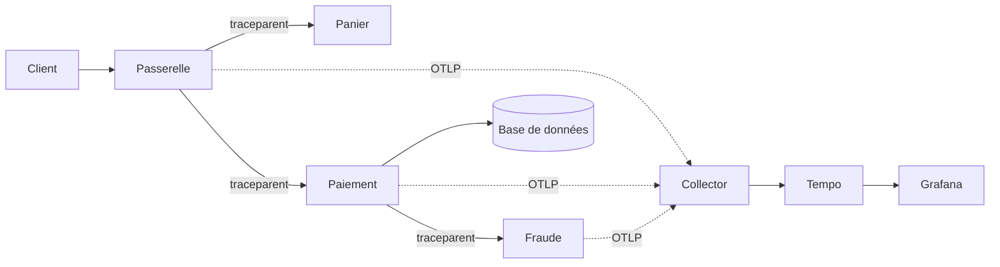

# Tracing distribué et Tempo

## Objectifs pédagogiques

À la fin de ce module, vous serez capable de :

- **Expliquer** comment un Trace ID, des Span ID et la relation parent-enfant reconstruisent le chemin d'une requête à travers plusieurs services.
- **Vérifier** qu'une propagation de contexte OpenTelemetry fonctionne de bout en bout, et repérer l'endroit où elle casse.
- **Écrire** des requêtes TraceQL pour retrouver les traces lentes, en erreur ou passant par une dépendance donnée.
- **Naviguer** entre logs (Loki) et traces (Tempo) dans Grafana grâce aux identifiants partagés.
- **Diagnostiquer** une trace absente en distinguant échantillonnage, propagation cassée et délai d'ingestion.
- **Mener** une investigation de requête lente, du symptôme jusqu'au span responsable.

## Mise en situation

Vous rejoignez l'équipe plateforme d'une boutique en ligne : six développeurs, une douzaine de services (passerelle, panier, paiement, stock, notifications), tout tourne sur Kubernetes. Depuis deux jours, le support reçoit des plaintes : « le paiement met parfois une éternité ».

Vous avez déjà de quoi enquêter. Prometheus vous montre que la latence p95 de la passerelle est passée de 400 ms à 3 s. Loki vous donne des milliers de lignes de logs par minute. Mais aucun de ces outils ne répond à la vraie question : **dans cette requête précise, où sont passées les 3 secondes ?**

Les métriques sont agrégées, donc elles vous disent *que* c'est lent, pas *où*. Les logs sont dispersés dans douze services, et rien ne garantit que vous retrouvez les lignes qui concernent la même requête.

Le tracing apporte exactement ce qui manque : un enregistrement par requête, qui suit celle-ci de service en service avec le temps passé à chaque étape. Tempo est le backend de Grafana qui stocke ces traces, et Grafana est l'endroit où vous les lisez.

## Ce qu'est vraiment une trace

### 🧠 Trace ID, Span ID, parent-enfant

Une trace rassemble toutes les étapes d'une même requête, et trois identifiants permettent de les relier.

> 📖 **Définitions**
>
> **Trace ID :** identifiant commun à toute la requête, qui ne change jamais du début à la fin.
>
> **Span :** une étape de la requête, avec son identifiant (**Span ID**), une heure de début et une durée.
>
> **Parent span ID :** l'identifiant de l'étape qui a déclenché celle-ci.
{: .callout .callout-definition}

Concrètement, une requête de paiement donne ceci :

```
Trace 4bf92f3577b34da6a3ce929d0e0e4736
└─ passerelle  POST /checkout                    (3 120 ms)
   ├─ panier   GET /cart/42                      (   45 ms)
   └─ paiement POST /pay                         (2 950 ms)
      ├─ paiement  validate_card                 (   30 ms)
      ├─ paiement  SELECT orders (db)            (   25 ms)
      └─ fraude    POST /score                   (2 850 ms)
```

Le span racine n'a pas de parent. Chaque autre span pointe vers le span qui l'a appelé. C'est cette chaîne de pointeurs, plus les horodatages, qui permet à Grafana de dessiner la cascade (le *waterfall*).

Un span porte aussi des **attributs** (`http.request.method`, `http.response.status_code`, `db.system`…) et un **statut** (`unset`, `ok`, `error`). Les attributs liés au processus ou au service (`service.name`, `k8s.pod.name`) sont des attributs de *ressource*, partagés par tous les spans d'un même service. Cette distinction compte dès qu'on écrit du TraceQL.

### Comment le contexte voyage

Les services ne partagent pas de mémoire. Pour que le service B sache qu'il travaille pour la trace X, le service A doit lui **transmettre** le contexte, et il le fait dans les en-têtes de la requête. Le standard utilisé par défaut dans OpenTelemetry est l'en-tête W3C `traceparent` :

```
traceparent: 00-4bf92f3577b34da6a3ce929d0e0e4736-00f067aa0ba902b7-01
             │  │                                │                │
             │  └ Trace ID (32 hex)              │                └ flags (01 = échantillonnée)
             └ version                           └ Span ID de l'appelant (16 hex)
```

Côté B, la bibliothèque d'instrumentation lit cet en-tête, crée un nouveau span dont le parent est `00f067aa0ba902b7`, et réutilise le même Trace ID. Si cet en-tête disparaît quelque part (un proxy qui le filtre, un client HTTP non instrumenté, un message de file qui ne porte pas le contexte), B démarre une **nouvelle** trace. Vous vous retrouvez avec deux demi-traces non reliées, et c'est l'un des problèmes les plus fréquents en pratique.



Les flèches pleines sont les appels métier qui transportent le contexte. Les flèches en pointillés sont l'export de la télémétrie, qui est un flux séparé.

## Instrumenter avec OpenTelemetry

OTel (OpenTelemetry) est le standard qui sépare deux choses : produire les spans dans l'application (SDK et bibliothèques d'instrumentation) et les transporter vers un backend (protocole OTLP, OpenTelemetry Protocol). L'application n'a pas besoin de connaître Tempo ; elle parle OTLP à un Collector ou directement à Tempo, qui accepte OTLP sur les ports 4317 (gRPC) et 4318 (HTTP).

Il existe deux niveaux d'instrumentation :

- L'**auto-instrumentation** (agent Java, `opentelemetry-instrument` en Python, etc.) crée des spans pour les serveurs HTTP, clients HTTP et pilotes de base de données sans toucher au code. Elle suffit pour obtenir la cascade des appels.
- L'**instrumentation manuelle** ajoute des spans autour d'une étape métier (« calcul du score de fraude ») quand l'automatique ne voit qu'un gros trou opaque.

Pour une application déjà packagée, la configuration passe le plus souvent par des variables d'environnement :

```bash
export OTEL_SERVICE_NAME=paiement
export OTEL_EXPORTER_OTLP_ENDPOINT=http://collector:4317
export OTEL_EXPORTER_OTLP_PROTOCOL=grpc
export OTEL_PROPAGATORS=tracecontext,baggage
export OTEL_TRACES_SAMPLER=parentbased_traceidratio
export OTEL_TRACES_SAMPLER_ARG=0.25
```

Le nom du service est critique : c'est lui qui apparaît dans la cascade, dans le service graph et dans vos requêtes TraceQL. Un service qui s'appelle `unknown_service:java` vous fera perdre du temps.

> 💡 **Astuce**
>
> Dans une architecture mixte, vérifiez que tous les services utilisent le même format de propagation. Un service ancien qui n'émet que des en-têtes `b3` (Zipkin) coupera la chaîne face à des services en `tracecontext`. `OTEL_PROPAGATORS=tracecontext,b3` permet de parler les deux le temps de la migration.
{: .callout .callout-astuce}

## Brancher Tempo à Grafana

Pour un labo local, un Tempo minimal ressemble à ceci (les clés exactes dépendent de la version, vérifiez la doc de celle que vous déployez) :

```yaml
server:
  http_listen_port: 3200
distributor:
  receivers:
    otlp:
      protocols:
        grpc:
          endpoint: 0.0.0.0:4317
        http:
          endpoint: 0.0.0.0:4318
storage:
  trace:
    backend: local
    wal:
      path: /var/tempo/wal
    local:
      path: /var/tempo/blocks
```

Côté Grafana, la source de données se déclare en provisioning. C'est ici qu'on active la corrélation vers les logs et le service graph :

```yaml
apiVersion: 1
datasources:
  - name: Tempo
    type: tempo
    uid: tempo
    url: http://tempo:3200
    jsonData:
      tracesToLogsV2:
        datasourceUid: loki
        spanStartTimeShift: "-1m"
        spanEndTimeShift: "1m"
        filterByTraceID: true
        filterBySpanID: false
        tags:
          - key: service.name
            value: service_name
      serviceMap:
        datasourceUid: prometheus
```

Le `tags` fait le pont entre le nom d'attribut côté trace (`service.name`) et le label côté Loki (`service_name`). Si les deux ne correspondent pas, le bouton « Logs for this span » ne trouvera rien. Le décalage `spanStartTimeShift`/`spanEndTimeShift` élargit la fenêtre de recherche autour du span, car les horloges ne sont jamais parfaitement synchronisées.

Pour vérifier que Tempo répond avant de le soupçonner de tout :

```bash
curl -s http://<TEMPO_HOST>:3200/ready
```

## Lire une trace dans Grafana

Deux chemins mènent à une trace. Le premier : vous avez déjà un Trace ID (dans un log, un ticket, une réponse HTTP) ; dans **Explore**, choisissez la source Tempo, onglet *TraceID*, collez l'identifiant. Le second : vous cherchez une trace correspondant à un critère, et vous utilisez l'onglet de recherche (formulaire) ou **TraceQL**.

Une fois la trace ouverte, voici comment lire la cascade, sans vous laisser hypnotiser par les barres :

- **Cherchez d'abord le span le plus long en temps propre**, pas en durée totale. En appel synchrone, un span parent dure au moins aussi longtemps que ses enfants (ce n'est pas garanti en asynchrone, où un enfant peut se terminer après son parent) ; ce qui compte est ce qu'il reste une fois les enfants retirés (le *self time*).
- **Un trou entre le début d'un parent et le premier enfant** indique du travail non instrumenté, une file d'attente, ou un temps de connexion réseau. Ce n'est pas un bug de l'affichage.
- **Beaucoup de petits spans identiques en séquence** (`SELECT ... WHERE id = ?` vingt fois) trahissent un problème « N+1 » : aucune requête n'est lente, c'est leur nombre qui l'est.
- **Des enfants parallèles** se chevauchent dans le temps ; des enfants séquentiels s'enchaînent en escalier. Le même total n'appelle pas la même optimisation.

Les spans en erreur sont signalés visuellement. Cliquez sur un span pour voir ses attributs : c'est souvent là que se cache l'URL, la requête SQL ou le code retour.

## TraceQL : retrouver les bonnes traces

TraceQL (Trace Query Language) est le langage de requête de Tempo. Il filtre sur les **spans**, et renvoie les traces qui contiennent au moins un span correspondant. La syntaxe se lit comme un filtre entre accolades :

```
{ resource.service.name = "paiement" && duration > 1s }
```

Les préfixes précisent où chercher : `resource.` pour les attributs de ressource, `span.` pour les attributs de span, et des champs intrinsèques sans préfixe (`duration`, `status`, `name`, `kind`). Quelques requêtes qui servent tout le temps :

```
{ status = error }
{ resource.service.name = "paiement" && span.http.response.status_code >= 500 }
{ span.db.system = "postgresql" && duration > 200ms }
```

Pour exprimer une relation entre services, on enchaîne deux filtres avec un opérateur structurel.

> 🔑 **Moyen mnémotechnique**
>
> `>` (un chevron) veut dire « enfant direct » : un seul niveau. `>>` (deux chevrons) veut dire « descendant de » : à n'importe quelle profondeur. Un chevron, un niveau ; deux chevrons, autant de niveaux que nécessaire.
{: .callout .callout-memo}

Par exemple :

```
{ resource.service.name = "passerelle" } >> { resource.service.name = "fraude" && duration > 2s }
```

Cette requête trouve les traces où la passerelle a fini par appeler un service de fraude lent, ce qui répond directement à une question de dépendance.

On peut aussi agréger sur les spans d'une même trace avec un pipe :

```
{ span.db.system = "postgresql" } | count() > 15
```

Voilà le détecteur de N+1 : toute trace contenant plus de quinze appels de base de données.

> ⚠️ **Erreur fréquente**
>
> Filtrer sur `duration > 2s` sans restreindre le service retourne aussi des spans racine légitimement longs (un traitement batch, un websocket). Ajoutez toujours `resource.service.name` ou `name` pour cibler ce qui vous intéresse. Et pensez à resserrer la fenêtre de temps dans Grafana : TraceQL parcourt le stockage sur la plage choisie, et sur une grande plage c'est lent.
{: .callout .callout-attention}

Si vous voulez scripter ou tester sans passer par l'interface, l'API HTTP de Tempo fait la même chose :

```bash
curl -G -s http://<TEMPO_HOST>:3200/api/search \
  --data-urlencode 'q={ status = error }' \
  --data-urlencode 'limit=20'

curl -s http://<TEMPO_HOST>:3200/api/traces/<TRACE_ID>
```

## Durées, erreurs et dépendances à l'échelle

TraceQL travaille trace par trace. Pour voir la forme globale (quels services s'appellent, avec quel taux d'erreur), Tempo peut activer son **metrics-generator**, qui calcule à partir des spans des métriques (`traces_spanmetrics_*`, `traces_service_graph_*`) et les écrit dans Prometheus. Grafana s'en sert pour afficher le **service graph**, la carte des dépendances où chaque flèche porte un débit, un taux d'erreur et une latence.

L'intérêt diagnostique est direct : le service graph vous dit *quelle arête* s'est dégradée, puis vous basculez sur TraceQL pour obtenir des exemples précis. Les span metrics vous donnent aussi des courbes de latence par opération dans des panels classiques, avec un lien vers des traces d'exemple.

> 🧠 **Concept clé**
>
> Les métriques répondent à « combien et depuis quand », les traces à « où dans le chemin ». Le bon réflexe est de partir de la métrique (l'alerte, le panel qui dérive), puis de descendre vers une trace représentative de la période concernée.
{: .callout .callout-important}

## Relier logs et traces

Une trace vous montre qu'un span a échoué ; seul le log dira *pourquoi* (le message d'exception, la valeur invalide). La liaison repose sur un principe simple : **écrire le Trace ID dans chaque ligne de log émise pendant la requête**. Les bibliothèques de logging instrumentées par OTel (ou un MDC/contexte de logger) l'ajoutent automatiquement :

```
level=error msg="timeout calling fraud scoring" trace_id=4bf92f3577b34da6a3ce929d0e0e4736 span_id=a1b2c3d4e5f60718
```

Dans le sens **trace → logs**, c'est la configuration `tracesToLogsV2` vue plus haut : un clic sur le span ouvre une requête Loki filtrée par le Trace ID. Dans le sens **logs → trace**, on déclare un *derived field* sur la source Loki, qui extrait l'identifiant par expression régulière et le transforme en lien vers Tempo :

```yaml
jsonData:
  derivedFields:
    - name: trace_id
      matcherRegex: 'trace_id=(\w+)'
      url: '$${__value.raw}'
      datasourceUid: tempo
```

Le `$$` est l'échappement du provisioning Grafana ; dans l'interface, vous écrivez `${__value.raw}`. Si vos logs sont en JSON, adaptez la regex au nom du champ (`"trace_id":"(\w+)"`).

> 💡 **Astuce**
>
> Pour tester la chaîne, prenez un Trace ID dans Tempo et cherchez-le avec `{service_name="paiement"} |= "<TRACE_ID>"` dans Explore Loki. Zéro résultat signifie que l'application n'écrit pas l'identifiant, et c'est à corriger côté code avant de toucher à Grafana.
{: .callout .callout-astuce}

## Diagnostic : pourquoi ma trace est absente ou incomplète

C'est le cœur diagnostique de ce module. Quand une trace manque, les causes se classent en quelques familles, qu'il vaut mieux explorer dans un ordre précis.

### ⚠️ Échantillonnage : la trace n'a jamais été conservée

**Symptôme** : vous avez un Trace ID dans un log, mais Tempo répond « trace not found » même plusieurs minutes plus tard. D'autres traces du même service existent.

**Cause** : l'échantillonnage. Avec `parentbased_traceidratio` à `0.1`, seule une requête sur dix est enregistrée, et c'est décidé au tout début (*head sampling*), avant de savoir si la requête serait lente ou en erreur. Les requêtes problématiques sont donc perdues dans les mêmes proportions que les saines.

> 💡 **À retenir**
>
> Le Trace ID est généré et écrit dans les logs même quand la trace n'est pas échantillonnée. Sa présence dans un log ne prouve donc pas que la trace existe dans Tempo.
{: .callout .callout-important}

**Correction** : deux leviers. Pour les environnements à volume modeste, montez le ratio (ou passez à `always_on` en préproduction). Pour la production, utilisez le *tail sampling* dans le Collector (processeur `tail_sampling`), qui attend la fin de la trace avant de décider, et conserve par exemple toutes les traces en erreur, toutes celles de plus de 1 s, plus un pourcentage du reste.

Le prix : le Collector doit garder les spans en mémoire le temps de la décision, et toutes les parties d'une même trace doivent arriver sur la même instance de Collector.

### Propagation cassée : deux demi-traces

**Symptôme** : la trace de la passerelle s'arrête à l'appel du paiement, et le paiement apparaît dans une autre trace, avec un autre Trace ID, qui commence par un span racine inattendu.

**Cause** : un maillon n'a pas transmis le `traceparent` (proxy ou ingress qui filtre les en-têtes, client HTTP non instrumenté, message publié dans une file sans contexte, appel asynchrone dans un pool de threads sans propagation).

**Correction** : repérez le dernier span de la trace amont et le premier de la trace aval, c'est là qu'est la coupure. Vérifiez avec `curl -v` ou les logs du proxy que l'en-tête passe. Pour les files de messages, il faut injecter explicitement le contexte dans les en-têtes du message.

### Délai d'ingestion et mauvaise fenêtre de temps

**Symptôme** : vous venez d'exécuter une requête, vous cherchez la trace tout de suite, rien. Quelques secondes plus tard, elle est là.

**Cause** : les spans transitent par le Collector (traitement par lots), puis par l'ingester de Tempo avant d'être consultables. Un délai de quelques secondes est normal.

**Correction** : attendez un peu avant de conclure. Si ça persiste, vérifiez aussi la plage de temps dans Grafana et le fuseau.

### Spans perdus en route

**Symptôme** : la trace existe mais il manque un service entier, alors que celui-ci est bien instrumenté et que son log contient le bon Trace ID.

**Cause** : l'export de ce service échoue (mauvais `OTEL_EXPORTER_OTLP_ENDPOINT`, port 4317 utilisé avec le protocole HTTP, réseau bloqué, file d'export pleine dans le Collector).

**Correction** : consultez les logs du SDK ou du Collector (messages d'export en échec), et testez la connectivité vers le port OTLP. Dans un Collector, l'exporter `debug` affiche les spans reçus, ce qui dit tout de suite si le problème est en amont ou en aval.

### Récapitulatif rapide

| Ce que vous voyez | Première hypothèse | Vérification |
|---|---|---|
| Trace ID dans les logs, introuvable dans Tempo | Échantillonnage | Ratio du sampler, règles de tail sampling |
| Trace coupée en deux | Propagation cassée | En-tête `traceparent` au point de rupture |
| Trace visible après 10 s seulement | Délai d'ingestion | Rien à corriger, élargir la fenêtre |
| Un service absent d'une trace complète | Export en échec | Logs du SDK/Collector, endpoint, protocole |
| Nom de service `unknown_service` | `OTEL_SERVICE_NAME` absent | Variables d'environnement du pod |

## Cas pratique : requête lente entre plusieurs services

Scénario illustratif (les chiffres sont inventés pour l'exemple). Reprenons la boutique du début : le p95 de `POST /checkout` est passé de 400 ms à 3 s.

**1. Délimiter le problème avec les métriques.** Le dashboard montre que seule la route `/checkout` est touchée, pas les autres. La dégradation a commencé à 14 h 10. Ce n'est donc pas la passerelle en général.

**2. Retrouver des traces représentatives.** Dans Explore → Tempo, avec la plage 14 h 10 – 14 h 40 :

```
{ resource.service.name = "passerelle" && name = "POST /checkout" && duration > 2s }
```

Plusieurs dizaines de traces ressortent. Aucune n'est en erreur : c'est de la lenteur pure.

**3. Ouvrir une trace et lire la cascade.** Total : 3,1 s. Le panier prend 45 ms, le paiement 2,95 s. Dans le paiement, la validation de la carte (30 ms) et la base (25 ms) sont normales ; l'appel vers `fraude` dure 2,85 s. Hypothèse : le service fraude est le goulot.

**4. Vérifier que ce n'est pas un cas isolé.** On teste l'hypothèse sur l'ensemble :

```
{ resource.service.name = "passerelle" } >> { resource.service.name = "fraude" && duration > 2s }
```

La quasi-totalité des traces lentes passent par ce chemin. L'hypothèse tient. Et pour la mettre à l'épreuve, on cherche aussi des contre-exemples : des traces `/checkout` lentes qui *ne* traversent *pas* le service fraude. Il n'y en a presque aucune.

**5. Descendre dans le service fraude.** À l'intérieur de son span, on trouve un span enfant `GET scoring-api.externe` de 2,8 s, et un attribut `http.response.status_code = 200`. Pas d'erreur, juste de la lenteur sur un appel sortant vers un fournisseur tiers.

**6. Corréler avec les logs.** Depuis ce span, « Logs for this span » ouvre Loki : on y lit `retry=2 reason="read timeout 1000ms"`. Le client HTTP attend 1 s, échoue, réessaie deux fois, et le résultat final réussit au troisième essai. D'où les 2,8 s.

**7. Conclusion technique.** Cause racine : le fournisseur de scoring a ralenti vers 14 h 10, et la politique de retry multiplie la latence perçue. Symptôme : p95 du checkout. On résume : *où* (span `scoring-api.externe`), *pourquoi* (timeouts + retries), *preuve* (traces filtrées et logs). Les actions possibles : timeout plus agressif avec dégradation (accepter le paiement et scorer en asynchrone), alerte sur la durée du span, discussion avec le fournisseur.

Remarquez ce qui s'est passé : à aucun moment vous n'avez « deviné ». Chaque étape a été une hypothèse vérifiable contre des données.

## Bonnes pratiques

- **Nommez chaque service explicitement** (`OTEL_SERVICE_NAME`) et uniformisez la convention (`paiement`, pas `Paiement-API-v2-prod`). Les requêtes, le service graph et les liens vers Loki dépendent de ce nom.
- **Écrivez le Trace ID dans tous les logs** dès le premier service instrumenté. Le gain est immédiat, et rattraper cet oubli après coup demande de toucher chaque application.
- **Ne mettez pas de données sensibles dans les attributs de span** : numéros de carte, jetons, e-mails en clair, corps de requête complets. Les traces sont stockées, consultables par toute l'équipe, et la rétention est souvent plus longue qu'on ne l'imagine. Nettoyez au niveau du Collector (processeur `attributes`) en plus du code.
- **Choisissez votre stratégie d'échantillonnage consciemment**. En production, privilégiez le tail sampling pour garder les traces d'erreur et de latence, et documentez le ratio pour que l'équipe ne soit pas surprise par une trace manquante.
- **Gardez les attributs à faible cardinalité dans les métriques dérivées**. Les span metrics génèrent une série par combinaison de dimensions ; ajouter l'identifiant utilisateur comme dimension ferait exploser Prometheus. Les valeurs à haute cardinalité vont dans les attributs de span, pas dans les labels de métriques.
- **Surveillez la chaîne de traçage elle-même** : taux de spans refusés ou abandonnés par le Collector, latence d'ingestion de Tempo. Un tracing silencieusement tronqué est pire qu'un tracing absent, car il fait croire à des conclusions fausses (on y reviendra avec le meta-monitoring).
- **Versionnez la configuration** (provisioning de la source Tempo, règles du Collector) dans Git, comme le reste. Les liens trace/logs cassés en silence sont typiques des configurations modifiées à la main dans l'interface.
- **Restreignez l'accès à la source Tempo** par les permissions de Grafana si les traces contiennent des données de plusieurs équipes : Tempo seul ne cloisonne rien.

## Résumé

Le tracing distribué résout un problème que ni les métriques ni les logs ne règlent seuls : savoir où une requête précise a perdu son temps en traversant plusieurs services. Il repose sur un Trace ID commun, des spans reliés par parent-enfant, et un contexte transmis dans l'en-tête `traceparent`. OpenTelemetry produit et exporte les spans, Tempo les stocke, Grafana les affiche et les interroge avec TraceQL. Les corrélations par identifiant avec Loki et le service graph alimenté par Prometheus complètent la boucle : de la métrique à la trace, de la trace au log. Les deux grands pièges sont l'échantillonnage (la trace n'a jamais existé) et la propagation cassée (la trace est coupée en deux). La suite logique est de transformer ces investigations ponctuelles en dashboards professionnels, qui donnent d'emblée la bonne vue de départ.

<!-- snippet
id: tempo_trace_span_parent_concept
type: concept
tech: tempo
level: beginner
importance: high
format: knowledge
tags: tracing,tempo,span,opentelemetry
title: Trace ID, Span ID et lien parent-enfant
content: Une trace = un Trace ID unique (32 hex) partagé par tous les spans d'une requête. Chaque span a son Span ID (16 hex), un horodatage, une durée et le Span ID de son parent. Le span racine n'a pas de parent. Grafana reconstruit la cascade en suivant ces pointeurs parent → enfant.
description: Le Trace ID relie tous les spans d'une requête, le parent span ID fixe leur hiérarchie, c'est ce qui permet de dessiner la cascade.
-->

<!-- snippet
id: tempo_traceparent_header_concept
type: concept
tech: opentelemetry
level: intermediate
importance: high
format: knowledge
tags: tracing,opentelemetry,propagation,w3c
title: Anatomie de l'en-tête traceparent
content: L'en-tête W3C traceparent a quatre champs séparés par des tirets : version, Trace ID (32 hex), Span ID de l'appelant (16 hex) et flags (01 = échantillonnée). Le service appelé crée un span dont le parent est ce Span ID et reprend le même Trace ID. Si l'en-tête est perdu en route, le service appelé démarre une nouvelle trace.
description: Exemple 00-4bf92f35...-00f067aa0ba902b7-01 ; le flag final indique si la trace est conservée par l'échantillonnage.
-->

<!-- snippet
id: tempo_otel_sampler_env_command
type: command
tech: opentelemetry
level: intermediate
importance: medium
format: knowledge
tags: opentelemetry,sampling,configuration,tracing
title: Régler l'échantillonnage via variables d'environnement
command: export OTEL_TRACES_SAMPLER=parentbased_traceidratio OTEL_TRACES_SAMPLER_ARG=<RATIO>
example: export OTEL_TRACES_SAMPLER=parentbased_traceidratio OTEL_TRACES_SAMPLER_ARG=0.25
description: Conserve 25 % des traces ; parentbased respecte la décision du service amont pour garder les traces entières.
-->

<!-- snippet
id: tempo_traceql_slow_service_command
type: command
tech: tempo
level: intermediate
importance: high
format: knowledge
tags: traceql,tempo,latence,recherche
title: TraceQL : traces lentes d'un service
context: À saisir dans Explore avec la source Tempo, onglet TraceQL
command: { resource.service.name = "<SERVICE>" && duration > <SEUIL> }
example: { resource.service.name = "paiement" && duration > 1s }
description: Restreindre au service évite de remonter des spans racine longs par nature, comme les batchs ou websockets.
-->

<!-- snippet
id: tempo_traceql_errors_command
type: command
tech: tempo
level: intermediate
importance: medium
format: knowledge
tags: traceql,tempo,erreurs,recherche
title: TraceQL : spans HTTP 5xx d'un service
command: { resource.service.name = "<SERVICE>" && span.http.response.status_code >= <CODE> }
example: { resource.service.name = "paiement" && span.http.response.status_code >= 500 }
description: Pour les erreurs déclarées par l'instrumentation, utilisez plutôt { status = error } ; le filtre sur le code HTTP attrape celles qu'elle ne marque pas comme erreur.
-->

<!-- snippet
id: tempo_traceql_structural_tip
type: tip
tech: tempo
level: advanced
importance: medium
format: knowledge
tags: traceql,dependances,tempo,diagnostic
title: Opérateur >> pour tester une dépendance lente
content: Pour trouver les traces où le service A finit par appeler un service B lent, enchaînez deux filtres avec >> (descendant à toute profondeur) : { resource.service.name = "passerelle" } >> { resource.service.name = "fraude" && duration > 2s }. Utilisez > pour un enfant direct uniquement.
description: Permet de valider ou d'infirmer une hypothèse sur un chemin d'appel précis, sans ouvrir les traces une par une.
-->

<!-- snippet
id: tempo_traceql_n_plus_one_tip
type: tip
tech: tempo
level: advanced
importance: medium
format: knowledge
tags: traceql,performance,base-de-donnees,tempo
title: Détecter un problème N+1 avec count()
content: La requête { span.db.system = "postgresql" } | count() > 15 renvoie les traces contenant plus de 15 spans de base de données. Beaucoup de petits spans identiques en séquence signalent un N+1 : aucune requête n'est lente, c'est leur nombre qui l'est. Ajustez le seuil selon ce qui est normal pour votre endpoint.
description: Le pipe count() agrège les spans d'une même trace, ce qui révèle les rafales de requêtes répétitives.
-->

<!-- snippet
id: tempo_api_trace_by_id_command
type: command
tech: tempo
level: intermediate
importance: medium
format: knowledge
tags: tempo,api,trace-id,curl
title: Récupérer une trace par son ID via l'API Tempo
context: Utile pour vérifier qu'une trace existe sans passer par Grafana
command: curl -s http://<TEMPO_HOST>:3200/api/traces/<TRACE_ID>
example: curl -s http://localhost:3200/api/traces/4bf92f3577b34da6a3ce929d0e0e4736
description: Une réponse 404 sur un ID présent dans les logs pointe vers l'échantillonnage, une propagation cassée ou un export en échec.
-->

<!-- snippet
id: tempo_api_search_traceql_command
type: command
tech: tempo
level: intermediate
importance: low
format: knowledge
tags: tempo,api,traceql,curl
title: Lancer une recherche TraceQL via l'API
command: curl -G -s http://<TEMPO_HOST>:3200/api/search --data-urlencode 'q=<TRACEQL>' --data-urlencode 'limit=<N>'
example: curl -G -s http://localhost:3200/api/search --data-urlencode 'q={ status = error }' --data-urlencode 'limit=20'
description: --data-urlencode est nécessaire car les accolades et espaces de TraceQL cassent une URL non encodée.
-->

<!-- snippet
id: tempo_sampling_missing_trace_warning
type: warning
tech: tempo
level: intermediate
importance: high
format: knowledge
tags: sampling,tempo,traces-absentes,opentelemetry
title: Trace ID dans les logs mais trace absente de Tempo
content: Piège : le Trace ID est généré et loggé même si la trace n'est pas échantillonnée. Avec un head sampling à 10 %, 9 requêtes sur 10 (y compris les lentes et en erreur) n'existent jamais dans Tempo. Correction : monter le ratio en préproduction, ou activer le tail sampling dans le Collector pour garder toutes les erreurs et les traces au-dessus d'un seuil de latence.
description: L'échantillonnage décidé au départ ignore si la requête sera problématique ; le tail sampling décide à la fin, avec plus d'informations.
-->

<!-- snippet
id: tempo_tail_sampling_tip
type: tip
tech: opentelemetry
level: advanced
importance: medium
format: knowledge
tags: sampling,collector,tail-sampling,production
title: Tail sampling : contrainte de routage des spans
content: Le processeur tail_sampling du Collector garde les spans en mémoire pendant decision_wait (30 s par défaut) avant de trancher. Tous les spans d'une trace doivent atterrir sur la même instance de Collector, sinon la décision est prise sur une trace partielle. Avec plusieurs instances, placez un load-balancing exporter par Trace ID en amont.
description: Sans routage par Trace ID, le tail sampling donne des décisions incohérentes dès qu'on scale le Collector à plusieurs instances.
-->

<!-- snippet
id: tempo_broken_propagation_error
type: error
tech: opentelemetry
level: intermediate
importance: high
format: knowledge
tags: propagation,traceparent,tracing,diagnostic
title: Trace coupée en deux au passage d'un service
content: Symptôme : la trace amont s'arrête à un appel, et le service aval apparaît dans une autre trace avec un autre Trace ID. Cause : un maillon ne retransmet pas l'en-tête traceparent (proxy qui filtre, client HTTP non instrumenté, message de file sans contexte, thread pool asynchrone). Correction : identifier le dernier span amont et le premier span aval, puis vérifier l'en-tête à cet endroit avec curl -v ou les logs du proxy.
description: La coupure se situe toujours entre le dernier span de la première trace et le span racine inattendu de la seconde.
-->

<!-- snippet
id: tempo_trace_not_found_delay_error
type: error
tech: tempo
level: beginner
importance: low
format: knowledge
tags: tempo,ingestion,traces-absentes,latence
title: Trace introuvable juste après la requête
content: Symptôme : la trace n'apparaît pas immédiatement après l'appel testé. Cause : les spans passent par le batch du SDK/Collector puis par l'ingester Tempo avant d'être consultables, soit quelques secondes. Correction : attendre 10 à 30 secondes, puis vérifier la plage de temps de Grafana avant de soupçonner un autre problème.
description: Un délai de quelques secondes est normal ; au-delà, chercher du côté de l'export OTLP ou de la configuration de Tempo.
-->

<!-- snippet
id: tempo_logs_derived_fields_tip
type: tip
tech: grafana
level: intermediate
importance: medium
format: knowledge
tags: loki,tempo,correlation,derived-fields
title: Lier un log Loki à sa trace avec un derived field
content: Dans la source Loki → Derived fields : matcherRegex 'trace_id=(\w+)', URL ${__value.raw}, Internal link activé vers la source Tempo. Chaque log contenant trace_id=... affiche alors un bouton menant à la trace. En provisioning YAML, écrire $${__value.raw} (double dollar). Pour des logs JSON, adapter la regex au champ, par exemple "trace_id":"(\w+)".
description: Sans regex correspondant au format réel des logs, le lien n'apparaît pas et aucune erreur n'est affichée.
-->

<!-- snippet
id: tempo_trace_to_logs_tag_mapping_error
type: error
tech: grafana
level: intermediate
importance: medium
format: knowledge
tags: tempo,loki,correlation,tracestologs
title: Bouton Logs for this span sans résultat
content: Symptôme : le lien vers Loki s'ouvre mais renvoie zéro ligne. Cause fréquente : le mapping tags de la source Tempo ne correspond pas aux labels Loki (service.name côté trace, service_name côté Loki), ou la fenêtre spanStartTimeShift/spanEndTimeShift est trop étroite. Correction : aligner key/value dans tracesToLogsV2 et élargir à -1m / +1m.
description: Tester la requête Loki générée dans Explore permet de voir immédiatement quel label ou quelle fenêtre bloque.
-->

<!-- snippet
id: tempo_waterfall_self_time_tip
type: tip
tech: tempo
level: intermediate
importance: medium
format: knowledge
tags: tempo,diagnostic,latence,cascade
title: Lire une cascade par le temps propre des spans
content: En appel synchrone, un span parent dure au moins autant que ses enfants (pas forcément en asynchrone). Cherchez le span dont la durée moins celle de ses enfants est la plus grande (self time). Un trou entre le début du parent et son premier enfant indique du code non instrumenté, une file d'attente ou une connexion réseau. Enfants en escalier = séquentiels ; chevauchés = parallèles.
description: La barre la plus longue n'est pas forcément coupable : c'est le temps propre qui désigne le vrai goulot.
-->

<!-- snippet
id: tempo_span_metrics_cardinality_warning
type: warning
tech: tempo
level: advanced
importance: medium
format: knowledge
tags: metrics-generator,cardinalite,prometheus,tempo
title: Dimensions des span metrics et explosion de séries
content: Piège : ajouter un attribut à haute cardinalité (user.id, URL complète avec identifiants) comme dimension du metrics-generator crée une série Prometheus par valeur distincte. Conséquence : mémoire et coûts de Prometheus qui explosent. Correction : ne garder en dimension que service, opération et code de statut ; laisser les valeurs uniques dans les attributs de span.
description: Les span metrics multiplient une série par combinaison de dimensions ; les identifiants uniques n'y ont pas leur place.
-->
