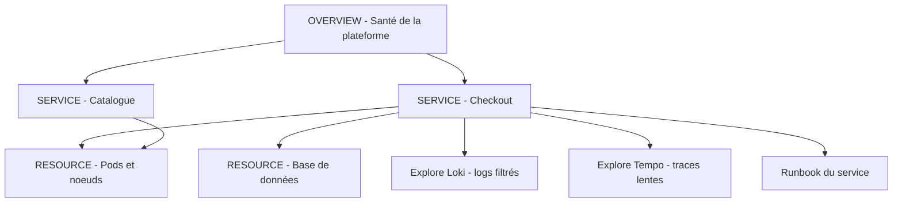

# Conception de dashboards professionnels

## Objectifs pédagogiques

À la fin de ce module, vous saurez :

- **Définir** pour chaque dashboard un lecteur, une question et une action attendue, au lieu de partir des métriques disponibles.
- **Organiser** un ensemble de dashboards selon la hiérarchie Overview → Service → Resource, avec une navigation fluide entre les niveaux.
- **Choisir** entre KPI (Key Performance Indicator) et métrique brute pour chaque panel, et placer l'information selon sa priorité de lecture.
- **Standardiser** unités, seuils et couleurs pour qu'un même signal ait le même sens partout.
- **Relier** les dashboards entre eux (data links, dashboard links, variables) et superposer annotations de déploiement et d'incident.
- **Repérer** et corriger un dashboard surchargé, sans contexte ni action associée.

## Mise en situation

Une équipe de huit personnes exploite une plateforme e-commerce : une dizaine de services sur Kubernetes, quelques bases managées, Prometheus, Loki et Tempo déjà en place. Après six mois, Grafana contient 140 dashboards. Beaucoup ont été importés depuis la communauté ou clonés puis modifiés, et la moitié n'a plus de propriétaire.

Un soir, le support remonte des lenteurs au paiement. L'astreinte ouvre le dashboard « Checkout – FINAL v3 » :

- 58 panels ;
- quatre unités différentes pour la latence (secondes, millisecondes, microsecondes, un « score ») ;
- des jauges rouges en permanence, parce que le seuil a été copié d'un autre service.

Elle met vingt minutes à comprendre que le problème vient d'une base de données, alors qu'un coup d'œil au bon endroit aurait suffi.

Les données étaient toutes là. Ce qui manquait, c'était de la conception : personne n'avait décidé *pour qui*, *pour répondre à quoi* et *dans quel ordre* ces panels devaient se lire. C'est ce que ce module met en place.

## Un dashboard sert un lecteur et une question

Avant d'ouvrir l'éditeur, posez donc trois questions :

> 🚗 **Analogie : le tableau de bord d'une voiture**
>
> Un dashboard professionnel ressemble moins à une galerie de graphiques qu'au tableau de bord d'une voiture : la vitesse et les voyants d'alerte sont immédiatement visibles, pas la pression de chaque pneu en temps réel. Ce qui est affiché dépend de ce que le conducteur doit décider *maintenant*. Limite de l'image : une voiture a un seul conducteur, alors qu'ici chaque type de lecteur appelle son propre dashboard.
{: .callout .callout-analogie}

1. **Qui** va regarder cet écran, et dans quel état d'esprit (veille passive, incident en cours, analyse à tête reposée) ?
2. **Quelle question** doit-il pouvoir trancher en moins de dix secondes ?
3. **Que fait-il ensuite** : escalade, ouverture d'un autre dashboard, consultation d'un runbook, rien du tout ?

> 💡 **À retenir**
>
> Si vous ne pouvez pas répondre à la troisième question, le dashboard est un décor, pas un outil d'exploitation.
{: .callout .callout-important}

### Quatre lecteurs, quatre dashboards

On distingue généralement quatre rôles. Ils ne cherchent pas la même chose, et c'est ce qui justifie des dashboards distincts plutôt qu'un dashboard « pour tout le monde ».

| Rôle | Question dominante | Contenu typique | Fréquence de lecture |
|------|--------------------|-----------------|----------------------|
| NOC (Network Operations Center) | « Quelque chose est-il cassé, et où ? » | Statuts globaux, taux d'erreur par service, alertes actives, peu de texte, grandes polices | Écran mural, coup d'œil permanent |
| Support | « Ce client a-t-il un problème, est-ce connu ? » | Santé par parcours utilisateur, incidents en cours, liens vers statut et runbooks | Ponctuelle, à chaque ticket |
| DevOps / SRE | « Quelle ressource sature, quel changement a tout déclenché ? » | Saturation, files d'attente, déploiements, état du cluster, liens vers logs et traces | Pendant les incidents et la capacité |
| Développeur | « Mon service se comporte-t-il bien après mon déploiement ? » | Latence par endpoint, erreurs par version, requêtes lentes, logs filtrés | Après chaque mise en production |

> 🧠 **Concept clé**
>
> Le rôle détermine le niveau d'abstraction. Le NOC lit des états (OK / dégradé / en panne), le développeur lit des distributions et des endpoints. Mélanger les deux dans un même écran force chacun à ignorer 80 % de ce qu'il voit.
{: .callout .callout-important}

Cela ne veut pas dire quatre silos de données. Les mêmes sources alimentent les mêmes séries ; seul l'angle change. Si le NOC et le développeur voient des chiffres différents pour « le taux d'erreur du checkout », vous avez un problème de définition, pas de dashboard (on y revient dans la section sur la standardisation).

## Overview → Service → Resource : l'ossature de l'ensemble

Pour un ensemble de dashboards, la structure la plus robuste est un entonnoir à trois niveaux. On part du plus large pour descendre vers le plus précis, comme un médecin qui commence par les constantes vitales avant de demander une analyse de sang.



| Niveau | Question | Granularité | Public principal |
|--------|----------|-------------|------------------|
| **Overview** | La plateforme va-t-elle bien ? Quel service est en cause ? | Une ligne par service, 1 à 3 KPI chacun | NOC, support, management |
| **Service** | Ce service tient-il sa promesse ? Où se dégrade-t-il ? | Rate / Errors / Duration, dépendances, déploiements | DevOps, développeurs |
| **Resource** | Quelle ressource sature ? | CPU, mémoire, I/O, connexions, files d'attente | DevOps, SRE |

> 🔑 **Moyen mnémotechnique**
>
> Retenez un acronyme par niveau. **RED** pour le Service (Rate, Errors, Duration) : débit, erreurs et latence vus du côté de l'utilisateur. **USE** pour la Resource (Utilization, Saturation, Errors) : taux d'utilisation, saturation et erreurs d'une ressource. RED dit *que* le service souffre, USE aide à comprendre *quelle ressource* en est la cause.
{: .callout .callout-memo}

> 💡 **Astuce**
>
> Nommez et rangez vos dashboards pour refléter ce niveau : un dossier par domaine, un préfixe ou un tag par niveau (`level:overview`, `level:service`, `level:resource`). Le jour où l'astreinte cherche « le dashboard de la base de données du checkout », la recherche Grafana par tag fait gagner plusieurs minutes.
{: .callout .callout-astuce}

Le niveau Overview mérite une attention particulière : il doit tenir sur un écran sans scroll. Si vous avez trente services, groupez-les (par domaine métier ou par équipe) plutôt que de créer un mur de trente cartes.

## À l'intérieur d'un dashboard : hiérarchie de lecture et densité

Un œil humain parcourt un écran en « Z » : en haut à gauche d'abord, puis vers la droite, puis plus bas. Grafana utilise une grille de 24 colonnes ; la position d'un panel est donc une décision de priorité, pas d'esthétique.

Un plan de lecture qui fonctionne bien en pratique :

- **Bandeau du haut** : 4 à 6 panels `Stat` ou `Gauge` avec les KPI qui répondent à « tout va bien ? ». Couleur pilotée par seuils, valeur lisible à deux mètres.
- **Zone centrale** : les séries temporelles qui expliquent *l'évolution* de ces KPI (débit, erreurs, latence côte à côte, avec le même axe temporel).
- **Zone basse** : détails, tableaux (top endpoints lents, top erreurs), éléments de diagnostic secondaires.
- **Rows repliables** : tout ce qui sert rarement (détails par instance, métriques de runtime) va dans des rows fermées par défaut.

Combien de panels faut-il par dashboard ? Il n'existe pas de nombre magique. Une règle empirique raisonnable : si vous devez scroller plus de deux écrans ou si vous ne pouvez plus résumer en une phrase ce que montre le dashboard, il fait trop de choses. Un dashboard Overview tourne plutôt autour d'une dizaine de panels ; un dashboard Service peut monter plus haut grâce aux rows repliées, à condition que la partie visible à l'ouverture reste sobre.

Quelques réglages qui changent beaucoup de choses :

- **Titres de panels explicites** : « Taux d'erreur 5xx (%) » plutôt que « http_requests_total ».
- **Description du panel** (l'icône « i ») : une phrase sur ce que mesure le panel, la requête à retenir et ce qui est « anormal ».
- **Un panel Text** en tête du dashboard : rôle du dashboard, propriétaire, lien vers le runbook, lien vers le niveau supérieur et inférieur.
- **Légendes** : en mode tableau seulement si on en a besoin (min/max/dernière valeur) ; sinon on les masque pour gagner de la place.

## KPI techniques vs métriques brutes

Un compteur brut qui monte en permanence ne dit rien à un humain. Un KPI se lit, se compare à un seuil et déclenche une décision.

> 📖 **Définition**
>
> Une **métrique brute** est ce que l'exporter expose : `node_cpu_seconds_total`, `http_requests_total`. Un **KPI** est une métrique *transformée en réponse à une question* : « le taux d'erreur du checkout sur 5 minutes ».
{: .callout .callout-definition}

| Métrique brute | KPI correspondant | Pourquoi c'est mieux |
|----------------|-------------------|----------------------|
| `http_requests_total` | Requêtes par seconde (`rate`) | Un compteur n'a pas de sens sans sa dérivée |
| Nombre de 5xx | Taux d'erreur en % du trafic | 50 erreurs sur 100 requêtes ≠ 50 erreurs sur 10 millions |
| Histogramme de durées | Latence p95 | Une moyenne masque les requêtes lentes |
| `node_memory_*` | % mémoire disponible | Comparable d'un serveur à l'autre |

Pour le taux d'erreur, la requête typique ressemble à ceci :

```promql
sum(rate(http_requests_total{service="$service",status=~"5.."}[5m]))
/
sum(rate(http_requests_total{service="$service"}[5m]))
```

Et la latence p95 d'un service :

```promql
histogram_quantile(0.95,
  sum by (le) (rate(http_request_duration_seconds_bucket{service="$service"}[5m]))
)
```

Je ne détaille pas ici le fonctionnement de ces fonctions (c'est le terrain du module PromQL opérationnel). Retenez l'intention : chaque panel du bandeau supérieur doit afficher un KPI, jamais un compteur brut.

> ⚠️ **Erreur fréquente**
>
> Construire le dashboard à partir de la liste des métriques disponibles dans Prometheus (« tiens, il y a cette métrique, je l'ajoute »). On obtient une collection de graphiques sans question sous-jacente. **Correction** : partez de la question (« les paiements passent-ils ? »), puis cherchez la métrique qui y répond. Si elle n'existe pas, c'est une information précieuse : un trou d'instrumentation à combler.
{: .callout .callout-attention}

Les métriques brutes ne disparaissent pas pour autant. Elles ont leur place en bas de dashboard, dans les rows repliées ou dans Explore, pour le diagnostic fin. Elles ne doivent juste pas occuper la zone de lecture principale.

## Drilldown : faire voyager le contexte entre les dashboards

Une hiérarchie Overview → Service → Resource n'a de valeur que si l'on peut la parcourir en un clic, *sans perdre le contexte* : même service, même plage de temps. Grafana offre deux mécanismes complémentaires.

**Les dashboard links** (Dashboard settings → Links) apparaissent en haut du dashboard. On peut les définir par tags (« tous les dashboards tagués `service:checkout` ») et cocher « Include current time range » et « Include current template variable values » pour que le contexte suive.

**Les data links** se configurent dans un panel (Field / Overrides → Data links). Ils transforment un élément cliquable (une barre, une cellule de tableau, un point d'un graphique) en lien vers un autre dashboard ou vers Explore. Par exemple, sur le tableau de l'Overview listant les services :

```text
/d/<UID_SERVICE>/service?var-service=${__data.fields.service}&${__url_time_range}
```

Ici, `var-service` renseigne la variable du dashboard cible avec la valeur de la ligne cliquée, et `${__url_time_range}` conserve la fenêtre de temps. Les noms exacts des variables de lien (`__data`, `__field`, `__value`) et leur disponibilité peuvent varier selon la version de Grafana et le type de panel : vérifiez-les dans la documentation de votre version.

Le même principe permet de sauter vers le niveau « preuve » : depuis un panel de latence, un data link vers Explore avec une requête Loki préfiltrée sur le service, ou vers Tempo pour les traces lentes sur la même période (le fonctionnement de Tempo est couvert dans le module précédent, ici on ne fait que le brancher).

> 💡 **Astuce**
>
> Testez vos liens comme un utilisateur sous pression : à partir de l'Overview, combien de clics pour arriver aux logs du service fautif, avec la bonne période et le bon filtre ? Au-delà de 3 clics ou si l'on doit retaper un nom de service, le parcours est à reprendre.
{: .callout .callout-astuce}

Un détail qui évite bien des frustrations : les variables d'un dashboard (`$service`, `$env`) doivent porter **le même nom** d'un dashboard à l'autre. Si l'Overview envoie `var-service` et que le dashboard Service attend `var-app`, le lien fonctionne… mais la variable transmise est ignorée et le dashboard cible garde sa valeur par défaut ou mémorisée, pas le service cliqué.

## Unités et seuils : parler la même langue partout

Le piège du dashboard « FINAL v3 » de notre mise en situation tient là : quatre unités pour la latence, des seuils copiés sans réflexion. Résultat : un 0,8 qui signifie 800 ms ici et 0,8 seconde là, un rouge qui veut dire « critique » sur un panel et « bruit de fond » sur un autre.

Voici ce qu'il faut figer dans une convention d'équipe :

- **Unités** : durées en secondes (unité native Prometheus) avec le réglage d'unité Grafana (`seconds (s)`) qui bascule seul en ms ou µs à l'affichage. Pourcentages en 0–100 ou 0–1, mais jamais un mélange. Octets en `bytes (IEC)`.
- **Seuils** : trois niveaux au maximum (base verte, orange, rouge), basés sur des valeurs métier ou sur le SLO du service, pas sur ce qui « fait joli ».
- **Couleurs** : le rouge ne signifie qu'une chose, une action attendue. Évitez de colorer un graphique en rouge par défaut ; réservez les couleurs de seuil aux Stat, Gauge et Table.
- **Mappings de valeurs** : un statut `0/1` devient « DOWN / UP » avec une couleur associée, plutôt qu'un chiffre obscur.
- **Panels réutilisables** : transformez un panel standard (latence p95 d'un service) en *library panel*. Une correction de seuil se propage alors à tous les dashboards qui l'utilisent.

Ces réglages se trouvent dans l'éditeur de panel, onglet *Standard options* (unité, décimales, min/max) et *Thresholds*. L'organisation exacte des menus évolue selon les versions, mais ces blocs existent partout.

> ⚠️ **Erreur fréquente**
>
> Fixer le seuil rouge d'un panel de latence à une valeur arbitraire, par exemple 500 ms, sur tous les services. Un service batch qui répond en 2 s par conception sera rouge en permanence, et l'équipe finira par ignorer cette couleur. **Correction** : un seuil se définit par service, à partir de ce qui est acceptable pour son utilisateur, ou se pilote par variable/override si le même panel est réutilisé.
{: .callout .callout-attention}

## Annotations : donner la mémoire du temps à vos graphiques

Un pic de latence à 14 h 32 prend tout son sens quand on voit, juste en dessous, un trait vertical « Déploiement checkout v1.4.2 à 14 h 30 ». Les annotations superposent des événements aux séries temporelles, et elles transforment un dashboard de constat en outil de corrélation.

Deux familles à prévoir :

- **Déploiements** : poussés par le pipeline CI/CD à chaque mise en production.
- **Incidents** : posés par l'astreinte, ou automatiquement par un outil de gestion d'incidents, avec début et fin (région annotée).

On peut les créer via l'API HTTP, par exemple depuis un job de déploiement. On utilise un token de service account avec les droits minimaux :

```bash
curl -X POST "http://<GRAFANA_HOST>:3000/api/annotations" \
  -H "Authorization: Bearer <SA_TOKEN>" \
  -H "Content-Type: application/json" \
  -d '{
    "time": <EPOCH_MS>,
    "tags": ["deploy", "checkout", "prod"],
    "text": "Deploy checkout v1.4.2 (commit <SHA>)"
  }'
```

Le champ `time` est en millisecondes depuis l'epoch.

Les annotations sans `dashboardUID` sont des annotations d'organisation : pour les afficher, on ajoute dans *Dashboard settings → Annotations* une requête de type « Grafana » filtrée **par tags** (par exemple `deploy` et le tag du service). C'est ce filtre par tags qui permet à chaque dashboard de n'afficher que ses propres déploiements.

Quelques règles de bon sens : un tag de service cohérent avec vos labels de métriques, un texte qui contient la version et un lien vers le commit ou la release, et un tag d'environnement pour ne pas mélanger staging et production.

## Construction progressive d'un dashboard Service

Voici comment on fait évoluer un dashboard plutôt que de viser la perfection d'emblée.

**v1 — Le minimum qui répond à une question.** Un dashboard Service avec quatre panels `Stat` en haut (requêtes/s, taux d'erreur, latence p95, instances disponibles) et trois séries temporelles en dessous (les trois premiers KPI dans le temps). Une variable `$service`, des unités posées, des seuils sommaires. En vingt minutes, il répond déjà à « ce service va-t-il bien ? ».

**v2 — Contexte et navigation.** On ajoute la variable `$env`, le panel Text d'en-tête (propriétaire, runbook, lien vers l'Overview), les dashboard links vers les dashboards Resource correspondants, des data links vers Explore (logs et traces) et les annotations de déploiement. Le dashboard cesse d'être un cul-de-sac : il oriente.

**v3 — Standardisation et industrialisation.** Les panels clés deviennent des library panels, les seuils sont alignés avec les objectifs du service, les rows de détail sont repliées, le dashboard porte des tags standard et un propriétaire explicite. Il est ensuite géré comme du code (provisioning, versionnement), ce que les modules suivants du parcours détaillent. L'idée à retenir : un dashboard de production a un cycle de vie, une revue et un responsable.

Chaque saut résout un problème précis : v1 → v2 évite l'impasse quand on veut comprendre *pourquoi*, v2 → v3 évite la dérive quand dix équipes copient et modifient chacune sa version.

## Prise de décision : un dashboard ou plusieurs ?

La tentation de « tout mettre au même endroit » revient sans cesse. Quelques situations pour trancher :

| Situation | Choix recommandé | Compromis |
|-----------|------------------|-----------|
| Même service, rôles différents (NOC et développeur) | Deux dashboards, mêmes KPI, niveau de détail différent | Un peu plus de maintenance, mais lecture beaucoup plus rapide |
| 30 services homogènes | Un dashboard Service paramétré par `$service` | Moins de dashboards, mais il faut des conventions de métriques strictes |
| Service atypique (batch, streaming) | Dashboard dédié | Perte d'uniformité, mais seuils et KPI pertinents |
| Besoin ponctuel (investigation d'un incident) | Explore, ou dashboard jetable non partagé | Ne pas polluer le catalogue permanent |

Cette approche atteint ses limites quand la flotte de dashboards grossit plus vite que la capacité à la maintenir : l'étape suivante est alors le provisioning, la revue par pairs et la suppression régulière des dashboards inutilisés. La question à se poser avant de créer : « existe-t-il déjà un dashboard à enrichir ? »

## Diagnostic : le dashboard surchargé, sans contexte ni action

C'est le défaut le plus répandu, et il se repère vite.

| Symptôme | Cause probable | Correction |
|----------|----------------|------------|
| L'astreinte met plusieurs minutes à trouver le panel utile | Plus de 30 panels visibles à l'ouverture, aucune hiérarchie | Remonter 4–6 KPI en bandeau, replier le reste dans des rows |
| Tout est rouge en permanence, on finit par l'ignorer | Seuils copiés sans lien avec le service | Redéfinir les seuils par service à partir du comportement normal |
| Deux collègues lisent des valeurs différentes pour la même métrique | Unités ou agrégations hétérogènes | Fixer la convention d'unités, utiliser des library panels |
| « C'est rouge, et alors ? » | Aucune consigne ni lien vers un runbook | Ajouter un panel Text avec procédure et propriétaire, data links vers la suite |
| Impossible de relier un pic à un changement | Pas d'annotations de déploiement | Pousser les annotations depuis le pipeline CI/CD |
| Personne ne sait qui maintient le dashboard | Clonage sans propriétaire | Tag `owner:<ÉQUIPE>` et revue périodique |

Un test rapide : montrez le dashboard à quelqu'un qui n'est pas son auteur, pendant dix secondes, puis cachez l'écran. S'il ne sait pas dire si le service va bien ni quoi faire ensuite, le dashboard est à revoir.

> ⚠️ **Erreur fréquente**
>
> Ajouter un panel à chaque incident « pour ne plus se faire avoir ». Au bout d'un an, le dashboard est un cimetière de post-mortems. **Correction** : après un incident, demandez-vous si l'information manquante doit devenir un KPI (dans le bandeau), un détail (dans une row repliée) ou une alerte (ce qui relève du module sur Grafana Alerting). Beaucoup de leçons d'incident ne méritent pas un panel.
{: .callout .callout-attention}

## Scénario illustratif : refonte du parcours de paiement

*Ce scénario est fictif ; les chiffres sont illustratifs.*

Reprenons notre plateforme e-commerce. L'équipe consacre une demi-journée à une refonte :

1. **Cadrage** : trois lecteurs retenus (NOC, astreinte DevOps, développeurs du checkout). Une question par lecteur, notée en tête de chaque dashboard.
2. **Overview** : un seul écran pour le NOC, une ligne par service avec taux d'erreur et latence p95, colorés selon les seuils du service. Chaque ligne a un data link vers le dashboard Service.
3. **Service Checkout** : bandeau de 5 KPI, trois séries temporelles, annotations de déploiement alimentées par le pipeline, liens vers logs et traces, runbook dans le panel d'en-tête.
4. **Resource** : dashboards dédiés aux pods et à la base, accessibles depuis le Service via dashboard links qui conservent le contexte.
5. **Nettoyage** : 140 dashboards examinés ; dans notre scénario, une soixantaine est archivée après vérification des dernières consultations.

Lors du prochain incident de lenteur au paiement, le parcours imaginé est le suivant : le NOC voit le checkout orange sur l'Overview, clique, constate une latence p95 qui grimpe sans erreur, repère l'annotation de déploiement 12 minutes plus tôt, ouvre le dashboard Resource de la base et voit les connexions saturées. Dans ce scénario, le diagnostic passe d'une vingtaine de minutes à moins de cinq. Le gain vient moins de nouvelles données que d'un ordre de lecture pensé à l'avance.

## Bonnes pratiques

- **Écrivez la question avant de créer le dashboard.** Une phrase dans le panel d'en-tête (« Le checkout tient-il sa latence cible ? ») sert de critère de revue : tout panel qui n'y contribue pas est candidat à la suppression.
- **Un propriétaire et un lien vers le runbook par dashboard.** Sans propriétaire, le dashboard dérive ; sans runbook, il constate sans guider.
- **Réutilisez au lieu de copier.** Library panels pour les KPI standard, variables nommées de façon identique d'un dashboard à l'autre. La cohérence se gère par construction.
- **Respectez le principe de moindre privilège pour les annotations et l'API.** Un token de service account dédié à la CI, avec le rôle le plus faible permettant d'écrire des annotations (Editor en Grafana OSS ; une permission limitée aux seules annotations suppose le RBAC fin de Grafana Enterprise/Cloud), plutôt qu'un token administrateur.
- **Rendez les dashboards reproductibles.** Un dashboard de production qui n'existe que dans l'UI disparaîtra au prochain incident de la plateforme ; visez le provisioning ou le versionnement (abordés dans les modules suivants du parcours), au moins pour les dashboards critiques.
- **Gardez de l'observabilité sur le dashboard lui-même.** Un panel qui affiche « No data » doit être distinguable d'un panel à zéro : configurez le comportement No value et vérifiez que les KPI critiques ne basculent pas silencieusement à 0 quand la source tombe.
- **Revoyez périodiquement.** Tous les trimestres, consultez les statistiques d'usage (usage insights, disponibles en Grafana Enterprise/Cloud ; à défaut, interrogez les propriétaires) et archivez ce qui n'est plus lu. Un catalogue réduit est un catalogue utilisé.
- **Testez avec un utilisateur réel.** Faites ouvrir le dashboard à quelqu'un de l'astreinte, chronométrez le temps pour arriver à la cause d'un incident simulé, puis corrigez ce qui a ralenti.

## Résumé

Un dashboard professionnel se conçoit à partir d'un lecteur, d'une question et d'une action, pas à partir des métriques disponibles. Les ensembles de dashboards s'organisent en Overview → Service → Resource, reliés par des liens qui conservent service, environnement et plage de temps. Dans chaque dashboard, les KPI occupent le haut de l'écran et les métriques brutes restent en bas ou repliées. Unités, seuils et couleurs sont standardisés (idéalement via des library panels) pour que chaque signal ait le même sens partout. Les annotations de déploiement et d'incident donnent aux graphiques la mémoire des changements. Il reste une difficulté : certaines données n'arrivent pas dans la forme voulue pour être affichées, ce qui nous mène naturellement aux transformations du module suivant.

<!-- snippet
id: grafana_dashboard_role_question_action
type: concept
tech: grafana
level: intermediate
importance: high
format: knowledge
tags: grafana,dashboards,conception,roles
title: Un dashboard = un lecteur, une question, une action
content: Avant de créer un dashboard, noter 3 éléments dans son panel d'en-tête : le rôle visé (NOC, support, DevOps, développeur), la question à trancher en moins de 10 secondes, et l'action qui suit (escalade, dashboard suivant, runbook). Le rôle fixe le niveau d'abstraction : états OK/dégradé pour le NOC, endpoints et distributions pour le développeur. Sans action associée, le dashboard est un décor.
description: Le rôle du lecteur détermine le contenu : écrire lecteur, question et action en tête du dashboard sert de critère de revue pour chaque panel.
-->

<!-- snippet
id: grafana_dashboard_overview_service_resource
type: concept
tech: grafana
level: intermediate
importance: high
format: knowledge
tags: grafana,dashboards,architecture,drilldown
title: Hiérarchie Overview, Service, Resource
content: Overview répond à "quel service est en cause ?" (une ligne par service, 1 à 3 KPI, tient sur un écran sans scroll). Service répond à "ce service tient-il sa promesse ?" (méthode RED : Rate, Errors, Duration). Resource répond à "quelle ressource sature ?" (méthode USE : Utilization, Saturation, Errors). On descend par data links qui gardent service et plage de temps.
description: Entonnoir à trois niveaux : l'Overview désigne le service fautif, le Service localise la dégradation, la Resource en identifie la cause matérielle.
-->

<!-- snippet
id: grafana_dashboard_kpi_vs_raw_metric
type: tip
tech: grafana
level: intermediate
importance: medium
format: knowledge
tags: grafana,kpi,promql,dashboards
title: Afficher des KPI en haut, des métriques brutes en bas
content: Dans le bandeau supérieur, remplacer les compteurs bruts par des KPI : rate() pour le débit, erreurs 5xx divisées par le trafic total (en %) pour le taux d'erreur, histogram_quantile(0.95, ...) pour la latence. Ranger les métriques brutes dans des rows repliées par défaut (Add → Row, puis collapse).
description: Un compteur qui monte sans cesse ne se lit pas ; un ratio ou un quantile se compare à un seuil et déclenche une décision.
-->

<!-- snippet
id: grafana_dashboard_data_link_drilldown
type: command
tech: grafana
level: intermediate
importance: high
format: knowledge
tags: grafana,data-links,drilldown,variables
title: Data link vers un dashboard Service avec contexte
context: Panel → Field/Overrides → Data links (l'interface peut varier selon la version de Grafana)
command: /d/<UID_DASHBOARD>/<SLUG>?var-<VARIABLE>=${__data.fields.<CHAMP>}&${__url_time_range}
example: /d/svc-checkout/service?var-service=${__data.fields.service}&${__url_time_range}
description: Passe la valeur de la ligne cliquée à la variable du dashboard cible et conserve la plage de temps ; les noms de variables doivent être identiques des deux côtés.
-->

<!-- snippet
id: grafana_dashboard_variable_naming_mismatch
type: error
tech: grafana
level: intermediate
importance: medium
format: knowledge
tags: grafana,variables,drilldown,dashboards
title: Le lien n'affiche pas le service cliqué
content: Symptôme : après un clic depuis l'Overview, le dashboard cible affiche la valeur par défaut (ou mémorisée) de sa variable au lieu du service cliqué. Cause : le lien envoie var-service alors que la variable du dashboard cible s'appelle autrement (var-app, par exemple), donc elle est ignorée. Correction : harmoniser le nom des variables (service, env) sur tous les dashboards et vérifier l'URL générée par le lien.
description: Les variables transmises par URL doivent porter exactement le même nom côté source et côté cible, sinon Grafana les ignore silencieusement.
-->

<!-- snippet
id: grafana_dashboard_threshold_per_service
type: warning
tech: grafana
level: intermediate
importance: high
format: knowledge
tags: grafana,seuils,unites,dashboards
title: Ne pas copier un seuil rouge d'un service à l'autre
content: Piège : appliquer le même seuil (ex. 500 ms) à tous les services. Conséquence : un service batch lent par conception reste rouge en permanence, l'équipe cesse de réagir au rouge. Correction : définir le seuil par service à partir de l'objectif acceptable pour son utilisateur (Thresholds dans l'éditeur de panel), avec 3 niveaux maximum (vert, orange, rouge).
description: Un rouge permanent est ignoré ; chaque seuil doit refléter ce qui est anormal pour ce service précis, pas une valeur générique.
-->

<!-- snippet
id: grafana_dashboard_library_panels
type: tip
tech: grafana
level: intermediate
importance: medium
format: knowledge
tags: grafana,library-panels,standardisation,dashboards
title: Centraliser unités et seuils avec des library panels
content: Pour un KPI utilisé dans plusieurs dashboards (latence p95, taux d'erreur), enregistrer le panel comme library panel (menu du panel → More → New library panel). Unité (seconds), décimales et seuils sont alors modifiés une fois et appliqués partout. Fixer la convention d'unité côté Prometheus : durées en secondes, Grafana convertit à l'affichage.
description: Un library panel évite de corriger le même seuil dans 20 dashboards ; l'unité native en secondes laisse Grafana afficher ms ou µs selon la valeur.
-->

<!-- snippet
id: grafana_annotations_api_deploy
type: command
tech: grafana
level: intermediate
importance: medium
format: knowledge
tags: grafana,annotations,api,deploiement
title: Poser une annotation de déploiement via l'API
context: À exécuter depuis le pipeline CI/CD à la fin du déploiement, avec un token de service account dédié (rôle Editor en Grafana OSS ; restriction aux seules annotations possible uniquement avec le RBAC fin d'Enterprise/Cloud)
command: curl -X POST "http://<GRAFANA_HOST>:3000/api/annotations" -H "Authorization: Bearer <SA_TOKEN>" -H "Content-Type: application/json" -d '{"time":<EPOCH_MS>,"tags":["deploy","<SERVICE>","<ENV>"],"text":"<MESSAGE>"}'
example: curl -X POST "http://grafana.example.local:3000/api/annotations" -H "Authorization: Bearer glsa_xxx" -H "Content-Type: application/json" -d '{"time":1735732200000,"tags":["deploy","checkout","prod"],"text":"Deploy checkout v1.4.2"}'
description: Le champ time est en millisecondes ; les tags servent ensuite de filtre dans l'annotation query du dashboard pour n'afficher que les déploiements du service.
-->

<!-- snippet
id: grafana_dashboard_overloaded_diagnosis
type: warning
tech: grafana
level: intermediate
importance: high
format: knowledge
tags: grafana,dashboards,conception,incident
title: Ne pas ajouter un panel à chaque incident
content: Piège : ajouter un graphique après chaque post-mortem. Conséquence : en un an, un dashboard de plus de 50 panels où personne ne trouve rien. Correction : classer chaque leçon en KPI (bandeau du haut), détail (row repliée) ou alerte (Grafana Alerting), et vérifier avec le test des 10 secondes : un tiers doit dire si le service va bien et quoi faire ensuite.
description: Un dashboard surchargé se corrige par tri et hiérarchie : seuls les KPI méritent la zone de lecture principale, le reste se replie ou devient une alerte.
-->
