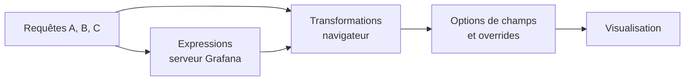
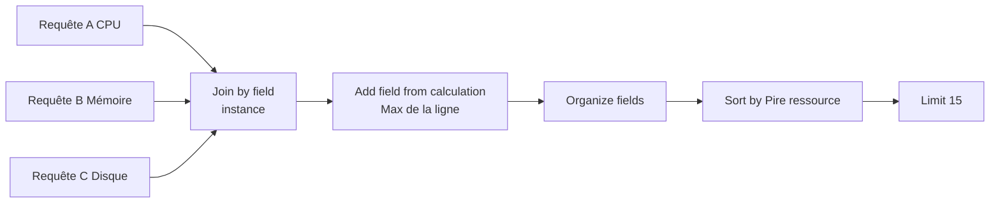

# Transformations et traitement des données

## Objectifs pédagogiques

À la fin de ce module, vous saurez :

- **Construire** une table de synthèse à partir de plusieurs requêtes en combinant Join by field, Organize fields et Sort by.
- **Choisir** entre Reduce, Merge et Join selon la forme des données à assembler.
- **Calculer** un champ dérivé avec Add field from calculation et savoir quand ce calcul doit plutôt vivre dans la requête.
- **Utiliser** les expressions Grafana (Math, Reduce, Resample) dans un panel et en identifier les limites.
- **Raisonner** sur l'ordre des transformations pour déboguer un pipeline qui produit un résultat vide ou incohérent.

## Mise en situation

Une équipe de cinq personnes exploite une quarantaine de machines virtuelles Linux supervisées par Prometheus. Le dashboard « Parc » contient trois panels : un pour le CPU, un pour la mémoire, un pour le disque. Chacun affiche 40 courbes. Pour répondre à la question « quelle machine va mal en ce moment ? », le technicien d'astreinte doit parcourir trois graphiques et recouper à l'œil les noms d'instances. Certains exportent même les données en CSV pour les trier dans un tableur.

Ce qu'il lui faut, c'est une seule table : une ligne par machine, trois colonnes (CPU, mémoire, disque), triée de la plus chargée à la moins chargée. Les données existent déjà dans Grafana, mais elles arrivent en trois morceaux qui n'ont pas la bonne forme. C'est le rôle des transformations : remodeler, assembler et nettoyer les résultats des requêtes avant l'affichage.

## Où s'insèrent les transformations dans le trajet de la donnée

Une transformation n'est pas une requête. Elle s'applique après coup, sur ce que la source de données a déjà renvoyé. Cette position explique à la fois leur utilité et leurs limites.



Les requêtes partent vers les sources de données. Les expressions, si vous en utilisez, s'exécutent sur le serveur Grafana. Les transformations s'exécutent dans le navigateur de la personne qui regarde le dashboard, puis les options de champs (unités, seuils, overrides) sont appliquées sur le résultat, et enfin la visualisation dessine.

> 🧠 **Concept clé** : les transformations travaillent sur des data frames, c'est-à-dire des tables avec des colonnes typées (temps, texte, nombre). Une requête Prometheus de type range renvoie une série par combinaison de labels. Une requête de type instant en format Table renvoie une seule ligne par série. Quand on sait quelle forme on a en entrée et quelle forme on veut en sortie, le choix de la transformation devient presque mécanique.
{: .callout .callout-important}

## Mise en place : où trouver les transformations

Il n'y a rien à installer. Les transformations sont natives dans Grafana OSS.

Dans un panel : **Edit → onglet Transformations → Add transformation**. Vous y retrouvez les entrées de la liste, avec une barre de recherche. Chaque transformation ajoutée apparaît comme une carte, que l'on peut réordonner par glisser-déposer, désactiver (icône œil) ou supprimer. Les noms et l'emplacement de certaines options (filtrage par requête, bouton de debug) varient selon la version de Grafana. Le principe reste identique d'une version à l'autre.

Pour voir ce que produit réellement le pipeline : **Panel → Inspect → Data**, avec l'option « Apply panel transformations » cochée ou non. Vous comparez ainsi avant et après sans toucher à rien.

> 💡 **Astuce** : passez temporairement la visualisation en **Table** quand vous construisez un pipeline, même si le rendu final doit être un bar gauge ou un stat. Voir les colonnes et leurs noms exacts évite la moitié des erreurs. Vous rebasculez ensuite vers la visualisation voulue.
{: .callout .callout-astuce}

## Les transformations qui font le travail

Il en existe une trentaine. Une dizaine couvre l'essentiel des besoins d'exploitation.

| Transformation | Rôle | Analogie |
|---|---|---|
| Reduce | Condense chaque série en valeurs uniques (dernier, max, moyenne...) | Résumer chaque courbe en une ligne de chiffres |
| Merge | Empile les lignes de plusieurs résultats de même forme | Poser des feuilles les unes sur les autres |
| Join by field | Colle côte à côte les colonnes de plusieurs résultats via un champ commun | Agrafer des feuilles en alignant une colonne clé |
| Organize fields by name | Renomme, réordonne, masque des champs | Mise en page d'un tableur |
| Add field from calculation | Crée un champ calculé à partir d'autres | Formule dans une cellule |
| Filter by name | Garde ou retire des champs (colonnes) | Masquer des colonnes |
| Filter data by values | Garde ou retire des lignes selon une condition | Filtre de tableur |
| Sort by | Trie les lignes sur un champ | Tri de tableur |
| Labels to fields | Transforme les labels Prometheus en colonnes | Faire sortir les étiquettes |
| Group by | Agrège les lignes par valeur d'un champ | GROUP BY |
| Limit | Garde les N premières lignes | Top N |

Les trois premières demandent une explication un peu plus longue, parce qu'on les confond souvent.

### Reduce : de la courbe au chiffre

Reduce a deux modes. En **Series to rows**, chaque série devient une ligne, avec une colonne par calcul demandé (Last, Max, Mean, Min...). C'est le mode à utiliser pour une table de synthèse à partir de requêtes range. En **Reduce fields**, chaque champ est réduit à une seule valeur mais la structure par champ est conservée, ce qui convient mieux à un bar gauge ou un stat.

Les calculs les plus utiles en exploitation sont Last (valeur actuelle), Max (pic sur la période), Mean (niveau habituel), et Last * (dernière valeur non nulle, précieux quand une série a un trou récent).

> 💡 **Astuce** : pour un panel Stat ou Gauge, ne cherchez pas de transformation Reduce. L'option **Value options → Calculation** du panel fait déjà ce travail. Reduce devient pertinent quand on veut plusieurs calculs en colonnes (Last, Max et Mean côte à côte), ce que le panel seul ne permet pas.
{: .callout .callout-astuce}

### Merge ou Join : empiler ou coller

La règle de choix est simple. Si vos requêtes renvoient **la même forme** (mêmes colonnes) pour des périmètres différents, par exemple une requête par région ou par environnement, utilisez **Merge**. Si vos requêtes renvoient **des colonnes différentes** pour **les mêmes entités**, par exemple CPU, mémoire et disque pour les mêmes machines, utilisez **Join by field**.

Avec Merge, les champs qui n'existent que dans un des résultats laissent des cellules vides dans les lignes des autres. Ce n'est pas une erreur, c'est la conséquence de l'empilement.

Join by field demande de choisir le champ commun (souvent `instance`, ou `Time` pour des séries temporelles) et un mode. Selon la version, vous trouverez des variantes du type OUTER (time series), OUTER (tabular) et INNER :

- **INNER** ne garde que les lignes présentes dans tous les résultats. Une machine absente d'une des requêtes disparaît de la table.
- **OUTER** garde toutes les lignes et remplit de vide ce qui manque. Une machine qui n'a pas de métrique disque apparaîtra quand même, avec une cellule vide.

> ⚠️ **Erreur fréquente** : choisir INNER par réflexe. Pour du monitoring, ce choix masque justement les machines qui ne remontent plus une des métriques, donc potentiellement celles qui ont un problème. Préférez OUTER, et assumez les cellules vides.
{: .callout .callout-attention}

### Organize fields : la mise en forme finale

Organize fields by name permet de renommer (`Value #A` devient `CPU %`), de réordonner les colonnes par glisser-déposer et de masquer ce qui ne sert à rien (les colonnes `Time`, `job` dupliquées après une jointure).

> ⚠️ **Erreur fréquente** : renommer dans Organize puis définir un override de champ qui cible l'ancien nom. Les transformations s'exécutent avant les options de champs. Au moment où l'override cherche `Value #A`, la colonne s'appelle déjà `CPU %`, et rien ne se passe. Un override doit toujours cibler le nom **après** transformation.
{: .callout .callout-attention}

## Calculs et champs dérivés

Add field from calculation crée une nouvelle colonne. Plusieurs modes sont proposés, et leur liste varie selon les versions :

- **Reduce row** : applique un calcul (Max, Mean, Sum...) sur plusieurs champs d'une même ligne.
- **Binary operation** : combine deux champs ou un champ et une constante (`Value #A / Value #B`).
- **Cumulative functions** et **Window functions** : totaux cumulés, moyennes glissantes.
- **Row index** : numérote les lignes.

Dans notre table de parc, un champ « Pire ressource » défini en Reduce row avec le calcul **Max** sur les trois colonnes CPU, mémoire, disque donne une colonne unique de tri. On trie ensuite sur elle, et la machine la plus en difficulté apparaît en haut, quelle que soit la ressource en cause. Le champ s'ajoute avec un alias, et l'option « Replace all fields » permet de ne garder que lui, ce dont on se sert rarement ici.

## Construction progressive : la table de parc

### V1 : une seule requête, une table lisible

On commence avec le CPU seul, en une requête Prometheus de type **Instant** et au format **Table** :

```promql
100 - (avg by (instance) (rate(node_cpu_seconds_total{mode="idle"}[5m])) * 100)
```

Pourquoi Instant et Table ? Une requête range renverrait des centaines de points par machine. Une requête instant renvoie une ligne par instance, ce qui est exactement la forme d'une table. La première transformation est **Organize fields by name** : masquer `Time`, renommer `Value` en `CPU %`. À ce stade, inutile d'aller plus loin.

### V2 : trois requêtes jointes

On ajoute deux requêtes, toujours en Instant et Table.

Requête B, mémoire utilisée :

```promql
100 * (1 - node_memory_MemAvailable_bytes / node_memory_MemTotal_bytes)
```

Requête C, disque racine :

```promql
max by (instance) (100 - (node_filesystem_avail_bytes{mountpoint="/"} / node_filesystem_size_bytes{mountpoint="/"} * 100))
```

Chaque requête renvoie `Time`, `instance`, éventuellement `job`, et `Value #A`, `Value #B` ou `Value #C`. Le pipeline devient :

1. **Join by field**, champ `instance`, mode OUTER (tabular).
2. **Organize fields by name** : masquer tous les `Time` et les `job` en double, renommer `Value #A/B/C` en `CPU %`, `Mémoire %`, `Disque %`.
3. **Sort by** `CPU %`, en ordre décroissant.

On passe de « trois panels à comparer » à « une table triée » sans avoir écrit une ligne de code de plus que les requêtes elles-mêmes. Mais on a aussi créé une dépendance : si le label `instance` n'a pas la même valeur dans les trois requêtes, la jointure ne trouve rien à coller.

### V3 : un champ de synthèse et un filtrage

On ajoute un champ calculé et on enchaîne :

1. Join by field sur `instance`.
2. **Add field from calculation**, mode Reduce row, calcul Max sur les trois colonnes de valeurs, alias `Pire ressource`.
3. **Organize fields by name** : masquages et renommages (maintenant que le champ calculé existe, on peut aussi le placer en première colonne).
4. **Sort by** `Pire ressource`, décroissant.
5. **Limit** à 15 lignes si la table doit rester compacte.

Côté options de champs (donc hors transformations), on applique des seuils de couleur sur les trois colonnes de pourcentage, avec un affichage de cellule coloré. Le technicien lit la table en trois secondes.



## Chaînage et ordre des transformations

Les transformations s'exécutent de haut en bas, et chacune reçoit la sortie de la précédente. Il n'y a pas de notion de dépendance explicite : l'ordre **est** la logique.

Quelques conséquences concrètes :

- **Joindre avant de renommer.** Après Organize, `Value #A` n'existe plus sous ce nom. Une jointure ou un calcul placé après doit utiliser le nouveau nom. Si vous renommez en premier et que vous tentez ensuite de référencer l'ancien nom dans Add field from calculation, le champ est introuvable.
- **Calculer avant de masquer.** Si vous masquez une colonne avec Organize puis cherchez à l'utiliser dans un calcul placé plus bas, elle a disparu du flux. Masquer en dernier, ou au moins après les calculs qui en dépendent.
- **Filtrer avant ou après Reduce, ce n'est pas pareil.** Filtrer les lignes sur une valeur avant Reduce élimine des points de la série, donc change le Max ou la moyenne. Filtrer après Reduce sélectionne des séries entières selon leur Max. Même transformation, deux questions différentes.
- **Trier en dernier**, sauf si une transformation placée plus bas réorganise les lignes (Group by, Limit sans tri préalable : le Limit garde les N premières lignes **dans l'état où elles arrivent**, donc il faut trier avant).

Quand un résultat est incohérent, la méthode qui marche : désactiver toutes les transformations avec l'icône œil, puis les réactiver une à une de haut en bas, en regardant la table à chaque étape. La carte qui casse le résultat est généralement évidente.

## Expressions Grafana : usages et limites

Les expressions sont une autre famille d'outils, souvent confondue avec les transformations. Dans l'éditeur de requêtes d'un panel, le bouton **+ Expression** ajoute un bloc de calcul qui référence les requêtes par leur identifiant (`$A`, `$B`). Elles sont évaluées par le **serveur** Grafana, au lieu du navigateur, et on les désigne souvent sous le nom de SSE (Server-Side Expressions).

Les types disponibles et utiles dans un panel :

| Type | Usage | Exemple |
|---|---|---|
| Math | Opération arithmétique ou logique entre requêtes | `$A / $B * 100` |
| Reduce | Réduit une série à un nombre (Last, Mean, Max, Sum, Count...) | Dernier point de `$A` |
| Resample | Réaligne une série sur un pas de temps régulier | Pas de 1m avant un Math |

Les autres types (Classic condition, Threshold) sont conçus pour les règles d'alerte. Ils reviendront dans le module suivant, il n'est pas utile de s'y attarder ici.

Une expression de type Math a un comportement qu'il faut connaître : elle associe les opérandes par **labels** : deux séries sont appariées si leurs jeux de labels sont identiques ou si l'un est inclus dans l'autre. Si `$A` renvoie une série `{instance="web-01"}` et `$B` une série `{instance="web-01:9100"}`, rien n'est associé, et le résultat est vide. C'est le même problème que la jointure sur `instance`, mais avec un message encore moins parlant.

> ⚠️ **Erreur fréquente** : utiliser une expression Math pour calculer un ratio entre deux métriques de la même source. Le calcul fonctionne, mais il tire deux séries brutes vers Grafana pour faire une division que Prometheus fait en une ligne de PromQL, avec moins de données transférées. Gardez les expressions pour les cas où les deux opérandes ne peuvent pas être calculés au même endroit.
{: .callout .callout-attention}

Autre limite : les expressions ne travaillent que sur les sources de données dites « backend ». Les plugins purement frontend ne peuvent pas être référencés. Les expressions ne remodelent pas non plus des tables (pas de join, pas de renommage, pas de tri). Pour mettre en forme, on revient aux transformations. La disponibilité exacte des types et leur comportement avec une source Mixed peuvent varier selon la version : vérifiez dans l'interface de votre instance.

### Quand choisir quoi

| Besoin | Outil |
|---|---|
| Ratio ou calcul sur des séries de la même source | PromQL, dans la requête |
| Coller des colonnes de plusieurs requêtes en une table | Transformation Join by field |
| Renommer, masquer, trier | Transformations |
| Calcul entre requêtes de sources différentes | Expression Math (ou transformation si on travaille sur une table) |
| Valeur unique à partir d'une série pour un Stat | Option Calculation du panel |

## Les transformations ne remplacent pas une requête bien conçue

C'est le piège principal du module, et il touche aussi bien la performance que la justesse.

Une transformation s'exécute **après** la requête. Tout ce que la source de données a renvoyé a déjà transité sur le réseau et se trouve déjà dans la mémoire du navigateur. Filtrer 38 machines sur 40 avec Filter data by values ne fait pas gagner un seul octet de transfert : Prometheus a calculé et renvoyé les 40.

Concrètement, voici ce que ça donne dans trois situations typiques :

- Vous voulez la valeur max de CPU sur 24 h pour 40 machines. Avec une requête range et Reduce, Grafana reçoit des milliers de points par série, puis les écrase en un chiffre. Avec `max_over_time(...[24h])` en requête instant, Prometheus renvoie 40 valeurs.
- Vous voulez uniquement les machines au-dessus de 80 %. Avec Filter data by values, toutes les machines sont calculées, transférées, puis filtrées. Avec `... > 80` en PromQL, seules les machines concernées reviennent.
- Vous voulez un ratio. PromQL le calcule en une seule requête, sans transférer deux jeux de séries à joindre.

La règle pratique : **tout ce qui réduit le volume ou change la sémantique de la donnée appartient à la requête**. Les transformations servent à la **mise en forme** : assembler, renommer, masquer, trier. Quand une transformation sert à compenser une requête mal posée, c'est un signal pour corriger la requête.

> ⚠️ **Erreur fréquente** : croire que les transformations d'un panel sont réutilisables ailleurs. Elles n'existent que dans le panel et sont exécutées par le navigateur. Un moteur qui évalue une requête en arrière-plan (comme le fera une règle d'alerte, voir le module suivant) ne voit pas votre pipeline : il ne reçoit que la requête et ses expressions. Une condition « CPU > 80 % » construite avec une transformation dans un panel ne peut pas simplement être recopiée dans une alerte.
{: .callout .callout-attention}

## Diagnostic : symptômes fréquents

| Symptôme | Cause probable | Correction |
|---|---|---|
| La table jointe est vide ou ne contient que quelques lignes | Le champ de jointure n'a pas les mêmes valeurs entre requêtes (`web-01:9100` contre `web-01`), ou mode INNER | Aligner les labels en PromQL (`label_replace`), ou passer en OUTER pour voir ce qui manque |
| Plusieurs lignes par machine au lieu d'une | Requêtes en range au lieu d'Instant | Passer le type à Instant, ou ajouter Reduce (Series to rows) |
| Colonnes dupliquées (`job 1`, `job 2`, `Time 1`...) | Chaque requête apporte ses propres colonnes communes | Les masquer avec Organize fields |
| Un override de champ ne s'applique plus | Il cible le nom d'avant renommage | Cibler le nom final, ou utiliser une option basée sur le type de champ |
| Aucune transformation n'a d'effet visible | Carte désactivée, ou transformation limitée à une autre requête (option de filtrage par requête, selon version) | Vérifier l'icône œil et l'option de portée de la carte |
| Le panel est lent à charger, le navigateur rame | Trop de séries ou de points transférés, puis traités côté client | Réduire en amont : Instant, `topk`, `max_over_time`, filtres de labels |
| Expression Math : « No data » | Labels différents entre `$A` et `$B` | Aligner les labels dans les requêtes, ou réduire chaque opérande avant le calcul |
| Valeurs avec 14 décimales | La transformation ne gère pas l'affichage | Définir l'unité et les décimales dans les options de champs |

## Cas pratique : le dashboard « Parc » après refonte

*Scénario illustratif, chiffres donnés à titre d'exemple.*

L'équipe de départ avait trois panels de courbes et dix à quinze minutes de comparaison manuelle quand un incident survenait. Après refonte, le dashboard s'ouvre sur une table : une ligne par machine, tri sur la pire ressource, seuils de couleur, lien de drill-down vers le dashboard détaillé de l'instance.

La première version, tout en transformations (range, Reduce, Filter data by values), mettait plusieurs secondes à se charger parce qu'elle transférait de grandes quantités de points. La seconde déplace le travail lourd dans les requêtes : Instant, `max_over_time` pour les pics, filtre de labels pour exclure les environnements hors production. Il reste quatre transformations : Join by field, Add field from calculation, Organize fields, Sort by. Le temps d'affichage devient négligeable, et le pipeline tient en quatre cartes lisibles par n'importe quel membre de l'équipe.

Dernière étape : le dashboard est exporté en JSON et versionné, avec la liste des transformations dans le panel. Un collègue qui reprend le dashboard dans six mois comprend le pipeline en le lisant dans l'ordre.

## Bonnes pratiques

- **Poser la question avant de choisir l'outil** : réduction de volume ou calcul → requête. Assemblage et mise en forme → transformation. Vérifier à chaque fois que la transformation ne compense pas un défaut de la requête.
- **Utiliser Instant et Table pour toute table de synthèse.** Un range suivi de Reduce n'a de sens que si vous avez vraiment besoin de plusieurs calculs sur la même série.
- **Préférer OUTER aux jointures INNER en supervision**, pour qu'une machine qui a cessé de remonter une métrique reste visible avec une cellule vide.
- **Nommer les champs une fois, à la fin du pipeline**, et cibler ces noms finaux dans les overrides et les seuils.
- **Garder les pipelines courts.** Au-delà de cinq ou six transformations, un collègue ne comprendra plus le panel. Un pipeline trop long indique souvent qu'il faut simplifier les requêtes ou découper en deux panels.
- **Documenter dans la description du panel** ce que fait le pipeline quand il n'est pas évident (une phrase suffit : « jointure sur instance, tri sur la pire ressource »).
- **Ne pas faire reposer une alerte sur une transformation.** La logique d'alerte doit être exprimable dans la requête et ses expressions, pas dans l'affichage d'un panel.
- **Versionner le dashboard** (export JSON ou provisioning) : les transformations sont stockées dans le JSON du panel et sont donc relisibles en revue de code, ce qui évite les modifications silencieuses dans l'interface.

## Résumé

Les transformations remodèlent les résultats des requêtes dans le navigateur : Reduce condense, Merge empile, Join by field assemble, Organize fields met en forme, Add field from calculation crée des colonnes dérivées. Elles s'exécutent dans l'ordre où elles sont déclarées, donc l'ordre fait partie de la logique. Les expressions (Math, Reduce, Resample) s'exécutent côté serveur et complètent ce dispositif pour les calculs entre requêtes. Rien de tout cela ne remplace une requête bien conçue : le volume, le filtrage et les ratios se règlent dans PromQL, la mise en forme dans les transformations. Maintenant que vous savez produire des données propres et lisibles, la suite logique est de s'en servir pour surveiller automatiquement : c'est l'objet du module sur la création et l'évaluation des alertes.

<!-- snippet
id: grafana_transform_pipeline_order
type: concept
tech: grafana
level: intermediate
importance: high
format: knowledge
tags: grafana,transformations,pipeline,dashboards
title: Les transformations s'exécutent de haut en bas
content: Chaque transformation reçoit la sortie de la précédente, dans l'ordre des cartes. Après un Organize fields qui renomme Value #A en CPU %, toute transformation placée plus bas doit utiliser CPU %. Un champ masqué n'est plus disponible pour les cartes suivantes. En cas de résultat incohérent, désactiver toutes les cartes puis les réactiver une à une.
description: L'ordre des cartes est la logique du pipeline : renommer ou masquer trop tôt rend les champs introuvables pour les transformations suivantes.
-->

<!-- snippet
id: grafana_transform_join_instant_table
type: tip
tech: grafana
level: intermediate
importance: high
format: knowledge
tags: grafana,promql,join,table
title: Joindre plusieurs requêtes en une table par instance
content: Pour chaque requête Prometheus, régler Type sur Instant et Format sur Table. Ajouter ensuite Join by field avec le champ instance en mode OUTER, puis Organize fields pour masquer les colonnes Time et job dupliquées et renommer Value #A, #B, #C. Une ligne par machine, à condition que chaque requête renvoie une seule série par instance (agréger avec by (instance) si nécessaire), aucune série temporelle inutile transférée.
description: Instant + Table donne une ligne par série, la forme idéale pour une jointure sur instance et un tableau de synthèse.
-->

<!-- snippet
id: grafana_transform_reduce_modes
type: concept
tech: grafana
level: intermediate
importance: medium
format: knowledge
tags: grafana,reduce,transformations,series
title: Reduce : Series to rows ou Reduce fields
content: Series to rows produit une ligne par série avec une colonne par calcul (Last, Max, Mean...), adapté à une table de synthèse. Reduce fields conserve la structure par champ avec une valeur unique chacun, adapté à un bar gauge. Pour un simple Stat, l'option Calculation du panel suffit sans aucune transformation.
description: Le choix du mode Reduce dépend de la forme de sortie voulue : table avec plusieurs calculs en colonnes, ou valeur unique par champ.
-->

<!-- snippet
id: grafana_transform_client_side_warning
type: warning
tech: grafana
level: intermediate
importance: high
format: knowledge
tags: grafana,transformations,performance,promql
title: Une transformation ne réduit pas le volume transféré
content: Piège : filtrer ou réduire avec une transformation. La source a déjà renvoyé toutes les séries et tous les points, qui transitent puis sont traités dans le navigateur. Conséquence : panel lent même si la table finale est petite. Correction : déplacer le filtre ou la réduction dans la requête (opérateur > 80, topk, max_over_time en Instant).
description: Les transformations s'exécutent après la requête, côté navigateur : le coût de transfert est déjà payé quand elles filtrent.
-->

<!-- snippet
id: grafana_transform_override_renamed_field
type: warning
tech: grafana
level: intermediate
importance: medium
format: knowledge
tags: grafana,overrides,organize-fields,transformations
title: Override de champ cassé après renommage
content: Piège : renommer Value #A en CPU % avec Organize fields puis créer un override ciblant Value #A. Les transformations passent avant les options de champs, donc l'override cherche un nom qui n'existe plus et ne s'applique pas. Correction : cibler le nom final (CPU %) ou un matcher par type de champ.
description: Les overrides s'appliquent après les transformations et doivent cibler les noms de champs tels qu'ils sont à la fin du pipeline.
-->

<!-- snippet
id: grafana_transform_join_empty_result
type: error
tech: grafana
level: intermediate
importance: high
format: knowledge
tags: grafana,join,labels,troubleshooting
title: Join by field renvoie une table vide ou incomplète
content: Symptôme : après Join by field sur instance, peu de lignes ou aucune. Cause : valeurs différentes entre requêtes (web-01:9100 contre web-01) ou mode INNER qui élimine les lignes sans correspondance. Correction : harmoniser avec label_replace dans PromQL, et passer en OUTER pour voir ce qui manque.
description: Une jointure ne rapproche que des valeurs strictement identiques. Vérifier les labels dans Inspect → Data avant d'incriminer la transformation.
-->

<!-- snippet
id: grafana_transform_row_max_calculation
type: command
tech: grafana
level: intermediate
importance: medium
format: knowledge
tags: grafana,calculation,transformations,table
title: Champ de synthèse : maximum de plusieurs colonnes
context: Panel en édition, après une jointure de plusieurs requêtes
command: Edit → Transformations → Add transformation → Add field from calculation → Mode "Reduce row" → Calculation "Max" → Alias "<NOM_CHAMP>"
example: Edit → Transformations → Add transformation → Add field from calculation → Mode "Reduce row" → Calculation "Max" → Alias "Pire ressource"
description: Crée une colonne égale au maximum des champs sélectionnés dans chaque ligne, pratique comme clé de tri. Les libellés de menu peuvent varier selon la version.
-->

<!-- snippet
id: grafana_expression_math_ratio
type: command
tech: grafana
level: intermediate
importance: low
format: knowledge
tags: grafana,expressions,math,panel
title: Expression Math entre deux requêtes
context: Éditeur de requêtes du panel, bouton + Expression, type Math
command: $<REFID_A> / $<REFID_B> * 100
example: $A / $B * 100
description: Les opérandes sont associés par labels (identiques, ou l'un inclus dans l'autre) ; sans correspondance le résultat est vide. Pour une même source, un ratio en PromQL est préférable.
-->

<!-- snippet
id: grafana_transform_not_in_alerting
type: warning
tech: grafana
level: intermediate
importance: high
format: knowledge
tags: grafana,transformations,alerting,expressions
title: Les transformations de panel n'existent pas pour les alertes
content: Piège : bâtir une condition (filtre, calcul, jointure) avec des transformations dans un panel, puis vouloir en faire une alerte. Les transformations sont propres au panel et exécutées par le navigateur ; un moteur d'évaluation en arrière-plan ne les voit pas. Correction : exprimer la logique dans la requête et dans les expressions serveur.
description: Une logique qui doit déclencher une alerte se place dans la requête ou les expressions, jamais dans l'onglet Transformations d'un panel.
-->

<!-- snippet
id: grafana_transform_inspect_data
type: tip
tech: grafana
level: intermediate
importance: medium
format: knowledge
tags: grafana,inspect,debug,transformations
title: Comparer les données avant et après transformation
content: Ouvrir Panel → Inspect → Data, puis cocher ou décocher l'option "Apply panel transformations" pour voir la table brute puis la table transformée. Les noms de colonnes exacts s'y lisent (Value #A, instance, job), indispensables pour configurer une jointure ou un override.
description: Inspect → Data affiche les data frames réels, ce qui évite de deviner les noms de champs et les formes de données avant de configurer le pipeline.
-->
