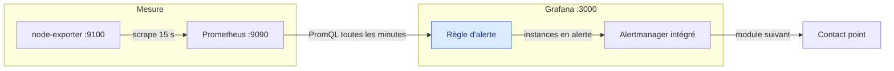
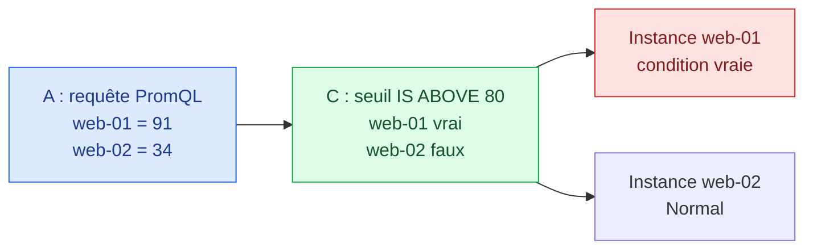
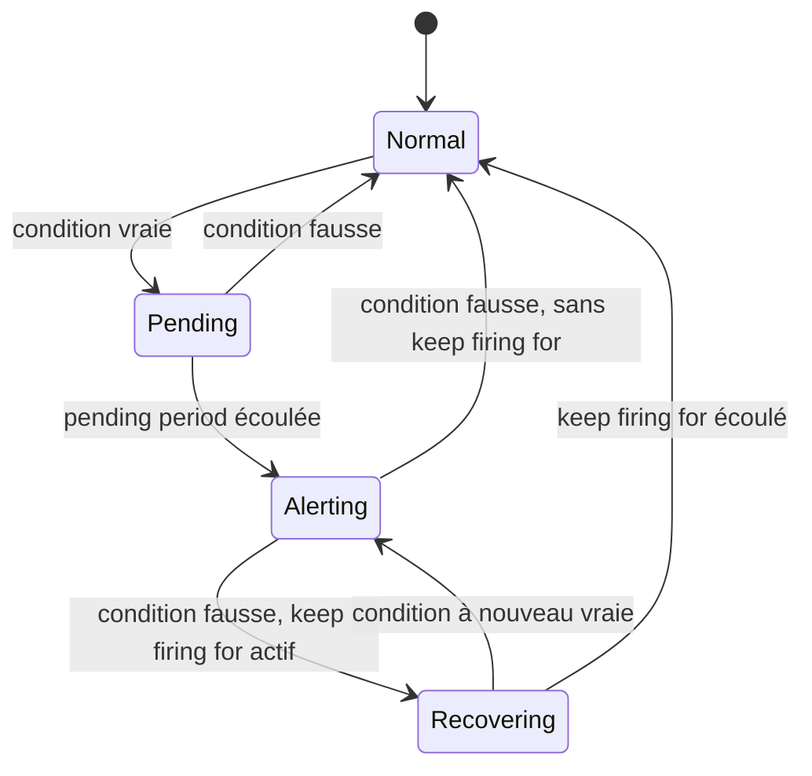


# Grafana Alerting — Création et évaluation

## Objectifs pédagogiques

À la fin de ce module, vous saurez :

- **Choisir** entre une règle Grafana-managed et une règle Data source-managed.
- **Construire** une règle complète : requête, seuil, groupe d'évaluation, labels et annotations.
- **Régler** la pending period, le recovery threshold et le keep firing for, et calculer le délai de détection qui en résulte.
- **Lire** le cycle de vie d'une instance d'alerte : Normal, Pending, Alerting, Recovering, No Data et Error.
- **Détecter** une panne qui rend une règle silencieuse.

## Où en est-on dans la chaîne

Ce module traite la règle, en bleu : elle interroge Prometheus à intervalle fixe et décide de l'état de chaque instance. Qui reçoit la notification, et comment, sera vu au module suivant.



## Mise en situation

*Scénario illustratif.* Une équipe de quatre personnes supervise une trentaine de serveurs Linux. Un vendredi soir, l'un d'eux sature en mémoire pendant quarante minutes, et c'est un utilisateur qui le signale.

L'équipe crée alors une alerte « CPU > 80 % ». Deux semaines plus tard, elle sonne vingt fois par nuit pour des pics de quelques secondes, et personne ne la regarde plus. Puis un exporteur tombe, les métriques disparaissent et rien ne sonne, car une absence de données n'est pas un dépassement de seuil.

Une bonne règle doit donc résoudre trois problèmes : détecter le vrai incident, ignorer le bruit, et signaler qu'elle ne voit plus rien.

## 1. Une règle en une image

Une règle est une petite chaîne de traitement que le serveur Grafana exécute à intervalle fixe, sans qu'aucun dashboard soit ouvert.



> 💡 **À retenir**
>
> Une série renvoyée par la requête donne une instance d'alerte, avec son propre état.
{: .callout .callout-important}

Le seuil compare un nombre, pas une courbe. Le type de requête décide donc de ce qu'il vous faut :

| Requête A | Ce qu'elle renvoie | Étape avant le seuil |
|---|---|---|
| **Instant** | Un point par série | Aucune, le seuil lit directement A |
| **Range** | Une courbe par série | Une expression **Reduce** (Last, Mean, Max) qui en tire un nombre |

Choisissez Instant quand la requête calcule déjà ce que vous voulez tester. Gardez Range et Reduce pour raisonner sur la plage, par exemple le maximum sur 10 minutes.

## 2. Grafana-managed ou Data source-managed

| Critère | Grafana-managed | Data source-managed |
|---|---|---|
| Stockage | Base de Grafana | Dans la source (Mimir, Loki) |
| Évaluation | Serveur Grafana | Ruler de la source |
| Sources par règle | Plusieurs possibles | Une seule |
| Expressions Reduce, Math, Threshold | Oui | Non, tout tient dans la requête |
| Réglage de No Data et Error | Oui, par règle | Non |
| Recovery threshold | Oui | Non |

> 💡 **À retenir**
>
> Prenez Grafana-managed par défaut. Gardez Data source-managed pour les règles qui vivent déjà avec le backend, ou pour un très gros volume à évaluer au plus près des données. Les deux familles peuvent cohabiter.
{: .callout .callout-important}

## 3. Le lab

Ce lab fonctionne avec Docker Compose. `latest` convient pour un test ; en production, épinglez les versions. Les libellés de ce module visent Grafana 13 et peuvent varier selon votre version.

```yaml
# docker-compose.yml
services:
  prometheus:
    image: prom/prometheus:latest
    volumes:
      - ./prometheus.yml:/etc/prometheus/prometheus.yml:ro
    ports: ["9090:9090"]
  node-exporter:
    image: prom/node-exporter:latest      # expose les métriques système sur :9100
  grafana:
    image: grafana/grafana:latest
    volumes:
      - ./datasources.yml:/etc/grafana/provisioning/datasources/datasources.yml:ro
    ports: ["3000:3000"]
```

```yaml
# prometheus.yml
global:
  scrape_interval: 15s                    # une mesure toutes les 15 s
scrape_configs:
  - job_name: node                        # devient le label job="node"
    static_configs:
      - targets: ["node-exporter:9100"]   # nom du service dans le réseau Compose
```

```yaml
# datasources.yml : la source existe dès le démarrage de Grafana
apiVersion: 1
datasources:
  - name: Prometheus
    type: prometheus
    access: proxy
    url: http://prometheus:9090           # vu depuis le conteneur, pas localhost
    isDefault: true
```

```bash
docker compose up -d
curl -s 'http://localhost:9090/api/v1/query?query=up'
```

La réponse doit contenir `"job":"node"` et la valeur `"1"`. Grafana répond ensuite sur `http://localhost:3000`, avec `admin` / `admin` à la première connexion.

## 4. Construire la première règle

Ouvrez **Alerts & IRM → Alert rules → + New alert rule**, puis choisissez le mode **Advanced**. Le mode Default regroupe réduction et seuil dans un seul champ **When** ; il est plus rapide, mais il montre moins ce qui se passe.

1. **Nom :** `CPU élevé`.
2. **Requête A**, source Prometheus, type **Instant** :

```promql
100 * (1 - avg by (instance) (rate(node_cpu_seconds_total{mode="idle"}[5m])))
```

3. **Expression C**, de type **Threshold**, sur l'entrée A : `IS ABOVE 80`. Cliquez sur **Set as alert condition**, puis sur **Preview** pour voir la valeur et l'état.
4. **Dossier** `Infra`, **Evaluation group** `infra-1m`, intervalle `1m`.
5. **Pending period** sur `0s` pour l'instant. Dans **Notifications**, gardez le contact point proposé.

Provoquez ensuite une charge, puis arrêtez-la :

```bash
# Dans un terminal Linux, Git Bash ou PowerShell (cmd.exe ne gère pas ces guillemets)
docker run -d --rm --name charge alpine sh -c 'for i in $(seq $(nproc)); do yes > /dev/null & done; wait'
docker kill charge
```

La règle passe en Alerting après quelques minutes, puis revient à Normal. Elle fonctionne, mais elle sonnera aussi pour le moindre pic : c'est le sujet de la section suivante.

## 5. Éliminer le bruit : trois réglages

Ces réglages agissent sur des moments différents de la vie d'une alerte.

| Réglage | Problème résolu | Agit | Exemple |
|---|---|---|---|
| **Pending period** | Un pic bref déclenche l'alerte | Avant le déclenchement | La condition doit tenir 5 min |
| **Custom recovery threshold** | La valeur oscille autour du seuil | Sur le seuil de retour | Alerte à 80, retour sous 70 |
| **Keep firing for** | L'alerte se ferme et se rouvre en boucle | Après le retour sous le seuil | Reste active 10 min de plus |

Commencez par la pending period. Ajoutez le recovery threshold si la valeur oscille, et réservez le keep firing for aux conditions qui reviennent par à-coups.

### Compter le temps de la pending period

Combien d'évaluations faut-il pour déclencher ? Avec un intervalle de `1m` et une pending period de `5m`, c'est la **sixième** évaluation vraie qui déclenche, car le compteur démarre à la première :

| Temps | Condition | État |
|---|---|---|
| 0 min | Vraie | Pending (compteur à 0) |
| 1 à 4 min | Vraie | Pending |
| 5 min | Vraie | **Alerting**, notification |

Si la condition redevient fausse pendant cette attente, l'instance repasse à Normal et le compteur repart de zéro.

### Calculer le délai réel de détection

Les délais s'additionnent. Prenons une machine presque au repos qui passe brutalement à 100 % de CPU, avec notre règle :

| Étape | Délai |
|---|---|
| `rate(...[5m])` lisse la montée : la moyenne atteint 80 % | Environ 4 min |
| Attente de la prochaine évaluation | Jusqu'à 1 min |
| Pending period | 5 min |
| **Total avant le déclenchement** | **Environ 10 min** |

C'est un choix à assumer. Pour détecter plus vite, raccourcissez la fenêtre de `rate` ou la pending period, en acceptant plus de bruit.

## 6. Labels et annotations

Tous deux sont des paires clé/valeur, mais leur rôle diffère.

> 📦 **Analogie : l'adresse et la lettre d'un colis**
>
> Les labels sont l'adresse : ils servent à trier et à acheminer, donc ils ne doivent pas changer en route. Les annotations sont la lettre à l'intérieur : elles informent le destinataire et peuvent varier. Limite : les labels forment aussi l'identité de l'instance d'alerte.
{: .callout .callout-analogie}

| | Labels | Annotations |
|---|---|---|
| **Rôle** | Identifier l'instance et router l'alerte | Informer la personne qui reçoit l'alerte |
| **Valeur** | Stable | Variable autorisée |
| **Exemple** | `severity=warning`, `team=infra` | Résumé, description, lien de runbook |

```text
Summary      CPU élevé sur {{ $labels.instance }}
Description  {{ with $values.A }}{{ $labels.instance }} est à {{ printf "%.1f" .Value }} % de CPU.{{ else }}Pas de mesure CPU disponible.{{ end }}
Runbook URL  https://wiki.example.com/runbooks/cpu-eleve
```

`$values.A` contient le résultat de la requête ou de l'expression d'identifiant `A`. Elle doit être de type Instant : avec une requête Range, lisez plutôt le Reduce, par exemple `$values.B`.

Le bloc `with ... else` n'est pas un détail. En No Data, il n'y a aucune valeur à afficher : un simple `printf "%.1f" $values.A.Value` produit alors `[no value] est à %!f(<nil>) % de CPU.`, précisément au moment où la personne d'astreinte a besoin d'un message clair.

> ⚠️ **Piège**
>
> Ne mettez jamais `{{ $values.A.Value }}` dans un label. Le jeu de labels change à chaque évaluation, donc Grafana voit une nouvelle instance à chaque fois : vous recevez une rafale de notifications.
{: .callout .callout-attention}

## 7. Instances et groupes d'évaluation

**Une instance par série.** Avec `avg by (instance)` sur 30 serveurs, une seule règle suit 30 instances indépendantes. Le choix du `by` est donc décisif :

| Requête | Instances | Conséquence |
|---|---|---|
| `avg(...)` | 1 | La moyenne du parc masque la machine en panne |
| `avg by (instance) (...)` | 1 par machine | Le bon niveau pour de l'infrastructure |
| Regroupement par `pod` ou `path` | Parfois des milliers | Charge et bruit, à réduire dans la requête |

**L'intervalle appartient au groupe.** Les règles d'un même groupe partagent le même intervalle et sont évaluées en parallèle. Séparez donc une règle critique à `30s` d'une règle de capacité à `5m`. L'intervalle doit être un multiple de l'intervalle de base du moteur, 10 s par défaut.

## 8. Le cycle de vie d'une instance



Lisez ce schéma comme le chemin normal d'une alerte. Une pending period à zéro saute Pending, et un keep firing for à zéro saute Recovering.

Deux états sortent de ce chemin, car ils ne parlent plus du seuil, mais de la mesure :

| État | Signification | Exemple de cause | Options par règle |
|---|---|---|---|
| **No Data** | La requête ne renvoie rien | Exporteur arrêté, label renommé | No Data (défaut), Alerting, Normal, Keep last state |
| **Error** | L'évaluation échoue | Source injoignable, délai dépassé | Error (défaut), Alerting, Normal, Keep last state |

Avec le réglage par défaut, Grafana crée une alerte séparée, `DatasourceNoData` ou `DatasourceError`. Comme elle est indépendante de l'instance d'origine, ses labels peuvent ne pas correspondre à vos silences et à vos politiques de notification. **Testez donc son acheminement.**

## 9. Quand une panne rend la règle silencieuse

Selon la panne, la règle CPU réagit différemment, et le remède aussi :

> 🧠 **À retenir**
>
> No Data ne prouve pas que le système va bien. Une règle teste une valeur : sans valeur, elle ne peut rien affirmer.
{: .callout .callout-important}

| Panne | Ce que fait la règle CPU | Règle complémentaire |
|---|---|---|
| Une machine sur 30 s'arrête, sa cible reste configurée | L'instance disparaît, puis repasse à **Normal** avec la raison `MissingSeries` | `up{job="node"}` en dessous de 1 |
| Tout le job s'arrête | Le CPU semble **monter tout seul**, puis No Data (voir ci-dessous) | `up{job="node"}` en dessous de 1 |
| La cible est retirée par la découverte de services | Comme le premier cas, et `up` disparaît aussi | `count(up{job="node"})` en dessous du nombre attendu |
| Prometheus est injoignable | **Error**, alerte `DatasourceError` | Vérifier son acheminement, puis une surveillance externe (module 35) |

Le premier cas est le plus trompeur : **la machine est morte et l'alerte se ferme**. Par défaut, Grafana considère l'instance comme disparue après 2 évaluations sans série (**Missing series evaluations to resolve**).

### La fausse alerte CPU

Une condition sur `up` retire ce faux signal, car la requête ne renvoie plus rien dès que la cible ne répond plus :

> ⚠️ **Piège**
>
> Quand l'exporteur s'arrête, notre règle voit le CPU grimper alors que la machine ne fait rien. Pendant que la fenêtre de 5 minutes se vide, `rate(...idle...)` baisse vers zéro, donc `100 * (1 - ...)` monte vers 100. Avec une pending period trop courte, vous recevez une alerte CPU pour ce qui est en réalité une panne de collecte.
{: .callout .callout-attention}

```promql
100 * (1 - avg by (instance) (rate(node_cpu_seconds_total{mode="idle"}[5m])))
  and on (instance) up{job="node"} == 1
```

Voici ce que donnent les deux écritures dans le lab, une fois l'exporteur arrêté, avec une pending period de 2 minutes :

| Temps | Requête simple | Avec `and ... up == 1` |
|---|---|---|
| 1 à 3 min | Normal, mais la valeur monte de 10 à 50 % | Pending, puis No Data |
| 4 à 5 min | Pending, la valeur dépasse 80 % | No Data |
| 7 à 8 min | No Data | No Data |

### Construire la règle de disponibilité

> 📖 **Définition**
>
> `up` vaut 1 si le dernier scrape a réussi et 0 sinon, tant que la cible reste configurée.
{: .callout .callout-definition}

1. **Nom :** `Cible injoignable`. **Requête A**, Instant : `up{job="node"}`.
2. **Expression C**, Threshold sur A : `IS BELOW 1`, définie comme condition.
3. **Groupe** `dispo-30s`, intervalle `30s`. **Pending period** `1m`.
4. **No data :** `Set Alerting state`, car l'absence totale de `up` signifie que le job a disparu.
5. **Labels** `severity=critical`, `team=infra`, et un lien de runbook.

Testez-la tout de suite :

```bash
docker compose stop node-exporter
# Attendu : « Cible injoignable » passe en Pending, puis en Alerting en 1 à 2 min.
# Avec la requête simple, la règle CPU monte seule, puis passe en No Data vers 7 min.
docker compose start node-exporter
```

## 10. Diagnostic

| Symptôme | Cause probable | Vérification |
|---|---|---|
| Normal alors que le dashboard dépasse le seuil | Requête ou réduction différente | **Preview** de la règle, et expression choisie comme condition |
| Reste en Pending | La condition retombe et remet le compteur à zéro | Comparer le signal à la pending period |
| Alterne entre Normal et Alerting | Oscillation autour du seuil | Ajouter un recovery threshold, ou un keep firing for |
| `DatasourceNoData` | Cible arrêtée, label ou métrique renommés | Lancer la requête telle quelle dans Explore |
| `DatasourceError` | Source injoignable, identifiants expirés, délai dépassé | Message de l'instance, **Save & test** de la source |
| Rien ne revient avec `$instance` | Une variable de dashboard n'existe pas côté serveur | Valeur explicite, ou `by (instance)` |

## 11. Cas pratique : la configuration de l'équipe

*Scénario illustratif, chiffres fictifs.* Reprenons l'équipe du début et ses 30 serveurs. Elle remplace son unique règle par deux règles complémentaires :

| | `CPU élevé` | `Cible injoignable` |
|---|---|---|
| Question posée | La machine sature-t-elle ? | La mesure fonctionne-t-elle ? |
| Groupe | `infra-1m` | `dispo-30s` |
| Pending period | `5m` | `1m` |
| Recovery threshold | Retour sous 70 | Aucun |
| Requête | Avec `and ... up == 1` | `up{job="node"}` |
| No Data | Valeur par défaut, acheminement testé | Set Alerting state |
| Sévérité | `warning` | `critical` |
| Détection | Environ 10 min | Environ 2 min |

Dans ce scénario, les réveils pour de simples pics disparaissent, et un exporteur arrêté n'est plus invisible. Chaque trimestre, l'équipe rejoue les deux pannes du lab pour vérifier toute la chaîne.

## Bonnes pratiques

1. **Alertez sur ce qui demande une action.** Le reste a sa place sur un dashboard.
2. **Séparez la mesure et le symptôme.** Une règle ne peut pas signaler la disparition de la métrique qu'elle teste.
3. **Décidez No Data et Error règle par règle**, et notez pourquoi. Évitez de mettre Error sur Normal sans raison explicite.
4. **Testez chaque alerte par une panne réelle.** Une règle jamais vue en Alerting n'est pas une règle validée.
5. **Versionnez les règles stables** (module 28), pour pouvoir les relire et les restaurer.

## Résumé

- Une règle enchaîne une requête et un seuil, à l'intervalle de son groupe, et crée **une instance par série**.
- Grafana-managed est le choix par défaut.
- La pending period, le recovery threshold et le keep firing for réduisent le bruit, mais **chaque délai s'ajoute au temps de détection**.
- Les labels identifient et restent stables ; les annotations informent et peuvent varier.
- Une règle ne détecte pas sa propre perte de données : il faut une règle sur la disponibilité de la mesure.

Le module suivant décide qui reçoit ces alertes, par quel canal et avec quelle priorité.

<!-- snippet
id: grafana_alerting_managed_vs_datasource
type: concept
tech: grafana
level: intermediate
importance: high
format: knowledge
tags: grafana,alerting,prometheus,mimir
title: Grafana-managed vs Data source-managed
content: Grafana-managed : règle stockée dans Grafana et évaluée par son serveur, avec expressions, plusieurs sources, réglage de No Data et Error, recovery threshold. Data source-managed : règle évaluée par le ruler de la source (Mimir, Loki), écrite dans son seul langage de requête.
description: Choisir Grafana-managed par défaut, et Data source-managed pour les règles qui vivent déjà avec le backend ou les très gros volumes.
-->

<!-- snippet
id: grafana_alerting_rule_pipeline
type: concept
tech: grafana
level: intermediate
importance: high
format: knowledge
tags: grafana,alerting,expressions,threshold
title: Instant ou Range dans une règle d'alerte
content: Le seuil compare un nombre. Une requête Instant renvoie un point par série, donc le Threshold la lit directement. Une requête Range renvoie une courbe : il faut une expression Reduce (Last, Mean, Max) avant le seuil. Le bouton Set as alert condition désigne l'expression qui décide.
description: Le type de requête détermine si une expression Reduce est nécessaire avant le seuil.
-->

<!-- snippet
id: grafana_alerting_pending_period
type: concept
tech: grafana
level: intermediate
importance: high
format: knowledge
tags: grafana,alerting,pending,evaluation
title: Compter les évaluations d'une pending period
content: Avec un intervalle de 1m et une pending period de 5m, l'instance passe en Alerting à la sixième évaluation vraie, car le compteur démarre à la première. Une évaluation fausse pendant cette attente la ramène à Normal. Avec 0s, Pending est sauté.
description: Nombre d'évaluations = pending period / intervalle + 1.
-->

<!-- snippet
id: grafana_alerting_noise_settings
type: tip
tech: grafana
level: intermediate
importance: high
format: knowledge
tags: grafana,alerting,flapping,threshold
title: Pending, recovery threshold ou keep firing for
content: Pic bref : pending period. Valeur qui oscille autour du seuil : custom recovery threshold, par exemple alerte à 80 et retour sous 70. Alerte qui se ferme et se rouvre par à-coups : keep firing for, qui maintient l'alerte pendant une durée minimale, avec l'état Recovering.
description: Trois réglages pour trois causes de bruit. Chaque délai s'ajoute au temps de détection.
-->

<!-- snippet
id: grafana_alerting_nodata_not_healthy
type: warning
tech: grafana
level: intermediate
importance: high
format: knowledge
tags: grafana,alerting,nodata,disponibilite
title: No Data ne veut pas dire que le système est sain
content: Piège : croire que l'absence d'alerte prouve la bonne santé du service. Conséquence : si l'exporteur s'arrête, la règle n'a plus de valeur à comparer. Correction : ajouter une règle sur up, choisir le comportement de No Data par règle, et tester l'acheminement de DatasourceNoData.
description: DatasourceNoData est une alerte indépendante : les silences et les politiques peuvent ne pas s'y appliquer.
-->

<!-- snippet
id: grafana_alerting_missing_series
type: warning
tech: grafana
level: advanced
importance: high
format: knowledge
tags: grafana,alerting,multidimensionnel,missingseries
title: Une série disparue ferme l'alerte au lieu de la déclencher
content: Piège : dans une règle à plusieurs instances, si une machine disparaît, les autres renvoient encore des données, donc il n'y a pas de No Data. Conséquence : après 2 évaluations par défaut, l'instance passe à Normal avec la raison MissingSeries. Correction : règle up IS BELOW 1 pour une cible statique, ou comparaison de count(up{job="..."}) au nombre attendu avec une découverte de services.
description: up passe à 0 tant que la cible reste configurée, mais disparaît si la découverte de services la retire.
-->

<!-- snippet
id: grafana_alerting_labels_stables
type: warning
tech: grafana
level: intermediate
importance: high
format: knowledge
tags: grafana,alerting,labels,annotations
title: Ne jamais mettre une valeur variable dans un label
content: Piège : écrire un label contenant {{ $values.A.Value }}. Conséquence : le jeu de labels change à chaque évaluation, donc Grafana crée une nouvelle instance et résout l'ancienne, avec des rafales de notifications. Correction : placer les valeurs variables dans une annotation.
description: Les labels forment l'identité d'une instance ; les annotations peuvent changer sans conséquence.
-->

<!-- snippet
id: grafana_alerting_multidimensional_instances
type: concept
tech: grafana
level: intermediate
importance: high
format: knowledge
tags: grafana,alerting,multidimensionnel,instances
title: Une règle produit une instance par série
content: avg by (instance) sur 30 serveurs crée 30 instances indépendantes. avg sans by n'en crée qu'une, et la moyenne du parc masque la machine en panne. Un regroupement trop fin peut produire des milliers d'instances.
description: Le découpage en instances dépend des labels renvoyés par la requête.
-->

<!-- snippet
id: grafana_alerting_evaluation_group
type: concept
tech: grafana
level: intermediate
importance: medium
format: knowledge
tags: grafana,alerting,evaluation,intervalle
title: L'intervalle d'évaluation appartient au groupe
content: Les règles d'un même groupe partagent un intervalle et sont évaluées en parallèle. L'intervalle doit être un multiple de l'intervalle de base, 10 s par défaut. Séparer une règle critique à 30s d'une règle de capacité à 5m.
description: Un intervalle trop court charge Grafana et la source ; trop long, il retarde la détection.
-->

<!-- snippet
id: grafana_alerting_annotation_value
type: tip
tech: grafana
level: intermediate
importance: medium
format: knowledge
tags: grafana,alerting,annotations,templates
title: Afficher la valeur dans une annotation
content: {{ with $values.A }}{{ $labels.instance }} est à {{ printf "%.1f" .Value }} % de CPU.{{ else }}Pas de mesure CPU disponible.{{ end }} $values.A contient le résultat de l'identifiant A, qui doit être Instant ou une expression comme Reduce. Sans le bloc with, un état No Data affiche [no value] et %!f(<nil>).
description: Une annotation utile reste lisible en No Data, indique la machine et la valeur, et donne un lien de runbook.
-->

<!-- snippet
id: grafana_alerting_dashboard_variables_error
type: error
tech: grafana
level: intermediate
importance: medium
format: knowledge
tags: grafana,alerting,variables,erreur
title: Variable de dashboard dans une requête d'alerte
content: Symptôme : une requête avec {instance="$instance"} ne renvoie rien en alerting. Cause : le serveur évalue la règle sans connaître les variables d'un dashboard. Correction : mettre une valeur explicite, ou agréger avec by (instance) pour obtenir une instance par machine.
description: Les variables de dashboard n'existent pas dans le contexte d'évaluation d'une règle.
-->

<!-- snippet
id: grafana_alerting_list_rules_api
type: command
tech: grafana
level: intermediate
importance: medium
format: knowledge
tags: grafana,alerting,api,jq
title: Lister l'état des règles Grafana-managed
context: API compatible Prometheus, chemin à vérifier selon votre version
command: curl -s -u <USER>:<PASSWORD> http://<HOST>:3000/api/prometheus/grafana/api/v1/rules | jq '.data.groups[].rules[] | {name, state}'
example: curl -s -u admin:admin http://localhost:3000/api/prometheus/grafana/api/v1/rules | jq '.data.groups[].rules[] | {name, state}'
description: Affiche le nom et l'état de chaque règle ; ajouter .alerts[]? pour voir les instances et leurs labels.
-->

<!-- snippet
id: grafana_alerting_simulate_nodata
type: command
tech: grafana
level: intermediate
importance: low
format: knowledge
tags: grafana,alerting,docker,nodata
title: Tester une règle en arrêtant l'exporteur
context: Lab Docker Compose avec Prometheus et node-exporter
command: docker compose stop <SERVICE_EXPORTER>
example: docker compose stop node-exporter
description: La règle sur up passe en Alerting en 1 à 2 min. Une règle basée sur rate(...[5m]) passe en No Data une fois la fenêtre vidée, soit environ 5 min plus la pending period.
-->

<!-- snippet
id: grafana_alerting_false_cpu_on_stale
type: warning
tech: grafana
level: advanced
importance: high
format: knowledge
tags: grafana,alerting,promql,rate
title: Une panne d'exporteur fait monter le CPU calculé
content: Piège : avec 100 * (1 - avg by (instance) (rate(node_cpu_seconds_total{mode="idle"}[5m]))), l'arrêt de l'exporteur fait baisser rate pendant que la fenêtre se vide. Conséquence : le CPU calculé monte vers 100 % sans aucune charge, et une pending period courte déclenche une fausse alerte. Correction : ajouter and on (instance) up{job="node"} == 1 à la requête.
description: Observé dans un lab : la valeur passe de 10 à 89 % en 4 min 30 après l'arrêt de l'exporteur. La condition sur up donne un No Data à la place.
-->

