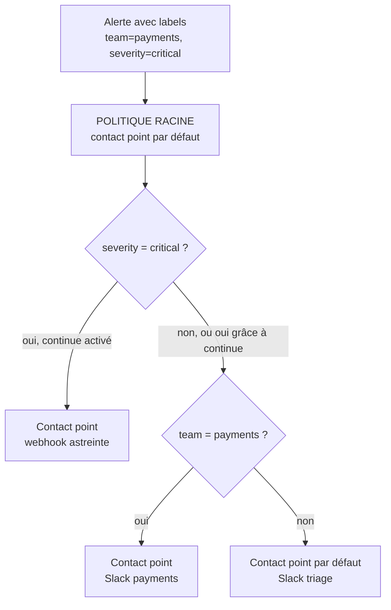


# Routage des alertes et gestion du bruit

## Objectifs pédagogiques

À la fin de ce module, vous serez capable de :

- **Construire** un arbre de notification policies qui dirige chaque alerte vers le bon contact point selon ses labels
- **Régler** `group_by`, `group_wait`, `group_interval` et `repeat_interval` pour obtenir une notification utile plutôt qu'une rafale
- **Choisir** entre un silence et un mute timing, et les utiliser sans masquer de vraies pannes
- **Vérifier** le routage et la livraison avant qu'une vraie alerte ne serve de test
- **Rédiger** des notifications exploitables par une personne d'astreinte qui n'a pas écrit la règle

## Mise en situation

Vous rejoignez une équipe de six personnes qui exploite une quarantaine de services sur Kubernetes. Les règles d'alerte existent et fonctionnent : vous savez les écrire et comprendre leurs états, c'était l'objet du module précédent. Mais tout part vers un unique canal Slack, `#alerts`, avec un seul contact point.

Un nœud tombe un mardi à 3 h du matin. Vingt-trois pods deviennent injoignables, chacun déclenche trois règles, et le canal reçoit environ soixante-dix messages en dix minutes. L'astreinte les lit à moitié, en mute le canal pour dormir, et rate l'alerte de saturation de base de données qui arrive vingt minutes plus tard. Le lendemain, plus personne n'ouvre `#alerts` avec confiance.

Le problème n'est pas dans les règles, qui disaient toutes quelque chose de vrai. C'est la couche entre l'alerte et l'humain qui manque : qui doit être prévenu, une fois ou dix, avec quelles informations, et à quel moment il vaut mieux se taire. Les chiffres de ce scénario sont illustratifs, mais le mécanisme est très courant.

## Ce qui se passe entre une règle et un téléphone

Une règle d'alerte ne parle à personne. Quand une instance passe en `Firing`, Grafana la transmet à son Alertmanager interne, qui décide quoi envoyer, à qui, et quand. Trois objets se partagent ce travail.

| Composant | Rôle | Exemple |
|-----------|------|---------|
| Contact point | Destination et format : où et comment envoyer | Slack `#payments-alerts`, email d'équipe, webhook vers l'outil d'astreinte |
| Notification policy | Règle de routage : quelle alerte va vers quel contact point, avec quel groupement et quels délais | `severity=critical` → webhook d'astreinte, regroupé par cluster |
| Silence / mute timing | Suppression temporaire des notifications | Silence d'une heure pendant une migration ; mute timing le samedi de 2 h à 4 h |

> 🧠 **Concept clé** : le routage ne s'appuie que sur les **labels** de l'alerte. Les politiques ne lisent ni le nom de la règle ni son contenu métier. Si la règle n'a pas de label `team`, aucune politique ne peut l'envoyer à une équipe.
{: .callout .callout-important}

Les politiques forment un **arbre**. La politique racine reçoit tout et possède un contact point par défaut. Dessous, des politiques enfants filtrent par matchers de labels :



Trois règles de lecture :

- **Les enfants héritent du parent** : contact point, `group_by` et délais, tant qu'ils ne les redéfinissent pas.
- **Les politiques sœurs sont évaluées dans l'ordre** : la première qui correspond gagne, et l'alerte s'arrête là.
- **L'option *Continue matching*** fait exception : l'alerte continue vers les politiques suivantes. C'est comme ça qu'une alerte critique peut prévenir l'astreinte *et* l'équipe.

> ⚠️ **Erreur fréquente** : oublier qu'une alerte sans label attendu retombe silencieusement sur la politique racine. Le contact point par défaut doit donc être un endroit réellement surveillé, pas une adresse poubelle. Et chaque règle devrait porter au minimum `team` et `severity`, avec des valeurs d'un vocabulaire fermé (`critical`, `warning`, `info`), jamais `Critical` dans un coin et `crit` dans un autre.
{: .callout .callout-attention}

## Mise en place

### Les contact points

Un contact point regroupe une ou plusieurs intégrations. Le choix du canal dépend de ce que vous attendez du destinataire :

| Canal | Pour quoi faire | Limite à connaître |
|-------|-----------------|--------------------|
| Slack | Information partagée, discussion autour de l'incident, alertes `warning` | Noyé dès que le volume monte ; ne réveille personne tout seul |
| Email | Traces, rapports, alertes non urgentes | Lent, filtré, facilement ignoré |
| Webhook | Intégration à un outil d'astreinte, un ticketing, un script d'automatisation | À vous de maintenir le récepteur ; Grafana envoie un JSON fixe |

Pour l'email, Grafana a besoin d'un serveur SMTP (Simple Mail Transfer Protocol) dans `grafana.ini` (ou via variables `GF_SMTP_*`) :

```ini
[smtp]
enabled = true
host = smtp.example.com:587
user = grafana@example.com
password = $__file{/run/secrets/smtp_password}
from_address = grafana-alerts@example.com
from_name = Grafana Alerting
```

Sans cette section, un contact point email se crée sans erreur, mais l'envoi échoue au premier test.

Dans l'interface, tout se fait sous **Alerting → Contact points → Add contact point**. Le bouton **Test** envoie une notification factice : il valide le canal et les identifiants, pas le routage. Les noms de menus peuvent varier d'une version à l'autre, mais le principe reste le même.

Pour un webhook, Grafana envoie un JSON qui contient notamment `status`, `groupLabels`, `commonLabels`, et un tableau `alerts` avec labels, annotations, `startsAt`, `generatorURL`, `silenceURL`, `dashboardURL`. Le récepteur doit donc être capable de traiter **plusieurs alertes dans un seul appel**, c'est le comportement normal dès qu'il y a du groupement.

### Le provisioning plutôt que la souris

Un arbre de politiques édité à la main dérive vite : quelqu'un ajoute une exception « temporaire » qui reste six mois. Le provisioning par fichier (ou l'API) rend l'arbre relisable et versionnable. Exemple minimal dans `provisioning/alerting/routing.yaml` :

```yaml
apiVersion: 1

contactPoints:
  - orgId: 1
    name: slack-triage
    receivers:
      - uid: slack-triage-1
        type: slack
        settings:
          url: $SLACK_TRIAGE_WEBHOOK
  - orgId: 1
    name: slack-payments
    receivers:
      - uid: slack-payments-1
        type: slack
        settings:
          url: $SLACK_PAYMENTS_WEBHOOK
  - orgId: 1
    name: oncall-webhook
    receivers:
      - uid: oncall-webhook-1
        type: webhook
        settings:
          url: https://oncall.example.com/hooks/grafana
          httpMethod: POST

muteTimes:
  - orgId: 1
    name: maintenance-samedi
    time_intervals:
      - weekdays: ['saturday']
        times:
          - start_time: '02:00'
            end_time: '04:00'

policies:
  - orgId: 1
    receiver: slack-triage
    group_by: ['grafana_folder', 'alertname']
    group_wait: 30s
    group_interval: 5m
    repeat_interval: 4h
    routes:
      - receiver: oncall-webhook
        object_matchers:
          - ['severity', '=', 'critical']
        group_by: ['alertname', 'cluster']
        repeat_interval: 1h
        continue: true
      - receiver: slack-payments
        object_matchers:
          - ['team', '=', 'payments']
        mute_time_intervals: ['maintenance-samedi']
```

Les variables `$SLACK_*` sont interpolées depuis l'environnement de Grafana, ce qui évite de committer des URLs secrètes. Les champs exacts des `settings` varient selon le type d'intégration et la version : exportez un contact point existant depuis l'interface pour voir le schéma attendu chez vous.

> 💡 **Astuce** : le provisioning de politiques remplace **tout l'arbre** de l'organisation. Un fichier incomplet efface donc les politiques créées à la main, et l'arbre provisionné n'est plus modifiable depuis l'interface. Choisissez une source de vérité et tenez-vous-y.
{: .callout .callout-astuce}

Vous pouvez exporter l'arbre actuel à tout moment :

```bash
curl -s -H "Authorization: Bearer <TOKEN>" \
  <GRAFANA_URL>/api/v1/provisioning/policies
```

## Les quatre réglages qui font la différence entre une alerte et du bruit

> 🍽️ **Analogie : le serveur de restaurant.** Un serveur n'apporte pas chaque assiette dès qu'elle sort de la cuisine. Il attend un court instant que le reste de la table soit prêt (`group_wait`). Il ramène ensuite les retardataires par vagues (`group_interval`). Si quelqu'un n'a toujours pas mangé une heure plus tard, il revient lui demander (`repeat_interval`). Le `group_by`, c'est la décision de ce qui forme une « table ». Limite de l'image : Grafana ne sait pas si le message a été lu. Il rappelle tant que le groupe reste en `Firing`.
{: .callout .callout-analogie}

### group_by : ce qui forme un groupe

Les alertes qui partagent les mêmes valeurs pour les labels de `group_by` sont envoyées dans **une seule notification**. Par défaut Grafana regroupe sur `grafana_folder` et `alertname`.

- `group_by: ['alertname', 'cluster']` : une notification « `NodeDown` sur `prod-eu` » qui liste les 23 pods concernés. C'est ce que vous voulez la plupart du temps.
- `group_by: ['...']` : la valeur spéciale `...` désactive le groupement, donc **une notification par alerte**. Utile très rarement.
- Un label à forte cardinalité (`pod`, `instance`, `request_id`) dans `group_by` recrée mécaniquement le problème : autant de groupes que de valeurs, donc autant de messages.

> 📖 **Définition.** La **cardinalité** d'un label est le nombre de valeurs distinctes qu'il peut prendre. `severity` en a trois ; `pod` peut en avoir des milliers.
{: .callout .callout-definition}

> ⚠️ **Erreur fréquente** : mettre `instance` dans `group_by` « pour voir quelle machine est touchée ». L'information se récupère dans le corps du message, via la liste des alertes du groupe. Le groupement sert à réduire le nombre de messages, pas à les enrichir.
{: .callout .callout-attention}

### Les trois délais

| Paramètre | Ce qu'il contrôle | Défaut courant |
|-----------|-------------------|----------------|
| `group_wait` | Attente avant la **première** notification d'un nouveau groupe, le temps de collecter les alertes qui partent ensemble | 30 s |
| `group_interval` | Délai minimal avant d'envoyer une notification pour des **changements** dans un groupe existant (nouvelle alerte, résolution) | 5 min |
| `repeat_interval` | Délai avant de **renotifier** un groupe inchangé qui est toujours en `Firing` | 4 h |

Sur une ligne de temps, avec les valeurs par défaut :

```text
t = 0       alerte A passe en Firing → le groupe est créé, on attend
t = 30 s    notification n°1 (A)
t = 2 min   alerte B rejoint le groupe → elle attend la prochaine fenêtre
t = 5 min 30  notification n°2 (A + B)
t = 4 h 05 min 30  si rien n'a changé depuis 5 min 30 → rappel (repeat_interval de 4 h après le dernier envoi)
```

Quelle valeur choisir pour `group_wait` ? C'est le compromis le plus facile à rater. Trop long, vous retardez une vraie alerte critique de plusieurs minutes. Trop court, vous envoyez une première notification avec une seule alerte, puis une deuxième cinq minutes plus tard avec les trente autres. Pour une politique critique, 10 à 30 s reste raisonnable ; pour du `warning`, vous pouvez monter à 1–2 min sans douleur.

> 💡 **Astuce** : gardez un `repeat_interval` multiple du `group_interval`, et jamais plus court que l'intervalle d'évaluation de la règle. Des rappels toutes les 5 minutes d'un incident déjà pris en charge donnent la même fatigue que l'absence de groupement.
{: .callout .callout-astuce}

## Silences et mute timings

Les deux suppriment des notifications sans arrêter l'évaluation : la règle continue de tourner, l'instance reste visible dans l'interface avec son état, seul le message n'est pas envoyé. La différence tient à l'usage.

| | Silence | Mute timing |
|---|---------|-------------|
| Nature | Ponctuel, créé à la volée | Récurrent, défini à l'avance |
| Cible | Des matchers de labels (`=`, `!=`, `=~`, `!~`) | Une ou plusieurs politiques |
| Durée | Début et fin explicites, il expire seul | Plages horaires / jours, valable tant que la politique le référence |
| Cas typique | Migration de base en cours, faux positif connu | Fenêtre de maintenance hebdomadaire, heures creuses d'un service non critique |

Un silence se crée depuis **Alerting → Silences → New silence**, ou depuis le bouton **Silence** d'une instance (les matchers sont alors préremplis). Mettez toujours un commentaire qui dit *pourquoi* et pour *qui*, sans quoi dans une semaine personne ne saura s'il peut être supprimé.

> ⚠️ **Erreur fréquente** : un silence trop large, par exemple `alertname=~".+"` pour « avoir la paix pendant l'intervention », cache aussi la vraie panne qui arrive à côté. Ciblez les labels de la maintenance (`cluster=prod-eu`, `service=billing`) et prévoyez une fin à l'heure de la fenêtre, pas « 7 jours au cas où ».
{: .callout .callout-attention}

Sur les mute timings, deux pièges à surveiller :

- **Le fuseau horaire** de l'intervalle n'est pas forcément celui de votre équipe (UTC par défaut chez Alertmanager) : une fenêtre « 2 h–4 h » peut tomber en plein après-midi.
- **La portée** : un mute timing attaché à une politique enfant ne touche que cette branche. Dans l'exemple de provisioning plus haut, l'alerte `critical` continue de réveiller l'astreinte samedi à 3 h, parce qu'elle passe par une autre route. C'est probablement ce que vous voulez, mais il faut le décider consciemment.

Certaines versions proposent aussi des *active time intervals*, l'inverse du mute timing : la politique n'est active que pendant la plage. C'est pratique pour router vers l'astreinte uniquement hors heures ouvrées.

## Flapping, déduplication et seuils dynamiques

### Le flapping

> 📖 **Définition.** Une alerte « flappe » quand elle alterne `Firing` / `Resolved` en boucle autour de son seuil.
{: .callout .callout-definition}

Vous connaissez déjà le levier côté règle : la durée de maintien avant déclenchement. Côté routage, vous n'éliminez pas le flapping, vous l'atténuez :

- Un `group_interval` de 5 à 10 min empêche d'envoyer un message à chaque oscillation : les changements sont agrégés par fenêtre.
- Sur certains contact points, l'option **Disable resolved message** supprime les notifications de résolution. Pour une alerte qui flappe, voir « résolu » puis « en feu » toutes les trois minutes est pire que de ne recevoir que l'ouverture.
- Si une alerte flappe de façon chronique, le vrai correctif est sur la règle ou sur le seuil, pas sur la politique. Un routage qui cache durablement un flapping est une dette.

### La déduplication

Deux niveaux à distinguer. Quand Grafana tourne en plusieurs instances, l'Alertmanager interne dédoublonne les notifications pour qu'une même alerte n'arrive pas deux fois. Et deux alertes qui ont **exactement les mêmes labels** sont considérées comme une seule : c'est l'identité de l'alerte.

Ce qui est une vraie question de conception, c'est le cas où **plusieurs règles différentes décrivent la même cause** : `NodeDown`, `PodNotReady`, `HighLatency`, tout ça parce qu'un nœud est mort. À ma connaissance, l'Alertmanager intégré à Grafana ne propose pas de règles d'inhibition (« si A est active, ne pas notifier B ») ; un Alertmanager externe, lui, oui. Vérifiez selon votre version. En attendant, vous pouvez réduire la redondance en regroupant sur `cluster` + un label de cause commune, ou en gardant un petit nombre d'alertes orientées symptôme.

### Les seuils dynamiques

Plutôt qu'un seuil fixe, certaines règles comparent à un comportement habituel, par exemple le taux d'erreurs actuel à celui de la même heure la semaine dernière :

```promql
sum(rate(http_requests_total{status=~"5.."}[5m]))
  > 2 * sum(rate(http_requests_total{status=~"5.."}[5m] offset 1w))
```

Ça réduit le bruit sur les services dont la charge varie fortement entre le jour et la nuit. Mais le risque est réel : si une dégradation dure, elle devient la référence de la semaine suivante, et l'alerte se tait sur un service qui va mal depuis sept jours.

Gardez un **plafond absolu** à côté (« jamais plus de 5 % d'erreurs, quoi que dise l'historique ») et traitez le seuil dynamique comme un complément, pas un remplacement.

Enfin, par construction, une alerte qui compare à `offset 1w` est muette dans la semaine qui suit la création d'une métrique, ce qui fait un bon candidat pour un test.

## Tester avant que ça compte

Tester l'alerte ne suffit pas, il faut tester **le chemin complet**, de la règle jusqu'à l'écran de la personne d'astreinte. Trois niveaux, du moins coûteux au plus fidèle :

1. **Le bouton *Test* du contact point** : valide l'URL Slack, le SMTP, la connectivité webhook et le rendu d'un template avec des données d'exemple. Il ne dit rien sur le routage.
2. **La prévisualisation du routage** : en éditant une règle, la section de notification propose de prévisualiser les politiques qui correspondent aux labels saisis. La page des politiques permet aussi de chercher par labels. Vous voyez quelle branche de l'arbre capte l'alerte avant même de la sauvegarder (l'intitulé varie selon la version).
3. **Une alerte synthétique de bout en bout** : on déclenche une règle de test toujours vraie qui porte les vrais labels de production.

Pour le niveau 3, n'injectez pas d'alerte par `POST .../api/v2/alerts` : l'Alertmanager interne de Grafana ne prend pas en charge cette injection, qui ne fonctionne qu'avec un Alertmanager externe. Créez plutôt une règle de test dont la condition est toujours vraie, avec les labels à vérifier, puis mettez-la en pause une fois la livraison constatée. Prévenez l'équipe avant d'envoyer un test `critical` qui atteint vraiment l'astreinte.

> 💡 **Astuce** : pour valider un webhook sans écrire de récepteur, lancez un serveur d'écho local, par exemple `docker run --rm -p 8080:8080 mendhak/http-https-echo`, et pointez le contact point vers `http://host.docker.internal:8080` si Grafana tourne aussi dans Docker (selon l'OS, l'adresse de l'hôte peut différer). Vous voyez le JSON exact que recevra votre outil d'astreinte, y compris ce qui arrive quand dix alertes sont regroupées.
{: .callout .callout-astuce}

## Construction progressive

**v1 : tout vers un canal.** Un contact point Slack sur la politique racine. Ça marche pour démarrer, et c'est exactement le scénario du début : un nœud tombe, le canal explose. Le seul gain sur « rien » est que quelqu'un voit les alertes.

**v2 : routage par labels et groupement.** On ajoute `severity` et `team` sur les règles, des politiques enfants par équipe, un `group_by: ['alertname','cluster']`. Le saut vient de ce que l'information a désormais un destinataire : l'équipe paiements ne reçoit plus les alertes de l'équipe catalogue, et l'incident du nœud passe de soixante-dix messages à un message qui liste les pods.

**v3 : exploitation.** Les critiques partent vers un webhook d'astreinte avec `continue: true` pour que l'équipe soit informée aussi. Les `warning` vont dans un canal ou un ticket, jamais en page. Les mute timings couvrent les maintenances prévisibles. Les templates imposent un runbook. L'ensemble est provisionné et relu en revue de code. Chaque étape répond à un problème vécu à l'étape précédente, il est inutile de tout construire d'emblée.

## Alerte correcte, mais impossible à traiter

C'est le piège le plus coûteux, parce qu'aucun outil ne le détecte. La règle est exacte, la condition correcte, la notification arrive, et pourtant personne ne sait quoi faire. Voici ce que reçoit l'astreinte à 3 h 12 :

```text
[FIRING] HighCPU
instance=10.4.2.17:9100
```

Qui est responsable de cette machine ? Est-ce grave ? Le service est-il dégradé ? Que faut-il vérifier d'abord ? Il faudra ouvrir Grafana, deviner quel dashboard consulter, et fouiller le wiki. Dix minutes de perdues avant la première action.

Voici la même alerte, avec les mêmes données, mais écrite pour être traitée :

```text
[FIRING] CPU saturé sur 3 nœuds du pool "checkout" (prod-eu)
Impact : latence du paiement > 2 s probable si > 5 nœuds touchés
Première vérification : pods évincés ? kubectl top nodes -l pool=checkout
Runbook   : https://wiki.example.com/runbooks/checkout-cpu
Dashboard : https://grafana.example.com/d/abc123/checkout?var-cluster=prod-eu
Propriétaire : équipe payments, astreinte via PagerDuty
Silence 1 h : <lien généré par Grafana>
```

Cette information vit dans les **annotations** de la règle (`summary`, `description`, `runbook_url`) et dans un **template de notification** qui les met en forme. Les deux sont indispensables, parce qu'une annotation que le template n'affiche pas ne sert à personne. Exemple de template, à créer sous **Alerting → Contact points → Notification Templates** :

```text
{{ define "oncall.message" -}}
[{{ .Status | toUpper }}] {{ .CommonLabels.alertname }} — {{ .Alerts.Firing | len }} en cours
{{ range .Alerts.Firing }}
• {{ .Labels.instance }} : {{ .Annotations.summary }}
  Runbook   : {{ .Annotations.runbook_url }}
  Dashboard : {{ .DashboardURL }}
  Silence   : {{ .SilenceURL }}
{{ end }}
{{- end }}
```

On l'appelle ensuite depuis le champ message du contact point avec `{{ template "oncall.message" . }}`. Les variables disponibles (`.Alerts`, `.CommonLabels`, `.DashboardURL`, etc.) dépendent de la version, regardez l'aperçu du template dans l'éditeur.

> 💡 **À retenir** : le test des 3 h du matin. *Une personne qui n'a pas écrit la règle, réveillée à 3 h, sait-elle en moins d'une minute ce qui est cassé, qui est touché et quoi faire en premier ?* Si non, ajoutez l'information manquante. Et si aucune action n'est possible, ce n'est pas une alerte, mais un panneau de dashboard ou un ticket.
{: .callout .callout-important}

## Erreurs fréquentes

**Aucune notification alors que l'alerte est en `Firing`.** Quatre causes courantes :

1. Un label attendu manque, l'alerte est tombée sur la racine : relisez les labels de l'instance et utilisez la prévisualisation du routage.
2. Un silence ou un mute timing la couvre : l'instance apparaît avec un état silencieux/muté dans la liste.
3. Le contact point est cassé : la page **Contact points** affiche la dernière erreur de livraison (URL Slack révoquée, SMTP absent, webhook en 500).
4. Le `group_wait` n'est pas écoulé.

Pour creuser, regardez les logs de Grafana, par exemple `docker logs <GRAFANA_CONTAINER> 2>&1 | grep -i notif`.

**Un message par alerte au lieu d'un message par incident.** Cause : `group_by: ['...']`, ou un label à forte cardinalité (`pod`, `instance`) dans `group_by`. Correction : regrouper sur `alertname` + un label de périmètre (`cluster`, `service`).

**Le même message dans deux canaux.** Cause : `Continue matching` activé sur une politique, ou deux politiques sœurs qui matchent toutes les deux avec le premier `continue`. Correction : décider explicitement quelles alertes doivent être dupliquées (typiquement `critical` → astreinte + équipe), et désactiver le `continue` partout ailleurs.

**Rappels toutes les quatre heures sur un incident déjà pris en charge.** Cause : `repeat_interval` par défaut. Correction : un silence avec commentaire pendant la prise en charge, ou un `repeat_interval` adapté à la criticité.

**La maintenance du samedi à 2 h n'a rien masqué.** Cause : fuseau horaire du mute timing, ou politique qui ne capte pas cette alerte (le mute timing est attaché à une autre branche). Correction : vérifier le fuseau configuré et la branche réellement empruntée.

**L'arbre de politiques n'est pas modifiable depuis l'interface.** Cause : il est provisionné par fichier, qui fait foi et est réappliqué à chaque démarrage. Correction : modifier le fichier, pas l'interface.

## Cas réel en entreprise

*Scénario illustratif, chiffres non issus d'un cas réel.*

Une équipe plateforme de huit personnes gère trois clusters. Elle reçoit environ 400 notifications Slack par semaine, dont une dizaine seulement a nécessité une action. Un incident passe inaperçu parce qu'il a été noyé au milieu d'alertes de CPU transitoires.

Ils procèdent en trois étapes, sur deux semaines :

1. **Inventaire** : tous les contact points et toutes les règles sont exportés. Chaque règle reçoit `team` et `severity`, et celles sans propriétaire sont soit supprimées soit transformées en panneaux de dashboard.
2. **Refonte du routage** : un arbre de politiques de deux niveaux, `critical` vers le webhook d'astreinte avec `continue`, `warning` vers un canal Slack par équipe avec `group_wait` à 2 min, `info` vers un ticket hebdomadaire. Le tout est provisionné et relu en revue.
3. **Qualité des messages** : un template impose `runbook_url` et `summary`, et une règle d'équipe refuse toute nouvelle alerte critique sans runbook.

Dans ce scénario, le volume tomberait à une cinquantaine de notifications par semaine, dont la majorité nécessite une action. Une première vraie panne montrerait ensuite que l'astreinte arrive sur le bon dashboard en moins de deux minutes. Le gain principal n'est pas la baisse du volume en soi, mais le retour de la confiance : quand le canal sonne, on regarde.

## Bonnes pratiques

- **Imposez `team` et `severity` sur toute règle** et refusez en revue celles qui n'en ont pas. Le routage ne vaut que par la qualité des labels, et une alerte sans propriétaire finit sur la racine, donc chez personne.
- **Rendez la politique racine surveillée, pas muette.** Elle sert de filet de sécurité : si elle reçoit trop, c'est un indicateur que des règles manquent de labels.
- **Séparez ce qui réveille de ce qui informe.** Seul `critical` doit atteindre un système de page ; `warning` va dans un canal ou un ticket. Si tout réveille, rien ne réveille.
- **Provisionnez contact points, politiques et mute timings**, versionnez-les, et testez-les à chaque changement avec une alerte synthétique envoyée à un canal de test (`env=test`).
- **Ne stockez jamais d'URL Slack, de mot de passe SMTP ou de token webhook en clair** dans le dépôt : variables d'environnement ou fichiers de secrets (`$__file{...}`), et rotation si une URL a fuité.
- **Mettez une date de fin et un commentaire sur chaque silence.** Un silence illimité est une alerte désactivée qu'on a oubliée.
- **Mesurez votre bruit.** Comptez les notifications par semaine, la part suivie d'une action, les alertes qui flappent. Sans chiffres, la réduction du bruit reste une impression.
- **Prévoyez un contact point de secours** et surveillez sa livraison : si Slack est en panne, ce que vous recevez est un silence qui ressemble à une nuit calme.

## Résumé

Une règle d'alerte ne notifie personne : c'est l'Alertmanager de Grafana qui, via les notification policies, choisit un contact point selon les labels de l'alerte. L'arbre de politiques hérite, se parcourt dans l'ordre, et `continue` permet de dupliquer volontairement. Le groupement (`group_by`) et les trois délais (`group_wait`, `group_interval`, `repeat_interval`) transforment une rafale en un message par incident. Silences et mute timings coupent les notifications sans arrêter l'évaluation, à condition d'être ciblés et bornés. Tester le chemin complet avec des alertes synthétiques évite de découvrir un routage cassé pendant un incident. Le dernier maillon, la qualité du message (runbook, dashboard, propriétaire), décide si l'alerte est traitable. Le module suivant mettra tout cela en pratique : face à une alerte qui sonne, comment mener l'investigation avec Grafana.

<!-- snippet
id: grafana_routing_policy_tree_inheritance
type: concept
tech: grafana
level: intermediate
importance: high
format: knowledge
tags: grafana,alerting,notification-policies,routing
title: Arbre de politiques : héritage, ordre et continue
content: Les notification policies forment un arbre. La racine reçoit toutes les alertes et fournit contact point, group_by et délais par défaut ; les enfants héritent de ces valeurs sauf redéfinition. Les politiques sœurs sont testées dans l'ordre et la première dont les matchers correspondent capte l'alerte. Seule l'option Continue matching laisse l'alerte poursuivre vers les sœurs suivantes.
description: Comment Grafana choisit un contact point : héritage depuis la racine, première correspondance gagnante, et exception via Continue matching.
-->

<!-- snippet
id: grafana_routing_group_timers
type: concept
tech: grafana
level: intermediate
importance: high
format: knowledge
tags: grafana,alerting,group-wait,repeat-interval
title: group_wait, group_interval et repeat_interval
content: group_wait (30 s par défaut) retarde la première notification d'un nouveau groupe pour y collecter les alertes simultanées. group_interval (5 min) est le délai minimal entre deux notifications pour des changements dans un groupe existant (nouvelle alerte, résolution). repeat_interval (4 h) régit le rappel d'un groupe inchangé toujours en Firing.
description: Les trois délais ne s'appliquent pas au même moment : première notification, mises à jour du groupe, rappel d'un groupe inchangé.
-->

<!-- snippet
id: grafana_routing_missing_labels_root
type: warning
tech: grafana
level: intermediate
importance: high
format: knowledge
tags: grafana,alerting,labels,routing
title: Alerte sans label team : elle tombe sur la racine
content: Piège : une règle sans le label attendu (team, severity) ne matche aucune politique enfant. Conséquence : l'alerte part vers le contact point par défaut de la racine, souvent un canal que personne ne lit. Correction : rendre team et severity obligatoires en revue de règles et utiliser la prévisualisation du routage avant de sauvegarder.
description: Le routage ne lit que les labels : sans eux, l'alerte atterrit sur la racine au lieu de l'équipe concernée.
-->

<!-- snippet
id: grafana_routing_group_by_cardinality
type: warning
tech: grafana
level: intermediate
importance: high
format: knowledge
tags: grafana,alerting,group-by,cardinalite
title: group_by avec pod ou instance recrée le spam
content: Piège : mettre pod, instance ou un label à forte cardinalité dans group_by, ou utiliser la valeur spéciale '...'. Conséquence : un groupe, donc un message, par valeur ; 23 pods en panne donnent 23 notifications. Correction : group_by sur alertname + cluster ou service, et lister les instances dans le corps du message.
description: Le groupement réduit le nombre de messages seulement si les labels de group_by ont peu de valeurs distinctes.
-->

<!-- snippet
id: grafana_routing_silence_vs_mute
type: concept
tech: grafana
level: intermediate
importance: medium
format: knowledge
tags: grafana,alerting,silence,mute-timing
title: Silence ponctuel ou mute timing récurrent
content: Un silence cible des matchers de labels pour une durée bornée (migration en cours, faux positif connu) ; il se crée à la volée et expire seul. Un mute timing définit des plages récurrentes (ex. samedi 2 h-4 h) et s'attache à une ou plusieurs politiques. Dans les deux cas la règle continue d'être évaluée, seule la notification est supprimée.
description: Silence = exception ponctuelle sur des labels ; mute timing = fenêtre récurrente attachée à une politique, avec fuseau horaire à vérifier.
-->

<!-- snippet
id: grafana_routing_broad_silence
type: warning
tech: grafana
level: intermediate
importance: high
format: knowledge
tags: grafana,alerting,silence,maintenance
title: Silence trop large : la vraie panne passe inaperçue
content: Piège : un silence comme alertname=~".+" ou sans date de fin réaliste pour avoir la paix pendant une intervention. Conséquence : une panne sans rapport est masquée pendant toute la durée. Correction : matchers limités au périmètre de la maintenance (cluster=prod-eu, service=billing), fin à l'heure prévue et commentaire qui indique pourquoi.
description: Un silence doit cibler le périmètre de la maintenance, expirer avec elle et expliquer sa raison dans son commentaire.
-->

<!-- snippet
id: grafana_routing_send_test_alert
type: command
tech: grafana
level: intermediate
importance: medium
format: knowledge
tags: grafana,alerting,test,api
title: Envoyer une alerte synthétique à un Alertmanager externe
context: Alertmanager externe uniquement ; l'Alertmanager interne de Grafana n'accepte pas l'injection d'alertes par cette API (utiliser alors une règle de test toujours vraie)
command: curl -s -X POST "<ALERTMANAGER_URL>/api/v2/alerts" -H "Content-Type: application/json" -d '[{"labels":{"alertname":"TestRouting","severity":"<SEVERITY>","team":"<TEAM>"},"annotations":{"summary":"Test, ignorer"}}]'
example: curl -s -X POST "http://alertmanager.example.com:9093/api/v2/alerts" -H "Content-Type: application/json" -d '[{"labels":{"alertname":"TestRouting","severity":"warning","team":"payments"},"annotations":{"summary":"Test, ignorer"}}]'
description: Teste le routage, le groupement et le receiver d'un Alertmanager externe avec les vrais labels ; sans endsAt, l'alerte se résout seule après le resolve_timeout.
-->

<!-- snippet
id: grafana_routing_export_policies
type: command
tech: grafana
level: intermediate
importance: medium
format: knowledge
tags: grafana,alerting,provisioning,notification-policies
title: Exporter l'arbre des notification policies
command: curl -s -H "Authorization: Bearer <TOKEN>" <GRAFANA_URL>/api/v1/provisioning/policies
example: curl -s -H "Authorization: Bearer glsa_xxx" https://grafana.example.com/api/v1/provisioning/policies
description: Retourne l'arbre complet en JSON : base d'un versionnement Git ou d'une comparaison avant/après changement de routage.
-->

<!-- snippet
id: grafana_routing_test_button_scope
type: tip
tech: grafana
level: intermediate
importance: medium
format: knowledge
tags: grafana,alerting,contact-points,test
title: Le bouton Test d'un contact point ne teste pas le routage
content: Le bouton Test (Alerting → Contact points) envoie une notification factice : il valide l'URL Slack, le SMTP ou le webhook et le rendu du template avec des données d'exemple. Pour vérifier qu'une alerte réelle arrive là, utiliser la prévisualisation du routage dans la règle, puis une alerte synthétique avec un label env=test routé vers un canal de test.
description: Test de livraison et test de routage sont deux vérifications distinctes ; seul le second prouve que la bonne alerte atteint le bon contact point.
-->

<!-- snippet
id: grafana_routing_no_notification_checklist
type: error
tech: grafana
level: intermediate
importance: high
format: knowledge
tags: grafana,alerting,troubleshooting,notifications
title: Alerte en Firing mais aucune notification reçue
content: Symptôme : l'instance est Firing et rien n'arrive. Causes fréquentes : label attendu absent (retombée sur la racine), silence ou mute timing actif, contact point en erreur (visible sur la page Contact points), group_wait pas encore écoulé. Correction : vérifier les labels de l'instance, prévisualiser le routage, regarder l'erreur de livraison, puis filtrer les logs Grafana sur notif.
description: Quatre causes à vérifier dans l'ordre : labels, silence/mute, état du contact point, délai de groupement.
-->

<!-- snippet
id: grafana_routing_runbook_template
type: tip
tech: grafana
level: intermediate
importance: high
format: knowledge
tags: grafana,alerting,runbook,templates
title: Afficher runbook_url dans le template de notification
content: Une annotation que le template n'affiche pas est invisible pour l'astreinte. Dans un template de notification, boucler sur {{ range .Alerts.Firing }} et afficher {{ .Annotations.summary }}, {{ .Annotations.runbook_url }}, {{ .DashboardURL }} et {{ .SilenceURL }}, puis l'appeler depuis le message du contact point avec {{ template "NOM" . }}. Vérifier le rendu dans l'aperçu du template.
description: Annotations et template vont ensemble : runbook, dashboard et lien de silence ne servent que s'ils figurent dans le message reçu.
-->

<!-- snippet
id: grafana_routing_unactionable_alert
type: warning
tech: grafana
level: intermediate
importance: high
format: knowledge
tags: grafana,alerting,astreinte,runbook
title: Alerte exacte mais impossible à traiter
content: Piège : une notification du type "[FIRING] HighCPU instance=10.4.2.17" sans impact, propriétaire ni première action. Conséquence : l'astreinte perd plusieurs minutes à chercher le dashboard et le wiki avant d'agir. Correction : summary clair, runbook_url, lien de dashboard filtré et propriétaire dans chaque alerte critique ; si aucune action n'est possible, la transformer en panneau ou en ticket.
description: Test des 3 h du matin : qui n'a pas écrit la règle doit comprendre le problème, l'impact et la première action en moins d'une minute.
-->

<!-- snippet
id: grafana_routing_dynamic_threshold_risk
type: warning
tech: grafana
level: intermediate
importance: medium
format: knowledge
tags: grafana,alerting,seuil-dynamique,promql
title: Seuil dynamique : la dégradation devient la normale
content: Piège : une règle qui compare à l'historique (rate(...[5m]) > 2 * rate(...[5m] offset 1w)). Conséquence : une dégradation qui dure une semaine devient la référence et l'alerte se tait. Correction : ajouter un seuil absolu en parallèle (ex. erreurs 5xx > 5 %) et traiter le seuil dynamique comme un complément.
description: Un seuil relatif à l'historique s'aligne sur une panne durable ; un plafond absolu empêche cette dérive.
-->

<!-- snippet
id: grafana_routing_disable_resolved_flapping
type: tip
tech: grafana
level: intermediate
importance: low
format: knowledge
tags: grafana,alerting,flapping,contact-points
title: Atténuer le flapping côté routage
content: Pour une alerte qui oscille autour de son seuil, passer group_interval à 5-10 min et cocher Disable resolved message sur le contact point concerné : l'équipe reçoit l'ouverture sans enchaîner résolu/en feu toutes les trois minutes. Cela atténue le symptôme ; la cause se corrige sur la règle ou son seuil.
description: Groupement plus lent et suppression des messages de résolution réduisent le bruit d'une alerte instable sans la corriger.
-->

