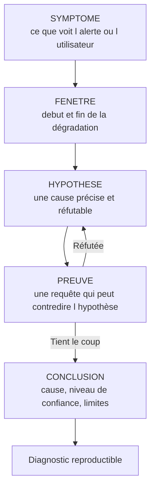
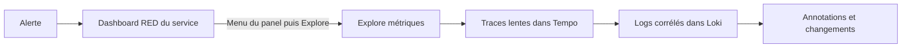

# Diagnostic d'incident avec Grafana

## Objectifs pédagogiques

À la fin de ce module, vous saurez :

- **appliquer** la boucle symptôme → hypothèse → preuve → conclusion sur un incident réel ou simulé ;
- **délimiter** une fenêtre temporelle fiable et la conserver d'un outil à l'autre ;
- **enchaîner** dashboards, Explore, logs et traces sans perdre le contexte de l'investigation ;
- **distinguer** le composant qui souffre de celui qui est à l'origine du problème, et tester une corrélation avant de la présenter comme une cause ;
- **rédiger** un diagnostic qu'un collègue peut rejouer et contester.

## Mise en situation

Vous êtes dans une équipe de six personnes qui exploite une plateforme e-commerce sur Kubernetes. Elle compte une douzaine de services : `checkout`, `inventory`, `payment`, `catalog` et d'autres. Grafana, Prometheus, Loki et Tempo sont en place, les alertes sont routées et le bruit est maîtrisé.

Un mardi à 14:07, l'alerte « p95 de `checkout` > 2 s » se déclenche. Le support remonte déjà des paniers qui n'aboutissent pas.

Le réflexe naïf est d'ouvrir le dashboard de `checkout`, de repérer une courbe de CPU qui monte et de redémarrer les pods. Ça peut même soulager quelques minutes. Mais `checkout` n'est que le service où le symptôme est visible. Un redémarrage efface en plus des preuves : les pods disparaissent avec leurs états internes, et vous ne saurez jamais ce qui s'est passé.

Ce module vous apprend à mener l'enquête avant d'agir. Les outils sont les mêmes que d'habitude, mais l'ordre dans lequel on les utilise change tout.

## Un diagnostic est une démonstration, pas une intuition

Un bon diagnostic est une petite démonstration que quelqu'un d'autre peut vérifier. Pour y arriver, on suit une boucle simple.



🧠 **Concept clé** — Une hypothèse utile est **réfutable**. « Il y a un problème de base de données » n'est pas testable. « Le pool de connexions de `inventory` est saturé depuis 14:02 » l'est : une requête suffit à dire oui ou non. Quand vous formulez une hypothèse, demandez-vous quelle courbe ou quel log vous prouverait que vous avez tort.

Chaque étape a un rôle précis :

- **Symptôme** : on décrit ce qui est observé, pas ce qu'on suppose. « La latence p95 de `checkout` passe de 400 ms à 3 s » est un symptôme. « `checkout` est surchargé » est déjà une interprétation.
- **Hypothèse** : on en formule une à la fois. Les tests croisés de trois pistes en parallèle produisent surtout de la confusion.
- **Preuve** : on cherche d'abord à *réfuter*. Un test qui ne peut pas échouer ne prouve rien.
- **Conclusion** : on écrit ce qu'on sait, ce qu'on suppose, et ce qu'on n'a pas pu vérifier.

Une hypothèse réfutée n'est pas un échec : elle élimine une piste et vous rapproche de la bonne.

## Délimiter la fenêtre temporelle

Avant toute hypothèse, il faut savoir *quand*. Le début de la dégradation est l'information la plus précieuse de l'enquête, car elle vous dit quels événements peuvent en être la cause : ceux qui l'ont précédée.

### Ne pas confondre l'heure de l'alerte et le début du problème

L'alerte se déclenche après la période d'évaluation. Si la règle exige « > 2 s pendant 5 minutes », la dégradation a commencé au moins 5 minutes avant la notification. Élargissez la vue, repérez où la courbe décroche réellement, puis notez cet instant.

### Verrouiller la plage

Une plage relative comme « Last 1 hour » glisse pendant que vous travaillez : ce que vous voyez à 14:20 n'est plus ce que vous regardiez à 14:10. Dès que vous avez identifié la zone utile, passez en plage absolue (sélecteur de temps → *Absolute time range*, ou sélection à la souris sur un graphique). Notez aussi le fuseau horaire : un dashboard en heure du navigateur et des logs lus en UTC produisent des décalages d'une ou deux heures, et des corrélations qui n'existent pas.

💡 **Astuce** — Dans les réglages du dashboard, passez *Graph tooltip* en *Shared crosshair* (ou *Shared tooltip*). En survolant un panel, un curseur vertical apparaît au même instant sur tous les autres. Vous voyez immédiatement quelle courbe bouge en premier.

### Comparer avec un état normal

Une valeur seule ne dit rien : 3 s est-il anormal pour ce service un mardi à 14 h ? Superposez la même métrique décalée d'un jour ou d'une semaine, soit avec `offset` en PromQL, soit avec l'option *Time shift* dans les *Query options* du panel (l'intitulé peut varier selon la version). Vous passez de « ça semble haut » à « c'est 7 fois la valeur habituelle à cette heure-ci ».

```promql
histogram_quantile(0.95, sum by (le) (rate(http_request_duration_seconds_bucket{service="checkout"}[5m])))
```

```promql
histogram_quantile(0.95, sum by (le) (rate(http_request_duration_seconds_bucket{service="checkout"}[5m] offset 1d)))
```

Affichez les deux dans le même panel : la première en trait plein, la seconde en pointillé.

## Passer des dashboards à Explore sans perdre le fil

Un dashboard répond bien à la question « où ça ne va pas ? », car il est construit à l'avance pour ça. Explore sert à la question suivante, que personne n'avait prévue : « pourquoi ? ». Le bon réflexe consiste à pivoter de l'un à l'autre sans repartir de zéro.



Quelques mécanismes font gagner un temps précieux :

- **Menu du panel → Explore** : la requête du panel et la plage de temps sont reprises. Vous pouvez alors modifier la requête librement, sans toucher au dashboard.
- **Split view dans Explore** : metrics à gauche, logs à droite. Le bouton de synchronisation du temps garde les deux sur la même plage.
- **Data links** : un lien configuré dans un panel peut ouvrir Explore ou un autre dashboard en transmettant des variables comme `${__field.labels.service}` ou la plage `${__url_time_range}`. C'est ce qui vous évite de recopier un nom de pod à la main.
- **Liens entre sources** : depuis un log, un *derived field* sur Loki ouvre la trace correspondante dans Tempo à partir du `trace_id`. Depuis une trace, le lien *trace to logs* ouvre les logs de la même période. Et si les applications émettent des exemplars, un point sur la courbe de latence mène directement à une trace représentative. Tout cela se configure dans les data sources ; l'emplacement des options dépend de la version.

⚠️ **Erreur fréquente** — Ces liens ne fonctionnent que si les noms de labels sont cohérents. Si Prometheus étiquette `service="checkout"` et que Loki étiquette `app="checkout"`, le pivot ne trouve rien, et on conclut à tort « pas de logs ». Corrigez le nom du label dans la configuration du lien ou, mieux, harmonisez les labels à la source.

## Corréler métriques, logs et traces

Les trois signaux répondent à des questions différentes, et c'est leur combinaison qui rend le diagnostic solide :

| Signal | Question à laquelle il répond | Outil d'entrée |
|--------|-------------------------------|----------------|
| Métriques | Combien ? Depuis quand ? Où ça dévie ? | Dashboard RED puis Explore |
| Traces | Où le temps est-il passé pour *une* requête ? | Tempo, via exemplar ou recherche |
| Logs | Que dit le composant précisément ? | Loki, filtré par service, par trace ou par période |

RED (Rate, Errors, Duration) est un bon point de départ pour un service : débit, taux d'erreur, durée. Les deux requêtes ci-dessous couvrent le débit et le taux d'erreur ; pour la durée, reprenez la requête p95 vue plus haut. Toutes sont à adapter à vos noms de métriques et de labels, qui dépendent de l'instrumentation de vos applications.

```promql
sum(rate(http_requests_total{service="checkout"}[5m]))
```

```promql
sum(rate(http_requests_total{service="checkout", status=~"5.."}[5m])) / sum(rate(http_requests_total{service="checkout"}[5m]))
```

Pour les traces, on cherche les cas lents plutôt qu'une trace au hasard. Dans Explore avec Tempo, TraceQL (Trace Query Language) le permet :

```
{ resource.service.name = "checkout" && duration > 2s }
```

Ici, `duration` est la durée de chaque span de `checkout` : la requête remonte les traces qui contiennent un tel span. Pour filtrer sur la durée totale de la trace, utilisez `traceDuration`. Ouvrez une trace dans cette liste. Le diagramme en cascade montre quel span accapare le temps. Si 90 % de la durée est dans l'appel à `inventory`, votre regard se déplace d'un service.

Les logs confirment ou contredisent ce que les traces suggèrent. Avec Loki, transformer les lignes en série temporelle évite de lire des milliers d'entrées :

```logql
sum by (error_type) (count_over_time({app="inventory"} | json | level="error" [1m]))
```

Si une nouvelle valeur de `error_type` apparaît à 14:02 et que tout était calme avant, vous avez un indice daté et précis.

## Analyser les changements récents

La plupart des incidents en production commencent par un changement : déploiement, modification de configuration, montée de version, pic de trafic, expiration de certificat. Dans votre fenêtre, la question devient : *qu'est-ce qui a bougé juste avant ?*

La meilleure réponse est de **rendre les changements visibles dans Grafana**. Les annotations affichent un trait vertical avec un texte sur tous les panels. Votre pipeline de déploiement peut en créer une avec l'API :

```bash
curl -X POST -H "Authorization: Bearer <TOKEN>" -H "Content-Type: application/json" \
  -d '{"text":"deploy <SERVICE> <VERSION>","tags":["deploy","<SERVICE>"]}' \
  https://<GRAFANA_HOST>/api/annotations
```

Sans champ `time`, l'annotation est datée de l'instant de l'appel. Ajoutez ensuite une annotation basée sur ce tag dans les réglages du dashboard. Le jeton doit venir d'un service account aux droits minimaux (voir le module d'administration).

Une autre source fiable est la métrique `build_info`. Par convention, beaucoup d'applications exposent une jauge à 1 avec la version en label, ce qui permet de voir l'évolution du parc :

```promql
count by (version) (app_build_info{service="inventory"})
```

Si deux versions coexistent dans la fenêtre, c'est un déploiement progressif, et vous venez de gagner un outil de comparaison, comme on le verra dans le cas pratique.

## Composant dégradé ou cause racine ?

🧠 **Concept clé** — Le composant où le symptôme *apparaît* n'est presque jamais celui où il *naît*. Dans une architecture distribuée, la lenteur se propage : un service lent à l'aval fait attendre tous ceux qui l'appellent, ce qui sature leurs threads, puis leurs files, puis leurs propres appelants.

Pensez à une file de caisses dans un supermarché. Si la cliente à la caisse 3 met dix minutes à payer, ce n'est pas la caisse 3 qui est cassée, c'est peut-être son terminal de carte. Quand toute la file se plaint, vous regardez la file, pas la cause.

La méthode pratique est de **descendre la chaîne des dépendances** :

1. `checkout` est lent. Ses ressources (CPU, mémoire) sont-elles saturées ? Si non, il attend probablement quelqu'un.
2. À qui attend-il ? La trace le dit : le plus gros span.
3. Ce service est-il lent *par lui-même* ou attend-il à son tour ? On refait le test.
4. On s'arrête quand on arrive à un composant dont les dépendances sont saines et qui, lui, a une anomalie observable : saturation, erreurs, changement.

Un composant est une bonne cause racine candidate quand ses dépendances à lui vont bien. Mais il s'agit encore d'une candidate : il reste à démontrer.

## ⚠️ Corrélation temporelle ≠ causalité

Voici le piège le plus coûteux de l'exploitation. Un déploiement a eu lieu à 13:58, la latence monte à 14:02 : la tentation de conclure est immense. Mais plusieurs choses ont pu se produire dans la même fenêtre : une campagne marketing, un job batch, une rotation de logs, une mise à jour du nœud.

Pour qu'une corrélation devienne un diagnostic, passez-la par ces tests :

- **L'ordre** : la cause précède-t-elle l'effet, avec un délai plausible ? Un déploiement à 13:58 ne peut pas expliquer une dégradation commencée à 13:40.
- **Le mécanisme** : pouvez-vous expliquer, en une phrase, *comment* A produit B ? Sans mécanisme, c'est un hasard jusqu'à preuve du contraire.
- **La contre-épreuve** : existe-t-il un groupe qui n'a pas subi A et qui va bien ? Pods restés sur l'ancienne version, une région non déployée, un autre tenant.
- **Les facteurs communs** : un troisième événement pourrait-il causer A et B à la fois ? Un pic de trafic peut provoquer à la fois un autoscaling, qui fait apparaître de nouveaux pods comme un changement, *et* de la latence.
- **L'intervention** : si la mesure corrective (rollback, désactivation d'un flag) est appliquée, le symptôme disparaît-il, et au bon moment ? C'est la preuve la plus forte, mais aussi la plus tardive.

La contre-épreuve est la plus accessible dans Grafana : découper une même métrique par version, par zone ou par nœud montre vite si le problème est partout ou localisé.

```promql
histogram_quantile(0.95, sum by (le, version) (rate(http_request_duration_seconds_bucket{service="<SERVICE>"}[5m])))
```

Deux courbes, une par version : si elles divergent exactement à l'heure du déploiement alors que le trafic est identique, vous venez d'obtenir une preuve bien plus forte qu'une simple coïncidence d'horaire.

## Rédiger un diagnostic reproductible

Un diagnostic qui n'existe que dans votre tête, ou dans une conversation de messagerie, est perdu à la fin de l'incident. Un bon écrit permet à quelqu'un d'autre de **refaire le chemin** et de constater la même chose. Il est aussi plus honnête, parce que l'écrire force à séparer les faits de l'interprétation.

Voici une trame qui fonctionne, sans prétention :

```markdown
## Incident <TITRE> — <DATE>

**Symptôme** : latence p95 checkout 3 s au lieu de 0,4 s, taux d'erreur 5xx 4 %.
**Fenêtre** : 14:02 → 14:41 UTC (plage absolue, lien Grafana ci-dessous).
**Hypothèse retenue** : saturation du pool de connexions de inventory v2.14.

**Preuves**
1. Traces lentes : 85 % du temps dans l'appel à inventory (lien Explore).
2. Pool inventory à 100 % depuis 14:02 (requête + lien).
3. p95 par version : v2.14 à 3 s, v2.13 à 0,5 s, même trafic (requête + lien).

**Hypothèses écartées**
- Pic de trafic : +15 % seulement, absorbé par v2.13.
- Ressources de checkout : CPU et mémoire normaux.

**Conclusion** : cause probable = régression dans inventory v2.14. Confiance : élevée.
**Non vérifié** : la requête exacte responsable (revue de code en cours).
**Action** : rollback de inventory vers v2.13 à 14:38 ; retour à la normale à 14:41.
```

Pour que les liens servent vraiment, utilisez la fonction de partage d'Explore (lien court ou lien avec plage absolue) et collez les requêtes dans le texte, car un lien peut casser si la source ou les dashboards changent. L'historique des requêtes d'Explore aide à retrouver ce que vous avez réellement lancé.

Remarquez les deux sections « Hypothèses écartées » et « Non vérifié » : elles valent autant que la conclusion. Elles évitent à l'équipe de refaire les mêmes tests et signalent honnêtement où le doute persiste.

## Erreurs fréquentes

Quelques situations reviennent régulièrement pendant les incidents. Pour chacune : symptôme → cause → correction.

- **Les courbes bougent pendant l'analyse.** Vous êtes sur une plage relative. Passez en plage absolue dès que la zone utile est identifiée.
- **Le déploiement semble arriver après le début de l'incident.** Dashboard en heure locale et logs ou pipeline en UTC. Vérifiez le fuseau du dashboard (*Timezone* dans ses réglages) et alignez tout sur UTC pour les investigations.
- **Aucune erreur visible alors que des utilisateurs se plaignent.** Une moyenne ou un p50 masque la queue de distribution, ou le taux d'erreur est calculé sur un label qui n'existe pas. Regardez p95 ou p99, et vérifiez qu'un `sum by` ne vous a pas fait perdre la dimension utile.
- **« No data » interprété comme « tout va bien ».** Un panel vide est une absence d'information, pas une bonne nouvelle : la cible a peut-être disparu, le label a changé après redéploiement, ou la source est en erreur. Vérifiez `up{job="<JOB>"}` et l'état de la data source avant de conclure.
- **Aucune trace trouvée pour la période.** L'échantillonnage peut conserver seulement une fraction des traces, ou ne garder que certaines requêtes. L'absence de trace n'est pas l'absence de requête lente : élargissez la fenêtre, ou croisez avec les métriques.
- **Le lien vers les logs ne retourne rien.** Labels différents entre Prometheus et Loki (`service` contre `app`), ou plage trop courte autour d'un instant précis. Vérifiez le nom du label et élargissez la plage de quelques minutes.
- **La courbe de CPU monte, on conclut que c'est la cause.** Le CPU peut monter *à cause* de la lenteur (threads qui tournent, retries). Cherchez qui varie en premier, avec le crosshair partagé.

## Cas pratique : checkout lent un mardi à 14:07

Ce scénario est illustratif, avec des valeurs inventées pour montrer le raisonnement.

**Symptôme.** L'alerte p95 de `checkout` se déclenche à 14:07. Le support signale des paniers bloqués.

**Fenêtre.** Le dashboard RED montre que la courbe décroche à 14:02, soit 5 minutes avant la notification, ce qui correspond à la durée d'évaluation de la règle. On verrouille la plage sur 13:30 – 15:00 UTC. La comparaison avec la veille (`offset 1d`) montre une latence 7 fois supérieure à l'habitude.

**Première hypothèse : `checkout` est saturé.** CPU et mémoire de ses pods sont normaux, et le débit n'a pas explosé. Hypothèse réfutée : `checkout` attend quelqu'un.

**Deuxième hypothèse : la lenteur vient d'un service en aval.** On cherche en TraceQL les traces de `checkout` de plus de 2 s. Sur la dizaine ouverte, 80 à 90 % du temps est passé dans le span d'appel à `inventory`. Hypothèse confirmée à ce niveau, mais on n'a trouvé qu'un composant dégradé, pas encore la cause.

**Descente de la chaîne.** Le dashboard d'`inventory` montre une latence en hausse depuis 14:02 et un pool de connexions à 100 %. Les logs, filtrés avec la requête `error_type` vue plus haut, révèlent une nouvelle valeur apparue à 14:02, `pool_timeout`. La base de données, elle, n'affiche ni CPU élevé ni erreurs. `inventory` est donc un bon candidat pour la cause racine.

**Changements récents.** Une annotation de déploiement apparaît à 13:58 : `inventory` v2.14. Mais une campagne marketing a aussi démarré à 14:00, et la tentation est forte de s'arrêter à la première coïncidence.

**Test de causalité.**

- Le trafic a augmenté de 15 % environ : insuffisant pour expliquer un pool saturé en quelques minutes.
- Le déploiement est progressif : 20 % des pods tournent encore en v2.13. En découpant la latence par `version`, v2.14 est à 3 s et v2.13 à 0,5 s, pour le même trafic.

La contre-épreuve est là. La régression est liée à la version, pas au pic de trafic.

**Conclusion.** Cause probable : régression dans `inventory` v2.14 qui consomme les connexions à la base de façon anormale. Confiance élevée. Ce qui reste à déterminer : le code précis en cause, renvoyé à l'équipe applicative. Rollback à 14:38, retour à la normale constaté à 14:41, ce qui constitue la dernière preuve, celle de l'intervention.

Le diagnostic a pris une quarantaine de minutes, sans redémarrer un seul pod de `checkout`. Il laisse une trace exploitable pour le post-mortem et pour la suite : une alerte sur la saturation du pool d'`inventory` aurait prévenu bien avant la latence côté `checkout`.

## Bonnes pratiques

- **Écrire le symptôme avant de regarder les courbes.** Une phrase factuelle avec des valeurs évite de choisir ensuite les graphiques qui confirment ce qu'on croit déjà.
- **Verrouiller la plage et le fuseau** dès qu'une zone est identifiée. Un lien Grafana sans plage absolue pourrira en quelques heures.
- **Annoter les déploiements automatiquement** depuis la CI/CD, avec un jeton de service account aux droits minimaux (restreindre le jeton à la seule écriture d'annotations exige le RBAC fin de Grafana Enterprise ou Cloud ; en OSS, il faut le rôle Editor). La sécurité de l'outil de diagnostic compte autant que celle des applications.
- **Réfuter avant de confirmer.** Cherchez la requête qui contredirait votre hypothèse. Si elle ne la contredit pas, vous avez de la confiance, pas une certitude.
- **Ne jamais agir en détruisant des preuves.** Avant un redémarrage ou un rollback, sauvegardez les liens Explore, une capture des panels et les logs de la période. Une remédiation idempotente et documentée peut se rejouer ; un geste dans l'urgence, non.
- **Harmoniser les labels entre métriques, logs et traces** (`service`, `namespace`, `version`) : c'est ce qui rend les pivots fiables.
- **Transformer chaque incident en amélioration.** Une requête qui vous a aidé devient un panel, un symptôme détecté trop tard devient une alerte, un lien manquant devient un data link.
- **Distinguer dans le rapport ce qui est démontré, supposé et non vérifié.** C'est ce qui rend le diagnostic crédible et utile à la prochaine personne.

## Résumé

Un incident se diagnostique comme une petite enquête : un symptôme factuel, une fenêtre temporelle verrouillée, une hypothèse réfutable, des preuves croisées entre métriques, traces et logs, puis une conclusion avec son niveau de confiance. Les dashboards situent le problème, Explore permet d'aller chercher le pourquoi, et les liens entre sources évitent de perdre le contexte. Le composant qui souffre n'est pas forcément la cause : on descend la chaîne des dépendances jusqu'à un composant dont l'aval est sain. Les changements récents sont les premiers suspects, mais une coïncidence horaire ne vaut jamais une preuve : il faut une contre-épreuve. Enfin, un diagnostic n'est utile que s'il est écrit de façon reproductible. Ce travail d'enquête repose sur des données de qualité, ce qui amène naturellement à la question de la manière dont ces données sont collectées et acheminées.

<!-- snippet
id: grafana_diag_method_loop
type: concept
tech: grafana
level: intermediate
importance: high
format: knowledge
tags: grafana,diagnostic,methode,incident
title: Boucle symptôme, hypothèse, preuve, conclusion
content: On décrit d'abord le symptôme avec des valeurs (p95 passé de 0,4 s à 3 s), puis on formule UNE hypothèse réfutable (pool de connexions saturé depuis 14:02), on cherche la requête qui pourrait la contredire, et on conclut en indiquant la confiance et ce qui n'est pas vérifié. Une hypothèse non testable par une requête n'en est pas une.
description: Le diagnostic suit une boucle : une hypothèse réfutable à la fois, testée par une requête précise, avec une conclusion qui nomme ses limites.
-->

<!-- snippet
id: grafana_diag_correlation_causality
type: warning
tech: grafana
level: intermediate
importance: high
format: knowledge
tags: grafana,diagnostic,causalite,incident
title: Corrélation temporelle n'est pas causalité
content: Piège : conclure qu'un déploiement à 13:58 est la cause d'une dégradation à 14:02 parce que les horaires coïncident. Conséquence : un rollback inutile pendant que le vrai facteur (pic de trafic, job batch) continue. Correction : chercher une contre-épreuve, par exemple découper la métrique par version ou par zone pour voir si les instances non touchées vont bien, et vérifier qu'un mécanisme explique le lien.
description: Une coïncidence d'horaire suggère une piste, rien de plus. Une contre-épreuve (même trafic, version différente) transforme la piste en preuve.
-->

<!-- snippet
id: grafana_diag_p95_by_version
type: command
tech: grafana
level: intermediate
importance: high
format: knowledge
tags: grafana,promql,latence,deploiement
title: Comparer la latence p95 par version
context: À saisir dans Explore ou un panel Prometheus, pendant un déploiement progressif
command: histogram_quantile(0.95, sum by (le, version) (rate(http_request_duration_seconds_bucket{service="<SERVICE>"}[5m])))
example: histogram_quantile(0.95, sum by (le, version) (rate(http_request_duration_seconds_bucket{service="inventory"}[5m])))
description: Une courbe par version pour le même trafic : si l'une diverge au moment du déploiement, on a une contre-épreuve solide. Le label version dépend de votre instrumentation.
-->

<!-- snippet
id: grafana_diag_offset_baseline
type: tip
tech: grafana
level: intermediate
importance: medium
format: knowledge
tags: grafana,promql,baseline,comparaison
title: Comparer à l'état normal avec offset 1d
content: Dans le même panel, ajouter une seconde requête identique avec `offset 1d` (ou `offset 7d`) pour afficher la valeur de la veille en pointillé, ou utiliser Query options → Time shift. On passe de « la latence semble haute » à « elle est 7 fois supérieure à hier à la même heure ».
description: Superposer la même métrique décalée d'un jour ou d'une semaine donne un point de référence objectif, sans aller chercher une période normale à la main.
-->

<!-- snippet
id: grafana_diag_absolute_time_utc
type: tip
tech: grafana
level: intermediate
importance: medium
format: knowledge
tags: grafana,fenetre-temporelle,fuseau,investigation
title: Verrouiller la plage en absolu et en UTC
content: Dès que la zone utile est trouvée, passer le sélecteur de temps en Absolute time range (ou sélectionner la zone à la souris) et fixer le fuseau du dashboard sur UTC dans ses réglages. Une plage relative comme Last 1 hour glisse pendant l'analyse, et un fuseau local face à des logs en UTC décale les événements d'une ou deux heures.
description: Plage relative et fuseaux mélangés créent des corrélations fantômes. Une plage absolue en UTC rend l'enquête stable et partageable.
-->

<!-- snippet
id: grafana_diag_logql_error_type
type: command
tech: grafana
level: intermediate
importance: medium
format: knowledge
tags: grafana,loki,logql,erreurs
title: Compter les erreurs par type dans Loki
context: Dans Explore avec la data source Loki
command: sum by (error_type) (count_over_time({app="<APP>"} | json | level="error" [1m]))
example: sum by (error_type) (count_over_time({app="inventory"} | json | level="error" [1m]))
description: Transforme les logs en série temporelle pour repérer à la minute près l'apparition d'un nouveau type d'erreur. Suppose des logs JSON avec un champ error_type.
-->

<!-- snippet
id: grafana_diag_traceql_slow
type: command
tech: grafana
level: intermediate
importance: medium
format: knowledge
tags: grafana,tempo,traceql,latence
title: Retrouver les traces lentes d'un service
context: Dans Explore avec la data source Tempo, onglet TraceQL
command: { resource.service.name = "<SERVICE>" && duration > <DUREE> }
example: { resource.service.name = "checkout" && duration > 2s }
description: Remonte les traces contenant un span du service plus long que le seuil (`duration` porte sur le span ; pour la durée totale de la trace, utiliser `traceDuration`). Le diagramme en cascade révèle quel span concentre le temps et donc quel service regarder ensuite.
-->

<!-- snippet
id: grafana_diag_root_cause_downstream
type: concept
tech: grafana
level: intermediate
importance: high
format: knowledge
tags: grafana,diagnostic,cause-racine,dependances
title: Composant dégradé ou cause racine
content: Le service où l'alerte se déclenche attend souvent un service en aval : sa latence est un effet de propagation. On descend la chaîne d'appels (trace → plus gros span → ce service attend-il à son tour ?) jusqu'à un composant dont les dépendances sont saines et qui présente une anomalie propre : saturation, erreurs, changement récent.
description: La lenteur se propage vers l'amont. On suit les dépendances jusqu'au premier composant sain en aval, c'est lui le candidat à la cause racine.
-->

<!-- snippet
id: grafana_diag_annotation_deploy
type: command
tech: grafana
level: intermediate
importance: medium
format: knowledge
tags: grafana,annotations,deploiement,api
title: Annoter un déploiement via l'API Grafana
context: À appeler depuis la CI/CD avec un jeton de service account aux droits minimaux (rôle Editor en OSS ; restriction aux seules annotations avec le RBAC fin d'Enterprise/Cloud)
command: curl -X POST -H "Authorization: Bearer <TOKEN>" -H "Content-Type: application/json" -d '{"text":"deploy <SERVICE> <VERSION>","tags":["deploy","<SERVICE>"]}' https://<GRAFANA_HOST>/api/annotations
example: curl -X POST -H "Authorization: Bearer glsa_xxx" -H "Content-Type: application/json" -d '{"text":"deploy inventory v2.14","tags":["deploy","inventory"]}' https://grafana.example.com/api/annotations
description: Crée un trait vertical daté sur les panels configurés pour afficher ce tag. Sans champ time, l'annotation est datée de l'instant de l'appel.
-->

<!-- snippet
id: grafana_diag_no_data_not_ok
type: error
tech: grafana
level: intermediate
importance: high
format: knowledge
tags: grafana,no-data,diagnostic,monitoring
title: Un panel vide n'est pas un service sain
content: Symptôme : aucune erreur visible, le panel affiche No data alors que des utilisateurs se plaignent. Cause possible : cible disparue après redéploiement, label renommé, data source en erreur. Correction : vérifier `up{job="<JOB>"}` et l'état de la data source avant de conclure que tout va bien.
description: No data signifie absence d'information, pas absence de problème. Vérifier up{} et la data source avant d'écarter une piste.
-->

<!-- snippet
id: grafana_diag_report_reproducible
type: tip
tech: grafana
level: intermediate
importance: medium
format: knowledge
tags: grafana,diagnostic,documentation,post-mortem
title: Documenter un diagnostic rejouable
content: Dans le rapport, coller chaque requête PromQL, LogQL ou TraceQL utilisée avec son lien court Explore (plage absolue) et ajouter deux sections : « Hypothèses écartées » et « Non vérifié ». Un lien peut casser, donc la requête doit être dans le texte et pas seulement derrière le lien.
description: Un diagnostic utile liste ses requêtes, ses plages absolues, ses pistes écartées et ses limites, pour qu'un collègue puisse refaire le chemin.
-->
