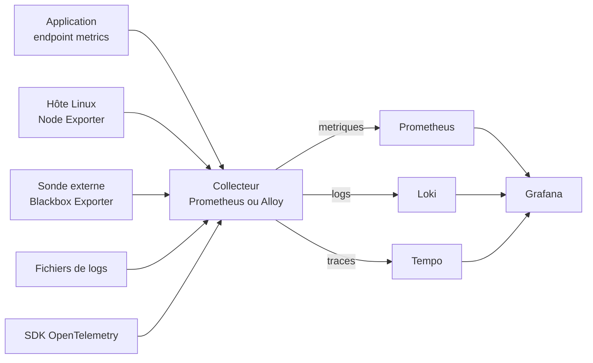
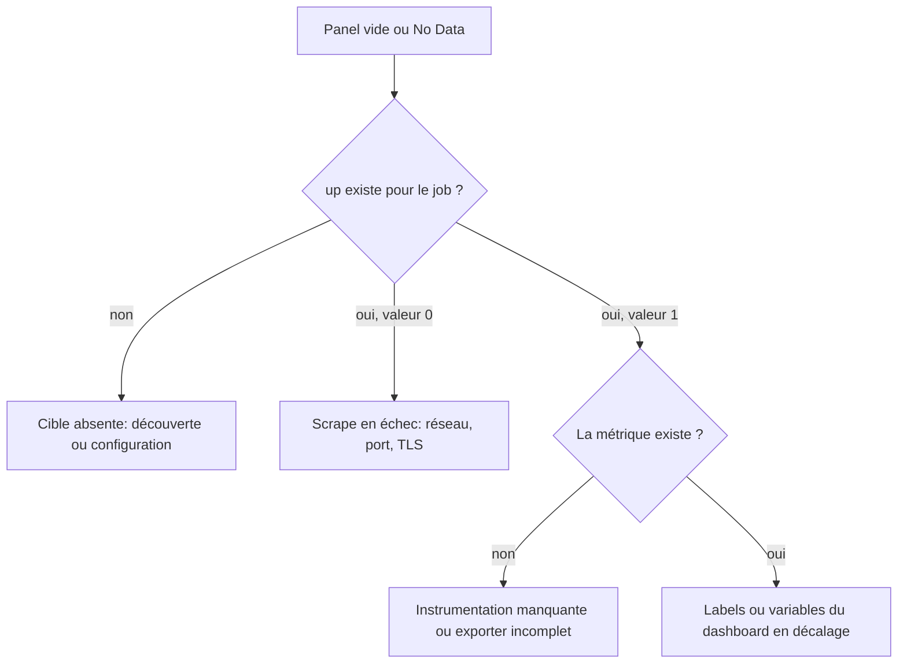

# Collecte et intégration des données

## Objectifs pédagogiques

- Reconstituer la chaîne instrumentation → collecte → backend → Grafana et situer chaque composant dans cette chaîne.
- Déployer Node Exporter et Blackbox Exporter, puis vérifier que Prometheus les scrape correctement.
- Lire un endpoint `/metrics` et reconnaître les éléments du format d'exposition Prometheus.
- Configurer Grafana Alloy pour collecter métriques et logs, et recevoir des traces au format OpenTelemetry.
- Appliquer une convention de labels `service` / `env` et diagnostiquer une rupture de collecte de la source jusqu'au panel.

## Mise en situation

Une équipe de six personnes exploite une plateforme de commande en ligne : une API, un worker et une base PostgreSQL, répartis sur huit machines Linux. Un Grafana a été installé le mois dernier. Quelqu'un a importé un joli dashboard « Node Exporter Full » trouvé en ligne, et tout le monde a considéré que la supervision était faite.

Puis la machine `worker-03` sature son disque un vendredi soir. Le dashboard n'affiche rien pour elle : jamais personne n'y a installé quoi que ce soit. Le lundi, on s'aperçoit aussi qu'aucune métrique ne vient de l'API elle-même, et que les logs se lisent encore avec `ssh` et `tail`.

Le problème n'est pas Grafana, c'est tout ce qui se passe en amont. Grafana est une fenêtre, et personne n'avait construit la pièce derrière. Ce module est consacré à cette pièce : qui produit les données, qui les récupère, où elles sont stockées, et comment on sait que la chaîne tient.

## Ce que fait vraiment la chaîne de collecte

> 🧠 **Concept clé** — Grafana n'ingère rien. Il interroge des backends (Prometheus, Loki, Tempo) qui ont eux-mêmes reçu leurs données d'un collecteur, lequel les a obtenues auprès de quelque chose d'instrumenté. Si un maillon casse, le panel reste vide, mais la cause est rarement dans le panel.
{: .callout .callout-important}

Quatre étages, donc :

1. **Instrumentation** : le code ou l'agent qui produit la donnée (un SDK dans l'application, Node Exporter sur l'hôte, un fichier de log).
2. **Collecte** : le composant qui va chercher ou reçoit la donnée (Prometheus qui scrape, Alloy, un collecteur OpenTelemetry).
3. **Backend** : le stockage interrogeable (Prometheus pour les métriques, Loki pour les logs, Tempo pour les traces).
4. **Grafana** : la couche d'interrogation et de visualisation.



Qui appelle qui ? Cette question, celle de la direction des flux, change la façon de raisonner :

- **Pull** pour les métriques : par défaut, c'est Prometheus qui appelle périodiquement chaque cible, typiquement toutes les 15 à 60 secondes.
- **Push** pour les logs et les traces : l'agent envoie vers Loki ou Tempo.

> 💡 **À retenir.** La différence a des conséquences directes en diagnostic. Avec le pull, une cible morte se voit tout de suite, parce que le scrape échoue. Avec le push, un émetteur qui se tait ne produit... rien, et le silence ressemble à un système en bonne santé.
{: .callout .callout-important}

## Les briques et leur rôle

| Composant | Rôle | Port par défaut | Exemple d'usage |
|---|---|---|---|
| Node Exporter | Expose les métriques de l'hôte Linux (CPU, mémoire, disque, réseau) | 9100 | `node_filesystem_avail_bytes` |
| Blackbox Exporter | Sonde de l'extérieur : HTTP, TCP, ICMP, DNS | 9115 | `probe_success` d'une URL publique |
| Endpoint applicatif | Métriques métier ou techniques exposées par l'appli | variable | `http_requests_total` |
| Prometheus | Scrape, stocke, évalue des règles | 9090 | `up{job="node"}` |
| Grafana Alloy | Agent unique : scrape, lecture de logs, réception OTLP, envoi | 12345 (interface) | Un agent par hôte |
| Loki | Stockage de logs indexés par labels | 3100 | `{service="api", env="prod"}` |
| Tempo | Stockage de traces | 3200 (API), 4317/4318 (OTLP) | Trace d'une requête lente |

Ces ports sont les valeurs par défaut ; ils changent selon l'installation. Plutôt que de les supposer, vérifiez-les chez vous avec `ss -tlnp`.

## Les sources de métriques : trois angles différents

### Node Exporter : l'hôte vu de l'intérieur

Node Exporter lit `/proc` et `/sys` et publie le résultat en HTTP. C'est la base de toute supervision de machine, et il est volontairement bête : il ne stocke rien, ne pousse rien, ne décide de rien.

```bash
# Vérifier que l'exporter répond, avant même de penser à Prometheus
curl -s http://localhost:9100/metrics | head -20
curl -s http://localhost:9100/metrics | grep '^node_memory_MemAvailable_bytes'
```

### Blackbox Exporter : l'utilisateur vu de l'extérieur

Node Exporter vous dit que la machine va bien, pas que le service répond. Une API peut tourner sur un hôte parfaitement sain et renvoyer des 502 aux clients. Blackbox Exporter comble ce trou : vous lui donnez une cible, il la sonde comme le ferait un client et vous renvoie `probe_success`, `probe_duration_seconds`, le code HTTP, l'expiration du certificat TLS.

Il s'utilise de façon un peu particulière : on ne le scrape pas lui-même, on lui passe la cible en paramètre.

```bash
curl -s "http://<BLACKBOX_HOST>:9115/probe?target=<URL>&module=http_2xx" | grep -E '^probe_(success|http_status_code|duration_seconds)'
```

Côté Prometheus, la configuration demande un petit détour de relabeling pour que la cible sondée devienne le paramètre `target` et que l'exporter reste l'adresse réellement contactée :

```yaml
scrape_configs:
  - job_name: blackbox_http
    metrics_path: /probe
    params:
      module: [http_2xx]
    static_configs:
      - targets:
          - https://shop.example.com/health
    relabel_configs:
      - source_labels: [__address__]
        target_label: __param_target
      - source_labels: [__param_target]
        target_label: instance
      - target_label: __address__
        replacement: <BLACKBOX_HOST>:9115
```

> 💡 **Astuce** — Quand les probes ne marchent pas, testez d'abord l'URL `/probe?...&debug=true` dans un navigateur. Blackbox y affiche les logs détaillés de la sonde, ce qui évite de deviner si le problème vient de la résolution DNS, du certificat ou du code HTTP attendu.
{: .callout .callout-astuce}

### Les métriques applicatives : ce que seul le code sait

Ni Node Exporter ni Blackbox ne connaissent le nombre de commandes validées par minute ou la latence de votre requête SQL la plus lente. Ça, c'est l'application qui doit le dire, via une bibliothèque cliente Prometheus ou un SDK OpenTelemetry, en exposant un endpoint `/metrics`. Le format est du texte brut, facile à lire :

```text
# HELP http_requests_total Nombre de requêtes HTTP traitées
# TYPE http_requests_total counter
http_requests_total{method="GET",route="/orders",status="200"} 10432
http_requests_total{method="GET",route="/orders",status="500"} 17
# HELP http_request_duration_seconds Durée des requêtes
# TYPE http_request_duration_seconds histogram
http_request_duration_seconds_bucket{route="/orders",le="0.1"} 9800
http_request_duration_seconds_bucket{route="/orders",le="0.5"} 10300
http_request_duration_seconds_bucket{route="/orders",le="+Inf"} 10449
```

Chaque ligne est un nom, des labels entre accolades et une valeur. Les lignes `# HELP` et `# TYPE` documentent la métrique. Retenez cette lecture à l'œil : quand un panel est vide, c'est ici qu'on regarde en premier si la métrique existe et sous quel nom exact.

> ⚠️ **Erreur fréquente** — Mettre un identifiant à forte variabilité en label (`user_id`, `order_id`, URL complète avec paramètres). Chaque valeur distincte crée une série temporelle séparée, et la mémoire de Prometheus explose. Correction : garder pour les labels des valeurs bornées (méthode, route normalisée, code de statut), et mettre les identifiants dans les logs ou les traces.
{: .callout .callout-attention}

## Grafana Alloy : un agent plutôt que cinq

Avec huit machines, installer Node Exporter, Promtail ou un équivalent pour les logs, et un collecteur OpenTelemetry sur chacune, ça fait vite trois ou quatre processus à maintenir, à mettre à jour et à surveiller par hôte. Grafana Alloy répond à ce problème : c'est une distribution du collecteur OpenTelemetry qui sait aussi parler Prometheus et Loki. Un seul binaire, un seul fichier de configuration.

Sa logique repose sur des **composants** que l'on chaîne entre eux. Chaque composant a une entrée et une sortie, et on connecte les sorties aux entrées avec `forward_to`.

> 🔧 **Analogie : un jeu de tuyaux.** Une source, éventuellement des filtres au milieu, puis un puits ; `forward_to` joue le rôle du raccord. Limite de l'image : `forward_to` accepte une liste, donc une sortie peut alimenter plusieurs destinations à la fois.
{: .callout .callout-analogie}

```alloy
// Métriques de l'hôte, sans installer Node Exporter séparément
prometheus.exporter.unix "hote" { }

prometheus.scrape "hote" {
  targets    = prometheus.exporter.unix.hote.targets
  forward_to = [prometheus.remote_write.central.receiver]
}

prometheus.remote_write "central" {
  endpoint {
    url = "http://<PROMETHEUS_HOST>:9090/api/v1/write"
  }
  external_labels = {
    env = "prod",
  }
}

// Logs d'un fichier
local.file_match "api" {
  path_targets = [{
    "__path__" = "/var/log/api/*.log",
    "service"  = "api",
    "env"      = "prod",
  }]
}

loki.source.file "api" {
  targets    = local.file_match.api.targets
  forward_to = [loki.write.central.receiver]
}

loki.write "central" {
  endpoint {
    url = "http://<LOKI_HOST>:3100/loki/api/v1/push"
  }
}
```

Alloy expose une petite interface sur le port 12345 de la machine où il tourne : on y voit chaque composant, son état de santé et ses arguments. C'est le premier endroit où regarder quand un pipeline ne rend rien.

Les noms de composants et la syntaxe évoluent entre les versions d'Alloy, et le remote write vers Prometheus demande que celui-ci soit lancé avec l'option qui active le récepteur (`--web.enable-remote-write-receiver`). Contrôlez la documentation de votre version avant de copier une configuration.

## Logs et traces avec OpenTelemetry

OpenTelemetry (OTel) est un standard ouvert pour produire et transporter métriques, logs et traces. Son transport principal est OTLP, accessible en gRPC sur le port 4317 et en HTTP sur le 4318 par convention. L'intérêt pour vous ? L'application n'a plus besoin de savoir où se trouve Tempo : elle envoie à l'agent local, qui s'occupe du reste.

> 📖 **Définition.** OTLP (OpenTelemetry Protocol) est le protocole de transport standard d'OpenTelemetry : il définit comment sont encodées et envoyées les trois sortes de télémétrie entre émetteur et récepteur.
{: .callout .callout-definition}

Côté application, la configuration tient souvent en trois variables d'environnement :

```bash
export OTEL_SERVICE_NAME=api
export OTEL_EXPORTER_OTLP_ENDPOINT=http://localhost:4318
export OTEL_RESOURCE_ATTRIBUTES=deployment.environment=prod
```

Côté Alloy, on déclare un récepteur OTLP, un traitement par lots (qui évite d'envoyer chaque span un par un), puis un exporteur vers Tempo :

```alloy
otelcol.receiver.otlp "app" {
  grpc { endpoint = "0.0.0.0:4317" }
  http { endpoint = "0.0.0.0:4318" }
  output {
    traces = [otelcol.processor.batch.defaut.input]
  }
}

otelcol.processor.batch "defaut" {
  output {
    traces = [otelcol.exporter.otlp.tempo.input]
  }
}

otelcol.exporter.otlp "tempo" {
  client {
    endpoint = "<TEMPO_HOST>:4317"
    tls { insecure = true }   // laboratoire uniquement
  }
}
```

Pour les logs, deux voies coexistent. La plus simple consiste à lire des fichiers avec `loki.source.file`, comme plus haut. La seconde fait passer les logs par OTLP, ce qui permet de les corréler avec les traces via le même `trace_id`. Commencez par la première ; passez à la seconde quand vous avez besoin de sauter d'un log à sa trace dans Grafana.

> ⚠️ **Erreur fréquente** — Laisser `insecure = true` ou un récepteur OTLP ouvert sur `0.0.0.0` en production. N'importe quel hôte du réseau peut alors injecter de la fausse télémétrie. Correction : lier le récepteur à `127.0.0.1` quand l'agent est local, ou activer TLS et une authentification quand il reçoit depuis d'autres machines.
{: .callout .callout-attention}

## Les labels : le contrat entre les maillons

Les labels sont la colle de tout le système. Un dashboard filtre sur `env="prod"`, une alerte regroupe par `service`, un lien depuis un log vers une trace se base sur des labels communs. Si le label `env` s'appelle `environment` chez l'un et `stage` chez l'autre, aucune requête ne fonctionne sur l'ensemble.

Prometheus ajoute automatiquement `job` et `instance`. Pour le reste, il faut décider d'une convention **avant** de déployer, et la tenir partout. Une base raisonnable :

| Label | Valeurs | Remarque |
|---|---|---|
| `service` | `api`, `worker`, `postgres` | Nom logique, pas le nom de la machine |
| `env` | `prod`, `staging`, `dev` | Liste fermée, minuscules |
| `instance` | `worker-03:9100` | Rempli automatiquement, ne pas le réutiliser pour un autre sens |

Côté OpenTelemetry, l'équivalent s'appelle les attributs de ressource : `service.name` et `deployment.environment` (selon la version des conventions sémantiques, ce dernier peut s'appeler `deployment.environment.name`). Alloy, Loki et Tempo savent les convertir en labels, mais leur nom final dépend de la version et de la configuration : vérifiez dans Explore comment ils apparaissent réellement.

> 💡 **Astuce** — Pour auditer rapidement, ouvrez Explore, source Prometheus, et tapez `count by (env, service) (up)`. Si vous voyez des `env` en double (`prod`, `production`, `Prod`), vous savez déjà où se situent les incohérences.
{: .callout .callout-astuce}

## Construire la chaîne par étapes

### v1 : Prometheus et Node Exporter, rien de plus

Le minimum utile : un Node Exporter sur chaque machine et un Prometheus qui les appelle.

```yaml
# prometheus.yml
global:
  scrape_interval: 30s

scrape_configs:
  - job_name: node
    static_configs:
      - targets: ["worker-03:9100", "api-01:9100"]
        labels:
          env: prod
```

```bash
promtool check config prometheus.yml
```

La vérification se fait dans l'interface Prometheus, page **Status → Targets** : chaque cible doit être `UP`. Puis, dans Grafana → Explore, `up{job="node"}` doit renvoyer `1` pour chaque machine. Tant que ce n'est pas le cas, inutile de construire des dashboards.

Cette version a deux limites : les cibles sont écrites à la main (une machine ajoutée est une machine oubliée), et il n'y a ni logs, ni traces, ni vue extérieure.

### v2 : Alloy sur chaque hôte, sonde externe, logs

On remplace Node Exporter par Alloy (qui intègre ses propres collecteurs système), on ajoute Blackbox Exporter sur une machine de sonde, et on envoie les logs vers Loki. Le saut se justifie par la maintenance : un seul agent à déployer, un seul fichier à versionner, et les logs arrivent enfin dans Grafana. Les labels `service` et `env` sont posés dès la source, dans la configuration Alloy.

Deux conséquences sont à anticiper :

- les métriques de `prometheus.exporter.unix` ne portent pas `job="node"` par défaut : vérifiez le label réel dans Explore, puis réalignez-le par relabeling ou adaptez alertes et dashboards ;
- comme Alloy pousse en `remote_write`, un agent arrêté n'envoie plus aucun `up` : l'avantage du pull disparaît, et seule une alerte d'absence ou de comptage le détecte.

### v3 : un point d'entrée OTLP et un contrôle de la chaîne elle-même

Les applications envoient leurs traces à l'Alloy local ou à un collecteur central sur 4317/4318. Les labels sont normalisés par relabeling à un seul endroit plutôt que chez chaque équipe. Surtout, on ajoute la surveillance de la collecte : une alerte sur `up == 0`, et une autre qui compare le nombre de séries `up` au nombre de cibles attendues, parce qu'une cible qui disparaît de la configuration ne produit plus de `up` du tout. `absent(up{job="<JOB>"})` ne se déclenche, lui, que si toutes les cibles du job disparaissent. Le passage de v2 à v3 ne rajoute pas de données, il rend les trous visibles.

## Choisir son collecteur

| Critère | Prometheus seul | Alloy | Collecteur OTel générique |
|---|---|---|---|
| Métriques par scrape | Natif | Oui | Oui, via récepteur Prometheus |
| Logs de fichiers | Non | Oui | Possible, plus verbeux |
| Traces OTLP | Non | Oui | Oui |
| Un seul agent par hôte | Non | Oui | Oui |
| Courbe d'apprentissage | Faible | Moyenne (nouvelle syntaxe) | Moyenne |
| Écosystème Grafana | Complémentaire | Pensé pour | Compatible |

Quelques cas concrets :

- **Petite équipe, métriques d'hôtes seulement** : Prometheus et Node Exporter suffisent très bien, sans ajouter de couche.
- **Logs, traces et plusieurs dizaines de machines** : Alloy se justifie par le gain de maintenance.
- **Collecteur OpenTelemetry et pipelines déjà standardisés dans votre organisation** : gardez-les plutôt que d'introduire un second outil.

Le modèle pull atteint ses limites avec les jobs éphémères (un script batch de 10 secondes ne sera jamais scrapé à temps) et avec les cibles derrière un NAT que Prometheus ne peut pas joindre. Dans le premier cas, on regarde du côté du Pushgateway avec ses contraintes propres ; dans le second, on passe à un agent qui pousse en `remote_write`, comme Alloy.

## ⚠️ Installer un dashboard ne crée pas les métriques manquantes

C'est le piège du début de ce module, et il mérite sa propre section. Importer un dashboard communautaire (par exemple « Node Exporter Full ») prend trente secondes et donne une impression de supervision. Mais un dashboard n'est qu'un ensemble de requêtes enregistrées. Chaque panel pose une question à un backend ; si celui-ci n'a pas la donnée, la réponse est vide.

Trois situations différentes produisent le même symptôme visuel (panels vides ou `No Data`) :

- **La métrique n'existe pas.** Aucun exporter n'est installé sur l'hôte, ou l'application n'est pas instrumentée.
- **La métrique existe sous un autre nom.** Le dashboard attend `node_memory_MemAvailable_bytes`, votre exporter est d'une version qui publie autre chose, ou un préfixe a été ajouté.
- **La métrique existe mais les labels ne correspondent pas.** Le dashboard filtre sur `job="node"` ou sur une variable `$instance`, et votre scrape s'appelle `job="linux-hosts"`.

Avant d'importer un dashboard, prenez l'habitude d'ouvrir sa définition (Dashboard settings → JSON Model) ou un panel (Edit → requête) et de relever les noms de métriques et les labels exigés. Collez ensuite chaque nom dans Explore. Si la requête ne renvoie rien, vous savez quelle brique de collecte il manque, avant d'avoir perdu une heure à « corriger le dashboard ».

## Diagnostiquer une rupture de collecte

Le module précédent portait sur la démarche d'investigation d'un incident applicatif. Ici le sujet est plus étroit : les données ont cessé d'arriver, et il faut trouver à quel étage de la chaîne.

On remonte de Grafana vers la source, et on commence par la métrique `up`, que Prometheus génère lui-même pour chaque cible.



Les cas les plus fréquents, en symptôme → cause → correction :

| Symptôme | Cause probable | Vérification et correction |
|---|---|---|
| `up == 0` sur une cible | Processus arrêté, port filtré, mauvais port | `curl http://<HOTE>:<PORT>/metrics` depuis la machine Prometheus ; si ça échoue, vérifier `systemctl status` et le pare-feu |
| Cible `UP` mais panel vide | Nom de label différent (`job`, `env`) ou variable de dashboard mal alimentée | Comparer le label réel dans Explore avec celui attendu par la requête du panel |
| Les données s'arrêtent à une heure précise | Agent ou exporter redémarré sans activation au boot, ou config rechargée avec erreur | `journalctl -u <SERVICE> --since "<HEURE>"`, puis `systemctl enable` |
| Métriques présentes mais logs absents | Chemin de fichier faux, droits de lecture, ou pipeline Alloy cassé | Interface Alloy (port 12345) : état du composant `loki.source.file` ; `ls -l` sur le fichier de log |
| Traces absentes alors que l'appli tourne | Variable `OTEL_EXPORTER_OTLP_ENDPOINT` absente, mauvais protocole (gRPC sur 4318 au lieu de HTTP) | Vérifier le port, `ss -tlnp \| grep 431` côté agent, logs du SDK |
| Une métrique disparaît d'un coup | Renommage dans l'application après un déploiement | Chercher le nouveau nom avec le navigateur de métriques d'Explore |

> ⚠️ **Erreur fréquente** — Se fier à l'absence d'alerte comme preuve que tout va bien. Si une cible disparaît de la configuration, plus aucun `up` n'est produit, donc `up == 0` ne se déclenche jamais. Correction : ajouter, en complément, une alerte qui compare `count(up{job="<JOB>"})` au nombre de cibles attendues. `absent(up{job="<JOB>"})` ne couvre que la disparition de toutes les cibles du job.
{: .callout .callout-attention}

Un petit rituel de vérification, dans l'ordre :

1. L'endpoint répond-il au `curl` ?
2. Prometheus (ou Alloy) le voit-il comme `UP` ?
3. La métrique est-elle interrogeable dans Explore ?
4. Le panel utilise-t-il les mêmes noms et labels ?

Ces quatre questions couvrent l'essentiel des ruptures.

## Scénario illustratif : de la supervision décorative à la chaîne contrôlée

Reprenons l'équipe de la mise en situation, avec des chiffres purement illustratifs. Huit machines, un dashboard importé, aucune donnée sur l'API.

Elle procède par étapes. D'abord, Alloy est déployé via Ansible sur les huit hôtes, avec un fichier de configuration unique et des labels `env` et `service` injectés par variables. Ensuite, un Blackbox Exporter est placé sur une machine externe et sonde l'URL `/health` de l'API et la page de paiement toutes les 30 secondes. L'API expose enfin un endpoint `/metrics` avec requêtes, erreurs et latence, et envoie des traces en OTLP vers l'Alloy local.

La règle ajoutée en dernier est la plus rentable : une alerte sur `up == 0` et une qui compare `count(up{job="<JOB>"})` aux huit hôtes attendus, avec un tableau de bord « Santé de la collecte » qui liste chaque cible attendue.

Résultat attendu dans ce scénario : le remplissage du disque d'un worker est désormais visible dans Grafana pendant qu'il progresse, plutôt que découvert le lundi matin. Un hôte dont l'agent s'arrête fait baisser le comptage des cibles et déclenche l'alerte correspondante. Le gain ne vient pas d'un meilleur dashboard, mais du fait que chaque donnée a désormais un chemin vérifié jusqu'à l'écran.

## Bonnes pratiques

- **Écouter sur l'interface interne uniquement.** Node Exporter sur le port 9100 donne la liste des services, des points de montage et de la mémoire de la machine. Liez-le à l'interface privée (`--web.listen-address=<IP_PRIVEE>:9100`) et filtrez au pare-feu ; pour un accès à travers un réseau non maîtrisé, activez TLS et l'authentification de base via le fichier de configuration web des exporters.
- **Versionner la configuration de collecte.** Le fichier Alloy, `prometheus.yml` et les modules Blackbox appartiennent à Git et se déploient par Ansible ou un outil équivalent. Une configuration éditée à la main sur un serveur est indétectable lors d'une dérive, et un redéploiement identique doit toujours donner le même résultat.
- **Valider avant de recharger.** `promtool check config` pour Prometheus, la validation de syntaxe d'Alloy au démarrage de la nouvelle configuration : une erreur de syntaxe ne doit jamais arrêter la collecte sans que vous l'ayez vue.
- **Fixer la convention de labels une fois pour toutes.** `service` et `env` sont obligatoires, avec une liste fermée de valeurs. Documentez-la dans le dépôt, et corrigez à la source plutôt qu'avec des `label_replace` dans chaque requête.
- **Surveiller la collecte comme un service.** Alerte sur `up == 0`, alerte sur `absent()`, et un panel qui compare le nombre de cibles attendues au nombre de cibles actives. C'est ce qui sépare une supervision qui informe d'une supervision qui rassure sans fondement.
- **Maîtriser la cardinalité dès l'instrumentation.** Pas d'identifiant utilisateur ou de requête complète en label. Un label dont le nombre de valeurs croît avec le trafic n'a pas sa place dans une métrique.
- **Épingler les versions.** Un changement de nom de métrique entre deux versions d'un exporter casse silencieusement les dashboards et les alertes. Testez la montée de version sur un hôte avant de la généraliser.

<!-- snippet
id: grafana_collecte_chaine_pull_push
type: concept
tech: grafana
level: intermediate
importance: high
format: knowledge
tags: collecte,prometheus,loki,architecture
title: Pull pour les métriques, push pour logs et traces
content: Prometheus appelle lui-même chaque cible (pull) à intervalle fixe, souvent 15 à 60 s. Loki et Tempo reçoivent au contraire des données envoyées par un agent (push). Conséquence : une cible de métriques morte fait échouer le scrape et produit up=0, alors qu'un émetteur de logs ou de traces arrêté ne produit aucun signal. Il faut donc surveiller explicitement l'absence de données côté logs et traces.
description: Pull et push n'échouent pas de la même façon : un scrape raté se voit via up, un agent de logs silencieux ne laisse aucune trace
-->

<!-- snippet
id: grafana_collecte_node_exporter_verifier
type: command
tech: grafana
level: beginner
importance: high
format: knowledge
tags: node-exporter,metrics,curl,verification
title: Vérifier directement l'endpoint d'un exporter
context: À exécuter depuis la machine qui scrape (Prometheus ou Alloy), pour tester aussi le chemin réseau
command: curl -s http://<HOTE>:<PORT>/metrics | grep '^<NOM_METRIQUE>'
example: curl -s http://worker-03:9100/metrics | grep '^node_filesystem_avail_bytes'
description: Isole le problème avant de toucher à Prometheus ou Grafana : si le curl échoue ou ne renvoie pas la métrique, la cause est en amont
-->

<!-- snippet
id: grafana_collecte_up_cibles_en_echec
type: command
tech: grafana
level: beginner
importance: high
format: knowledge
tags: promql,up,scrape,diagnostic
title: Lister les cibles dont le scrape échoue
context: À saisir dans Grafana → Explore, avec la source Prometheus
command: up{job="<JOB>"} == 0
example: up{job="node"} == 0
description: up vaut 1 si le dernier scrape a réussi, 0 sinon. Cette requête renvoie uniquement les cibles injoignables ou en erreur
-->

<!-- snippet
id: grafana_collecte_dashboard_sans_metriques
type: warning
tech: grafana
level: intermediate
importance: high
format: knowledge
tags: dashboard,metriques,import,no-data
title: Un dashboard importé ne crée aucune métrique
content: Piège : importer un dashboard communautaire et croire la supervision en place. Conséquence : panels vides ou No Data, parce que chaque panel n'est qu'une requête vers un backend qui n'a pas la donnée. Correction : avant l'import, lire les noms de métriques et labels du JSON Model, les coller dans Explore, et installer l'exporter ou l'instrumentation correspondante.
description: Un dashboard est un ensemble de requêtes enregistrées. Sans exporter ni instrumentation en amont, il n'affiche rien
-->

<!-- snippet
id: grafana_collecte_blackbox_vue_externe
type: concept
tech: grafana
level: intermediate
importance: medium
format: knowledge
tags: blackbox-exporter,probe,disponibilite
title: Blackbox Exporter sonde comme un client
content: Blackbox Exporter reçoit une cible en paramètre (/probe?target=URL&module=http_2xx), l'appelle lui-même et renvoie des métriques comme probe_success (0 ou 1), probe_duration_seconds et probe_http_status_code. Il mesure ce que voit un utilisateur, ce que Node Exporter ne peut pas faire : un hôte sain peut servir des 502.
description: Complément indispensable de Node Exporter : l'un dit que la machine va bien, l'autre dit si le service répond réellement
-->

<!-- snippet
id: grafana_collecte_blackbox_probe_manuelle
type: command
tech: grafana
level: intermediate
importance: medium
format: knowledge
tags: blackbox-exporter,probe,curl,debug
title: Tester une sonde Blackbox à la main
command: curl -s "http://<BLACKBOX_HOST>:9115/probe?target=<URL>&module=<MODULE>&debug=true"
example: curl -s "http://monitoring-01:9115/probe?target=https://shop.example.com/health&module=http_2xx&debug=true"
description: Avec debug=true, la réponse détaille chaque étape de la sonde (DNS, connexion, TLS, HTTP) pour comprendre pourquoi probe_success vaut 0
-->

<!-- snippet
id: grafana_collecte_alloy_composants_chaines
type: concept
tech: grafana
level: intermediate
importance: high
format: knowledge
tags: alloy,pipeline,configuration,composants
title: Alloy chaîne des composants avec forward_to
content: Une configuration Alloy est un graphe de composants (source, éventuel traitement, destination). Chaque composant expose une sortie que l'on branche à l'entrée du suivant : prometheus.scrape → forward_to → prometheus.remote_write. L'interface sur le port 12345 montre l'état et la santé de chaque composant, ce qui permet de localiser le maillon cassé d'un pipeline.
description: Pour déboguer un pipeline Alloy, ouvrir l'interface locale sur le port 12345 et repérer le composant en erreur plutôt que lire tout le fichier
-->

<!-- snippet
id: grafana_collecte_promtool_valider_config
type: command
tech: grafana
level: intermediate
importance: medium
format: knowledge
tags: prometheus,promtool,configuration,validation
title: Valider prometheus.yml avant rechargement
command: promtool check config <FICHIER>
example: promtool check config /etc/prometheus/prometheus.yml
description: Détecte erreurs de syntaxe et fichiers de règles manquants avant le reload, pour ne pas interrompre la collecte sur une faute de frappe
-->

<!-- snippet
id: grafana_collecte_convention_labels
type: tip
tech: grafana
level: intermediate
importance: high
format: knowledge
tags: labels,convention,env,service
title: Imposer service et env dès la source
content: Définir deux labels obligatoires, service (api, worker, postgres) et env (prod, staging, dev) avec une liste fermée de valeurs, et les poser dans la config de l'agent : env via external_labels, qui s'applique à tout l'agent, et service sur chaque cible ou par relabeling quand un hôte porte plusieurs services. Auditer avec count by (env, service) (up) dans Explore : des doublons comme prod/production révèlent les incohérences.
description: Sans nom de label commun, aucune requête, alerte ou lien log-trace ne fonctionne de manière transversale entre métriques, logs et traces
-->

<!-- snippet
id: grafana_collecte_cible_up_panel_vide
type: error
tech: grafana
level: intermediate
importance: high
format: knowledge
tags: labels,dashboard,no-data,job
title: Cible UP mais panel vide
content: Symptôme : la cible est UP dans Prometheus mais le panel affiche No Data. Cause fréquente : la requête du dashboard filtre sur un label absent ou différent (job="node" attendu, job="linux-hosts" réel) ou une variable $instance mal alimentée. Correction : comparer dans Explore les labels réels de la série avec ceux de la requête du panel, puis aligner le job_name ou la requête.
description: up=1 prouve que le scrape marche, pas que le dashboard cherche la bonne série. Les labels doivent correspondre exactement
-->

<!-- snippet
id: grafana_collecte_absent_cible_disparue
type: warning
tech: grafana
level: advanced
importance: high
format: knowledge
tags: alerting,absent,promql,collecte
title: up == 0 ne détecte pas une cible disparue
content: Piège : n'alerter que sur up == 0. Si une cible est retirée de la configuration ou de la découverte de services, Prometheus ne génère plus aucun up pour elle et l'alerte ne se déclenche jamais. Correction : comparer count(up{job="<JOB>"}) au nombre de cibles attendues. absent(up{job="<JOB>"}) ne se déclenche que si toutes les cibles du job disparaissent.
description: Une cible qui disparaît ne produit pas up=0, elle ne produit rien. Seul un comptage par rapport à l'attendu détecte la perte d'une cible isolée ; absent() ne voit que la disparition du job entier
-->

<!-- snippet
id: grafana_collecte_otlp_variables_env
type: tip
tech: grafana
level: intermediate
importance: medium
format: knowledge
tags: opentelemetry,otlp,traces,sdk
title: Brancher une appli sur OTLP en trois variables
content: Exporter OTEL_SERVICE_NAME=api, OTEL_EXPORTER_OTLP_ENDPOINT=http://localhost:4318 (HTTP) ou localhost:4317 (gRPC) et OTEL_RESOURCE_ATTRIBUTES=deployment.environment=prod avant de démarrer l'application. Les ports 4317 et 4318 correspondent à gRPC et HTTP : un mauvais protocole sur le mauvais port donne des traces absentes dans Tempo ; l'échec n'apparaît généralement que dans les logs d'export du SDK.
description: Trois variables suffisent pour que le SDK envoie service et environnement à l'Alloy local, qui relaie ensuite vers Tempo
-->

<!-- snippet
id: grafana_collecte_cardinalite_labels
type: warning
tech: grafana
level: intermediate
importance: medium
format: knowledge
tags: cardinalite,labels,prometheus,instrumentation
title: Pas d'identifiant à forte variabilité en label
content: Piège : mettre user_id, order_id ou une URL complète avec paramètres en label de métrique. Chaque valeur distincte crée une série temporelle, ce qui fait grimper la mémoire de Prometheus et ralentit les requêtes. Correction : garder des labels bornés (méthode, route normalisée, statut) et placer les identifiants dans les logs ou les traces.
description: La cardinalité d'une métrique est le produit du nombre de valeurs de chaque label ; un identifiant par utilisateur peut multiplier les séries par des milliers
-->
