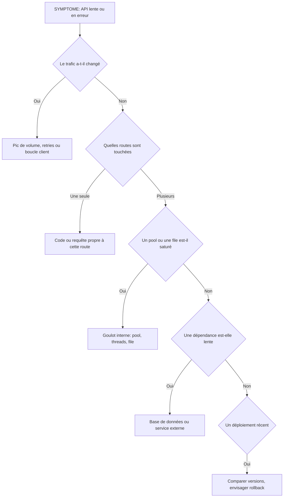

# Observabilité applicative et APIs

## Objectifs pédagogiques

À la fin de ce module, vous saurez :

- construire pour une API le trio débit, taux d'erreur et latence p95/p99, avec les requêtes PromQL correspondantes
- expliquer pourquoi une latence moyenne rassure à tort et lire une distribution à la place
- distinguer les erreurs 4xx des erreurs 5xx et en tirer des décisions différentes
- repérer une saturation (pool de connexions, file d'attente, dépendance lente) avant qu'elle ne produise des erreurs
- corréler une dégradation avec un déploiement et conclure sans confondre symptôme et cause racine

## Mise en situation

Lundi, 10 h 30. Vous êtes support Cloud dans une équipe qui exploite `orders-api`, l'API de commandes d'un site marchand : six développeurs, une petite équipe d'exploitation, quatre réplicas, une base PostgreSQL et un prestataire de paiement externe. Le service client remonte des clients qui « n'arrivent plus à valider leur panier ».

Vous ouvrez le dashboard existant. Le CPU des machines est à 35 %, la mémoire est stable, tous les conteneurs sont `Up`, et la latence moyenne affichée est de 310 ms. Rien n'est rouge, et pourtant des clients se plaignent.

La supervision d'infrastructure répond à « la machine va-t-elle bien ? ». Elle ne dit rien de « l'API tient-elle sa promesse ? ». Une API peut être lente avec un CPU à 10 %, par exemple lorsqu'elle attend une connexion de base de données ou la réponse d'un tiers. Ce module vous apprend à poser les bonnes questions à votre application : combien de requêtes, combien échouent, combien de temps elles prennent, et ce qui les retient.

Les chiffres et noms de métriques de ce module sont illustratifs. Les noms exacts dépendent de la bibliothèque d'instrumentation : `http_requests_total` ici, `http_server_requests_seconds_count` avec Micrometer, `http_server_request_duration_seconds` avec OpenTelemetry. Le raisonnement reste identique, adaptez simplement les noms en regardant ce que votre cible expose.

## Les trois signaux d'une API

Pour une API, trois questions suffisent pour savoir si le service est en bonne santé. Combien de requêtes arrivent ? Combien échouent ? Combien de temps prennent les autres ? C'est la méthode RED (Rate, Errors, Duration).

🧠 **Concept clé** — Ces trois signaux se lisent ensemble. Un débit qui s'effondre avec zéro erreur peut signaler une panne en amont (plus personne n'arrive jusqu'à vous). Des erreurs qui montent à débit constant pointent vers l'application. Une latence qui monte à débit constant pointe vers une ressource saturée.

| Signal | Question | Requête PromQL de départ |
|---|---|---|
| Débit | Combien de requêtes par seconde (RPS — Requests Per Second) ? | `sum(rate(http_requests_total{service="$service"}[$__rate_interval]))` |
| Erreurs | Quelle part échoue côté serveur ? | rapport entre les 5xx et le total (voir plus bas) |
| Durée | Combien de temps prennent les requêtes ? | `histogram_quantile` sur les buckets (voir plus bas) |

Le débit se construit avec `rate()` sur un compteur. Pour voir quelle route consomme quoi, ajoutez un `by` :

```promql
sum by (route) (rate(http_requests_total{service="$service"}[$__rate_interval]))
```

Dans Grafana, utilisez `$__rate_interval` plutôt qu'une fenêtre fixe comme `[5m]`. La variable s'adapte au pas de la requête et évite les courbes vides quand on dézoome ou qu'on zoome. Pour le débit, un panel Time series avec l'unité `requests/sec (rps)` suffit.

Le taux d'erreur est un rapport entre deux débits :

```promql
sum(rate(http_requests_total{service="$service", status=~"5.."}[$__rate_interval]))
/
sum(rate(http_requests_total{service="$service"}[$__rate_interval]))
```

Affichez-le avec l'unité `Percent (0.0-1.0)`. Quand le trafic est nul, la division produit `NaN` ou « No data ». Ce n'est pas un bug : il n'y a rien à diviser. Réglez le comportement dans le panel (Standard options → No value), et traitez aussi « No data » sur une API censée recevoir du trafic comme un signal en soi.

## La latence : pourquoi la moyenne vous ment

⚠️ **Erreur fréquente** — Afficher `rate(..._sum) / rate(..._count)` et conclure que « la latence est bonne ».

Imaginez 100 requêtes : 98 répondent en 50 ms, 2 prennent 5 secondes. La moyenne vaut (98 × 0,05 + 2 × 5) / 100, soit environ 150 ms, un chiffre qui ne choque personne. Pourtant, deux utilisateurs sur cent ont attendu cinq secondes, et ce sont probablement ceux qui passaient une commande.

Un percentile répond à une question plus utile : « quel temps 95 % (ou 99 %) des requêtes ne dépassent-elles pas ? ». Sur l'exemple, le p95 vaut 50 ms (il ne voit pas encore le problème) et le p99 vaut 5 s (il le voit). Les deux n'ont donc pas le même rôle : le p95 décrit l'expérience courante, le p99 la queue de distribution, où se cachent les incidents naissants.

```promql
histogram_quantile(0.99,
  sum by (le) (rate(http_request_duration_seconds_bucket{service="$service"}[$__rate_interval]))
)
```

Remplacez `0.99` par `0.95` pour le p95. Pour voir la latence par route, ajoutez `route` dans le `by` en gardant impérativement `le` :

```promql
histogram_quantile(0.99,
  sum by (le, route) (rate(http_request_duration_seconds_bucket{service="$service"}[$__rate_interval]))
)
```

Trois règles évitent la plupart des erreurs de lecture.

**Agréger les buckets, jamais les percentiles.** Si vous calculez un p99 par réplica puis faites la moyenne, le résultat n'a aucun sens statistique. La bonne méthode consiste à sommer les buckets de tous les réplicas (`sum by (le)`), puis à calculer le quantile une seule fois.

**Le résultat dépend des bornes des buckets.** `histogram_quantile` interpole linéairement à l'intérieur d'un bucket. Si vos buckets s'arrêtent à 1 s et que des requêtes durent 5 s, elles tombent dans `+Inf` et le p99 affiché plafonne à 1 s. Votre dashboard est alors plat alors que la réalité se dégrade. Vérifiez les bornes directement sur la cible :

```bash
curl -s http://<HOST>:<PORT>/metrics | grep 'http_request_duration_seconds_bucket' | head -n 15
```

Regardez les valeurs de `le` : elles doivent encadrer vos seuils réels (par exemple 0.05, 0.1, 0.25, 0.5, 1, 2.5, 5, 10).

**Regarder la forme, pas seulement un chiffre.** Le panel Heatmap, alimenté par `sum by (le) (increase(http_request_duration_seconds_bucket[$__rate_interval]))` avec le format Heatmap, montre la distribution complète au fil du temps. Une seconde « bande » qui apparaît loin au-dessus de la première, c'est exactement la population de requêtes lentes que la moyenne masquait.

💡 **Astuce** — Placez moyenne, p95 et p99 dans le même panel pendant quelques semaines. L'écart entre les courbes devient un indicateur à part entière : quand p99 s'éloigne de p95, une minorité de requêtes se comporte différemment.

## Découper par route, méthode et statut

Un taux d'erreur global est une moyenne de plus. Une route qui échoue à 40 % sur 1 % du trafic ne le fait pas bouger. Le découpage par `route`, `method` et `status` donne la carte de l'API, à condition de respecter une règle : le label `route` doit contenir le **modèle** de la route (`/orders/:id`), pas le chemin brut (`/orders/84217`). Sinon, chaque identifiant crée une nouvelle série et la cardinalité explose, ce qui coûte cher en mémoire et en temps de requête.

Vérifiez-le dans Explore :

```promql
count(count by (route) (http_requests_total{service="orders-api"}))
```

Une dizaine ou une centaine de valeurs, c'est normal. Plusieurs milliers signalent que l'instrumentation utilise le chemin brut. La correction se fait dans l'application ou son middleware, pas dans Grafana.

Deux filtres rendent les panels bien plus lisibles. Excluez d'abord les routes techniques : les sondes `/healthz` et `/metrics` représentent souvent une grande part du trafic, avec des réponses ultra rapides qui diluent la latence et le taux d'erreur. Ajoutez `route!~"/healthz|/metrics"` à vos requêtes. Pensez ensuite à une variable de dashboard `$route` (voir le module sur les variables) pour passer de la vue globale à une route précise sans dupliquer les panels.

## 4xx et 5xx : deux histoires différentes

Les deux familles ne se lisent pas de la même façon, et les regrouper dans un seul « taux d'erreur » brouille les décisions.

| Code | En général | Que faire |
|---|---|---|
| 500, 502, 503, 504 | Le serveur ou une dépendance a échoué | Investigation immédiate, c'est votre problème |
| 400, 422 | Requête invalide | Normal à faible niveau ; une hausse après déploiement suggère un changement de contrat |
| 401, 403 | Authentification ou droits | Hausse brutale = jeton expiré, configuration d'accès cassée, ou tentative d'abus |
| 404 | Ressource ou route inexistante | Hausse après déploiement = route renommée ou client non mis à jour |
| 429 | Limitation de débit | Un client légitime est-il bloqué ? Une boucle de retry s'est-elle déclenchée ? |

Une règle simple : alertez sur les 5xx, surveillez les 4xx. Les 4xx sont majoritairement causés par le client, mais une variation soudaine reste un excellent indicateur de changement. Un 401 massif juste après une mise en production n'est pas « la faute des clients ».

Pour un panel de 4xx, découpez par code :

```promql
sum by (status) (rate(http_requests_total{service="$service", status=~"4.."}[$__rate_interval]))
```

⚠️ **Erreur fréquente** — Ne compter que les statuts renvoyés par l'application. Un timeout vu par le reverse proxy (504), une connexion fermée par le client avant la réponse, ou un conteneur redémarré en pleine requête n'apparaissent pas forcément dans les métriques applicatives. Si le taux d'erreur applicatif est à 0 % mais que les utilisateurs échouent, comparez avec les métriques du proxy ou du load balancer.

## Saturation : ce qui retient les requêtes

Une API qui ralentit sans erreur est presque toujours en train d'attendre quelque chose : une connexion de base de données, un thread de travail, une place dans une file, la réponse d'un service tiers. On parle de saturation, la deuxième lettre de la méthode USE (Utilization, Saturation, Errors), qui s'applique aux ressources comme la méthode RED s'applique aux requêtes.

🧠 **Concept clé** — La saturation se manifeste **avant** les erreurs. Un pool de connexions à 100 % ne produit pas d'erreur tout de suite : les requêtes attendent, la latence monte, puis les timeouts arrivent. Observer l'occupation des ressources vous donne quelques minutes d'avance sur les 5xx.

Trois familles de panels couvrent l'essentiel, à condition que l'application expose les métriques (la plupart des bibliothèques de pool et de files le permettent) :

```promql
# Occupation du pool de connexions, par réplica
max by (pod) (app_db_pool_connections_in_use{service="$service"} / app_db_pool_connections_max{service="$service"})

# Temps passé à attendre une connexion (p99)
histogram_quantile(0.99, sum by (le) (rate(app_db_pool_wait_seconds_bucket{service="$service"}[$__rate_interval])))

# Profondeur d'une file de travail
max(app_job_queue_depth{service="$service", queue="emails"})
```

Pour chacune, ce qui compte est la tendance et le plateau. Un pool qui oscille entre 40 et 70 % est sain. Un pool collé à 100 % pendant dix minutes est un goulot, même si aucune erreur n'est encore visible. Une file qui grossit sans jamais se vider signifie que les consommateurs sont plus lents que les producteurs.

### Bases de données et services externes

Pour chaque dépendance, deux angles complémentaires.

**Le point de vue de l'application** : combien d'appels, combien d'erreurs, quelle latence, vus depuis le client. C'est ce que votre code subit réellement, réseau compris.

```promql
histogram_quantile(0.99,
  sum by (le, dependency) (rate(http_client_request_duration_seconds_bucket{service="$service"}[$__rate_interval]))
)
```

Un label `dependency` (`payment-gateway`, `postgres`, `search`) permet de comparer toutes les dépendances sur un seul graphique et de voir laquelle dérive.

**Le point de vue de la dépendance** : pour une base de données, les métriques de l'exporteur (connexions actives, requêtes lentes, verrous). L'installation de ces collecteurs relève du module précédent ; ici, on s'en sert pour répondre à une question précise : la base est-elle lente, ou est-ce l'application qui la sollicite mal ?

La comparaison des deux angles est précieuse. Si la latence vue par l'application augmente alors que la base reste calme de son côté, le problème se trouve entre les deux (pool, réseau, transaction qui reste ouverte trop longtemps) et pas dans la base elle-même.

## Corréler une régression avec un déploiement

Une question revient dans presque tous les incidents : « est-ce que quelque chose a changé ? ». Tant que la réponse est dans le canal de discussion de l'équipe et pas dans Grafana, vous perdez du temps.

Le plus efficace consiste à faire poser une **annotation** par le pipeline de déploiement à chaque mise en production. L'annotation apparaît comme une ligne verticale sur tous les panels concernés.

```bash
curl -X POST "https://<GRAFANA_URL>/api/annotations" \
  -H "Authorization: Bearer <TOKEN>" \
  -H "Content-Type: application/json" \
  -d '{"text":"Deploy <SERVICE> <VERSION>","tags":["deploy","<SERVICE>"]}'
```

Sans champ `time`, l'annotation est datée du moment de l'appel. Utilisez un jeton de compte de service (Service Account) limité à ce besoin, stocké comme secret dans l'outil de CI (Continuous Integration). Côté dashboard, ajoutez une requête d'annotation qui filtre sur le tag `deploy` ; l'emplacement exact du menu (Dashboard settings → Annotations) peut varier selon la version.

Deux autres pistes complètent cette corrélation :

- **Exposer la version dans les métriques.** Une métrique `app_build_info{version="2.14.0"} 1` ou un label `version` sur les séries HTTP permet de comparer directement deux versions pendant un déploiement progressif : `histogram_quantile(0.99, sum by (le, version) (...))`.
- **Comparer avec le passé.** `offset 1d` évalue la requête sur la même heure de la veille. Affichée à côté de la série actuelle, elle sépare un comportement habituel (pic de 10 h) d'une vraie anomalie :

```promql
sum(rate(http_requests_total{service="orders-api", status=~"5.."}[$__rate_interval] offset 1d))
/ sum(rate(http_requests_total{service="orders-api"}[$__rate_interval] offset 1d))
```

Ajoutez cette requête en deuxième série du panel, à côté de la requête actuelle, et affichez-la en pointillés gris.

⚠️ **Erreur fréquente** — Conclure « c'est le déploiement » parce que les deux événements coïncident. Une corrélation temporelle donne une hypothèse, pas une preuve. Vérifiez que le changement explique le mécanisme observé (quelle ressource sature, quelle route est touchée) avant de décider d'un rollback.

## Une démarche de diagnostic reproductible

Quand l'alerte tombe ou qu'un utilisateur se plaint, un ordre de lecture évite de partir dans toutes les directions :



Ce n'est pas un algorithme, juste un fil conducteur : à chaque étape, un panel précis de votre dashboard répond par oui ou par non. Si votre dashboard ne permet pas de répondre à l'une de ces questions, c'est lui qu'il faut améliorer.

## Scénario : l'API de commandes qui ralentit

Reprenons `orders-api`. Tous les chiffres qui suivent sont illustratifs.

**Étape 1 : le trafic.** Le débit est à peu près 120 req/s, comme un lundi matin habituel. Ce n'est donc pas un pic de volume.

**Étape 2 : latence et erreurs.** Le p99 est passé de 0,4 s à 6 s. Le p95 est monté de 0,25 s à 0,6 s, et la moyenne de 0,12 s à 0,31 s. La moyenne reste sous un tiers de seconde, un chiffre qui ne choque pas ; le p99, multiplié par 15, raconte une autre histoire. Les 5xx sont passés de 0,2 % à environ 3 %.

**Étape 3 : par route.** Le p99 de `POST /orders` explose, `GET /orders/:id` se dégrade modérément, et `GET /products` (servi depuis un cache) est inchangé. Le problème ne vient donc pas de toute l'application : il touche les routes qui utilisent la base de données.

**Étape 4 : saturation.** Le pool de connexions est collé à 100 % depuis environ 09 h 52, et le temps d'attente d'une connexion a explosé. Les requêtes font la queue pour obtenir une connexion.

**Étape 5 : dépendances.** La latence du prestataire de paiement est stable à environ 300 ms, et PostgreSQL ne montre ni verrous ni requêtes lentes. Aucune des deux dépendances n'est en cause.

**Étape 6 : changement récent.** Une annotation indique le déploiement de la version 2.14.0 à 09 h 48. En ajoutant la série `offset 1d`, l'occupation du pool hier à la même heure était d'environ 45 %.

**Hypothèse et vérification.** Quelque chose dans la 2.14.0 garde les connexions occupées plus longtemps. L'équipe de développement le confirme en relisant le changement : l'appel au prestataire de paiement a été déplacé *à l'intérieur* de la transaction de base de données. Chaque connexion reste donc bloquée pendant les 300 ms de l'appel externe, et le pool, dimensionné pour des transactions courtes, sature au pic.

**Conclusion.** Le symptôme est une latence p99 élevée sur `POST /orders`. La cause racine est une transaction qui englobe un appel externe. Agrandir le pool masquerait le problème et mettrait la base sous pression ; la bonne réponse est un retour à la version précédente, puis un correctif sortant l'appel de la transaction. Notez au passage que l'infrastructure n'a jamais été en cause : le dashboard CPU de départ était juste hors sujet.

## Erreurs fréquentes de lecture

| Symptôme | Cause probable | Correction |
|---|---|---|
| Le p99 est plat à 1 s alors que les utilisateurs se plaignent | Les requêtes lentes tombent dans le bucket `+Inf`, le calcul plafonne à la dernière borne finie | Ajouter des buckets au-delà du seuil réel (5 s, 10 s) dans l'instrumentation |
| Le p99 affiché ne correspond à aucune mesure plausible | Moyenne de percentiles calculés par réplica | Sommer les buckets (`sum by (le)`) avant `histogram_quantile` |
| Le taux d'erreur indique « No data » la nuit | Division par un débit nul | Régler « No value » dans le panel ; distinguer « pas de trafic » de « pas de métriques » |
| Taux d'erreur et latence anormalement bons | Les sondes `/healthz` noient le trafic réel | Exclure ces routes avec `route!~"/healthz\|/metrics"` |
| Des milliers de séries pour `route` | Chemins bruts instrumentés au lieu des modèles | Corriger l'instrumentation pour émettre `/orders/:id` |
| 0 % d'erreur côté application, mais des échecs côté utilisateurs | Timeouts ou coupures vus uniquement par le proxy ou le load balancer | Ajouter les métriques du proxy dans le dashboard et comparer |
| Pic de 4xx interprété comme du bruit | Changement de contrat, route renommée ou jeton mal configuré après déploiement | Croiser avec les annotations de déploiement et regarder le détail par `status` |

## Bonnes pratiques

- **Partir de questions, pas de métriques disponibles.** Chaque panel doit répondre à une question du type « une route se dégrade-t-elle ? » ou « le pool sature-t-il ? ». Un graphique sans question associée finit par être ignoré.
- **Afficher p95 et p99, jamais la moyenne seule.** Gardez la moyenne comme repère secondaire, mais jamais comme indicateur principal d'une API.
- **Contrôler les labels à la source.** Routes en modèle, pas de chemin brut, pas d'identifiant utilisateur ni de donnée personnelle dans un label : ce qui entre dans une métrique est lisible par tous ceux qui ont accès au dashboard.
- **Rendre les déploiements visibles et idempotents.** Un seul appel d'annotation par déploiement, avec le numéro de version dans le texte, et un jeton de compte de service aux droits minimaux. L'API ne dédoublonne pas : un rejeu du pipeline crée une seconde annotation, à éviter côté pipeline (par exemple en vérifiant d'abord les annotations existantes filtrées par tags).
- **Superviser la saturation autant que les erreurs.** Pools, files, threads : ces panels vous donnent de l'avance sur les incidents.
- **Surveiller l'absence de données.** Un service sans métriques n'est pas un service en bonne santé. Configurez le comportement `No Data` de vos règles d'alerte pour que le silence soit signalé.
- **Provisionner les dashboards applicatifs.** Un dashboard modifié à la main dans l'interface diverge vite de celui versionné. Les dashboards de référence doivent vivre dans des fichiers.
- **Documenter ce que signifie chaque panel.** Une description d'une ligne (« p99 de `POST /orders`, au-delà de 2 s : vérifier le pool ») fait gagner du temps à la personne d'astreinte qui n'a pas construit le dashboard.

## Résumé

Une API se supervise d'abord avec trois signaux : débit, taux d'erreur et latence, lus en p95 et p99 plutôt qu'en moyenne, car la moyenne masque les requêtes lentes. Découper par route, méthode et statut donne la carte précise des dégradations, à condition de maîtriser les labels, tandis que la séparation des 4xx (souvent le client, parfois un changement) et des 5xx (votre responsabilité) clarifie les décisions. La saturation des pools, files et dépendances prévient les erreurs avant leur apparition, et les annotations de déploiement transforment « quelque chose a changé » en information visible. Ces bases préparent le terrain pour le module suivant, où les mêmes signaux seront exploités dans un environnement de conteneurs et de Kubernetes.

<!-- snippet
id: grafana_api_p99_par_route
type: command
tech: grafana
level: intermediate
importance: high
format: knowledge
tags: promql,latence,histogram,percentile
title: Latence p99 par route avec histogram_quantile
command: histogram_quantile(0.99, sum by (le, <LABEL>) (rate(<METRIQUE>_bucket{<FILTRE>}[$__rate_interval])))
example: histogram_quantile(0.99, sum by (le, route) (rate(http_request_duration_seconds_bucket{service="orders-api"}[$__rate_interval])))
description: Le label le doit rester dans le by, sinon histogram_quantile ne peut pas reconstruire la distribution. Remplacer 0.99 par 0.95 pour le p95.
-->

<!-- snippet
id: grafana_api_moyenne_latence_trompeuse
type: warning
tech: grafana
level: intermediate
importance: high
format: knowledge
tags: latence,percentile,moyenne,diagnostic
title: La latence moyenne masque les requêtes lentes
content: Piège : surveiller sum/count. Sur 100 requêtes dont 98 à 50 ms et 2 à 5 s, la moyenne vaut ~150 ms et paraît acceptable alors que le p99 vaut 5 s. Conséquence : une minorité d'utilisateurs subit une panne invisible. Correction : afficher p95 et p99 (histogram_quantile) et garder la moyenne comme repère secondaire.
description: 2 % de requêtes à 5 s donnent une moyenne de ~150 ms mais un p99 de 5 s ; seul le percentile révèle l'incident naissant.
-->

<!-- snippet
id: grafana_api_agreger_buckets_pas_percentiles
type: warning
tech: grafana
level: intermediate
importance: high
format: knowledge
tags: promql,histogram,percentile,agregation
title: Ne jamais moyenner des percentiles entre réplicas
content: Piège : calculer un p99 par réplica puis faire avg() ou max() dans Grafana. Conséquence : valeur statistiquement fausse, impossible à comparer avec la réalité. Correction : sommer d'abord les buckets de tous les réplicas avec sum by (le) (rate(..._bucket[...])), puis appliquer histogram_quantile une seule fois.
description: Le quantile se calcule sur les buckets agrégés de toutes les instances, jamais sur des quantiles déjà calculés par instance.
-->

<!-- snippet
id: grafana_api_buckets_plafond_inf
type: error
tech: grafana
level: intermediate
importance: high
format: knowledge
tags: histogram,buckets,latence,instrumentation
title: P99 plat à la dernière borne : buckets trop courts
content: Symptôme : le p99 reste collé à 1 s alors que les utilisateurs signalent des lenteurs. Cause : les requêtes plus longues tombent dans le bucket +Inf, et histogram_quantile renvoie la borne supérieure du dernier bucket fini. Correction : vérifier les valeurs de le avec curl sur /metrics et ajouter des bornes au-delà du seuil réel (5, 10 s) dans l'instrumentation.
description: Quand le quantile tombe dans +Inf, Prometheus renvoie la dernière borne finie, ce qui masque l'aggravation réelle de la latence.
-->

<!-- snippet
id: grafana_api_taux_erreur_5xx
type: command
tech: grafana
level: intermediate
importance: high
format: knowledge
tags: promql,erreurs,5xx,red
title: Taux d'erreur 5xx en rapport du trafic total
command: sum(rate(<METRIQUE>{<FILTRE>, status=~"5.."}[$__rate_interval])) / sum(rate(<METRIQUE>{<FILTRE>}[$__rate_interval]))
example: sum(rate(http_requests_total{service="orders-api", status=~"5.."}[$__rate_interval])) / sum(rate(http_requests_total{service="orders-api"}[$__rate_interval]))
description: Afficher en unité Percent (0.0-1.0). Sans trafic, la division donne NaN ou No data : régler le panel pour distinguer absence de trafic et absence de métriques.
-->

<!-- snippet
id: grafana_api_route_modele_cardinalite
type: tip
tech: grafana
level: intermediate
importance: medium
format: knowledge
tags: cardinalite,route,labels,prometheus
title: Vérifier que le label route est un modèle, pas un chemin
content: Lancer dans Explore count(count by (route) (http_requests_total{service="<SERVICE>"})). Une dizaine à une centaine de valeurs est normale ; plusieurs milliers signifient que l'application émet /orders/84217 au lieu de /orders/:id. Corriger dans le middleware d'instrumentation, pas dans Grafana.
description: Un chemin brut dans un label crée une série par identifiant et fait exploser mémoire et temps de requête côté Prometheus.
-->

<!-- snippet
id: grafana_api_exclure_sondes_sante
type: tip
tech: grafana
level: intermediate
importance: medium
format: knowledge
tags: healthcheck,promql,latence,erreurs
title: Exclure les sondes de santé des panels de latence
content: Ajouter route!~"/healthz|/metrics" aux requêtes de débit, d'erreur et de latence. Les sondes envoient des requêtes très rapides et sans erreur qui diluent le p95 et le taux d'erreur, surtout quand le trafic réel est faible (nuit, week-end).
description: Les health checks peuvent représenter une grande part des requêtes et rendent les indicateurs plus beaux que la réalité utilisateur.
-->

<!-- snippet
id: grafana_api_4xx_vs_5xx
type: concept
tech: grafana
level: intermediate
importance: high
format: knowledge
tags: http,erreurs,4xx,5xx
title: 4xx et 5xx : deux signaux, deux décisions
content: Un 5xx indique un échec côté serveur ou dépendance : à alerter et investiguer. Un 4xx est majoritairement causé par la requête, mais une variation brutale après un déploiement trahit un changement : 401 (authentification cassée), 404 (route renommée), 400 (contrat modifié), 429 (limitation atteinte par un client légitime). Règle pratique : alerter sur les 5xx, surveiller les 4xx par status.
description: Les 4xx ne sont pas du bruit : un pic soudain croisé avec une annotation de déploiement révèle souvent une régression de contrat ou d'authentification.
-->

<!-- snippet
id: grafana_api_saturation_avant_erreurs
type: concept
tech: grafana
level: intermediate
importance: high
format: knowledge
tags: saturation,pool,use,latence
title: La saturation précède les erreurs
content: Quand un pool de connexions atteint 100 %, les requêtes n'échouent pas immédiatement : elles attendent une connexion libre, donc la latence monte d'abord, puis les timeouts produisent des 5xx. Surveiller le ratio max by (pod) (in_use / max) et le temps d'attente du pool donne plusieurs minutes d'avance. Un plateau à 100 % sur 10 minutes est un goulot, pas un pic.
description: Pools, files et threads se saturent avant de produire des erreurs ; leur occupation est un indicateur avancé de la dégradation d'une API.
-->

<!-- snippet
id: grafana_api_annotation_deploiement
type: command
tech: grafana
level: intermediate
importance: medium
format: knowledge
tags: annotations,deploiement,api,ci
title: Poser une annotation de déploiement via l'API Grafana
context: À exécuter depuis le pipeline de déploiement, avec un jeton de compte de service aux droits minimaux
command: curl -X POST "https://<GRAFANA_URL>/api/annotations" -H "Authorization: Bearer <TOKEN>" -H "Content-Type: application/json" -d '{"text":"Deploy <SERVICE> <VERSION>","tags":["deploy","<SERVICE>"]}'
example: curl -X POST "https://grafana.example.com/api/annotations" -H "Authorization: Bearer glsa_abc123" -H "Content-Type: application/json" -d '{"text":"Deploy orders-api v2.14.0","tags":["deploy","orders-api"]}'
description: Sans champ time, l'annotation est datée de l'appel. Filtrer ensuite sur le tag deploy dans Dashboard settings → Annotations pour l'afficher sur les panels.
-->

<!-- snippet
id: grafana_api_offset_1d_comparaison
type: tip
tech: grafana
level: intermediate
importance: medium
format: knowledge
tags: promql,offset,regression,comparaison
title: Comparer au même créneau de la veille avec offset 1d
content: Ajouter en seconde requête du panel la même expression avec [$__rate_interval] offset 1d, affichée en pointillés gris. Un pic à 10 h qui se retrouve à l'identique la veille est habituel ; un écart net (pool à 100 % contre 45 % hier) désigne une vraie anomalie.
description: offset 1d sépare un comportement récurrent d'une régression, sans devoir reconstituer l'historique à la main ni changer la plage de temps.
-->
