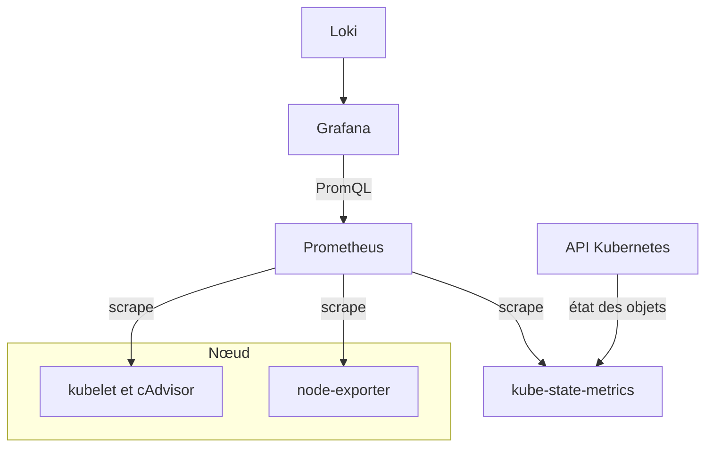
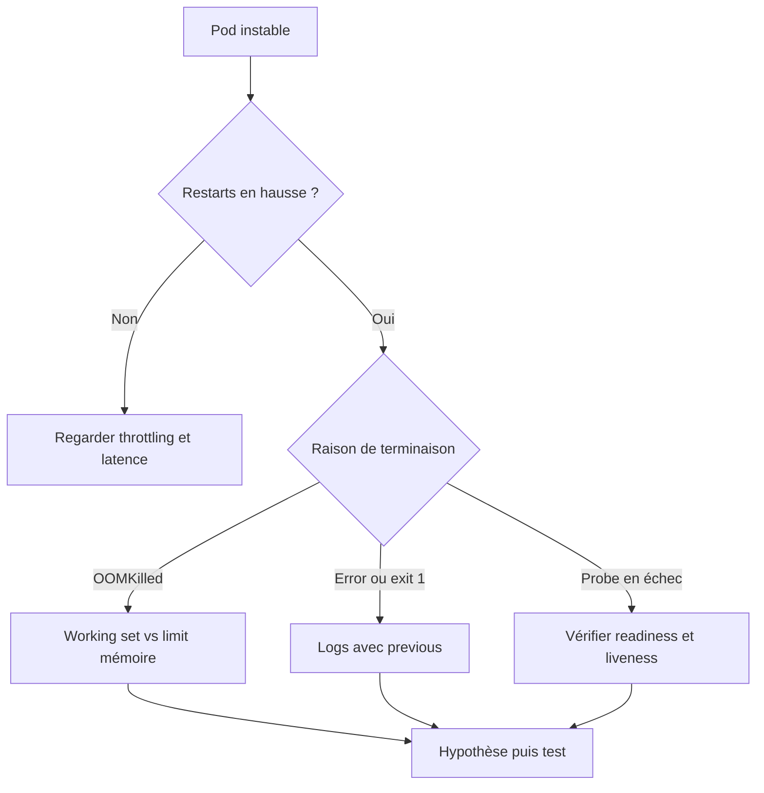

# Observabilité des conteneurs et Kubernetes

## Objectifs pédagogiques

À la fin de ce module, vous saurez :

- **Identifier** quel composant (cAdvisor, kubelet, kube-state-metrics, node-exporter) produit quelle métrique dans un cluster.
- **Déployer** une pile de métriques Kubernetes et **vérifier** que Grafana reçoit bien les données.
- **Construire** des requêtes et des dashboards organisés par cluster, namespace et workload, avec des filtres dynamiques.
- **Détecter** le CPU throttling, les `OOMKilled` et les redémarrages en boucle.
- **Distinguer** une consommation de CPU d'une saturation de CPU, et conduire l'analyse d'un pod instable jusqu'à une hypothèse vérifiable.

## Mise en situation

Vous êtes dans une équipe de cinq personnes qui exploite un cluster Kubernetes managé : trois nœuds, une vingtaine de services répartis dans six namespaces. Jusqu'ici, le monitoring se résumait à `kubectl top pods` et à un dashboard « Node Exporter » importé depuis le catalogue Grafana. Il suffisait pour voir qu'un nœud chauffait.

Puis le service `checkout-api` se met à répondre lentement, par intermittence. `kubectl top` affiche 180m de CPU pour un pod dont la limite est à 200m. Ça ne crie pas à l'incident. Pourtant, côté utilisateurs, ça rame. Quelques heures plus tard, le pod redémarre sans que personne ne comprenne pourquoi.

`kubectl top` donne une photo instantanée, sans historique, sans comparaison avec les limites et sans lien avec les redémarrages. Pour comprendre ce qui se passe dans un cluster, il faut des séries temporelles qui croisent **ce que les conteneurs consomment**, **ce que Kubernetes leur a promis ou autorisé** et **ce qui leur est arrivé**. C'est ce que ce module met en place.

## Qui produit quoi : l'architecture de collecte

Une erreur courante chez les débutants consiste à croire qu'il existe « les métriques Kubernetes » comme une source unique. En réalité, plusieurs composants distincts répondent à trois questions différentes : que consomment les conteneurs, dans quel état sont les objets Kubernetes, et comment se portent les machines.

| Composant | Rôle | Exemples de métriques |
|-----------|------|-----------------------|
| kubelet + cAdvisor (Container Advisor) | Mesure la consommation réelle de chaque conteneur, via les cgroups du nœud | `container_cpu_usage_seconds_total`, `container_memory_working_set_bytes` |
| kube-state-metrics | Traduit l'état déclaré dans l'API Kubernetes en métriques (aucune mesure de consommation) | `kube_pod_container_status_restarts_total`, `kube_deployment_status_replicas_available` |
| node-exporter | Mesure la machine elle-même (CPU, mémoire, disque, réseau, pression) | `node_load1`, `node_memory_MemAvailable_bytes` |
| Prometheus | Collecte et stocke le tout | — |
| Grafana | Interroge Prometheus en PromQL | — |



> 🧠 **Concept clé**
>
> CAdvisor sait ce que **consomme** un conteneur, kube-state-metrics sait ce qui a été **demandé et décidé** (requests, limits, replicas, raisons d'arrêt). Presque tous les diagnostics utiles demandent de croiser les deux. Une consommation de 900 Mo ne dit rien sans la limite à 1 Go ou à 512 Mo.
{: .callout .callout-important}

Le kubelet expose plusieurs endpoints. Celui qui nous intéresse est `/metrics/cadvisor`. Ses séries portent les labels `namespace`, `pod` et `container`, ce qui permet de filtrer comme dans les objets Kubernetes. Les menus et noms de jobs peuvent varier selon la façon dont vous déployez la pile, donc vérifiez toujours dans Explore ce qui existe réellement chez vous.

## Premier terrain : Docker et cAdvisor sur un hôte

Avant Kubernetes, un hôte Docker seul permet de comprendre cAdvisor sans la complexité du cluster. `docker stats` donne une vue instantanée, comme `kubectl top`. Pour avoir un historique, on lance cAdvisor comme conteneur :

```bash
docker run -d --name=cadvisor -p 8080:8080 \
  --volume=/:/rootfs:ro \
  --volume=/var/run:/var/run:ro \
  --volume=/sys:/sys:ro \
  --volume=/var/lib/docker/:/var/lib/docker:ro \
  --privileged --device=/dev/kmsg \
  <IMAGE_CADVISOR>:<VERSION>
```

Le registre de l'image a changé au fil des versions, donc consultez la documentation du projet pour l'adresse à jour. Vérifiez ensuite que ça répond :

```bash
curl -s http://localhost:8080/metrics | grep container_cpu_usage_seconds_total | head
```

Côté Prometheus, un job de scrape suffit :

```yaml
scrape_configs:
  - job_name: cadvisor
    static_configs:
      - targets: ["<HOTE>:8080"]
```

En Docker pur, il n'y a ni namespace ni pod. cAdvisor étiquette les conteneurs avec `name` et `image`. Dans Grafana, une première requête utile ressemble à ceci :

```promql
sum by (name) (rate(container_cpu_usage_seconds_total{name!=""}[5m]))
```

> ⚠️ **Erreur fréquente**
>
> Exposer le port 8080 de cAdvisor sur une interface publique. Il révèle la liste de tous vos conteneurs, leurs images et leurs ressources. Limitez-le au réseau de monitoring ou à `127.0.0.1` derrière un reverse proxy.
{: .callout .callout-attention}

## Mise en place sur Kubernetes

Sur Kubernetes, on ne déploie pas ces composants à la main un par un. Le chart Helm `kube-prometheus-stack` installe Prometheus, kube-state-metrics, node-exporter, le scraping des kubelets et un ensemble de dashboards prêts à l'emploi. C'est le chemin le plus courant, et celui que nous suivons ici.

```bash
helm repo add prometheus-community https://prometheus-community.github.io/helm-charts
helm repo update
helm upgrade --install monitoring prometheus-community/kube-prometheus-stack \
  --namespace monitoring --create-namespace \
  --values values.yaml
```

La forme `upgrade --install` est volontaire : la commande est rejouable sans erreur, que la release existe déjà ou non. Elle s'accompagne d'un fichier `values.yaml` versionné dans Git, pour que la configuration ne vive pas dans l'historique de votre terminal.

Vérifiez que tout démarre :

```bash
kubectl get pods -n monitoring
kubectl port-forward -n monitoring svc/monitoring-grafana 3000:80
kubectl get secret -n monitoring monitoring-grafana \
  -o jsonpath='{.data.admin-password}' | base64 -d
```

Les noms de services dépendent du nom de release (`monitoring` ici). Si vous disposez déjà d'une instance Grafana séparée, vous pouvez ignorer celle du chart et ajouter simplement Prometheus comme Data Source, comme vu dans le module sur les sources de données.

Avant d'ouvrir le moindre dashboard, faites ce test dans Explore :

```promql
up{job=~"kubelet|kube-state-metrics|node-exporter"}
```

Si une cible vaut `0` ou n'apparaît pas, inutile d'aller plus loin : les panels afficheront « No Data » et vous chercherez au mauvais endroit.

> 💡 **Astuce**
>
> Dans l'onglet Explore, le *Metrics browser* permet de lister les métriques qui existent réellement dans votre Prometheus. Les noms ont évolué entre les versions de kube-state-metrics, et c'est plus rapide que de chercher dans la documentation.
{: .callout .callout-astuce}

## Lire un cluster : nodes, pods, deployments

Un cluster se lit en couches, du plus large au plus fin, et chaque couche pose une question distincte.

### Les nœuds

La question est : « Les machines sont-elles saines, et reste-t-il de la place ? ». Deux angles complémentaires :

```promql
# Nœuds non Ready
kube_node_status_condition{condition="Ready", status="true"} == 0

# Capacité planifiable déjà réservée par les requests CPU
sum(kube_pod_container_resource_requests{resource="cpu"})
/
sum(kube_node_status_allocatable{resource="cpu"})
```

Le second ratio mesure la **réservation**, pas l'usage. Un cluster peut être réservé à 90 % tout en ne consommant que 20 % du CPU : le scheduler refusera de placer de nouveaux pods alors que les machines sont presque au repos. Ce n'est pas un bug, c'est ce que les `requests` sont censées garantir, mais ça surprend les équipes.

> 📝 **Note**
>
> Le CPU réservé mais inutilisé n'est pas perdu : les autres pods du nœud peuvent s'en servir. En revanche, le scheduler le compte comme pris pour placer de nouveaux pods.
{: .callout .callout-note}

### Les pods et conteneurs

La question devient : « Qui consomme quoi, par rapport à ce qui lui est alloué ? ». Les métriques cAdvisor contiennent des séries parasites qu'il faut écarter systématiquement :

```promql
sum by (namespace, pod) (
  rate(container_cpu_usage_seconds_total{container!="", container!="POD"}[5m])
)
```

> ⚠️ **Erreur fréquente**
>
> Oublier `container!=""`. cAdvisor publie aussi une série agrégée au niveau du pod (container vide) et, selon la version, des séries pour le conteneur « pause » (`container="POD"`). Sans filtre, vos totaux sont doublés, voire triplés, et vos dashboards affichent des valeurs fausses sans erreur visible.
{: .callout .callout-attention}

### Les Deployments et workloads

Là, la question est : « Le nombre de réplicas voulu est-il atteint ? ». Seul kube-state-metrics le sait :

```promql
kube_deployment_spec_replicas - kube_deployment_status_replicas_available > 0
```

Un détail piégeux : cAdvisor ne connaît pas les Deployments, seulement les pods. Pour agréger par workload, il faut passer par les relations Pod → ReplicaSet → Deployment. Le `kube-prometheus-stack` fournit des recording rules pour ça (par exemple `namespace_workload_pod:kube_pod_owner:relabel`, à vérifier dans votre version). Elles évitent de réécrire de longues jointures `label_replace` dans chaque panel.

## CPU throttling, OOMKilled et restart count

C'est le cœur opérationnel du module : trois signaux qui racontent la majorité des problèmes de pods.

### Le throttling CPU

Quand vous posez une `limit` CPU, le noyau l'applique via le CFS (Completely Fair Scheduler)\* sous forme de quota : sur chaque période de 100 ms, le conteneur reçoit un temps de calcul maximum. Une fois épuisé, ses threads sont **gelés jusqu'à la période suivante**. Votre application ne plante pas, elle attend. Les requêtes s'allongent, des timeouts apparaissent, et rien n'est visible dans les logs.

> ⏱️ **Analogie : un forfait remis à zéro toutes les 100 ms**
>
> Une limit de 200m équivaut à 20 ms de calcul par tranche de 100 ms. Une fois le forfait consommé, le conteneur attend la tranche suivante, même si le nœud est libre. Attention : le forfait est partagé entre tous les threads, donc 4 threads actifs l'épuisent en 5 ms.
{: .callout .callout-analogie}

```promql
sum by (namespace, pod, container) (rate(container_cpu_cfs_throttled_periods_total{container!="", container!="POD"}[5m]))
/
sum by (namespace, pod, container) (rate(container_cpu_cfs_periods_total{container!="", container!="POD"}[5m]))
```

Le résultat est la proportion de périodes où le conteneur a été bridé. Une valeur durable au-dessus de 25 % mérite une investigation. Les conteneurs sans limit CPU n'ont pas de quota, donc pas de périodes à compter : le ratio donne `NaN` ou aucune série. C'est normal.

\* CFS : l'ordonnanceur Linux qui répartit le temps CPU et applique les quotas des cgroups.

### Les OOMKilled

Pour la mémoire, la métrique à suivre n'est pas `container_memory_usage_bytes` (qui inclut du cache fichier récupérable), mais `container_memory_working_set_bytes`. L'OOM (Out Of Memory) killer intervient quand le conteneur dépasse sa limite mémoire.

> 📖 **Définition**
>
> Le *working set* est la mémoire d'un conteneur, sans le cache inactif que le noyau peut récupérer. C'est la métrique qui se rapproche le plus de ce que le noyau regarde avant de tuer un processus.
{: .callout .callout-definition}

```promql
max by (namespace, pod, container) (container_memory_working_set_bytes{container!="", container!="POD"})
/
max by (namespace, pod, container) (kube_pod_container_resource_limits{resource="memory"})
```

Un ratio qui grimpe lentement vers 1 puis retombe brutalement, en dents de scie, signale une fuite mémoire ou une limite trop basse. Pour détecter l'événement lui-même :

```promql
(increase(kube_pod_container_status_restarts_total[30m]) > 0)
and on (namespace, pod, container)
(kube_pod_container_status_last_terminated_reason{reason="OOMKilled"} == 1)
```

On combine les deux séries parce que `last_terminated_reason` reste à `1` tant que la raison de la dernière terminaison n'a pas changé, même plusieurs jours après. Seule, elle ferait apparaître des alertes fantômes. Le `increase` sur les restarts garantit qu'on parle d'un événement récent.

### Le compteur de redémarrages

`kube_pod_container_status_restarts_total` est un compteur : sa valeur brute (« 14 restarts ») ne dit pas quand ni à quelle vitesse. Un pod à 14 restarts accumulés en trois semaines est stable. Un pod à 4 restarts en 10 minutes est en pleine boucle.

> 💡 **Astuce**
>
> Affichez toujours `increase(kube_pod_container_status_restarts_total[1h])` plutôt que la valeur brute. Et ajoutez en tableau le `CrashLoopBackOff` : `kube_pod_container_status_waiting_reason{reason="CrashLoopBackOff"} == 1`.
{: .callout .callout-astuce}

## ⚠️ Consommation CPU ≠ saturation CPU

C'est le piège central du module, et il explique l'incident de notre mise en situation.

Un pod peut afficher 40 % de CPU « utilisé » par rapport à sa limite et être pourtant fortement bridé. Pourquoi ? Parce que `rate(container_cpu_usage_seconds_total[5m])` est une **moyenne sur cinq minutes**.

Prenez une application multithread qui travaille en rafales, par exemple avec un burst de 80 ms à 4 cœurs au démarrage de chaque requête. Elle épuise son quota (20 ms par période de 100 ms pour une limit de 200m) en quelques millisecondes, puis reste gelée le reste de la période. En moyenne, le CPU paraît modéré. À l'échelle de la requête, la latence est dégradée.

L'inverse existe aussi, à l'échelle du nœud : un pod **sans limit** n'est jamais bridé, mais si le nœud est surchargé, il attend son tour pour obtenir du CPU. Aucun throttling dans les métriques, et pourtant il est ralenti.

> 💡 **À retenir**
>
> La **consommation** répond à « combien de CPU le conteneur a-t-il obtenu ? ». La **saturation** répond à « combien de temps a-t-il attendu pour en obtenir ? ». Ce sont deux questions différentes, et le dashboard doit montrer les deux.
{: .callout .callout-important}

| Ce que vous voulez savoir | Signal à regarder |
|---------------------------|-------------------|
| Le conteneur est-il bridé par sa limit ? | Ratio `throttled_periods / periods` |
| Le nœud est-il sous tension ? | `node_load1` rapporté au nombre de cœurs, ou la pression CPU (PSI (Pressure Stall Information)\*) |
| Les requests sont-elles bien dimensionnées ? | Usage moyen vs `requests`, sur plusieurs jours |
| Le service est-il lent à cause du CPU ? | Corrélation entre throttling et latence applicative (module précédent) |

```promql
# Charge du nœud rapportée au nombre de cœurs (≥ 1 : file d'attente)
node_load1 / count by (instance) (node_cpu_seconds_total{mode="idle"})

# Temps passé à attendre le CPU, si PSI est activé dans le noyau
rate(node_pressure_cpu_waiting_seconds_total[5m])
```

\* PSI : une fonction du noyau Linux qui mesure la part du temps pendant laquelle des tâches attendent une ressource ; sa disponibilité dépend de la version du noyau et de sa configuration.

> 🧠 **Concept clé**
>
> Un panel « CPU usage » seul ne permet jamais de conclure à l'absence de problème CPU. Placez toujours le ratio de throttling juste à côté.
{: .callout .callout-important}

## Construction progressive des dashboards

### v1 : les dashboards du chart

Le `kube-prometheus-stack` provisionne des dashboards de type *Compute Resources* (par cluster, namespace, pod et workload) et *Nodes*. Parcourez-les d'abord. Vous apprendrez quelles requêtes les mainteneurs jugent utiles, et vous aurez une vue immédiate. Leur limite : ils sont génériques et ne répondent pas à votre question du moment.

### v2 : votre dashboard orienté diagnostic

Partez d'une question concrète : « Pourquoi ce service est-il instable ? ». Un dashboard de workload en trois rangées suffit :

- **Santé** : réplicas voulus vs disponibles, pods par phase, restarts sur 1 h.
- **Ressources** : CPU usage vs requests/limits, ratio de throttling, working set vs limit mémoire.
- **Contexte** : liens vers Explore Loki filtré sur le pod, et vers les traces.

Les filtres se construisent avec des variables, que vous connaissez depuis le module dédié :

```promql
# Variable cluster (si le label existe, voir v3)
label_values(kube_pod_info, cluster)

# Variable namespace, multi-valeurs
label_values(kube_pod_info{cluster="$cluster"}, namespace)

# Variable pod
label_values(kube_pod_info{cluster="$cluster", namespace=~"$namespace"}, pod)
```

Dans les requêtes des panels, utilisez `namespace=~"$namespace"` avec l'opérateur regex, sinon le choix de plusieurs valeurs ou de « All » ne fonctionnera pas.

### v3 : prêt pour la production

Le saut de v2 à v3 consiste à rendre le dashboard fiable quand il y a plusieurs clusters et beaucoup de pods.

- **Label `cluster`** : Kubernetes ne l'ajoute pas tout seul. Il se pose via `externalLabels` de Prometheus ou une étape de relabeling, et il doit être présent *avant* que vous ayez plusieurs clusters, sinon leurs séries se mélangent.
- **Recording rules** pour les calculs lourds (agrégations par workload, ratios de throttling) : le dashboard lit des séries précalculées.
- **Contrôle de la cardinalité** : le label `pod` change à chaque déploiement, et cAdvisor produit beaucoup de séries par conteneur. Supprimez au scraping les métriques que vous n'utilisez jamais (`metricRelabelings`).
- **Alertes** sur les signaux de cette page, avec un propriétaire clair pour chaque namespace.
- **Dashboards provisionnés** depuis Git, pas modifiés à la main dans l'interface.

## Analyser un pod instable

Voici la démarche complète sur le cas de `checkout-api`, namespace `shop`. Les chiffres sont illustratifs. Le raisonnement compte plus que les valeurs.



**Étape 1 : confirmer l'instabilité sur la durée.** Dans le dashboard workload, la rangée Santé montre `increase(restarts[1h])` à 7 pour un des trois pods. Ce n'est donc pas un redémarrage ponctuel.

**Étape 2 : lire la raison.** Le tableau `last_terminated_reason` indique `OOMKilled`. Vous confirmez en ligne de commande :

```bash
kubectl describe pod checkout-api-7d9f8b-x2k4q -n shop
```

Dans la section `Last State`, on trouve `Reason: OOMKilled` et `Exit Code: 137`. Ce code 137 (128 + signal 9) est la signature d'un processus tué par le noyau.

**Étape 3 : comprendre la dynamique.** Le panel `working set / limit` montre, sur 6 h, une montée de 55 % à 99 % en environ 40 minutes, puis une chute. Chaque dent de scie correspond à un restart. La mémoire grimpe régulièrement : suspicion de fuite ou de cache applicatif non borné.

**Étape 4 : vérifier qu'on ne confond pas symptôme et cause.** Corrélez avec le trafic : si la mémoire monte proportionnellement au nombre de requêtes, la limite est sous-dimensionnée. Si elle monte alors que le trafic est plat, c'est une fuite. Ici, le trafic est stable et la mémoire monte quand même : l'hypothèse est une fuite, ou un cache sans plafond.

**Étape 5 : aller chercher les logs du conteneur précédent.** Les logs du conteneur actuel sont presque vides, car il vient de démarrer :

```bash
kubectl logs checkout-api-7d9f8b-x2k4q -n shop --previous
```

Dans Grafana, le même résultat s'obtient avec Loki filtré sur le pod, sur la fenêtre de temps qui précède le restart.

**Étape 6 : lier au CPU.** Le ratio de throttling est à 0,35 sur ce pod alors que l'usage moyen n'est que de 60 % de la limit. Quand le conteneur approche de sa limite mémoire, le ramasse-miettes travaille davantage, consomme son quota en rafales, et la latence augmente avant le crash. Cela explique les lenteurs *avant* les redémarrages : le CPU était un symptôme, la mémoire la cause racine.

**Conclusion exploitable** : fuite mémoire probable, confirmée par la croissance à trafic constant. Action immédiate : relever la limit pour gagner du temps. Action de fond : profiler l'application. La conclusion reste une hypothèse, tant que le correctif n'a pas été déployé et que la courbe n'a pas été revue.

## Comparaison avec les alternatives

| Critère | Prometheus + Grafana (ce module) | `kubectl top` / metrics-server | Grafana Kubernetes Monitoring (Cloud) |
|---------|----------------------------------|--------------------------------|----------------------------------------|
| Historique | Oui, selon la rétention | Non, instantané | Oui |
| Throttling, OOM, restarts | Oui | Non | Oui |
| Mise en place | Chart Helm, quelques heures | Déjà dans la plupart des clusters | Assistant d'onboarding (varie selon les versions) |
| Contrôle des coûts et de la cardinalité | Total, mais à votre charge | Sans objet | Délégué, avec des limites de volumétrie |

`kubectl top` reste utile pour un coup d'œil rapide en ligne de commande, d'autant qu'il interroge la même Metrics API (servie par metrics-server) que celle consommée par le Horizontal Pod Autoscaler. Ne comparez pas ses valeurs au point près avec Grafana : l'une est un instantané, l'autre une moyenne sur fenêtre.

## Diagnostic : erreurs fréquentes

**Les panels de conteneurs affichent « No Data » alors que les nœuds apparaissent.** Cause probable : le scraping de `/metrics/cadvisor` ne fonctionne pas (autorisation du kubelet, TLS, ou `metrics_path` mal configuré), alors que node-exporter, lui, répond. Vérifiez dans Prometheus les targets du job `kubelet`, et testez la requête `up{job="kubelet", metrics_path="/metrics/cadvisor"}`. Certaines distributions locales (clusters de développement) exposent cAdvisor différemment.

**Les totaux CPU ou mémoire sont environ deux fois trop élevés.** Cause : les séries agrégées au niveau du pod (`container=""`) et les conteneurs pause sont sommés avec les vrais conteneurs. Correction : ajouter `container!="", container!="POD"` dans chaque requête.

**La consommation mémoire dépasse la limite sans OOM.** Cause : vous regardez `container_memory_usage_bytes`, qui inclut le cache fichier récupérable par le noyau. Correction : utiliser `container_memory_working_set_bytes`.

**Un pod a « disparu » du dashboard après un déploiement.** Cause : le nom du pod a changé (nouveau suffixe), c'est une nouvelle série. Correction : agréger par workload ou par `container` plutôt que d'épingler un nom de pod.

**La valeur de `restarts_total` retombe à zéro.** Cause : le pod a été recréé, le compteur repart avec lui. Correction : agréger sur un label stable, par exemple `sum by (namespace, container) (increase(kube_pod_container_status_restarts_total[1h]))`, et ne pas interpréter une remise à zéro comme une amélioration.

**L'alerte OOM se déclenche en permanence.** Cause : `last_terminated_reason` reste à `1` longtemps après l'événement. Correction : la combiner avec `increase(restarts_total[...]) > 0`, comme vu plus haut.

## Cas réel en entreprise (scénario illustratif)

*Ce qui suit est un scénario d'illustration, pas un retour d'expérience réel. Les chiffres sont fictifs.*

Une équipe de six personnes exploite un cluster de quatre nœuds qui héberge 35 services. Les utilisateurs signalent régulièrement des lenteurs sur un portail de réservation, sans qu'aucune alerte ne se soit déclenchée : les dashboards montraient un CPU à 45 % en moyenne.

**Étapes.** L'équipe ajoute un panel de ratio de throttling par workload. Trois services dépassent 30 % de périodes bridées aux heures de pointe, dont le portail. Leurs limits CPU, fixées à l'identique « par précaution », sont trop serrées pour des traitements en rafales. L'équipe supprime les limits CPU sur ces services (en gardant les requests, et en gardant les limits mémoire), puis surveille la pression sur les nœuds.

**Résultat (valeurs fictives).** Le ratio de throttling tombe sous 2 %, et le p95 du portail passe de 1,8 s à 0,6 s. Surtout, l'équipe ajoute une alerte sur le throttling soutenu plutôt que sur le CPU total, et documente dans le runbook qui est responsable de chaque namespace.

L'enseignement à retenir est la méthode, plus que le correctif : le signal utile n'existait pas dans le dashboard d'origine, il a fallu se poser la bonne question.

## Bonnes pratiques

- **Toujours afficher usage, requests/limits et throttling ensemble.** Un seul de ces trois signaux induit en erreur, comme on l'a vu avec le CPU.
- **Utiliser `working_set` pour la mémoire, `increase()` pour les compteurs.** Les valeurs brutes sont une source de fausses conclusions.
- **Poser le label `cluster` dès le premier cluster.** L'ajouter après coup casse l'historique et les dashboards existants.
- **Maîtriser la cardinalité au scraping.** Éliminez les métriques inutilisées avec `metricRelabelings`, et évitez de grouper par `pod` quand `workload` suffit.
- **Sécuriser l'accès aux métriques.** Le scrape du kubelet doit passer par TLS et un ServiceAccount avec des droits RBAC minimaux. N'exposez jamais cAdvisor ou Prometheus sans authentification.
- **Rendre l'installation rejouable.** `helm upgrade --install` avec un `values.yaml` dans Git, et des dashboards provisionnés plutôt que modifiés à la main.
- **Vérifier la chaîne de collecte elle-même.** Une alerte sur `up == 0` pour les jobs kubelet et kube-state-metrics évite de découvrir une panne de monitoring pendant un incident.
- **Relier chaque alerte à un responsable.** Un `OOMKilled` sans propriétaire de namespace identifié reste une alerte ignorée.

## Résumé

Observer un cluster Kubernetes suppose de croiser trois sources : cAdvisor via le kubelet pour la consommation réelle, kube-state-metrics pour l'état déclaré, node-exporter pour les machines. Le chart `kube-prometheus-stack` les installe ensemble, et Grafana les interroge en PromQL. Trois signaux concentrent l'essentiel des diagnostics de pods : le throttling CPU, les `OOMKilled` (via `working_set` et la limit) et le rythme des redémarrages. Le piège principal est de confondre consommation et saturation : un CPU « raisonnable » peut cacher un conteneur fortement bridé. Une fois ces signaux organisés par cluster, namespace et workload, vous pouvez conduire une analyse d'incident de bout en bout, avant de vous pencher sur la gestion des accès à cette plateforme dans le module suivant.

<!-- snippet
id: grafana_k8s_helm_install_stack
type: command
tech: grafana
level: intermediate
importance: high
format: knowledge
tags: kubernetes,helm,prometheus,installation
title: Installer la pile de métriques Kubernetes avec Helm
context: Exécuté depuis un poste ayant accès au cluster via kubectl
command: helm upgrade --install <RELEASE> prometheus-community/kube-prometheus-stack --namespace <NAMESPACE> --create-namespace --values <FICHIER_VALUES>
example: helm upgrade --install monitoring prometheus-community/kube-prometheus-stack --namespace monitoring --create-namespace --values values.yaml
description: Installe Prometheus, kube-state-metrics, node-exporter et des dashboards. La forme upgrade --install est rejouable sans erreur si la release existe déjà.
-->

<!-- snippet
id: grafana_k8s_grafana_port_forward
type: command
tech: grafana
level: beginner
importance: low
format: knowledge
tags: kubernetes,grafana,port-forward,acces
title: Accéder à Grafana du cluster depuis son poste
context: Le nom du service dépend du nom de release Helm
command: kubectl port-forward -n <NAMESPACE> svc/<RELEASE>-grafana 3000:80
example: kubectl port-forward -n monitoring svc/monitoring-grafana 3000:80
description: Ouvre Grafana sur http://localhost:3000 sans créer d'Ingress ni de LoadBalancer, utile pour le premier test après installation.
-->

<!-- snippet
id: grafana_k8s_cadvisor_endpoint
type: concept
tech: grafana
level: intermediate
importance: high
format: knowledge
tags: cadvisor,kubelet,metriques,kubernetes
title: D'où viennent les métriques de conteneurs Kubernetes
content: cAdvisor est intégré au kubelet de chaque nœud et lit les cgroups Linux. Prometheus le collecte sur l'endpoint /metrics/cadvisor du kubelet, pas sur un service à part. Les séries portent les labels namespace, pod et container. Il mesure la consommation réelle (CPU, mémoire, réseau, disque), mais ignore les requests, limits et Deployments : ceux-là viennent de kube-state-metrics.
description: cAdvisor mesure la consommation, kube-state-metrics décrit l'état déclaré. Il faut croiser les deux pour comparer l'usage aux limites.
-->

<!-- snippet
id: grafana_k8s_container_label_filter
type: warning
tech: grafana
level: intermediate
importance: high
format: knowledge
tags: cadvisor,promql,labels,kubernetes
title: Filtrer container vide et POD dans les requêtes cAdvisor
content: Piège : sommer des séries cAdvisor sans filtre. cAdvisor publie une série agrégée au niveau du pod (container="") et, selon les versions, des séries pour le conteneur pause (container="POD"). Conséquence : totaux CPU et mémoire gonflés, sans erreur visible. Correction : ajouter {container!="", container!="POD"} à chaque requête sur container_*.
description: Sans ce filtre, les totaux par pod ou namespace sont doublés ou triplés. À ajouter systématiquement aux requêtes container_cpu et container_memory.
-->

<!-- snippet
id: grafana_k8s_throttling_ratio
type: command
tech: grafana
level: intermediate
importance: high
format: knowledge
tags: cpu,throttling,promql,kubernetes
title: Calculer le ratio de CPU throttling par conteneur
context: À saisir dans Explore ou dans un panel Grafana sur la source Prometheus
command: sum by (namespace, pod, container) (rate(container_cpu_cfs_throttled_periods_total{container!="", container!="POD"}[5m])) / sum by (namespace, pod, container) (rate(container_cpu_cfs_periods_total{container!="", container!="POD"}[5m]))
description: Proportion de périodes CFS de 100 ms où le conteneur a été gelé après avoir épuisé son quota. Au-dessus de 25 % durablement, la limit CPU est suspecte.
-->

<!-- snippet
id: grafana_k8s_cpu_usage_not_saturation
type: warning
tech: grafana
level: intermediate
importance: high
format: knowledge
tags: cpu,saturation,throttling,diagnostic
title: Un CPU à 40 % peut cacher un conteneur bridé
content: Piège : conclure à l'absence de problème CPU parce que rate(container_cpu_usage_seconds_total) reste sous la limit. Cette valeur est une moyenne sur la fenêtre (5 min), alors que le quota CFS se consomme par périodes de 100 ms : une application multithread en rafales épuise son quota en quelques ms et reste gelée. Correction : afficher le ratio de throttling à côté de l'usage, et regarder la pression CPU du nœud.
description: Usage CPU et saturation CPU répondent à deux questions différentes. Le throttling mesure l'attente, la consommation moyenne ne la montre pas.
-->

<!-- snippet
id: grafana_k8s_memory_working_set
type: concept
tech: grafana
level: intermediate
importance: high
format: knowledge
tags: memoire,oomkilled,cadvisor,promql
title: Working set, la métrique mémoire qui précède l'OOM
content: container_memory_usage_bytes inclut du cache fichier que le noyau peut récupérer, donc il dépasse souvent la limit sans conséquence. container_memory_working_set_bytes retire le cache inactif et approche ce que le noyau examine avant de tuer un processus. On le compare à kube_pod_container_resource_limits{resource="memory"} : un ratio proche de 1 annonce un OOMKilled.
description: Pour prédire un OOMKilled, utiliser working_set rapporté à la limit mémoire, pas memory_usage_bytes qui inclut du cache récupérable.
-->

<!-- snippet
id: grafana_k8s_oomkilled_detection
type: command
tech: grafana
level: intermediate
importance: high
format: knowledge
tags: oomkilled,promql,restarts,alerting
title: Détecter un OOMKilled récent sans alertes fantômes
context: À saisir dans Explore ou à utiliser comme base d'une règle d'alerte
command: (increase(kube_pod_container_status_restarts_total[30m]) > 0) and on (namespace, pod, container) (kube_pod_container_status_last_terminated_reason{reason="OOMKilled"} == 1)
description: last_terminated_reason reste à 1 longtemps après l'événement. Le croiser avec une hausse récente des restarts évite les alertes persistantes.
-->

<!-- snippet
id: grafana_k8s_restarts_increase
type: tip
tech: grafana
level: intermediate
importance: medium
format: knowledge
tags: restarts,promql,crashloopbackoff,dashboard
title: Afficher le rythme des restarts, pas le total
content: Dans un panel, remplacer kube_pod_container_status_restarts_total par increase(kube_pod_container_status_restarts_total[1h]). Un pod à 14 restarts cumulés en 3 semaines est stable, un pod à 4 restarts en 10 minutes est en boucle. Ajouter en tableau kube_pod_container_status_waiting_reason{reason="CrashLoopBackOff"} == 1.
description: Le compteur brut ne dit ni quand ni à quelle vitesse. increase sur 1 h distingue un vieux pod instable d'un pod en CrashLoopBackOff actuel.
-->

<!-- snippet
id: grafana_k8s_deployment_unavailable
type: command
tech: grafana
level: intermediate
importance: medium
format: knowledge
tags: deployment,kube-state-metrics,promql,workload
title: Lister les Deployments sans tous leurs réplicas
context: Métriques fournies par kube-state-metrics, pas par cAdvisor
command: kube_deployment_spec_replicas - kube_deployment_status_replicas_available > 0
description: Affiche les Deployments dont le nombre de réplicas disponibles est inférieur à celui demandé : déploiement bloqué, pods Pending ou probes en échec.
-->

<!-- snippet
id: grafana_k8s_namespace_variable
type: tip
tech: grafana
level: intermediate
importance: medium
format: knowledge
tags: variables,namespace,dashboard,promql
title: Variable namespace multi-valeurs dans un dashboard
content: Créer la variable avec la requête label_values(kube_pod_info, namespace), activer Multi-value et Include All. Dans les panels, écrire namespace=~"$namespace" avec l'opérateur regex : avec = le choix de plusieurs valeurs ou de All ne retourne rien. Pour le pod, chaîner : label_values(kube_pod_info{namespace=~"$namespace"}, pod).
description: Sans l'opérateur =~, une variable multi-valeurs ne filtre pas correctement. Chaîner les variables namespace puis pod pour des listes cohérentes.
-->

<!-- snippet
id: grafana_k8s_no_data_container_metrics
type: error
tech: grafana
level: intermediate
importance: medium
format: knowledge
tags: cadvisor,kubelet,no-data,scraping
title: No Data sur les conteneurs alors que les nœuds s'affichent
content: Symptôme : les panels node_* fonctionnent mais container_* sont vides. Cause : le scrape de /metrics/cadvisor du kubelet échoue (autorisation, TLS, metrics_path) alors que node-exporter répond normalement. Correction : tester up{job="kubelet", metrics_path="/metrics/cadvisor"} dans Explore, puis examiner la page Targets de Prometheus.
description: Les métriques de nœud et de conteneur viennent de scrapes différents. Vérifier la cible /metrics/cadvisor du job kubelet avant de modifier les panels.
-->

<!-- snippet
id: grafana_k8s_describe_pod_oom
type: command
tech: grafana
level: beginner
importance: medium
format: knowledge
tags: kubectl,oomkilled,diagnostic,pod
title: Confirmer la cause d'un redémarrage avec kubectl describe
context: Complète Grafana : donne la raison exacte de la dernière terminaison
command: kubectl describe pod <POD> -n <NAMESPACE>
example: kubectl describe pod checkout-api-7d9f8b-x2k4q -n shop
description: La section Last State indique Reason et Exit Code. Reason OOMKilled avec code 137 confirme un arrêt par le noyau pour dépassement de la limite mémoire.
-->

<!-- snippet
id: grafana_k8s_logs_previous
type: command
tech: grafana
level: beginner
importance: medium
format: knowledge
tags: kubectl,logs,crashloopbackoff,diagnostic
title: Lire les logs du conteneur avant son redémarrage
command: kubectl logs <POD> -n <NAMESPACE> --previous
example: kubectl logs checkout-api-7d9f8b-x2k4q -n shop --previous
description: Après un restart, les logs courants sont presque vides. --previous affiche ceux de l'instance qui vient de s'arrêter, là où se trouve l'erreur.
-->
