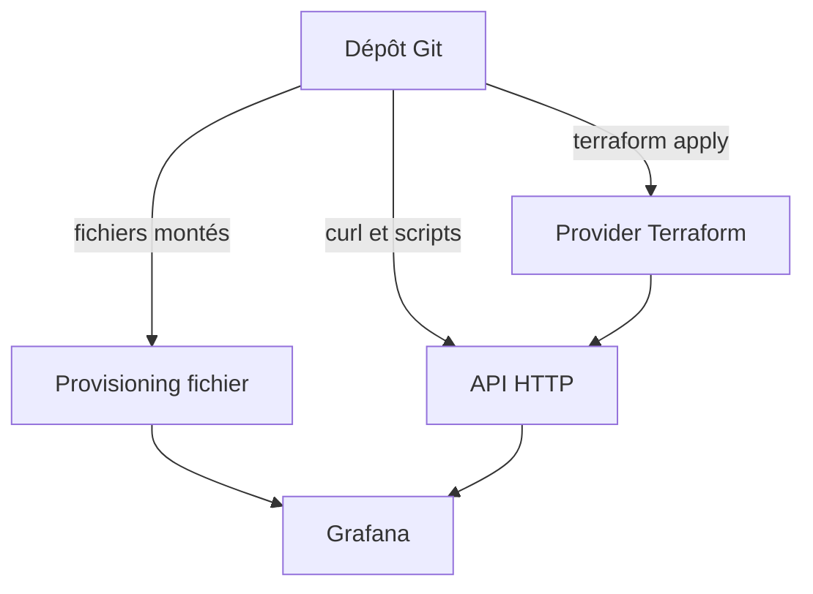
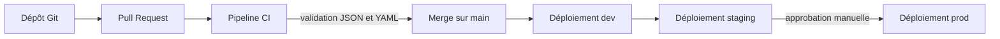

# Provisioning, API et versionnement

## Objectifs pédagogiques

À la fin de ce module, vous saurez :

- **Déclarer** des Data Sources et des dashboards par fichiers YAML et JSON pour qu'une instance Grafana se reconstruise seule au démarrage.
- **Expliquer** le rôle de l'UID (Unique Identifier) et du champ `version` dans un dashboard, et ce qui se passe quand ils changent.
- **Automatiser** avec `curl` et un token de Service Account la création de dossiers, l'import de dashboards, la gestion de permissions et le chargement de règles d'alerte.
- **Organiser** un dépôt Git de configuration Grafana, avec une revue de modifications lisible et une promotion dev → staging → production.
- **Anticiper** le conflit entre modifications faites dans l'interface et provisioning par fichier, puis écrire une première ressource avec le provider Terraform Grafana.

## Mise en situation

Une équipe plateforme de quatre personnes gère trois instances Grafana : dev, staging et production. Au départ, tout s'est fait à la main, ce qui est normal quand on découvre l'outil. Les Data Sources ont été créées dans l'interface, les dashboards copiés de l'un à l'autre via « Export » puis « Import », et les alertes recréées une par une.

Après six mois, le volume Docker de la production est corrompu. Il faut tout reconstruire. Personne ne sait quels dashboards de prod avaient été modifiés depuis l'export précédent. Les Data Sources ont des noms légèrement différents entre environnements, donc les panels importés affichent « datasource not found ». Et la règle d'alerte sur la latence de l'API, retouchée trois fois par trois personnes, n'existe plus que dans la mémoire de l'une d'elles.

Le problème n'est pas Grafana, c'est que sa configuration n'existe qu'à un seul endroit : la base interne de l'instance. Ce module montre comment la sortir de là pour la mettre dans Git, où elle se relit, se compare, se restaure et se déploie.

## Trois canaux pour piloter Grafana sans cliquer

Grafana offre plusieurs moyens de recevoir sa configuration de l'extérieur. Ils se complètent, mais ils ne se valent pas selon la situation.



Terraform ne contourne pas l'API : il l'appelle pour vous, avec une couche d'état et de planification en plus.

| Critère | Provisioning fichier | API HTTP (`curl`, scripts) | Provider Terraform |
|---|---|---|---|
| Où ça s'exécute | Sur l'instance (fichiers lus au démarrage et périodiquement) | À distance, n'importe quand | À distance, depuis un poste ou un pipeline |
| Idéal pour | Data Sources, dashboards, alerting de base | Actions ponctuelles, export, migration, dépannage | Gérer l'ensemble de l'instance en code, avec `plan` avant `apply` |
| Détecte les dérives | Non, il réapplique | Non | Oui, via l'état et `terraform plan` |
| Demande un accès au système de fichiers | Oui (volume, ConfigMap) | Non | Non |
| Convient à Grafana Cloud | Pas de fichiers à monter | Oui | Oui |

🧠 **Concept clé** : quel que soit le canal, la règle est qu'un objet donné n'a qu'**un seul propriétaire**. Un dashboard géré par fichier ne se modifie pas en parallèle par Terraform, et inversement. Les conflits entre outils sont la première source de comportements déroutants dans ce domaine.

## Mise en place : une instance qui se configure au démarrage

Le principe du provisioning par fichiers est simple. Grafana lit au démarrage le répertoire `/etc/grafana/provisioning` (emplacement modifiable via `paths.provisioning`), qui contient un sous-dossier par type d'objet :

```text
provisioning/
├── datasources/    # Data Sources
├── dashboards/     # providers : où trouver les fichiers JSON
├── alerting/       # règles, contact points, policies
├── plugins/        # configuration d'applications
└── access-control/ # rôles personnalisés (selon l'édition)
```

Voici un environnement local minimal, avec les fichiers montés en lecture seule. Ce détail compte : l'instance ne doit pas pouvoir écrire dans sa propre configuration.

```yaml
# docker-compose.yml
services:
  prometheus:
    image: prom/prometheus
    ports: ["9090:9090"]

  grafana:
    image: grafana/grafana   # en vrai projet : épingler une version précise
    ports: ["3000:3000"]
    environment:
      GF_SECURITY_ADMIN_PASSWORD: ${GF_ADMIN_PASSWORD}
      PROM_URL: http://prometheus:9090
    volumes:
      - ./provisioning:/etc/grafana/provisioning:ro
      - ./dashboards:/dashboards:ro
      - grafana-data:/var/lib/grafana
    depends_on: [prometheus]

volumes:
  grafana-data:
```

Pour vérifier que Grafana a bien lu vos fichiers, regardez les logs plutôt que l'interface. Une erreur de syntaxe YAML y est signalée immédiatement, alors qu'à l'écran vous verriez simplement « rien ».

```bash
docker compose up -d
docker compose logs grafana | grep -i provisioning
```

Vous devriez voir des lignes du logger `provisioning.datasources` et `provisioning.dashboard` indiquant l'insertion ou la mise à jour des objets (le libellé exact varie selon la version).

## Provisioning des Data Sources

Voici le fichier qui remplace les clics du module 5 :

```yaml
# provisioning/datasources/prometheus.yaml
apiVersion: 1

datasources:
  - name: Prometheus
    uid: prom-main
    type: prometheus
    access: proxy
    url: ${PROM_URL}
    isDefault: true
    editable: false
    jsonData:
      timeInterval: 15s
    # Pour une source authentifiée :
    # basicAuth: true
    # basicAuthUser: grafana
    # secureJsonData:
    #   basicAuthPassword: ${PROM_PASSWORD}

# Supprimer proprement une source retirée du dépôt
deleteDatasources:
  - name: Prometheus-old
    orgId: 1
```

Trois choses méritent d'être soulignées.

**L'UID est la clé de voûte.** Chaque panel d'un dashboard référence sa source par UID, pas par nom : `{"type": "prometheus", "uid": "prom-main"}`. Si vous fixez l'UID dans le fichier (et le gardez identique entre dev, staging et prod), le même JSON de dashboard fonctionne partout. Si vous laissez Grafana en générer un, chaque environnement aura le sien, et vous retrouverez le « datasource not found » de la mise en situation.

**Les secrets passent par `secureJsonData` et les variables d'environnement.** Grafana remplace `$VAR` ou `${VAR}` dans les fichiers de provisioning par la valeur de la variable d'environnement au chargement. Le dépôt Git contient donc `${PROM_PASSWORD}`, jamais le mot de passe. Pour écrire un vrai caractère `$` (dans un mot de passe, par exemple), doublez-le : `$$`.

**`editable: false`** interdit la modification de la source depuis l'interface. C'est le comportement voulu en production : si quelqu'un doit changer l'URL, il passe par une Pull Request.

💡 **Astuce** : pour valider une Data Source après déploiement sans ouvrir l'interface, appelez le point de santé de l'API :

```bash
curl -s -H "Authorization: Bearer <TOKEN>" \
  <GRAFANA_URL>/api/datasources/uid/<DS_UID>/health
```

## Provisioning des dashboards

Le provisioning de dashboards fonctionne en deux temps. Un **provider** (un fichier YAML) dit à Grafana où chercher. Les dashboards eux-mêmes sont des fichiers JSON dans ce répertoire.

```yaml
# provisioning/dashboards/default.yaml
apiVersion: 1

providers:
  - name: fichiers-git
    orgId: 1
    type: file
    disableDeletion: true
    allowUiUpdates: false
    updateIntervalSeconds: 30
    options:
      path: /dashboards
      foldersFromFilesStructure: true
```

Avec `foldersFromFilesStructure: true`, chaque sous-répertoire de `/dashboards` devient un dossier Grafana : `dashboards/infra/node.json` atterrit dans le dossier « infra ». N'utilisez pas en même temps l'option `folder` du provider, qui fait double emploi.

### Anatomie d'un dashboard JSON

Un dashboard exporté fait vite plusieurs milliers de lignes, mais seuls quelques champs structurent l'ensemble :

```json
{
  "id": null,
  "uid": "api-latency",
  "title": "API — Latence et erreurs",
  "tags": ["api", "prod"],
  "schemaVersion": 39,
  "version": 1,
  "time": { "from": "now-6h", "to": "now" },
  "panels": [
    {
      "type": "timeseries",
      "title": "Requêtes par seconde",
      "gridPos": { "h": 8, "w": 12, "x": 0, "y": 0 },
      "datasource": { "type": "prometheus", "uid": "prom-main" },
      "targets": [
        { "refId": "A", "expr": "sum(rate(http_requests_total[5m]))" }
      ]
    }
  ]
}
```

- **`id`** est un numéro interne propre à chaque base. Mettez-le à `null` dans tout fichier versionné : il n'a de sens que sur l'instance qui l'a attribué, et s'il traîne, l'import vers une autre instance échoue ou écrase le mauvais objet.
- **`uid`** est l'identité stable. Liens entre dashboards, URL partagées (`/d/api-latency/...`), favoris et références depuis les alertes s'appuient dessus. Changer l'UID revient à créer un autre dashboard et à casser tout ce qui pointait vers l'ancien.
- **`version`** est un compteur que Grafana incrémente à chaque sauvegarde dans sa base. Il sert à détecter les modifications concurrentes (nous y reviendrons avec l'API). Dans un fichier provisionné, Git est votre historique ; ne cherchez pas à tenir ce champ à jour à la main.
- **`schemaVersion`** indique le format du JSON. Grafana migre automatiquement les anciens schémas à l'ouverture. Les versions récentes introduisent aussi de nouveaux formats de dashboard ; le détail varie selon la version installée.

⚠️ **Erreur fréquente** : copier un export « Export for sharing externally » dans le dépôt. Ce mode remplace les Data Sources par des variables `${DS_PROMETHEUS}` pensées pour l'import manuel. Pour du provisioning, utilisez plutôt l'export JSON standard (« Export as JSON » sans partage externe), dont les références à des UID fixes fonctionnent telles quelles.

## Le piège central : le fichier a toujours raison

Un dashboard provisionné n'est pas un dashboard comme les autres. Grafana le marque comme géré par fichier, et le comportement dépend de `allowUiUpdates` :

- **`allowUiUpdates: false`** (valeur par défaut) : le bouton de sauvegarde est refusé (« Cannot save provisioned dashboard »). On peut toujours « Save as » pour faire une copie ou exporter le JSON. C'est ce qu'on veut en staging et en production.
- **`allowUiUpdates: true`** : l'interface accepte la sauvegarde, et c'est là que le piège se referme. La modification est écrite dans la base, mais le fichier sur disque n'a pas bougé. Dès que ce fichier est modifié (nouveau déploiement, nouveau commit), Grafana le recharge et **écrase la version de l'interface**. Le travail de la personne qui avait édité le panel disparaît sans avertissement.

Deux autres effets de bord du même mécanisme :

- Avec `disableDeletion: false`, **supprimer le fichier supprime le dashboard** dans Grafana au prochain scan. Ça peut être voulu, mais pas lors d'un déploiement qui oublie un volume.
- Si deux fichiers déclarent le même UID, Grafana ne garde qu'un des deux et le signale dans les logs. Lequel ? Ne comptez pas là-dessus.

Le bon réflexe est donc un sens unique : on édite dans l'interface sur **dev**, on exporte le JSON, on le commit, et staging et prod le reçoivent par fichier. L'interface est un outil de conception, Git est la source de vérité.

💡 **Astuce** : en dev, mettre `allowUiUpdates: true` est une bonne idée si l'équipe adopte la règle « on exporte avant de pousser ». Vous gardez la liberté du clic et vous évitez d'éditer du JSON à la main.

## L'API HTTP et `curl`

Le provisioning couvre le déploiement de l'état voulu. L'API sert à tout ce qui est dynamique : exporter, migrer, auditer, corriger un point précis. Chaque appel a besoin d'un token. Un Service Account avec le rôle minimal nécessaire fait l'affaire (création et permissions déjà vues au module précédent). Passez-le en en-tête `Authorization: Bearer`.

```bash
export GRAFANA_URL=http://localhost:3000
export TOKEN=<TOKEN>      # token de Service Account

# 1. L'instance répond-elle ? (aucune authentification requise)
curl -s $GRAFANA_URL/api/health

# 2. Lister les dashboards
curl -s -H "Authorization: Bearer $TOKEN" \
  "$GRAFANA_URL/api/search?type=dash-db&query=api" | jq '.[] | {uid, title, folderTitle}'
```

### Exporter proprement un dashboard vers Git

L'API renvoie le dashboard dans une enveloppe avec ses métadonnées. Pour obtenir un fichier prêt à être versionné, on ne garde que le JSON du dashboard, sans `id` ni `version`, et trié par clé pour que les diffs Git restent lisibles :

```bash
curl -s -H "Authorization: Bearer $TOKEN" \
  $GRAFANA_URL/api/dashboards/uid/api-latency \
  | jq -S '.dashboard | del(.id, .version)' > dashboards/app/api-latency.json
```

Le tri (`-S`) est important : sans lui, l'ordre des clés peut changer d'un export à l'autre, et la revue de code se noie dans des différences sans signification.

### Créer les dossiers, importer un dashboard

```bash
# Créer un dossier avec un UID fixe
curl -s -X POST $GRAFANA_URL/api/folders \
  -H "Authorization: Bearer $TOKEN" -H "Content-Type: application/json" \
  -d '{"uid": "app", "title": "Application"}'

# Importer (ou mettre à jour) un dashboard dans ce dossier
jq -n --slurpfile d dashboards/app/api-latency.json \
  '{dashboard: $d[0], folderUid: "app", overwrite: true, message: "import depuis Git"}' \
| curl -s -X POST $GRAFANA_URL/api/dashboards/db \
  -H "Authorization: Bearer $TOKEN" -H "Content-Type: application/json" -d @-
```

Le champ `overwrite: true` mérite une explication. Sans lui, Grafana protège contre les écrasements involontaires : si le dashboard existe déjà et que la `version` envoyée ne correspond pas à celle de la base, ou si un dashboard du même nom existe dans le dossier, la requête est rejetée (HTTP 412). Avec `overwrite: true`, vous dites « mon fichier est la référence, remplace ». C'est exactement ce que veut un pipeline de déploiement, mais pas ce que veut un script qui bricole sur une instance partagée.

### Permissions d'un dossier

Les permissions se règlent au niveau du dossier, et les dashboards qu'il contient en héritent :

```bash
# Lire les permissions actuelles
curl -s -H "Authorization: Bearer $TOKEN" \
  $GRAFANA_URL/api/folders/app/permissions | jq

# Définir les permissions (1 = View, 2 = Edit, 4 = Admin)
curl -s -X POST $GRAFANA_URL/api/folders/app/permissions \
  -H "Authorization: Bearer $TOKEN" -H "Content-Type: application/json" \
  -d '{"items": [
        {"role": "Editor", "permission": 2},
        {"teamId": 3,      "permission": 2},
        {"role": "Viewer", "permission": 1}
      ]}'
```

⚠️ **Erreur fréquente** : ce `POST` **remplace** la liste complète. Si vous envoyez seulement `{"teamId": 3, "permission": 2}`, toutes les autres entrées disparaissent (seul le rôle Admin d'organisation garde son accès implicite). Faites toujours un `GET` d'abord, ajoutez votre ligne, puis renvoyez la liste entière. Les endpoints exacts de permissions évoluent avec la gestion des accès (RBAC) ; vérifiez la référence de votre version.

### Recharger sans redémarrer

Après un changement de fichiers sur une instance déjà démarrée, inutile de la redémarrer :

```bash
curl -s -X POST -u admin:$GF_ADMIN_PASSWORD \
  $GRAFANA_URL/api/admin/provisioning/dashboards/reload
```

Des endpoints équivalents existent pour `datasources` et `alerting`. Ils exigent le rôle Grafana Server Admin. Un token de Service Account ne le porte normalement pas, d'où l'authentification Basic d'un compte Server Admin ci-dessus (voir la documentation de l'Admin API de votre version).

## Alertes : fichiers et API

Pour l'alerting, deux outils cohabitent, avec la même logique de propriété que pour les dashboards.

**Par fichiers**, dans `provisioning/alerting/`, vous pouvez déclarer groupes de règles, contact points, policies et mute timings. Exemple pour un contact point :

```yaml
# provisioning/alerting/contact-points.yaml
apiVersion: 1

contactPoints:
  - orgId: 1
    name: oncall-webhook
    receivers:
      - uid: oncall-webhook-1
        type: webhook
        settings:
          url: http://alert-gateway:8080/hook
```

**Par l'API de provisioning** (`/api/v1/provisioning/...`), vous pouvez créer et modifier règles, contact points, policies, templates et mute timings à distance. L'astuce la plus utile ici est de ne pas écrire les règles à la main : concevez-les dans l'interface de dev, puis exportez-les.

```bash
curl -s -H "Authorization: Bearer $TOKEN" \
  "$GRAFANA_URL/api/v1/provisioning/alert-rules/export?format=yaml" \
  > provisioning/alerting/rules.yaml
```

Le format `yaml` est directement rechargeable par le provisioning fichier ; d'autres formats (JSON, HCL pour Terraform) sont proposés selon la version.

⚠️ **Erreur fréquente** : une règle créée via l'API de provisioning reçoit un marqueur de **provenance**. Résultat, elle devient non modifiable dans l'interface, avec un verrou qui ressemble au cas des dashboards. Si vous voulez continuer à l'éditer à la main (en dev par exemple), ajoutez l'en-tête `X-Disable-Provenance: true` à vos appels d'écriture. En production, laissez le verrou : c'est un garde-fou.

Dernier point : l'arbre de notification policies est une ressource **unique** par organisation. Un `PUT` sur `/api/v1/provisioning/policies` le remplace en entier, comme les permissions de dossier plus haut. Le routage lui-même n'est pas détaillé ici ; retenez seulement que sa mise à jour automatisée est un « tout ou rien ».

## Versionner dans Git et relire les changements

Un dépôt de configuration Grafana n'a pas besoin d'être sophistiqué. Une structure qui tient bien dans le temps :

```text
grafana-config/
├── provisioning/
│   ├── datasources/
│   ├── dashboards/        # providers uniquement
│   └── alerting/
├── dashboards/
│   ├── infra/
│   └── app/
├── envs/
│   ├── dev.env
│   ├── staging.env
│   └── prod.env           # sans secrets : uniquement des URL et des noms
├── scripts/
│   ├── export-dashboard.sh
│   └── validate.sh
└── terraform/             # si vous franchissez ce pas, voir plus bas
```

Une Pull Request qui modifie un dashboard produit un diff JSON. Il est rarement lisible tel quel, d'où trois habitudes qui changent tout :

1. **Normaliser à l'export** avec `jq -S` et retirer `id` et `version`, comme vu plus haut.
2. **Un commit par intention** : « ajouter le panel de saturation CPU » plutôt que « maj dashboards ». Un relecteur doit pouvoir confronter le diff à une phrase.
3. **Valider automatiquement en CI** pour attraper les erreurs bêtes avant qu'elles n'arrivent sur une instance :

```bash
#!/usr/bin/env bash
# scripts/validate.sh : à lancer sur chaque Pull Request
set -euo pipefail

# 1. Tout le JSON est valide
find dashboards -name '*.json' -print0 | xargs -0 -n1 jq empty

# 2. Aucun dashboard ne garde d'id numérique au premier niveau
bad=$(find dashboards -name '*.json' -exec jq -r 'select(.id != null) | input_filename' {} +)
[ -z "$bad" ] || { echo "id numérique à mettre à null : $bad"; exit 1; }

# 3. Les UID sont uniques
dups=$(find dashboards -name '*.json' -exec jq -r '.uid' {} + | sort | uniq -d)
[ -z "$dups" ] || { echo "UID en double : $dups"; exit 1; }
```

Le deuxième contrôle ne regarde que l'`id` de premier niveau : les panels portent eux aussi un `id` numérique, qui est normal. Mieux vaut un garde-fou simple mais actif qu'une revue qui compte sur l'œil humain.

Vous croiserez aussi des outils qui génèrent le JSON à partir de code (Jsonnet, SDK), ou la fonction Git Sync de Grafana. Ils sont utiles pour de très gros parcs de dashboards, mais Git Sync évolue encore et son comportement dépend de la version ; pour démarrer, le provisioning par fichiers reste l'approche la mieux éprouvée.

## Séparer dev, staging et production

Le but est d'avoir **le même contenu** à chaque étape, et seulement ce qui change réellement (URLs, secrets, durées de rétention) injecté de l'extérieur. Grafana rend cela facile grâce à deux choix déjà faits : UID fixes pour les Data Sources, et interpolation de variables d'environnement dans les fichiers.



Une organisation qui fonctionne bien en pratique :

| | Dev | Staging | Production |
|---|---|---|---|
| Rôle | Concevoir et expérimenter | Valider avec des données proches du réel | Servir les équipes |
| `allowUiUpdates` | `true` | `false` | `false` |
| `editable` des Data Sources | `true` | `false` | `false` |
| Qui déploie | Automatique au merge | Automatique après dev | Approbation humaine |
| Token d'API | Large | Restreint | Restreint, rotation planifiée |

Utilisez des **instances distinctes** et non des dossiers « dev » et « prod » dans la même instance : un dashboard en cours de conception ne doit pas partager de permissions, de quotas ou de pannes avec la production. Chaque instance a ses propres tokens, jamais réutilisés.

Si vous voulez qu'un même fichier fonctionne partout, les URLs viennent de variables :

```yaml
url: ${PROM_URL}      # dev : http://prometheus:9090 | prod : https://prom.internal.example
```

## Introduction au provider Terraform Grafana

Terraform est pertinent quand vous voulez piloter Grafana **à distance** (pas de fichiers à monter, cas typique de Grafana Cloud), voir ce qui va changer avant d'appliquer (`terraform plan`), ou détecter qu'une instance a dérivé de ce qui est déclaré.

Un premier exemple minimal :

```hcl
terraform {
  required_providers {
    grafana = {
      source  = "grafana/grafana"
      version = "~> 3.0"   # épingler une version majeure ; adapter à la version courante
    }
  }
}

provider "grafana" {
  url  = var.grafana_url
  auth = var.grafana_token   # token de Service Account
}

resource "grafana_folder" "app" {
  uid   = "app"
  title = "Application"
}

resource "grafana_data_source" "prometheus" {
  uid  = "prom-main"
  type = "prometheus"
  name = "Prometheus"
  url  = var.prometheus_url   # injectée par environnement, comme ${PROM_URL}
}

resource "grafana_dashboard" "api_latency" {
  folder      = grafana_folder.app.uid
  config_json = file("${path.module}/../dashboards/app/api-latency.json")
}
```

Le dashboard reste le même fichier JSON que dans le provisioning : vous ne réécrivez pas vos dashboards, vous changez seulement le véhicule de déploiement. L'ordre de création (dossier avant dashboard) est géré par le graphe de dépendances, car `folder` référence `grafana_folder.app.uid`.

```bash
terraform init
terraform plan      # lire ce qui va être créé, modifié, détruit
terraform apply
```

Deux points d'attention dès le premier jour :

- **L'état Terraform contient des secrets** si vous déclarez des mots de passe de Data Sources. Stockez-le dans un backend chiffré et à accès restreint, jamais dans Git.
- **Ne mélangez pas les propriétaires.** Une Data Source déclarée par Terraform ne doit pas aussi exister dans un fichier de provisioning, sinon chaque outil essaie de reprendre la main sur l'autre.

La gestion avancée (modules, import de ressources existantes, états multiples) relève du module sur Grafana as Code. Ici, l'objectif est de savoir que cette porte existe et à quoi elle ressemble.

## Diagnostic : erreurs fréquentes

| Symptôme | Cause probable | Correction |
|---|---|---|
| Le dashboard n'apparaît pas après déploiement | Chemin `options.path` incorrect, fichier illisible par l'utilisateur du conteneur, JSON invalide | `docker compose logs grafana \| grep -i provisioning` ; vérifier le montage et passer le fichier dans `jq empty` |
| « Cannot save provisioned dashboard » | Comportement normal avec `allowUiUpdates: false` | Exporter le JSON depuis l'interface, le commiter, redéployer |
| Panels en « datasource not found » après un déploiement | L'UID de la Data Source diffère de celui référencé dans le JSON | Fixer `uid` dans le fichier de provisioning, aligner tous les environnements |
| Les modifications faites dans l'interface ont disparu | `allowUiUpdates: true` et fichier modifié ensuite | Exporter *avant* de pousser ; en prod, passer à `false` |
| Dashboard supprimé après un déploiement | Fichier absent et `disableDeletion: false` | Vérifier le volume monté ; garder `disableDeletion: true` en prod |
| API : HTTP 412 à l'import | Version obsolète ou nom déjà utilisé dans le dossier | `overwrite: true` pour un déploiement piloté par Git |
| API : 401 ou 403 | Token absent, expiré ou rôle insuffisant | Contrôler l'en-tête `Authorization: Bearer` et le rôle du Service Account |
| Règle d'alerte non éditable dans l'interface | Provenance posée par l'API de provisioning | Ajouter `X-Disable-Provenance: true` si l'édition manuelle est voulue |
| Dashboard dupliqué après import | `id` numérique laissé dans le JSON, ou UID modifié | `id: null`, UID conservé d'une version à l'autre |
| Diff Terraform permanent sur un dashboard | JSON modifié en parallèle dans l'interface, ou champs ajoutés par Grafana | Désigner un seul propriétaire ; selon la version, comparer après normalisation `jq -S` |

## Cas réel : une plateforme qui se reconstruit en quelques minutes

*Scénario illustratif, les chiffres sont fictifs et servent d'ordre de grandeur.*

Reprenons l'équipe de la mise en situation. Après l'incident de volume, elle décide d'investir deux semaines. La première étape (v1) est un simple export : un script `curl` + `jq -S` récupère tous les dashboards et les commit dans un dépôt. Rien ne change dans le fonctionnement quotidien, mais pour la première fois il existe une copie lisible et datée.

Deuxième étape (v2) : les Data Sources passent en provisioning avec des UID fixes, les dashboards sont servis depuis le dépôt (`allowUiUpdates: false` en staging et prod), et les contact points sont déclarés par fichier. Le saut vient de ce que l'instance de production devient **jetable** : on peut la détruire et la recréer, elle se reconfigure seule.

Troisième étape (v3) : un pipeline CI valide le JSON et les UID, déploie automatiquement sur dev, puis staging, et attend un clic pour la production. Les règles d'alerte sont conçues sur dev, exportées en YAML, relues en Pull Request. Quelqu'un teste à froid la procédure de reconstruction complète.

Résultat sur ce scénario : une reconstruction d'instance qui prenait environ deux jours de bricolage passe à une vingtaine de minutes (démarrage du conteneur et premier cycle de provisioning). Les modifications sauvages en production disparaissent, et chaque changement de seuil d'alerte a un auteur, une date et une raison dans l'historique Git.

## Bonnes pratiques

- **Fixez les UID** des Data Sources, des dossiers et des dashboards. C'est la condition pour que les mêmes fichiers marchent dans tous les environnements et que les liens ne cassent pas.
- **Gardez les secrets hors du dépôt.** Référencez-les par `${VARIABLE}` dans les fichiers, injectez-les depuis un gestionnaire de secrets, et limitez les droits de chaque token à ce que l'automatisation fait réellement.
- **Écrivez des déploiements idempotents.** Rejouer le pipeline deux fois doit donner le même résultat : `overwrite: true`, UID fixes, ressources déclarées plutôt que créées par séquences de commandes.
- **Un seul propriétaire par objet** : fichier, API ou Terraform, mais jamais deux. Documentez-le dans le dépôt, sinon quelqu'un finira par changer de méthode « juste pour cette fois ».
- **Verrouillez la production** (`allowUiUpdates: false`, `editable: false`, provenance active) et gardez l'interface en dev pour la conception. Le verrou est une aide, pas une punition.
- **Validez avant de déployer** : JSON valide, UID uniques, pas d'`id` numérique. Quelques lignes de CI évitent la plupart des incidents de configuration.
- **Surveillez l'automatisation elle-même.** Un échec de provisioning se lit dans les logs de Grafana (`provisioning.*`) et dans le statut du pipeline. Faites remonter les deux, sinon une configuration périmée restera en place sans que personne ne le sache.
- **Testez la reconstruction à froid**, instance vide, depuis le dépôt seul. Un dépôt qui n'a jamais été rejoué n'est qu'une hypothèse de sauvegarde.

## Résumé

Une instance Grafana configurée à la main stocke tout dans sa base : impossible de la reconstruire, de relire un changement ou de savoir ce qui diffère entre dev et prod. Le provisioning par fichiers (YAML pour les Data Sources, providers et alerting ; JSON pour les dashboards) déplace cette vérité dans Git, avec l'UID comme identité stable. L'API HTTP complète l'ensemble pour exporter, importer, régler des permissions et charger des règles, et Terraform l'enveloppe quand on veut piloter à distance avec un plan avant application. Le piège central reste de savoir qui possède chaque objet : le fichier écrase l'interface, l'API de provisioning verrouille les alertes, et deux outils ne doivent jamais se partager la même ressource. Ces bases permettent d'assembler, dans le module suivant, une première observabilité de bout en bout pour une application Web.

<!-- snippet
id: grafana_provisioning_uid_stable
type: concept
tech: grafana
level: intermediate
importance: high
format: knowledge
tags: grafana,provisioning,uid,datasource
title: Fixer l'UID des Data Sources pour des dashboards portables
content: Un panel référence sa source par UID ({"type":"prometheus","uid":"prom-main"}), pas par nom. Si l'UID est fixé dans le fichier de provisioning et identique en dev, staging et prod, le même JSON fonctionne partout. Sans UID fixe, Grafana en génère un par instance et les panels affichent "datasource not found".
description: L'UID est l'identité stable d'une Data Source : le fixer dans le YAML rend un dashboard JSON déployable à l'identique sur tous les environnements.
-->

<!-- snippet
id: grafana_provisioning_ui_overwritten
type: warning
tech: grafana
level: intermediate
importance: high
format: knowledge
tags: grafana,provisioning,dashboards,allowuiupdates
title: Le provisioning fichier écrase les modifications de l'UI
content: Piège : avec allowUiUpdates true, une sauvegarde dans l'interface va en base mais le fichier n'est pas modifié. Conséquence : au prochain changement du fichier (déploiement, commit), Grafana le recharge et écrase la version de l'UI sans avertissement. Correction : éditer en dev, exporter le JSON vers Git, redéployer ; mettre allowUiUpdates false en staging et prod.
description: Le fichier est la source de vérité d'un dashboard provisionné ; toute édition faite uniquement dans l'UI est perdue au prochain rechargement du fichier.
-->

<!-- snippet
id: grafana_provisioning_disable_deletion
type: warning
tech: grafana
level: intermediate
importance: medium
format: knowledge
tags: grafana,provisioning,dashboards,disabledeletion
title: Supprimer un fichier peut supprimer le dashboard
content: Piège : avec disableDeletion false dans le provider, un fichier JSON absent (volume non monté, mauvais chemin) fait supprimer le dashboard correspondant au scan suivant. Conséquence : dashboards disparus en production après un déploiement raté. Correction : disableDeletion true en prod et vérifier le montage du volume avant chaque déploiement.
description: Le provider de dashboards synchronise aussi les suppressions : un répertoire vide ou mal monté vide Grafana si disableDeletion vaut false.
-->

<!-- snippet
id: grafana_provisioning_env_secrets
type: tip
tech: grafana
level: intermediate
importance: high
format: knowledge
tags: grafana,provisioning,secrets,securite
title: Injecter les secrets par variables d'environnement
content: Dans un fichier de provisioning, écrire secureJsonData: { basicAuthPassword: "${PROM_PASSWORD}" } et fournir PROM_PASSWORD au conteneur (secret Docker, Kubernetes Secret). Grafana remplace $VAR ou ${VAR} au chargement. Pour un vrai caractère $ dans une valeur, le doubler en $$. Le dépôt Git ne contient jamais le mot de passe.
description: Grafana interpole les variables d'environnement dans les fichiers YAML de provisioning ; les secrets restent hors Git et un $ littéral s'écrit $$.
-->

<!-- snippet
id: grafana_api_reload_provisioning
type: command
tech: grafana
level: intermediate
importance: medium
format: knowledge
tags: grafana,api,provisioning,reload
title: Recharger le provisioning des dashboards sans redémarrer
context: Après modification des fichiers sur une instance déjà démarrée ; rôle Grafana Server Admin requis (authentification Basic, un token de Service Account ne suffit normalement pas)
command: curl -s -X POST -u <ADMIN>:<MOT_DE_PASSE> <GRAFANA_URL>/api/admin/provisioning/dashboards/reload
example: curl -s -X POST -u admin:<MOT_DE_PASSE> http://localhost:3000/api/admin/provisioning/dashboards/reload
description: Force la relecture des fichiers de dashboards ; des endpoints analogues existent pour datasources et alerting, sans redémarrer Grafana.
-->

<!-- snippet
id: grafana_api_export_dashboard_git
type: command
tech: grafana
level: intermediate
importance: high
format: knowledge
tags: grafana,api,git,export,jq
title: Exporter un dashboard en JSON prêt pour Git
command: curl -s -H "Authorization: Bearer <TOKEN>" <GRAFANA_URL>/api/dashboards/uid/<UID> | jq -S '.dashboard | del(.id, .version)' > <FICHIER>.json
example: curl -s -H "Authorization: Bearer glsa_xxxxxxxx" http://localhost:3000/api/dashboards/uid/api-latency | jq -S '.dashboard | del(.id, .version)' > api-latency.json
description: Extrait le dashboard de son enveloppe, retire id et version propres à l'instance, trie les clés pour des diffs Git stables.
-->

<!-- snippet
id: grafana_api_import_dashboard_overwrite
type: command
tech: grafana
level: intermediate
importance: high
format: knowledge
tags: grafana,api,dashboards,import,ci
title: Importer un dashboard dans un dossier avec écrasement
command: jq -n --slurpfile d <FICHIER>.json '{dashboard: $d[0], folderUid: "<FOLDER_UID>", overwrite: true}' | curl -s -X POST -H "Authorization: Bearer <TOKEN>" -H "Content-Type: application/json" -d @- <GRAFANA_URL>/api/dashboards/db
example: jq -n --slurpfile d api-latency.json '{dashboard: $d[0], folderUid: "app", overwrite: true}' | curl -s -X POST -H "Authorization: Bearer glsa_xxxxxxxx" -H "Content-Type: application/json" -d @- http://localhost:3000/api/dashboards/db
description: Enveloppe le JSON du dashboard et le pousse via l'API ; overwrite true rend l'opération rejouable depuis un pipeline.
-->

<!-- snippet
id: grafana_api_folder_permissions_replace
type: warning
tech: grafana
level: intermediate
importance: high
format: knowledge
tags: grafana,api,permissions,dossiers
title: Le POST de permissions de dossier remplace tout
content: Piège : POST /api/folders/<UID>/permissions remplace la liste complète des permissions. Conséquence : envoyer une seule ligne supprime toutes les autres (seul le rôle Admin d'organisation garde un accès implicite). Correction : faire d'abord un GET, ajouter ou modifier l'entrée voulue, puis renvoyer la liste entière (1 = View, 2 = Edit, 4 = Admin).
description: L'API de permissions de dossier est un remplacement total et non un ajout : lire l'existant avant d'écrire pour ne pas retirer d'accès par erreur.
-->

<!-- snippet
id: grafana_alerting_disable_provenance
type: tip
tech: grafana
level: intermediate
importance: medium
format: knowledge
tags: grafana,alerting,api,provenance
title: Garder les règles éditables avec X-Disable-Provenance
content: Une règle créée via /api/v1/provisioning/alert-rules reçoit une provenance et devient non éditable dans l'UI. Pour continuer à l'éditer à la main (dev), ajouter l'en-tête -H "X-Disable-Provenance: true" à chaque requête d'écriture. En production, ne pas l'ajouter : le verrou évite les modifications hors Git.
description: L'API de provisioning d'alerting verrouille par défaut dans l'interface les objets qu'elle crée ; l'en-tête X-Disable-Provenance true lève ce verrou.
-->

<!-- snippet
id: grafana_alerting_export_rules_yaml
type: command
tech: grafana
level: intermediate
importance: medium
format: knowledge
tags: grafana,alerting,export,provisioning
title: Exporter les règles d'alerte en YAML provisionnable
context: Les règles sont conçues dans l'UI de dev ; le format exporté dépend de la version de Grafana
command: curl -s -H "Authorization: Bearer <TOKEN>" "<GRAFANA_URL>/api/v1/provisioning/alert-rules/export?format=yaml" > <FICHIER>.yaml
example: curl -s -H "Authorization: Bearer glsa_xxxxxxxx" "http://localhost:3000/api/v1/provisioning/alert-rules/export?format=yaml" > provisioning/alerting/rules.yaml
description: Génère un fichier directement utilisable dans provisioning/alerting ; évite d'écrire les règles à la main, d'autres formats comme HCL existent selon la version.
-->

<!-- snippet
id: grafana_api_error_412_import
type: error
tech: grafana
level: intermediate
importance: medium
format: knowledge
tags: grafana,api,dashboards,erreur
title: HTTP 412 à l'import d'un dashboard
content: Symptôme : POST /api/dashboards/db renvoie 412. Cause : le dashboard existe déjà avec une version différente, ou un dashboard du même nom est présent dans le dossier. Correction : ajouter "overwrite": true dans le corps de la requête pour un déploiement piloté par Git, ou relire la version courante avant d'écrire.
description: Grafana protège contre les écrasements concurrents ; overwrite true dit explicitement que le fichier fait référence, adapté à un pipeline mais pas à un script manuel.
-->

<!-- snippet
id: grafana_git_normalize_json_diff
type: tip
tech: grafana
level: intermediate
importance: medium
format: knowledge
tags: grafana,git,jq,revue
title: Normaliser le JSON pour des diffs lisibles
content: Exporter chaque dashboard avec jq -S '.dashboard | del(.id, .version)' avant commit : les clés sont triées et les champs propres à l'instance sont retirés. Ajouter en CI jq empty sur chaque fichier et un contrôle d'unicité des UID. Un relecteur voit alors uniquement le changement fonctionnel, pas du bruit d'ordre de clés.
description: Trier les clés et retirer id et version à l'export évite des diffs de plusieurs centaines de lignes pour un changement d'un seul panel.
-->

<!-- snippet
id: grafana_terraform_single_owner
type: warning
tech: grafana
level: intermediate
importance: medium
format: knowledge
tags: grafana,terraform,provisioning,gouvernance
title: Un seul outil propriétaire par ressource Grafana
content: Piège : déclarer la même Data Source ou le même dashboard à la fois dans un fichier de provisioning et dans Terraform. Conséquence : chaque outil réapplique sa version, diffs permanents dans terraform plan, modifications qui s'annulent. Correction : choisir un propriétaire par type d'objet et le documenter dans le dépôt.
description: Fichier, API et Terraform ne doivent pas gérer le même objet : sinon ils se disputent la configuration et produisent des dérives difficiles à expliquer.
-->
