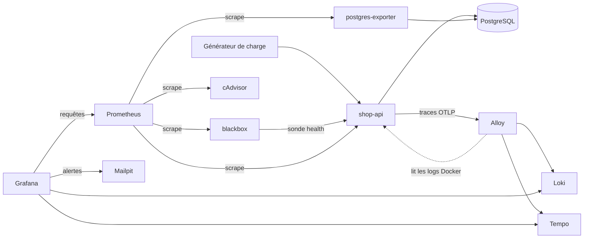

# Projet pratique — Observabilité d'une application Web

## Objectifs pédagogiques

À la fin de ce module, vous serez capable de :

- **Assembler** une mini-stack Grafana + Prometheus + Loki + Tempo autour d'une application conteneurisée (API + base de données) et la faire démarrer en une commande.
- **Instrumenter** une API pour qu'elle émette des métriques, des logs structurés et des traces qui se recoupent entre eux.
- **Construire** un dashboard d'infrastructure et un dashboard applicatif qui répondent à des questions d'exploitation distinctes.
- **Définir** des alertes de disponibilité, d'erreurs et de latence, avec un comportement explicite quand les données manquent, et les relier à une notification et à un runbook.
- **Rejouer** un incident applicatif, le diagnostiquer du symptôme jusqu'à la trace fautive, puis versionner l'ensemble pour qu'un collègue puisse le reproduire.

## Mise en situation

Une petite équipe de quatre développeurs maintient `shop-api`, une API de gestion de commandes adossée à PostgreSQL. Tout tourne dans des conteneurs sur un seul hôte. Jusqu'ici, le monitoring se résumait à un `docker stats` lancé à la main et à un `grep ERROR` dans les logs quand un client se plaignait.

Un jeudi, le support remonte « des lenteurs sur la liste des commandes ». Personne ne sait depuis quand, ni si c'est l'API, la base ou le réseau. Le développeur de garde ouvre trois terminaux, relit des logs sans pouvoir les rattacher à une requête précise, et finit par redémarrer le conteneur. Ça passe. Personne ne sait pourquoi, et ça recommencera.

La solution naïve (« on ajoute un dashboard CPU/RAM ») ne suffit plus. Le CPU de l'API était normal pendant la lenteur. Ce qui manque, c'est un chemin continu : une alerte qui prévient avant le client, un dashboard qui désigne la route fautive, une trace qui montre où le temps a été perdu, et les logs de *cette* requête-là. C'est ce chemin que vous construisez dans ce projet, et que vous allez casser volontairement pour vérifier qu'il tient.

## Ce qu'on construit, et pourquoi cette forme

Avant de taper la moindre ligne, il faut voir la stack comme un tout. Grafana n'y stocke rien : il interroge trois backends et envoie des mails quand une règle bascule. Chaque signal a son circuit de collecte.



| Composant | Rôle | Pourquoi lui |
|---|---|---|
| `shop-api` | API Flask qui expose `/orders`, `/health`, `/metrics` | Petite, lisible, et on y injecte des pannes à la demande |
| PostgreSQL + postgres-exporter | Données et métriques de la base (connexions, états) | Le deuxième suspect habituel d'une lenteur |
| cAdvisor | CPU, mémoire, redémarrages par conteneur | Vue infrastructure sans agent sur l'hôte |
| blackbox-exporter | Sonde HTTP externe sur `/health` | Mesure ce que voit un client, pas ce que l'app dit d'elle-même |
| Prometheus | Stockage des métriques | Source des alertes et des dashboards |
| Alloy | Collecteur : logs Docker → Loki, traces → Tempo | Un seul agent pour deux signaux |
| Loki / Tempo | Stockage des logs / des traces | Les deux autres piliers |
| Grafana | Dashboards, Explore, alerting | Point d'entrée unique |
| Mailpit | Faux serveur SMTP avec interface web | Voir les notifications sans compte Slack ni relais mail |

Trois choix de conception pèsent plus lourd que le reste, et on les fait dès le départ.

🧠 **Concept clé** — Les trois signaux ne servent à rien s'ils ne partagent pas de vocabulaire. Ici, le nom du service est `shop-api` partout : nom du service Docker (donc label Loki `service`), attribut `service.name` des traces, et job Prometheus. Le jour où vous passez d'une métrique à un log, vous changez d'outil, pas de nom.

Deuxième choix : le label `route` des métriques contient le *gabarit* de la route (`/orders/<int:oid>`), jamais l'URL brute (`/orders/48213`). Une URL brute crée une série temporelle par identifiant, et votre cardinalité explose avant même la première alerte.

Troisième choix : le `trace_id` est écrit dans chaque ligne de log, mais n'est **pas** un label Loki. C'est un identifiant unique par requête ; en faire un label créerait un flux par requête. On le retrouve par filtrage de contenu, et Grafana fait le saut automatiquement grâce à un champ dérivé.

## Construction progressive

On avance en trois versions. Chacune est utilisable seule, et chaque saut répond à une limite précise de la précédente.

### v1 — L'application et ses métriques

L'objectif : une API qui tourne, des métriques qui remontent, un premier dashboard. Rien de plus. Si cette étape ne marche pas, ajouter des logs et des traces ne fera que brouiller le diagnostic.

Le code de l'API tient en une soixantaine de lignes. Il contient l'instrumentation complète, donc on le pose d'un coup ; les parties « logs » et « traces » ne serviront qu'en v2.

```python
# app/main.py
import json, logging, os, random, time
import psycopg2
from flask import Flask, Response, abort, g, jsonify, request
from prometheus_client import CONTENT_TYPE_LATEST, Counter, Histogram, generate_latest
from opentelemetry import trace
from opentelemetry.sdk.resources import Resource
from opentelemetry.sdk.trace import TracerProvider
from opentelemetry.sdk.trace.export import BatchSpanProcessor
from opentelemetry.exporter.otlp.proto.grpc.trace_exporter import OTLPSpanExporter
from opentelemetry.instrumentation.flask import FlaskInstrumentor
from opentelemetry.instrumentation.psycopg2 import Psycopg2Instrumentor

provider = TracerProvider(resource=Resource.create({"service.name": "shop-api"}))
provider.add_span_processor(BatchSpanProcessor(
    OTLPSpanExporter(endpoint=os.getenv("OTLP_ENDPOINT", "alloy:4317"), insecure=True)))
trace.set_tracer_provider(provider)

app = Flask(__name__)
FlaskInstrumentor().instrument_app(app)
Psycopg2Instrumentor().instrument()

REQUESTS = Counter("http_requests_total", "Requêtes HTTP", ["method", "route", "status"])
LATENCY = Histogram("http_request_duration_seconds", "Durée des requêtes", ["route"],
                    buckets=(0.05, 0.1, 0.25, 0.5, 1, 2.5, 5))
FAULT = {"mode": "none", "delay": 0.0, "rate": 0.0}

class JsonFormatter(logging.Formatter):
    def format(self, record):
        ctx = trace.get_current_span().get_span_context()
        return json.dumps({"level": record.levelname, "msg": record.getMessage(),
                           "trace_id": format(ctx.trace_id, "032x") if ctx.is_valid else ""})

log = logging.getLogger("shop")
handler = logging.StreamHandler()
handler.setFormatter(JsonFormatter())
log.addHandler(handler)
log.setLevel(logging.INFO)

def query(sql, args=()):
    conn = psycopg2.connect(os.environ["DATABASE_URL"], connect_timeout=3)
    try:
        with conn.cursor() as cur:
            if FAULT["mode"] == "slow_db" and request.path == "/orders":
                cur.execute("SELECT pg_sleep(%s)", (FAULT["delay"],))
            cur.execute(sql, args)
            return cur.fetchall()
    finally:
        conn.close()

@app.before_request
def start():
    g.t0 = time.time()

@app.after_request
def record(resp):
    if request.path in ("/metrics", "/health"):
        return resp
    route = request.url_rule.rule if request.url_rule else "unmatched"
    elapsed = time.time() - g.t0
    REQUESTS.labels(request.method, route, str(resp.status_code)).inc()
    LATENCY.labels(route).observe(elapsed)
    level = logging.ERROR if resp.status_code >= 500 else logging.INFO
    log.log(level, f"{request.method} {route} status={resp.status_code} duration={elapsed:.3f}")
    return resp

@app.get("/orders")
def orders():
    if FAULT["mode"] == "errors" and random.random() < FAULT["rate"]:
        abort(500)
    return jsonify(query("SELECT id, total FROM orders ORDER BY id LIMIT 20"))

@app.get("/orders/<int:oid>")
def order(oid):
    rows = query("SELECT id, total FROM orders WHERE id = %s", (oid,))
    return (jsonify(rows[0]), 200) if rows else (jsonify(error="not found"), 404)

@app.get("/health")
def health():
    try:
        query("SELECT 1")
        return jsonify(status="ok")
    except Exception:
        return jsonify(status="db unreachable"), 503

@app.get("/metrics")
def metrics():
    return Response(generate_latest(), mimetype=CONTENT_TYPE_LATEST)

@app.post("/debug/fault")
def set_fault():
    FAULT.update(request.get_json())
    return jsonify(FAULT)
```

Quelques détails de ce code méritent qu'on s'y arrête, parce qu'ils conditionnent la suite.

`/health` fait un vrai `SELECT 1`. Un health check qui répond « ok » sans toucher la base vous dira que le processus tourne, pas que le service rend service. À vous de choisir la profondeur ; ici, on veut que la panne de la base fasse tomber la sonde.

`/metrics` et `/health` sont exclus de l'enregistrement. Sinon, les sondes toutes les 15 secondes dilueraient vos percentiles de latence avec des requêtes sans intérêt.

L'endpoint `/debug/fault` est notre interrupteur de panne. Il n'a évidemment rien à faire dans une vraie application exposée.

⚠️ **Erreur fréquente** — Lancer cette application avec plusieurs workers Gunicorn. Chaque worker a ses propres compteurs en mémoire, et Prometheus verra des valeurs qui sautent d'un scrape à l'autre selon le worker qui répond. Dans le Dockerfile, on garde un seul worker avec des threads : `gunicorn -b 0.0.0.0:8000 --workers 1 --threads 4 main:app`. Le mode multiprocess de `prometheus_client` existe, mais c'est un autre sujet.

Pour le reste de la v1, un `compose.yaml` minimal avec des versions épinglées dans `.env` (prenez les versions stables du moment, l'important est de les figer) :

```yaml
services:
  db:
    image: postgres:${POSTGRES_VERSION}
    environment:
      POSTGRES_DB: shop
      POSTGRES_USER: shop
      POSTGRES_PASSWORD: ${DB_PASSWORD}
    volumes:
      - ./app/db/init.sql:/docker-entrypoint-initdb.d/init.sql:ro

  shop-api:
    build: ./app
    environment:
      DATABASE_URL: postgresql://shop:${DB_PASSWORD}@db:5432/shop
    ports: ["8000:8000"]
    depends_on: [db]

  postgres-exporter:
    image: prometheuscommunity/postgres-exporter:${PGEXP_VERSION}
    environment:
      DATA_SOURCE_NAME: postgresql://shop:${DB_PASSWORD}@db:5432/shop?sslmode=disable

  cadvisor:
    image: gcr.io/cadvisor/cadvisor:${CADVISOR_VERSION}
    volumes:
      - /:/rootfs:ro
      - /var/run:/var/run:ro
      - /sys:/sys:ro
      - /var/lib/docker/:/var/lib/docker:ro

  blackbox:
    image: prom/blackbox-exporter:${BLACKBOX_VERSION}
    volumes:
      - ./config/blackbox/blackbox.yml:/etc/blackbox_exporter/config.yml:ro

  prometheus:
    image: prom/prometheus:${PROM_VERSION}
    ports: ["9090:9090"]
    volumes:
      - ./config/prometheus/prometheus.yml:/etc/prometheus/prometheus.yml:ro

  grafana:
    image: grafana/grafana:${GRAFANA_VERSION}
    ports: ["3000:3000"]
    environment:
      GF_SECURITY_ADMIN_PASSWORD: ${GF_ADMIN_PASSWORD}
    volumes:
      - ./grafana/provisioning:/etc/grafana/provisioning:ro
      - ./grafana/dashboards:/etc/grafana/dashboards:ro
      - grafana-data:/var/lib/grafana

volumes:
  grafana-data:
```

Le fichier `blackbox.yml` n'a besoin que d'un module : `modules: { http_2xx: { prober: http, timeout: 5s } }`. Côté Prometheus, quatre jobs : l'API, cAdvisor, postgres-exporter, et la sonde blackbox, qui demande un traitement un peu particulier puisque c'est blackbox qui fait la requête vers la cible :

```yaml
global:
  scrape_interval: 15s
scrape_configs:
  - job_name: shop-api
    static_configs: [{ targets: ['shop-api:8000'] }]
  - job_name: cadvisor
    static_configs: [{ targets: ['cadvisor:8080'] }]
  - job_name: postgres
    static_configs: [{ targets: ['postgres-exporter:9187'] }]
  - job_name: blackbox-http
    metrics_path: /probe
    params: { module: [http_2xx] }
    static_configs: [{ targets: ['http://shop-api:8000/health'] }]
    relabel_configs:
      - source_labels: [__address__]
        target_label: __param_target
      - source_labels: [__param_target]
        target_label: instance
      - target_label: __address__
        replacement: blackbox:9115
```

Le provisioning de la datasource Prometheus et du fournisseur de dashboards suit exactement ce que vous avez vu dans le module précédent ; on y revient en v2 uniquement pour ajouter les corrélations.

**Vérification de la v1.** Rien n'est acquis tant que vous n'avez pas vu ces trois choses :

```bash
docker compose up -d --build
curl -s localhost:8000/orders | head -c 200
# Prometheus → Status → Targets : les 4 jobs doivent être UP
curl -s 'localhost:9090/api/v1/query?query=probe_success'
```

Si un job est `DOWN`, corrigez-le maintenant. Un dashboard construit sur une cible qui ne remonte pas est pire que pas de dashboard.

Il manque un trafic pour que les graphiques vivent. Ajoutez un petit générateur de charge au compose, qui frappe les deux routes deux fois par seconde :

```yaml
  loadgen:
    image: curlimages/curl:${CURL_VERSION}
    entrypoint: ["sh", "-c"]
    command:
      - 'while true; do curl -s -o /dev/null http://shop-api:8000/orders; curl -s -o /dev/null http://shop-api:8000/orders/1; sleep 0.5; done'
    depends_on: [shop-api]
```

### v2 — Logs et traces, avec les liens entre eux

La v1 vous dit *qu'*il y a un problème et sur *quelle route*. Elle ne vous dit pas *pourquoi*. Pour ça, il faut des logs et des traces, et surtout la possibilité de passer de l'un à l'autre sans copier-coller d'identifiant.

On ajoute Loki, Tempo et Alloy au compose. Pour Loki et Tempo, utilisez les configurations monolithiques avec stockage fichier des quickstarts officiels : ici, ce ne sont que des boîtes de stockage, et leur réglage fin n'est pas l'objet du projet. Vérifiez seulement que Tempo accepte l'OTLP (OpenTelemetry Protocol) en gRPC sur le port 4317.

Alloy fait le travail de collecte :

```alloy
// config/alloy/config.alloy
otelcol.receiver.otlp "default" {
  grpc { endpoint = "0.0.0.0:4317" }
  output { traces = [otelcol.exporter.otlp.tempo.input] }
}

otelcol.exporter.otlp "tempo" {
  client {
    endpoint = "tempo:4317"
    tls { insecure = true }
  }
}

discovery.docker "containers" {
  host = "unix:///var/run/docker.sock"
}

discovery.relabel "logs" {
  targets = discovery.docker.containers.targets
  rule {
    source_labels = ["__meta_docker_container_label_com_docker_compose_service"]
    target_label  = "service"
  }
}

loki.source.docker "default" {
  host          = "unix:///var/run/docker.sock"
  targets       = discovery.docker.containers.targets
  relabel_rules = discovery.relabel.logs.rules
  forward_to    = [loki.write.local.receiver]
}

loki.write "local" {
  endpoint { url = "http://loki:3100/loki/api/v1/push" }
}
```

Un seul label est posé sur les logs : `service`, tiré du nom du service Compose. C'est volontairement pauvre. Chaque label supplémentaire multiplie le nombre de flux que Loki doit gérer ; tout le reste (niveau, route, trace_id) se filtre dans la requête grâce au JSON.

⚠️ **Erreur fréquente** — Monter `/var/run/docker.sock` dans un conteneur, c'est lui donner un levier très puissant sur l'hôte, même en lecture seule. Acceptable dans un lab local, à ne pas copier tel quel ailleurs.

Il reste à relier les signaux. C'est dans la provisioning des datasources que ça se joue :

```yaml
apiVersion: 1
datasources:
  - name: Prometheus
    uid: prometheus
    type: prometheus
    url: http://prometheus:9090
    isDefault: true

  - name: Loki
    uid: loki
    type: loki
    url: http://loki:3100
    jsonData:
      derivedFields:
        - name: trace_id
          matcherRegex: '"trace_id":\s*"(\w+)"'
          url: '$${__value.raw}'
          datasourceUid: tempo
          urlDisplayLabel: Voir la trace

  - name: Tempo
    uid: tempo
    type: tempo
    url: http://tempo:3200
    jsonData:
      tracesToLogsV2:
        datasourceUid: loki
        customQuery: true
        query: '{service="shop-api"} |= "$${__trace.traceId}"'
```

Deux choses à comprendre ici. Le champ dérivé dit à Grafana : « dans une ligne de log, si vous voyez `"trace_id": "..."`, transformez la valeur en lien vers Tempo ». Et le sens inverse, depuis une trace, lance une requête Loki qui cherche l'identifiant dans les lignes du service. Les noms exacts des options et le rendu de l'interface peuvent varier selon la version de Grafana : en cas de doute, configurez la corrélation une fois dans l'UI, puis exportez-la.

💡 **Astuce** — Le `$$` n'est pas une faute de frappe. Les fichiers de provisioning interpolent les variables d'environnement ; un `$` unique serait avalé avant que Grafana ne voie `${__value.raw}`. Doubler le signe le laisse passer littéralement.

**Vérification de la v2.** Dans Explore, source Loki : `{service="shop-api"} | json`. Vous devez voir des lignes avec un `trace_id` cliquable. Un clic doit ouvrir la trace dans Tempo, avec un span serveur et, dessous, un span `SELECT` côté base. Depuis la trace, le bouton vers les logs doit ramener la ligne de la requête. Si l'une de ces trois étapes échoue, ne passez pas à la suite : l'incident de la section suivante repose entièrement sur ce chemin.

### v3 — Alertes, notifications, runbooks

Avec la v2, vous savez *investiguer*. Mais vous n'investiguez que si quelqu'un vous prévient. La v3 ferme la boucle : des règles qui détectent, un canal qui notifie, un document qui dit quoi faire.

On ajoute Mailpit (`SMTP` sur le port 1025, interface web sur 8025) et on configure Grafana pour l'utiliser (ces variables sont à fusionner dans le service `grafana` de la v1, qui garde ses volumes de provisioning, et non à substituer à sa définition) :

```yaml
  mailpit:
    image: axllent/mailpit:${MAILPIT_VERSION}
    ports: ["8025:8025"]

  grafana:
    environment:
      GF_SECURITY_ADMIN_PASSWORD: ${GF_ADMIN_PASSWORD}
      GF_SMTP_ENABLED: "true"
      GF_SMTP_HOST: mailpit:1025
      GF_SMTP_FROM_ADDRESS: grafana@shop.example.test
```

Le point de contact et la politique de notification sont provisionnés, comme tout le reste :

```yaml
apiVersion: 1
contactPoints:
  - orgId: 1
    name: shop-oncall-mail
    receivers:
      - uid: shop-mail
        type: email
        settings:
          addresses: oncall@shop.example.test
policies:
  - orgId: 1
    receiver: shop-oncall-mail
    group_by: [alertname, service]
    group_wait: 30s
    group_interval: 1m
    repeat_interval: 4h
```

Les délais courts (`group_wait: 30s`) servent le lab ; en exploitation, vous les rallongerez. Les alertes elles-mêmes sont l'objet de la section suivante, après les dashboards.

## Deux dashboards, deux questions

Un dashboard qui répond à « qu'est-ce que je peux afficher ? » finit en mur de graphiques. Ici, chaque dashboard part d'une question d'exploitation.

**Dashboard « Shop — Application »** répond à : *l'API rend-elle le service attendu, et si non, où ça casse ?* C'est la méthode RED (Rate, Errors, Duration) appliquée par route.

| Panel | Requête |
|---|---|
| Débit par route | `sum by (route) (rate(http_requests_total[$__rate_interval]))` |
| Taux d'erreurs 5xx | `sum(rate(http_requests_total{status=~"5.."}[$__rate_interval])) / sum(rate(http_requests_total[$__rate_interval]))` |
| Latence p95 par route | `histogram_quantile(0.95, sum by (le, route) (rate(http_request_duration_seconds_bucket[$__rate_interval])))` |
| Disponibilité vue de l'extérieur | `probe_success{job="blackbox-http"}` |
| Logs en erreur | Loki : `{service="shop-api"} \| json \| level="ERROR"` |
| Requêtes lentes | Tempo, TraceQL : `{ resource.service.name="shop-api" && duration > 1s }` |

Les deux derniers panels sont ceux qui transforment le dashboard en point de départ d'investigation : on passe d'un pic sur un graphique à une liste de traces ou de lignes concrètes, sans quitter la page.

**Dashboard « Shop — Infrastructure »** répond à : *les ressources sont-elles en cause ?*

| Panel | Requête |
|---|---|
| CPU par conteneur | `sum by (name) (rate(container_cpu_usage_seconds_total{name=~".+"}[$__rate_interval]))` |
| Mémoire par conteneur | `container_memory_working_set_bytes{name=~".+"}` |
| Connexions PostgreSQL | `sum by (state) (pg_stat_activity_count{datname="shop"})` |
| Redémarrages | `changes(container_start_time_seconds{name=~".+"}[1h])` |

Les noms de labels cAdvisor (`name` ici) dépendent de l'environnement et de la version : vérifiez-les dans Explore avant de figer les requêtes.

Pourquoi deux dashboards plutôt qu'un ? Parce que le diagnostic suit cet ordre : on regarde d'abord le service (est-ce cassé, et où ?), puis seulement les ressources (est-ce expliqué par la machine ?). Sur un incident de latence, le second dashboard sert à *éliminer* des hypothèses, et on verra que c'est précieux.

⚠️ **Erreur fréquente** — Exporter un dashboard depuis l'UI avec l'option « Export for sharing externally » activée. Grafana remplace alors l'UID de la datasource par un placeholder du genre `${DS_PROMETHEUS}`, que le provisioning ne sait pas résoudre : tous les panels affichent « datasource not found ». Pour un dashboard provisionné, exportez le JSON **sans** cette option.

## Alertes : détecter, et savoir quoi faire quand les données manquent

Trois alertes, une par symptôme que le client ressent : le service ne répond plus, il répond mal, il répond lentement.

| Alerte | Condition | Durée (`for`) | Sévérité | État `No Data` |
|---|---|---|---|---|
| Disponibilité | `min(probe_success{job="blackbox-http"}) < 1` | 2 min | critical | `Alerting` |
| Taux d'erreurs | ratio 5xx / total `> 0.05` | 3 min | critical | `OK` |
| Latence p95 | p95 global `> 0.8` s | 3 min | warning | `OK` |

La dernière colonne est celle qu'on oublie, et qui fait toute la différence. Réfléchissez au sens de « pas de données » pour chaque alerte :

- Pour la disponibilité, si `probe_success` disparaît, c'est que blackbox ou Prometheus est cassé, ou que la cible n'est plus configurée. On ne peut plus affirmer que le service va bien : on alerte.
- Pour les erreurs et la latence, une absence de données signifie souvent « aucune requête dans la fenêtre » (le ratio ou le percentile n'est alors pas calculable). Pour le ratio d'erreurs, elle signifie aussi « aucune 5xx encore émise » : la série du numérateur n'existe pas tant qu'aucune erreur n'a été comptée, d'où l'intérêt d'un `or vector(0)` sur le numérateur. Alerter à chaque période creuse noierait l'équipe, et la disponibilité couvre déjà le cas d'une API réellement morte.

Cette asymétrie est un choix, pas une règle universelle. L'important, c'est qu'il soit fait *explicitement*, et non laissé au défaut de l'outil.

Voici la règle de latence en provisioning. Dans la pratique, créez-la d'abord dans l'UI puis exportez-la pour obtenir la forme exacte de votre version ; ce YAML vous montre la structure à reconnaître.

```yaml
apiVersion: 1
groups:
  - orgId: 1
    name: shop-api
    folder: Shop
    interval: 1m
    rules:
      - uid: shop-latency-p95
        title: Latence p95 élevée sur shop-api
        condition: C
        data:
          - refId: A
            relativeTimeRange: { from: 600, to: 0 }
            datasourceUid: prometheus
            model:
              expr: histogram_quantile(0.95, sum by (le) (rate(http_request_duration_seconds_bucket[5m])))
              instant: true
              refId: A
          - refId: B
            datasourceUid: __expr__
            model:
              type: reduce
              expression: A
              reducer: last
              refId: B
          - refId: C
            datasourceUid: __expr__
            model:
              type: threshold
              expression: B
              conditions:
                - evaluator: { type: gt, params: [0.8] }
              refId: C
        noDataState: OK
        execErrState: Error
        for: 3m
        labels:
          severity: warning
          service: shop-api
        annotations:
          summary: "p95 > 800 ms sur shop-api"
          runbook_url: "https://git.example.test/shop-observability/-/blob/main/docs/runbooks/high-latency.md"
```

Le chaînage `A → B → C` (requête, réduction à une valeur, seuil) est le modèle standard. `execErrState: Error` fait passer la règle en erreur si Prometheus ne répond pas, ce qui est différent d'un `No Data` : ici c'est le monitoring lui-même qui est en défaut.

Le `for: 3m` du lab est court pour que vous voyiez l'alerte basculer sans attendre. Sur un vrai service, la durée dépend du bruit tolérable et de l'impact d'une détection tardive.

### Le runbook : ce qui se passe après le mail

Une alerte sans runbook transmet un problème sans transmettre la marche à suivre. Le lien `runbook_url` dans l'annotation fait apparaître le document dans la notification (selon la version et le modèle de message, l'affichage varie légèrement).

Un bon runbook n'est pas un essai : c'est une checklist qu'on suit à 3 h du matin. Pour la latence :

```markdown
# Runbook — Latence p95 élevée sur shop-api

**Impact** : les clients voient des pages lentes. Pas encore d'erreurs.

## Vérifications (5 min)
1. Dashboard « Shop — Application » → panel *Latence p95 par route* : quelle route ?
2. Même dashboard → *Taux d'erreurs* : plat ou en hausse ?
3. Dashboard « Infrastructure » → CPU/mémoire de shop-api et connexions PostgreSQL.
4. Explore → Tempo : `{ resource.service.name="shop-api" && duration > 1s }`
   Ouvrir une trace : quel span concentre le temps ?

## Interprétation
- Un span SQL domine, CPU normal → problème côté base (requête, verrou, I/O).
- Le temps est dans l'app, CPU saturé → charge ou boucle applicative.
- Latence sur toutes les routes → ressource partagée (hôte, réseau, base).

## Mitigation
Voir le propriétaire du composant identifié. Ne pas redémarrer avant d'avoir noté la trace et l'heure.

## Escalade
Si non résolu en 30 min : <CONTACT>.
```

La ligne « ne pas redémarrer avant d'avoir noté… » vient directement de l'histoire de départ : le redémarrage efface la preuve.

## Rejouer un incident et le diagnostiquer

On y est : le moment de vérité. L'idée est de casser l'application de manière contrôlée et de vérifier que le chemin alerte → dashboard → trace → logs vous mène à la bonne conclusion. Chaque panne a son script dans `scenarios/`, de sorte qu'un collègue puisse la rejouer à l'identique.

```bash
# scenarios/slow-db.sh
curl -s -X POST localhost:8000/debug/fault \
  -H 'Content-Type: application/json' \
  -d '{"mode":"slow_db","delay":1.5}'
```

Ce script ajoute 1,5 s d'attente SQL sur `/orders` uniquement. L'API continue de répondre, sans erreur : c'est exactement le profil des « lenteurs du jeudi ».

**Ce que vous observez, dans l'ordre.**

1. **L'alerte.** Après quelques minutes (fenêtre de `rate` + `for`), Mailpit (`localhost:8025`) reçoit « Latence p95 élevée sur shop-api », avec le lien vers le runbook.
2. **Le dashboard applicatif.** Le panel p95 montre `/orders` qui décolle, `/orders/<int:oid>` qui reste stable. Le taux d'erreurs est plat. Premier tri : ce n'est pas une panne, c'est une dégradation, et elle est localisée.
3. **Le dashboard d'infrastructure.** CPU de `shop-api` normal, CPU de la base normal. La mémoire aussi. Cette absence d'anomalie est une information : la machine ne souffre pas, donc le temps est *attendu* quelque part, pas *calculé*.
4. **La trace.** Dans le panel de requêtes lentes (ou en Explore avec la requête TraceQL), vous ouvrez une trace. Le span serveur dure environ 1,5 s, et un span `SELECT` enfant en occupe presque la totalité.
5. **Les logs.** Depuis la trace, vous sautez aux logs de cette requête précise : une ligne `GET /orders status=200 duration=1.5xx`, avec le même `trace_id`.

**La conclusion**, rédigée comme dans un ticket : « Latence sur `GET /orders` due au temps passé dans l'appel SQL (≈ 99 % de la durée du span). Aucune erreur, CPU API et base normaux. L'origine est côté requête ou attente en base, pas côté code applicatif ni ressources de l'hôte. »

Remarquez ce que cette phrase ne dit pas : elle ne prétend pas connaître la cause racine. Dans ce lab, vous savez qu'il s'agit d'un `pg_sleep` injecté, mais dans la vraie vie, la trace vous a seulement dit *où* regarder. Plan d'exécution, verrou, volumétrie : c'est l'étape suivante, et elle commence avec une hypothèse déjà réduite à un seul composant. C'est la différence entre confondre le symptôme (« l'API est lente ») et le localiser.

Pour remettre la stack d'aplomb :

```bash
curl -s -X POST localhost:8000/debug/fault \
  -H 'Content-Type: application/json' -d '{"mode":"none"}'
```

L'alerte repasse en `Normal` après quelques évaluations, et Mailpit reçoit la notification de résolution.

Deux autres scénarios complètent le jeu, à scripter de la même façon :

- **Erreurs** : `{"mode":"errors","rate":0.4}`. Le taux de 5xx monte, les logs `level="ERROR"` se remplissent, et les traces portent le statut d'erreur. Question à vous poser : la latence bouge-t-elle ? (Non, et c'est le contraste avec le scénario précédent.)
- **Base arrêtée** : `docker compose stop db`. `/health` passe en 503, `probe_success` tombe à 0, l'alerte de disponibilité se déclenche. Observez aussi le postgres-exporter : il continue de répondre et expose `pg_up 0`, tandis que les métriques issues de la base (connexions, par exemple) disparaissent au lieu de passer à zéro. Un panel ou une règle construits sur elles tomberaient en `No Data`, d'où l'intérêt de décider explicitement ce comportement.

## Exporter, versionner, et prouver que ça se reconstruit

Vous avez déjà vu les mécanismes d'export et de versionnement. Ici, on les utilise pour boucler le projet, avec une exigence : ce qui est dans Git doit suffire à tout recréer.

```text
shop-observability/
├── compose.yaml
├── .env.example            # modèle, sans secrets (le vrai .env est ignoré)
├── app/                    # Dockerfile, main.py, db/init.sql
├── config/                 # prometheus, blackbox, loki, tempo, alloy
├── grafana/
│   ├── provisioning/       # datasources, dashboards, alerting
│   └── dashboards/         # JSON des deux dashboards
├── docs/runbooks/          # un fichier par alerte
├── scenarios/              # slow-db.sh, errors.sh, db-down.sh
└── README.md
```

Le cycle de travail est simple : vous modifiez un dashboard ou une règle dans l'UI, vous exportez, vous relisez le diff, vous commitez. Pour les règles d'alerte, l'API de provisioning sait les exporter :

```bash
curl -s -u admin:<PASSWORD> \
  "http://localhost:3000/api/v1/provisioning/alert-rules/export?format=yaml" \
  > grafana/provisioning/alerting/rules.yaml
```

Relisez toujours le fichier avant de le committer : un export peut embarquer des champs dépendants de l'instance ou, pour certains points de contact, des paramètres sensibles. Les secrets passent par des variables d'environnement, pas par le dépôt.

Mais exporter ne prouve rien. La seule preuve est la reconstruction :

```bash
docker compose down -v && docker compose up -d --build
```

Le `-v` supprime les volumes, donc toute modification faite « à la main » et jamais exportée disparaît. Si, après redémarrage, les deux dashboards, les datasources avec leurs corrélations, les règles et le point de contact sont là, votre dépôt dit la vérité. Sinon, vous venez de découvrir une divergence entre l'UI et les fichiers *chez vous, en lab*, plutôt qu'au moment d'une restauration réelle.

**Critères de recette du livrable** (mini-stack documentée et scénario reproductible) :

- `git clone` puis `docker compose up -d` donne une stack fonctionnelle, sans action manuelle dans Grafana.
- Les quatre jobs Prometheus sont `UP`, les logs et traces de `shop-api` sont consultables et corrélés.
- `scenarios/slow-db.sh` déclenche l'alerte de latence, et le README décrit les observations attendues à chaque étape.
- Chaque alerte pointe vers un runbook existant dans le dépôt.
- Le test `down -v` / `up` passe sans retouche.

## Diagnostic : quand le projet ne se comporte pas comme prévu

| Symptôme | Cause probable | Correction |
|---|---|---|
| Le champ `trace_id` n'est pas cliquable dans Loki | Regex du champ dérivé qui ne colle pas au format JSON réel (espace après `:`), ou `$` non doublé dans le YAML | Tester la regex sur une vraie ligne ; écrire `$${__value.raw}` |
| Depuis une trace, le lien vers les logs ne retourne rien | Nom de service différent entre Loki (`service`) et la requête de corrélation, ou `trace_id` absent des logs | Aligner les noms (`shop-api` partout) et vérifier que la ligne contient bien l'identifiant |
| Aucune trace dans Tempo | Alloy n'atteint pas Tempo, ou l'API envoie vers le mauvais endpoint OTLP | Vérifier `OTLP_ENDPOINT`, les logs d'Alloy, et que Tempo écoute en gRPC sur 4317 |
| Alerte de latence qui ne se déclenche jamais | Fenêtre de `rate` trop courte par rapport à l'intervalle de scrape, ou `for` plus long que la durée de la panne | Fenêtre d'au moins 4 intervalles de scrape ; durcir la panne ou raccourcir `for` en lab |
| Alerte « No Data » constante sur le taux d'erreurs | Aucune réponse 5xx encore émise : la série `status=~"5.."` n'existe pas, donc le numérateur et le ratio sont vides, même avec du trafic (ou simple absence de trafic) | Ajouter `or vector(0)` au numérateur ; générateur de charge actif ; choisir l'état `No Data` selon le sens voulu |
| Dashboards vides après `down -v` | Provisioning mal monté, ou JSON exporté avec « sharing externally » | Contrôler les chemins dans le compose et les UID de datasource dans le JSON |
| Mailpit ne reçoit rien | Variables SMTP absentes ou point de contact non rattaché à la politique | Vérifier `GF_SMTP_*` et utiliser « Test » sur le point de contact |
| Valeurs de compteur qui sautent | Plusieurs workers Gunicorn | Un seul worker avec des threads |

Quand rien de tout ça ne colle, remontez la chaîne dans l'ordre naturel de la donnée : l'application produit-elle le signal ? le collecteur le reçoit-il ? le backend le stocke-t-il ? Grafana l'interroge-t-il avec la bonne datasource ? Un seul de ces maillons est en cause, et les interfaces de Prometheus (`/targets`) et d'Alloy permettent de trancher en quelques minutes.

## Jusqu'où cette stack tient

Cette architecture est volontairement minimale : un hôte, un conteneur par composant, un stockage local, des mails dans un bac à sable. Elle est excellente pour apprendre, valider une instrumentation ou outiller une petite équipe. Elle n'offre en revanche ni redondance, ni gestion fine des accès, ni rétention pensée pour la durée. Ces limites sont précisément ce que le module suivant adresse en parlant d'architecture de production ; ici, retenez simplement qu'elles existent et que vous savez désormais les nommer.

## Scénario type : l'équipe qui arrête de redémarrer pour voir

Voici un scénario illustratif (les chiffres sont fictifs, choisis pour la lisibilité). Une équipe de cinq personnes exploite une API de réservation avec une base PostgreSQL. Avant la mise en place de la stack, les incidents de lenteur sont traités par redémarrage : une dizaine de minutes pour constater, autant pour redémarrer, et aucune trace de la cause.

Après adoption de la mini-stack, le même type de lenteur se déroule autrement. L'alerte de latence arrive avant la plainte client. Le développeur de garde suit le runbook, repère que seule une route est touchée, ouvre une trace, voit qu'un appel SQL concentre l'essentiel du temps, et transmet au propriétaire de la base avec l'identifiant de trace. Le diagnostic passe de « on ne sait pas » à une localisation en quelques minutes, et le redémarrage cesse d'être le réflexe par défaut. Le gain n'est pas le dashboard : c'est la réduction de l'espace de recherche à chaque étape.

## Bonnes pratiques

- **Gardez un seul nom de service dans tous les signaux.** Label Loki, `service.name` des traces, job Prometheus : une divergence silencieuse casse les corrélations, et vous le découvrez en plein incident.
- **Faites du gabarit de route le label, jamais de l'URL brute.** Vos séries restent en nombre fini, et vos dashboards chargent vite.
- **Mettez le `trace_id` dans le log, pas dans les labels Loki.** Vous retrouvez la requête sans multiplier les flux.
- **Décidez explicitement le comportement `No Data` et `Error` de chaque alerte.** Une panne du monitoring ne doit jamais ressembler à un « tout va bien ».
- **Sondez le service de l'extérieur** (blackbox) en plus des métriques internes. `up` vous dit que `/metrics` répond, pas que l'API rend service.
- **Attachez à chaque alerte un runbook court avec des liens et des requêtes prêtes à l'emploi**, stocké dans le dépôt à côté du code qu'il documente.
- **Ne mettez aucun secret dans le dépôt.** `.env.example` versionné, `.env` ignoré, mots de passe de contact points via variables d'environnement.
- **Validez avec `down -v` avant de déclarer le projet terminé.** Un dépôt qui ne se reconstruit pas n'est qu'une sauvegarde optimiste.

## Résumé

Ce projet assemble une application conteneurisée (API + PostgreSQL) et une stack d'observabilité complète : Prometheus pour les métriques, Loki pour les logs, Tempo pour les traces, Alloy pour la collecte, Grafana pour l'investigation et l'alerting. La valeur tient moins à chaque brique qu'aux liens entre elles : un nom de service commun, un `trace_id` dans les logs, des corrélations provisionnées. Deux dashboards répondent à deux questions distinctes (le service va-t-il bien, les ressources sont-elles en cause), trois alertes couvrent disponibilité, erreurs et latence avec un traitement explicite des états `No Data`, et les notifications portent un lien vers un runbook. L'incident rejoué prouve que le chemin alerte → dashboard → trace → logs mène à une conclusion localisée, et que tout est reconstructible depuis Git. Reste à savoir ce qui change quand cette stack quitte un poste de développement : c'est le sujet de l'architecture Grafana en production.

<!-- snippet
id: grafana_webapp_route_label_template
type: concept
tech: grafana
level: intermediate
importance: high
format: knowledge
tags: prometheus,cardinalite,metriques,instrumentation
title: Label route : gabarit de route, jamais l'URL brute
content: Dans les métriques HTTP, le label route doit contenir le gabarit (/orders/<int:oid>, via request.url_rule.rule en Flask) et non l'URL réelle (/orders/48213). Prometheus crée une série temporelle par combinaison unique de labels : une URL brute produit une série par identifiant, ce qui fait gonfler la mémoire et ralentit les requêtes. Le gabarit garde un nombre de séries fini et stable.
description: Une URL brute en label crée une série par identifiant ; le gabarit de route garde la cardinalité bornée.
-->

<!-- snippet
id: grafana_webapp_trace_id_not_label
type: concept
tech: grafana
level: intermediate
importance: high
format: knowledge
tags: loki,traces,logs,cardinalite
title: trace_id dans la ligne de log, pas en label Loki
content: Loki crée un flux distinct par combinaison de labels. Un trace_id étant unique par requête, en faire un label produirait un flux par requête et saturerait l'index. On l'écrit donc dans la ligne de log (JSON) et on le retrouve par filtre (| json | trace_id="..."). Un champ dérivé (derivedFields) sur la datasource Loki le transforme en lien cliquable vers Tempo.
description: Un label à valeur unique par requête explose le nombre de flux ; le champ dérivé fait le lien vers Tempo sans coût d'index.
-->

<!-- snippet
id: grafana_webapp_export_no_external_sharing
type: warning
tech: grafana
level: intermediate
importance: high
format: knowledge
tags: dashboards,provisioning,export,datasource
title: Export JSON : ne pas cocher « sharing externally »
content: Piège : exporter un dashboard avec "Export for sharing externally" remplace l'UID de datasource par un placeholder (${DS_PROMETHEUS}). Conséquence : une fois provisionné, tous les panels affichent "datasource not found". Correction : exporter le JSON sans cette option, avec les UID fixes définis dans le provisioning des datasources.
description: L'option de partage externe remplace les UID de datasource par des variables que le provisioning ne résout pas.
-->

<!-- snippet
id: grafana_webapp_nodata_per_alert
type: tip
tech: grafana
level: intermediate
importance: high
format: knowledge
tags: alerting,nodata,disponibilite,sonde
title: Choisir l'état No Data règle par règle
content: Dans chaque règle d'alerte, positionner noDataState selon le sens de l'absence de données. Disponibilité (probe_success absent = monitoring ou cible cassés) → Alerting. Taux d'erreurs et p95 (absence = souvent aucun trafic dans la fenêtre, ou, pour le ratio d'erreurs, aucune 5xx encore émise : ajouter or vector(0) au numérateur) → OK, la disponibilité couvrant l'API morte. Garder execErrState: Error pour distinguer une panne du datasource d'un simple trou de données.
description: Disponibilité en Alerting, erreurs et latence en OK : un No Data n'a pas le même sens selon la règle.
-->

<!-- snippet
id: grafana_webapp_blackbox_vs_up
type: concept
tech: grafana
level: intermediate
importance: medium
format: knowledge
tags: prometheus,blackbox,disponibilite,sonde
title: blackbox mesure le service, up mesure le scrape
content: La métrique up d'un job indique seulement que Prometheus a pu lire /metrics. Le blackbox-exporter émet lui-même une requête HTTP vers la cible (ex. /health) et expose probe_success (1/0) plus la durée. Si /health fait un SELECT 1 en base, probe_success tombe à 0 quand la base est injoignable, alors que up reste à 1.
description: up valide la lecture de /metrics ; probe_success valide qu'une requête réelle réussit, base de données comprise.
-->

<!-- snippet
id: grafana_webapp_export_alert_rules_api
type: command
tech: grafana
level: intermediate
importance: medium
format: knowledge
tags: alerting,export,api,provisioning
title: Exporter les règles d'alerte en YAML via l'API
context: À lancer sur l'instance Grafana après avoir modifié des règles dans l'UI, avant de committer
command: curl -s -u admin:<PASSWORD> "http://<HOST>:3000/api/v1/provisioning/alert-rules/export?format=yaml" > grafana/provisioning/alerting/rules.yaml
example: curl -s -u admin:s3cret "http://localhost:3000/api/v1/provisioning/alert-rules/export?format=yaml" > grafana/provisioning/alerting/rules.yaml
description: Génère un YAML directement rechargeable par le provisioning ; à relire avant commit pour exclure tout secret.
-->

<!-- snippet
id: grafana_webapp_rebuild_from_scratch
type: command
tech: grafana
level: intermediate
importance: high
format: knowledge
tags: docker,compose,reproductibilite,versionnement
title: Prouver qu'un dépôt reconstruit toute la stack
context: Dans le répertoire du projet, pour valider que rien ne dépend d'une modification faite à la main
command: docker compose down -v && docker compose up -d --build
description: Le -v supprime les volumes : tout ce qui n'est pas dans Git (dashboards, règles, corrélations) disparaît et se voit tout de suite.
-->

<!-- snippet
id: grafana_webapp_derived_field_dollar
type: error
tech: grafana
level: intermediate
importance: medium
format: knowledge
tags: provisioning,loki,traces,yaml
title: Lien de trace vide : le $ du YAML a été interpolé
content: Symptôme : le champ dérivé Loki apparaît mais le lien vers Tempo est vide ou cassé. Cause : les fichiers de provisioning interpolent les variables d'environnement, donc ${__value.raw} est évalué avant que Grafana ne le voie. Correction : doubler le signe dans le fichier, soit url: '$${__value.raw}' (idem pour $${__trace.traceId} dans tracesToLogsV2).
description: Dans le provisioning YAML, $$ produit un $ littéral ; sans cela, les variables Grafana sont écrasées.
-->

<!-- snippet
id: grafana_webapp_service_name_alignment
type: error
tech: grafana
level: intermediate
importance: medium
format: knowledge
tags: traces,logs,correlation,nommage
title: Trace-vers-logs vide : noms de service divergents
content: Symptôme : depuis une trace Tempo, le bouton vers les logs ne renvoie aucune ligne. Cause fréquente : le label Loki service (nom du service Docker) diffère du service.name des traces, ou la ligne de log ne contient pas le trace_id. Correction : utiliser le même nom partout (ex. shop-api) et vérifier qu'une ligne réelle contient bien "trace_id".
description: La requête de corrélation filtre sur le label service et sur le trace_id ; un seul écart suffit à retourner zéro résultat.
-->

<!-- snippet
id: grafana_webapp_docker_sock_warning
type: warning
tech: grafana
level: intermediate
importance: medium
format: knowledge
tags: docker,securite,alloy,logs
title: Alloy et docker.sock : acceptable en lab seulement
content: Piège : monter /var/run/docker.sock dans le conteneur Alloy pour lire les logs Docker. Conséquence : le conteneur obtient une visibilité et un levier très étendus sur l'hôte, même en lecture seule ; une compromission d'Alloy devient un risque pour toute la machine. Correction : réserver ce montage au lab, et en dehors utiliser une autre voie de collecte (agent sur l'hôte, fichiers de logs, ou sortie directe vers un collecteur).
description: L'accès au socket Docker équivaut à un accès très privilégié sur l'hôte ; à ne pas reproduire tel quel hors d'un lab.
-->
