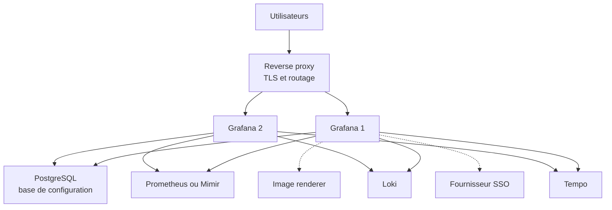
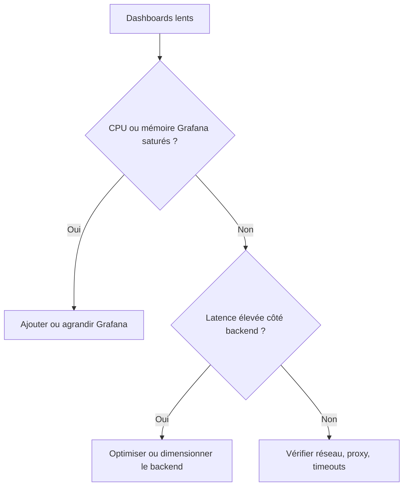

# Architecture Grafana en production

## Objectifs pédagogiques

À la fin de ce module, vous saurez :

- **Choisir** entre une installation standalone, une pile distribuée et Grafana Cloud selon les contraintes d'une équipe.
- **Concevoir** la chaîne reverse proxy → Grafana → base de configuration → backends, en séparant ce que chaque brique possède.
- **Arbitrer** entre SQLite, PostgreSQL et MySQL pour la base interne de Grafana.
- **Dimensionner** une installation en distinguant la charge portée par Grafana de celle portée par Prometheus, Loki et Tempo.
- **Reconnaître** les cas où ajouter des instances Grafana aggrave le problème au lieu de le résoudre.

## Mise en situation

Vous reprenez l'observabilité d'une équipe plateforme de 12 personnes qui supervise une quarantaine de services. Tout est parti d'un projet pratique ressemblant à celui du module précédent : un `docker compose` sur une VM, Grafana avec sa base SQLite par défaut, Prometheus et Loki à côté. Ça a bien marché tant que trois personnes l'utilisaient.

Six mois plus tard :

- Une cinquantaine de personnes ouvrent des dashboards, dont plusieurs écrans de salle d'exploitation rafraîchis toutes les 5 secondes.
- Le lundi matin, Grafana répond lentement, et personne ne sait si le coupable est Grafana, Prometheus ou le réseau.
- Un redémarrage de la VM a coûté une demi-journée, parce que la base SQLite vivait dans un volume non sauvegardé.
- Un collègue propose de « mettre trois Grafana derrière un load balancer » pour régler la lenteur.

La solution naïve ne tient plus parce que le problème n'est pas là où on le croit. Ce module sert à lire une architecture Grafana, à voir où sont l'état, la charge et les points de défaillance, et à décider quoi faire évoluer avant d'empiler des serveurs.

## Ce que Grafana est vraiment

Avant de dessiner une architecture, il faut savoir ce qu'on place dedans. Grafana ne stocke pas vos métriques, vos logs ni vos traces. C'est une application Go qui fait trois choses :

1. Elle **sert l'interface** (dashboards, Explore, alerting).
2. Elle **interroge les data sources** au nom de l'utilisateur, le plus souvent en mode proxy : c'est le serveur Grafana qui appelle Prometheus, pas le navigateur.
3. Elle **conserve sa propre configuration** dans une base : dashboards, utilisateurs, organisations, permissions, data sources, règles d'alerte, état des alertes.

🧠 **Concept clé** — Grafana est un *client de requêtes* avec un petit état propre. Son état est dans la base de configuration, pas dans le processus. Si la base survit, on peut recréer l'instance. Si la base disparaît, les binaires intacts ne servent à rien. Le coût, lui, se paie dans les backends interrogés.

Une analogie utile : Grafana est un guichet de renseignements. Les archives (Prometheus, Loki, Tempo) sont dans un autre bâtiment. Ajouter des guichets accueille plus de monde, mais ne rend pas les archivistes plus rapides.

## Les composants d'une installation de production



| Composant | Rôle | Exemple |
|-----------|------|---------|
| Reverse proxy / load balancer | Terminaison TLS, routage, répartition entre instances, en-têtes de sécurité | nginx, HAProxy, Traefik, load balancer cloud |
| Grafana Server | Interface, API, évaluation des alertes, proxy vers les data sources | image `grafana/grafana`, paquet système |
| Base de configuration | Dashboards, utilisateurs, permissions, data sources, état des alertes | PostgreSQL, MySQL, SQLite |
| Backends de télémétrie | Stockage et requêtage réels des données | Prometheus, Loki, Tempo, Mimir |
| Image renderer | Rendu PNG/PDF, gourmand en CPU et mémoire, isolé du serveur | `grafana-image-renderer` |
| Fournisseur d'identité | Authentification centralisée | Keycloak, Entra ID, Okta |

Le renderer et le SSO (Single Sign-On) sont en pointillé : optionnels, mais quand ils existent, ce sont des dépendances à part entière, avec leur propre disponibilité.

## Standalone, distribuée, Cloud : trois façons d'héberger

On parle souvent d'architecture « distribuée ». Grafana lui-même n'est pas un système en micro-services : on le scale en dupliquant des instances identiques qui partagent une base. Ce qui se distribue vraiment, ce sont les **backends** (Loki, Tempo et Mimir existent en mode simple et en mode distribué). Quand on compare « standalone » et « distribué », on compare donc des *piles complètes*.

| Critère | Standalone | Distribuée (auto-hébergée) | Grafana Cloud |
|---------|-----------|---------------------------|---------------|
| Composition | 1 Grafana, backends en instance unique | N Grafana + backends en mode scalable | Grafana et backends managés |
| Effort d'exploitation | Faible | Élevé : upgrades, stockage objet, capacité | Faible côté plateforme |
| Disponibilité | Un seul point de défaillance | Possible, mais à construire et à tester | Portée par le fournisseur, selon l'offre |
| Contrôle des données | Total | Total | Données chez un tiers, à valider côté conformité |
| Coût | Machines | Machines, stockage, temps d'équipe | Facturation à l'usage (ingestion, rétention, utilisateurs) |
| Limite typique | Saturation d'une machine | Complexité opérationnelle | Coût qui suit le volume, accès aux réseaux privés |

### Comment trancher

- **Standalone** convient à une équipe de moins d'une vingtaine d'utilisateurs, avec un volume modeste et une tolérance à quelques minutes d'indisponibilité. C'est un choix valable, à condition que la base soit sauvegardée et que le coût d'une panne soit accepté.
- **Distribuée** se justifie quand le volume de télémétrie dépasse ce qu'une machine encaisse, ou quand la plateforme est un service interne avec un engagement de disponibilité. Il faut une équipe qui sait exploiter Kubernetes, du stockage objet et des mises à jour de composants stateful.
- **Cloud** s'impose quand l'équipe n'a pas la capacité d'exploiter la plateforme et que la donnée peut quitter l'infrastructure. Les limites arrivent avec la facture quand le volume explose, ou avec l'accès aux data sources en réseau privé (des mécanismes comme Private Data Source Connect existent, leur disponibilité dépend de l'offre).

Une règle de bon sens : on ne passe pas en distribué parce que c'est « plus pro ». On y passe quand une mesure précise (saturation d'un backend, SLA exigé) le justifie.

## Reverse proxy : la porte d'entrée

Grafana sait écouter en HTTPS lui-même, mais en production on place presque toujours un reverse proxy devant. Il termine le TLS (Transport Layer Security), centralise les certificats, applique les règles réseau et répartit la charge.

Deux réglages Grafana comptent autant que le proxy :

```ini
[server]
domain   = grafana.example.com
root_url = https://grafana.example.com/
```

Sans `root_url` correct, Grafana génère des liens et des redirections avec l'adresse interne (`http://grafana:3000`). Résultat : boucles de redirection après login, liens d'alerte inutilisables, callbacks SSO qui échouent.

Côté nginx, un détail piège beaucoup d'équipes : Grafana Live utilise des WebSockets. Sans les en-têtes `Upgrade`, ces connexions échouent. L'interface fonctionne à peu près, mais les fonctions temps réel cassent avec des erreurs peu parlantes.

```nginx
map $http_upgrade $connection_upgrade {
  default upgrade;
  ''      close;
}

upstream grafana {
  server <GRAFANA_HOST_1>:3000;
  server <GRAFANA_HOST_2>:3000;
}

server {
  listen 443 ssl;
  server_name grafana.example.com;
  ssl_certificate     <CHEMIN_CERTIFICAT>;
  ssl_certificate_key <CHEMIN_CLE_PRIVEE>;

  location / {
    proxy_set_header Host $host;
    proxy_pass http://grafana;
  }

  location /api/live/ {
    proxy_http_version 1.1;
    proxy_set_header Upgrade $http_upgrade;
    proxy_set_header Connection $connection_upgrade;
    proxy_set_header Host $host;
    proxy_pass http://grafana;
  }
}
```

⚠️ **Erreur fréquente** — Régler `proxy_read_timeout` à 30 s alors que certaines requêtes Loki ou Prometheus en prennent 45. Le proxy coupe avant que Grafana n'ait fini, et l'utilisateur voit un 504 qui ressemble à une panne de Grafana. Le timeout du proxy doit être **supérieur ou égal** à celui que Grafana applique à ses data sources (`[dataproxy] timeout`, 30 s par défaut). Sinon c'est le proxy qui décide à la place de Grafana.

## Base de configuration : SQLite, PostgreSQL ou MySQL

SQLite est le choix par défaut : un fichier `grafana.db` dans `/var/lib/grafana`, zéro installation. C'est parfait pour apprendre, et ça devient un handicap en production pour trois raisons :

- Les écritures concurrentes se sérialisent. Sous charge, on voit apparaître des erreurs `database is locked`.
- Le fichier appartient à **une** machine. Deux instances Grafana avec chacune leur SQLite sont deux Grafana différents, avec des dashboards et des utilisateurs différents. Un load balancer devant elles produit un comportement qui change à chaque requête.
- La sauvegarde cohérente d'un fichier ouvert en écriture demande de la rigueur (le détail viendra au module sur la sauvegarde).

🧠 **Concept clé** — Dès qu'on veut plus d'une instance Grafana, la base doit être **externe et partagée**. C'est le critère qui fait basculer, bien avant la taille du fichier.

| Critère | SQLite | PostgreSQL | MySQL |
|---------|--------|-----------|-------|
| Plusieurs instances Grafana | Non | Oui | Oui |
| Charge d'exploitation | Aucune | Un service à opérer | Un service à opérer |
| Réplication, sauvegarde en ligne | Manuelle | Outillage mature | Outillage mature |
| Quand le choisir | Test, démo, petite équipe sans exigence de disponibilité | Choix par défaut en production | Si l'organisation exploite déjà MySQL et sait le sauvegarder |

Entre PostgreSQL et MySQL, la décision se prend sur la compétence interne et l'existant. Une base que votre équipe sait restaurer à 3 h du matin vaut mieux qu'une base théoriquement supérieure.

```ini
[database]
type     = postgres
host     = <PG_HOST>:5432
name     = grafana
user     = grafana
ssl_mode = require
max_open_conn = 20
```

Le mot de passe ne doit pas figurer dans le fichier : il passe par la variable d'environnement `GF_DATABASE_PASSWORD`. Grafana traduit toute variable `GF_<SECTION>_<CLÉ>` en surcharge du `grafana.ini`, ce qui convient bien aux conteneurs.

💡 **Astuce** — `max_open_conn` multiplié par le nombre d'instances ne doit pas dépasser la limite de connexions de PostgreSQL (`max_connections`). Avec 3 instances à 20 connexions, vous réservez déjà 60 connexions, avant les autres applications.

La migration de SQLite vers PostgreSQL n'est pas anodine. Autant partir sur une base externe dès que la plateforme dépasse le stade du pilote.

## Construction progressive

### v1 — Un serveur, un proxy, une base fichier

Grafana et ses backends tournent sur une VM, un nginx fait le TLS, SQLite reste en place. C'est le point de départ du module précédent, avec un vrai nom de domaine et un certificat. Ça suffit pour valider l'usage, pas pour s'engager sur une disponibilité.

### v2 — Base externalisée et dépendances isolées

Les changements portent sur ce qui est fragile :

- PostgreSQL sort de la VM, avec sa propre sauvegarde.
- Les secrets passent en variables d'environnement ou dans un gestionnaire de secrets.
- La version de l'image est épinglée (`grafana/grafana:<VERSION>`, jamais `latest`).
- Le renderer d'images tourne dans un conteneur à part, avec des limites de ressources.
- Grafana est scrapé par Prometheus via son endpoint `/metrics`.

Le gain principal de cette étape est de pouvoir **détruire et recréer** l'instance Grafana sans perte. La plateforme devient remplaçable.

```bash
curl -s http://localhost:3000/api/health
# {"database":"ok","version":"<VERSION>", ...}
```

Un `database: ok` confirme que Grafana atteint bien sa base. À brancher dans les probes de l'orchestrateur ou du load balancer.

### v3 — Plusieurs instances, backends dimensionnés séparément

On ajoute une deuxième instance Grafana derrière le proxy, avec la même base. La haute disponibilité, ou HA (High Availability), demande alors des réglages spécifiques, notamment pour l'alerting : sans coordination entre instances, chacune enverrait ses propres notifications. Ces réglages, leurs tests de bascule et les modes de panne relèvent du module sur la haute disponibilité. Retenez ici le principe : **la v3 n'est utile que si le goulot d'étranglement était bien Grafana**. Le plus souvent, il est ailleurs.

## Environnements et dépendances

Une installation de production n'est jamais seule. Le plus simple est de lister ce dont elle dépend :

| Dépendance | Risque si elle tombe | Question à se poser |
|------------|---------------------|---------------------|
| Base de configuration | Grafana ne démarre pas ou devient inutilisable | Qui la restaure, en combien de temps ? |
| Data sources | Dashboards vides ou en erreur | Grafana distingue-t-il « pas de données » et « backend injoignable » ? |
| SSO | Plus personne ne peut se connecter | Existe-t-il un compte local de secours ? |
| Serveur SMTP / webhooks | Les alertes partent dans le vide | Une alerte non livrée est-elle visible quelque part ? |
| Plugins | Panels cassés après une mise à jour | Les plugins sont-ils inclus dans l'image ou installés au démarrage ? |

Pour les environnements, le choix est entre une instance Grafana par environnement (dev, staging, prod) et une instance unique avec des organisations séparées. La première isole mieux les risques : on peut casser un dashboard ou tester une mise à jour sans toucher la production. La seconde consomme moins, mais mélange les blocs de panne et les droits. Pour une plateforme sérieuse, un Grafana de pré-production dans la même version que la production n'est pas un luxe : c'est l'endroit où on valide les montées de version et les changements de plugins. La manière de synchroniser ces environnements relève du module suivant.

## Capacité et dimensionnement

Grafana consomme peu de ressources par rapport aux backends. Les deux charges qui comptent ne sont pas là où on les cherche :

1. **Les requêtes des dashboards.** Chaque panel visible est une requête vers un backend, rejouée à chaque rafraîchissement.
2. **Les règles d'alerte.** Chacune est une requête exécutée à intervalle fixe, que personne ne regarde.

Un calcul rapide donne l'ordre de grandeur (chiffres illustratifs) :

- 40 utilisateurs actifs × 15 panels × un rafraîchissement toutes les 10 s ≈ **60 requêtes par seconde** vers les backends.
- 200 règles d'alerte évaluées chaque minute ≈ **3 requêtes par seconde**.

Les dashboards pèsent donc vingt fois plus que les alertes dans cet exemple, et un seul écran rafraîchi toutes les 5 s sur un mur d'équipe compte comme un utilisateur actif de plus.

💡 **Astuce** — `min_refresh_interval` (section `[dashboards]`) impose un plancher aux rafraîchissements automatiques. Avec un plancher à 30 s, la charge d'un dashboard réglé à 5 s est divisée par six, celle d'un dashboard à 10 s par trois, sans toucher à un seul panel.

### Le piège : multiplier les Grafana ne soulage pas les backends

⚠️ **Erreur fréquente** — Face à des dashboards lents, ajouter des instances Grafana. Si Prometheus ou Loki sont saturés, c'est comme ouvrir de nouveaux guichets devant des archives déjà débordées : la file à l'intérieur ne bouge pas, et vous augmentez le nombre de demandeurs simultanés.

Deux raisons :

- Les requêtes lourdes partent toujours vers le même backend. La capacité de traitement n'a pas changé, seule la capacité d'accueil des utilisateurs a augmenté.
- Dans le mode HA classique, chaque instance évalue l'ensemble des règles d'alerte, et seules les notifications sont dédoublonnées. Trois instances peuvent donc tripler la charge d'évaluation sur les backends (à vérifier selon la version et la configuration utilisées).

Avant d'ajouter une instance, il faut établir **où** est le goulot :



Les leviers côté backend, par ordre de coût croissant : réduire la fréquence de rafraîchissement, alléger les requêtes (recording rules Prometheus, plages de temps plus courtes), activer les caches du backend (par exemple le cache de résultats de Loki ou Mimir) et seulement ensuite scaler. Le cache de requêtes intégré à Grafana est une fonctionnalité Enterprise ou Cloud, pas OSS. La cardinalité et l'optimisation fine font l'objet d'un module dédié.

Pour mesurer côté Grafana, l'endpoint `/metrics` expose un histogramme de durée des requêtes HTTP. Le rapport `_sum` / `_count` en donne la durée moyenne :

```bash
curl -s http://<GRAFANA_HOST>:3000/metrics | grep -E 'grafana_http_request_duration_seconds_(sum|count)'
```

Comparez cette latence à celle que mesure Prometheus ou Loki pour les mêmes requêtes. Si les deux sont proches et élevées, le backend est le goulot. Si Grafana ajoute beaucoup, regardez le proxy, les timeouts et la base.

## Erreurs fréquentes

| Symptôme | Cause probable | Correction |
|----------|---------------|------------|
| `database is locked` dans les logs, sauvegardes de dashboards qui échouent | SQLite sous écritures concurrentes | Migrer vers PostgreSQL ou MySQL |
| Dashboards ou utilisateurs différents d'un rafraîchissement à l'autre | Plusieurs instances avec chacune sa SQLite derrière un load balancer | Une seule base partagée pour toutes les instances |
| Boucle de redirection après login, liens d'alerte avec `localhost:3000` | `root_url` ou `domain` non alignés sur l'URL publique | Corriger `[server]`, redémarrer, tester via le proxy |
| Erreurs WebSocket ou 502 sur `/api/live/` | En-têtes `Upgrade` absents dans le proxy | Ajouter le bloc `location /api/live/` avec `Upgrade` et `Connection` |
| Alertes envoyées en double | Plusieurs instances sans coordination de l'alerting | Configurer la HA de l'alerting (voir module HA) |
| 504 sur les dashboards lourds | Timeout du proxy plus court que celui de Grafana | Aligner les timeouts, puis alléger les requêtes |
| Grafana démarre mais « Bad Gateway » depuis le proxy | Mauvais port ou protocole dans `proxy_pass`, ou `http_addr` limité à 127.0.0.1 | Vérifier `http_addr`, le port, et `/api/health` depuis le proxy |

## Cas réel en entreprise

*Scénario illustratif, chiffres fictifs.*

Une équipe plateforme de 12 personnes exploite Grafana en standalone. Le lundi matin, 50 personnes ouvrent leurs dashboards, et le temps de chargement passe de 3 s à plus de 20 s. La proposition initiale : trois instances Grafana.

Avant de déployer quoi que ce soit, l'équipe mesure :

1. **Grafana lui-même.** CPU à 15 %, mémoire stable. Pas de saturation.
2. **Prometheus.** Un pic d'environ 400 requêtes par seconde le lundi matin, dont une grande partie vient de quatre dashboards d'équipe en auto-refresh à 5 s. Le CPU de Prometheus est saturé.
3. **La base.** SQLite sur la VM, quelques verrous, mais sans lien avec le ralentissement.

Décisions prises :

- `min_refresh_interval` passé à 30 s : la charge des quatre dashboards rafraîchis à 5 s est divisée par six.
- Deux requêtes coûteuses déplacées vers des recording rules Prometheus.
- PostgreSQL mis en place, avec sauvegarde planifiée, pour supprimer le risque de perte de configuration.
- Pas de nouvelle instance Grafana pour l'instant. Le sujet est repris quand la disponibilité deviendra un engagement.

Résultat dans le scénario : temps de chargement ramené à environ 4 s le lundi matin, sans serveur supplémentaire. La mesure a évité d'ajouter de la complexité pour un problème qui ne venait pas de là.

## Bonnes pratiques

- **Externalisez la base dès que la plateforme dépasse le stade pilote.** PostgreSQL ou MySQL, avec TLS (`ssl_mode`), un compte dédié et une sauvegarde testée en restauration.
- **Épinglez les versions** de Grafana, des plugins et du renderer, et validez chaque montée de version en pré-production avant la production.
- **Sortez les secrets du `grafana.ini`** : mots de passe de base et clés SSO passent par des variables d'environnement ou un gestionnaire de secrets, jamais par un dépôt Git.
- **Mesurez avant de scaler.** Comparez la latence mesurée par Grafana à celle de chaque backend. N'ajoutez des instances Grafana que si Grafana est vraiment le goulot.
- **Encadrez la charge générée par les dashboards** avec `min_refresh_interval`, des plages de temps raisonnables et des recording rules pour les requêtes coûteuses.
- **Supervisez Grafana comme n'importe quel service** : scrape de `/metrics`, probe sur `/api/health`, alerte sur l'indisponibilité de la base. Le sujet du meta-monitoring sera approfondi plus loin.
- **Prévoyez un accès de secours** (compte administrateur local) pour le cas où le SSO tombe.
- **Documentez les dépendances et leurs propriétaires** : pour chaque composant listé plus haut, qui répond quand il tombe et en combien de temps on restaure.

## Résumé

Grafana en production est un client de requêtes doté d'un petit état stocké dans une base de configuration, placé derrière un reverse proxy et branché sur des backends qui portent la vraie charge. Le choix standalone, distribuée ou Cloud dépend du volume, de la disponibilité exigée, de la compétence d'exploitation et des contraintes sur la donnée. SQLite convient aux tests. Dès que l'on veut plusieurs instances ou une vraie résilience, il faut PostgreSQL ou MySQL. Le dimensionnement se fait en comptant les requêtes générées par les dashboards et les alertes, pas en regardant le CPU de Grafana. Ajouter des instances Grafana ne soulage jamais un Prometheus ou un Loki saturé. Une fois l'architecture stabilisée, reste à reproduire ces choix de façon fiable et automatisée, ce qui est l'objet du module suivant.

<!-- snippet
id: grafana_prod_stateless_concept
type: concept
tech: grafana
level: advanced
importance: high
format: knowledge
tags: grafana,architecture,production,etat
title: Grafana est un client de requêtes avec un état en base
content: Grafana ne stocke ni métriques, ni logs, ni traces. Il interroge les data sources en mode proxy (le serveur appelle le backend, pas le navigateur) et garde dashboards, utilisateurs, permissions et état des alertes dans sa base de configuration. Conséquence : si la base survit, on peut recréer l'instance ; si elle disparaît, la configuration est perdue. La charge se paie dans les backends.
description: Comprendre où est l'état (la base) et où est la charge (les backends) conditionne toute décision d'architecture Grafana.
-->

<!-- snippet
id: grafana_prod_sqlite_multi_instance
type: warning
tech: grafana
level: advanced
importance: high
format: knowledge
tags: grafana,sqlite,haute-disponibilite,base-de-donnees
title: SQLite avec plusieurs instances Grafana : configuration divergente
content: Piège : placer deux Grafana avec chacun leur SQLite derrière un load balancer. Conséquence : chaque instance a ses propres dashboards, utilisateurs et sessions, et l'interface change d'une requête à l'autre. Correction : dès la 2e instance, passer à PostgreSQL ou MySQL partagé ([database] type = postgres), avec la même secret_key ([security]) sur toutes les instances.
description: SQLite est un fichier local à une machine ; plusieurs instances exigent une base externe partagée.
-->

<!-- snippet
id: grafana_prod_more_instances_backend
type: warning
tech: grafana
level: advanced
importance: high
format: knowledge
tags: grafana,capacite,prometheus,loki,dimensionnement
title: Plus d'instances Grafana n'allège pas Prometheus ou Loki
content: Piège : ajouter des instances Grafana face à des dashboards lents. Conséquence : les mêmes requêtes lourdes visent le même backend, et en mode HA classique chaque instance évalue toutes les règles d'alerte, donc la charge peut être multipliée par N. Correction : comparer d'abord la latence côté Grafana et côté backend, puis alléger les requêtes (recording rules, refresh plus long) avant de scaler.
description: Grafana est un guichet, pas une archive : sa duplication augmente les demandeurs sans augmenter la capacité des backends.
-->

<!-- snippet
id: grafana_prod_health_check
type: command
tech: grafana
level: intermediate
importance: medium
format: knowledge
tags: grafana,healthcheck,api,probe
title: Vérifier l'état de Grafana et de sa base via /api/health
command: curl -s http://<GRAFANA_HOST>:3000/api/health
example: curl -s http://localhost:3000/api/health
description: Retourne un JSON avec database (ok si la base est joignable) et version ; à brancher en probe sur le load balancer ou l'orchestrateur.
-->

<!-- snippet
id: grafana_prod_metrics_latency
type: command
tech: grafana
level: advanced
importance: medium
format: knowledge
tags: grafana,metrics,latence,diagnostic
title: Lire la latence HTTP exposée par Grafana
command: curl -s http://<GRAFANA_HOST>:3000/metrics | grep -E 'grafana_http_request_duration_seconds_(sum|count)'
example: curl -s http://grafana.internal:3000/metrics | grep -E 'grafana_http_request_duration_seconds_(sum|count)'
context: Endpoint /metrics actif par défaut, à restreindre au réseau interne.
description: Affiche les séries _sum et _count de l'histogramme de durée. Le rapport _sum / _count donne la durée moyenne des requêtes, à comparer avec la latence du backend pour localiser le goulot.
-->

<!-- snippet
id: grafana_prod_min_refresh_interval
type: tip
tech: grafana
level: advanced
importance: high
format: knowledge
tags: grafana,dashboards,refresh,charge
title: Limiter le rafraîchissement automatique avec min_refresh_interval
content: Dans grafana.ini, section [dashboards], fixer min_refresh_interval = 30s. Les dashboards ne peuvent plus se rafraîchir plus vite que toutes les 30 s, même si leur JSON demande 5 s. Pour un écran réglé à 5 s, ce plancher divise par 6 la charge qu'il génère sur Prometheus et Loki (par 3 pour un écran à 10 s).
description: Un seul levier de configuration protège les backends contre les murs d'écrans rafraîchis à 5 s.
-->

<!-- snippet
id: grafana_prod_query_load_formula
type: concept
tech: grafana
level: advanced
importance: medium
format: knowledge
tags: grafana,dimensionnement,requetes,alerting
title: Estimer la charge de requêtes générée par Grafana
content: Dashboards : utilisateurs actifs × panels × (1 / intervalle de refresh en secondes). Exemple : 40 × 15 / 10 s ≈ 60 requêtes/s. Alertes : règles × (1 / intervalle d'évaluation). Exemple : 200 règles à 60 s ≈ 3 requêtes/s. Ce sont ces requêtes, pas le CPU de Grafana, qui dimensionnent Prometheus, Loki et Tempo.
description: Calculer le débit de requêtes vers les backends avant de décider quoi scaler, en comptant dashboards et règles d'alerte.
-->

<!-- snippet
id: grafana_prod_websocket_proxy_error
type: error
tech: grafana
level: advanced
importance: medium
format: knowledge
tags: grafana,nginx,websocket,reverse-proxy
title: Erreurs 502 ou WebSocket sur /api/live/ derrière nginx
content: Symptôme : erreurs 502 ou connexions WebSocket qui échouent vers /api/live/. Cause : le proxy ne transmet pas les en-têtes Upgrade. Correction : ajouter un bloc location /api/live/ avec proxy_http_version 1.1, proxy_set_header Upgrade $http_upgrade et Connection $connection_upgrade (via un map sur $http_upgrade).
description: Grafana Live utilise des WebSockets ; sans en-têtes Upgrade dans le proxy, les fonctions temps réel cassent.
-->

<!-- snippet
id: grafana_prod_root_url_redirect
type: error
tech: grafana
level: intermediate
importance: high
format: knowledge
tags: grafana,root-url,reverse-proxy,sso
title: Boucle de redirection ou liens en localhost derrière un proxy
content: Symptôme : redirection en boucle après login, liens d'alerte pointant vers http://grafana:3000, callback SSO refusé. Cause : root_url et domain ne correspondent pas à l'URL publique. Correction : dans [server], définir domain = grafana.example.com et root_url = https://grafana.example.com/, puis redémarrer et tester via le proxy.
description: root_url sert à construire toutes les URL absolues de Grafana ; un mauvais réglage casse login, SSO et notifications.
-->

<!-- snippet
id: grafana_prod_proxy_timeout_alignment
type: tip
tech: grafana
level: advanced
importance: medium
format: knowledge
tags: grafana,timeout,nginx,dataproxy
title: Aligner le timeout du proxy sur celui du dataproxy Grafana
content: Grafana coupe ses requêtes vers les data sources à 30 s par défaut ([dataproxy] timeout). Régler proxy_read_timeout nginx à au moins cette valeur (par exemple 60s si le timeout Grafana est relevé à 50s). Sinon le proxy renvoie un 504 avant que Grafana ait fini, et l'erreur ressemble à une panne de Grafana.
description: Si le timeout du proxy est inférieur à celui de Grafana, les 504 masquent la vraie cause.
-->

<!-- snippet
id: grafana_prod_env_override
type: tip
tech: grafana
level: intermediate
importance: medium
format: knowledge
tags: grafana,configuration,docker,secrets
title: Surcharger grafana.ini par variables GF_SECTION_CLE
content: Toute option de grafana.ini se surcharge par une variable GF_<SECTION>_<CLÉ> en majuscules. Exemple : GF_DATABASE_PASSWORD pour [database] password, GF_SERVER_ROOT_URL pour [server] root_url. Utiliser cette méthode pour injecter les secrets dans un conteneur sans les écrire dans un fichier versionné.
description: Les variables GF_* ont priorité sur le fichier et évitent de stocker mots de passe et clés dans le dépôt Git.
-->

<!-- snippet
id: grafana_prod_pg_connection_budget
type: tip
tech: grafana
level: advanced
importance: low
format: knowledge
tags: grafana,postgresql,connexions,haute-disponibilite
title: Budgéter les connexions PostgreSQL par instance Grafana
content: Chaque instance ouvre jusqu'à max_open_conn connexions ([database]). Avec 3 instances à 20, il faut réserver 60 connexions dans max_connections de PostgreSQL, en plus des autres applications. Calculer ce budget avant d'ajouter une instance pour éviter des erreurs de connexion au démarrage.
description: Le nombre de connexions de la base est un plafond partagé : instances × max_open_conn doit rester sous max_connections.
-->
