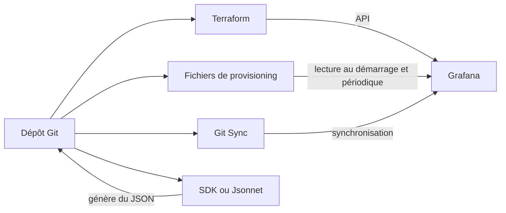


# Grafana as Code et automatisation avancée

## Objectifs pédagogiques

À la fin de ce module, vous serez capable de :

- **Déclarer** des dossiers, dashboards, règles d'alerte et sources de données avec le provider Terraform Grafana, puis de les importer depuis une instance existante.
- **Choisir** entre provisioning fichier, API, Terraform et Git Sync selon le type de ressource et l'équipe concernée.
- **Mettre en place** un pipeline CI/CD qui valide, planifie, applique, promeut entre environnements et sait revenir en arrière.
- **Organiser** les dépôts et la revue de code pour que les changements de monitoring soient relus comme du code applicatif.
- **Détecter et résoudre** les conflits quand plusieurs outils pilotent la même ressource.

## Mise en situation

Imaginez une plateforme avec trois instances Grafana (dev, staging, prod), six personnes dans l'équipe plateforme et quatre équipes produit qui s'en servent. Il y a environ 120 dashboards, tous créés à la main dans l'interface.

Un vendredi soir, pendant un incident, quelqu'un abaisse le seuil d'une règle d'alerte directement en prod pour "arrêter le bruit". Personne ne le remet en place. Trois semaines plus tard, une vraie dégradation passe sous le seuil sans alerter. Au même moment, un dashboard de staging ne ressemble plus à celui de prod, et personne ne sait lequel est le bon. Le dossier d'une équipe a été supprimé par erreur, avec tout son contenu.

Exporter les dashboards en JSON de temps en temps ne règle rien. Vous obtenez des copies, pas une source de vérité. Ce qu'il vous faut, c'est que **l'état voulu de Grafana vive dans Git**, que les changements passent par une revue, et que l'instance soit une conséquence du dépôt, pas l'inverse.

C'est l'idée du Grafana as Code, une déclinaison de l'IaC (Infrastructure as Code). La difficulté n'est pas d'écrire du Terraform. Elle est de décider **qui contrôle quoi**, et de tenir cette règle dans la durée.

## Les quatre façons de piloter Grafana depuis du code

Avant de toucher à Terraform, il faut comprendre ce que chaque mécanisme sait faire, parce que le choix d'un outil découle des contraintes de chacun.



| Critère | Provisioning fichier | API HTTP directe | Terraform | Git Sync |
|---|---|---|---|---|
| Modèle | Grafana lit des fichiers sur son disque | Appels impératifs | Déclaratif, état comparé au réel | Grafana synchronise avec un dépôt |
| Qui l'exécute | Grafana lui-même | Un script | Un pipeline, à la demande | Grafana, en continu |
| Suppression gérée | Partielle, via options du provider de fichiers | À votre charge | Oui, via `plan` | Selon version |
| Ressources couvertes | Sources de données, dashboards, alerting, plugins | Presque tout | Très large (dossiers, dashboards, alertes, utilisateurs, équipes…) | Surtout dashboards et dossiers, à vérifier selon votre version |
| Édition dans l'UI | Bloquée par défaut pour les ressources provisionnées | Libre pour les dashboards ; alerting verrouillé par provenance | Libre pour les dashboards, d'où la dérive ; alerting verrouillé par provenance par défaut | Possible, avec proposition de changement vers Git |
| Pré-requis | Accès au système de fichiers de l'instance | Un token | Un état (state) + un token | Version récente de Grafana, dépôt connecté |

🧠 **Concept clé** : ces outils ne se distinguent pas par ce qu'ils savent créer, mais par **qui détient la vérité**. Avec le provisioning fichier, c'est le disque de Grafana. Avec Terraform, c'est le fichier d'état plus votre dépôt. Avec Git Sync, c'est le dépôt, et Grafana le reflète. Tant que chaque ressource a un seul propriétaire, tout va bien. Les ennuis commencent quand deux outils se croient chacun propriétaires.

Le provisioning fichier est le plus ancien et le plus éprouvé. Il convient très bien à ce qui doit exister dès le démarrage : sources de données et providers de dashboards. Terraform convient quand vous voulez un cycle `plan` puis `apply` avec revue, et que vos ressources dépassent les dashboards. Git Sync est plus récent et sa couverture évolue d'une version à l'autre. Son intérêt est de laisser les équipes éditer dans l'interface tout en gardant Git comme référence. Vérifiez la documentation de votre version pour savoir ce qu'il synchronise, et si des feature toggles sont à activer. Ne remplacez pas un provisioning qui marche par Git Sync sans avoir testé les limites sur un environnement de test.

Il y a aussi la génération de code. Le Foundation SDK de Grafana fournit des builders dans plusieurs langages (Go, TypeScript, Python, entre autres) qui produisent le JSON d'un dashboard. Grafonnet fait la même chose avec Jsonnet. Ils règlent le problème du JSON de 3 000 lignes impossible à relire en pull request : vous écrivez 40 lignes de code, vous générez le JSON en CI, et vous le fournissez à Terraform ou au provisioning. Ces outils ne sont pas un mode de déploiement, mais une façon d'**écrire** la ressource.

Il existe aussi un outil en ligne de commande officiel, `gcx`, pour manipuler les ressources Grafana depuis un dépôt (récupérer l'état d'une instance, pousser des fichiers). Ce type d'outil évolue vite et a déjà changé de nom au fil des versions. Consultez son `--help` et sa documentation actuelle avant de l'intégrer à une chaîne de production. Prenez-le comme un outil d'aide à l'écriture et à l'export plutôt que comme un moteur de déploiement établi.

## Mise en place du provider Terraform

### Un compte de service dédié

Terraform parle à l'API de Grafana. Ne lui donnez jamais votre compte personnel. Créez un compte de service (Administration → Users and access → Service accounts, le chemin peut varier selon la version) avec le rôle strictement nécessaire, puis générez un token.

Il y a un problème d'œuf et de poule : pour créer le premier token avec Terraform, il faut déjà un token. On le résout en créant à la main (ou par script) un compte de service d'amorçage par environnement, puis en gérant tout le reste en code.

Le provider lit son URL et son token dans l'environnement, ce qui évite d'écrire un secret dans les fichiers :

```bash
export GRAFANA_URL="https://grafana-staging.example.com"
export GRAFANA_AUTH="<SERVICE_ACCOUNT_TOKEN>"
```

### Premier fichier

```hcl
terraform {
  required_version = ">= 1.6"
  required_providers {
    grafana = {
      source  = "grafana/grafana"
      version = "~> 3.0" # épinglez la version que vous avez testée
    }
  }
}

provider "grafana" {}   # URL et token viennent des variables d'environnement
```

Un mot sur la syntaxe : Terraform utilise HCL (HashiCorp Configuration Language), un format déclaratif où vous décrivez l'état souhaité sans écrire les étapes.

Vérifiez que la connexion marche avant d'aller plus loin :

```bash
terraform init
curl -s -H "Authorization: Bearer $GRAFANA_AUTH" "$GRAFANA_URL/api/health"
```

Le `/api/health` répond sans authentification, donc il ne prouve pas que votre token est valide. Testez aussi un appel authentifié, par exemple `GET /api/folders`, pour vérifier que les droits suffisent.

## Construction progressive

### v1 : un dossier et un dashboard

On commence minimal, pour voir le cycle complet.

```hcl
resource "grafana_folder" "payments" {
  uid   = "team-payments"
  title = "Payments"
}

resource "grafana_dashboard" "api_latency" {
  folder      = grafana_folder.payments.uid
  config_json = file("${path.module}/dashboards/api-latency.json")
}
```

Deux détails comptent plus que le reste. D'abord, **fixez toujours le `uid`** du dossier et du dashboard. Si Grafana le génère, il change entre environnements, et vos liens, vos alertes et votre promotion deviennent fragiles. Ensuite, dans le JSON exporté depuis l'interface, supprimez le champ `id` (numérique, propre à chaque instance) et ne versionnez pas `version`. Gardez `uid`, qui est la vraie identité stable.

Voici ce que fait l'idempotence ici : relancer `terraform apply` sans changement ne produit aucun effet. Terraform compare l'état déclaré, l'état enregistré et l'état réel (via un refresh), et ne touche que ce qui diffère. C'est ce qui rend l'outil sûr à lancer en boucle dans un pipeline. Avec un script `curl` impératif, il faudrait gérer vous-même les cas "existe déjà".

### v2 : factoriser, ajouter des alertes et des sources de données

À partir d'une dizaine de dashboards, déclarer chaque ressource à la main devient pénible. On boucle sur un répertoire :

```hcl
locals {
  dashboards = fileset("${path.module}/dashboards", "*.json")
}

resource "grafana_dashboard" "team" {
  for_each    = local.dashboards
  folder      = grafana_folder.payments.uid
  config_json = file("${path.module}/dashboards/${each.value}")
}
```

Ajouter un dashboard devient alors "déposer un fichier JSON dans le dossier". Le diff de la pull request montre exactement ce qui entre.

La source de données est le point d'attache entre dashboards et alertes. Donnez-lui un **`uid` identique dans tous les environnements** (par exemple `prometheus-main`), même si l'URL derrière diffère. Vos dashboards et règles référencent cet `uid`, et la promotion devient un simple changement de variables, sans réécrire de JSON.

```hcl
resource "grafana_data_source" "prometheus" {
  uid  = "prometheus-main"
  name = "Prometheus"
  type = "prometheus"
  url  = var.prometheus_url
}
```

Pour les alertes, une règle appartient à un groupe, lui-même rattaché à un dossier :

```hcl
resource "grafana_rule_group" "api" {
  name             = "api-availability"
  folder_uid       = grafana_folder.payments.uid
  interval_seconds = 60

  rule {
    name           = "API 5xx rate high"
    condition      = "B"
    for            = "5m"
    no_data_state  = "Alerting"
    exec_err_state = "Error"

    labels = {
      severity = "critical"
      team     = "payments"
    }
    annotations = {
      summary     = "Taux de 5xx supérieur à 5 % sur l'API"
      runbook_url = "https://wiki.example.com/runbooks/api-5xx"
    }

    data {
      ref_id         = "A"
      datasource_uid = "prometheus-main"
      relative_time_range {
        from = 600
        to   = 0
      }
      model = jsonencode({
        refId   = "A"
        instant = true
        expr    = "sum(rate(http_requests_total{job=\"api\",status=~\"5..\"}[5m])) / sum(rate(http_requests_total{job=\"api\"}[5m]))"
      })
    }

    data {
      ref_id         = "B"
      datasource_uid = "__expr__"
      relative_time_range {
        from = 0
        to   = 0
      }
      model = jsonencode({
        refId      = "B"
        type       = "threshold"
        expression = "A"
        conditions = [{ evaluator = { type = "gt", params = [0.05] } }]
      })
    }
  }
}
```

💡 **Astuce** : le bloc `model` est la partie la plus pénible à écrire à la main, et sa forme exacte dépend de la version. Créez la règle dans l'interface sur une instance de test, utilisez la fonction d'export de la règle (le format HCL est proposé), puis adaptez la sortie. C'est bien plus rapide que de deviner la structure.

Remarquez que `no_data_state` et `exec_err_state` sont explicites. Ce sont les réglages qui décident ce qui se passe quand la métrique disparaît ou que la requête échoue : exactement les pannes silencieuses du fil rouge du parcours. Une revue de code doit toujours les voir.

### Reprendre l'existant sans tout recréer

Vous avez déjà 120 dashboards en prod. Ne les recrée pas : importe-les. Avec Terraform 1.5 ou plus, un bloc `import` est relisable en revue :

```hcl
import {
  to = grafana_folder.payments
  id = "team-payments"
}
```

Puis `terraform plan` vous montre ce qui serait modifié. L'objectif est un plan **vide** après import : si Terraform veut changer des choses, c'est que votre déclaration ne reflète pas encore la réalité. Corrigez-la avant d'appliquer quoi que ce soit.

### v3 : environnements, état distant et pipeline

Le passage en production repose sur trois ajouts.

**Un état distant avec verrouillage.** Le fichier d'état ne doit jamais rester sur un poste. Utilisez un backend distant avec verrou (un bucket versionné, par exemple). Deux `apply` simultanés sur le même état sont une cause classique de corruption.

**Une structure par environnement.** Le même code, des variables différentes :

```text
grafana-config/
├── modules/
│   └── team-folder/        # dossier + droits + dashboards + alertes d'une équipe
├── dashboards/
│   ├── payments/
│   └── platform/
├── envs/
│   ├── staging/
│   │   ├── main.tfvars
│   │   └── backend.hcl
│   └── prod/
│       ├── main.tfvars
│       └── backend.hcl
└── CODEOWNERS
```

Je préfère des répertoires ou fichiers de variables séparés à des workspaces Terraform : l'environnement ciblé est visible dans le chemin et dans la revue, donc moins d'erreurs du type "j'ai appliqué sur prod en croyant être sur staging".

**Un pipeline.** Voici l'ossature, ici en GitHub Actions (le principe est le même ailleurs) :

```yaml
name: grafana-config
on:
  pull_request:
    paths: ["grafana-config/**"]
  push:
    branches: [main]
    paths: ["grafana-config/**"]

defaults:
  run:
    working-directory: grafana-config

jobs:
  plan-staging:
    runs-on: ubuntu-latest
    env:
      GRAFANA_URL: ${{ vars.GRAFANA_STAGING_URL }}
      GRAFANA_AUTH: ${{ secrets.GRAFANA_STAGING_TOKEN }}
    steps:
      - uses: actions/checkout@v4
      - uses: hashicorp/setup-terraform@v3
      - run: terraform fmt -check -recursive
      - run: find dashboards -name '*.json' -exec jq empty {} +
      - run: terraform init -backend-config=envs/staging/backend.hcl
      - run: terraform validate
      - run: terraform plan -var-file=envs/staging/main.tfvars -out=plan.tfplan

  apply-prod:
    if: github.ref == 'refs/heads/main'
    needs: plan-staging
    environment: production        # approbation manuelle configurée côté plateforme
    runs-on: ubuntu-latest
    env:
      GRAFANA_URL: ${{ vars.GRAFANA_PROD_URL }}
      GRAFANA_AUTH: ${{ secrets.GRAFANA_PROD_TOKEN }}
    steps:
      - uses: actions/checkout@v4
      - uses: hashicorp/setup-terraform@v3
      - run: terraform init -backend-config=envs/prod/backend.hcl
      - run: terraform apply -auto-approve -var-file=envs/prod/main.tfvars
```

Ce squelette est volontairement court. Un pipeline réel applique d'abord sur staging, exécute un test de fumée (voir plus bas), puis déclenche la prod après approbation. Il publie aussi le résultat du `plan` en commentaire de la pull request, pour que le relecteur voie l'impact réel et pas seulement le diff de texte.

## CI/CD : valider, tester, promouvoir, revenir en arrière

### Valider

Les contrôles sont de plus en plus coûteux. Faites d'abord ceux qui échouent vite :

- `terraform fmt -check` et `terraform validate` pour la syntaxe.
- Un lint JSON (`jq empty`) pour attraper une virgule oubliée dans un dashboard.
- Un outil comme `dashboard-linter` pour vérifier des conventions de dashboards (sources de données paramétrées, unités, etc.). Configurez-le avec ce que votre équipe a réellement décidé, sinon il produit du bruit et on l'ignore.
- Des règles de revue sur les alertes, voir plus bas.

### Tester

Un dashboard ne se teste pas comme une fonction, mais vous pouvez vérifier l'essentiel :

- **Plan sur staging** : si le plan échoue ou propose des suppressions inattendues, la PR s'arrête.
- **Test de fumée après apply** : appeler `GET /api/search?query=<TITRE>` pour confirmer que les dashboards attendus existent, et lister les règles d'alerte via l'API de provisioning pour vérifier que le nombre est cohérent.
- **`terraform test`** (disponible depuis Terraform 1.6) pour vos modules, avec un `plan` sur des variables types : utile pour s'assurer qu'un module n'oublie pas `runbook_url` ou `severity`.

### Promouvoir

La promotion n'est pas un copier-coller de JSON entre instances. C'est **le même commit**, appliqué avec les variables de l'environnement suivant. C'est ce que rend possible l'`uid` identique des sources de données. Si votre dashboard prod contient des URL ou des uid en dur, la promotion casse, et le défaut est à corriger dans le JSON, pas dans le pipeline.

### Revenir en arrière

Le rollback le plus fiable est un `git revert` du commit fautif, suivi du pipeline normal. C'est la raison pour laquelle on ne doit pas autoriser de modification manuelle en parallèle : sans cela, "revenir au commit précédent" ne ramène pas à un état connu.

Il y a des limites à connaître. Si le commit fautif a **supprimé** une ressource, le revert la recrée, mais l'historique de versions du dashboard, ses annotations ou l'historique d'état des alertes ne reviennent pas. Si la défaillance vient d'une montée de version du provider ou de Grafana, le revert du code ne suffit pas.

⚠️ **Erreur fréquente** : supprimer un dossier dans le code. Terraform le détruit, et Grafana supprime avec lui les dashboards et règles d'alerte qu'il contient, y compris ceux créés à la main par une équipe qui ne savait pas que Terraform gérait ce dossier. Correction : relire attentivement tout `plan` qui contient `destroy` sur un `grafana_folder`, et protéger les dossiers critiques avec `lifecycle { prevent_destroy = true }`.

## Organisation des dépôts et revue de code

Il n'y a pas de bonne réponse unique, mais deux modèles dominent.

Un **dépôt central** géré par l'équipe plateforme est simple à gouverner et facile à auditer. Il crée un goulot d'étranglement dès que les équipes produit veulent modifier leurs dashboards tous les jours. À l'inverse, un **dépôt par équipe** donne de l'autonomie, mais multiplie les pipelines, les états et les risques de divergence.

Un compromis qui marche bien : un dépôt (ou monorepo) avec des **modules fournis par la plateforme** et des répertoires par équipe, protégés par un fichier `CODEOWNERS`. L'équipe Payments relit ce qui est dans `dashboards/payments/`, la plateforme relit les modules, les dossiers racine et tout ce qui touche au routage des alertes.

Pour que la revue de code serve à quelque chose, définissez ce que le relecteur doit chercher. Pour une règle d'alerte :

- `for` et `no_data_state` / `exec_err_state` sont-ils choisis volontairement ?
- Les labels permettent-ils le routage vers la bonne équipe (module de routage des alertes) ?
- Y a-t-il un `runbook_url` et une description qui permettent d'agir sans connaître le service ?
- La requête est-elle raisonnable en coût (pas de sélecteur sans label sur une métrique à forte cardinalité) ?

Pour un dashboard : l'`uid` est-il stable, la source de données référencée par uid, et la première ligne répond-elle à une question d'exploitation ?

## Gestion des secrets entre environnements

Le code d'infrastructure manipule trois familles de secrets : les tokens que Terraform utilise pour parler à Grafana, les identifiants des sources de données, et les secrets des canaux de notification (URL de webhook Slack, clés PagerDuty).

Quelques règles qui découlent de la façon dont Terraform fonctionne :

- **Un token par environnement**, avec le rôle minimal nécessaire, stocké dans le coffre de secrets du CI (ou un coffre dédié comme Vault) et injecté en variable d'environnement. Jamais dans le dépôt.
- **L'état Terraform contient les valeurs en clair**, y compris celles marquées `sensitive`. Marquer une variable `sensitive` ne fait que masquer l'affichage. Chiffrez donc le backend et restreignez son accès autant que les secrets eux-mêmes.
- Pour les sources de données, passez les mots de passe via `secure_json_data_encoded` plutôt que dans la configuration visible, et lisez-les depuis une variable.
- Dans les fichiers de provisioning, Grafana remplace les variables d'environnement (`${NOM}`) au chargement. Le fichier versionné ne contient que la référence, et la valeur vient de l'environnement du processus Grafana.

```yaml
apiVersion: 1
datasources:
  - name: Prometheus
    uid: prometheus-main
    type: prometheus
    url: ${PROMETHEUS_URL}
    basicAuth: true
    basicAuthUser: grafana
    secureJsonData:
      basicAuthPassword: ${PROMETHEUS_PASSWORD}
```

⚠️ **Erreur fréquente** : exporter un dashboard ou une source de données depuis l'interface pour le commiter, sans relire. Selon ce qui a été configuré, le JSON peut contenir des URL internes, des noms d'utilisateurs ou des jetons dans des liens. Relisez toujours un export avant le premier commit, parce qu'un secret qui a été dans l'historique Git est à considérer comme compromis même après suppression.

## Le piège central : plusieurs outils sur la même ressource

C'est le sujet qui fait le plus de dégâts en pratique, donc voyons concrètement à quoi il ressemble.

**Scénario 1, Terraform + édition manuelle.** Terraform déploie un dashboard. Quelqu'un le modifie dans l'interface (c'est possible, car un dashboard créé par l'API n'est pas verrouillé, contrairement aux ressources d'alerting). Le prochain `apply` écrase la modification, souvent à l'insu de son auteur. Ou, plus pernicieux : personne ne relance `apply` pendant des semaines, et l'instance dérive silencieusement.

**Scénario 2, provisioning fichier + Terraform dans le même dossier.** Le provisioning fichier "possède" les dashboards qu'il charge. Si Terraform gère aussi le dossier, ou pousse un dashboard au même `uid`, chacun réécrit l'autre à son rythme (le provisioning fichier recharge périodiquement, par défaut toutes les 10 secondes pour les dashboards). Résultat : une version qui oscille, ou un plan qui n'est jamais vide.

**Scénario 3, objet singleton.** La politique de notification d'une organisation est unique. Si `grafana_notification_policy` est déclarée à deux endroits (deux dépôts, deux équipes), le dernier `apply` remplace tout l'arbre de routage. C'est la façon la plus rapide de perdre un routage d'astreinte sans que rien ne plante.

**Scénario 4, Git Sync + Terraform.** Si Git Sync synchronise un dossier et que Terraform déclare des dashboards dans ce même dossier, vous avez deux sources de vérité Git qui ne se connaissent pas.

La règle est simple et se formule ainsi : **une ressource, un propriétaire**. Une façon pratique de l'appliquer est de découper par type et par périmètre, puis d'écrire cette découpe dans le dépôt.

| Ressource | Propriétaire recommandé | Pourquoi |
|---|---|---|
| Sources de données | Provisioning fichier ou Terraform (un seul des deux) | Doivent exister avant tout le reste |
| Dossiers, droits, équipes | Terraform | Structure et gouvernance, revue obligatoire |
| Règles d'alerte, points de contact, politiques | Terraform | Cycle plan/apply et revue indispensables |
| Dashboards d'équipe | Git Sync ou Terraform, **par dossier**, jamais les deux | Dépend de la culture de l'équipe |
| Dashboards personnels, exploration | Interface, hors périmètre du code | Liberté, sans prétention à la reproductibilité |

Comment détecter qu'une ressource est mal possédée ?

- Un `terraform plan` programmé (hebdomadaire ou quotidien) avec `-detailed-exitcode` : le code de retour 2 signale une dérive. Faites-le échouer visiblement dans le CI.
- Dans l'interface, un message du type "Cannot save provisioned dashboard" indique que la ressource est verrouillée par un provisioning fichier. Pour l'alerting, Grafana enregistre l'origine (provenance) des ressources créées via l'API de provisioning et les verrouille dans l'interface par défaut.
- Le diagnostic à froid : lister les ressources via l'API, comparer à `terraform state list`, et identifier celles qui n'ont pas de propriétaire connu.

💡 **Astuce** : décidez dès le départ ce que vous faites des modifications faites dans l'interface sur une ressource gérée. Deux politiques tiennent la route. La première : **interdire** (droits en lecture seule pour les éditeurs sur ces dossiers, dashboards provisionnés avec `allowUiUpdates: false`). La seconde : **autoriser et réconcilier**, avec une boucle claire (Git Sync, ou un export périodique et une PR). Ce qui ne marche pas, c'est de ne pas décider.

## Commandes essentielles

Le quotidien avec Terraform et l'API, dans l'ordre où vous en avez besoin :

```bash
# Initialisation avec le backend de l'environnement
terraform init -backend-config=envs/<ENV>/backend.hcl

# Voir ce qui changerait (code de retour 2 = différences)
terraform plan -detailed-exitcode -var-file=envs/<ENV>/main.tfvars

# Importer une ressource existante
terraform import grafana_folder.<NOM> <UID>

# Lister ce que Terraform gère
terraform state list

# Lister les règles d'alerte réellement présentes dans Grafana
curl -s -H "Authorization: Bearer $GRAFANA_AUTH" \
  "$GRAFANA_URL/api/v1/provisioning/alert-rules"

# Recharger les sources de données provisionnées par fichier
curl -s -X POST -H "Authorization: Bearer $GRAFANA_AUTH" \
  "$GRAFANA_URL/api/admin/provisioning/datasources/reload"
```

Le dernier appel demande des droits d'administration. Il évite de redémarrer Grafana quand vous modifiez un fichier de source de données (les dashboards, eux, se rechargent seuls selon `updateIntervalSeconds`).

## Diagnostic : erreurs fréquentes

| Symptôme | Cause probable | Correction |
|---|---|---|
| `terraform plan` jamais vide, toujours les mêmes champs | Champs volatils dans le JSON (`id`, `version`) ou un autre outil qui réécrit la ressource | Retirer `id` et `version` du JSON versionné, chercher le second propriétaire |
| "Cannot save provisioned dashboard" dans l'UI | Dashboard chargé par provisioning fichier | Modifier le fichier source, ou régler `allowUiUpdates` si c'est voulu |
| Le dashboard promu en prod affiche "datasource not found" | `uid` de source de données différent entre environnements | Fixer le même `uid` partout, ou passer par une variable |
| Routage des alertes disparu après un déploiement | Deux déclarations de la politique de notification | Une seule déclaration par organisation, dans un seul dépôt |
| `apply` échoue en 401/403 | Token expiré ou rôle insuffisant | Vérifier avec un appel authentifié `GET /api/folders`, ajuster le rôle du compte de service |
| Des dashboards manuels ont disparu | Dossier supprimé dans le code | Restaurer depuis les sauvegardes, ajouter `prevent_destroy` |

## Cas réel en entreprise

Voici un scénario illustratif, avec des chiffres inventés pour donner un ordre de grandeur. Une plateforme de six personnes gère trois instances et 120 dashboards. Après l'incident du seuil modifié à la main, l'équipe décide de migrer en trois étapes sur un mois :

1. **Semaine 1** : importation des dossiers et sources de données dans Terraform, plan vide obtenu sur staging puis prod. Droits des éditeurs réduits sur ces dossiers.
2. **Semaine 2 à 3** : migration des règles d'alerte et des points de contact, avec une politique de notification unique dans un module géré par la plateforme. Pipeline avec plan sur PR et approbation pour la prod.
3. **Semaine 4** : dashboards des équipes migrés vers des fichiers JSON dans le monorepo, avec `CODEOWNERS`. Un plan de détection de dérive tourne chaque nuit.

Ce qu'on peut raisonnablement observer ensuite : un changement d'alerte passe par une PR relue en quelques heures plutôt que par un clic non tracé. La dérive entre staging et prod devient visible dans le plan du lendemain. Une suppression accidentelle se corrige par un revert et une exécution du pipeline, pas par une reconstruction manuelle. La migration a un coût : les équipes doivent apprendre à passer par Git, et la plateforme doit assurer une revue rapide pour que le processus ne devienne pas le goulot.

## Bonnes pratiques

- **Un propriétaire par ressource.** Documentez-le dans le dépôt (un tableau comme celui plus haut) et vérifiez-le avec un plan de dérive programmé. Sans cela, le premier incident vous ramène aux modifications manuelles.
- **Fixez les `uid`** des dossiers, dashboards et sources de données, identiques entre environnements. C'est la condition de la promotion et des liens stables.
- **Épinglez les versions** du provider et de Terraform, et montez-les d'abord en staging. Un changement de comportement du provider est un changement de production.
- **Chiffrez l'état et verrouillez-le.** L'état contient des secrets. Un backend distant, versionné, avec verrou, est un minimum.
- **Un token par environnement, avec le rôle minimal**, stocké dans un coffre et rotaté. Compte de service dédié pour Terraform, jamais un compte personnel.
- **Rendez l'observabilité du pipeline lui-même visible** : une alerte quand le plan de dérive échoue ou quand un `apply` plante, sinon vous apprenez l'échec par ses effets.
- **Protégez les suppressions** : `prevent_destroy` sur les dossiers critiques et relecture obligatoire des `destroy` dans le plan.
- **Testez le retour arrière** : au moins une fois par trimestre, simulez un revert sur staging et vérifiez que l'état obtenu est bien celui attendu, y compris pour les alertes.

## Résumé

Le Grafana as Code remplace la configuration par clics par un état versionné, relu et appliqué par un pipeline. Le provider Terraform couvre dossiers, dashboards, sources de données et alerting. Le provisioning fichier reste le plus simple pour ce qui doit exister au démarrage, tandis que Git Sync et les outils comme `gcx` ou le Foundation SDK facilitent l'écriture et la synchronisation, avec une maturité à vérifier selon votre version. Tout repose sur une règle : une ressource, un propriétaire, vérifiée par un plan de dérive régulier. Autour de ça, on met en place la validation, la promotion par variables, le rollback par `git revert` et la gestion rigoureuse des secrets. La suite logique est de rendre la plateforme elle-même résiliente : tout ce code décrit l'état voulu, mais il faut encore que l'instance qui l'héberge survive aux pannes.

<!-- snippet
id: grafana_iac_one_owner_per_resource
type: warning
tech: grafana
level: advanced
importance: high
format: knowledge
tags: terraform,provisioning,gitops,drift
title: Une ressource Grafana ne doit avoir qu'un seul propriétaire
content: Piège : Terraform, provisioning fichier, Git Sync ou édition UI agissent sur le même dashboard ou la même règle. Conséquence : écrasements successifs, plan Terraform jamais vide, version qui oscille (le provisioning fichier recharge toutes les 10 s par défaut). Correction : attribuer chaque dossier ou type de ressource à un seul outil et le documenter dans le dépôt.
description: Deux outils sur la même ressource provoquent des écrasements en boucle et un plan toujours non vide. Découper la propriété par dossier ou par type de ressource.
-->

<!-- snippet
id: grafana_terraform_plan_detailed_exitcode
type: command
tech: terraform
level: advanced
importance: high
format: knowledge
tags: terraform,drift,cicd,grafana
title: Détecter la dérive Grafana avec le code de retour du plan
context: À lancer dans un job CI planifié (nuit ou hebdomadaire) sur chaque environnement
command: terraform plan -detailed-exitcode -var-file=envs/<ENV>/main.tfvars
example: terraform plan -detailed-exitcode -var-file=envs/prod/main.tfvars
description: Code 0 = aucun changement, 1 = erreur, 2 = différences détectées. Faire échouer le job sur 2 révèle les modifications manuelles faites dans l'UI.
-->

<!-- snippet
id: grafana_terraform_import_folder
type: command
tech: terraform
level: advanced
importance: medium
format: knowledge
tags: terraform,import,grafana,migration
title: Importer un dossier Grafana existant dans l'état Terraform
context: Après avoir déclaré la ressource grafana_folder dans le code
command: terraform import grafana_folder.<NOM> <UID>
example: terraform import grafana_folder.payments team-payments
description: Rattache un dossier déjà présent à la ressource déclarée. Objectif : un plan vide ensuite ; sinon la déclaration ne reflète pas encore l'existant.
-->

<!-- snippet
id: grafana_terraform_folder_delete_cascade
type: warning
tech: grafana
level: advanced
importance: high
format: knowledge
tags: terraform,folder,destroy,rollback
title: Détruire un dossier Terraform supprime son contenu
content: Piège : retirer un grafana_folder du code (ou le recréer) fait supprimer par Grafana les dashboards et règles d'alerte du dossier, y compris ceux créés à la main. Conséquence : perte d'historique et d'objets non versionnés. Correction : relire tout plan contenant un destroy sur un dossier et ajouter lifecycle { prevent_destroy = true } sur les dossiers critiques.
description: La suppression d'un dossier entraîne celle de son contenu, même créé hors Terraform. prevent_destroy et relecture des plans réduisent le risque.
-->

<!-- snippet
id: grafana_notification_policy_singleton
type: warning
tech: grafana
level: advanced
importance: high
format: knowledge
tags: alerting,terraform,routing,notification
title: La politique de notification est un singleton par organisation
content: Piège : déclarer grafana_notification_policy dans plusieurs dépôts ou modules. Conséquence : chaque apply remplace tout l'arbre de routage, et le dernier gagne sans erreur visible. Correction : une seule déclaration par organisation, dans un module géré par la plateforme et protégé par CODEOWNERS.
description: Un second apply écrase l'arbre de routage entier sans erreur. À centraliser dans un seul module relu par la plateforme.
-->

<!-- snippet
id: grafana_stable_uid_across_environments
type: tip
tech: grafana
level: advanced
importance: high
format: knowledge
tags: terraform,promotion,datasource,uid
title: Fixer les uid de sources de données identiques partout
content: Donner à chaque source de données le même uid dans dev, staging et prod (ex. prometheus-main), même si l'URL diffère. Les dashboards et règles d'alerte référencent cet uid, donc le même commit se promeut en changeant seulement les variables Terraform. Avec des uid générés, il faut réécrire le JSON à chaque environnement.
description: Un uid de datasource identique entre environnements permet de promouvoir le même JSON de dashboard sans modification, en ne variant que l'URL.
-->

<!-- snippet
id: grafana_dashboard_json_strip_id
type: tip
tech: grafana
level: advanced
importance: medium
format: knowledge
tags: dashboard,json,terraform,idempotence
title: Nettoyer le JSON exporté avant de le versionner
content: Avant de commiter un dashboard exporté depuis l'UI, retirer le champ numérique id (propre à chaque instance), ne pas versionner version, et conserver uid. Vérifier aussi qu'aucun secret ou URL interne ne s'y trouve. Sans ce nettoyage, le plan Terraform affiche des différences à chaque exécution.
description: Les champs id et version changent à chaque instance ou sauvegarde et rendent le plan non idempotent. Garder uid comme identité stable.
-->

<!-- snippet
id: grafana_provisioning_env_secret
type: tip
tech: grafana
level: advanced
importance: medium
format: knowledge
tags: provisioning,secrets,datasource,environment
title: Injecter les secrets dans les fichiers de provisioning par variable
content: Dans un fichier de provisioning, écrire basicAuthPassword: ${PROMETHEUS_PASSWORD} sous secureJsonData ; Grafana substitue la variable d'environnement au chargement. Le fichier versionné ne contient alors aucune valeur sensible, et la valeur est fournie par l'environnement du processus Grafana (conteneur, unité systemd).
description: Grafana remplace ${VAR} dans les fichiers de provisioning au chargement. Le dépôt ne contient que la référence, jamais le mot de passe.
-->

<!-- snippet
id: grafana_datasource_provisioning_reload
type: command
tech: grafana
level: advanced
importance: low
format: knowledge
tags: provisioning,api,datasource,admin
title: Recharger les sources de données provisionnées sans redémarrer
context: Droits administrateur requis ; les dashboards se rechargent seuls selon updateIntervalSeconds
command: curl -s -X POST -H "Authorization: Bearer $GRAFANA_AUTH" "$GRAFANA_URL/api/admin/provisioning/datasources/reload"
example: curl -s -X POST -H "Authorization: Bearer $GRAFANA_AUTH" "https://grafana-staging.example.com/api/admin/provisioning/datasources/reload"
description: Applique une modification de fichier de datasource sans redémarrage de Grafana. Ne concerne pas les dashboards, rechargés périodiquement par leur provider.
-->

<!-- snippet
id: grafana_provisioned_dashboard_cannot_save
type: error
tech: grafana
level: intermediate
importance: medium
format: knowledge
tags: provisioning,dashboard,ui,allowuiupdates
title: "Cannot save provisioned dashboard" dans l'interface
content: Symptôme : impossible de sauvegarder un dashboard depuis l'UI. Cause : il est chargé par un provider de provisioning fichier avec allowUiUpdates à false. Correction : modifier le fichier JSON source dans le dépôt et laisser le provider recharger, ou activer allowUiUpdates uniquement si l'édition UI est une politique assumée.
description: Le dashboard est verrouillé par le provisioning fichier. Éditer le JSON source ou changer allowUiUpdates selon la politique voulue.
-->

<!-- snippet
id: grafana_gitsync_scope_check
type: concept
tech: grafana
level: advanced
importance: medium
format: knowledge
tags: gitsync,gitops,dashboard,provisioning
title: Git Sync : vérifier ce qu'il synchronise avant d'en dépendre
content: Git Sync connecte Grafana à un dépôt Git pour synchroniser des ressources (dashboards et dossiers en priorité) avec possibilité d'éditer dans l'UI puis de proposer le changement vers Git. Sa couverture et ses feature toggles dépendent de la version de Grafana. Avant d'en faire la source de vérité, tester sur un environnement dédié et garder Terraform pour ce qui n'est pas couvert (alerting, sources de données, droits).
description: Git Sync évolue selon les versions et ne couvre pas tout. Valider son périmètre sur un environnement de test avant de remplacer le provisioning.
-->

<!-- snippet
id: grafana_terraform_state_secrets
type: warning
tech: terraform
level: advanced
importance: high
format: knowledge
tags: terraform,secrets,state,security
title: L'état Terraform contient les secrets en clair
content: Piège : croire que sensitive = true protège la valeur. Il ne fait que masquer l'affichage ; tokens, mots de passe de sources de données et URL de webhooks restent lisibles dans le fichier d'état. Correction : utiliser un backend distant chiffré, versionné, avec verrou, et restreindre son accès comme celui d'un coffre de secrets.
description: sensitive masque seulement l'affichage. Les secrets sont stockés en clair dans l'état, qui doit donc être chiffré et fortement restreint.
-->

<!-- snippet
id: grafana_alert_rule_export_hcl
type: tip
tech: grafana
level: advanced
importance: low
format: knowledge
tags: alerting,terraform,export,hcl
title: Générer le HCL d'une règle d'alerte depuis l'interface
content: Écrire à la main le bloc model d'une règle grafana_rule_group est fastidieux et dépend de la version. Créer la règle dans l'UI sur une instance de test, utiliser la fonction d'export de la règle en format HCL, puis adapter uid, labels et variables avant de la committer.
description: L'export HCL d'une règle depuis l'UI évite d'écrire le JSON du bloc model à la main. À adapter ensuite avec uid, labels et variables.
-->

