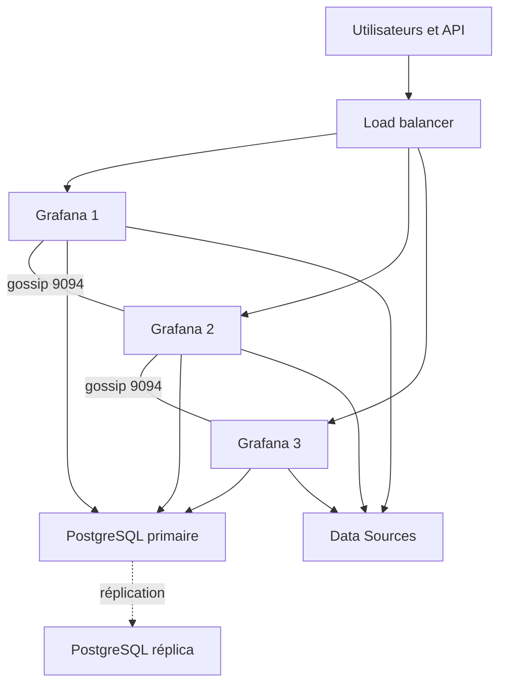
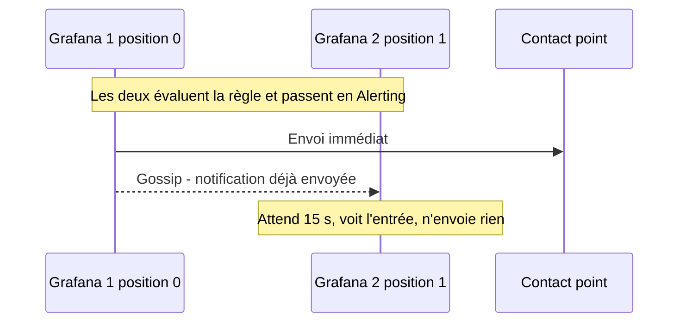
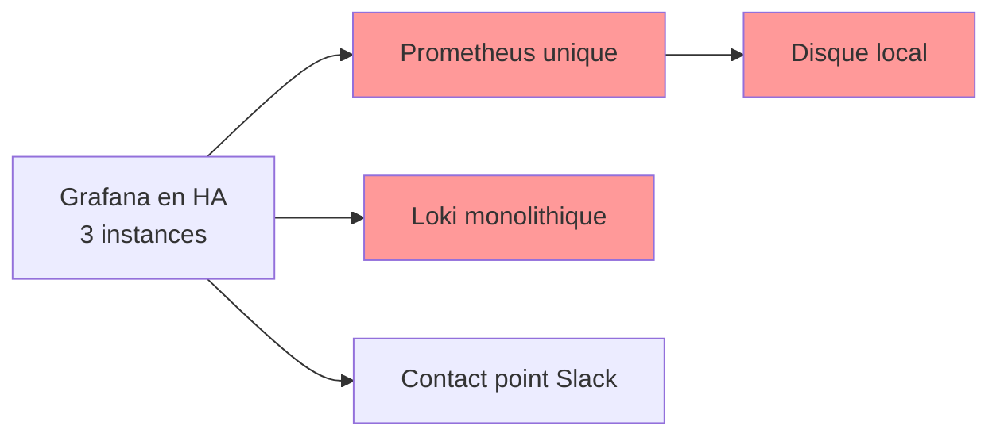

# Haute disponibilité et résilience

## Objectifs pédagogiques

À la fin de ce module, vous saurez :

- **Concevoir** une architecture Grafana multi-instance avec load balancer et base de données partagée
- **Configurer** la HA (High Availability) du moteur d'alerting et **expliquer** comment les évaluations sont dupliquées puis dédupliquées
- **Anticiper** le comportement de Grafana quand une Data Source, la base ou une instance tombe
- **Planifier et exécuter** des tests de basculement qui produisent une preuve, pas une impression
- **Distinguer** la HA de Grafana de celle de la chaîne d'observabilité complète, et **décider** où investir

## Mise en situation

Prenons une équipe plateforme de six personnes qui supervise une centaine de services. Grafana tourne sur une VM unique, avec la base SQLite par défaut. Pendant un incident réel, le disque de la VM se remplit et Grafana s'arrête. Les dashboards deviennent inaccessibles et les règles d'alerte cessent d'être évaluées. Pire, personne n'est prévenu qu'elles ne sont plus évaluées. L'équipe perd ses outils d'investigation au pire moment, et la panne est silencieuse.

La première réaction est de lancer une deuxième instance. Ça ne fonctionne pas : chacune a sa propre base SQLite, donc ses propres dashboards, utilisateurs et règles. Deux instances qui divergent ne forment pas un cluster, c'est un problème d'un autre genre. Tout ce module sert à passer de « deux copies » à « un seul système en plusieurs exemplaires ».

Le module précédent vous a donné une configuration reproductible (provisioning, Terraform). C'est la condition préalable : un cluster dont les instances ne sont pas strictement identiques tombe en panne de façon imprévisible. Nous partons donc du principe que vous savez déployer N fois la même configuration.

## Ce qu'on protège, et contre quoi

Avant de dessiner quoi que ce soit, il faut dire ce qu'on appelle « disponible ». Grafana remplit trois fonctions dont les exigences diffèrent :

| Fonction | Ce qui doit survivre | Conséquence d'une panne |
|---|---|---|
| Consultation (dashboards, Explore) | Au moins une instance joignable, et la base | On investigue à l'aveugle |
| Alerting | Au moins une instance qui évalue, et l'envoi des notifications | Les incidents ne sont plus signalés |
| Administration (provisioning, API) | La base en écriture | On ne peut plus déployer ni corriger |

Deux notions de gestion du risque reviennent dans toutes les discussions d'architecture. Le RTO (Recovery Time Objective) est la durée d'indisponibilité acceptable. Le RPO (Recovery Point Objective) est la quantité de données qu'on tolère de perdre. Pour Grafana, le RPO porte sur la base (dashboards modifiés dans l'UI, silences, état des alertes). Le RTO se joue surtout sur la détection de la panne et le basculement du trafic.

## Architecture

Voici l'architecture cible. Les instances Grafana sont interchangeables, la base est l'unique source de vérité, et les instances ont un canal latéral réservé à l'alerting.



| Composant | Rôle | Exemple |
|---|---|---|
| Load balancer | Répartit le trafic HTTP, retire les instances en échec | HAProxy, nginx, ALB, Ingress |
| Instances Grafana | Servent l'UI/API et évaluent les règles ; sans état local important | 2 à 3 conteneurs ou pods |
| Base partagée | Dashboards, utilisateurs, Data Sources, règles, sessions, état des alertes | PostgreSQL ou MySQL en HA |
| Canal gossip | Synchronise silences et journal de notifications entre instances | TCP et UDP 9094 |
| Remote cache (optionnel) | Cache partagé entre instances | Redis, Memcached |
| Data Sources | Fournissent les données ; chacune a sa propre disponibilité | Prometheus, Loki, Tempo |

## Comment un cluster Grafana se comporte sous le capot

### Des instances jetables autour d'une base

> 🧠 **Concept clé** : en HA, une instance Grafana ne détient plus rien d'irremplaçable. Tout ce qui compte (dashboards, comptes, Data Sources chiffrées, règles, contact points, sessions) vit dans la base. On peut détruire une instance et en recréer une identique sans rien perdre. C'est la même logique qu'un serveur web sans état derrière un load balancer.
{: .callout .callout-important}

Conséquence directe : **SQLite est exclue**. C'est un fichier local à une instance. Grafana prend en charge MySQL et PostgreSQL pour ce scénario.

> ⚠️ **Erreur fréquente** : démarrer une deuxième instance sans changer `[database]`. Elle crée sa propre base SQLite, tout a l'air de fonctionner, et on découvre plus tard qu'un dashboard modifié « disparaît » une fois sur deux, selon l'instance qui répond. Correction : vérifier `[database] type` sur chaque instance avant tout test.
{: .callout .callout-attention}

### Sessions : pas de sticky sessions

Les sessions de connexion sont stockées en base (jetons d'authentification), le cookie du navigateur n'en porte que la référence. N'importe quelle instance peut donc valider une session créée par une autre. Pas besoin d'affinité de session sur le load balancer.

Deux conditions pour que ça tienne :

- `[server] root_url` identique sur toutes les instances, et égale à l'URL publique du load balancer. Sinon les redirections OAuth/SSO partent vers la mauvaise adresse.
- `[security] secret_key` identique partout. Cette clé chiffre les secrets des Data Sources stockés en base ; une instance avec une clé différente ne peut pas les déchiffrer.

> ⚠️ **Erreur fréquente** : générer une `secret_key` différente par instance (ou laisser la valeur par défaut sur l'une d'elles). Symptôme : une Data Source fonctionne ou échoue selon l'instance qui sert la requête, avec des erreurs de déchiffrement dans les logs. Correction : une seule clé, injectée depuis votre gestionnaire de secrets.
{: .callout .callout-attention}

Le `remote_cache` mérite une mention. Par défaut il utilise la base ; sous forte charge, on peut le déplacer vers Redis ou Memcached pour soulager PostgreSQL. C'est une optimisation, pas un prérequis.

Les fonctions temps réel de Grafana Live (WebSocket) demandent une attention particulière : avec plusieurs instances, il faut un moteur HA basé sur Redis, et le load balancer doit laisser passer les connexions WebSocket. Si vous n'utilisez pas le streaming en direct, ne vous en occupez pas, mais vérifiez au moins que le proxy ne coupe pas `/api/live/`.

### La base : le vrai point unique de défaillance

Cette base est le SPOF (Single Point of Failure) de votre cluster. Trois instances Grafana derrière un PostgreSQL seul offrent une disponibilité inférieure à celle de ce PostgreSQL.

| Option | Principe | À retenir |
|---|---|---|
| Service managé multi-zone | Le fournisseur gère le basculement | Le plus simple ; vérifier la durée de bascule annoncée |
| Patroni + HAProxy/PgBouncer | Réplication + élection du primaire | Puissant, mais vous l'exploitez |
| Réplication manuelle | Réplica promu à la main | Basculement lent, source d'erreurs |

Grafana attend **un seul point d'accès en écriture** : un nom DNS, un VIP ou un pooler qui suit le primaire. Il ne sait pas répartir les lectures sur des réplicas. Pendant un basculement de base, les requêtes en cours échouent, puis le pool de connexions se rétablit une fois le nouveau primaire joignable. Sur une échelle de durée, comptez de quelques secondes à plus d'une minute selon la solution, et mesurez-la chez vous.

> 💡 **Astuce** : calculez votre budget de connexions. Chaque instance ouvre jusqu'à `max_open_conn` connexions ; avec 3 instances et une limite de 50, la base doit en accepter 150, plus la marge pour la maintenance. Fixez des valeurs explicites (`max_open_conn`, `max_idle_conn`, `conn_max_lifetime`) plutôt que de laisser le défaut.
{: .callout .callout-astuce}

### Migrations et mises à jour

Au démarrage, une instance applique les migrations de schéma, avec un verrou en base (`migration_locking`) qui évite que deux instances le fassent en même temps. Pour une montée de version, le plus sûr est de mettre à jour **une instance, de vérifier qu'elle est saine, puis les suivantes**. Les anciennes instances continuent de tourner sur un schéma que la nouvelle a déjà modifié : restez sur des versions voisines, et lisez les notes de version pour les changements de schéma incompatibles.

## Construction progressive

### v1 : l'instance unique

SQLite, un processus, un disque. C'est le point de départ, parfait pour apprendre, inacceptable dès que l'alerting est le filet de sécurité d'une équipe.

### v2 : deux instances, une base, un load balancer

C'est le laboratoire minimal pour tester les comportements décrits ici. Le saut par rapport à v1 est conceptuel : on sépare l'état (PostgreSQL) du calcul (Grafana).

```yaml
x-grafana: &grafana
  image: grafana/grafana:13.3.0   # même version partout
  depends_on: [postgres]
  restart: unless-stopped   # depends_on n'attend pas que PostgreSQL soit prêt
  environment: &grafana-env
    GF_DATABASE_TYPE: postgres
    GF_DATABASE_HOST: postgres:5432
    GF_DATABASE_NAME: grafana
    GF_DATABASE_USER: grafana
    GF_DATABASE_PASSWORD: change-me
    GF_SECURITY_SECRET_KEY: cle-de-lab-identique-partout
    GF_SERVER_ROOT_URL: http://localhost:8080/
    GF_UNIFIED_ALERTING_HA_LISTEN_ADDRESS: 0.0.0.0:9094
    GF_UNIFIED_ALERTING_HA_PEERS: grafana1:9094,grafana2:9094

services:
  postgres:
    image: postgres:16
    environment:
      POSTGRES_DB: grafana
      POSTGRES_USER: grafana
      POSTGRES_PASSWORD: change-me
    volumes: [pgdata:/var/lib/postgresql/data]
  grafana1:
    <<: *grafana
  grafana2:
    <<: *grafana
  lb:
    image: nginx:stable
    ports: ["8080:80"]
    volumes: ["./nginx.conf:/etc/nginx/conf.d/default.conf:ro"]
    depends_on: [grafana1, grafana2]

volumes:
  pgdata:
```

Et la configuration du load balancer, avec un en-tête qui indique quelle instance a répondu, très utile pour les tests :

```nginx
upstream grafana {
    server grafana1:3000 max_fails=2 fail_timeout=10s;
    server grafana2:3000 max_fails=2 fail_timeout=10s;
}

map $http_upgrade $connection_upgrade { default upgrade; '' close; }

server {
    listen 80;

    location / {
        proxy_set_header Host $http_host;
        proxy_next_upstream error timeout http_502 http_503;
        proxy_pass http://grafana;
        add_header X-Upstream $upstream_addr always;
    }

    location /api/live/ {
        proxy_http_version 1.1;
        proxy_set_header Upgrade $http_upgrade;
        proxy_set_header Connection $connection_upgrade;
        proxy_set_header Host $http_host;
        proxy_pass http://grafana;
    }
}
```

Vérification que le cluster est cohérent :

```bash
# Une instance répond, la base est joignable
curl -s http://localhost:8080/api/health

# Les pairs d'alerting se voient (le préfixe exact des métriques varie selon la version)
docker compose exec grafana1 wget -qO- http://localhost:3000/metrics | grep -i cluster_members
```

Le premier appel doit retourner un JSON avec `"database": "ok"`. Le second doit indiquer 2 membres, sinon le gossip ne fonctionne pas.

> 💡 **Astuce** : nginx open source ne fait que des contrôles passifs (il marque une instance en échec après des erreurs réelles). Le premier utilisateur touché paie la panne. Pour des contrôles actifs sur `/api/health`, utilisez HAProxy, le load balancer de votre cloud ou un Ingress configuré en conséquence.
{: .callout .callout-astuce}

### v3 : production

On garde la mécanique de v2 et on change ce qui était du bricolage :

- Base **managée ou orchestrée** en multi-zone, avec un point d'accès stable
- 3 instances réparties sur des zones ou nœuds distincts (anti-affinité côté Kubernetes), de sorte qu'une maintenance n'élimine pas la tolérance de panne
- Load balancer avec **contrôle actif** de `/api/health`
- Secrets (`secret_key`, mot de passe de base) injectés depuis un gestionnaire, pas écrits dans le dépôt
- Configuration poussée par votre pipeline as-code, pour garantir l'identité des instances

```ini
[database]
type = postgres
host = pg-grafana.internal:5432
name = grafana
user = grafana
password = $__file{/run/secrets/grafana_db_password}
ssl_mode = require
max_open_conn = 30
max_idle_conn = 10

[security]
secret_key = $__file{/run/secrets/grafana_secret_key}

[server]
root_url = https://grafana.example.com/

[unified_alerting]
enabled = true
ha_listen_address = 0.0.0.0:9094
ha_advertise_address = $__env{POD_IP}:9094
ha_peers = grafana-0.grafana-headless:9094,grafana-1.grafana-headless:9094,grafana-2.grafana-headless:9094
ha_peer_timeout = 15s
```

Sous Kubernetes, un service headless fournit la découverte des pairs. Le chart Helm officiel le propose, mais le nom des valeurs dépend de la version : vérifiez dans le vôtre.

## Grafana Alerting en cluster

C'est la partie la moins intuitive, et celle où les erreurs coûtent le plus cher.

### Chaque instance évalue chaque règle

> 🧠 **Concept clé** : en HA, **toutes les instances évaluent toutes les règles**. Il n'y a pas d'élection d'un « évaluateur » : avec 3 instances, chaque règle est calculée 3 fois par intervalle. C'est voulu : tant qu'une instance vit, l'évaluation continue, sans phase de bascule. La déduplication intervient plus tard, au moment d'envoyer les notifications.
{: .callout .callout-important}

Ça a deux conséquences concrètes. La charge sur vos Data Sources est multipliée par le nombre d'instances, ce qui est un argument pour ne pas dépasser 2 ou 3. Et les résultats peuvent différer légèrement entre instances si elles interrogent la source à quelques secondes d'écart. Des évolutions récentes cherchent à réduire cette duplication ; consultez la documentation de votre version avant de vous appuyer sur ce détail.

### Déduplication par gossip

Chaque instance embarque un Alertmanager interne. Ces Alertmanagers échangent par gossip (protocole de bavardage entre pairs, sur le port 9094) leur journal de notifications et leurs silences. Chaque pair a une position, et la règle est simple :

- La position 0 envoie immédiatement, puis publie dans le journal « c'est envoyé ».
- La position N attend `N × ha_peer_timeout` (15 s par défaut), consulte le journal, et n'envoie que si personne ne l'a fait.



La même mécanique détermine votre comportement en cas de panne : si l'instance de position 0 meurt, la suivante enverra **avec ~15 s de retard**, pas avant. Ce retard est le coût de la déduplication, et il s'ajoute à `group_wait` et à l'intervalle d'évaluation dans votre budget de délai.

> ⚠️ **Erreur fréquente** : ouvrir le port 9094 en TCP seulement. Le gossip utilise TCP et UDP. Si les pairs ne se voient pas, chacun se croit seul et notifie : vous recevez les alertes en double ou en triple, et les silences créés sur une instance ne sont pas respectés par les autres. Correction : autoriser TCP et UDP 9094 entre instances (règles de pare-feu, NetworkPolicy), puis contrôler le nombre de membres dans les métriques.
{: .callout .callout-attention}

### État des alertes et redémarrages

L'état des instances d'alerte est persisté en base et rechargé au démarrage. Un redémarrage ne remet donc pas à zéro les alertes en phase `Pending`. Si **toute** la base est perdue pendant un moment, le comportement des évaluations dépend de la version et de la configuration : ne le supposez pas, testez-le (voir plus bas).

### Envoyer des alertes vers Grafana depuis l'extérieur

Si votre version permet à un Prometheus externe de pousser ses alertes vers l'Alertmanager de Grafana (ce n'est pas le cas d'usage standard : vérifiez-le dans la documentation officielle), déclarez **toutes les instances comme cibles**, pas le load balancer. Passer par le load balancer envoie chaque alerte à une seule instance au hasard, ce qui contourne la logique de réplication.

## Dégradation des Data Sources et reprise

Grafana ne tombe pas parce qu'une Data Source tombe. Il dégrade : les panels concernés affichent une erreur, le reste fonctionne. Mais la façon dont on récupère n'a rien d'automatique, et c'est là que les équipes se trompent.

> 🧠 **Concept clé** : Grafana ne voit qu'**une URL par Data Source**. Il ne sait pas basculer de lui-même vers une seconde source. La redondance doit donc être cachée derrière cette URL.
{: .callout .callout-important}

| Source | Redondance derrière l'URL | Point d'attention |
|---|---|---|
| Prometheus | Deux Prometheus identiques derrière Thanos Query ou Mimir | Un simple load balancer sur deux Prometheus donne des courbes qui sautent (scrapes décalés) |
| Loki | Mode distribué avec réplication | Une instance monolithique unique reste un SPOF |
| Tempo | Idem, selon le mode de déploiement | Idem |
| Base SQL métier | Endpoint de cluster | DNS à TTL court ou pooler |

Côté Grafana, vous pilotez la dégradation avec des timeouts. `[dataproxy] timeout` borne les requêtes proxifiées ; pour l'alerting, `[unified_alerting] evaluation_timeout` et `max_attempts` gouvernent la durée d'une évaluation et le nombre de tentatives (noms et valeurs par défaut à vérifier dans votre version). Un timeout trop long, c'est des panels qui chargent pendant une minute et des goroutines qui s'empilent. Trop court, ce sont des fausses erreurs aux heures de pointe.

Pour les règles d'alerte, souvenez-vous des états `No Data` et `Error` vus aux modules d'alerting : quand la Data Source est en panne, vos règles basculent dans l'un ou l'autre. Choisissez leur mapping explicitement. Pour une règle critique, une Data Source muette ne doit pas être traitée comme « tout va bien ».

Le cache de requêtes de Grafana (qui peut absorber une indisponibilité courte) est une fonction Enterprise/Cloud, pas OSS. Ne le comptez pas dans une architecture OSS.

## ⚠️ HA de Grafana ≠ HA de la chaîne d'observabilité

C'est le piège du module, et le plus coûteux. On finit un beau cluster Grafana à 3 instances, on déclare « HA terminée », et le prochain incident montre que :



Grafana n'est que la **fenêtre**. Si Prometheus meurt, vos trois instances affichent trois fois la même erreur. Et l'alerting en HA évalue très bien… des requêtes qui ne répondent plus.

Passez en revue la chaîne de bout en bout. Une panne à l'un de ces maillons rend la HA de Grafana sans objet :

- **Collecte** : l'agent ou l'exporter qui produit la donnée
- **Stockage** : Prometheus, Loki, Tempo, et leur disque
- **Évaluation** : Grafana lui-même, ou un ruler côté backend
- **Notification** : contact point, webhook, service d'astreinte, DNS
- **La base de Grafana**, qu'on oublie parce qu'elle est « juste » une base

Une autre conséquence : si **toutes** les instances Grafana sont arrêtées, personne ne vous prévient, puisque c'est Grafana qui devait le faire. Le seul remède est un signal externe : une alerte « heartbeat » toujours active, envoyée vers un service indépendant qui réagit à son absence. La supervision de la plateforme elle-même est traitée plus tard dans le parcours ; retenez ici le principe.

## Prise de décision

**Où évaluer les alertes critiques ?** Grafana ne doit pas forcément être le seul à évaluer.

| Option | Avantage | Limite |
|---|---|---|
| Règles gérées par Grafana en cluster | Multi-sources, gestion unifiée, UI | Charge ×N sur les sources ; dépend de la base Grafana |
| Règles gérées par la source (ruler Prometheus/Mimir/Loki + Alertmanager) | Indépendantes de Grafana, HA propre au backend | Une source par règle, configuration hors UI Grafana |
| Hybride | Critiques au plus près des données, corrélées dans Grafana | Deux endroits à documenter et à tester |

Notre recommandation pratique : alertes « la plateforme ou le service est mort » dans le backend ou en doublon, alertes métier et multi-sources dans Grafana.

**Combien d'instances ?** Deux suffisent pour survivre à une panne. Trois permettent d'en tolérer une pendant qu'une autre est en maintenance. Au-delà, vous multipliez la charge des évaluations pour peu de gain de disponibilité : si la consultation est surchargée, c'est un problème de performance, pas de HA.

**Actif/actif ou actif/passif ?** L'actif/actif est le mode naturel de Grafana, sans bascule à orchestrer. Un actif/passif (une instance en veille démarrée sur panne) reste possible, mais vous recréez un temps de reprise et vous perdez le bénéfice de l'évaluation continue.

**Quand cette solution atteint ses limites** : quand une région entière tombe (il faut alors du multi-région, avec une base répliquée entre régions, un sujet à part), ou quand votre vrai goulet est la base ou les Data Sources, pas Grafana.

## Tests de basculement

Un cluster non testé est une hypothèse. Le but est d'observer chaque panne dans un environnement de recette avant qu'elle ne survienne en production, et de noter les durées.

| Scénario | Action | Comportement attendu | À mesurer |
|---|---|---|---|
| Perte d'une instance | `docker compose stop grafana1` | Le LB retire l'instance, l'UI reste disponible | Nombre d'erreurs HTTP pendant la bascule |
| Perte de l'instance « position 0 » | Arrêter chaque instance à tour de rôle | Notification envoyée avec ~15 s de retard | Délai réel de notification |
| Gossip coupé | Bloquer 9094 TCP+UDP entre pairs | Doublons de notifications | Détection par la métrique de membres |
| Base indisponible | Arrêter PostgreSQL | UI dégradée/inaccessible ; reprise automatique | Durée de reprise après retour de la base |
| Data Source en panne | Arrêter Prometheus | Panels en erreur ; règles en `Error`/`No Data` selon mapping | Alerte de panne bien émise |
| Montée de version | Mettre à jour une instance à la fois | Service continu | Erreurs pendant le roulement |

Un test d'alerting qui ne coûte presque rien : créez une règle qui est toujours en alerte, envoyez-la vers un webhook de recette (un récepteur HTTP quelconque qui journalise les appels), puis observez.

```bash
# Boucle de contrôle de disponibilité pendant qu'on casse des choses
for i in $(seq 1 60); do
  curl -s -o /dev/null -w "%{http_code} " http://localhost:8080/api/health
  sleep 1
done; echo
```

Le résultat attendu pour un incident d'instance : quelques erreurs au pire, et **un seul** message par groupe de notifications côté webhook. Deux messages, c'est le gossip qui ne fonctionne pas.

> 💡 **Astuce** : consignez les résultats dans un document d'exploitation (date, version, durée de bascule mesurée). À la prochaine montée de version, vous rejouerez les mêmes scénarios et vous saurez si quelque chose a régressé.
{: .callout .callout-astuce}

Le test le plus négligé est le plus utile : après le retour de la base, vérifiez que les **règles d'alerte reprennent seules** sans redémarrage manuel. Si ce n'est pas le cas dans votre version, il faut le savoir avant, pas pendant un incident.

## Erreurs fréquentes

| Symptôme | Cause probable | Correction |
|---|---|---|
| Un dashboard modifié « disparaît » une fois sur deux | Une instance utilise encore SQLite | Vérifier `[database]` sur chaque instance |
| Une Data Source échoue sur une instance seulement, erreurs de déchiffrement | `secret_key` différente | Même clé partout, via le gestionnaire de secrets |
| Alertes reçues en double ou triple | Gossip bloqué (UDP oublié, mauvais `ha_peers`) | Ouvrir TCP+UDP 9094, contrôler `ha_advertise_address` et les métriques de membres |
| Un silence n'est respecté qu'une fois sur deux | Même cause : silences non répliqués | Idem ; recréer le silence après correction |
| Redirection SSO vers une mauvaise adresse | `root_url` différent selon l'instance | Aligner sur l'URL publique du load balancer |
| Épuisement de connexions PostgreSQL au scale-up | N × `max_open_conn` > `max_connections` | Plafonner `max_open_conn`, ajuster la base ou ajouter un pooler |
| Le load balancer envoie du trafic à une instance morte | Contrôles passifs uniquement | Contrôle actif sur `/api/health` |
| Après un incident de base, plus d'évaluations | Reprise non validée dans votre version | Test de coupure de base, mise à jour si nécessaire, procédure de redémarrage |

## Cas réel en entreprise (scénario illustratif)

Une équipe plateforme d'une soixantaine d'ingénieurs supervise une application de commande en ligne. Chiffres fictifs, pour illustrer la démarche.

**Situation de départ** : Grafana sur une VM, SQLite, 3 à 4 indisponibilités par an. Lors de la dernière, les alertes sont restées muettes pendant 40 minutes.

**Étapes** :

1. Migration de la base vers PostgreSQL managé multi-zone, avec une répétition de restauration avant bascule.
2. Déploiement de 3 instances sur 3 zones, avec secrets et configuration identiques poussés par le pipeline.
3. Contrôle actif de `/api/health` sur le load balancer.
4. Premier test de recette : l'équipe reçoit chaque alerte **en double**. Cause : le pare-feu autorisait 9094 en TCP mais pas en UDP.
5. Alertes critiques « service indisponible » déplacées vers le ruler du backend de métriques, avec un heartbeat envoyé à un service externe.
6. Exercices de panne trimestriels, documentés.

**Résultats mesurés en recette (illustratifs)** : perte d'une instance, aucune interruption visible côté utilisateur ; bascule de base, interruption de l'UI d'environ une minute ; notifications retardées d'environ 15 secondes quand l'instance de tête est arrêtée. L'équipe peut maintenant annoncer un engagement que l'architecture soutient, et non plus un souhait.

## Bonnes pratiques

1. **Mettez la base en HA avant d'ajouter des instances Grafana.** C'est elle qui plafonne votre disponibilité.
2. **Rendez les instances strictement identiques** : version, plugins, `secret_key`, `root_url`, fichiers de provisioning, tous issus du même pipeline.
3. **Gérez les secrets hors dépôt** (fichier monté, gestionnaire de secrets), et restreignez l'accès réseau à la base et au port 9094.
4. **Prévoyez un contrôle actif de santé** sur `/api/health` et répartissez les instances sur des domaines de panne distincts.
5. **Surveillez les membres du cluster d'alerting** : une alerte sur la baisse du nombre de pairs vous prévient avant que les doublons n'arrivent.
6. **Placez les alertes critiques à un niveau indépendant de Grafana** (ruler du backend, heartbeat externe) pour ne pas dépendre d'un seul composant.
7. **Fixez des timeouts explicites** pour les Data Sources et l'évaluation, et choisissez volontairement le mapping de `No Data` et `Error`.
8. **Rejouez les tests de basculement** à chaque montée de version et avant chaque modification du réseau ou du stockage.

## Résumé

Rendre Grafana résilient consiste à retirer tout état local des instances pour le confier à une base partagée elle-même en HA, puis à placer plusieurs instances identiques derrière un load balancer. L'alerting suit sa propre logique : toutes les instances évaluent, et un échange gossip sur le port 9094 déduplique les notifications, au prix d'un retard d'environ `ha_peer_timeout` quand l'instance de tête disparaît. Les Data Sources restent hors du périmètre de Grafana : une URL, donc une redondance à construire derrière elle. Le piège principal est de croire que la HA de Grafana sécurise l'observabilité, alors que collecte, stockage et notification doivent être étudiés au même niveau. Ces mécanismes sont autant de charges sur la base et les sources, ce qui amène naturellement au module suivant : comprendre où Grafana et ses backends consomment leurs ressources, et comment les diagnostiquer.

<!-- snippet
id: grafana_ha_shared_database_concept
type: concept
tech: grafana
level: advanced
importance: high
format: knowledge
tags: grafana,haute-disponibilite,postgresql,architecture
title: Instances Grafana sans état autour d'une base partagée
content: En HA, dashboards, utilisateurs, Data Sources chiffrées, règles, contact points, sessions et état des alertes sont stockés dans la base. Les instances deviennent interchangeables et sans sticky session sur le load balancer. Prérequis : PostgreSQL ou MySQL (pas SQLite), même root_url et même secret_key sur toutes les instances.
description: La base devient la source de vérité unique ; sans elle, N instances Grafana sont N systèmes indépendants qui divergent.
-->

<!-- snippet
id: grafana_ha_sqlite_warning
type: warning
tech: grafana
level: advanced
importance: high
format: knowledge
tags: grafana,haute-disponibilite,sqlite,configuration
title: SQLite avec deux instances = deux systèmes divergents
content: Piège : lancer une deuxième instance sans changer [database] ; chacune crée sa propre base SQLite. Conséquence : dashboards, utilisateurs et règles diffèrent selon l'instance qui répond, avec des modifications qui semblent disparaître. Correction : configurer type = postgres (ou mysql) sur toutes les instances et vérifier avant tout test.
description: SQLite est un fichier local ; un cluster Grafana nécessite une base réseau partagée, sinon aucune donnée n'est commune.
-->

<!-- snippet
id: grafana_ha_secret_key_warning
type: warning
tech: grafana
level: advanced
importance: high
format: knowledge
tags: grafana,haute-disponibilite,secrets,datasource
title: secret_key identique sur toutes les instances
content: Piège : une secret_key différente par instance. Conséquence : les secrets des Data Sources chiffrés en base ne se déchiffrent que sur l'instance qui les a écrits, d'où des Data Sources qui échouent une fois sur deux avec des erreurs de déchiffrement. Correction : une seule clé injectée depuis un gestionnaire de secrets, dans [security] secret_key.
description: Cette clé chiffre les secrets des Data Sources en base ; une valeur différente par instance rend ces secrets illisibles pour les autres.
-->

<!-- snippet
id: grafana_ha_alert_evaluation_concept
type: concept
tech: grafana
level: advanced
importance: high
format: knowledge
tags: grafana,alerting,haute-disponibilite,gossip
title: Toutes les instances évaluent, le gossip déduplique
content: En HA, chaque instance évalue chaque règle (3 instances = 3 évaluations par intervalle). Les Alertmanagers internes échangent un journal de notifications par gossip sur le port 9094 : la position 0 envoie immédiatement, la position N attend N x ha_peer_timeout puis n'envoie que si le journal ne montre aucun envoi. La charge sur les Data Sources est multipliée par le nombre d'instances.
description: Pas d'évaluateur élu : la continuité est immédiate, mais la déduplication ne fonctionne qu'avec un gossip sain entre pairs.
-->

<!-- snippet
id: grafana_ha_peer_timeout_tip
type: tip
tech: grafana
level: advanced
importance: medium
format: knowledge
tags: grafana,alerting,delai,ha_peer_timeout
title: Compter 15 s de retard si l'instance de tête tombe
content: ha_peer_timeout vaut 15s par défaut : si l'instance de position 0 disparaît, la suivante notifie après environ 15 s, la troisième après 30 s. À ajouter à group_wait et à l'intervalle d'évaluation dans votre budget de délai de notification. Mesurer en recette en arrêtant chaque instance à tour de rôle.
description: Le retard de bascule de l'alerting vient de la déduplication par position ; l'intégrer dans le délai total de notification.
-->

<!-- snippet
id: grafana_ha_duplicate_notifications_error
type: error
tech: grafana
level: advanced
importance: high
format: knowledge
tags: grafana,alerting,gossip,pare-feu
title: Alertes en double : le gossip 9094 est bloqué
content: Symptôme : chaque alerte arrive 2 ou 3 fois et les silences ne sont respectés que par une instance. Cause : les pairs ne se voient pas (port 9094 ouvert en TCP seulement, ha_peers erroné, mauvais ha_advertise_address) ; chacun se croit seul et notifie. Correction : autoriser TCP et UDP 9094 entre instances et vérifier le nombre de membres dans /metrics.
description: Le gossip utilise TCP et UDP ; sans lui, chaque instance envoie ses propres notifications et ignore les silences des autres.
-->

<!-- snippet
id: grafana_ha_check_cluster_members
type: command
tech: grafana
level: advanced
importance: medium
format: knowledge
tags: grafana,alerting,metriques,diagnostic
title: Vérifier le nombre de membres du cluster d'alerting
context: À exécuter sur chaque instance ; le préfixe exact des métriques peut varier selon la version
command: curl -s http://<HOST>:3000/metrics | grep -i cluster_members
example: curl -s http://grafana-1.internal:3000/metrics | grep -i cluster_members
description: La valeur doit égaler le nombre d'instances ; une valeur de 1 indique que cette instance est isolée du gossip.
-->

<!-- snippet
id: grafana_ha_health_endpoint
type: command
tech: grafana
level: advanced
importance: medium
format: knowledge
tags: grafana,load-balancer,sante,haute-disponibilite
title: Contrôler la santé d'une instance via /api/health
command: curl -s http://<INSTANCE>:3000/api/health
example: curl -s http://grafana-1.internal:3000/api/health
description: Retourne la version et l'état de la base ; à utiliser comme contrôle actif du load balancer plutôt que de se fier à la seule connexion TCP.
-->

<!-- snippet
id: grafana_ha_chain_not_ha_warning
type: warning
tech: grafana
level: advanced
importance: high
format: knowledge
tags: grafana,observabilite,haute-disponibilite,architecture
title: Grafana en HA ne rend pas la chaîne résiliente
content: Piège : déclarer la HA terminée après le cluster Grafana. Conséquence : un Prometheus ou un Loki unique, un contact point en panne ou une base non répliquée suffit à rendre trois instances inutiles, et si toutes tombent personne n'est prévenu. Correction : auditer collecte, stockage, évaluation, notification et base, et ajouter un heartbeat externe.
description: Grafana n'est que la fenêtre sur les données ; sa HA ne protège ni la collecte, ni le stockage, ni la notification.
-->

<!-- snippet
id: grafana_ha_datasource_single_url_concept
type: concept
tech: grafana
level: advanced
importance: medium
format: knowledge
tags: grafana,datasource,resilience,prometheus
title: Une Data Source Grafana = une seule URL
content: Grafana interroge une seule URL par Data Source et ne bascule pas seul vers un second serveur. La redondance doit donc se cacher derrière cette URL : Thanos Query ou Mimir devant deux Prometheus, Loki ou Tempo en mode distribué. Un simple load balancer sur deux Prometheus provoque des courbes irrégulières, car leurs scrapes ne sont pas alignés.
description: La résilience d'une source de données se construit côté backend ; Grafana ne fait ni failover ni agrégation de réplicas.
-->

<!-- snippet
id: grafana_ha_db_connection_budget_tip
type: tip
tech: grafana
level: advanced
importance: medium
format: knowledge
tags: grafana,postgresql,connexions,configuration
title: Calculer le budget de connexions à la base
content: Chaque instance ouvre jusqu'à max_open_conn connexions. Exemple : 3 instances x 50 = 150 connexions, à comparer au max_connections de PostgreSQL (défaut 100), marge de maintenance comprise. Fixer max_open_conn et max_idle_conn dans [database], ou placer PgBouncer devant.
description: Le scale-up de Grafana consomme les connexions de la base ; un plafond explicite évite un refus de connexion au prochain redémarrage.
-->

<!-- snippet
id: grafana_ha_failover_webhook_test_tip
type: tip
tech: grafana
level: advanced
importance: medium
format: knowledge
tags: grafana,alerting,test,basculement
title: Tester la déduplication avec une règle toujours en alerte
content: Créer une règle qui est toujours en alerte, l'envoyer vers un webhook de recette qui journalise les appels, puis arrêter les instances une à une. Attendu : un seul message par groupe de notifications, et un retard d'environ 15 s lorsque l'instance de tête est coupée. Deux messages = gossip défaillant.
description: Test peu coûteux qui valide la déduplication et mesure le délai réel de bascule de l'alerting.
-->
