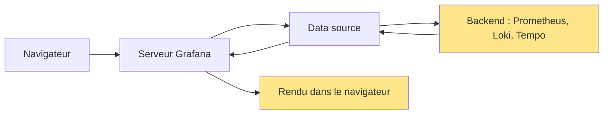

# Performance, optimisation et cardinalité

## Objectifs pédagogiques

- Lire un Query Inspector pour distinguer une lenteur de requête, de transfert ou de rendu
- Calculer le `step` réel d'un panel et le régler avec `min interval` et `max data points`
- Réécrire une requête PromQL ou LogQL coûteuse sans changer sa signification
- Identifier les métriques et labels responsables d'une explosion de cardinalité
- Décider quand remplacer une requête par une recording rule, et quand réduire un dashboard ou son rafraîchissement

## Mise en situation

Une équipe plateforme de quatre personnes supervise une trentaine de services sur Kubernetes. Le dashboard « API Overview » a été enrichi pendant dix-huit mois : chaque incident a ajouté un panel. Il en compte maintenant une quarantaine, rafraîchis toutes les 5 secondes, et il est affiché en permanence sur un écran de salle d'équipe, en plus des consultations individuelles.

Le lundi matin, il met 15 secondes à s'ouvrir. Pire : pendant une dégradation de l'API, les panels qui devraient aider restent en chargement, et Prometheus passe lui-même en saturation. Le monitoring tombe en panne au moment où on en a besoin.

Acheter plus de CPU pour Prometheus règle le symptôme pendant un mois. Ensuite le dashboard s'enrichit encore, et on recommence. Ce module sert à sortir de ce cycle : savoir où le temps se perd, ce qui coûte réellement cher, et ce qu'on peut retirer sans perdre d'information utile.

## Où le temps se perd : les quatre étapes d'un panel

Avant de toucher à une requête, il faut savoir de quelle lenteur on parle. Un panel qui « charge lentement » peut être lent à quatre endroits différents, et les remèdes n'ont rien en commun.



Le backend évalue la requête (c'est là que se joue le coût de PromQL ou LogQL). Le trajet retour transporte un volume de données. Enfin le navigateur dessine des séries et des points. Un panel qui retourne 400 000 lignes peut avoir une évaluation rapide côté Prometheus et pourtant geler l'onglet pendant plusieurs secondes.

> 🧠 **Concept clé**
>
> Le coût d'une requête dépend de deux choses multipliées : le nombre de séries touchées et le nombre d'échantillons lus par série. La cardinalité agit sur le premier facteur, la plage de temps et le `step` sur le second.
{: .callout .callout-important}

## Query Inspector : le point de départ de tout diagnostic

Sur un panel lent, la première action est toujours la même : ouvrir l'inspecteur. Survolez le panel et appuyez sur `i`, ou passez par le menu du panel → **Inspect** → **Query**. Les intitulés peuvent varier légèrement selon la version de Grafana.

Les onglets qui comptent :

| Onglet | Ce qu'on y cherche |
|--------|--------------------|
| Stats | Durée totale de la requête, nombre de requêtes envoyées, nombre total de lignes retournées |
| Query | La requête réellement envoyée au backend (variables résolues, `step` effectif) et la réponse brute après un clic sur **Refresh** |
| Data | Ce que le panel reçoit réellement, après transformations éventuelles |
| JSON | La définition du panel, utile pour comparer ou versionner |
| Error | Le message complet du backend quand une requête échoue |

Trois lectures rapides suffisent souvent.

**Durée élevée, peu de lignes.** Le backend travaille beaucoup pour peu de résultats : la requête est coûteuse à évaluer. C'est un problème de sélecteurs, de fenêtre ou de cardinalité.

**Durée modérée, énormément de lignes.** Le backend va bien, mais on transporte et on dessine trop. Regardez le `step`, le nombre de séries et les labels non agrégés.

**Plusieurs requêtes dans le même panel.** Le temps affiché est celui de l'ensemble. Désactivez les requêtes une par une (l'icône œil dans l'éditeur) jusqu'à repérer la coupable. C'est rudimentaire, mais ça marche à chaque fois.

> 💡 **Astuce**
>
> Copiez la requête affichée dans l'onglet **Query** (celle avec les variables résolues) et rejouez-la dans Explore. Vous éliminez l'effet du dashboard : si elle est rapide seule, le problème vient du nombre de panels ou de la variable, pas de la requête.
{: .callout .callout-astuce}

Pour comparer ce que Grafana mesure avec ce que Prometheus voit, activez le journal des requêtes côté serveur :

```yaml
# prometheus.yml
global:
  query_log_file: /var/log/prometheus/query.log
```

Puis extrayez les requêtes qui dépassent une seconde d'évaluation :

```bash
jq -r 'select(.stats.timings.evalTotalTime > 1) | [.stats.timings.evalTotalTime, .params.query] | @tsv' /var/log/prometheus/query.log
```

Si Grafana affiche 8 secondes et que Prometheus déclare 0,4 seconde d'évaluation, ne cherchez plus dans PromQL : le temps se perd dans un proxy, le réseau, le volume retourné ou le rendu.

## Step, intervalle et nombre de points

C'est l'endroit où se cachent les gains les plus faciles, et aussi les incompréhensions les plus tenaces. Grafana n'envoie pas à Prometheus « donne-moi toutes les données » : il demande une série d'échantillons espacés d'un `step`, calculé à partir de la largeur du panel.

Le principe : Grafana vise un nombre de points proche du **max data points** (par défaut lié à la largeur du panel en pixels, de l'ordre de 1 000 points). Il en déduit un intervalle :

```text
intervalle ≈ plage de temps / max data points
step effectif = max(intervalle, min interval)
```

Sur un panel de 1 200 pixels de large :

| Plage affichée | Calcul | Step approximatif |
|----------------|--------|-------------------|
| 1 heure | 3 600 s / 1 200 | 3 s, remonté au `min interval` (souvent 15 s ou 30 s) |
| 24 heures | 86 400 s / 1 200 | environ 1 min |
| 30 jours | 2 592 000 s / 1 200 | environ 36 min |

Le step est arrondi par Grafana à des valeurs « propres », donc ne vous étonnez pas de ne pas retrouver exactement ces chiffres.

Les réglages se trouvent dans l'éditeur du panel → **Query options** :

- **Max data points** : plafonne le nombre de points. Descendre à 300 sur un petit panel réduit volume et rendu, sans perte visible.
- **Min interval** : plancher du step. Inutile de demander un point toutes les 5 secondes si la collecte se fait toutes les 15. Le champ **Scrape interval** de la data source Prometheus devrait refléter la vraie valeur de collecte.
- **Resolution** (Prometheus) : un ratio 1/2 ou 1/3 divise le nombre de points demandés.
- **Type : Instant** (dans les options de la requête Prometheus, sous l'éditeur de requête) : pour un panel Stat, Gauge ou Table, qui n'affiche qu'une valeur, une requête instantanée évite de calculer toute une série temporelle pour n'en garder que le dernier point.

> ⚠️ **Erreur fréquente**
>
> Écrire `rate(http_requests_total[$__interval])`. Si le step tombe sous deux fois l'intervalle de collecte, la fenêtre ne contient pas assez d'échantillons et le panel affiche des trous. Utilisez `$__rate_interval`, que Grafana calcule en tenant compte de l'intervalle de scrape configuré dans la data source (au moins quatre fois cet intervalle, ou le step plus l'intervalle de scrape si c'est plus grand).
{: .callout .callout-attention}

Et si la plage est longue avec un step trop fin, Prometheus refuse la requête avec `exceeded maximum resolution of 11,000 points per timeseries`. Ce n'est pas un bug : c'est une protection. On y répond en augmentant le step ou en réduisant la plage, pas en cherchant à contourner la limite.

## Optimiser les requêtes PromQL et LogQL

Le principe est identique dans les deux langages : réduire tôt ce que le moteur doit lire.

### PromQL

Les gains viennent presque toujours de quatre réflexes :

1. **Resserrer les sélecteurs.** `http_requests_total{job="api", env="prod"}` lit une fraction de ce que lit `http_requests_total` seul. Évitez les sélecteurs sur `__name__` avec regex.
2. **Éviter les regex quand l'égalité suffit.** `status=~"5.."` est légitime, mais `job=~"api"` est une égalité déguisée, moins lisible que `job="api"`.
3. **Agréger avant de transformer.** Pour un quantile sur des histogrammes, additionnez les buckets avant `histogram_quantile`, pas après.
4. **Se méfier des sous-requêtes.** `max_over_time(rate(x[5m])[1d:1m])` réévalue une expression des centaines de fois. Si elle est utile, c'est un candidat à une recording rule.

Exemple avant/après pour une latence p95 :

```promql
# Avant : aucune agrégation, tous les labels conservés dans le résultat
histogram_quantile(0.95, rate(http_request_duration_seconds_bucket[$__rate_interval]))

# Après : on ne garde que le label nécessaire, `le`, plus la dimension voulue
histogram_quantile(0.95, sum by (le, service) (rate(http_request_duration_seconds_bucket{env="prod"}[$__rate_interval])))
```

La première version renvoie une série par combinaison de labels (pod, instance, route...). La seconde renvoie une série par service : moins de lignes, moins de rendu, et un résultat réellement lisible.

### LogQL

Loki indexe uniquement les labels et lit ensuite le contenu des lignes. L'ordre des opérations compte donc beaucoup :

```logql
# Coûteux : parse chaque ligne du flux avant de filtrer
{app="api"} | json | level="error"

# Meilleur : filtre texte d'abord, parse seulement les lignes retenues
{app="api"} |= "error" | json | level="error"
```

Autres règles :

- Choisir des sélecteurs de flux précis (`{app="api", env="prod"}`), car c'est la seule partie indexée.
- Préférer `|=` (contient) à `|~` (regex) quand c'est possible.
- Réduire la plage de temps : une requête de métriques sur logs, comme `sum by (level) (count_over_time({app="api"} |= "error" [5m]))`, relit tous les logs de la fenêtre à chaque point.
- Quand une agrégation de logs revient dans un dashboard permanent, c'est souvent le signe qu'une métrique dédiée serait plus adaptée.

## Cardinalité : pourquoi une requête simple peut coûter une fortune

Elle se mesure vite, et elle explose vite.

> 📖 **Définition**
>
> La cardinalité d'une métrique est son nombre de séries distinctes. Elle vaut au plus le produit du nombre de valeurs de chacun de ses labels, car seules les combinaisons réellement émises créent des séries.
{: .callout .callout-definition}

Prenons `http_requests_total` avec les labels suivants :

| Label | Valeurs |
|-------|---------|
| method | 5 |
| status | 10 |
| route | 200 |
| pod | 50 |

Ça fait jusqu'à 5 × 10 × 200 × 50 = 500 000 séries pour une seule métrique, dans le pire cas où toutes les combinaisons existent. Si quelqu'un ajoute `user_id` ou met l'URL brute (avec les identifiants) dans `route`, le chiffre n'a plus de plafond.

L'impact est triple :

- la mémoire du TSDB (Time Series Database) augmente avec chaque série active ;
- chaque requête qui touche cette métrique lit toutes les séries correspondantes ;
- côté Grafana, un panel sans agrégation tente de dessiner des milliers de courbes.

### Trouver les coupables

Le plus économique est la page d'état du TSDB, en interface (**Status → TSDB Status**) ou par API :

```bash
curl -s http://<PROM_HOST>:9090/api/v1/status/tsdb | jq '.data.seriesCountByMetricName[:10]'
```

Pour les labels les plus problématiques, regardez `labelValueCountByLabelName` dans la même réponse. Hors ligne, `promtool tsdb analyze /var/lib/prometheus` donne un rapport similaire sur les blocs de données.

Pour vérifier un label précis, comptez ses valeurs distinctes :

```promql
count(count by (route) (http_requests_total))
```

> ⚠️ **Erreur fréquente**
>
> Lancer `topk(10, count by (__name__) ({__name__=~".+"}))` en production pour chercher la métrique la plus lourde. Cette requête touche toutes les séries de la base : elle peut elle-même provoquer l'incident. Passez par la page TSDB Status.
{: .callout .callout-attention}

Côté Loki, le principe est le même avec les labels de flux : chaque combinaison de valeurs crée un flux distinct. `logcli series '{app="api"}' --analyze-labels` aide à repérer ceux qui ont trop de valeurs (la disponibilité de l'option dépend de la version de `logcli`). Les identifiants de requête ou d'utilisateur n'ont pas leur place dans les labels. Selon la version de Loki, les *structured metadata* peuvent les accueillir sans multiplier les flux.

### Corriger

La bonne correction est à la source : retirer le label de l'instrumentation, ou normaliser (`/users/123` devient `/users/:id`). Quand on ne contrôle pas le code, on peut agir à la collecte :

```yaml
scrape_configs:
  - job_name: api
    metric_relabel_configs:
      - action: labeldrop
        regex: "request_id|user_id"
```

Attention, `labeldrop` peut fusionner deux séries qui ne différaient que par ce label et provoquer des collisions d'échantillons. Testez sur un environnement de préproduction avant de déployer.

## Recording rules : calculer une fois, lire souvent

Quand une requête est coûteuse et consultée à répétition (par un dashboard, plusieurs utilisateurs, des alertes), il vaut mieux que Prometheus la calcule à intervalle régulier et stocke le résultat comme une nouvelle série. Les panels lisent alors cette série, légère, au lieu de réévaluer l'expression.

> 🍳 **Analogie : la mise en place en cuisine**
>
> Un restaurant prépare ses sauces avant le service au lieu de les refaire à chaque commande. La recording rule fait de même : le calcul est fait à l'avance, et la lecture devient immédiate. La limite de l'image : une préparation faite d'avance ne s'adapte plus à chaque demande, comme le précise le compromis décrit plus bas.
{: .callout .callout-analogie}

```yaml
# rules/api_latency.yml
groups:
  - name: api_latency
    interval: 1m
    rules:
      - record: service:http_request_duration_seconds_bucket:rate5m
        expr: sum by (service, le) (rate(http_request_duration_seconds_bucket[5m]))
```

Le nom suit la convention `niveau:métrique:opérations`, ce qui indique d'où vient la série et comment elle a été calculée. Vérifiez la syntaxe avant de déployer :

```bash
promtool check rules rules/api_latency.yml
```

Puis rechargez Prometheus (par `SIGHUP`, ou par `POST /-/reload` si `--web.enable-lifecycle` est activé). Le panel devient :

```promql
histogram_quantile(0.95, service:http_request_duration_seconds_bucket:rate5m{service="$service"})
```

Quel est le prix à payer ?

- Une recording rule fige une fenêtre (ici 5 minutes) et une résolution (ici 1 minute) : on perd la souplesse de `$__rate_interval`.
- Elle consomme du stockage et du temps d'évaluation.
- Une règle mal choisie, qui conserve des labels à forte cardinalité, ne fait que déplacer le problème.

L'objectif est la **préagrégation** : on supprime les labels dont personne n'a besoin à l'affichage.

> 💡 **Astuce**
>
> Réservez les recording rules aux expressions lentes (plus d'une seconde) et fréquentes. Pour une requête rapide consultée rarement, la règle ajoute de la maintenance sans bénéfice.
{: .callout .callout-astuce}

## Analyser un dashboard lent

Un dashboard lent n'a jamais une seule cause. La méthode consiste à faire un inventaire plutôt qu'à deviner.

**Étape 1 : mesurer.** Ouvrez les outils de développement du navigateur (onglet réseau) et rechargez le dashboard. Vous voyez toutes les requêtes vers `/api/ds/query`, leur durée et leur taille. Les plus longues et les plus lourdes sont vos premières cibles.

N'oubliez pas qu'en HTTP/1.1 le navigateur limite le nombre de connexions simultanées vers un même hôte, et que Grafana ou le backend peuvent aussi limiter la concurrence : avec 90 requêtes, certaines attendent leur tour, même si chacune est rapide.

**Étape 2 : compter.** Combien de panels ? Combien de requêtes par panel ? Combien sont réellement lues en situation d'incident ? Un panel que personne n'a regardé depuis six mois est un coût sans valeur.

**Étape 3 : regarder les variables.** Une variable de type *Query* configurée pour se rafraîchir à chaque changement de plage de temps relance sa requête à chaque zoom. Une variable multi-valeurs avec `All` peut générer une regex de plusieurs centaines de valeurs dans chaque requête. Et un panel répété par variable (*repeat*) multiplie les panels : 30 valeurs, 30 panels, donc 30 fois plus de requêtes.

**Étape 4 : traiter par ordre d'impact.** D'abord supprimer ou fusionner les panels redondants, puis corriger les requêtes les plus lentes, puis les recording rules sur ce qui reste, enfin le rafraîchissement.

Quelques décisions concrètes :

- Un panel qui affiche 15 courbes presque identiques ne dit rien : agrégez, ou transformez-le en tableau trié (top 5).
- Plusieurs panels Stat qui interrogent la même métrique avec des filtres légèrement différents peuvent souvent se fondre en une seule requête avec plusieurs séries.
- Les lignes (rows) repliables peuvent éviter de charger des panels que personne ne regarde, mais le comportement exact varie selon la version de Grafana. Testez-le dans l'onglet réseau.
- Un dashboard qui répond à trop de questions à la fois devrait être découpé : une vue d'ensemble légère, et des dashboards de détail ouverts par lien.

## Rafraîchir plus vite : la fausse bonne idée

Prenez un chiffre illustratif : 25 personnes ont le dashboard ouvert, il contient 40 requêtes, et il se rafraîchit toutes les 10 secondes. Cela fait 25 × 40 / 10 = 100 requêtes par seconde sur les data sources, en continu, y compris pour les onglets oubliés derrière une autre fenêtre. Passez à 5 secondes et vous doublez ce flux.

> ⚠️ **Piège**
>
> Passer un dashboard à 5 secondes de rafraîchissement donne l'impression de voir en direct. Si la collecte se fait toutes les 15 secondes, deux rafraîchissements sur trois affichent exactement les mêmes données. Vous avez triplé la charge sans gagner une seule information.
{: .callout .callout-attention}

> 💡 **À retenir**
>
> L'intervalle de rafraîchissement ne devrait pas descendre sous l'intervalle de collecte. Il doit aussi être cohérent avec la décision qu'il permet de prendre.
{: .callout .callout-important}

Pendant une investigation, 30 secondes suffisent largement. Un écran mural n'a pas besoin de mieux qu'une minute.

Pour empêcher les dérives, un administrateur peut fixer un plancher dans `grafana.ini` :

```ini
[dashboards]
min_refresh_interval = 30s
```

Le paramètre s'applique à l'instance entière : choisissez la valeur après en avoir parlé avec les équipes, sinon vous créerez un contournement plus coûteux (rechargement manuel permanent, par exemple).

## Diagnostic : symptôme, cause, correction

**Le dashboard met 15 s à s'ouvrir, mais chaque requête est rapide dans Explore.**
Cause probable : trop de requêtes simultanées, avec une file d'attente côté navigateur ou data source, ou une variable qui se recalcule. Vérifiez l'onglet réseau et le nombre de panels. Corrigez en réduisant et fusionnant les panels, puis en ajustant le rafraîchissement des variables.

**Le panel reste en chargement, puis l'onglet se fige.**
Cause : volume de lignes énorme (Query Inspector → Stats, nombre total de lignes). Corrigez en agrégeant par un label utile, en réduisant `max data points`, ou en passant en requête instantanée si le panel n'a besoin que d'une valeur.

**`exceeded maximum resolution of 11,000 points per timeseries`.**
Cause : step trop petit pour la plage demandée, souvent à cause d'un `min interval` fixé à 1 s sur une plage de plusieurs jours. Corrigez en augmentant le `min interval` ou en ajustant `max data points`.

**Les courbes `rate()` ont des trous.**
Cause : fenêtre plus courte que deux intervalles de scrape. Remplacez `$__interval` par `$__rate_interval` et vérifiez que le *Scrape interval* de la data source correspond à la configuration réelle de collecte.

**Prometheus consomme de plus en plus de mémoire après un déploiement.**
Cause : nouveau label à forte cardinalité (identifiant, URL non normalisée, nom de pod à chaque redémarrage). Regardez `prometheus_tsdb_head_series` : une montée soudaine date l'événement. Puis cherchez le coupable dans TSDB Status et corrigez à la source ou avec `metric_relabel_configs`.

**Loki renvoie une erreur de limite de séries ou `timeout` sur une requête de métrique.**
Cause : agrégation trop large sur une longue plage, ou labels qui créent trop de séries. Resserrez le sélecteur de flux, filtrez par `|=` avant les parseurs, réduisez la plage, ou créez une métrique dédiée. Les limites exactes dépendent de la configuration et de la version de Loki.

**Le dashboard était rapide hier, lent aujourd'hui, sans modification.**
Cause : la plage par défaut (7 jours, 30 jours), ou la cardinalité qui a grandi. Comparez l'onglet **Stats** d'un panel à plusieurs plages et vérifiez la tendance des séries actives.

## Scénario illustratif : le dashboard « API Overview »

Reprenons l'équipe de la mise en situation. Les chiffres qui suivent sont inventés pour illustrer la démarche, pas des mesures réelles.

**Point de départ.** 38 panels, 90 requêtes, rafraîchissement toutes les 5 s, ouverture en 15 s. En incident, 20 personnes consultent la page et Prometheus plafonne en CPU.

**Étape 1 : mesurer.** L'onglet réseau montre cinq requêtes de plus de 6 secondes. Query Inspector indique que deux d'entre elles renvoient plus de 200 000 lignes : `histogram_quantile` appliqué sans `sum by`, qui garde les labels `pod` et `route`.

**Étape 2 : corriger les requêtes.** Les deux requêtes passent à une agrégation `sum by (le, service)`. Les panels Stat passent en requête *Instant*. Les panels qui affichaient 40 courbes deviennent des tables « top 5 ».

**Étape 3 : recording rules.** Trois expressions apparaissent dans plusieurs panels et dans des alertes : latence p95 par service, taux d'erreur par service, débit par service. Elles passent en règles avec `interval: 1m`.

**Étape 4 : réduire.** Les panels inutilisés depuis des mois sont retirés (38 → 22). Les détails par pod migrent vers un dashboard secondaire accessible depuis un lien. Le rafraîchissement passe à 30 s avec `min_refresh_interval = 30s`.

**Résultat (illustratif).** Ouverture en 2 s environ, 90 requêtes ramenées à 35, flux de requêtes divisé par un ordre de grandeur, et surtout un dashboard qui reste utilisable pendant un incident. L'équipe ajoute une revue trimestrielle : pour chaque nouveau panel, on retire un panel moins utile.

## Bonnes pratiques

- **Partir de la mesure, pas du ressenti.** Query Inspector et l'onglet réseau avant toute modification : on corrige la requête lente, pas celle qu'on soupçonne.
- **Surveiller la cardinalité en continu.** Alertez sur la croissance de `prometheus_tsdb_head_series` ou sur le nombre de séries par métrique. Une explosion détectée en dix minutes se corrige ; détectée en dix jours, elle laisse des données coûteuses et des dashboards cassés.
- **Plafonner côté backend.** Les limites de Prometheus (timeout, nombre maximal d'échantillons par requête) et celles de Loki protègent le système contre une requête malheureuse. Un dashboard ne doit pas pouvoir faire tomber le stockage.
- **Versionner les règles et les dashboards.** Mettez les recording rules dans des fichiers sous Git, validés par `promtool check rules` dans l'intégration continue. Un déploiement doit être rejouable à l'identique.
- **Limiter l'exposition des labels sensibles.** Un identifiant utilisateur dans un label est à la fois un problème de cardinalité et de confidentialité. Le retirer règle les deux.
- **Aligner rafraîchissement, collecte et usage.** Pas de rafraîchissement plus rapide que l'intervalle de scrape, et un `min_refresh_interval` pour que l'instance ne dépende pas de la discipline de chacun.
- **Nommer les recording rules selon la convention.** `niveau:métrique:opérations` permet de savoir d'où vient une série sans ouvrir le fichier de règles.
- **Faire une revue périodique.** Un dashboard est une dette qui grandit : supprimer des panels peu consultés fait partie de la maintenance, au même titre que mettre à jour un composant.

## Résumé

La lenteur d'un dashboard vient presque toujours d'un excès de séries, de points ou de requêtes, rarement de Grafana lui-même.

Query Inspector donne la durée, le nombre de requêtes et de lignes retournées, ce qui permet de séparer coût d'évaluation, transfert et rendu. Le `step` découle de `max data points` et de `min interval` ; `$__rate_interval` évite les trous sur les `rate()`. Côté requêtes, on resserre les sélecteurs, on agrège tôt, on filtre avant de parser, et on déplace dans des recording rules les calculs coûteux et récurrents. La cardinalité reste la cause racine la plus discrète : elle se mesure avec TSDB Status et se corrige à la source. Accélérer le rafraîchissement ne fait qu'ajouter de la charge sans gain d'information.

La suite logique est de définir ce qu'on veut réellement garantir à partir de ces données, c'est-à-dire de choisir des indicateurs de fiabilité et des objectifs mesurables.

<!-- snippet
id: grafana_perf_query_inspector_open
type: tip
tech: grafana
level: advanced
importance: high
format: knowledge
tags: grafana,performance,query-inspector,diagnostic
title: Ouvrir Query Inspector et lire l'onglet Stats
context: Panel lent dans un dashboard
content: Survoler le panel et taper `i` (ou menu du panel → Inspect → Query). Onglet Stats : durée totale, nombre de requêtes, nombre de lignes. Durée haute + peu de lignes = requête coûteuse ; durée modérée + des centaines de milliers de lignes = problème de volume ou de rendu.
description: Le couple durée/nombre de lignes dans Stats indique si le coût est dans l'évaluation de la requête ou dans le transfert et l'affichage.
-->

<!-- snippet
id: grafana_perf_step_formula
type: concept
tech: grafana
level: advanced
importance: high
format: knowledge
tags: grafana,step,max-data-points,min-interval
title: Comment Grafana calcule le step d'un panel
content: Grafana calcule intervalle = plage / max data points (lié à la largeur du panel, environ 1 000), puis step = max(intervalle, min interval), arrondi à une valeur propre. Sur 24 h avec 1 200 points, le step est d'environ 1 min. Un min interval inférieur à l'intervalle de scrape demande des points qui n'existent pas.
description: Le step dépend de la plage, de max data points et de min interval ; descendre sous l'intervalle de collecte ne donne aucune précision supplémentaire.
-->

<!-- snippet
id: grafana_perf_rate_interval
type: warning
tech: grafana
level: advanced
importance: high
format: knowledge
tags: grafana,promql,rate,interval
title: Utiliser $__rate_interval plutôt que $__interval dans rate()
content: Piège : rate(x[$__interval]) utilise le step comme fenêtre ; si le step est inférieur à deux intervalles de scrape, la fenêtre contient moins de deux échantillons et la courbe a des trous. Correction : rate(x[$__rate_interval]) et renseigner le vrai Scrape interval dans la data source Prometheus.
description: $__rate_interval tient compte de l'intervalle de scrape configuré dans la data source et garantit assez d'échantillons dans la fenêtre du rate().
-->

<!-- snippet
id: grafana_perf_instant_query
type: tip
tech: grafana
level: advanced
importance: medium
format: knowledge
tags: grafana,prometheus,instant,stat
title: Passer les panels Stat et Table en requête Instant
content: Dans les options de la requête Prometheus (éditeur de requête), régler Type sur Instant pour un panel Stat, Gauge ou Table qui n'affiche qu'une valeur. Prometheus évalue un seul point au lieu de calculer des centaines de points pour n'en garder que le dernier.
description: Une requête instantanée évite de calculer une série complète quand le panel ne montre que la dernière valeur : moins de charge et moins de lignes retournées.
-->

<!-- snippet
id: grafana_perf_tsdb_status_api
type: command
tech: prometheus
level: advanced
importance: high
format: knowledge
tags: prometheus,cardinalite,tsdb,diagnostic
title: Lister les métriques qui ont le plus de séries
context: À lancer sur le serveur Prometheus ou depuis un poste qui y accède
command: curl -s http://<PROM_HOST>:9090/api/v1/status/tsdb | jq '.data.seriesCountByMetricName[:10]'
example: curl -s http://prometheus.internal:9090/api/v1/status/tsdb | jq '.data.seriesCountByMetricName[:10]'
description: Retourne les 10 métriques ayant le plus de séries ; moins coûteux que de compter tout le TSDB avec une requête PromQL sur __name__.
-->

<!-- snippet
id: grafana_perf_count_label_values
type: command
tech: promql
level: advanced
importance: medium
format: knowledge
tags: promql,cardinalite,labels
title: Compter les valeurs distinctes d'un label
context: Dans Explore sur la data source Prometheus
command: count(count by (<LABEL>) (<METRIQUE>))
example: count(count by (route) (http_requests_total))
description: Le count imbriqué renvoie le nombre de valeurs distinctes du label ; un chiffre qui croît sans cesse trahit un identifiant ou une URL non normalisée.
-->

<!-- snippet
id: grafana_perf_topk_name_warning
type: warning
tech: prometheus
level: advanced
importance: high
format: knowledge
tags: prometheus,cardinalite,production,promql
title: Ne pas compter toutes les séries avec __name__=~".+"
content: Piège : topk(10, count by (__name__) ({__name__=~".+"})) lit toutes les séries de la base pour trouver les plus lourdes. Conséquence : forte charge CPU et mémoire, parfois l'incident qu'on cherchait à comprendre. Correction : utiliser Status → TSDB Status ou /api/v1/status/tsdb.
description: Chercher la métrique la plus lourde avec une requête globale peut saturer Prometheus ; la page TSDB Status donne la réponse sans cette charge.
-->

<!-- snippet
id: grafana_perf_recording_rule
type: concept
tech: prometheus
level: advanced
importance: high
format: knowledge
tags: prometheus,recording-rules,preagregation,promql
title: Recording rule : préagréger une expression coûteuse
content: Prometheus évalue l'expression à chaque interval du groupe (ex. 1m) et stocke le résultat comme nouvelle série, nommée niveau:métrique:opérations. Le panel lit cette série légère au lieu de recalculer rate() et sum by à chaque affichage. Contrepartie : fenêtre et résolution figées, stockage supplémentaire.
description: Une recording rule déplace le calcul du moment de l'affichage vers un calcul périodique ; elle convient aux expressions lentes et fréquemment consultées.
-->

<!-- snippet
id: grafana_perf_promtool_check_rules
type: command
tech: prometheus
level: advanced
importance: medium
format: knowledge
tags: prometheus,promtool,recording-rules,ci
title: Valider un fichier de recording rules
context: Avant de déployer, idéalement dans le pipeline d'intégration continue
command: promtool check rules <FICHIER_REGLES>
example: promtool check rules rules/api_latency.yml
description: Vérifie la syntaxe YAML et les expressions PromQL du fichier ; évite de recharger Prometheus avec une règle invalide.
-->

<!-- snippet
id: grafana_perf_refresh_load
type: warning
tech: grafana
level: advanced
importance: high
format: knowledge
tags: grafana,refresh,charge,dashboard
title: Un rafraîchissement rapide multiplie la charge sans nouvelle donnée
content: Piège : rafraîchir toutes les 5 s alors que Prometheus collecte toutes les 15 s. Conséquence : deux rafraîchissements sur trois affichent les mêmes points, et 25 utilisateurs × 40 requêtes / 10 s = 100 requêtes/s en continu. Correction : intervalle ≥ intervalle de scrape (30 s en investigation) et min_refresh_interval dans [dashboards] de grafana.ini.
description: Le coût du rafraîchissement croît avec le nombre d'onglets ouverts, sans gain d'information si l'intervalle est inférieur à celui de la collecte.
-->

<!-- snippet
id: grafana_perf_max_resolution_error
type: error
tech: grafana
level: advanced
importance: medium
format: knowledge
tags: grafana,prometheus,step,erreur
title: Erreur « exceeded maximum resolution of 11,000 points »
content: Symptôme : le panel affiche l'erreur exceeded maximum resolution of 11,000 points per timeseries. Cause : step trop petit pour la plage demandée (souvent un min interval à 1s sur plusieurs jours). Correction : augmenter min interval, baisser max data points ou raccourcir la plage.
description: Prometheus refuse les requêtes qui dépasseraient 11 000 points par série ; on corrige en agrandissant le step, pas en contournant la limite.
-->

<!-- snippet
id: grafana_perf_logql_filter_order
type: tip
tech: loki
level: advanced
importance: medium
format: knowledge
tags: loki,logql,optimisation,filtre
title: Filtrer le texte avant de parser en LogQL
content: Écrire {app="api"} |= "error" | json | level="error" plutôt que {app="api"} | json | level="error". Le filtre |= écarte les lignes sans parser ; | json ne s'exécute que sur les lignes restantes. Préférer |= à |~ quand une simple sous-chaîne suffit.
description: L'ordre des opérations LogQL change le volume de lignes parsées ; filtrer en premier réduit le travail pour un résultat identique.
-->

<!-- snippet
id: grafana_perf_labeldrop_collision
type: warning
tech: prometheus
level: advanced
importance: medium
format: knowledge
tags: prometheus,relabeling,cardinalite,labeldrop
title: labeldrop peut provoquer des collisions de séries
content: Piège : metric_relabel_configs avec action labeldrop sur request_id ou user_id fusionne les séries qui ne différaient que par ce label ; Prometheus voit alors des échantillons dupliqués. Correction : retirer le label à la source (instrumentation) ou tester le relabeling en préproduction.
description: Supprimer un label à la collecte réduit la cardinalité mais peut produire des échantillons en doublon si d'autres labels ne distinguent pas les séries.
-->
