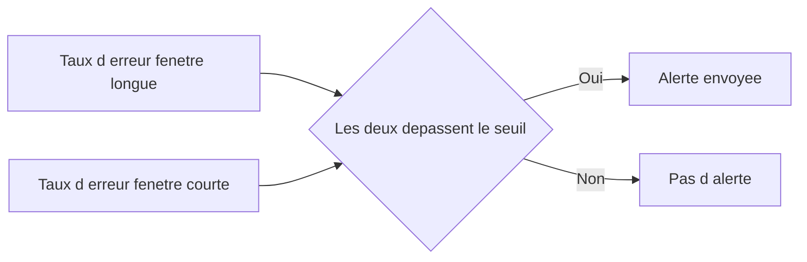

# SLO, SLI et Error Budgets

## Objectifs pédagogiques

À l'issue de ce module, vous saurez :

- **Définir** des SLI de disponibilité, de taux de succès et de latence à partir de métriques Prometheus réellement disponibles.
- **Fixer** un SLO réaliste en tenant compte de l'historique mesuré et des dépendances du service.
- **Calculer** un error budget, en minutes et en nombre de requêtes, et l'interpréter pour décider.
- **Construire** des alertes de burn rate multi-fenêtres dans Grafana Alerting.
- **Concevoir** un dashboard de fiabilité orienté service, et distinguer un SLO interne d'un SLA contractuel.

## Mise en situation

Vous êtes responsable de la plateforme d'observabilité d'une équipe qui exploite une API de commande en ligne. Chaque lundi, le même rituel : le tableau de bord « Santé » est vert, les pods sont `Running`, le CPU des nœuds plafonne à 40 %. Et pourtant le support a reçu une quinzaine de tickets pendant le week-end : « le paiement échoue », « la page tourne dans le vide ».

Le problème ne vient pas de Grafana. Le tableau de bord répond à la question « les machines tournent-elles ? », alors que la vraie question est « les clients arrivent-ils à commander ? ». Côté alertes, c'est l'inverse : un seuil à « erreurs > 1 % pendant 5 minutes » réveille l'astreinte pour des pics inoffensifs, mais laisse passer une dégradation lente à 0,4 % qui dure trois jours.

Les SLO apportent une réponse à ces deux problèmes. Ils fixent ce que « ça marche » veut dire du point de vue de l'utilisateur, combien d'échecs on accepte, et à quelle vitesse on les consomme. Les alertes ne dépendent plus d'un seuil arbitraire : elles découlent d'un engagement chiffré.

## Ce que sont les SLI, les SLO et le budget d'erreur

Trois notions s'emboîtent, et il vaut mieux ne pas les mélanger.

Un **SLI (Service Level Indicator)** est une mesure : la proportion d'événements « réussis » parmi les événements « valides ». Par exemple, 99,93 % des requêtes ont obtenu une réponse non erronée sur les dernières 24 heures.

Un **SLO (Service Level Objective)** est la cible que l'on se fixe sur ce SLI, sur une fenêtre donnée : « 99,9 % des requêtes réussissent, sur 30 jours glissants ».

L'**error budget** est le complément : 100 % − SLO. C'est la quantité d'échecs que l'on s'autorise. Ce n'est pas une tolérance honteuse, c'est une ressource que l'on dépense en déployant, en migrant, en prenant des risques.

🧠 **Concept clé** : un SLI se ramène toujours à une fraction `événements_bons / événements_valides`. Cette forme unique, comprise entre 0 et 1, rend tous les SLI comparables, et permet de calculer budgets et burn rates avec les mêmes formules, quel que soit le service.

Pour l'intuition, pensez à un budget mensuel de dépenses : le SLO, c'est le plafond que vous vous fixez, l'error budget ce qu'il vous reste à dépenser, et le burn rate la vitesse à laquelle vous le videz. Dépenser 80 % du budget en trois jours revient à le vider environ huit fois trop vite (burn rate ≈ 8) : c'est un rythme qui impose d'agir sans attendre.

## Choisir des SLI qui reflètent l'expérience utilisateur

### Les trois familles de SLI

**Taux de succès.** C'est le SLI le plus courant pour une API. Les événements bons sont les réponses sans erreur serveur, les événements valides toutes les requêtes. Les erreurs 4xx sont en général exclues des « mauvais » événements : un 404 ou un 401 est souvent un comportement correct, pas une défaillance du service.

```promql
sum(rate(http_requests_total{job="api", code!~"5.."}[5m]))
/
sum(rate(http_requests_total{job="api"}[5m]))
```

Le nom du label (`code`, `status`, `status_code`) dépend de la bibliothèque d'instrumentation. Vérifiez-le dans Explore avant de copier la requête.

**Latence.** Piège classique : prendre un percentile (« p95 < 300 ms ») comme SLI. Cela donne une valeur, pas une proportion, et on ne peut pas en tirer un budget propre. La forme correcte consiste à compter la part des requêtes plus rapides qu'un seuil :

```promql
sum(rate(http_request_duration_seconds_bucket{job="api", le="0.3"}[5m]))
/
sum(rate(http_request_duration_seconds_count{job="api"}[5m]))
```

Le SLO devient alors « 95 % des requêtes répondent en moins de 300 ms ».

⚠️ **Erreur fréquente** : la valeur de `le` doit correspondre exactement à une borne de bucket de l'histogramme. Avec des buckets à 0.25 et 0.5, `le="0.3"` ne renvoie rien. Si vous voulez un seuil à 300 ms, il faut l'ajouter à l'instrumentation, ce qui est plus simple à faire avant d'écrire le SLO qu'après.

**Disponibilité.** Deux approches coexistent. La première est basée sur le trafic réel : le taux de succès ci-dessus fait office de disponibilité. La seconde utilise des sondes synthétiques (par exemple le blackbox exporter) qui interrogent un parcours toutes les 30 secondes, et la disponibilité est la proportion de sondes réussies. Les sondes sont indispensables quand le trafic est faible ou nul la nuit : sans requêtes, un SLI basé sur le trafic ne dit rien.

### Disponibilité infrastructure ≠ disponibilité fonctionnelle

⚠️ **Le piège du plan, et le plus coûteux en pratique.** La métrique `up == 1` signifie que Prometheus a pu scraper la cible. Un pod `Ready` signifie que sa sonde de santé répond. Aucune des deux ne dit que le client peut payer sa commande.

Voici des cas où l'infrastructure est à 100 % et le service à 0 % utile :

- l'API répond 200, mais le fournisseur de paiement qu'elle appelle est en panne et elle renvoie un panier vide ;
- la base est saturée : l'endpoint `/health` répond vite, `/orders` expire à 30 secondes ;
- un déploiement a cassé un seul endpoint critique, noyé dans le volume des autres.

La règle est donc de mesurer le plus près possible de l'utilisateur, sur un parcours qui a du sens métier. En pratique :

| Où mesurer | Ce que ça capture | Limite |
|---|---|---|
| Métriques de l'application | Erreurs applicatives, latence interne | Ne voit pas les requêtes qui n'arrivent jamais jusqu'à l'application |
| Ingress ou load balancer | Ce que voit réellement le client, y compris les 502/503 | Granularité métier limitée |
| Sondes synthétiques sur un parcours | Disponibilité de bout en bout, même sans trafic | Représentatif d'un seul scénario |

Le plus solide combine souvent l'ingress (trafic réel) et une sonde sur le parcours critique. Les métriques d'infrastructure (CPU, mémoire, état des pods) restent utiles, mais pour le diagnostic, pas pour définir la fiabilité.

💡 **Astuce** : choisissez peu de SLI par service, deux ou trois suffisent (succès + latence sur le parcours principal). Un SLI par métrique disponible reproduit le dashboard « tout ce qu'on peut afficher », et c'est justement ce qu'on cherche à éviter.

## Fixer un SLO réaliste

Un SLO n'est pas une ambition, c'est un compromis. Trop bas, il ne protège personne. Trop haut, il paralyse les déploiements ou, pire, il est ignoré parce que tout le monde sait qu'il est déjà violé.

Trois repères aident à le fixer :

1. **L'historique mesuré.** Calculez le SLI réel sur les 60 à 90 derniers jours. Si le service tourne à 99,7 %, viser 99,99 % n'a pas de sens. Partez un peu en dessous de l'existant, puis resserrez si besoin.
2. **Les dépendances.** Les disponibilités se multiplient quand les composants sont en série. Une API à 99,9 % qui dépend d'une base à 99,9 % et d'un fournisseur de paiement à 99,9 % ne peut pas honnêtement promettre mieux que 0,999³ ≈ 99,7 %, sauf mécanisme de contournement (cache, file d'attente, dégradation gracieuse).
3. **L'attente réelle des utilisateurs.** Un service interne de reporting consulté dix fois par jour n'a pas besoin des mêmes neuf qu'un tunnel de paiement.

Le coût de chaque « neuf » supplémentaire est exponentiel. Voici ce que les cibles courantes autorisent sur 30 jours (43 200 minutes) :

| SLO | Error budget | Indisponibilité totale tolérée |
|---|---|---|
| 99 % | 1 % | 7 h 12 min |
| 99,5 % | 0,5 % | 3 h 36 min |
| 99,9 % | 0,1 % | 43,2 min |
| 99,99 % | 0,01 % | 4,3 min |

À 99,99 %, un seul déploiement raté de cinq minutes épuise tout le mois. Si l'équipe ne dispose ni de déploiements progressifs ni de retour arrière automatique, ce SLO est un vœu pieux.

Dernier choix : la fenêtre. Une fenêtre glissante de 28 ou 30 jours est la plus courante, car elle évite l'effet « remise à zéro » du premier du mois, où l'on se sent soudain autorisé à tout casser. Une fenêtre calendaire s'aligne mieux sur des revues mensuelles, mais elle comporte ce biais.

## Error budget : calcul et interprétation

Le calcul se fait de deux façons, équivalentes mais utiles dans des contextes différents.

**En temps** (pour parler en réunion) : à 99,9 % sur 30 jours, vous disposez de 43,2 minutes d'indisponibilité complète.

**En événements** (pour mesurer réellement) : si le service traite 12 millions de requêtes sur 30 jours, un SLO de 99,9 % autorise 12 000 requêtes en échec. La seconde forme est plus fidèle, car une panne de 10 minutes à 3 h du matin ne coûte pas autant qu'une panne de 10 minutes à l'heure de pointe.

Le budget restant se calcule dans Prometheus ainsi :

```promql
1 - (
  (
    (sum(increase(http_requests_total{job="api", code=~"5.."}[30d])) or vector(0))
    /
    sum(increase(http_requests_total{job="api"}[30d]))
  ) / 0.001
)
```

Le résultat vaut 1 quand rien n'a été dépensé, 0 quand le budget est épuisé, et devient négatif si le SLO est violé. Le `or vector(0)` est nécessaire : tant qu'aucune erreur 5xx n'a été émise, la série filtrée n'existe pas et la requête renverrait un résultat vide au lieu de 1. `0.001` est le budget (1 − 0,999) : si vous changez le SLO, changez cette valeur.

💡 **Astuce** : une requête sur 30 jours coûte cher à chaque rafraîchissement du dashboard. Pour la production, enregistrez par recording rule le débit d'erreurs et le débit total (et non un ratio), puis sommez chacun sur la fenêtre avant de diviser : moyenner des ratios avec `avg_over_time` pondérerait par le temps et non par le volume de requêtes. Le module précédent a détaillé ce levier de performance, il s'applique ici tel quel. Vérifiez aussi que la rétention de votre backend couvre bien la fenêtre du SLO : avec 15 jours de rétention, un SLO sur 30 jours affichera des résultats faux, sans erreur visible.

### Lire le budget pour décider

Le budget sert à arbitrer, pas à décorer un dashboard. Une **error budget policy**, écrite et acceptée par l'équipe produit comme par l'équipe technique, définit à l'avance ce qui se passe selon l'état du budget :

- budget confortable : on déploie normalement, on peut même prendre des risques (migration, expérimentation) ;
- budget consommé à 75 % : les changements risqués attendent, on traite en priorité les causes d'erreurs récurrentes ;
- budget épuisé : gel des fonctionnalités non essentielles jusqu'à retour sous le SLO, effort consacré à la fiabilité.

L'intérêt de cette politique est qu'elle évite la négociation à chaud pendant un incident : la règle existait avant.

⚠️ **Erreur fréquente** : considérer qu'un budget intact à 100 % en fin de période est une réussite. Il peut signifier au contraire que l'objectif est trop prudent, ou que l'équipe n'ose plus rien livrer. Un budget jamais consommé est un signal à examiner, au même titre qu'un budget épuisé.

## Burn rate et alertes multi-fenêtres

### Pourquoi le seuil fixe échoue

Une alerte « erreurs > 1 % sur 5 minutes » traite de la même façon un pic de 5 minutes sans conséquence et une dégradation silencieuse qui dure des jours. La première réveille quelqu'un pour rien, la seconde vide le budget sans que personne ne le voie.

Le **burn rate** corrige cela en mesurant la vitesse de consommation du budget :

> burn rate = taux d'erreur observé / taux d'erreur autorisé par le SLO

Un burn rate de 1 épuise exactement le budget à la fin de la fenêtre. À 99,9 %, le taux autorisé est 0,001 : si vous observez 1,44 % d'erreurs, le burn rate vaut 14,4, et le budget de 30 jours serait épuisé en 720 h / 14,4 = 50 heures. Une panne totale correspond à un burn rate de 1000 : tout le budget part en 43 minutes.

### Combiner une fenêtre longue et une fenêtre courte

Une seule fenêtre pose problème : trop courte, elle est bruyante ; trop longue, elle continue de sonner longtemps après la fin de l'incident. On associe donc deux fenêtres : la longue confirme que le problème est significatif, la courte confirme qu'il est toujours en cours.



La configuration suivante, inspirée du Google SRE Workbook, convient bien pour un SLO de 99,9 % sur 30 jours :

| Gravité | Burn rate | Fenêtre longue | Fenêtre courte | Budget consommé à l'alerte | Seuil d'erreur |
|---|---|---|---|---|---|
| Page (urgent) | 14,4 | 1 h | 5 min | 2 % | 1,44 % |
| Page | 6 | 6 h | 30 min | 5 % | 0,6 % |
| Ticket | 1 | 3 j | 6 h | 10 % | 0,1 % |

Le pourcentage de budget consommé se vérifie facilement : 14,4 × 1 h / 720 h = 2 %. Plus la fuite est rapide, plus on veut être prévenu tôt, au prix d'un seuil de budget plus bas. Plus elle est lente, plus on accepte d'attendre, et le canal passe de la page à un ticket.

### Mise en œuvre dans Grafana

Commencez par produire les ratios d'erreur sur chaque fenêtre via des recording rules côté Prometheus :

```yaml
groups:
  - name: api-slo
    rules:
      - record: slo:api_error_ratio:rate5m
        expr: |
          sum(rate(http_requests_total{job="api", code=~"5.."}[5m]))
          / sum(rate(http_requests_total{job="api"}[5m]))
      - record: slo:api_error_ratio:rate1h
        expr: |
          sum(rate(http_requests_total{job="api", code=~"5.."}[1h]))
          / sum(rate(http_requests_total{job="api"}[1h]))
      # même schéma pour 30m, 6h et 3d
```

Dans Grafana Alerting, créez une règle gérée par Grafana avec deux requêtes (A = ratio 1 h, B = ratio 5 min) et une expression de type Math comme condition :

```
($A > 0.0144) && ($B > 0.0144)
```

Répétez avec les paliers 6 h/30 min (seuil 0.006) et 3 j/6 h (seuil 0.001). Les libellés exacts de l'interface varient selon la version de Grafana, mais le principe reste le même : deux séries, une condition booléenne qui exige que les deux soient vraies.

Deux points d'attention propres aux SLO. D'abord le comportement `No Data` : si le service ne reçoit aucune requête, le ratio est indéfini. Décidez explicitement si c'est un état sain (service de nuit) ou une panne à signaler ; un service qui n'a plus de trafic parce que le DNS est cassé est un cas réel. Ensuite, joignez à l'alerte un lien vers le dashboard du service et une description de l'action attendue, sinon l'alerte indique que le budget brûle, sans dire où regarder.

Si vous ne souhaitez pas écrire ces règles à la main, des générateurs open source comme Sloth ou Pyrra produisent recording rules et alertes à partir d'une définition de SLO. Grafana Cloud propose aussi une application SLO intégrée. Dans les deux cas, comprenez d'abord ce qui est généré : en cas de comportement inattendu, c'est cette logique que vous devrez déboguer.

## Dashboards de fiabilité orientés service

Un dashboard de SLO répond à trois questions dans cet ordre : *Sommes-nous dans l'objectif ? À quelle vitesse dépensons-nous ? Où partent les erreurs ?* Une organisation qui fonctionne bien en pratique :

1. **Ligne du haut** : des panels Stat très lisibles : SLO cible, SLI actuel sur 30 jours, budget restant (en %), burn rate sur 1 h et 6 h. Colorez le budget restant avec des seuils (vert > 50 %, orange 25-50 %, rouge < 25 %).
2. **Ligne centrale** : une série temporelle du budget restant sur la fenêtre, avec des annotations de déploiement. On voit immédiatement quelle release a creusé la courbe.
3. **Ligne du bas** : décomposition de ce qui consomme le budget, par route ou par code d'erreur. Ces labels doivent rester à faible cardinalité, sinon le dashboard devient lui-même un problème de performance.
4. **Liens** : depuis chaque panel, un lien vers Explore avec la requête pré-remplie, vers les logs d'erreurs dans Loki et vers les traces lentes dans Tempo. Le dashboard indique qu'il y a un problème, les autres signaux disent pourquoi.

Utilisez une variable de dashboard pour le service, afin qu'un même modèle serve à toutes les APIs de l'organisation. Et gardez ce dashboard court : il s'adresse autant au responsable produit qu'à l'ingénieur d'astreinte, et le premier ne fera pas défiler trois écrans.

## SLA contractuel vs SLO interne

Le **SLA (Service Level Agreement)** est un engagement contractuel envers un client, avec des conséquences en cas de manquement : crédits de service, pénalités, voire résiliation. Le SLO est un objectif interne, sans sanction juridique, destiné à piloter le travail de l'équipe.

La règle qui en découle : **le SLO est plus strict que le SLA**. Si le contrat promet 99,5 %, l'équipe vise 99,9 % en interne. L'écart est un coussin : quand le SLO est violé, il reste une marge avant d'enfreindre le contrat. Le dashboard doit afficher les deux seuils.

Deux nuances méritent d'être connues. Le SLA est souvent mesuré de façon plus restrictive ou plus simple que le SLO (exclusion des maintenances planifiées, mesure mensuelle calendaire, périmètre limité à certains endpoints), donc ne copiez pas sa définition dans votre SLI. Et le texte du contrat relève du juridique et du commercial : l'ingénierie fournit les chiffres et ce qui est techniquement mesurable, mais ne les fixe pas seule.

## Cas réel : l'API de commande (scénario illustratif)

Reprenons l'API de la mise en situation, avec des chiffres fictifs. Elle traite environ 12 millions de requêtes par mois, soit ~280 par minute en moyenne. L'équipe fixe un SLO de 99,9 % de succès sur 30 jours glissants, soit 12 000 requêtes en échec autorisées, avec un SLA client à 99,5 %.

**Incident rapide.** Un déploiement introduit un bug qui renvoie 3 % d'erreurs 500 pendant 40 minutes, à environ 300 requêtes par minute. Le burn rate atteint 3 % / 0,1 % = 30. Le ratio sur 5 min dépasse 1,44 % dès les premières minutes, mais celui sur 1 h n'y parvient que vers la 29e minute (3 % × t / 60 min > 1,44 %) : la page se déclenche alors, avant la fin de l'incident. À ce rythme le budget serait épuisé en 24 heures. L'équipe fait un retour arrière. Au total, 40 × 300 × 3 % = 360 requêtes en échec, soit 3 % du budget. L'alerte est justifiée, même si le budget consommé paraît faible : ce qui compte, c'est la trajectoire.

**Fuite lente.** Une semaine plus tard, une régression sur un endpoint fait grimper les erreurs à 0,3 %. Burn rate de 3 : les alertes à 14,4 et 6 ne sonnent pas, et c'est voulu, ce n'est pas une urgence nocturne. La fenêtre de 6 h dépasse 0,1 % au bout de 2 heures, mais le ratio sur 3 jours ne franchit ce seuil qu'après environ 24 heures (0,3 % × t / 72 h > 0,1 %) : c'est alors que l'alerte de ticket (burn rate > 1 sur 3 j et 6 h) s'ouvre, avec environ 10 % du budget consommé (3 × 24 h / 720 h). L'équipe corrige dans la journée qui suit.

Avec l'ancien seuil « 1 % sur 5 minutes », la première panne aurait déclenché une page de toute façon, et même plus tôt (après 5 minutes), mais la seconde serait restée invisible pendant des jours, jusqu'aux tickets du support.

## Bonnes pratiques

- **Démarrez petit.** Un service critique, deux SLI, un SLO, un budget et des alertes. Étendez après un trimestre d'usage, pas avant.
- **Écrivez la politique de budget** avant d'en avoir besoin, et faites-la valider par le produit. Un SLO sans conséquence est un indicateur de plus.
- **Revoyez les SLO à fréquence fixe** (par trimestre, par exemple) avec les données réelles. Un SLO qui n'a jamais bougé est probablement mal calibré.
- **Mesurez ce que voit l'utilisateur**, jamais seulement l'état des composants. Si vous hésitez entre deux points de mesure, prenez celui qui est le plus proche du client.
- **Surveillez le pipeline du SLI lui-même.** Si le scrape échoue ou si la rétention est insuffisante, le SLI devient vide ou se calcule sur une période tronquée ; selon la construction de la requête, il peut même afficher un 100 % trompeur, ce qui est le pire résultat possible. Traitez `No Data` comme un signal.
- **Versionnez les définitions** (recording rules, alertes, dashboards) en fichiers de provisioning ou en code, de façon à rendre un changement de SLO traçable et relu.
- **Ne mettez pas de SLO sur tout.** Un service interne d'importance faible n'en a pas besoin ; la charge de maintenance d'un SLO mal suivi dépasse sa valeur.

<!-- snippet
id: grafana_slo_sli_definition
type: concept
tech: grafana
level: advanced
importance: high
format: knowledge
tags: slo,sli,fiabilite,observabilite
title: Un SLI est une proportion d'événements bons
content: Un SLI se ramène toujours à événements_bons / événements_valides, soit une valeur entre 0 et 1. Le SLO fixe la cible sur ce ratio (ex. 0,999 sur 30 jours) et l'error budget vaut 1 - SLO. Cette forme unique permet d'appliquer les mêmes formules de budget et de burn rate à tous les services.
description: Tous les SLI partagent la forme bons/valides, ce qui rend budgets et burn rates calculables de façon homogène.
-->

<!-- snippet
id: grafana_slo_success_ratio_query
type: command
tech: prometheus
level: advanced
importance: high
format: knowledge
tags: slo,sli,promql,taux-succes
title: SLI de taux de succès en PromQL
context: À exécuter dans Explore ou dans un panel, sur la source Prometheus
command: sum(rate(http_requests_total{job="<JOB>", code!~"5.."}[<FENETRE>])) / sum(rate(http_requests_total{job="<JOB>"}[<FENETRE>]))
example: sum(rate(http_requests_total{job="api", code!~"5.."}[5m])) / sum(rate(http_requests_total{job="api"}[5m]))
description: Proportion de requêtes sans erreur serveur ; les 4xx sont exclus des échecs car ils reflètent souvent un comportement correct du service.
-->

<!-- snippet
id: grafana_slo_latency_sli_query
type: command
tech: prometheus
level: advanced
importance: medium
format: knowledge
tags: slo,sli,latence,histogram
title: SLI de latence par proportion sous un seuil
command: sum(rate(http_request_duration_seconds_bucket{job="<JOB>", le="<SEUIL>"}[<FENETRE>])) / sum(rate(http_request_duration_seconds_count{job="<JOB>"}[<FENETRE>]))
example: sum(rate(http_request_duration_seconds_bucket{job="api", le="0.3"}[5m])) / sum(rate(http_request_duration_seconds_count{job="api"}[5m]))
description: Donne la part des requêtes plus rapides que le seuil, donc un ratio exploitable pour un budget, contrairement à un p95 brut.
-->

<!-- snippet
id: grafana_slo_latency_bucket_boundary
type: warning
tech: prometheus
level: advanced
importance: medium
format: knowledge
tags: slo,latence,histogram,buckets
title: Le seuil le doit correspondre à un bucket existant
content: Piège : écrire le="0.3" alors que l'histogramme n'a que des buckets 0.25 et 0.5 → la requête ne renvoie aucune série et le SLI de latence reste vide. Correction : choisir le seuil du SLO parmi les bornes existantes, ou ajouter la borne souhaitée dans l'instrumentation avant de définir l'objectif.
description: Un seuil de latence absent des buckets produit un résultat vide, pas une erreur explicite.
-->

<!-- snippet
id: grafana_slo_error_budget_table
type: concept
tech: grafana
level: advanced
importance: high
format: knowledge
tags: slo,error-budget,disponibilite
title: Error budget : minutes autorisées selon le SLO
content: Budget = 1 - SLO, appliqué à la fenêtre. Sur 30 jours (43 200 min) : 99 % = 7 h 12, 99,5 % = 3 h 36, 99,9 % = 43,2 min, 99,99 % = 4,3 min. En événements, 12 M de requêtes à 99,9 % autorisent 12 000 échecs, ce qui reflète mieux l'impact réel qu'un décompte en minutes.
description: Chaque neuf supplémentaire divise le budget par dix ; à 99,99 %, un seul déploiement raté de 5 min épuise le mois.
-->

<!-- snippet
id: grafana_slo_budget_remaining_query
type: command
tech: prometheus
level: advanced
importance: high
format: knowledge
tags: slo,error-budget,promql,dashboard
title: Calculer le budget d'erreur restant sur 30 jours
context: Exige une rétention du backend au moins égale à la fenêtre du SLO
command: 1 - (((sum(increase(http_requests_total{job="<JOB>", code=~"5.."}[30d])) or vector(0)) / sum(increase(http_requests_total{job="<JOB>"}[30d]))) / <BUDGET>)
example: 1 - (((sum(increase(http_requests_total{job="api", code=~"5.."}[30d])) or vector(0)) / sum(increase(http_requests_total{job="api"}[30d]))) / 0.001)
description: Renvoie 1 si rien n'est consommé, 0 si le budget est épuisé, une valeur négative si le SLO est violé ; BUDGET vaut 1 moins le SLO, et or vector(0) évite un résultat vide tant qu'aucune erreur 5xx n'existe.
-->

<!-- snippet
id: grafana_slo_burn_rate_concept
type: concept
tech: grafana
level: advanced
importance: high
format: knowledge
tags: slo,burn-rate,alerting,error-budget
title: Burn rate : vitesse de consommation du budget
content: Burn rate = taux d'erreur observé / taux d'erreur autorisé (1 - SLO). À 99,9 %, 1,44 % d'erreurs donne un burn rate de 14,4 : le budget de 30 jours serait épuisé en 720 h / 14,4 = 50 h. Une panne totale correspond à un burn rate de 1000, soit un budget consommé en 43 min.
description: Un burn rate de 1 épuise exactement le budget en fin de fenêtre ; au-dessus, on le vide plus vite que prévu.
-->

<!-- snippet
id: grafana_slo_multiwindow_alert_thresholds
type: tip
tech: grafana
level: advanced
importance: high
format: knowledge
tags: slo,alerting,burn-rate,multi-fenetres
title: Trois paliers d'alerte multi-fenêtres pour un SLO 99,9 %
content: Page : burn rate 14,4 sur 1 h ET 5 min (seuil 0.0144). Page : burn rate 6 sur 6 h ET 30 min (seuil 0.006). Ticket : burn rate 1 sur 3 j ET 6 h (seuil 0.001). Dans Grafana Alerting, deux requêtes A et B plus une expression Math ($A > 0.0144) && ($B > 0.0144) comme condition.
description: La fenêtre longue confirme l'impact, la courte confirme que le problème est en cours, ce qui évite de sonner longtemps après la résolution.
-->

<!-- snippet
id: grafana_slo_infra_vs_functional
type: warning
tech: grafana
level: advanced
importance: high
format: knowledge
tags: slo,disponibilite,sonde,diagnostic
title: up == 1 ne signifie pas que le service fonctionne
content: Piège : définir la disponibilité avec up == 1 ou l'état des pods. Conséquence : tableau tout vert pendant que des requêtes échouent (dépendance en panne, endpoint cassé, réponse 200 vide). Correction : mesurer le taux de succès à l'ingress ou au load balancer, et ajouter une sonde synthétique sur le parcours critique.
description: Les métriques d'infrastructure servent au diagnostic ; le SLI doit refléter ce que vit l'utilisateur.
-->

<!-- snippet
id: grafana_slo_dependency_ceiling
type: warning
tech: grafana
level: advanced
importance: medium
format: knowledge
tags: slo,dependances,objectif,disponibilite
title: Un SLO ne peut pas dépasser celui de ses dépendances
content: Piège : viser 99,99 % pour une API qui dépend en série d'une base et d'un fournisseur chacun à 99,9 %. Conséquence : plafond réel proche de 0,999 × 0,999 × 0,999 ≈ 99,7 %, SLO violé en permanence puis ignoré. Correction : partir du SLI mesuré sur 60-90 jours et des dépendances, sauf contournement (cache, file d'attente).
description: Les disponibilités en série se multiplient ; le SLO doit rester atteignable avec l'architecture actuelle.
-->

<!-- snippet
id: grafana_slo_sla_margin
type: tip
tech: grafana
level: advanced
importance: medium
format: knowledge
tags: slo,sla,contrat,disponibilite
title: Garder le SLO plus strict que le SLA
content: Si le contrat promet 99,5 % (SLA), fixer l'objectif interne à 99,9 % (SLO) et afficher les deux seuils sur le dashboard. L'écart sert de marge : une violation du SLO déclenche une action avant d'atteindre la pénalité contractuelle. Ne copiez pas la définition du SLA (exclusions, périmètre) dans le SLI.
description: Le SLO pilote l'équipe, le SLA engage l'entreprise ; l'écart entre les deux laisse du temps pour réagir.
-->

<!-- snippet
id: grafana_slo_budget_panel_nodata
type: error
tech: grafana
level: advanced
importance: medium
format: knowledge
tags: slo,error-budget,retention,no-data
title: Le panel de budget affiche des valeurs fausses ou No Data
content: Symptôme : budget faux ou panel vide (No Data). Causes : rétention du backend inférieure à la fenêtre du SLO (15 j pour un SLO 30 j), donc ratio calculé sur une période tronquée ; aucune série 5xx encore émise, donc numérateur vide ; cible non scrapée ou service sans trafic, donc ratio indéfini. Correction : aligner la rétention sur la fenêtre, ajouter or vector(0) au numérateur, alerter sur l'absence de données, et décider explicitement si zéro requête est sain.
description: Un SLI calculé sur des données manquantes rassure à tort ; l'absence de données doit être traitée comme un signal.
-->
