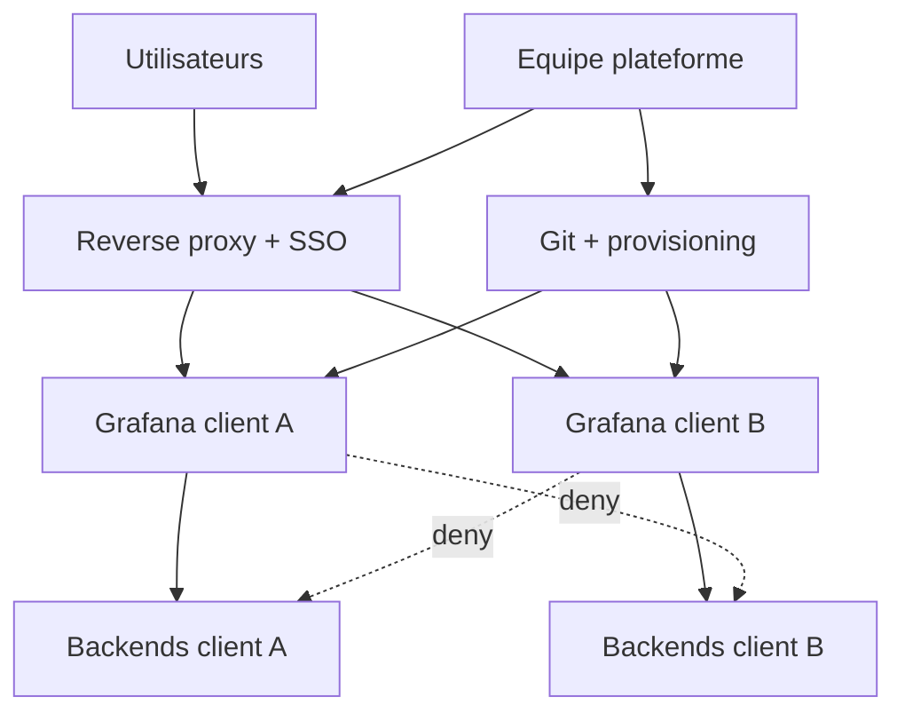

# Sécurité avancée et gouvernance

## Objectifs pédagogiques

À la fin de ce module, vous saurez :

- **concevoir** un modèle d'accès Grafana en moindre privilège, avec séparation entre administration de la plateforme, gestion des données et édition des dashboards ;
- **identifier** ce qu'un utilisateur `Viewer` peut réellement atteindre via le proxy de data sources, et ce que ça implique pour la segmentation ;
- **durcir** une instance (TLS, cookies, plugins, secrets) et **automatiser** la rotation des tokens de service accounts ;
- **décider** entre organisations, instances séparées ou stacks dédiées selon le niveau d'isolation exigé ;
- **détecter** les modifications sensibles et vérifier par des tests concrets que les contrôles tiennent.

## Mise en situation

*Scénario illustratif, chiffres fictifs.*

Une équipe plateforme héberge Grafana OSS pour trois clients. Chaque client a sa propre **organisation Grafana**, ses dashboards, ses utilisateurs en rôle `Viewer` ou `Editor`, et un `Admin` d'org côté client. Les métriques viennent d'un Prometheus partagé, les logs d'un Loki multi-tenant. Les data sources de chaque org sont déclarées avec l'en-tête `X-Scope-OrgID: client-a`, `client-b`, etc.

Un utilisateur du client B, curieux, a reçu le rôle `Admin` de son organisation pour gérer ses propres data sources. Il ouvre la configuration de la data source Loki de son organisation et change la valeur de l'en-tête : `X-Scope-OrgID: client-a`. Loki ne vérifie pas l'identité du client, il fait confiance à l'en-tête. Les logs du client A apparaissent dans Explore.

La défense naïve était « une organisation par client ». Elle sépare les dashboards, pas les données.

> 🏢 **Analogie : des bureaux dans un même immeuble.** Les organisations Grafana sont une séparation **logique** : un même processus, une même base SQL, les mêmes plugins et un seul administrateur serveur. Chaque client a sa porte, mais le gardien a toutes les clés et les couloirs sont communs. Limite de l'image : dans Grafana, ce qui relie les « bureaux » est aussi le chemin vers les données elles-mêmes.
{: .callout .callout-analogie}

Le vrai contrôle d'accès aux données doit vivre dans les backends, ou dans la décision de ne pas partager l'instance.

## Surface d'attaque

Grafana est un client privilégié de tous vos backends d'observabilité. Le compromettre revient souvent à compromettre ce qu'il interroge.

| Vecteur | Exposition | Impact potentiel |
|---|---|---|
| Endpoint `/api/ds/query` et proxy de data sources | Tout utilisateur authentifié de l'org, même `Viewer`, peut interroger une data source de l'org s'il connaît son UID, même si aucun dashboard ne l'utilise | Lecture de toutes les métriques et logs accessibles à la data source |
| Edition de data source (URL, en-têtes, TLS) | `Admin` d'org, ou tout rôle ayant la permission d'écriture | Changement de tenant Loki/Mimir, SSRF (Server-Side Request Forgery) vers le réseau interne |
| Service account tokens (`glsa_...`) | CI/CD, scripts, Terraform, dépôts Git, logs de pipeline | Persistance : un token `Admin` sans expiration survit à la rotation des mots de passe |
| Base Grafana (SQLite/PostgreSQL) + `secret_key` | Sauvegardes, volumes montés, snapshots disque | Déchiffrement des identifiants de data sources stockés |
| Plugins | Binaires backend exécutés avec les droits du processus Grafana, code JS exécuté dans le navigateur des utilisateurs | Exécution de code côté serveur, XSS (Cross-Site Scripting) |
| Panels HTML/Text, dashboards importés | Contenu fourni par les éditeurs | Vol de session d'un admin qui ouvre le dashboard |
| Interface exposée publiquement | Reverse proxy mal configuré, port 3000 ouvert | Exploitation directe de CVE (Common Vulnerabilities and Exposures) non patchées |

## Modèle de menace

Trois acteurs couvrent la plupart des scénarios réalistes :

- **L'utilisateur interne légitime mais curieux** : `Viewer`, `Editor` ou `Admin` d'org qui cherche à voir plus que ce qu'on lui a montré. C'est le cas du scénario d'ouverture, de loin le plus probable.
- **L'identité volée** : token de service account dans un dépôt, cookie de session d'un admin, compte SSO compromis. Pas besoin de CVE, seulement d'un secret qui traîne.
- **L'attaquant externe** qui atteint Grafana via Internet et exploite une vulnérabilité non corrigée.

> 🔴 **Vecteur d'attaque — CVE-2021-43798.** Dans Grafana 8.0.0-beta1 à 8.3.0, le chemin `/public/plugins/<ID_PLUGIN>/` permettait une traversée de répertoire sans authentification. L'attaque se résume à un `curl --path-as-is` (sans `--path-as-is`, curl normalise les `../` et l'attaque échoue silencieusement) :
{: .callout .callout-danger}

```bash
curl --path-as-is "http://<HOST>:3000/public/plugins/alertlist/../../../../../../../../etc/grafana/grafana.ini"
```

L'attaquant lit `grafana.ini`, récupère `secret_key`, puis télécharge `/var/lib/grafana/grafana.db`. Des outils publics déchiffrent ensuite les mots de passe des data sources stockés dans la base. Un seul bug de lecture de fichier se transforme ainsi en accès à tous les backends. Ce chemin d'attaque explique pourquoi `secret_key` et la base ne doivent jamais voyager ensemble.

> 🔴 **Vecteur d'attaque — proxy de data sources.** Pas de CVE ici, c'est le comportement normal. Avec un token ou une session `Viewer` :
{: .callout .callout-danger}

```bash
curl -s -X POST "https://<HOST>/api/ds/query" \
  -H "Authorization: Bearer <TOKEN>" -H "Content-Type: application/json" \
  -d '{"queries":[{"refId":"A","datasource":{"uid":"<DS_UID>"},"expr":"up","instant":true}],"from":"now-5m","to":"now"}'
```

Si la data source accepte la requête, le `Viewer` lit la donnée, même s'il n'a jamais vu de panel qui l'utilise. Les UID sont faciles à obtenir : ils apparaissent dans le JSON de n'importe quel dashboard exporté.

> 🧠 **Concept clé.** Dans Grafana OSS, la permission d'interroger une data source est portée par l'organisation, pas par le dashboard. Les permissions de dossier masquent des dashboards ; elles n'empêchent pas une requête directe. Les permissions par data source existent dans les éditions Enterprise et Cloud (vérifier selon la version).
{: .callout .callout-important}

## Moindre privilège et séparation des responsabilités

Le moindre privilège dans Grafana demande de découper les rôles par **fonction**, pas par personne. Quatre fonctions distinctes, idéalement tenues par des identités différentes :

| Fonction | Ce qu'elle fait | Identité typique | Ne doit pas pouvoir |
|---|---|---|---|
| Admin plateforme | Config serveur, plugins, SSO, orgs | 2 à 3 personnes, comptes nominatifs, accès rare | Éditer les dashboards au quotidien |
| Gestion des data sources | URL, TLS, credentials, en-têtes | Pipeline de provisioning, pas d'humain | Être modifiée depuis l'UI en production |
| Propriétaire de dossier | Dashboards et règles d'alerte de son périmètre | Équipe applicative, via permissions de dossier | Voir ou modifier les dossiers voisins |
| Consommation | Lecture des dashboards | Support, astreinte | Écrire, créer des tokens |

Le point d'application le plus efficace, y compris en OSS, est le provisioning avec `editable: false` :

```yaml
apiVersion: 1
datasources:
  - name: Prometheus-prod
    type: prometheus
    uid: prom-prod
    access: proxy
    url: https://prometheus.prod.internal:9090
    editable: false
    jsonData:
      tlsAuth: true
      tlsAuthWithCACert: true
      httpMethod: POST
    secureJsonData:
      tlsCACert: $__file{/run/secrets/ca.pem}
      tlsClientCert: $__file{/run/secrets/client.pem}
      tlsClientKey: $__file{/run/secrets/client.key}
```

Dans le scénario d'ouverture, cette seule ligne bloque la modification de l'en-tête de tenant depuis l'UI. Un admin d'org malveillant peut encore tenter d'ajouter une autre data source, d'où le besoin de limiter qui est `Admin` d'org.

> 🔒 **Contrôle de sécurité.** Une règle simple à faire respecter : personne n'est `Admin` d'organisation en dehors de l'équipe plateforme. Les équipes applicatives sont `Editor` sur leurs dossiers via des permissions de dossier. Les `Editor` créent des dashboards sans pouvoir toucher aux data sources, ce qui réduit fortement les chemins vers le changement de tenant.
{: .callout .callout-securite}

### Ce que change l'édition

| Capacité | OSS | Enterprise / Cloud |
|---|---|---|
| Rôles de base (`Viewer`, `Editor`, `Admin`) | Oui | Oui |
| Permissions de dossier et dashboard | Oui | Oui |
| Teams | Oui | Oui, avec synchronisation depuis l'IdP (Identity Provider) selon l'édition |
| Rôles personnalisés (RBAC fin) | Non | Oui |
| Permissions par data source | Non | Oui |
| Audit logging natif | Non | Oui |
| LBAC (Label-Based Access Control) sur Loki | Non | Selon l'offre |

L'interface et les limites évoluent d'une version à l'autre : vérifiez la matrice de votre version avant de promettre une garantie. En OSS, on compense par trois leviers : le provisioning verrouillé, la revue de code sur Git, et la segmentation par instance.

## Service accounts, tokens, secrets et TLS

Les anciennes API keys sont dépréciées au profit des **service accounts**.

> 📖 **Définition.** Un service account est un compte destiné aux scripts et aux outils. Il porte un rôle, des permissions, et des tokens en `glsa_...` rattachés à son compte.
{: .callout .callout-definition}

Un token sans date d'expiration est un mot de passe permanent.

En production, la rotation se fait par chevauchement : le nouveau token fonctionne avant que l'ancien ne disparaisse.

1. créer un nouveau token avec une durée de vie courte ;
2. le déposer dans le gestionnaire de secrets (Vault, secrets Kubernetes chiffrés, etc.) ;
3. redéployer les consommateurs ;
4. supprimer l'ancien token.

```bash
curl -s -X POST "https://<HOST>/api/serviceaccounts/<SA_ID>/tokens" \
  -H "Authorization: Bearer <ADMIN_TOKEN>" -H "Content-Type: application/json" \
  -d '{"name":"ci-provisioning-2025-06","secondsToLive":2592000}'
```

> ⚠️ **Erreur fréquente.** Un unique service account `Admin` partagé entre Terraform, un script de sauvegarde et un exporter. Si l'un des trois fuit, l'attaquant obtient `Admin`. Correction : un service account par usage, avec le rôle minimal. Un script de lecture d'alertes est `Viewer`. Terraform qui gère les dashboards est `Editor`, jamais `Admin`, sauf s'il crée aussi des data sources.
{: .callout .callout-attention}

Au-delà des tokens, trois secrets structurent la sécurité de la plateforme :

- **`secret_key`** : clé qui chiffre les credentials stockés en base. Sa valeur par défaut est publique dans `defaults.ini` (`SW2YcwTIb9zpOOhoPsMm`). Sans la changer, quiconque obtient la base peut tout déchiffrer. La rotation de cette clé se fait via une procédure documentée de re-chiffrement dont les commandes dépendent de la version, et exige une sauvegarde préalable de la base.
- **Credentials de data sources** : toujours injectés via `$__file{}` ou `$__env{}` dans le provisioning, jamais en clair dans Git.
- **Certificats TLS** : certificat du serveur Grafana (ou du reverse proxy) et certificats clients vers les backends.

Configuration durcie de référence (à adapter à votre version) :

```ini
[server]
protocol = https
cert_file = /etc/grafana/tls/tls.crt
cert_key = /etc/grafana/tls/tls.key
min_tls_version = TLS1.2

[security]
secret_key = $__file{/run/secrets/gf_secret_key}
admin_password = $__file{/run/secrets/gf_admin_password}
cookie_secure = true
cookie_samesite = lax
strict_transport_security = true
content_security_policy = true
allow_embedding = false
disable_gravatar = true
data_source_proxy_whitelist = prometheus.prod.internal:9090 loki.prod.internal:3100

[users]
allow_sign_up = false
auto_assign_org_role = Viewer
viewers_can_edit = false

[auth]
login_maximum_inactive_lifetime_duration = 7d
login_maximum_lifetime_duration = 30d

[auth.anonymous]
enabled = false

[snapshots]
external_enabled = false

[plugins]
plugin_admin_enabled = false
```

Si TLS est terminé sur un reverse proxy, le bloc `[server]` change, mais le chiffrement entre proxy et Grafana reste souhaitable dès que le réseau n'est pas dédié.

Ce que ça coûte :

- `data_source_proxy_whitelist` ajoute une étape à chaque nouveau backend (la liste doit être mise à jour), mais elle limite la SSRF via le proxy de data sources. Elle ne couvre pas forcément les requêtes des data sources à backend (`/api/ds/query`) : vérifiez dans la documentation de votre version.
- `disable_login_form` n'est pas dans la liste volontairement : le désactiver oblige à passer par SSO, ce qui est souhaitable. Il faut toutefois conserver un compte local d'urgence (*break-glass*) dont le mot de passe est dans un coffre, sous peine de verrouillage total en cas de panne de l'IdP.
- La rotation des tokens et des certificats demande de l'automatisation. Sans elle, l'expiration devient un incident récurrent plutôt qu'une protection.

## Segmentation : organisations, instances ou stacks



Les flèches en pointillés représentent des règles réseau explicites (NetworkPolicy, security groups) : l'instance du client A ne doit pas pouvoir joindre les backends du client B, même par erreur de configuration.

> ⚠️ **Piège à traiter explicitement.** Grafana n'est pas une frontière de sécurité suffisante pour isoler des données multi-clients. Les organisations partagent le processus, la base, les plugins, le réseau sortant et les administrateurs serveur. Une faille applicative, un plugin malveillant ou une data source mal configurée suffit à traverser la séparation.
{: .callout .callout-attention}

| Situation | Option | Compromis | Limite |
|---|---|---|---|
| Équipes internes d'une même société, données de sensibilité équivalente | Une organisation par équipe | Peu coûteux, administration centralisée | Un `Admin` d'org peut atteindre n'importe quelle data source du réseau si rien ne la protège |
| Environnements prod / préprod avec secrets différents | Une instance par environnement | Plus de déploiements, mais blast radius réduit | Doit être industrialisée via provisioning |
| Clients externes, contraintes contractuelles ou réglementaires | Une instance (ou stack) par client, backends séparés | Coût d'infrastructure (mémoire, sauvegardes, patching multiplié) | Nécessite de l'automatisation pour rester gérable |
| Plateforme mutualisée avec Loki/Mimir | Isolation réelle au niveau backend (authentification proxy qui impose `X-Scope-OrgID`, LBAC si disponible) | Complexité côté proxy | Grafana seul ne vaut pas isolation |

> 💡 **À retenir.** Si une fuite entre deux consommateurs est un incident contractuel ou réglementaire, passez à une instance par consommateur et à des backends distincts. Sinon, les organisations suffisent, à condition que les rôles `Admin` soient restreints et que les data sources soient verrouillées en provisioning.
{: .callout .callout-important}

## Cycle de vie des plugins

Un plugin backend est un exécutable lancé par le processus Grafana, avec les droits de ce processus. Un plugin front tourne dans le navigateur de chaque utilisateur qui ouvre un dashboard. > 📦 **Analogie : une dépendance en production.** Un plugin non signé a une portée comparable à celle d'une dépendance applicative exécutée en production. Vous ne l'installeriez pas sans en vérifier l'origine et la version.
{: .callout .callout-analogie}

Pratiques applicables sans outillage lourd :

- **Inventaire** : `grafana cli plugins ls` (ou l'API) dans un job régulier, comparé à une liste approuvée en Git.
- **Installation figée dans l'image** : `grafana cli plugins install <ID> <VERSION>` au *build*, pas au démarrage via `GF_INSTALL_PLUGINS`, qui rend l'état dépendant du réseau et du dépôt de plugins à chaque redémarrage.
- **Signature obligatoire** : `allow_loading_unsigned_plugins` vide en production. Un plugin privé est signé avec votre propre clé plutôt que dispensé de signature.
- **Interface d'administration des plugins désactivée** (`plugin_admin_enabled = false`) : l'installation passe par le pipeline.
- **Suppression** de tout plugin non utilisé depuis trois mois, avec ses data sources associées.
- **Veille** : surveiller les avis de sécurité Grafana et mettre à jour les plugins avec la même cadence que Grafana lui-même.

Coût : chaque mise à jour de plugin passe par un build d'image et un déploiement, ce qui ralentit les demandes d'équipes qui veulent « juste tester ce panel ». Une instance de test non connectée aux backends de production sert à cela.

## Audit des modifications et détection

L'audit logging natif est une fonction Enterprise/Cloud. En OSS, on reconstitue la traçabilité avec trois sources :

- l'**historique de versions** des dashboards (qui, quand) ;
- les **logs du serveur** (`router_logging = true` si le volume le permet) et les logs d'accès du reverse proxy, qui portent l'IP, l'utilisateur et la méthode ;
- le **dépôt Git** du provisioning : tout ce qui est déployé par pipeline est tracé par commit et revue.

Ces logs doivent partir vers un stockage que les admins Grafana ne peuvent pas modifier (un Loki séparé, un SIEM — Security Information and Event Management). Sinon, l'attaquant qui devient admin efface ses traces.

Exemple de requête LogQL pour repérer des écritures sensibles (les noms de champs varient selon la version et la configuration de log) :

```logql
{app="grafana"} |= "method=" |~ "method=(POST|PUT|DELETE|PATCH)" |~ "path=/api/(datasources|serviceaccounts|orgs|admin)"
```

Indicateurs de compromission à surveiller en priorité :

- création d'un service account ou d'un token hors fenêtre de déploiement ;
- modification d'une data source alors qu'elle est provisionnée (`editable: false` devrait empêcher l'action depuis l'UI, donc toute tentative réussie mérite une alerte) ;
- création d'un utilisateur `Admin` ou changement de rôle vers `Admin` ;
- rafale d'échecs d'authentification suivie d'un succès depuis la même IP ;
- requêtes `/public/plugins/` contenant `..` ou `%2e%2e` dans les logs du reverse proxy ;
- installation d'un plugin hors pipeline.

## Tests de sécurité

Après avoir appliqué le durcissement, vérifiez que chaque contrôle tient, au lieu de supposer qu'il tient.

**1. Pas d'accès anonyme.** Réponse attendue : `401`.

```bash
curl -s -o /dev/null -w "%{http_code}\n" https://<HOST>/api/org
```

**2. Pas de traversée de répertoire sur les plugins.** Réponse attendue : `400`, `403` ou `404`, jamais `200` avec du contenu.

```bash
curl --path-as-is -s -o /dev/null -w "%{http_code}\n" \
  "https://<HOST>/public/plugins/alertlist/../../../../../../../../etc/passwd"
```

**3. Un `Viewer` ne dépasse pas son périmètre.** Avec un token `Viewer`, testez `/api/ds/query` sur chaque data source qui ne devrait pas lui être accessible. En OSS, vous constaterez que la requête réussit : c'est le comportement attendu qui justifie la segmentation par instance ou le contrôle côté backend.

**4. Audit des tokens.** La réponse JSON contient `expiration` et `hasExpired` pour chaque token.

```bash
curl -s -H "Authorization: Bearer <ADMIN_TOKEN>" \
  "https://<HOST>/api/serviceaccounts/<SA_ID>/tokens"
```

**5. Audit des rôles.**

```bash
curl -s -H "Authorization: Bearer <ADMIN_TOKEN>" https://<HOST>/api/org/users | jq '.[] | select(.role=="Admin") | .login'
```

**6. Versions TLS.** Les anciennes versions doivent être refusées, et la date d'expiration du certificat connue. Avec OpenSSL 3.x, `@SECLEVEL=0` est nécessaire pour que le client propose TLS 1.1. Un message « no protocols available » signale une limite locale, pas un refus du serveur.

```bash
openssl s_client -connect <HOST>:443 -tls1_1 -cipher 'DEFAULT:@SECLEVEL=0' </dev/null 2>&1 | grep -i "alert\|handshake failure"
openssl s_client -connect <HOST>:443 </dev/null 2>/dev/null | openssl x509 -noout -enddate
```

**7. Plugins.** `grafana cli plugins ls` doit correspondre à la liste approuvée. Un plugin inattendu est un incident à ouvrir.

## Cas réel en entreprise

*Scénario illustratif, non attribuable à un incident public précis.*

Une équipe SRE stocke dans le dépôt d'infrastructure un token de service account `Admin` utilisé par Terraform. Le dépôt est interne, donc « personne ne le voit ». Un stagiaire clone le dépôt sur un poste personnel, qui est ensuite compromis. L'attaquant utilise le token depuis une IP inconnue.

Chronologie typique :

| Moment | Événement | Ce qui aurait dû alerter |
|---|---|---|
| J0 | Token utilisé depuis une nouvelle IP, liste des data sources et des utilisateurs | Logs du reverse proxy : IP absente de la liste des runners CI |
| J0 + 10 min | Création d'un second service account `Admin` avec un token sans expiration | Alerte sur création de service account hors fenêtre de déploiement |
| J0 + 1 h | Requêtes massives vers `/api/datasources/proxy/uid/...` | Pic de requêtes depuis une identité de type Terraform, qui ne devrait pas exécuter de requêtes de lecture |
| J + 3 | Détection par un audit manuel des tokens | Aucun contrôle automatisé n'existait |

Containment et remédiation :

1. Révoquer le token exposé, puis **tous** les tokens créés depuis la date d'exposition : le second service account est la persistance.
2. Lister les data sources et en faire tourner les credentials. Ils ont pu être utilisés via le proxy : même si l'API ne renvoie pas leurs valeurs, l'attaquant a pu exploiter les droits qu'ils donnent sur les backends.
3. Vérifier les modifications de dashboards et d'alertes (une règle d'alerte supprimée est une manière de masquer l'attaque).
4. Remplacer le token Terraform par un token `Editor` à durée de vie courte injecté par le CI, avec détection d'usage depuis une IP hors liste.

Leçon : la compromission ne dépendait d'aucune vulnérabilité Grafana. Elle reposait sur un secret permanent, trop privilégié, sans surveillance d'usage.

## Erreurs fréquentes

> ⚠️ **`secret_key` laissé à sa valeur par défaut.**
{: .callout .callout-attention}

Conséquence : toute fuite de la base ou de `grafana.db` (sauvegarde, snapshot de volume, CVE de lecture de fichier) donne accès aux credentials des data sources.
Correction : `secret_key` fourni par fichier secret, unique par instance. Détection : recherche de la valeur par défaut dans la configuration déployée, ou revue du `grafana.ini` effectif.

> ⚠️ **Une organisation par client, présentée comme isolation.**
{: .callout .callout-attention}

Conséquence : un `Admin` d'org modifie l'en-tête de tenant d'une data source Loki et lit les données d'un autre client ; une CVE applicative traverse toutes les orgs.
Correction : instance et backends dédiés quand l'isolation est contractuelle. Sinon, authentification côté proxy du backend qui force le tenant selon l'identité, et data sources provisionnées en `editable: false`.

> ⚠️ **Plugins non signés autorisés « temporairement ».**
{: .callout .callout-attention}

Conséquence : un binaire non vérifié tourne avec les droits de Grafana, souvent avec accès aux secrets montés dans le conteneur.
Correction : `allow_loading_unsigned_plugins` vide, signature privée pour les plugins internes. Détection : scan de la configuration (`grep allow_loading_unsigned_plugins`) dans la CI.

> ⚠️ **Token sans expiration, partagé entre plusieurs usages.**
{: .callout .callout-attention}

Conséquence : une fuite donne un accès permanent, et on ne sait pas quel usage est concerné pour le révoquer.
Correction : un service account par usage, `secondsToLive` renseigné, rotation automatisée. Détection : le script de l'étape « Audit des tokens » ci-dessus, planifié chaque semaine.

> ⚠️ **`tlsSkipVerify: true` pour « faire marcher » une data source.**
{: .callout .callout-attention}

Conséquence : l'interception entre Grafana et son backend est possible, et les credentials transitent vers un serveur non authentifié.
Correction : installer la CA interne dans la data source (`tlsCACert`). Détection : recherche de `tlsSkipVerify: true` dans les fichiers de provisioning par un lint en CI.

> ⚠️ **Logs d'audit stockés sur le même Grafana ou Loki administré par les mêmes personnes.**
{: .callout .callout-attention}

Conséquence : un admin compromis efface les traces.
Correction : envoyer les logs vers un stockage séparé en écriture seule pour les admins Grafana.

## Résumé

Grafana concentre des accès vers vos backends d'observabilité : le sécuriser, c'est limiter ce qu'une identité compromise ou curieuse peut en tirer. Le moindre privilège passe par des rôles découpés par fonction, des data sources provisionnées en lecture seule et des service accounts dédiés, à durée de vie courte.

Le durcissement de la configuration (secret_key, TLS, cookies, plugins signés, liste d'hôtes autorisés pour le proxy) réduit l'impact d'une CVE comme CVE-2021-43798. Les organisations Grafana ne constituent pas une frontière de sécurité pour des données multi-clients : au-delà d'un seuil de sensibilité, il faut une instance et des backends séparés, ou un contrôle d'accès côté backend.

Restent à surveiller les créations de tokens, les modifications de data sources, l'écart entre plugins installés et plugins approuvés, et l'âge des secrets. Le prochain chantier consiste à s'assurer que cette configuration peut être restaurée à l'identique après un incident.

<!-- snippet
id: grafana_ds_query_viewer_access
type: concept
tech: grafana
level: advanced
importance: high
format: knowledge
tags: grafana,rbac,datasource,isolation
title: Un Viewer peut interroger toute data source de son org
context: Grafana OSS, sans permissions par data source (fonction Enterprise/Cloud)
content: Dans Grafana OSS, la permission de requêter une data source est portée par l'organisation. Un Viewer avec un token ou une session peut appeler POST /api/ds/query avec l'UID de n'importe quelle data source de l'org, même absente de tous les dashboards qu'il voit. Les UID sont lisibles dans le JSON exporté d'un dashboard. Les permissions de dossier ne protègent donc pas la donnée.
description: Les permissions de dossier masquent des dashboards, pas les data sources : /api/ds/query répond tant que l'UID est connu et que la data source est dans l'org.
-->

<!-- snippet
id: grafana_cve_2021_43798_test
type: command
tech: grafana
level: advanced
importance: high
format: knowledge
tags: grafana,cve,path-traversal,pentest
title: Tester la traversée de répertoire CVE-2021-43798
context: Instance Grafana 8.0.0-beta1 à 8.3.0 vulnérable ; tester uniquement vos propres instances
command: curl --path-as-is -s -o /dev/null -w "%{http_code}\n" "https://<HOST>/public/plugins/alertlist/../../../../../../../../etc/passwd"
example: curl --path-as-is -s -o /dev/null -w "%{http_code}\n" "https://grafana.example.internal/public/plugins/alertlist/../../../../../../../../etc/passwd"
description: Un code 200 indique que le serveur lit des fichiers hors du dossier plugins. --path-as-is est indispensable, sinon curl normalise les ../ avant l'envoi.
-->

<!-- snippet
id: grafana_sa_token_create_ttl
type: command
tech: grafana
level: advanced
importance: high
format: knowledge
tags: grafana,service-accounts,tokens,rotation
title: Créer un token de service account à durée limitée
command: curl -s -X POST "https://<HOST>/api/serviceaccounts/<SA_ID>/tokens" -H "Authorization: Bearer <ADMIN_TOKEN>" -H "Content-Type: application/json" -d '{"name":"<NOM_TOKEN>","secondsToLive":<SECONDES>}'
example: curl -s -X POST "https://grafana.example.internal/api/serviceaccounts/7/tokens" -H "Authorization: Bearer glsa_xxx" -H "Content-Type: application/json" -d '{"name":"ci-provisioning-2025-06","secondsToLive":2592000}'
description: secondsToLive=2592000 limite le token à 30 jours. Le token (glsa_...) n'est affiché qu'une fois : le stocker directement dans le gestionnaire de secrets.
-->

<!-- snippet
id: grafana_sa_tokens_audit_expiry
type: command
tech: grafana
level: advanced
importance: medium
format: knowledge
tags: grafana,service-accounts,audit,tokens
title: Lister les tokens d'un service account et leur expiration
command: curl -s -H "Authorization: Bearer <ADMIN_TOKEN>" "https://<HOST>/api/serviceaccounts/<SA_ID>/tokens"
example: curl -s -H "Authorization: Bearer glsa_xxx" "https://grafana.example.internal/api/serviceaccounts/7/tokens" | jq '.[] | {name, expiration, hasExpired}'
description: Les champs expiration et hasExpired permettent de repérer les tokens sans date de fin. À planifier chaque semaine dans un job d'audit.
-->

<!-- snippet
id: grafana_org_not_security_boundary
type: warning
tech: grafana
level: advanced
importance: high
format: knowledge
tags: grafana,multi-tenant,organisations,isolation
title: Les organisations Grafana n'isolent pas des clients
content: Une organisation par client partage le processus, la base, les plugins, le réseau sortant et les admins serveur ; une faille applicative ou une data source modifiée traverse la séparation. Correction : instance et backends dédiés par client quand l'isolation est contractuelle, ou authentification côté backend qui impose le tenant selon l'identité.
description: Orgs = séparation logique dans un même processus. Pour des données clients, l'isolation doit être dans l'infrastructure ou dans les backends, pas dans Grafana.
-->

<!-- snippet
id: grafana_loki_tenant_header_editable
type: concept
tech: grafana
level: advanced
importance: high
format: knowledge
tags: grafana,loki,multi-tenant,datasource
title: Changer X-Scope-OrgID depuis la data source lit un autre tenant
content: Loki et Mimir font confiance à l'en-tête X-Scope-OrgID envoyé par le client. Si la data source Grafana qui le porte est modifiable, un Admin d'org change client-b en client-a et lit les logs de l'autre tenant. Contrôles : data source provisionnée avec editable false, et reverse proxy devant Loki qui impose le tenant selon le certificat client ou le credential.
description: Le tenant Loki n'est pas authentifié par défaut. L'en-tête est une simple valeur de configuration, modifiable par quiconque peut éditer la data source.
-->

<!-- snippet
id: grafana_provisioning_secrets_file
type: tip
tech: grafana
level: advanced
importance: medium
format: knowledge
tags: grafana,provisioning,secrets,datasource
title: Injecter les secrets de data source via $__file
content: Dans le fichier de provisioning, écrire tlsClientKey ou password sous secureJsonData avec $__file{/run/secrets/<NOM>} (ou $__env{<VAR>}), et monter le fichier depuis le gestionnaire de secrets. Le YAML versionné dans Git ne contient alors aucune valeur sensible, et la rotation se fait sans modifier le dépôt.
description: $__file et $__env sont résolus au démarrage de Grafana. Un redémarrage ou un rechargement du provisioning est nécessaire pour prendre en compte un secret renouvelé.
-->

<!-- snippet
id: grafana_default_secret_key
type: warning
tech: grafana
level: advanced
importance: high
format: knowledge
tags: grafana,secret-key,chiffrement,hardening
title: secret_key par défaut : credentials de data sources lisibles
content: Si secret_key reste à sa valeur par défaut publique (SW2YcwTIb9zpOOhoPsMm dans defaults.ini), toute copie de grafana.db (sauvegarde, snapshot de volume, lecture de fichier via CVE) permet de déchiffrer les mots de passe de data sources. Correction : secret_key unique par instance, injectée via $__file, et sauvegardée séparément de la base.
description: secret_key chiffre les credentials stockés en base. Avec la clé par défaut, la base seule suffit à les récupérer, d'où le risque en cas de fuite de sauvegarde.
-->

<!-- snippet
id: grafana_unsigned_plugins_warning
type: warning
tech: grafana
level: advanced
importance: high
format: knowledge
tags: grafana,plugins,signature,supply-chain
title: allow_loading_unsigned_plugins expose le serveur Grafana
content: Un plugin backend non signé s'exécute avec les droits du processus Grafana, souvent avec accès aux secrets montés et au réseau interne. Laisser allow_loading_unsigned_plugins renseigné en production expose à un binaire non vérifié. Correction : valeur vide, installation au build de l'image avec une version figée, signature privée pour les plugins internes.
description: Un plugin backend est un exécutable, pas un simple panel. Sa signature est la seule vérification d'origine ; la désactiver revient à exécuter du code inconnu.
-->

<!-- snippet
id: grafana_ds_proxy_whitelist
type: tip
tech: grafana
level: advanced
importance: medium
format: knowledge
tags: grafana,ssrf,datasource,hardening
title: Limiter les destinations du proxy de data sources
content: Dans grafana.ini section [security], renseigner data_source_proxy_whitelist avec la liste exacte host:port des backends autorisés (par exemple prometheus.prod.internal:9090 loki.prod.internal:3100). Les requêtes du proxy de data sources (/api/datasources/proxy) vers une autre destination sont refusées, ce qui réduit la SSRF vers les services internes (métadonnées cloud, API d'admin). Le paramètre n'empêche pas la création de la data source et ne couvre pas forcément les data sources à backend interrogées via /api/ds/query : vérifier dans la documentation de votre version.
description: Le coût est une étape de plus à chaque nouveau backend : mettre à jour la liste. Contrepartie : un admin d'org ne peut plus viser n'importe quelle adresse interne via le proxy de data sources.
-->

<!-- snippet
id: grafana_audit_mutations_logql
type: command
tech: grafana
level: advanced
importance: medium
format: knowledge
tags: grafana,audit,logql,detection
title: Repérer les écritures sensibles dans les logs Grafana
context: Les noms de champs dépendent de la version et de router_logging ; adapter à vos logs réels
command: {app="grafana"} |~ "method=(POST|PUT|DELETE|PATCH)" |~ "path=/api/(datasources|serviceaccounts|orgs|admin)"
description: Filtre les créations de tokens, modifications de data sources et d'organisations. À corréler avec les fenêtres de déploiement et à envoyer vers un stockage non administrable par les admins Grafana.
-->

<!-- snippet
id: grafana_tls_old_versions_test
type: command
tech: grafana
level: intermediate
importance: medium
format: knowledge
tags: grafana,tls,openssl,hardening
title: Vérifier que TLS 1.1 est refusé
command: openssl s_client -connect <HOST>:<PORT> -tls1_1 -cipher 'DEFAULT:@SECLEVEL=0' </dev/null 2>&1 | grep -i "alert\|handshake failure"
example: openssl s_client -connect grafana.example.internal:443 -tls1_1 -cipher 'DEFAULT:@SECLEVEL=0' </dev/null 2>&1 | grep -i "alert\|handshake failure"
description: Une alerte handshake failure confirme le refus des anciennes versions. Avec OpenSSL 3.x, @SECLEVEL=0 est requis pour que le client propose TLS 1.1 ; « no protocols available » indique une limite locale. Si la poignée de main réussit, min_tls_version n'est pas appliquée à l'endroit où TLS est terminé.
-->
