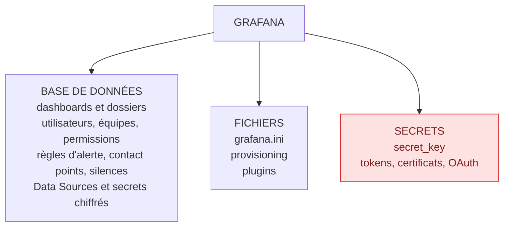

# Sauvegarde, restauration et migration

## Objectifs pédagogiques

À la fin de ce module, vous saurez :

- **Inventorier** tout ce qui constitue l'état d'une instance Grafana (base, configuration, plugins, secrets) et décider de ce qui doit être sauvegardé.
- **Sauvegarder et restaurer** une instance complète, avec SQLite ou PostgreSQL, sans perdre les identifiants des Data Sources.
- **Exporter et réimporter** des dashboards par l'API, en maîtrisant les UIDs pour que les références survivent à une migration.
- **Planifier une mise à jour** avec une procédure de rollback réellement exécutable.
- **Valider** un RPO (Recovery Point Objective) et un RTO (Recovery Time Objective) par des tests de restauration chronométrés.

## Mise en situation

Une équipe SRE de six personnes exploite une instance Grafana sur une VM unique : SQLite, trois organisations, environ 180 dashboards, une quarantaine de règles d'alerte et une dizaine de Data Sources. Quelqu'un a mis en place, il y a un an, un export JSON mensuel des dashboards. L'équipe se sent protégée.

Un matin, le disque de la VM est corrompu. On recrée une VM, on réinstalle Grafana, on réimporte les JSON. Les dashboards sont là, mais ils affichent « Datasource not found ». Les Data Sources sont à recréer, avec des mots de passe que personne n'a sous la main. Les règles d'alerte ont disparu, les contact points aussi, ainsi que les équipes et les permissions de dossiers. Pendant deux jours, l'astreinte travaille sans alerting fiable.

Ce scénario est illustratif, mais il se produit réellement dès qu'on confond **exporter des dashboards** et **sauvegarder Grafana**. Ce module sert à poser la différence, puis à construire une sauvegarde dont on a prouvé qu'elle restaure.

## Ce qui constitue vraiment l'état de Grafana

Où vit chaque information ? C'est la question à se poser avant de choisir un outil. Grafana est un binaire sans état fort, posé sur trois zones : une base de données, des fichiers, et des secrets. Le reste (métriques, logs, traces) vit dans les backends que Grafana interroge.



Le tableau ci-dessous est celui à garder en tête quand on vous dit « on a des sauvegardes » :

| Élément | Où il se trouve | Couvert par un export JSON de dashboards ? |
|---------|-----------------|--------------------------------------------|
| Dashboards et dossiers | Base | Partiellement (le JSON, pas les permissions du dossier) |
| Historique des versions d'un dashboard | Base | Non |
| Users, teams, organisations, rôles | Base | Non |
| Règles d'alerte, contact points, politiques de notification, silences | Base | Non |
| Data Sources (configuration) | Base | Non |
| Mots de passe et tokens des Data Sources | Base, chiffrés | Non |
| Annotations, snapshots, préférences | Base | Non |
| Service accounts et leurs tokens | Base | Non |
| `grafana.ini` et variables d'environnement | Fichiers / orchestrateur | Non |
| Fichiers de provisioning | Fichiers ou dépôt Git | Non |
| Plugins installés | Disque (`/var/lib/grafana/plugins`) | Non |
| `secret_key` | `grafana.ini` ou secret manager | Non |

> ⚠️ **Erreur fréquente**
>
> Considérer un export JSON comme une sauvegarde. Un export de dashboards est une copie de contenu, utile et à conserver, mais il ne contient ni les utilisateurs, ni l'alerting, ni les identifiants des sources de données. La sauvegarde complète, c'est la base + les fichiers + la clé de chiffrement, prises de façon cohérente.
{: .callout .callout-attention}

Un dernier point de périmètre : restaurer Grafana ne ramène **pas** les métriques de Prometheus ni les logs de Loki. Leur sauvegarde dépend de chaque backend et relève de parcours distincts. Ici, on protège le plan de contrôle et de visualisation.

## Sauvegarder la base

La base est la pièce maîtresse : 90 % de la valeur d'une instance s'y trouve. La méthode dépend du moteur.

### SQLite (installation par défaut)

Le fichier est `/var/lib/grafana/grafana.db`. Le piège classique est de faire un `cp` pendant que Grafana écrit : on obtient une copie potentiellement incohérente. La commande `.backup` de SQLite passe par l'API de sauvegarde en ligne et garantit une copie cohérente sans arrêter le service.

```bash
sqlite3 /var/lib/grafana/grafana.db ".backup '/backup/grafana-$(date +%F).db'"
```

Vérifiez ensuite que la copie est lisible :

```bash
sqlite3 /backup/grafana-$(date +%F).db "PRAGMA integrity_check;"
```

La réponse attendue est `ok`. Si la copie ne se lit pas, mieux vaut le savoir aujourd'hui que le jour du sinistre.

### PostgreSQL ou MySQL

Dès que vous avez plusieurs instances Grafana ou besoin de haute disponibilité, la base est externe et la sauvegarde passe par les outils du moteur :

```bash
# PostgreSQL : format custom, compressé, restaurable table par table
pg_dump -Fc -h <DB_HOST> -U <DB_USER> -d <DB_NAME> -f /backup/grafana-$(date +%F).dump

# MySQL / MariaDB : --single-transaction évite de verrouiller les tables InnoDB
mysqldump --single-transaction -h <DB_HOST> -u <DB_USER> -p <DB_NAME> > /backup/grafana-$(date +%F).sql
```

Pour viser un RPO de quelques minutes plutôt que 24 heures, le dump quotidien ne suffit plus. On bascule alors sur l'archivage continu du moteur (par exemple WAL archiving et restauration à un point dans le temps avec PostgreSQL), ce qui relève de l'administration de la base elle-même.

## Sauvegarder fichiers, plugins et clé de chiffrement

Une fois la base copiée, reste tout le reste de l'état. Trois choses comptent.

**La configuration.** `grafana.ini` (souvent `/etc/grafana/grafana.ini`), le dossier `provisioning/`, et, en conteneur, les variables `GF_*` définies dans votre orchestrateur. Si tout cela est déjà dans Git, vous avez ce qu'il faut. Sinon :

```bash
tar czf /backup/grafana-files-$(date +%F).tar.gz /etc/grafana
```

**Les plugins.** Inutile de sauvegarder des binaires qu'on peut retélécharger. Ce qu'il faut conserver, c'est la **liste avec les versions**, pour réinstaller exactement la même chose :

```bash
grafana cli plugins ls > /backup/plugins-$(date +%F).txt
```

À la restauration, chaque ligne devient `grafana cli plugins install <PLUGIN_ID> <VERSION>`. En conteneur, la variable `GF_INSTALL_PLUGINS` joue ce rôle (le nom de la variable a évolué dans les versions récentes, vérifiez la documentation de votre version). Un plugin de panel manquant produit un panel vide ou en erreur, pas une erreur globale, ce qui rend l'oubli facile à rater.

**La `secret_key`.** C'est l'élément qui fait la différence entre une restauration qui marche et une qui fait semblant.

Grafana chiffre en base les mots de passe, tokens et autres champs sensibles des Data Sources et des contact points. La clé racine de ce chiffrement dérive de `secret_key` (ou d'un KMS, Key Management Service, si vous l'avez branché).

> 🔐 **Analogie : le coffre sans sa combinaison**
>
> Restaurer la base avec une autre clé revient à récupérer un coffre intact dont on a perdu la combinaison : les Data Sources existent, mais ne peuvent plus s'authentifier. La comparaison a une limite : seuls les champs chiffrés restent fermés, et les dashboards comme le reste de la base restent lisibles.
{: .callout .callout-analogie}

> 🧠 **Concept clé**
>
> Une sauvegarde de base sans la `secret_key` correspondante est incomplète. Conservez la clé **séparément** de la base (secret manager, coffre), jamais dans le même fichier de sauvegarde, sinon le chiffrement ne protège plus rien. Puis testez : restaurez et vérifiez qu'une Data Source authentifiée répond.
{: .callout .callout-important}

## Exporter et restaurer des dashboards

Rien de ce qui précède ne rend les exports JSON inutiles. Ils offrent un avantage que la base n'a pas : ils sont lisibles, diffables dans Git, et permettent de restaurer **un** dashboard sans toucher au reste. On les utilise donc **en complément**, pas à la place.

### Export en masse par l'API

Créez un service account et un token. Un Viewer ne voit que les dossiers et dashboards auxquels il a accès : pour un export exhaustif, donnez-lui le rôle Admin de l'organisation. Attention : un token est limité à son organisation, donc une boucle par organisation est nécessaire si vous en avez plusieurs.

```bash
#!/usr/bin/env bash
set -euo pipefail

GRAFANA_URL="http://<HOST>:3000"
OUT="/backup/dashboards/$(date +%F)"
mkdir -p "$OUT"

curl -sf -H "Authorization: Bearer $GRAFANA_TOKEN" \
  "$GRAFANA_URL/api/search?type=dash-db&limit=5000" \
  | jq -r '.[].uid' \
  | while read -r uid; do
      curl -sf -H "Authorization: Bearer $GRAFANA_TOKEN" \
        "$GRAFANA_URL/api/dashboards/uid/$uid" \
        | jq '.' > "$OUT/$uid.json"
    done
```

La réponse de `/api/dashboards/uid/<UID>` contient deux blocs : `dashboard` (le modèle) et `meta` (dossier, permissions, dates). Gardez les deux : `meta.folderUid` vous dit où replacer le dashboard à la restauration.

> 💡 **Astuce**
>
> L'interface propose aussi un export JSON avec une option « Export for sharing externally ». Cette option remplace les références de Data Sources par des variables `${DS_...}` demandées à l'import. C'est parfait pour partager un dashboard avec une autre équipe, mais c'est le **mauvais** format pour une sauvegarde : vous perdez les UIDs réels. L'intitulé exact de l'option varie selon la version de l'interface.
{: .callout .callout-astuce}

### Réimport

L'import par l'API demande de retirer l'`id` numérique (propre à l'instance) et de conserver l'`uid` :

```bash
jq '{dashboard: (.dashboard | .id = null), folderUid: .meta.folderUid, overwrite: true}' \
  /backup/dashboards/2025-01-15/<UID>.json \
  | curl -sf -X POST -H "Authorization: Bearer $GRAFANA_TOKEN" \
      -H "Content-Type: application/json" \
      -d @- "http://<HOST>:3000/api/dashboards/db"
```

Le dossier cible doit exister avant l'import. Il faut donc restaurer ou provisionner les dossiers d'abord, sinon l'appel échoue (dossier introuvable).

## Les UIDs : ce qui fait qu'un dashboard survit à une migration

Revenons à notre scénario d'ouverture : pourquoi les dashboards affichaient-ils « Datasource not found » ? Parce qu'un panel ne référence pas sa source par son nom, mais par un **UID** (identifiant unique en chaîne de caractères). Dans le JSON, on trouve par exemple `"datasource": {"type": "prometheus", "uid": "P1809F7CD0C75ACF3"}`. Si vous recréez la Data Source à la main, Grafana génère un nouvel UID aléatoire, et tous les dashboards pointent dans le vide.

> 🧠 **Concept clé**
>
> L'UID est le contrat entre un dashboard et sa Data Source. Ce qui doit rester stable entre environnements, ce n'est pas le nom affiché mais l'UID. En fixant `uid: prometheus-main` dans le provisioning de chaque environnement (dev, recette, prod), le même JSON de dashboard fonctionne partout, sans réécriture.
{: .callout .callout-important}

```yaml
# provisioning/datasources/prometheus.yaml
apiVersion: 1
datasources:
  - name: Prometheus
    uid: prometheus-main
    type: prometheus
    access: proxy
    url: http://<PROMETHEUS_HOST>:9090
    isDefault: true
```

Le même raisonnement s'applique aux UIDs de dashboards (stables, donc les liens entre dashboards et les URLs partagées survivent) et aux UIDs de dossiers (utilisés par l'import et par les permissions).

> ⚠️ **Erreur fréquente**
>
> Déployer des Data Sources sans UID fixe, puis constater en migration que les UIDs diffèrent entre dev et prod. Si c'est déjà fait, deux issues : fixer rétroactivement l'UID dans le provisioning (l'ancien UID doit alors être repris tel quel), ou réécrire en masse les références dans les JSON avec `jq` avant import. La première est plus propre, la seconde dépanne.
{: .callout .callout-attention}

## Migrer : deux situations à ne pas mélanger

On emploie « migration » pour deux opérations qui n'ont pas les mêmes risques.

**Déplacer l'instance** (nouvelle VM, nouveau cluster, passage de SQLite à PostgreSQL, ou vers Grafana Cloud). Vous transportez l'état complet. La clé, c'est la fidélité : même `secret_key`, mêmes UIDs, mêmes plugins. Selon la destination :

- **Simple changement de machine, même moteur** : la restauration de la sauvegarde décrite plus haut suffit.
- **SQLite vers PostgreSQL** : Grafana ne fournit pas de commande de conversion intégrée à toute épreuve. On trouve des outils tiers (comme `pgloader`) et des méthodes documentées qui évoluent d'une version à l'autre. Dans tous les cas, on répète la migration sur une copie, on compare le nombre de dashboards, de Data Sources et de règles d'alerte, puis seulement on programme la bascule.
- **Grafana Cloud** : un assistant de migration existe dans les versions récentes. Son périmètre et son interface changent : consultez la documentation de votre version.

**Promouvoir du contenu** (dev → recette → prod). Ici on ne déplace pas l'état, on déploie des définitions. L'approche saine est de ne jamais copier à la main d'une instance à l'autre : le contenu vit dans Git, le provisioning (ou Terraform, vu au module précédent de la série sur l'automatisation) l'applique. La sauvegarde de la base devient alors une assurance pour ce qui n'est pas dans Git : utilisateurs, annotations, silences, modifications faites à la main.

Le piège de cette seconde situation est la dérive. Si des dashboards sont provisionnés **et** modifiables dans l'interface, parce que `allowUiUpdates` est activé, les modifications faites dans l'UI sont enregistrées en base, puis écrasées silencieusement par la version du disque dès que le fichier change. Grafana n'écrit jamais dans les fichiers de provisioning. Décidez, par dossier, qui fait foi.

## Mises à jour : compatibilité et préparation

Une mise à jour de Grafana est une migration déguisée. Au démarrage, la nouvelle version exécute des **migrations de schéma** sur la base, et ces migrations ne sont pas conçues pour être rejouées à l'envers. Conséquence directe : démarrer l'ancienne version sur une base déjà migrée est au mieux une erreur, au pire un comportement incohérent.

Pour une mise à jour sans mauvaise surprise, l'enchaînement ressemble à ceci :

1. Lire le guide de mise à jour et les « breaking changes » de la version cible, en particulier sur l'alerting, l'authentification et les plugins.
2. Vérifier la compatibilité de chaque plugin installé avec la version cible (la liste du `plugins ls` sert ici).
3. Si l'écart entre versions est grand, passer par les versions majeures intermédiaires lorsque la documentation le recommande, plutôt que de sauter plusieurs paliers.
4. Rejouer l'opération complète sur une **copie restaurée** de la production avant de toucher la production.
5. Fixer la version de l'image ou du paquet (`grafana/grafana:<VERSION>`, jamais `latest`).

La quatrième étape est la plus rentable : elle teste simultanément la mise à jour **et** la sauvegarde. Le jour où elle échoue sur la copie, vous avez perdu une heure ; le jour où elle échoue en production sans copie, vous êtes en incident.

## Procédure de rollback

La séquence est donc écrite avant la mise à jour, pas pendant l'incident.

> 💡 **À retenir**
>
> Comme le schéma de base ne revient pas en arrière, le rollback de Grafana n'est pas « réinstaller l'ancienne version ». C'est **restaurer l'état d'avant** avec l'ancienne version.
{: .callout .callout-important}

Avant la mise à jour : arrêter les écritures si possible (ou accepter la fenêtre de perte), prendre le dump de la base, copier `grafana.ini` et le provisioning, noter la version exacte en cours.

Si ça se passe mal :

1. Arrêter Grafana.
2. Restaurer le dump pris juste avant la mise à jour (cible vide ou base remplacée).
3. Réinstaller la version précédente, fixée par tag ou par paquet.
4. Remettre la configuration d'origine.
5. Démarrer, puis valider : `/api/health`, nombre de dashboards, une Data Source qui répond, une règle d'alerte qui s'évalue.

Un coût est à regarder en face : tout ce qui a été écrit entre la mise à jour et le rollback (dashboards modifiés, silences posés) est perdu. D'où l'intérêt de **limiter le temps de validation** après la mise à jour : si l'instance n'est pas saine au bout d'une durée convenue (30 minutes, par exemple), on revient en arrière sans débat.

## RPO, RTO et tests de restauration

Ces deux chiffres ne sont pas des vœux : ils sont mesurés ou ils n'existent pas.

> 📖 **Définition**
>
> Le **RPO** (Recovery Point Objective) est la quantité maximale de données qu'on accepte de perdre, exprimée en temps. Le **RTO** (Recovery Time Objective) est le délai maximal pour remettre le service en état.
{: .callout .callout-definition}

Un exemple de raisonnement. Les dashboards sont dans Git et provisionnés : leur RPO est quasiment nul. En revanche, les règles d'alerte sont modifiées en interface presque tous les jours. Avec un dump nocturne, vous pouvez perdre jusqu'à 24 heures de modifications, ce qui est probablement trop pour des alertes d'astreinte. Deux choix : déplacer les règles dans le provisioning (RPO ≈ 0), ou rapprocher les dumps (toutes les 4 heures, par exemple). Le bon choix dépend du coût de l'un face au risque de l'autre.

Le RTO se mesure en chronométrant une restauration réelle : provisionner la machine, restaurer la base, réinstaller les plugins, démarrer, valider. Si le total est de 25 minutes pour un objectif d'une heure, vous avez de la marge. Si vous n'avez jamais chronométré, vous ne connaissez pas votre RTO, vous l'espérez.

### Le test de restauration

Il se fait dans un environnement jetable, jamais sur la production. Un point critique : **empêcher l'instance de test d'envoyer des alertes**, sinon elle évalue les règles restaurées et notifie l'astreinte comme si c'était réel.

```bash
mkdir -p /tmp/restore && cp /backup/grafana-<DATE>.db /tmp/restore/grafana.db
chown -R 472:0 /tmp/restore   # UID de l'utilisateur grafana dans l'image officielle

docker run -d --name grafana-restore-test -p 3100:3000 \
  -v /tmp/restore:/var/lib/grafana \
  -e GF_SECURITY_SECRET_KEY=<SECRET_KEY> \
  -e GF_UNIFIED_ALERTING_EXECUTE_ALERTS=false \
  grafana/grafana:<VERSION>
```

Le paramètre `execute_alerts` de la section `unified_alerting` désactive l'évaluation des règles ; son comportement exact peut varier selon la version, à vérifier avant de s'y fier. Ensuite, la validation se fait par des vérifications simples, scriptables :

```bash
curl -s http://localhost:3100/api/health
curl -s -H "Authorization: Bearer <TOKEN>" "http://localhost:3100/api/search?type=dash-db" | jq length
curl -s -H "Authorization: Bearer <TOKEN>" "http://localhost:3100/api/datasources/uid/<DS_UID>/health"
```

Le premier confirme que la base répond, le deuxième compare le nombre de dashboards avec la production, le troisième prouve que la `secret_key` est la bonne : si la Data Source authentifiée répond, le déchiffrement fonctionne. (Ce dernier endpoint est présent dans les versions récentes ; sinon, le bouton « Save & test » de l'interface remplit le même rôle.)

## Construction progressive

On n'arrive pas à une stratégie complète du premier coup. Voici une trajectoire réaliste, avec la raison de chaque saut.

**v1 : minimal mais déjà utile.** Un cron nocturne lance `sqlite3 .backup` et un `tar` de `/etc/grafana`, copie le tout sur un autre disque. C'est mieux que rien, mais il subsiste deux failles : la copie est sur la même machine et la `secret_key` voyage avec le reste.

**v2 : séparer et diversifier.** La base passe sur PostgreSQL, avec dumps toutes les quelques heures envoyés hors du serveur. La `secret_key` est dans un coffre. Les dashboards sont exportés dans Git, les Data Sources provisionnées avec des UIDs fixes. On a maintenant deux voies de restauration : base complète ou contenu seul.

**v3 : preuve et automatisation.** Les sauvegardes sont chiffrées et copiées hors site. Un job hebdomadaire restaure la dernière sauvegarde dans un conteneur éphémère, exécute les vérifications ci-dessus et échoue bruyamment si une ne passe pas. Le RTO mesuré est consigné. On surveille aussi l'âge de la dernière sauvegarde réussie. L'intérêt de cette étape est de transformer « on croit que ça marche » en « ça a marché dimanche dernier ».

## Erreurs fréquentes au moment de restaurer

| Symptôme | Cause probable | Correction |
|----------|----------------|------------|
| Les Data Sources existent mais échouent en authentification ; erreurs de déchiffrement dans les logs | `secret_key` différente de celle utilisée lors de la sauvegarde | Remettre la clé d'origine depuis le coffre et redémarrer. Si elle est perdue, ressaisir les secrets de chaque source. |
| Panels en « Datasource ... was not found » | UID de Data Source différent de celui référencé par les dashboards | Recréer la source avec l'UID d'origine (provisioning) ou réécrire les références dans les JSON |
| Panels vides, message « Panel plugin not found » | Plugin non réinstallé sur la nouvelle machine | Réinstaller depuis la liste versionnée, redémarrer Grafana |
| L'import API échoue | Dossier cible absent, `id` numérique conservé, ou conflit d'UID sans `overwrite` | Restaurer les dossiers d'abord, mettre `id` à `null`, ajouter `"overwrite": true` |
| Grafana ne démarre plus après une mise à jour | Migration de schéma échouée ou plugin incompatible | Lire les logs de démarrage ; si non résolu rapidement, appliquer la procédure de rollback |
| L'astreinte reçoit des alertes d'une instance « de test » | Évaluation des règles active sur la copie restaurée | Désactiver l'exécution des alertes avant le premier démarrage de la copie |
| Impossible d'écrire dans la base restaurée (conteneur) | Propriétaire du fichier incorrect | `chown -R 472:0` sur le dossier monté |

## Scénario : refonte d'une instance vieillissante

Reprenons l'équipe de la mise en situation, mais cette fois avec une démarche saine. Le scénario ci-dessous est illustratif, les durées sont des ordres de grandeur.

L'équipe veut passer de SQLite à PostgreSQL avant d'ajouter une deuxième instance pour la haute disponibilité. Un audit des contenus montre que 70 % des dashboards existent dans Git, mais que les règles d'alerte et les équipes ont été créées à la main. Plutôt que de convertir la base à l'aveugle, l'équipe procède par étapes.

Première étape : une sauvegarde complète (dump, fichiers, `secret_key` ressortie du coffre) est restaurée dans un conteneur de test, avec exécution des alertes désactivée. Cela révèle deux plugins non versionnés et une Data Source sans UID fixe, corrigés avant d'aller plus loin. Seconde étape : les règles d'alerte sont exportées et rangées dans le provisioning, ce qui ramène leur RPO de 24 heures à presque zéro. Troisième étape : la migration vers PostgreSQL est répétée deux fois sur une copie, avec comparaison du nombre de dashboards, sources, équipes et règles. La bascule réelle tient en une fenêtre de moins d'une heure, avec un rollback écrit et prêt (dump pré-bascule, ancienne instance conservée arrêtée).

Résultat illustratif : un RTO mesuré à 25 minutes en test, contre un objectif d'une heure, et un test de restauration planifié chaque semaine. Le vrai gain n'est pas le chiffre, c'est que chaque hypothèse de la procédure a été vérifiée avant le jour où elle est nécessaire.

## Bonnes pratiques

- **Sauvegardez la base, les fichiers et la `secret_key` comme un tout**, mais stockez la clé à part : sans elle les secrets sont illisibles, avec elle dans le même fichier le chiffrement est contourné.
- **Fixez les UIDs** de Data Sources, de dossiers et de dashboards dans le provisioning, pour qu'une migration ne casse aucune référence.
- **Utilisez les exports JSON comme complément**, versionnés dans Git, pour les restaurations ciblées et la revue de changements ; jamais comme seule protection.
- **Pinnez les versions** de Grafana et de chaque plugin ; une image `latest` rend le rollback invérifiable.
- **Écrivez le rollback avant la mise à jour** et fixez un délai de décision, car revenir en arrière coûte les écritures faites entre-temps.
- **Testez la restauration régulièrement et chronométrez-la** dans un environnement isolé, avec alerting désactivé, afin de valider le RTO au lieu de le supposer.
- **Copiez hors de la machine et hors du compte** qui héberge Grafana, et chiffrez les sauvegardes : une sauvegarde sur le même disque ne protège pas du disque.
- **Surveillez l'âge de la dernière sauvegarde réussie** ; une sauvegarde qui échoue en silence est la pire des situations.

## Résumé

Grafana ne se sauvegarde pas en exportant des dashboards : son état se répartit entre une base de données (contenu, utilisateurs, alerting, Data Sources), des fichiers (configuration, provisioning, plugins) et une `secret_key` qui conditionne la lisibilité des secrets. Les exports JSON, les UIDs fixes et le provisioning complètent ce dispositif en rendant le contenu portable entre environnements. Les mises à jour modifiant le schéma de la base sans retour possible, le rollback consiste à restaurer l'état d'avant, avec l'ancienne version. Enfin, un RPO et un RTO n'ont de valeur que s'ils sont mesurés par des restaurations réellement jouées. La suite logique est de savoir diagnostiquer la plateforme quand, malgré tout, quelque chose ne se comporte pas comme prévu : c'est l'objet du prochain module.

<!-- snippet
id: grafana_backup_sqlite_online
type: command
tech: grafana
level: advanced
importance: high
format: knowledge
tags: grafana,sqlite,sauvegarde,backup
title: Sauvegarder grafana.db à chaud avec sqlite3 .backup
context: Instance Grafana utilisant SQLite (installation par défaut), sans arrêt du service
command: sqlite3 /var/lib/grafana/grafana.db ".backup '<CHEMIN_SAUVEGARDE>'"
example: sqlite3 /var/lib/grafana/grafana.db ".backup '/backup/grafana-2025-01-15.db'"
description: Utilise l'API de sauvegarde en ligne de SQLite : copie cohérente même si Grafana écrit, contrairement à un cp du fichier ouvert.
-->

<!-- snippet
id: grafana_backup_postgres_dump
type: command
tech: grafana
level: advanced
importance: high
format: knowledge
tags: grafana,postgresql,sauvegarde,pg_dump
title: Dumper la base Grafana PostgreSQL au format custom
command: pg_dump -Fc -h <DB_HOST> -U <DB_USER> -d <DB_NAME> -f <FICHIER_DUMP>
example: pg_dump -Fc -h db.internal -U grafana -d grafana -f /backup/grafana-2025-01-15.dump
description: Le format custom (-Fc) est compressé et permet de restaurer avec pg_restore, y compris table par table. À lancer depuis un hôte hors du serveur Grafana.
-->

<!-- snippet
id: grafana_backup_secret_key_separate
type: warning
tech: grafana
level: advanced
importance: high
format: knowledge
tags: grafana,secret_key,chiffrement,restauration
title: Sans la secret_key, la base restaurée est inutilisable
content: Piège : restaurer la base sans la secret_key d'origine. Conséquence : les Data Sources et contact points existent, mais leurs mots de passe et tokens chiffrés ne peuvent plus être déchiffrés, donc les sources échouent en authentification. Correction : stocker la clé dans un coffre, séparément des sauvegardes de base, et vérifier à chaque test de restauration qu'une Data Source authentifiée répond.
description: Les secrets des Data Sources sont chiffrés à partir de secret_key. La clé doit voyager avec la sauvegarde logiquement, mais être stockée ailleurs.
-->

<!-- snippet
id: grafana_export_json_not_backup
type: warning
tech: grafana
level: advanced
importance: high
format: knowledge
tags: grafana,export,sauvegarde,dashboards
title: Un export JSON de dashboards n'est pas une sauvegarde
content: Piège : se reposer sur des exports JSON. Conséquence : à la restauration, il manque utilisateurs, équipes, permissions, règles d'alerte, contact points, silences, Data Sources et leurs secrets, plugins et configuration. Correction : sauvegarder base + fichiers + secret_key, et garder les exports JSON dans Git comme complément pour restaurer un dashboard isolé.
description: L'export JSON ne contient que le modèle du dashboard. Tout le reste de l'état Grafana vit dans la base et la configuration.
-->

<!-- snippet
id: grafana_datasource_uid_stable
type: concept
tech: grafana
level: advanced
importance: high
format: knowledge
tags: grafana,uid,datasource,migration,provisioning
title: L'UID de Data Source relie dashboards et sources
content: Un panel référence sa source par UID, pas par nom : "datasource": {"type": "prometheus", "uid": "prometheus-main"}. Recréer une source à la main génère un nouvel UID aléatoire, donc tous les panels pointent dans le vide ("Datasource not found"). En fixant uid: prometheus-main dans le provisioning de chaque environnement, le même JSON de dashboard fonctionne en dev, recette et prod sans réécriture.
description: Fixer les UIDs dans le provisioning rend les dashboards portables entre environnements et résistants à une restauration sur une nouvelle instance.
-->

<!-- snippet
id: grafana_dashboards_export_api
type: command
tech: grafana
level: advanced
importance: medium
format: knowledge
tags: grafana,api,export,dashboards,jq
title: Récupérer le JSON d'un dashboard par son UID
context: Token de service account ayant accès au dashboard (un Viewer ne voit pas les dashboards aux permissions restreintes), limité à son organisation
command: curl -sf -H "Authorization: Bearer <TOKEN>" "http://<HOST>:3000/api/dashboards/uid/<UID>" | jq '.' > <FICHIER>.json
example: curl -sf -H "Authorization: Bearer glsa_abc123" "http://grafana.internal:3000/api/dashboards/uid/cdxk2m9" | jq '.' > cdxk2m9.json
description: La réponse contient dashboard et meta ; conserver meta.folderUid permet de replacer le dashboard dans le bon dossier à la restauration.
-->

<!-- snippet
id: grafana_dashboards_import_api
type: command
tech: grafana
level: advanced
importance: medium
format: knowledge
tags: grafana,api,import,dashboards,overwrite
title: Réimporter un dashboard exporté (id null, overwrite)
context: Le dossier cible doit exister avant l'import ; token avec rôle Editor
command: jq '{dashboard: (.dashboard | .id = null), folderUid: .meta.folderUid, overwrite: true}' <FICHIER>.json | curl -sf -X POST -H "Authorization: Bearer <TOKEN>" -H "Content-Type: application/json" -d @- "http://<HOST>:3000/api/dashboards/db"
example: jq '{dashboard: (.dashboard | .id = null), folderUid: .meta.folderUid, overwrite: true}' cdxk2m9.json | curl -sf -X POST -H "Authorization: Bearer glsa_abc123" -H "Content-Type: application/json" -d @- "http://grafana.internal:3000/api/dashboards/db"
description: L'id numérique est propre à l'instance source : le mettre à null évite les conflits, l'uid conservé préserve les liens et URLs.
-->

<!-- snippet
id: grafana_plugins_list_versioned
type: command
tech: grafana
level: advanced
importance: medium
format: knowledge
tags: grafana,plugins,sauvegarde,versions
title: Lister les plugins installés avec leurs versions
command: grafana cli plugins ls
description: Sauvegarder cette liste suffit : à la restauration, on réinstalle chaque plugin avec grafana cli plugins install <ID> <VERSION> au lieu de copier des binaires.
-->

<!-- snippet
id: grafana_upgrade_rollback_schema
type: concept
tech: grafana
level: advanced
importance: high
format: knowledge
tags: grafana,mise-a-jour,rollback,migration-schema
title: Le rollback Grafana passe par la restauration de la base
content: Au démarrage, une nouvelle version de Grafana exécute des migrations de schéma sur la base, sans mécanisme de retour arrière. Démarrer l'ancienne version sur une base migrée échoue ou se comporte de façon incohérente. Le rollback consiste donc à arrêter Grafana, restaurer le dump pris juste avant la mise à jour, réinstaller la version précédente fixée par tag, remettre la config, puis valider. Les écritures faites depuis la mise à jour sont perdues.
description: Le dump pré-mise à jour est la seule vraie assurance de rollback ; sans lui, revenir à la version précédente n'est pas garanti.
-->

<!-- snippet
id: grafana_rpo_rto_measure
type: concept
tech: grafana
level: advanced
importance: high
format: knowledge
tags: grafana,rpo,rto,restauration,tests
title: RPO et RTO se mesurent par une restauration chronométrée
content: RPO (Recovery Point Objective) = perte de données maximale acceptée ; RTO (Recovery Time Objective) = délai maximal de remise en service. Exemple : dump nocturne = RPO de 24 h, trop long pour des règles d'alerte modifiées chaque jour, d'où un dump toutes les 4 h ou un provisioning des règles. Le RTO se mesure en chronométrant une restauration complète dans un environnement jetable (machine, base, plugins, démarrage, validation).
description: Un objectif non mesuré par un test réel n'est qu'une hypothèse. Chronométrer chaque étape révèle où se perd le temps.
-->

<!-- snippet
id: grafana_restore_test_no_alerts
type: tip
tech: grafana
level: advanced
importance: high
format: knowledge
tags: grafana,restauration,alerting,docker,test
title: Désactiver l'évaluation des alertes sur une copie restaurée
content: Pour tester une restauration, lancer l'image avec -e GF_UNIFIED_ALERTING_EXECUTE_ALERTS=false, -e GF_SECURITY_SECRET_KEY=<SECRET_KEY> et un volume dont le propriétaire est 472:0 (chown -R 472:0). Sans le premier réglage, la copie évalue les règles restaurées et notifie l'astreinte comme en production. Valider ensuite avec /api/health, le nombre de dashboards et la santé d'une Data Source authentifiée.
description: Évite les fausses alertes pendant un test. Le nom exact du paramètre peut varier selon la version de Grafana : à vérifier avant de s'y fier.
-->

<!-- snippet
id: grafana_error_datasource_not_found
type: error
tech: grafana
level: advanced
importance: medium
format: knowledge
tags: grafana,datasource,uid,restauration,erreur
title: Panels en "Datasource not found" après restauration
content: Symptôme : après restauration ou import, les dashboards affichent "Datasource ... was not found" alors que la source existe. Cause : l'UID de la Data Source recréée diffère de celui référencé dans le JSON des panels. Correction : recréer la source avec l'UID d'origine via le provisioning (uid: <UID_ORIGINE>), ou réécrire les références dans les JSON avec jq avant import.
description: Une source recréée à la main reçoit un UID aléatoire. Reprendre l'UID d'origine dans le provisioning est la correction durable.
-->
