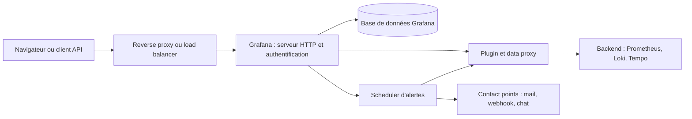
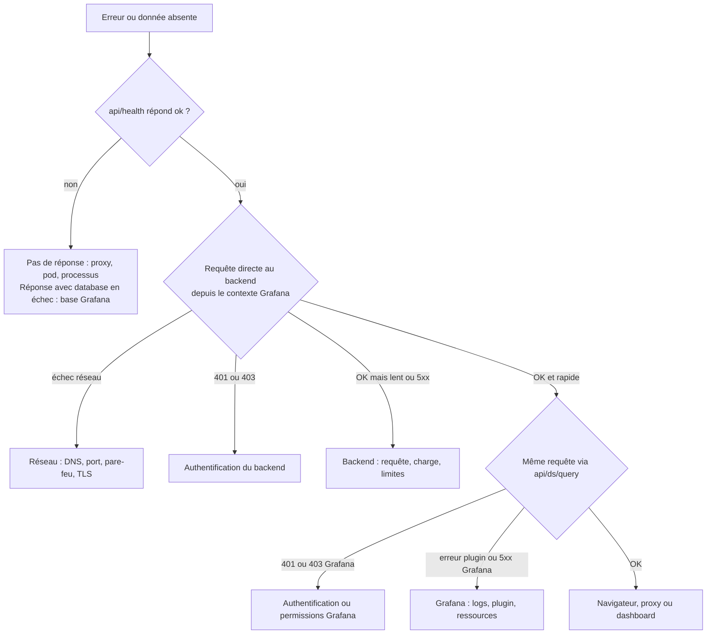

# Troubleshooting avancé de la plateforme

## Objectifs pédagogiques

À la fin de ce module, vous saurez :

- **Classer** une erreur dans sa couche (proxy, Grafana, réseau, authentification, backend) à partir du message, du code HTTP et du temps de réponse.
- **Exploiter** les logs Grafana (niveaux, filtres par logger, champs utiles) et les réponses de l'API pour remonter à la cause d'origine.
- **Isoler** la cause d'une data source indisponible ou intermittente en reproduisant la requête depuis le contexte réseau de Grafana.
- **Diagnostiquer** un échec d'évaluation d'alerte et distinguer évaluation, routage et livraison.
- **Constituer** un dossier d'escalade avec des preuves qu'une autre personne peut rejouer.

## Mise en situation

Votre équipe plateforme (4 personnes) exploite un Grafana OSS sur Kubernetes, avec Prometheus et Loki derrière. Une quarantaine de personnes l'utilisent : développeurs, support N1, astreinte. Les dashboards sont provisionnés depuis Git, les alertes sont gérées par Grafana.

Lundi, 09 h 10 : un ticket arrive, « Grafana ne marche pas ». Le même jour, l'équipe d'une API de paiement apprend par ses clients que le service est dégradé depuis environ 40 minutes. Aucune alerte n'a été reçue. Pourtant, Grafana s'ouvre normalement, le login fonctionne, les dashboards s'affichent et le pod est `Running`.

Redémarrer le pod, le premier réflexe, ne servirait à rien ici. Le problème n'est pas que l'interface soit tombée, mais qu'une partie de la plateforme est cassée sans que cela se voie. Pour la trouver, il faut une méthode : savoir quelle couche répond, laquelle se tait, et ne rien conclure sans une preuve que quelqu'un d'autre pourrait rejouer. C'est l'objet de ce module. Nous reprendrons ce scénario dans le cas pratique, avec des chiffres illustratifs.

## Une requête, plusieurs endroits où elle peut casser

Grafana joue le rôle d'un standardiste. Quand la communication est mauvaise, il faut savoir si le problème vient de lui, de la ligne ou de l'interlocuteur. Beaucoup de tickets « Grafana est cassé » sont en réalité des problèmes de ligne ou d'interlocuteur.



Une requête de panel suit la chaîne du navigateur jusqu'au backend. Une évaluation d'alerte part du scheduler, passe par le même plugin, puis finit chez un contact point. Chaque flèche peut échouer avec sa propre signature.

> 🧠 **Concept clé** — Trois questions suffisent pour situer une erreur. Qui a répondu (le proxy, Grafana ou le backend) ? À quel saut la chaîne s'est-elle rompue ? Quel est le message d'origine, avant que Grafana ne l'habille ? Dans une version récente, ce message se trouve presque toujours dans le champ `error=` des logs.
{: .callout .callout-important}

Le tableau ci-dessous sert de table de lecture rapide. Les messages exacts varient un peu selon les versions et les backends, mais les familles restent stables.

| Ce que vous voyez | Couche probable | Premier test |
|---|---|---|
| Page blanche, `Failed to fetch`, 502 ou 504 avec la page d'erreur du proxy | Amont : proxy, pod ou processus Grafana arrêté | `curl` sur `/api/health` en contournant le proxy |
| `dial tcp ...: connect: connection refused` | Réseau : backend arrêté ou mauvais port | Endpoint de santé du backend depuis le contexte Grafana |
| `lookup <HOST>: no such host` | Réseau : résolution DNS (Domain Name System) | Résoudre le nom depuis le conteneur Grafana |
| `context deadline exceeded`, `i/o timeout` | Réseau ou backend trop lent | `curl` avec décomposition des temps |
| `x509: certificate signed by unknown authority` ou `certificate has expired` | TLS : autorité de certification absente ou certificat expiré | `openssl s_client` et comparaison des CA |
| `{"message":"Unauthorized"}` sur `/api/...` | Authentification Grafana : token, session | Tester le token sur un endpoint simple |
| `403` avec un message de permission Grafana | Autorisations Grafana | Rôle et permissions de l'identité utilisée |
| `401` ou `403` dont le détail vient du backend | Authentification du backend | `curl` direct avec les mêmes identifiants |
| `bad_data`, `parse error` | Requête invalide, rejetée par le backend | Rejouer la requête directement sur le backend |
| `plugin unavailable`, `plugin not registered` | Grafana : plugin absent ou en échec | Logs `plugin` et `grafana cli plugins ls` |
| `database is locked` | Base de données de Grafana | Logs et type de base (SQLite ?) |

> ⚠️ **Erreur fréquente** — Un panel qui affiche *Bad Gateway* ne signifie pas que Grafana est tombé. Sur les data sources en mode serveur, Grafana relaie la requête, donc il joue le rôle de proxy. Un 502 dans un panel veut généralement dire « mon backend ne m'a pas répondu correctement ». Si vous cherchez dans Grafana, vous cherchez au mauvais endroit : le message d'origine, dans les logs, désigne le vrai coupable.
{: .callout .callout-attention}

La distinction 401 / 403 mérite un arrêt, car elle oriente tout le diagnostic. Un **401** signifie que l'identité n'est pas reconnue : token expiré ou révoqué, session perdue, mauvais mot de passe. Un **403** signifie que l'identité est reconnue mais n'a pas le droit. Corriger un 403 en régénérant un token ne changera rien, et corriger un 401 en ajoutant des permissions non plus. Il faut aussi savoir qui parle : le JSON `{"message": ...}` vient de Grafana, alors qu'un texte brut ou un format typique d'un autre produit vient du backend, relayé tel quel.

## Lire les logs Grafana et les erreurs API

### Où sont les logs, et comment les rendre bavards sans noyer le reste

Selon l'installation, les logs sont sur la sortie standard (conteneur, Kubernetes), dans le journal systemd, ou dans un fichier comme `/var/log/grafana/grafana.log` pour un paquet classique. Le format par défaut est du texte `clé=valeur`. Le format JSON est plus simple à filtrer avec `jq` ou à indexer.

Une ligne d'erreur typique ressemble à ceci (illustratif, le détail dépend de la version) :

```text
logger=context userId=12 orgId=1 uname=alice t=2025-01-15T09:12:44.123Z level=error msg="Request Completed" error="failed to query data: Post \"http://prometheus:9090/api/v1/query_range\": context deadline exceeded" remote_addr=10.1.4.7 time_ms=30004
```

Il y a trois informations à lire en priorité :

- `logger=` indique le sous-système : `context` pour les requêtes HTTP, `plugin.*` pour les plugins et data sources, `ngalert.*` pour l'alerting, `provisioning.*`, `migrator`, ainsi que des préfixes liés à l'authentification (`oauth`, `ldap`, etc.).
- `error=` contient le plus souvent le message d'origine. Ici, on lit déjà que Grafana a contacté `prometheus:9090` et que la requête a expiré.
- `time_ms=30004` donne la durée de la requête. Une durée qui tombe pile sur 30 000 ms n'est jamais un hasard : c'est une limite qui a coupé la requête, dans ce cas le timeout du data proxy (nous y revenons plus bas).

Avant de passer en `debug` globalement, sachez que ce niveau est volumineux et peut exposer des informations sensibles. Préférez un niveau ciblé par logger, puis revenez à la normale une fois la preuve collectée.

```bash
# Dernières erreurs et avertissements (conteneur Docker)
docker logs --since 15m <CONTAINER> 2>&1 | grep -E 'level=(error|warn)'

# Idem sur Kubernetes
kubectl logs deploy/<DEPLOYMENT> -n <NAMESPACE> --since=15m | grep -E 'level=(error|warn)'

# Debug ciblé sur l'alerting et l'OAuth, variable à injecter dans l'environnement du conteneur (env du Deployment, docker run -e)
GF_LOG_FILTERS="ngalert:debug oauth:debug"

# Journaliser chaque requête HTTP reçue (volumineux, temporaire)
GF_SERVER_ROUTER_LOGGING=true
```

> 💡 **Astuce** — Collectez les logs avant de redémarrer quoi que ce soit. Un redémarrage efface l'état en mémoire et, sur Kubernetes, un pod recréé n'a plus les logs de l'instance précédente. Si le conteneur a déjà redémarré, `kubectl logs <POD> --previous` récupère ceux de l'instance qui a planté.
{: .callout .callout-astuce}

### Lire une réponse d'API sans se tromper

L'API de Grafana répond avec un code HTTP et un JSON `{"message": "..."}`. Utilisez `curl -i` pour voir les deux, et une identité de diagnostic dédiée : un compte de service en lecture seule, plutôt que le compte admin.

```bash
# Santé : version, commit, état de la base
curl -sS http://<HOST>:3000/api/health

# Cette identité est-elle reconnue (401) et autorisée (403) ?
curl -i -H "Authorization: Bearer <TOKEN>" http://<HOST>:3000/api/datasources
```

> ⚠️ **Erreur fréquente** — `/api/health` répond `ok` quand le serveur HTTP tourne et que la base de données répond. Il ne dit rien des data sources, du scheduler d'alertes ni des contact points. Un contrôle de santé vert n'est donc jamais une réponse à la question « est-ce que mes alertes fonctionnent ? ».
{: .callout .callout-attention}

## Reproduire hors de Grafana : l'arbre de décision

Pour séparer Grafana de ce qui se trouve derrière, une règle simple : **rejouer la même requête par un chemin plus court**. Si elle passe en direct mais échoue via Grafana, le problème est entre les deux. Si elle échoue aussi en direct, Grafana est hors de cause.



Le point délicat est le « depuis le contexte Grafana ». Tester depuis votre poste ne prouve rien : le DNS, les routes, les pare-feux et les certificats de confiance ne sont pas les mêmes. Les images Grafana n'embarquent pas toujours `curl`. On évite donc d'installer des outils dans le conteneur et on se greffe sur son réseau :

```bash
# Docker : un conteneur jetable qui partage le réseau de Grafana
docker run --rm --network container:<CONTAINER> curlimages/curl:latest \
  -sS -m 5 -o /dev/null -w '%{http_code}\n' http://<BACKEND_HOST>:9090/-/ready

# Kubernetes : conteneur éphémère dans le pod de Grafana
kubectl debug -it <POD> -n <NAMESPACE> --image=curlimages/curl --target=grafana -- sh
```

Cette astuce reproduit le réseau (DNS, routes, règles de sortie) mais pas le système de fichiers, donc ni les certificats d'autorité ni les fichiers de Grafana. Pensez aussi aux variables `HTTP_PROXY`, `HTTPS_PROXY` et `NO_PROXY` du conteneur : elles peuvent s'appliquer aux appels sortants de Grafana et pas à votre test.

Pour savoir où le temps passe, `curl` sait décomposer une requête :

```bash
curl -sS -o /dev/null -w 'http=%{http_code} dns=%{time_namelookup}s connect=%{time_connect}s tls=%{time_appconnect}s ttfb=%{time_starttransfer}s total=%{time_total}s\n' <URL>
```

La lecture est simple. Un `dns` élevé désigne la résolution de noms. Un `connect` élevé désigne le réseau. En HTTPS, un écart notable entre `connect` et `tls` pointe la négociation TLS, et un grand écart entre `tls` et `ttfb` signifie que le backend réfléchit longtemps. En HTTP simple, `tls` vaut 0 : lisez alors directement l'écart entre `connect` et `ttfb`. Enfin, un `total` très supérieur au `ttfb` indique une réponse volumineuse.

Pour rejouer une requête de panel côté Grafana, utilisez l'endpoint de requête de l'API. Le corps exact dépend du plugin, donc le plus fiable est de copier celui de l'onglet *Query* de l'Inspector :

```bash
curl -sS -X POST http://<HOST>:3000/api/ds/query \
  -H "Authorization: Bearer <TOKEN>" -H "Content-Type: application/json" \
  -d '{"queries":[{"refId":"A","datasource":{"type":"prometheus","uid":"<DS_UID>"},"expr":"up","instant":true}],"from":"now-5m","to":"now"}'
```

## Data sources indisponibles ou intermittentes

Le bouton *Save & test* donne un faux sentiment de sécurité : il exécute un test minimal, par exemple une requête triviale. Une data source peut passer ce test et laisser expirer chaque requête réelle un peu lourde. Selon la version, un équivalent API existe via `/api/datasources/uid/<UID>/health`, mais il souffre de la même limite. Le vrai test est toujours la requête réelle, rejouée en direct.

### La chaîne de timeouts

> 🧠 **Concept clé** — Entre le navigateur et le moteur de stockage, plusieurs couches ont chacune leur délai maximum, et c'est la plus courte qui coupe en premier. À titre indicatif, car les valeurs par défaut varient selon version et configuration :
{: .callout .callout-important}

| Couche | Réglage typique | Valeur courante |
|---|---|---|
| Reverse proxy | `proxy_read_timeout` (nginx) | 60 s |
| Data proxy Grafana | `[dataproxy] timeout` | 30 s |
| Data source | *Query timeout* (Prometheus) | 60 s |
| Backend | `--query.timeout` (Prometheus) | 2 min |

Cela a une conséquence pratique : **la durée de l'échec est une signature**. Une requête qui meurt à 30,0 s pile s'est heurtée au data proxy. Une qui meurt à 60 s s'est heurtée à l'une des deux autres. Augmenter un seul timeout sans regarder les autres déplace la limite sans résoudre la lenteur. Le vrai correctif est presque toujours côté requête ou backend.

### Quand la panne est intermittente

Une panne intermittente a presque toujours un motif, et chercher ce motif est plus productif que de regarder les logs au hasard.

| Symptôme | Cause probable | Correction |
|---|---|---|
| La première requête après une période calme échoue (`EOF`, `connection reset by peer`), puis tout passe | Un pare-feu ou une NAT (Network Address Translation) coupe les connexions inactives, et Grafana réutilise une connexion morte | Aligner les durées de keep-alive (`[dataproxy] keep_alive_seconds`) sous le délai d'inactivité de l'équipement |
| Une requête sur deux échoue, de façon régulière | Un load balancer répartit vers plusieurs réplicas dont l'un est défaillant | Tester chaque réplica directement, retirer celui qui est fautif |
| Les échecs surviennent à heure fixe ou en pic d'usage | Limites de concurrence du backend ou dashboards trop lourds ouverts en même temps | Mesurer les requêtes simultanées côté backend, alléger les dashboards |
| `lookup ...: i/o timeout` ou `server misbehaving` par épisodes | DNS surchargé ou instable | Regarder les logs du DNS du cluster, mesurer `dns=` avec `curl` |
| Un seul utilisateur est touché | Identité transmise ou permissions propres à cet utilisateur | Comparer avec un autre compte sur la même requête |
| Tout casse après une rotation de certificats | Autorité ou certificat client obsolète dans la configuration de la data source | Mettre à jour la CA ou le certificat, tester à nouveau avec `openssl s_client` |

## Échec d'évaluation des alertes

### Le piège : l'interface répond, les alertes peuvent être à l'arrêt

> ⚠️ **Erreur fréquente** — Une page Grafana accessible ne garantit pas le bon fonctionnement des alertes. L'interface web et le moteur d'alertes sont deux métiers dans le même processus. C'est un restaurant dont la salle est ouverte alors que la cuisine est éteinte : les clients peuvent entrer, personne ne prépare les plats. Le scheduler évalue les règles de son côté, avec ses propres dépendances : la base pour lire les règles, les data sources pour les interroger, puis le routage et les contact points pour notifier. Chaque maillon peut tomber sans que l'interface le laisse paraître. Corriger ce biais demande de ne jamais conclure « les alertes marchent » parce qu'on voit la page.
{: .callout .callout-attention}

### Remonter la chaîne d'une alerte, étape par étape

Pour trouver où une alerte s'arrête, parcourez les cinq étapes dans l'ordre, sans en sauter.

| Étape | Où regarder | Signe de panne |
|---|---|---|
| 1. Planification | Liste des règles : date de dernière évaluation. Logs `ngalert` | Dernière évaluation ancienne, règle en pause, scheduler en retard |
| 2. Exécution de la requête | Santé de la règle (`ok`, `error`, `nodata`) et `lastError` | `error` ou `nodata` persistant |
| 3. Gestion de l'état | Règle : état *Normal*, *Pending*, *Alerting*, *NoData*, *Error* | Règle bloquée en *Pending*, gestion du *No Data* trop permissive |
| 4. Routage | Instances d'alertes et politiques de notification | Aucune politique ne correspond aux labels, silence ou mute timing actif |
| 5. Livraison | Contact point : dernière tentative d'envoi. Logs du notifier | Erreur HTTP, TLS ou SMTP côté destinataire |

Le plus économique est d'interroger l'API de règles, qui expose la santé et la dernière erreur de chacune. Le format peut varier un peu selon la version :

```bash
curl -sS -H "Authorization: Bearer <TOKEN>" \
  http://<HOST>:3000/api/prometheus/grafana/api/v1/rules \
  | jq -r '.data.groups[].rules[] | select(.health != "ok") | [.name, .health, .lastEvaluation, .lastError] | @tsv'
```

Si une règle en erreur est détectée, regardez aussi l'alerte spéciale générée par Grafana (`DatasourceError` pour une erreur d'exécution, `DatasourceNoData` pour une absence de données). Elle n'est utile que si une politique de notification la route vers quelqu'un qui la lit.

> 💡 **Astuce** — Pour tester la chaîne complète de bout en bout, créez une règle volontairement toujours vraie (par exemple `vector(1)` avec un seuil `> 0` sur une data source Prometheus), avec un label dédié comme `team=diag-test`, routée vers un contact point de test. Si la notification arrive, planification, évaluation, routage et livraison fonctionnent. Supprimez la règle ensuite. Le bouton *Test* d'un contact point, lui, ne valide que la dernière étape.
{: .callout .callout-astuce}

### Les causes classiques

| Symptôme | Cause | Correction |
|---|---|---|
| Santé `error`, `context deadline exceeded` | La requête dépasse le délai d'évaluation (`evaluation_timeout`, 30 s par défaut dans les versions courantes) | Alléger la requête ou précalculer avec une recording rule, plutôt qu'allonger le délai |
| Règle verte alors que le service est tombé, santé `nodata` | La métrique a disparu et la gestion du *No Data* est réglée sur *Normal* | Choisir *No Data* ou *Alerting*, puis comprendre pourquoi la série a disparu |
| `data source not found` | L'UID de la data source a changé après recréation | Fixer explicitement l'`uid` dans le provisioning, corriger la règle |
| Règle qui marche dans Explore, échoue en alerte | L'évaluation tourne côté serveur : pas de variables de dashboard, pas d'identité utilisateur transmise, data source qui doit supporter le mode backend | Réécrire la requête avec des valeurs fixes, vérifier la compatibilité de la data source |
| Dernière évaluation ancienne sur plusieurs règles | Scheduler en retard, règles en pause, trop de règles aux mêmes instants | Logs `ngalert`, répartir les groupes, regarder la charge |
| Alerte *Alerting* dans l'UI, aucun message reçu | Routage, silence, mute timing ou contact point en échec | Comparer les labels de l'instance aux politiques, lire la dernière tentative d'envoi |

## Provisioning, plugins et migrations

Ces trois sujets ont un point commun : ils se manifestent surtout **au démarrage**. Les logs de démarrage sont donc votre meilleure source, avant toute autre piste.

**Provisioning.** Quand une data source provisionnée est invalide (YAML cassé, champ inconnu, variable d'environnement absente), Grafana peut refuser de démarrer : le pod boucle en `CrashLoopBackOff` et la dernière ligne du log indique le fichier fautif. À l'inverse, un dashboard invalide est généralement journalisé sans empêcher Grafana de démarrer : il reste simplement absent ou obsolète. Pensez aussi à la substitution de variables : un `$` dans un mot de passe provisionné doit être écrit `$$`, sinon il est interprété comme une variable et le secret est tronqué. La conséquence, un 401 côté backend, ressemble à tort à une panne d'authentification.

| Symptôme | Cause | Correction |
|---|---|---|
| Grafana ne démarre pas, log `provisioning.datasources` | YAML invalide, champ ou variable manquant | Corriger le fichier, valider avant déploiement |
| Dashboard provisionné ne se met pas à jour | Fichier non monté ou ConfigMap non rafraîchie, intervalle de scrutation du provider | Vérifier le contenu réel dans le conteneur et `updateIntervalSeconds` |
| `Cannot save provisioned dashboard` | Dashboard géré par fichier | Modifier la source dans Git, ou `allowUiUpdates` si c'est voulu |
| Panels : `Datasource <UID> was not found` | UID de data source modifié | Fixer l'`uid` dans le provisioning |
| `permission denied` sur les fichiers | Utilisateur de Grafana sans droit de lecture sur le dossier monté | Corriger propriétaire et droits du volume |
| 401 sur une data source provisionnée avec un mot de passe contenant `$` | `$` interprété comme variable | Écrire `$$` dans le fichier |

**Plugins.** Les causes habituelles sont une signature absente (un plugin non signé est refusé tant qu'il n'est pas explicitement autorisé via `allow_loading_unsigned_plugins`), une version incompatible avec Grafana, un binaire pour une autre architecture (amd64 contre arm64) ou non exécutable (volume monté en `noexec`), et une installation au démarrage (`GF_INSTALL_PLUGINS`) qui échoue faute d'accès sortant. Commencez toujours par lister ce que Grafana voit réellement : `kubectl exec deploy/<DEPLOYMENT> -n <NAMESPACE> -- grafana cli plugins ls`, puis lisez les lignes `plugin.*`.

**Migrations.** Au démarrage après une mise à jour, Grafana migre le schéma de sa base (logger `migrator`). Si ça échoue, ne relancez pas en boucle : relevez l'erreur exacte, vérifiez qu'une seule instance migre à la fois et, si nécessaire, restaurez en suivant la procédure du module précédent. Sachez qu'un retour à une version antérieure du binaire n'est pas supporté une fois la base migrée. Enfin, `database is locked` indique presque toujours SQLite sous charge ou sur un stockage réseau, et c'est un signal pour passer à PostgreSQL ou MySQL plutôt qu'à chercher un réglage.

## Saturation CPU, RAM et latence des requêtes

Quand « Grafana est lent », la question n'est pas « combien de CPU consomme-t-il ? » mais « où le temps est-il perdu ? ». Quatre mesures répondent, du plus proche de l'utilisateur au plus proche des données :

| Mesure | Ce qu'elle montre |
|---|---|
| Onglet *Network* du navigateur (durée de `/api/ds/query`) | Si la lenteur vient de la requête ou de l'affichage |
| Query Inspector → *Stats* | Temps de requête total contre temps de traitement des données |
| Logs de Grafana (`time_ms`, `duration`) | Durée vue par le serveur |
| `curl` direct sur le backend avec la même requête | Durée du backend seul |

La lecture est assez mécanique. Si le backend est lent en direct, Grafana n'est pas en cause. S'il est rapide en direct mais lent via Grafana, cherchez entre les deux : proxy, réseau, ressources de Grafana. Si les requêtes sont rapides mais que la page est lente, la lenteur vient du navigateur : trop de panels, transformations coûteuses (elles s'exécutent côté client), résultats énormes.

| Symptôme | Cause probable | Correction |
|---|---|---|
| CPU en pics réguliers, toutes les minutes | Évaluation simultanée de nombreuses règles, ou dashboards à rafraîchissement très court | Répartir les groupes de règles, fixer `[dashboards] min_refresh_interval` |
| Mémoire qui grimpe, pod `OOMKilled` | Résultats volumineux (sélecteurs trop larges, Explore sur de gros volumes de logs), rendu d'images | Limiter les requêtes et les résultats, revoir la limite mémoire |
| Latence élevée, CPU bas | Attente du backend ou de la base (SQLite sur stockage réseau) | Mesurer côté backend, migrer la base si nécessaire |
| Navigateur qui fige, serveur sain | Dashboard trop chargé ou transformations lourdes | Réduire les panels, déplacer le calcul vers la requête |

Les vérifications de ressources sont rapides à faire :

```bash
docker stats --no-stream <CONTAINER>
kubectl top pod -n <NAMESPACE>
kubectl describe pod <POD> -n <NAMESPACE> | grep -A3 'Last State'
```

Le dernier recours est le profilage Go intégré (`[diagnostics] profiling_enabled = true`, écoute locale sur le port 6060 par défaut). On l'utilise pour un cas rare à documenter, jamais exposé au réseau, et on le désactive aussitôt après. Selon la version, la configuration peut varier.

## Escalader avec des preuves reproductibles

Escalader n'est pas se débarrasser du problème : c'est le transmettre en réduisant le temps que l'autre équipe passera à le comprendre. Un dossier est reproductible si une autre personne peut rejouer la même commande et obtenir la même erreur. Une capture d'écran seule ne l'est pas. Une commande avec son résultat, un horodatage et un contexte, si.

Un bon dossier tient sur une page :

```text
Résumé : <une phrase : quoi, depuis quand, quel impact>
Version / déploiement : Grafana <VERSION> (commit <COMMIT>), <Kubernetes | Docker | paquet>
Périmètre : tous les utilisateurs ? une org ? une data source ? une règle ?
Changement récent : <déploiement, rotation de certificat, mise à jour de plugin>
Preuve 1 : commande exécutée + code HTTP + temps (UTC)
Preuve 2 : extrait de log (logger, level, error=) avec horodatage
Test de contournement : même requête en direct sur le backend → résultat
Hypothèse : <ce que vous pensez, et ce qui la confirmerait ou l'infirmerait>
Déjà tenté : <actions réalisées, une à la fois>
```

Quelques règles de rigueur : horodatez en UTC, masquez les tokens et mots de passe avant d'envoyer des logs, changez une seule chose à la fois, notez ce que vous avez modifié, et n'écrivez « cause » que pour ce que vous avez prouvé. L'orientation du dossier suit l'arbre de décision : problème réseau ou backend, vers l'équipe concernée avec la preuve du test direct ; problème d'authentification ou de permissions, vers les responsables de l'identité ; comportement de Grafana lui-même (régression, bug), vers le support ou l'issue amont, avec version, logs et reproduction minimale. Selon l'édition et la version, un *support bundle* peut aussi regrouper les informations utiles.

## Cas pratique : l'alerte qui n'est jamais arrivée

Reprenons le lundi du début. Voici le déroulé illustratif, avec des chiffres fictifs.

1. **Constat.** `/api/health` répond `ok`, le pod tourne. Cela ne dit rien des alertes. L'équipe interroge l'API de règles et filtre sur `health != "ok"` : 8 règles de l'API de paiement sont en erreur, avec `lastError` à `context deadline exceeded`.
2. **Hypothèse.** Le backend est lent, ou le réseau coupe. L'équipe rejoue la requête de la règle depuis le contexte de Grafana avec `curl` : la réponse arrive après 38 s, avec un `ttfb` presque égal au `total`. Ce n'est pas le réseau, c'est Prometheus qui calcule longtemps, et la requête dépasse les 30 s de `evaluation_timeout`.
3. **Cause.** Un déploiement de la veille a introduit un label très variable sur les métriques de l'API, ce qui a multiplié le nombre de séries à agréger. La requête des règles, qui parcourait une longue plage, est devenue trop lourde.
4. **Pourquoi personne n'a été prévenu.** Les alertes `DatasourceError` générées par ces règles étaient bien émises, mais la politique par défaut les envoyait vers un canal que personne ne lisait.
5. **Correction.** Retirer le label fautif de l'agrégation, créer une recording rule pour précalculer la métrique, réécrire les 8 règles pour s'appuyer sur elle. Les règles repassent à `ok` et l'équipe lance la règle de test `vector(1)` pour valider la chaîne complète jusqu'au contact point.
6. **Suite.** Router explicitement `DatasourceError` et `DatasourceNoData` vers l'astreinte, et documenter la procédure de vérification.

Le diagnostic complet prend ici environ 25 minutes, parce que chaque étape a éliminé une couche. Sans méthode, on aurait pu passer ce temps à redémarrer Grafana, ce qui n'aurait rien changé.

## Bonnes pratiques

- **Diagnostiquer sans modifier.** Une requête rejouée en lecture est répétable ; un changement de configuration, non. Lisez, mesurez, puis seulement corrigez, et tracez chaque changement. Collectez les logs avant tout redémarrage.
- **Tester depuis le contexte de Grafana.** Un test depuis votre poste ne prouve rien sur le DNS, les routes ou les certificats vus par le serveur.
- **Lire le message d'origine.** Le champ `error=` des logs et le code HTTP valent mieux que le texte affiché dans l'interface. Notez aussi la durée d'échec, car elle trahit souvent la limite qui a coupé.
- **Ne jamais déduire les alertes de l'interface.** Vérifiez la santé des règles, la fraîcheur des évaluations et, régulièrement, la chaîne complète avec une règle de test.
- **Garder des timeouts cohérents.** Documentez ceux de chaque couche (proxy, data proxy, data source, backend) pour savoir lequel coupe en premier.
- **Utiliser une identité de diagnostic minimale.** Un compte de service en lecture seule évite qu'un test accidentel modifie quoi que ce soit, et sépare clairement les erreurs 401 et 403.
- **Éviter le debug global.** Activez des loggers ciblés, pour une durée limitée, et retirez-les ensuite. Masquez les secrets avant de partager des logs.
- **Versionner la configuration.** Provisioning et règles dans Git permettent de comparer avant et après un incident, et d'identifier le changement fautif.

## Résumé

Diagnostiquer Grafana consiste d'abord à localiser la couche qui échoue : proxy, Grafana, réseau, authentification ou backend. Le message d'origine, le code HTTP et la durée de l'échec guident ce tri, et la reproduction depuis le contexte réseau de Grafana tranche. Les data sources intermittentes ont presque toujours un motif régulier, et la chaîne de timeouts explique beaucoup d'échecs. Les alertes forment un maillon à part : planification, exécution, état, routage et livraison peuvent casser sans que la page web le laisse voir. Provisioning, plugins et migrations se lisent dans les logs de démarrage, et saturation et lenteur se mesurent d'abord, en distinguant backend, serveur et navigateur. Reste une limite de cette méthode : elle suppose qu'un humain regarde. Faire en sorte que la plateforme signale elle-même sa propre panne est l'objet du module suivant.

<!-- snippet
id: grafana_troubleshoot_health_endpoint
type: command
tech: grafana
level: intermediate
importance: medium
format: knowledge
tags: grafana,health,diagnostic,api
title: Interroger /api/health pour la version et l'état de la base
command: curl -sS http://<HOST>:3000/api/health
example: curl -sS http://grafana.internal:3000/api/health
description: Renvoie la version, le commit et l'état de la base de Grafana. Utile pour un dossier d'escalade, mais ne dit rien des alertes ni des data sources.
-->

<!-- snippet
id: grafana_troubleshoot_health_ok_not_alerts
type: warning
tech: grafana
level: advanced
importance: high
format: knowledge
tags: grafana,alerting,health,piege
title: Page accessible ne veut pas dire alertes fonctionnelles
content: Piège : conclure que les alertes marchent parce que l'interface s'ouvre et que /api/health répond ok. Conséquence : le scheduler peut être en retard ou les règles en erreur sans aucun signe visible. Correction : interroger la santé des règles (health, lastError, lastEvaluation) et valider la chaîne avec une règle de test toujours vraie.
description: L'interface web et le moteur d'alertes sont deux fonctions du même processus ; /api/health ne vérifie que le serveur HTTP et la base.
-->

<!-- snippet
id: grafana_troubleshoot_curl_timing
type: command
tech: grafana
level: advanced
importance: high
format: knowledge
tags: grafana,curl,latence,diagnostic
title: Décomposer le temps d'une requête avec curl -w
context: À exécuter depuis le contexte réseau de Grafana, pas depuis votre poste
command: curl -sS -o /dev/null -w 'http=%{http_code} dns=%{time_namelookup}s connect=%{time_connect}s tls=%{time_appconnect}s ttfb=%{time_starttransfer}s total=%{time_total}s\n' <URL>
example: curl -sS -o /dev/null -w 'http=%{http_code} dns=%{time_namelookup}s connect=%{time_connect}s tls=%{time_appconnect}s ttfb=%{time_starttransfer}s total=%{time_total}s\n' http://prometheus:9090/-/ready
description: dns élevé = résolution de noms, connect = réseau, écart tls→ttfb (connect→ttfb en HTTP, où tls vaut 0) = temps de calcul du backend. Distingue réseau et backend en une commande.
-->

<!-- snippet
id: grafana_troubleshoot_reproduce_from_container
type: command
tech: grafana
level: advanced
importance: high
format: knowledge
tags: grafana,docker,reseau,reproduction
title: Tester le backend avec le réseau du conteneur Grafana
context: Évite d'installer curl dans l'image Grafana ; ne reproduit pas son système de fichiers ni ses certificats
command: docker run --rm --network container:<CONTAINER> curlimages/curl:latest -sS -m 5 -o /dev/null -w '%{http_code}\n' <URL>
example: docker run --rm --network container:grafana curlimages/curl:latest -sS -m 5 -o /dev/null -w '%{http_code}\n' http://prometheus:9090/-/ready
description: Un conteneur jetable partage le DNS, les routes et les règles de sortie de Grafana. Reproduit ce que Grafana voit réellement du réseau.
-->

<!-- snippet
id: grafana_troubleshoot_log_filters
type: tip
tech: grafana
level: advanced
importance: medium
format: knowledge
tags: grafana,logs,debug,configuration
title: Activer le debug par logger plutôt que globalement
content: Définir dans l'environnement du conteneur Grafana (env du Deployment, docker run -e) GF_LOG_FILTERS="ngalert:debug oauth:debug" (loggers séparés par un espace) active le niveau debug uniquement sur l'alerting et l'OAuth, au lieu de GF_LOG_LEVEL=debug sur tout Grafana. Redémarrer, reproduire, collecter les logs, puis retirer la variable : le debug global est volumineux et peut exposer des données sensibles.
description: Cible un sous-système précis (ngalert, oauth, plugin, provisioning) pour garder des logs lisibles et limiter l'exposition d'informations sensibles.
-->

<!-- snippet
id: grafana_troubleshoot_previous_logs
type: tip
tech: grafana
level: intermediate
importance: medium
format: knowledge
tags: grafana,kubernetes,logs,incident
title: Récupérer les logs avant tout redémarrage
content: Sur Kubernetes, un pod recréé ne contient plus les logs de l'instance précédente. Après un crash ou un OOMKilled, lancer kubectl logs <POD> -n <NAMESPACE> --previous avant de supprimer le pod. Redémarrer d'abord détruit la preuve : cela doit rester la dernière action, pas la première.
description: kubectl logs --previous retrouve la sortie du conteneur qui a planté ; indispensable pour diagnostiquer un crash au démarrage.
-->

<!-- snippet
id: grafana_troubleshoot_bad_gateway_panel
type: concept
tech: grafana
level: advanced
importance: high
format: knowledge
tags: grafana,datasource,proxy,erreur
title: Un 502 dans un panel vient souvent du backend
content: Avec une data source en mode serveur, Grafana relaie la requête vers le backend et joue le rôle de proxy. Un Bad Gateway dans un panel signifie donc que le backend n'a pas répondu correctement, pas que Grafana est tombé. Le message d'origine (connection refused, timeout, x509, 401) est dans le champ error= des logs du logger context ou plugin.
description: Bad Gateway dans un panel désigne en général le backend ou le réseau. Lire error= dans les logs Grafana pour trouver la vraie cause.
-->

<!-- snippet
id: grafana_troubleshoot_timeout_chain
type: concept
tech: grafana
level: advanced
importance: high
format: knowledge
tags: grafana,timeout,datasource,latence
title: La durée d'échec d'une requête révèle quel timeout a coupé
content: Entre navigateur et backend se trouvent plusieurs timeouts (valeurs courantes à vérifier : proxy nginx 60 s, data proxy Grafana 30 s, data source Prometheus 60 s, backend 2 min). La plus courte coupe en premier. Une requête qui échoue à 30,0 s pile pointe le data proxy. Augmenter un seul délai déplace la limite sans réduire la lenteur : corriger la requête ou le backend.
description: Lire la durée exacte de l'échec (time_ms dans les logs) pour identifier la couche qui a coupé la requête.
-->

<!-- snippet
id: grafana_troubleshoot_401_vs_403
type: concept
tech: grafana
level: intermediate
importance: high
format: knowledge
tags: grafana,authentification,api,permissions
title: 401 et 403 n'appellent pas le même correctif
content: Un 401 signifie identité non reconnue (token expiré ou révoqué, session perdue, mauvais mot de passe) : renouveler ou corriger les identifiants. Un 403 signifie identité reconnue mais non autorisée : ajuster le rôle ou les permissions. Vérifier aussi qui répond : JSON {"message": ...} = Grafana, autre format = backend relayé tel quel.
description: Un token régénéré ne corrige pas un 403, et un rôle ajouté ne corrige pas un 401. Identifier aussi si la réponse vient de Grafana ou du backend.
-->

<!-- snippet
id: grafana_troubleshoot_rules_health
type: command
tech: grafana
level: advanced
importance: high
format: knowledge
tags: grafana,alerting,api,jq
title: Lister les règles d'alerte en erreur via l'API
context: Le format de l'API peut varier légèrement selon la version de Grafana
command: curl -sS -H "Authorization: Bearer <TOKEN>" http://<HOST>:3000/api/prometheus/grafana/api/v1/rules | jq -r '.data.groups[].rules[] | select(.health != "ok") | [.name, .health, .lastEvaluation, .lastError] | @tsv'
example: curl -sS -H "Authorization: Bearer glsa_xxx" http://grafana.internal:3000/api/prometheus/grafana/api/v1/rules | jq -r '.data.groups[].rules[] | select(.health != "ok") | [.name, .health, .lastEvaluation, .lastError] | @tsv'
description: Affiche nom, santé, dernière évaluation et dernière erreur des règles non saines. Révèle les échecs d'évaluation que l'interface ne met pas en avant.
-->

<!-- snippet
id: grafana_troubleshoot_rule_nodata_normal
type: warning
tech: grafana
level: advanced
importance: high
format: knowledge
tags: grafana,alerting,nodata,panne-silencieuse
title: Règle verte quand la métrique a disparu
content: Piège : une règle dont la gestion du No Data est réglée sur Normal reste verte quand la série disparaît (scrape cassé, renommage de job). Conséquence : une panne réelle passe inaperçue, la santé de la règle indique nodata. Correction : régler No Data sur NoData ou Alerting, puis rechercher pourquoi la série a disparu.
description: Une métrique absente n'est pas une métrique à zéro. Le réglage No Data détermine si la panne silencieuse est visible.
-->

<!-- snippet
id: grafana_troubleshoot_alert_test_rule
type: tip
tech: grafana
level: advanced
importance: medium
format: knowledge
tags: grafana,alerting,test,bout-en-bout
title: Valider la chaîne d'alerte avec une règle toujours vraie
content: Créer une règle Grafana-managed sur Prometheus avec la requête vector(1), une condition > 0, un label team=diag-test et un contact point de test. Si la notification arrive, planification, évaluation, routage et livraison fonctionnent. Le bouton Test d'un contact point ne valide que la livraison. Supprimer la règle après le test.
description: Seule une règle réelle qui se déclenche prouve toute la chaîne, du scheduler au contact point.
-->

<!-- snippet
id: grafana_troubleshoot_provisioning_startup_error
type: error
tech: grafana
level: advanced
importance: medium
format: knowledge
tags: grafana,provisioning,demarrage,kubernetes
title: Grafana en CrashLoopBackOff à cause du provisioning
content: Symptôme : le pod redémarre en boucle juste après un déploiement. Cause : un fichier de data source provisionnée est invalide (YAML cassé, champ inconnu, variable d'environnement absente), et Grafana refuse de démarrer. Correction : lire les dernières lignes du log (logger provisioning.datasources) pour identifier le fichier, corriger, valider avant de redéployer.
description: Une data source provisionnée invalide peut empêcher Grafana de démarrer, contrairement à un dashboard invalide qui est seulement journalisé.
-->

<!-- snippet
id: grafana_troubleshoot_dollar_in_provisioning
type: error
tech: grafana
level: advanced
importance: low
format: knowledge
tags: grafana,provisioning,secrets,authentification
title: Un mot de passe provisionné avec $ provoque un 401
content: Symptôme : la data source provisionnée renvoie 401, alors que le mot de passe est correct côté backend. Cause : Grafana interprète le $ comme une variable d'environnement et tronque le secret. Correction : doubler le caractère en $$ dans le fichier de provisioning, ou passer le secret par une variable d'environnement.
description: Le $ est une syntaxe de substitution dans les fichiers de provisioning ; un secret qui en contient doit l'échapper en $$.
-->

<!-- snippet
id: grafana_troubleshoot_query_inspector_stats
type: tip
tech: grafana
level: intermediate
importance: medium
format: knowledge
tags: grafana,latence,inspector,panel
title: Séparer lenteur de requête et lenteur d'affichage
content: Sur le panel lent : menu du panel → Inspect → onglet Stats, qui sépare le temps de requête total du temps de traitement des données. Un temps de requête élevé désigne le backend ou le réseau ; un temps de traitement élevé désigne les transformations côté navigateur ou un volume de données trop grand. Le libellé exact peut varier selon la version.
description: Le Query Inspector indique si la lenteur vient de la requête ou du traitement des données, avant de toucher au backend ou à Grafana.
-->
