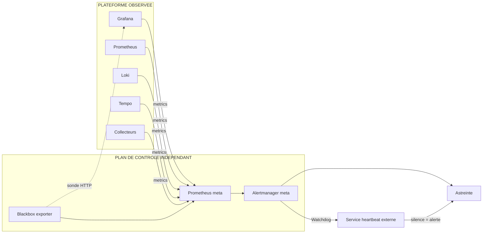

# Meta-monitoring de la plateforme

## Objectifs pédagogiques

À la fin de ce module, vous serez capable de :

- **Concevoir** un plan de contrôle de la supervision, indépendant de la plateforme qu'il surveille.
- **Instrumenter** Grafana et ses backends (Prometheus, Loki, Tempo, collecteurs) avec leurs métriques internes et leurs endpoints de santé.
- **Détecter** une panne silencieuse : collecte arrêtée, données périmées, évaluations d'alertes en échec, notifications qui n'arrivent plus.
- **Mettre en place** un mécanisme de type Watchdog et une sonde externe pour casser la dépendance circulaire.
- **Arbitrer** entre une solution auto-hébergée et un service externe selon la criticité et la taille de l'équipe.

## Mise en situation

Une équipe de douze personnes exploite une application SaaS. Toute sa supervision tient sur une même machine virtuelle : Grafana, Prometheus, Loki et l'Alertmanager. Les dashboards sont soignés, les alertes sont routées vers Slack et vers l'astreinte. Tout le monde se sent couvert.

Un samedi soir, le disque de la VM se remplit. Prometheus cesse d'écrire, Grafana ralentit puis se fige. L'application, elle, continue de tourner et finit par dégrader ses réponses vers 2 h du matin. Aucune alerte ne part, puisque l'outil qui devait la déclencher est lui-même à l'arrêt. L'équipe l'apprend le lundi, par un client.

Le problème n'est pas un manque de dashboards. Personne ne surveillait la supervision. Ce module construit ce qui manquait : une couche qui observe la plateforme d'observabilité et qui sait crier quand elle se tait.

## Le problème de fond : qui surveille le surveillant ?

Un système de supervision est un service de production comme les autres. Il consomme du CPU, remplit des disques, dépend d'une base de données, d'un réseau et de certificats qui expirent.

La différence tient à ses échecs. Quand une API tombe, la supervision le dit. Quand la supervision tombe, **rien ne le dit**. Le silence ressemble alors à un « tout va bien ».

> 🧠 **Concept clé — Le silence n'est pas un signal de santé**
>
> Une plateforme d'observabilité ne peut pas prouver qu'elle fonctionne par l'absence d'alertes. Il faut un signal positif, émis en continu, dont l'*absence* déclenche une réaction depuis un point extérieur.
{: .callout .callout-important}

Le meta-monitoring se découpe en trois questions, à ne pas mélanger :

1. **Est-ce que la plateforme est vivante ?** Grafana répond, les backends sont prêts, les Data Sources sont joignables.
2. **Est-ce que ses données sont fraîches et complètes ?** La collecte tourne, les séries arrivent, rien ne s'est évaporé en route.
3. **Est-ce que sa fonction d'alerte marche de bout en bout ?** Les règles s'évaluent, les notifications partent et sont reçues.

La troisième question est la plus négligée. Un Grafana qui répond en HTTP 200 avec un contact point cassé est plus dangereux qu'un Grafana éteint : il donne l'illusion d'être protégé.

## Comment la surveillance de la surveillance s'organise

### Le principe d'indépendance

Le détecteur d'une panne ne doit pas partager son sort avec ce qu'il détecte. Concrètement, on sépare deux plans : la **plateforme observée**, celle qui sert les équipes, et un **plan de contrôle minimal**.

> 📖 **Définition**
>
> Le *plan de contrôle* est une supervision réduite qui ne fait que surveiller la plateforme observée. Il est volontairement petit, sobre et sans dépendance vis-à-vis d'elle.
{: .callout .callout-definition}



Le Prometheus « meta » n'a pas besoin d'être gros. Il collecte quelques dizaines de séries, garde quelques jours de rétention et vit sur une machine ou dans une zone différente de la plateforme principale. L'astreinte est jointe par ce chemin, pas par Grafana.

### Qui détecte quoi

| Panne | Détecteur approprié | Signal |
|---|---|---|
| Grafana injoignable | Sonde externe (Blackbox) | `probe_success == 0` |
| Grafana vivant, base de données KO | Endpoint de santé | `/api/health` indique `database` ≠ `ok` |
| Data Source en erreur | Métriques internes Grafana + test de santé | Taux d'erreurs par Data Source |
| Collecte arrêtée | Prometheus meta | `up == 0` ou série absente |
| Données périmées | Requête de fraîcheur | Âge du dernier succès ou valeur qui ne varie plus |
| Règles d'alerte en échec | Métriques internes Grafana / Prometheus | Compteurs d'échecs d'évaluation |
| Notifications perdues | Métriques de l'Alertmanager | Compteurs de notifications en échec |
| Prometheus meta mort | Service de heartbeat externe | Absence de ping Watchdog |

La dernière ligne compte le plus : la chaîne doit se refermer sur quelque chose d'extérieur, sinon on déplace simplement la dépendance circulaire d'un cran.

### Métriques internes, santé et logs de Grafana

Grafana expose ses propres métriques au format Prometheus sur `/metrics`. Elles sont activées par défaut dans la section `[metrics]` de `grafana.ini`, que vous pouvez protéger avec `basic_auth_username` et `basic_auth_password`. Le scrape ressemble à n'importe quel autre job :

```yaml
scrape_configs:
  - job_name: grafana
    metrics_path: /metrics
    scheme: http
    static_configs:
      - targets: ["<GRAFANA_HOST>:3000"]
```

À côté, `/api/health` répond en JSON avec la version et l'état de la base de données. C'est un test de vivacité bon marché, mais limité. Il vérifie que Grafana tourne et atteint sa base de configuration. Il ne dit rien de vos Data Sources ni de vos alertes.

```bash
curl -s http://<GRAFANA_HOST>:3000/api/health
```

> 📝 **Note**
>
> Les noms exacts des métriques évoluent d'une version à l'autre. Avant d'écrire une règle, vérifiez le nom et les labels réels avec un `curl` sur `/metrics` de *votre* instance.
{: .callout .callout-note}

Les familles les plus utiles sont :

- les requêtes HTTP (`grafana_http_request_duration_seconds`), pour la latence de l'interface et de l'API ;
- les requêtes vers les Data Sources (`grafana_datasource_request_*`), pour savoir quelle source dégrade l'expérience ;
- l'alerting (`grafana_alerting_*`), pour les évaluations et les notifications ;
- les métriques de runtime Go (`go_goroutines`, `process_resident_memory_bytes`), pour la capacité.

Les logs complètent le tableau : Grafana journalise les erreurs d'évaluation et d'envoi avec des loggers dédiés à l'alerting (préfixe `ngalert`). Envoyez-les dans Loki, ou mieux, dans un Loki distinct si vous en avez un. Une requête simple repère les rafales d'erreurs :

```logql
sum(count_over_time({job="grafana"} |= "level=error" |= "ngalert" [5m]))
```

Le format des logs (`level=` ou `lvl=`) et les labels de flux dépendent de votre version et de votre collecteur. Adaptez la requête à ce que vous voyez dans Explore.

### Disponibilité des Data Sources

Une Data Source peut être configurée correctement et ne plus répondre. Deux angles se complètent. Le premier est passif : le taux d'erreurs des requêtes que Grafana émet réellement vers chaque source.

```promql
sum by (datasource) (rate(grafana_datasource_request_total{code=~"5.."}[5m]))
/
sum by (datasource) (rate(grafana_datasource_request_total[5m]))
```

Le second est actif : un test de santé régulier. Les versions récentes exposent `GET /api/datasources/uid/<DS_UID>/health` (l'URL et le comportement dépendent de la version, et certains plugins ne le supportent pas). Un petit script planifié, ou un job du plan de contrôle, l'appelle avec un token de service en lecture seule.

> 💡 **Astuce**
>
> Interrogez aussi directement les backends sur leurs propres endpoints de préparation : `/-/ready` pour Prometheus, `/ready` pour Loki et Tempo. Si l'endpoint direct répond mais que Grafana remonte des erreurs, vous venez de couper le problème en deux : le défaut est dans la connexion, pas dans le backend.
{: .callout .callout-astuce}

### Santé de la collecte et fraîcheur des données

C'est là que se logent les pannes vraiment sournoises. Un collecteur arrêté ne produit aucune erreur : il ne produit plus rien. Les dashboards gardent leurs derniers points, et les graphiques s'arrêtent sans bruit.

Trois niveaux de vérification, du plus simple au plus fin :

- `up == 0` détecte une cible qui ne répond plus au scrape. Cela suppose que la cible existe encore dans la configuration.
- `absent_over_time(up{job="<JOB>"}[5m])` détecte une cible ou un job *disparu*, par exemple après une erreur de service discovery ou de relabeling. Sans cette règle, `up` n'existe plus, donc `up == 0` ne se déclenche jamais.
- Une requête de fraîcheur sur les données elles-mêmes, pour attraper le cas où la cible répond mais renvoie des données figées. Deux formes possibles : `time() - <METRIQUE_DERNIER_SUCCES>` si le pipeline expose l'horodatage de son dernier traitement réussi, ou `changes(<METRIQUE>[<DUREE>]) == 0` sur une valeur censée évoluer. `timestamp()` renvoie l'heure du scrape et ne révèle donc pas des valeurs figées.

> ⚠️ **Erreur fréquente**
>
> Se contenter de `up == 1`. Un exporter peut répondre 200 avec des valeurs figées ou vides. `up` mesure la joignabilité du scrape, pas la qualité de ce qui est servi. Ajoutez au moins une métrique « métier » de contrôle par pipeline et surveillez son âge.
{: .callout .callout-attention}

Côté logs et traces, le principe est le même : comparez le débit entrant (octets ou lignes reçus par le distributeur Loki, spans reçus par Tempo) à sa valeur habituelle. Une chute brutale vers zéro un jour de semaine à 10 h n'est pas un calme plat, c'est une panne.

### Suivi des évaluations et des notifications d'alertes

Le moteur d'alerte de Grafana tourne comme un planificateur : il lance des évaluations à intervalles réguliers, puis envoie les résultats à un Alertmanager (interne ou externe), qui notifie les contact points. Chaque étape peut casser sans que les autres le sachent.

Pour les évaluations, surveillez trois choses :

- le taux d'échec (`grafana_alerting_rule_evaluation_failures_total`) : une règle qui ne s'évalue plus n'alertera jamais ;
- la durée d'évaluation, qui doit rester nettement inférieure à l'intervalle configuré, sinon les évaluations prennent du retard ;
- le nombre de règles actives, dont une chute soudaine peut trahir un provisioning cassé.

```promql
sum(rate(grafana_alerting_rule_evaluation_failures_total[5m])) > 0
```

Pour les notifications, le compteur d'échecs de l'Alertmanager (`alertmanager_notifications_failed_total` côté Alertmanager autonome, famille `grafana_alerting_*` côté Alertmanager interne, noms à confirmer sur votre version) est le signal principal. Un webhook dont le certificat a expiré, un token Slack révoqué ou un serveur SMTP qui refuse la connexion se manifestent ici.

Mais seulement lorsqu'un envoi est tenté : tant qu'aucune alerte ne part, le compteur reste à zéro. D'où l'intérêt de tester chaque contact point.

> 🧠 **Concept clé — Évaluer n'est pas notifier**
>
> Une règle peut être à l'état Firing, parfaitement visible dans l'interface, tout en échouant à envoyer quoi que ce soit. Deux jeux de métriques, deux alertes distinctes.
{: .callout .callout-important}

### Dashboards de capacité et de fiabilité

Pourquoi deux dashboards plutôt qu'un seul ? Parce qu'ils servent des moments différents. Le dashboard de **fiabilité** sert pendant un incident : est-ce que la plateforme répond, est-ce que les alertes circulent ? Celui de **capacité** sert en revue hebdomadaire ou mensuelle : vers quoi allons-nous ?

| Question posée | Panel utile |
|---|---|
| La plateforme est-elle vivante maintenant ? | Statuts de toutes les sondes, un état par composant |
| Les utilisateurs sont-ils ralentis ? | Latence p95 des requêtes Grafana par route |
| Quelle source pénalise Grafana ? | Taux d'erreurs et latence par Data Source |
| Les alertes partent-elles ? | Échecs d'évaluation, échecs de notification |
| Vers quand le disque sera-t-il plein ? | `predict_linear` sur le volume de données |
| Le nombre de séries explose-t-il ? | `prometheus_tsdb_head_series` dans le temps |
| Grafana manque-t-il de mémoire ? | `process_resident_memory_bytes`, goroutines |

La projection de disque est probablement la règle qui aurait sauvé le week-end de notre scénario :

```promql
predict_linear(node_filesystem_avail_bytes{mountpoint="<MONTAGE_DATA>"}[6h], 4 * 3600) < 0
```

Elle alerte quand, au rythme des six dernières heures, l'espace disponible tombera à zéro dans les quatre heures. Cela laisse le temps d'agir, ce que ne permet pas un seuil fixe à 90 % sur un disque qui se remplit en une heure. Les questions de coût et de réduction de volumétrie viendront dans le module suivant. Ici, on se contente d'observer la pente.

## Casser la dépendance circulaire

Deux mécanismes complémentaires, tous les deux nécessaires.

> ⚠️ **Erreur fréquente — Alerter uniquement par la plateforme qui vient de tomber**
>
> Si Grafana (ou son Alertmanager, ou son Prometheus) est le seul à évaluer et à envoyer l'alerte « Grafana est en panne », cette alerte ne partira jamais au moment où elle serait utile. Correction : au moins un détecteur doit vivre hors du périmètre de panne, et la chaîne doit se terminer sur un service tiers.
{: .callout .callout-attention}

### Le Watchdog (dead man's switch)

> 📖 **Définition**
>
> Un *Watchdog* renverse la logique d'alerte : au lieu d'attendre qu'une alerte apparaisse, on émet en permanence une alerte **toujours** active. Un service externe reçoit ce battement et déclenche l'astreinte s'il ne l'entend plus.
{: .callout .callout-definition}

> 💂 **Analogie : le poste de garde**
>
> Imaginez un détecteur de présence au poste de garde : si la personne cesse de signaler qu'elle est là, on envoie quelqu'un, sans attendre qu'elle appelle à l'aide.
{: .callout .callout-analogie}

Dans Prometheus, c'est une règle qui vaut toujours vrai :

```yaml
groups:
  - name: meta-monitoring
    rules:
      - alert: Watchdog
        expr: vector(1)
        labels:
          severity: none
        annotations:
          summary: "Battement de la chaîne d'alerte"
```

On la route vers un récepteur dédié, avec un intervalle de répétition court, pour qu'un ping parte toutes les minutes :

```yaml
route:
  receiver: default
  routes:
    - matchers:
        - alertname="Watchdog"
      receiver: heartbeat
      group_wait: 0s
      group_interval: 1m
      repeat_interval: 1m
receivers:
  - name: heartbeat
    webhook_configs:
      - url: "<HEARTBEAT_URL>"
        send_resolved: false
```

Le service de heartbeat (un service SaaS spécialisé ou un petit outil auto-hébergé dans un autre fournisseur) est configuré avec une tolérance, par exemple « alerter si aucun ping depuis 5 minutes ». Traitez l'URL comme un secret : quiconque la connaît peut simuler un battement.

La même chose existe côté Grafana Alerting : une règle toujours vraie, routée vers un contact point de type webhook. Faites-le sur les **deux** étages si vous avez les deux moteurs, car chacun peut tomber indépendamment.

### La sonde externe

Le Watchdog valide la chaîne d'alerte. Il ne valide pas ce que voient les utilisateurs. Pour cela, une sonde HTTP (par exemple Blackbox exporter) interroge Grafana comme le ferait un client, depuis un autre réseau ou une autre région :

```yaml
- alert: GrafanaUnreachable
  expr: probe_success{job="blackbox-grafana"} == 0
  for: 2m
  labels:
    severity: critical
```

La sonde teste l'URL publique, avec le DNS, le certificat TLS et le reverse proxy. Elle détecte donc aussi l'expiration d'un certificat ou un record DNS cassé, que `/metrics` en réseau interne ne verrait jamais.

> 💡 **Astuce**
>
> Pointez la sonde sur `/api/health` pour la vivacité, mais ajoutez aussi une sonde sur la page de login ou sur un dashboard simple. Un Grafana dont l'API répond mais dont le frontend sert une erreur de proxy passe sinon sous le radar.
{: .callout .callout-astuce}

## Construction progressive

### v1 — Le minimum qui évite la catastrophe

Un seul Prometheus, celui de la plateforme, qui scrape Grafana, lui-même, Loki et Tempo. Deux règles : `up == 0` sur chaque composant et la projection de remplissage du disque. Une sonde Blackbox hébergée ailleurs vérifie l'URL publique de Grafana. C'est suffisant pour la plupart des pannes franches.

La faiblesse ? La sonde, même hébergée ailleurs, est scrapée et évaluée par ce même Prometheus. Si la machine entière tombe, aucune alerte ne part. C'est déjà beaucoup mieux que rien, et c'est précisément ce que corrige la v2.

### v2 — Un plan de contrôle séparé et un Watchdog

On ajoute un Prometheus meta, léger, hébergé hors de la plateforme principale. Il scrape les composants et applique les règles de fraîcheur, d'absence, d'échec d'évaluation et d'échec de notification. Son Alertmanager route vers l'astreinte. Le Watchdog est branché vers un service de heartbeat externe. Le saut est justifié par une seule raison : la panne de la plateforme n'emporte plus la capacité de la signaler.

### v3 — Production

On rend le plan de contrôle lui-même résilient et auditable :

- deux Alertmanagers en cluster ou un service managé pour l'acheminement final ;
- des runbooks liés à chaque alerte meta via les annotations ;
- une alerte « le Prometheus meta est-il vivant ? » portée par le heartbeat, jamais par lui-même ;
- un exercice périodique de panne simulée (couper un exporter, révoquer un token de test, bloquer un port) pour vérifier que chaque détecteur parle réellement ;
- les règles et dashboards meta gérés comme du code, versionnés, séparément du reste.

Chaque palier répond à une défaillance observable du palier précédent, et il n'est pas utile de monter en v3 si la plateforme sert dix personnes en horaires de bureau.

## Prise de décision

**Où héberger la détection ?** Trois options reviennent :

| Option | Avantage | Limite |
|---|---|---|
| Prometheus meta auto-hébergé, autre hôte ou zone | Contrôle total, coût faible | Vous exploitez un deuxième système, qui peut tomber sans qu'on le sache |
| Service externe managé (sondes, heartbeat, status) | Indépendance réelle, aucune maintenance | Coût récurrent, couverture limitée aux sondes simples |
| Combinaison des deux | Défense en profondeur | Deux outils à configurer et à tenir à jour |

Pour une petite équipe, le meilleur rapport efficacité/effort est presque toujours la combinaison : un Prometheus meta minimal pour le détail, un service externe de heartbeat et de sonde pour la garantie. Si l'équipe n'a pas la capacité de garder un second système en bonne santé, mieux vaut s'appuyer davantage sur le service externe.

**Où cette approche atteint ses limites.** Un plan de contrôle sérieux ne remplace pas une vraie stratégie de résilience de la plateforme principale (haute disponibilité, sauvegardes), traitée dans d'autres modules. Il vous dit *qu'il y a un problème*, pas comment l'éviter. Autre limite : plus vous ajoutez de détecteurs, plus vous créez de bruit. Une règle meta qui se déclenche chaque semaine pour rien sera ignorée le jour où elle dit vrai.

## Erreurs fréquentes

**Symptôme :** un incident applicatif a eu lieu, aucune notification reçue, alors que la règle apparaît en Firing dans Grafana.
**Cause :** le contact point est cassé (webhook expiré, token Slack révoqué, SMTP refusé). L'évaluation fonctionne, l'envoi échoue.
**Correction :** alerter sur les compteurs d'échec de notification de l'Alertmanager, tester chaque contact point après modification de secret, et prévoir un second canal pour les alertes critiques.

**Symptôme :** la règle `up == 0` n'a rien déclenché alors qu'un service a disparu depuis une heure.
**Cause :** après une modification de configuration, la cible n'est plus scrapée, donc la série `up` n'existe plus. Une absence ne vaut pas zéro.
**Correction :** ajouter `absent_over_time(up{job="<JOB>"}[5m])` pour chaque job critique.

**Symptôme :** le Watchdog fait sonner l'astreinte toutes les nuits à 3 h.
**Cause :** une maintenance, une rotation de logs ou un redémarrage planifié coupe brièvement la chaîne, et la tolérance du heartbeat est trop courte.
**Correction :** régler la tolérance au-delà de la durée de la plus longue interruption normale (par exemple 10 à 15 minutes plutôt que 2), et ne jamais réduire l'intervalle d'envoi pour compenser.

**Symptôme :** le dashboard de la plateforme est vert, mais les utilisateurs se plaignent de lenteur.
**Cause :** la vérification ne porte que sur `/api/health`, qui ne reflète pas la latence des requêtes réelles ni celle des Data Sources.
**Correction :** surveiller le p95 de la latence HTTP par route et par Data Source, et ajouter une sonde synthétique qui charge un vrai dashboard.

## Cas réel en entreprise (scénario illustratif)

Reprenons l'équipe de douze personnes de la mise en situation. Les chiffres ci-dessous sont fictifs, choisis pour montrer l'effet d'une démarche.

Après l'incident du week-end, l'équipe procède en trois temps :

1. Une sonde Blackbox, déployée chez un autre hébergeur, interroge `/api/health` et la page de login toutes les 30 secondes.
2. Un petit Prometheus meta, sur une machine séparée, scrape Grafana, Prometheus, Loki et le collecteur. Il porte quatre règles : cible injoignable ou absente, projection de remplissage de disque, échecs d'évaluation Grafana et échecs de notification.
3. Un Watchdog est branché sur un service de heartbeat avec une tolérance de 5 minutes, relié à l'astreinte par SMS.

Lors du test de réception, ils coupent volontairement le Prometheus principal, puis l'Alertmanager du plan de contrôle meta. Dans le premier cas, la règle de cible injoignable se déclenche en moins de 3 minutes. Dans le second, c'est le heartbeat qui sonne au bout de 5 minutes. Un troisième exercice révèle un défaut inattendu : le webhook Slack utilisait un token expiré depuis des semaines. Le compteur d'échec de notification était à zéro simplement parce qu'aucune alerte ne s'était déclenchée entre-temps, et l'exercice l'a fait apparaître.

Dans ce scénario, le temps de détection d'une panne de supervision passe de « plusieurs heures, découvert par un client » à « moins de 5 minutes, découvert par l'astreinte ». Le coût : un petit hôte supplémentaire, un abonnement modeste à un service de heartbeat et une demi-journée de configuration.

## Bonnes pratiques

- **Séparez les plans.** Hébergez le plan de contrôle sur une machine, un réseau ou un fournisseur différent de la plateforme observée. Si les deux partagent le même disque ou la même zone, ils tomberont ensemble.
- **Terminez toujours la chaîne à l'extérieur.** Au moins un maillon (heartbeat ou sonde) doit être indépendant de votre infrastructure, sinon vous n'avez fait que déplacer le problème.
- **Alertez sur l'absence, pas seulement sur la valeur.** Pour chaque pipeline critique, une règle `absent_over_time` ou de fraîcheur ; `up == 0` seul ne suffit pas.
- **Surveillez la notification autant que l'évaluation.** Testez chaque contact point après un changement de secret, et alertez sur ses échecs.
- **Sécurisez le plan de contrôle comme le reste.** Protégez `/metrics` (authentification de base ou réseau privé), utilisez des tokens de service en lecture seule pour les tests de santé, traitez les URL de heartbeat comme des secrets.
- **Gardez les règles meta peu nombreuses et actionnables.** Chaque alerte pointe vers un runbook (annotation) et a un responsable. Une alerte meta qui bruite sans cesse sera ignorée.
- **Versionnez-les comme du code.** Règles, dashboards de fiabilité et configuration des sondes vont dans Git et sont déployés de façon idempotente, pour qu'une reconstruction du plan de contrôle soit reproductible.
- **Répétez les pannes.** Un exercice trimestriel (couper un exporter, bloquer l'Alertmanager, révoquer un token de test) vérifie que chaque détecteur parle réellement. Un détecteur jamais testé est une hypothèse, pas une garantie.

## Résumé

Une plateforme d'observabilité est un service de production, et sa panne est la plus difficile à voir : elle ne génère aucun message, seulement du silence. Le meta-monitoring consiste à surveiller trois choses distinctes : la vivacité des composants, la fraîcheur et la complétude des données, et le bon fonctionnement de bout en bout du chemin d'alerte, de l'évaluation à la notification. On y répond avec les métriques internes de Grafana et de ses backends, des endpoints de santé, des règles d'absence et de projection de capacité.

Le point décisif reste l'indépendance : un plan de contrôle séparé, un Watchdog vers un service externe et une sonde HTTP extérieure cassent la dépendance circulaire. Une fois la plateforme capable de signaler qu'elle va mal, la question suivante devient celle de ce qu'elle coûte à mesure que la volumétrie grandit.

<!-- snippet
id: grafana_meta_health_endpoint
type: command
tech: grafana
level: advanced
importance: medium
format: knowledge
tags: grafana,health,meta-monitoring,api
title: Tester la vivacité de Grafana avec /api/health
command: curl -s http://<GRAFANA_HOST>:3000/api/health
example: curl -s http://grafana.internal:3000/api/health
description: Renvoie la version et l'état de la base de configuration (champ database). Il ne teste ni les Data Sources ni les alertes, il ne remplace donc pas un vrai contrôle.
-->

<!-- snippet
id: grafana_meta_watchdog_concept
type: concept
tech: grafana
level: advanced
importance: high
format: knowledge
tags: watchdog,heartbeat,alerting,meta-monitoring
title: Watchdog : une alerte qui doit toujours être active
content: Une règle toujours vraie (expr: vector(1) dans Prometheus) est routée chaque minute vers un webhook externe de heartbeat. Le service externe attend ce ping et déclenche l'astreinte si rien n'arrive pendant la tolérance configurée (par exemple 5 min). L'absence du battement, et non une alerte reçue, révèle alors la panne de la chaîne complète : évaluation, Alertmanager et réseau.
description: Inverse la logique d'alerte : c'est le silence du battement qui sonne, ce qui détecte les pannes que la plateforme ne peut pas signaler elle-même.
-->

<!-- snippet
id: grafana_meta_circular_dependency_warning
type: warning
tech: grafana
level: advanced
importance: high
format: knowledge
tags: dependance-circulaire,alerting,meta-monitoring,resilience
title: Ne pas alerter sur Grafana uniquement via Grafana
content: Piège : l'alerte « Grafana est en panne » est évaluée et envoyée par Grafana ou son Prometheus. Conséquence : quand la plateforme tombe, l'alerte ne part jamais et la panne passe inaperçue pendant des heures. Correction : placer au moins un détecteur hors du périmètre de panne (sonde Blackbox depuis un autre réseau, Watchdog vers un service de heartbeat externe) et terminer la chaîne sur un canal indépendant.
description: Une supervision qui se surveille elle-même ne détecte pas sa propre panne totale ; il faut un maillon externe à la plateforme.
-->

<!-- snippet
id: grafana_meta_absent_over_time
type: command
tech: grafana
level: advanced
importance: high
format: knowledge
tags: promql,absent,collecte,fraicheur
title: Détecter une cible disparue avec absent_over_time
command: absent_over_time(up{job="<JOB>"}[<DUREE>])
example: absent_over_time(up{job="grafana"}[5m])
description: Renvoie 1 quand aucune série up n'existe plus pour ce job. Complète up == 0, qui ne se déclenche pas si la cible a disparu de la configuration.
-->

<!-- snippet
id: grafana_meta_up_not_fresh
type: warning
tech: grafana
level: advanced
importance: medium
format: knowledge
tags: up,fraicheur,collecte,exporter
title: up == 1 ne garantit pas des données fraîches
content: Piège : se fier à up == 1 comme preuve que la collecte est saine. Conséquence : un exporter qui répond 200 avec des valeurs figées ou vides n'est jamais détecté et les graphiques s'arrêtent sans bruit. Correction : surveiller une métrique de contrôle par pipeline, par exemple time() - <METRIQUE_DERNIER_SUCCES> sur un horodatage de dernier succès exposé par le pipeline, ou changes(<METRIQUE>[<DUREE>]) == 0 sur une valeur censée évoluer. timestamp() renvoie l'heure du scrape et ne détecte pas des valeurs figées.
description: up mesure la joignabilité du scrape, pas la qualité du contenu ; une métrique de contrôle par pipeline couvre les données périmées.
-->

<!-- snippet
id: grafana_meta_alert_eval_failures
type: command
tech: grafana
level: advanced
importance: high
format: knowledge
tags: alerting,evaluation,metriques,prometheus
title: Surveiller les échecs d'évaluation des règles Grafana
command: sum(rate(grafana_alerting_rule_evaluation_failures_total[5m])) > 0
description: Une règle qui échoue à s'évaluer n'alertera jamais. Le nom exact de la métrique dépend de la version : le confirmer sur /metrics avant de l'utiliser.
-->

<!-- snippet
id: grafana_meta_scrape_metrics_tip
type: tip
tech: grafana
level: advanced
importance: medium
format: knowledge
tags: metrics,scrape,configuration,securite
title: Exposer et protéger /metrics de Grafana
content: Les métriques internes sont servies sur /metrics, section [metrics] de grafana.ini (enabled = true). Ajouter basic_auth_username et basic_auth_password, puis déclarer le même couple dans le job Prometheus (basic_auth) ou restreindre le port au réseau de supervision. Vérifier ensuite les noms de métriques réels avec curl <GRAFANA_HOST>:3000/metrics avant d'écrire des règles.
description: Active et sécurise le scrape de Grafana ; vérifier les noms réels sur votre version évite des règles qui ne matchent aucune série.
-->

<!-- snippet
id: grafana_meta_notification_failure_error
type: error
tech: grafana
level: advanced
importance: high
format: knowledge
tags: notifications,contact-point,alerting,diagnostic
title: Règle en Firing mais aucune notification reçue
content: Symptôme : la règle est visible en Firing dans l'interface, mais personne n'est notifié. Cause : l'évaluation fonctionne, l'envoi échoue (webhook expiré, token Slack révoqué, SMTP refusé). Correction : alerter sur les compteurs d'échec de notification de l'Alertmanager, tester chaque contact point après un changement de secret et prévoir un second canal pour les alertes critiques.
description: Évaluer n'est pas notifier : le compteur d'échecs de notification révèle un contact point cassé, mais seulement lorsqu'un envoi est tenté.
-->

<!-- snippet
id: grafana_meta_blackbox_probe_tip
type: tip
tech: grafana
level: advanced
importance: medium
format: knowledge
tags: blackbox,sonde,monitoring-externe,disponibilite
title: Sonde externe sur l'URL publique de Grafana
content: Déployer un Blackbox exporter hors de la plateforme (autre réseau ou région) et sonder l'URL publique /api/health toutes les 30 s, plus une page de login. Alerte : probe_success == 0 pendant 2 min. La sonde passe par DNS, TLS et reverse proxy, donc elle repère aussi un certificat expiré ou un record DNS cassé.
description: Une sonde HTTP extérieure voit ce que voit l'utilisateur, y compris DNS, certificat et proxy, ce qu'un scrape interne de /metrics ne détecte pas.
-->

<!-- snippet
id: grafana_meta_predict_linear_disk
type: command
tech: grafana
level: advanced
importance: medium
format: knowledge
tags: capacite,disque,promql,predict-linear
title: Prévoir un disque plein avec predict_linear
command: predict_linear(node_filesystem_avail_bytes{mountpoint="<MONTAGE_DATA>"}[6h], 4 * 3600) < 0
example: predict_linear(node_filesystem_avail_bytes{mountpoint="/var/lib/prometheus"}[6h], 4 * 3600) < 0
description: Alerte si, au rythme des 6 dernières heures, le disque sera plein dans 4 heures. Plus réactif qu'un seuil fixe à 90 % sur un volume qui se remplit vite.
-->

<!-- snippet
id: grafana_meta_datasource_error_ratio
type: concept
tech: grafana
level: advanced
importance: medium
format: knowledge
tags: datasource,disponibilite,metriques,promql
title: Mesurer la santé d'une Data Source par son taux d'erreurs
content: Grafana expose des métriques de requêtes par Data Source (grafana_datasource_request_total avec labels datasource et code). Le ratio sum by (datasource)(rate(...{code=~"5.."}[5m])) divisé par le total des requêtes donne un taux d'erreurs par source. Il capte les défauts réels vécus par les utilisateurs, là où un test de santé ponctuel peut passer. Labels et noms à vérifier sur /metrics selon la version.
description: Le taux d'erreurs par Data Source révèle quelle source dégrade Grafana, en complément d'un test de santé actif.
-->

<!-- snippet
id: grafana_meta_heartbeat_tolerance_error
type: error
tech: grafana
level: advanced
importance: low
format: knowledge
tags: heartbeat,watchdog,astreinte,faux-positif
title: Le Watchdog sonne toutes les nuits sans vraie panne
content: Symptôme : l'astreinte est réveillée à heure fixe par le heartbeat. Cause : une maintenance, un redémarrage ou une rotation interrompt brièvement la chaîne et la tolérance du service externe est trop courte. Correction : régler la tolérance au-delà de la plus longue coupure normale (10 à 15 min plutôt que 2) sans réduire l'intervalle d'envoi.
description: Un heartbeat trop strict génère des faux positifs qui conduisent l'équipe à ignorer l'alerte le jour où la panne est réelle.
-->
