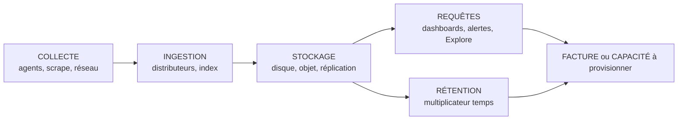
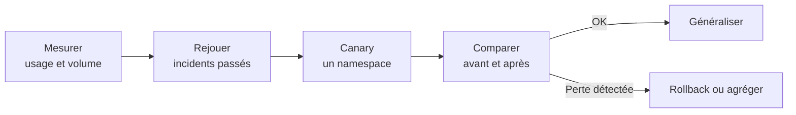

# Maîtrise des coûts et de la volumétrie

## Objectifs pédagogiques

À la fin de ce module, vous serez capable de :

- **Identifier** pour chaque signal (métriques, logs, traces) le facteur qui fait réellement grimper la facture.
- **Mesurer** la cardinalité, la volumétrie des logs et le volume de traces avec des requêtes précises, avant de toucher à la configuration.
- **Appliquer** des leviers de réduction (relabeling, filtrage, sampling, rétention par niveau) sans casser la capacité de diagnostic.
- **Comparer** Grafana OSS auto-hébergé et Grafana Cloud sur le coût total, pas seulement sur le prix catalogue.
- **Arbitrer** entre signal utile et télémétrie excessive avec des critères vérifiables.

## Mise en situation

Une plateforme SaaS tourne sur Kubernetes : une quarantaine de services, huit ingénieurs, une stack Prometheus + Loki + Tempo visualisée dans Grafana. Elle a été montée vite, avec une consigne implicite : « on envoie tout, on triera plus tard ». Personne n'a trié.

Dix-huit mois plus tard, trois choses arrivent la même semaine. Prometheus a redémarré deux fois pour manque de mémoire. L'équipe finance demande pourquoi le stockage objet de Loki a triplé. Et un développeur a ajouté un label `user_id` sur une métrique « pour mieux débugger ».

La réaction naïve est de couper : passer la rétention à 3 jours, désactiver les logs `info`, échantillonner les traces à 1 %. Ça fait baisser la facture, et ça prépare la prochaine panne où l'on découvrira qu'on a supprimé exactement la donnée dont on avait besoin. Tout ce module sert à éviter ces deux extrêmes : ne rien contrôler, ou couper à l'aveugle.

## Où part vraiment l'argent

Avant de réduire quoi que ce soit, il faut savoir où part l'argent. Le coût d'une plateforme d'observabilité se répartit en quatre postes qui ne grossissent pas pour les mêmes raisons.



- **Collecte** : CPU et mémoire des agents, trafic réseau (qui devient facturé dès que ça traverse une zone de disponibilité ou internet), fréquence de scrape.
- **Stockage** : volume écrit, facteur de réplication, type de disque ou de stockage objet.
- **Requêtes** : chaque panneau qui se rafraîchit, chaque règle d'alerte évaluée, chaque investigation en Explore consomme du CPU et de la mémoire côté backend. Ce poste est le plus souvent oublié.
- **Rétention** : un multiplicateur. Doubler la durée double (grosso modo) le stockage, sans rien changer d'autre.

> 🧠 **Concept clé**
>
> Chaque signal a son *facteur dominant*. Pour les métriques, c'est le nombre de séries actives. Pour les logs, c'est le volume d'octets ingérés. Pour les traces, c'est le nombre de spans conservés. Optimiser le mauvais facteur, par exemple réduire la rétention des métriques alors que le problème est la cardinalité, donne un gain faible pour un vrai coût en diagnostic.
{: .callout .callout-important}

| Signal | Facteur dominant | Ce qui pèse vraiment | Levier le plus rentable |
|---|---|---|---|
| Métriques | Séries actives | Mémoire du backend (ou ligne de facture « active series ») | Supprimer des labels, dédupliquer des métriques |
| Logs | Go ingérés par jour | Stockage objet + CPU d'ingestion | Filtrer à la source, abaisser le niveau de log |
| Traces | Spans conservés | Stockage + CPU des collecteurs | Sampling adapté |

## Métriques : la cardinalité, un multiplicateur silencieux

Le nombre total de séries est le **produit** du nombre de valeurs possibles de chaque label.

> 📖 **Définition**
>
> Une série temporelle, c'est une métrique + une combinaison unique de labels.
{: .callout .callout-definition}

Prenons un histogramme de latence HTTP typique :

- 12 buckets + `_sum` + `_count` = 14 séries par combinaison
- 40 routes × 5 méthodes × 6 codes de statut × 30 pods

14 × 40 × 5 × 6 × 30 = **504 000 séries**, pour une seule métrique. Si on ajoute un label `user_id` avec 50 000 utilisateurs actifs, on ne parle plus de centaines de milliers de séries mais de milliards de combinaisons potentielles. Le backend n'y survit pas, ou la facture explose.

Voici comment mesurer avant d'agir, en PromQL :

```promql
# Séries actives en tête de bloc
prometheus_tsdb_head_series

# Les 10 métriques les plus coûteuses (requête lourde : à lancer hors pic)
topk(10, count by (__name__) ({__name__=~".+"}))

# Répartition par job : qui produit quoi
topk(10, count by (job) ({__name__=~".+"}))

# Taux d'ingestion en échantillons par seconde
rate(prometheus_tsdb_head_samples_appended_total[5m])
```

> 💡 **Astuce**
>
> La page `/tsdb-status` de l'interface Prometheus donne les mêmes classements (métriques, labels, paires label/valeur les plus coûteuses) sans exécuter de requête lourde. Commencez par là.
{: .callout .callout-astuce}

### Le stockage est rarement le problème des métriques

Prometheus compresse très bien. Compter environ 1 à 2 octets par échantillon est une base raisonnable (à vérifier sur votre propre instance). Exemple illustratif :

- 500 000 séries scrapées toutes les 30 s → ≈ 16 700 échantillons/s
- 15 jours = 1 296 000 s
- 16 700 × 1 296 000 × 2 octets ≈ **43 Go**

C'est modeste. Ce qui coûte, c'est la **mémoire** : chaque série active est conservée en RAM dans la tête du TSDB (Time Series Database), à raison de plusieurs Ko par série.

Et si l'on allonge l'intervalle de scrape ? Passer de 15 s à 60 s divise le nombre d'échantillons par quatre, mais ne supprime aucune série. La mémoire, dominée par le coût par série active, baisse donc peu. Le gain est réel sur le disque et l'ingestion, à condition que les fenêtres des rate() et des alertes couvrent au moins quatre intervalles de scrape.

### Leviers concrets

Le relabeling à l'ingestion (`metric_relabel_configs`) permet de jeter ce qui ne sert à personne :

```yaml
scrape_configs:
  - job_name: kubernetes-pods
    metric_relabel_configs:
      # Métriques de runtime jamais utilisées
      - source_labels: [__name__]
        regex: "go_gc_.*|promhttp_metric_handler_.*"
        action: drop
      # Labels techniques qui multiplient les séries à chaque déploiement
      - regex: "pod_template_hash|controller_revision_hash"
        action: labeldrop
```

> ⚠️ **Erreur fréquente**
>
> Un `labeldrop` qui fait entrer deux séries distinctes en collision (même nom, mêmes labels restants) provoque des erreurs d'échantillons dupliqués. Vérifiez que les labels restants suffisent à distinguer les séries.
{: .callout .callout-attention}

Pour les requêtes lourdes qui reviennent dans plusieurs dashboards, une *recording rule* calcule une fois le résultat agrégé et le stocke. Les panneaux interrogent alors la série précalculée au lieu de rebalayer des centaines de milliers de séries à chaque rafraîchissement.

## Logs : ce qui compte, ce sont les octets

Avec Loki, la logique est différente. Le contenu des lignes n'est pas indexé, seuls les labels le sont. Deux coûts distincts s'additionnent :

1. **Le volume brut** (Go/jour) : stockage objet, bande passante, CPU de compression.
2. **Le nombre de flux** : un *stream* est une combinaison unique de labels. Trop de flux (labels à valeurs non bornées comme un identifiant de requête ou une IP client) fragmente l'index et dégrade les écritures comme les lectures.

Mesurez d'abord qui produit les octets :

```logql
sum by (service_name) (bytes_over_time({env="prod"}[24h]))
```

Selon la version de Loki et la configuration de l'agent, le label de service peut s'appeler `service_name`, `app` ou `job`. Adaptez.

Dans presque toutes les plateformes, la même histoire se répète : un ou deux services produisent plus de la moitié du volume, et la majeure partie de ce volume est du niveau `debug` ou des logs d'accès répétitifs. C'est le bon endroit pour agir, à la source plutôt qu'au stockage. Exemple avec Alloy :

```alloy
loki.process "reduce" {
  forward_to = [loki.write.default.receiver]

  // On ne conserve pas le debug en production (suppose que level est un label du flux)
  stage.match {
    selector = "{level=\"debug\", env=\"prod\"}"
    action   = "drop"
  }
}
```

Côté Loki, des limites protègent le backend contre un producteur qui s'emballe. Elles ne remplacent pas le filtrage, mais évitent qu'une seule équipe sature le cluster :

```yaml
limits_config:
  ingestion_rate_mb: 8
  ingestion_burst_size_mb: 16
  per_stream_rate_limit: 3MB
  max_global_streams_per_user: 50000
```

> 💡 **Astuce**
>
> Si vous avez besoin de conserver un identifiant (trace ID, request ID) sans créer un flux par valeur, ne le mettez pas en label. Mettez-le dans la ligne de log, ou en *structured metadata* si votre version de Loki le supporte. Vous le retrouverez par filtre, sans exploser l'index.
{: .callout .callout-astuce}

## Traces : conserver l'intéressant, pas l'exhaustif

Un système distribué sous charge génère un nombre de spans considérable, et la grande majorité décrit des requêtes réussies, rapides, identiques à des millions d'autres. Conserver 100 % de ces traces est le moyen le plus sûr de payer très cher pour du bruit. D'où le *sampling* : on ne conserve qu'une partie des traces.

> 📊 **Analogie : le sondage**
>
> Comme un institut qui interroge 1 000 personnes plutôt que toute la population, on garde un échantillon représentatif. Limite de l'image : le tail sampling, lui, n'est volontairement pas représentatif, puisqu'il garde toutes les erreurs et toutes les traces lentes.
{: .callout .callout-analogie}

Deux familles :

| Critère | Head sampling | Tail sampling |
|---|---|---|
| Moment de la décision | Au début de la trace | Après réception de la trace complète |
| Information disponible | Aucune (statut, durée inconnus) | Erreurs, latence, attributs |
| Coût | Très faible | Mémoire + complexité (toutes les spans d'une trace doivent atteindre la même instance) |
| Risque | Perd des traces d'erreurs au hasard | Plus d'infra à opérer |

Le head sampling est simple et peu cher, mais il est aveugle : avec 5 % de taux, vous perdez 95 % des erreurs aussi. Le tail sampling décide avec le résultat sous les yeux, par exemple « garder toutes les erreurs, toutes les traces lentes, et 5 % du reste ».

```yaml
processors:
  tail_sampling:
    decision_wait: 10s
    policies:
      - name: keep-errors
        type: status_code
        status_code: { status_codes: [ERROR] }
      - name: keep-slow
        type: latency
        latency: { threshold_ms: 1000 }
      - name: baseline
        type: probabilistic
        probabilistic: { sampling_percentage: 5 }
```

Contrainte d'architecture : pour que le collecteur voie toutes les spans d'une trace, il faut router par `traceID` vers la même instance (exporter de type load-balancing en amont). Sans ça, des décisions sont prises sur des traces incomplètes.

> ⚠️ **Erreur fréquente**
>
> Calculer les métriques RED (taux, erreurs, durée) à partir des spans **après** sampling. Avec 5 % de traces conservées, le débit affiché est faux d'un facteur 20 et les dashboards mentent. Calculez les métriques de spans (connector `spanmetrics` ou metrics-generator) **avant** la décision de sampling, ou corrigez avec le taux d'échantillonnage.
{: .callout .callout-attention}

## Rétention : durée selon la criticité

La rétention est un multiplicateur, donc le réglage le plus tentant et le plus dangereux. Une politique unique (« 30 jours pour tout ») est à la fois trop longue pour le debug et trop courte pour l'audit. Il vaut mieux raisonner par niveau de criticité. Les durées ci-dessous sont des ordres de grandeur à ajuster à vos contraintes réglementaires et à vos besoins d'analyse de tendances.

| Niveau | Exemples | Métriques | Logs | Traces |
|---|---|---|---|---|
| Critique / conformité | Authentification, paiement, audit | 13 mois (agrégées) | 90 à 365 j | Erreurs : 14 j |
| Production standard | Services applicatifs | 15 j brut + agrégats longs | 30 j | 7 j |
| Support / non critique | Outils internes, batch | 7 à 15 j | 7 à 14 j | 3 j ou aucune |
| Debug / bruit | Logs `debug`, traces de santé | non conservées | 3 j maximum | Non conservées |

Les métriques supportent bien l'historique long à condition de **réduire la résolution** : une recording rule qui agrège à 5 min coûte une fraction du brut, et suffit pour comparer « ce mois-ci avec le même mois l'an dernier ». Prometheus seul ne fait pas de downsampling automatique. Il faut donc des recording rules, ou un backend long terme qui le propose (Thanos, par exemple).

Côté Loki, la rétention ne s'applique pas toute seule : elle repose sur le compactor.

```yaml
limits_config:
  retention_period: 744h        # 31 jours (défaut Loki : 0, aucune suppression)
  retention_stream:
    - selector: '{level="debug"}'
      priority: 1
      period: 72h

compactor:
  working_directory: /loki/compactor
  retention_enabled: true
  delete_request_store: s3
```

Les noms exacts des paramètres (notamment `delete_request_store`) varient selon la version de Loki. Contrôlez la documentation de votre version.

Pour Tempo, la durée est portée par le compactor (`block_retention`), avec une valeur par défaut de 14 jours.

> 💡 **Astuce**
>
> Doublez toujours la rétention applicative par une règle de cycle de vie sur le bucket objet pour les anciens blocs orphelins. Cela sert de filet si le compactor s'arrête silencieusement.
{: .callout .callout-astuce}

## Requêtes : le coût qu'on ne voit pas dans le stockage

Un cluster qui ingère peu peut quand même saturer à cause de la lecture. Imaginez 30 personnes avec un dashboard de 20 panneaux rafraîchi toutes les 5 secondes : cela fait 120 requêtes par seconde, simplement parce que des onglets restent ouverts sur un écran de salle.

Trois leviers simples :

- **Limiter le rafraîchissement automatique** côté Grafana : `min_refresh_interval = 30s` dans la section `[dashboards]` de `grafana.ini` (la valeur par défaut est 5 s).
- **Aligner l'intervalle d'évaluation des alertes** avec le besoin réel : 500 règles évaluées toutes les 10 s coûtent six fois plus qu'à 60 s. Le minimum se règle dans `[unified_alerting]` via `min_interval`.
- **Précalculer** avec des recording rules les requêtes lourdes répétées sur plusieurs dashboards.

Le cache de requêtes existe dans Grafana Enterprise et Grafana Cloud. Il réduit la charge backend pour les dashboards très consultés, mais ne remplace pas les trois leviers précédents.

## Grafana OSS auto-hébergé ou Grafana Cloud

C'est la partie du module où l'on compare deux modèles de coût différents par nature : l'un se paie en infrastructure et en temps d'équipe, l'autre en consommation facturée. Les grilles tarifaires et les fonctions d'optimisation évoluent régulièrement. Vérifiez l'offre actuelle avant toute décision.

| Critère | Grafana OSS auto-hébergé | Grafana Cloud |
|---|---|---|
| Modèle de coût | Infra (calcul, disque, objet, réseau) + temps d'équipe | Consommation : séries actives, Go de logs, Go de traces, utilisateurs selon l'offre |
| Prévisibilité | Bonne côté infra, mauvaise si l'équipe est submergée | Dépend de la discipline sur la cardinalité et le volume |
| Effet d'un bug de cardinalité | Saturation mémoire, incident | Facture qui monte, parfois avant que quelqu'un ne le voie |
| Maintenance backends | À votre charge (mises à jour, compaction, scaling, astreinte) | Déléguée |
| Outils d'optimisation | Ceux que vous construisez (relabeling, limites, dashboards d'usage) | Outils de gestion d'usage intégrés (selon l'offre, par ex. agrégation de métriques) |
| Contrôle des données | Total (localisation, chiffrement, réseau) | Dépend du contrat et de la région choisie |
| Point d'inflexion | Rentable quand l'équipe plateforme existe déjà et que le volume est élevé | Rentable quand le volume est modéré ou que l'équipe est petite |

Un point mérite d'être dit clairement : **« gratuit » n'est pas « sans coût »**.

> 📖 **Définition**
>
> Le TCO (*Total Cost of Ownership*, coût total de possession) d'une plateforme auto-hébergée inclut le temps passé à monter de version Loki ou Tempo, à diagnostiquer une compaction bloquée, à dimensionner les nœuds, à répondre à la page du samedi soir.
{: .callout .callout-definition}

Une fraction d'ingénieur à temps plein coûte souvent plus que la facture d'un service managé pour un volume moyen. À l'inverse, à volume très élevé, le prix à la consommation finit par dépasser l'infra et le temps d'équipe.

### Les coûts opérationnels des backends

Au-delà de l'infra brute, comptez :

- Les montées de version, avec leurs changements de configuration (les paramètres de rétention en sont un bon exemple).
- Le dimensionnement : ingesters, queriers, compactors, stockage objet, cache.
- La gestion des incidents propres à chaque backend (ingestion bloquée, compaction en retard, requêtes qui timeout).
- La formation : un backend comme Loki ou Tempo en mode distribué ne s'apprend pas en une après-midi.

Le modèle hybride existe et se justifie parfois : on garde en local ce qui est volumineux ou sensible (logs d'audit), on envoie dans le Cloud ce qui est léger ou ponctuel. Il double en revanche la surface à opérer. Ne le choisissez pas par défaut.

## Prise de décision : signal utile ou télémétrie excessive

Voici une règle de travail : une donnée mérite d'être conservée si elle sert à **au moins un** de ces usages, vérifiable dans les 90 derniers jours.

1. Elle alimente une alerte active.
2. Elle apparaît dans un dashboard réellement consulté.
3. Elle a été utilisée dans un diagnostic ou un post-mortem récent.
4. Elle répond à une obligation réglementaire ou contractuelle.

Si aucune de ces quatre conditions n'est vraie, la donnée est un candidat à la suppression, à l'agrégation ou à une rétention courte. Ce n'est pas encore une preuve de son inutilité, car certaines données ne servent que dans les cas rares. Mais cela change la charge de la preuve : on garde quand quelqu'un peut dire pourquoi, plus par défaut.

Pour passer du sentiment aux faits, `mimirtool` permet d'analyser les métriques effectivement référencées par vos dashboards et vos règles :

```bash
mimirtool analyze grafana --address=<GRAFANA_URL> --key=<API_KEY>
mimirtool analyze prometheus --address=<PROMETHEUS_URL> --grafana-metrics-file=metrics-in-grafana.json
```

Les options peuvent varier selon la version de l'outil. Le principe est de croiser « ce qui est stocké » avec « ce qui est utilisé ». L'écart, c'est votre liste de candidats.

### L'ordre d'attaque

Tous les leviers ne se valent pas en risque. Du moins dangereux au plus dangereux :

1. **Supprimer les doublons et le bruit évident** (métriques de runtime non utilisées, logs `debug` en production, health checks tracés).
2. **Réduire la résolution** (scrape à 60 s au lieu de 15 s quand c'est acceptable).
3. **Agréger** (recording rules, suppression de labels non discriminants).
4. **Échantillonner** (sampling des traces et des logs répétitifs).
5. **Raccourcir la rétention**, en dernier, parce que l'effet est irréversible : une donnée expirée ne se récupère pas.

## ⚠️ Réduire sans mesurer la perte de capacité de diagnostic

C'est le piège central du module, et il est insidieux parce que la réduction réussit sur tous les indicateurs visibles. La facture baisse, la mémoire se stabilise, personne ne se plaint.

Le coût réel n'apparaît que lors du prochain incident, quand une donnée qu'on croyait inutile manque :

- la métrique par pod supprimée pour réduire les séries ;
- les traces d'erreur perdues par un head sampling à 1 % ;
- les logs de la veille expirés avant l'analyse.

La bonne approche consiste à traiter toute réduction comme un changement de production :



Concrètement :

- **Rejouer les incidents récents.** Prenez les cinq derniers post-mortems. Pour chacun, listez les signaux qui ont permis de trouver la cause. Si une réduction supprime l'un d'eux, elle est refusée ou transformée (agrégation plutôt que suppression).
- **Procéder par canary.** Appliquez la règle à un seul namespace ou un seul service pendant une à deux semaines, et vérifiez que les alertes et dashboards restent corrects.
- **Préférer l'agrégation à la suppression.** Garder `http_requests_total` agrégé par service tout en supprimant le label `pod` conserve l'essentiel. Mais gardez à l'esprit le compromis : sans label `pod`, vous ne saurez plus *quel* pod est défaillant. Si ce cas arrive souvent chez vous, ce label vaut son coût.
- **Mettre la réduction sous surveillance.** Suivez le taux de requêtes en `No Data`, le nombre de dashboards en erreur et le nombre de requêtes d'investigation sans résultat après la modification.

> 🧠 **Concept clé**
>
> L'objectif n'est pas la facture la plus basse, c'est le **meilleur rapport entre coût et capacité de diagnostic**. Réduire de 40 % le coût en dégradant d'un facteur 2 le temps de résolution des incidents est généralement un mauvais marché, même si personne ne le voit sur la facture.
{: .callout .callout-important}

## Diagnostic : erreurs fréquentes

**La facture ou la mémoire monte juste après un déploiement.**
Cause probable : un nouveau label à valeurs non bornées (ID utilisateur, URL complète avec paramètres, identifiant de requête). Correction : repérez la métrique avec `topk` ou `/tsdb-status`, supprimez ou normalisez le label (par exemple en remplaçant `/user/12345` par `/user/:id`), puis ajoutez une limite d'échantillons par scrape (`sample_limit`) pour que la prochaine dérive soit rejetée plutôt que subie.

**Loki rejette des écritures avec « per stream rate limit exceeded » ou « ingestion rate limit exceeded ».**
Cause : un flux unique dépasse `per_stream_rate_limit`, ou le tenant dépasse `ingestion_rate_mb`. Souvent, un service très bavard se retrouve dans un seul flux faute de labels distinctifs. Correction : filtrer à la source en premier, puis ajouter un label **borné** (par exemple le nom de pod) pour répartir la charge. N'augmentez la limite qu'en dernier recours.

**Les dashboards RED affichent un débit divisé par vingt après l'activation du sampling.**
Cause : les métriques de spans sont calculées sur les traces déjà échantillonnées. Correction : calculez-les avant l'échantillonnage, via le connector `spanmetrics` du collecteur placé en amont de la politique de sampling.

**Les erreurs rares ont disparu de Tempo.**
Cause : head sampling probabiliste, qui rejette aussi les erreurs. Correction : passez au tail sampling avec une politique `status_code: ERROR` prioritaire, ou conservez au minimum un échantillon d'erreurs via les logs corrélés.

**La rétention Loki est configurée mais le stockage ne baisse pas.**
Cause : `retention_enabled: true` est absent du compactor, ou celui-ci ne tourne pas. Correction : activez-le, vérifiez ses logs, puis laissez passer un cycle de compaction avant de conclure.

## Scénario : de la facture qui double à la maîtrise (chiffres illustratifs)

Reprenons la plateforme du début. Ce scénario est construit à titre d'exemple : les chiffres ne proviennent d'aucune entreprise réelle.

**Point de départ** : 2,4 millions de séries actives, 300 Go de logs par jour, 100 % des traces conservées 14 jours, scrape à 15 s partout.

**Étape 1, mesurer (semaine 1).** Le `topk` par métrique révèle que trois métriques représentent 55 % des séries, dont l'histogramme HTTP avec un label `pod` et un `user_id` récemment ajouté. Les logs : deux services produisent 62 % du volume, dont 70 % en `debug`. Les traces : 90 % des spans proviennent de health checks et d'appels réussis rapides.

**Étape 2, rejouer (semaine 2).** L'équipe relit les six derniers incidents. Le label `pod` a servi dans deux d'entre eux : il est conservé pour les services critiques. Les traces d'erreur ont servi dans cinq : elles sont non négociables. Les logs `debug` n'ont servi dans aucun.

**Étape 3, canary puis généralisation (semaines 3 à 6).**

- Suppression du label `user_id` (ajouté sans besoin d'analyse métier réelle) et passage du scrape à 60 s sur les services non critiques.
- Suppression des logs `debug` en production, rétention de 72 h conservée en préproduction.
- Tail sampling : toutes les erreurs, toutes les traces au-dessus de 1 s, 5 % du reste.
- Rétention par niveau : 365 jours pour les logs d'audit, 30 jours pour la production standard, 7 jours pour le reste.

**Résultat (illustratif)** : environ 900 000 séries actives, 110 Go de logs par jour, volume de traces divisé par 8. Le temps moyen de diagnostic mesuré sur les incidents suivants reste stable, ce qui est le critère de réussite, et pas seulement la baisse des coûts. Un tableau de bord d'usage, alimenté par les métriques déjà collectées, suit désormais séries, Go/jour et spans/jour par équipe, avec un seuil d'alerte à +20 % sur sept jours.

## Bonnes pratiques

- **Mesurer avant de couper.** Chaque réduction part d'une requête qui chiffre le problème (`topk`, `bytes_over_time`, taux de spans) et se termine par la même requête pour confirmer le gain. Sans chiffre avant et après, on ne sait pas si l'on a gagné.
- **Imputer les coûts par équipe ou par service.** Un tableau de bord d'usage par label d'équipe transforme un coût collectif invisible en responsabilité concrète. Les volumes baissent souvent dès qu'on les montre.
- **Poser des garde-fous techniques.** `sample_limit` et `label_limit` côté Prometheus, `ingestion_rate_mb` et `max_global_streams_per_user` côté Loki : ils transforment une dérive en rejet visible, au lieu d'une surprise sur la facture.
- **Versionner les règles de réduction.** Relabeling, limites, politiques de sampling et rétentions doivent vivre dans Git, avec revue. Une règle de suppression modifiée à la main dans une interface est un incident en attente.
- **Garder les données d'audit et de sécurité hors des politiques de réduction générales.** Elles ont leur propre rétention, leurs propres droits d'accès, et leurs propres exigences de chiffrement.
- **Revoir périodiquement l'utilité des données.** Un contrôle trimestriel (métriques non utilisées, dashboards non consultés, alertes jamais déclenchées) évite l'accumulation, qui est la vraie source de dérive.
- **Rendre toute réduction réversible.** Préférez le canary, l'agrégation et la rétention courte plutôt que la suppression définitive, tant que vous n'avez pas validé l'absence d'impact sur le diagnostic.
- **Inclure le temps humain dans le calcul.** Comparez les options (OSS, Cloud, hybride) sur le TCO complet, et réévaluez à chaque changement d'échelle.

## Résumé

La facture d'observabilité ne vient pas d'un seul endroit : collecte, ingestion, stockage, requêtes et rétention y contribuent chacun, avec un facteur dominant propre à chaque signal (séries actives, octets de logs, spans conservés). La cardinalité se mesure et se contrôle à la source, le sampling des traces se choisit selon ce qu'on ne peut pas se permettre de perdre, et la rétention se module par criticité plutôt que d'être uniforme. Le choix entre Grafana OSS et Grafana Cloud se fait sur le coût total, temps d'équipe compris, pas sur le seul prix de l'infrastructure. Toute réduction doit être validée par rapport à la capacité de diagnostic réelle, en rejouant des incidents passés. Une fois ces coûts maîtrisés au sein d'un environnement, la question suivante est de savoir comment répliquer cette discipline quand la plateforme s'étend sur plusieurs environnements et plusieurs clusters.

<!-- snippet
id: grafana_cost_top_series_metrics
type: command
tech: grafana
level: advanced
importance: high
format: knowledge
tags: prometheus,cardinalite,promql,couts
title: Lister les 10 métriques les plus coûteuses en séries
context: À lancer hors pic : la requête balaie toutes les séries de l'instance
command: topk(10, count by (__name__) ({__name__=~".+"}))
description: Classe les métriques par nombre de séries actives pour repérer les candidats à la réduction. La page /tsdb-status de Prometheus donne un résultat similaire, moins lourd.
-->

<!-- snippet
id: grafana_cost_cardinality_multiplication
type: concept
tech: grafana
level: advanced
importance: high
format: knowledge
tags: cardinalite,prometheus,labels,couts
title: La cardinalité est un produit, pas une somme
content: Le nombre de séries d'une métrique est le produit du nombre de valeurs de chaque label. Un histogramme à 14 séries × 40 routes × 5 méthodes × 6 statuts × 30 pods fait 504 000 séries. Ajouter un label non borné (user_id, URL complète) multiplie ce total par le nombre de valeurs distinctes. Le coût se paie en mémoire du TSDB ou en séries actives facturées.
description: Chaque label ajouté multiplie les séries au lieu de s'additionner, ce qui explique les explosions soudaines de mémoire ou de facture après un simple changement d'instrumentation.
-->

<!-- snippet
id: grafana_cost_prometheus_storage_vs_memory
type: concept
tech: grafana
level: advanced
importance: medium
format: knowledge
tags: prometheus,stockage,memoire,dimensionnement
title: Prometheus : le stockage est modeste, la mémoire coûte
content: Prometheus compresse à environ 1 à 2 octets par échantillon : 500 000 séries à 30 s sur 15 jours ≈ 43 Go de disque. En revanche chaque série active reste en RAM dans la tête du TSDB, pour plusieurs Ko par série. Le facteur limitant est donc le nombre de séries actives, pas la rétention.
description: Raccourcir la rétention Prometheus économise peu. Réduire les séries actives fait baisser la mémoire. Allonger l'intervalle de scrape (15 s → 60 s) divise les échantillons et le disque, pas la mémoire, et impose des fenêtres rate() d'au moins 4 intervalles.
-->

<!-- snippet
id: grafana_cost_loki_volume_by_service
type: command
tech: grafana
level: advanced
importance: high
format: knowledge
tags: loki,logql,volumetrie,couts
title: Mesurer les octets de logs par service sur 24 h
context: Le label de service peut s'appeler service_name, app ou job selon l'agent et la version de Loki
command: sum by (service_name) (bytes_over_time({env="<ENV>"}[24h]))
example: sum by (service_name) (bytes_over_time({env="prod"}[24h]))
description: Identifie les services qui produisent l'essentiel du volume de logs. Souvent deux services dépassent 50 % du total, c'est là qu'il faut filtrer en premier.
-->

<!-- snippet
id: grafana_cost_tail_vs_head_sampling
type: concept
tech: grafana
level: advanced
importance: high
format: knowledge
tags: tempo,sampling,traces,opentelemetry
title: Head sampling vs tail sampling des traces
content: Le head sampling décide au début de la trace, sans connaître son statut ni sa durée : à 5 %, 95 % des erreurs sont perdues avec le reste. Le tail sampling attend la trace complète (decision_wait, ex. 10 s) puis applique des politiques (erreurs, latence > 1 s, 5 % aléatoire). Contrainte : toutes les spans d'une trace doivent arriver à la même instance du collecteur, via un routage par traceID.
description: Le tail sampling conserve les traces d'erreur et lentes, au prix de mémoire côté collecteur et d'un routage par traceID obligatoire.
-->

<!-- snippet
id: grafana_cost_sampling_before_spanmetrics
type: warning
tech: grafana
level: advanced
importance: high
format: knowledge
tags: tempo,sampling,spanmetrics,red
title: Calculer les métriques de spans avant le sampling
content: Piège : générer les métriques RED à partir de traces déjà échantillonnées. Conséquence : à 5 % de conservation, le débit affiché est 20 fois trop bas et les taux d'erreur sont biaisés. Correction : placer le connector spanmetrics en amont de la politique de sampling dans le pipeline du collecteur.
description: Des métriques RED calculées après échantillonnage donnent des dashboards faux. Les calculer avant la décision de sampling préserve les chiffres exacts.
-->

<!-- snippet
id: grafana_cost_reduce_without_measuring
type: warning
tech: grafana
level: advanced
importance: high
format: knowledge
tags: diagnostic,reduction,incident,couts
title: Réduire la télémétrie sans mesurer l'impact diagnostic
content: Piège : supprimer labels, logs ou traces d'après la seule facture. Conséquence : la perte n'apparaît qu'au prochain incident, quand la donnée manque. Correction : relire les 5 derniers post-mortems, lister les signaux utilisés, tester la réduction sur un namespace pendant 1 à 2 semaines et la généraliser seulement si les diagnostics restent possibles.
description: Une réduction doit être traitée comme un changement de production : rejouer des incidents passés, canary, comparer, puis généraliser ou revenir en arrière.
-->

<!-- snippet
id: grafana_cost_mimirtool_analyze_grafana
type: command
tech: grafana
level: advanced
importance: medium
format: knowledge
tags: mimirtool,metriques,usage,couts
title: Repérer les métriques stockées mais jamais utilisées
context: Les options de mimirtool peuvent varier selon la version
command: mimirtool analyze grafana --address=<GRAFANA_URL> --key=<API_KEY>
example: mimirtool analyze grafana --address=https://grafana.example.com --key=glsa_xxxxx
description: Extrait les métriques référencées dans les dashboards (fichier metrics-in-grafana.json). Croisé avec analyze prometheus, il fait ressortir les métriques stockées sans usage.
-->

<!-- snippet
id: grafana_cost_min_refresh_interval
type: tip
tech: grafana
level: advanced
importance: medium
format: knowledge
tags: grafana,dashboards,requetes,configuration
title: Limiter le rafraîchissement automatique des dashboards
content: Dans grafana.ini, section [dashboards], définir min_refresh_interval = 30s (défaut : 5s). 30 utilisateurs avec un dashboard de 20 panneaux à 5 s font 120 requêtes/s vers le backend, rien que pour des onglets laissés ouverts. Faire de même pour les alertes avec min_interval dans [unified_alerting] si les règles n'ont pas besoin d'une évaluation à 10 s.
description: Passer le rafraîchissement minimal de 5 s à 30 s divise par six la charge de requêtes générée par les dashboards ouverts en permanence.
-->

<!-- snippet
id: grafana_cost_loki_retention_compactor
type: concept
tech: grafana
level: advanced
importance: high
format: knowledge
tags: loki,retention,compactor,configuration
title: La rétention Loki dépend du compactor
content: Définir limits_config.retention_period ne suffit pas : c'est le compactor qui supprime les données expirées, et seulement si compactor.retention_enabled vaut true. Les rétentions par flux se déclarent via retention_stream (selector, priority, period). Les noms exacts de certains paramètres (ex. delete_request_store) dépendent de la version de Loki.
description: Sans compactor actif avec retention_enabled: true, la rétention configurée n'est pas appliquée et le stockage objet continue de croître.
-->

<!-- snippet
id: grafana_cost_loki_stream_rate_error
type: error
tech: grafana
level: advanced
importance: medium
format: knowledge
tags: loki,ingestion,limites,logs
title: Loki : "per stream rate limit exceeded"
content: Symptôme : l'agent reçoit des erreurs 429 et des logs sont perdus. Cause : un flux unique (une combinaison de labels) dépasse per_stream_rate_limit (3 Mo/s par défaut), souvent un service très bavard avec trop peu de labels. Correction : filtrer d'abord à la source (drop du debug), puis ajouter un label borné comme le nom de pod pour répartir la charge, et n'augmenter la limite qu'en dernier recours.
description: L'erreur vient en général d'un service bavard concentré dans un seul flux, pas d'une limite trop basse. Filtrer ou répartir avant de relever le seuil.
-->
