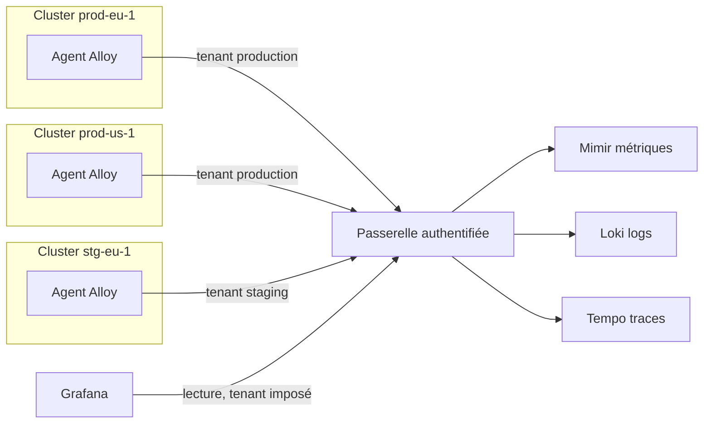


# Observabilité multi-environnement et multi-cluster

## Objectifs pédagogiques

À la fin de ce module, vous serez capable de :

- **Définir** un contrat de labels (`environment`, `cluster`, `region`, `service`) et **choisir** où chaque label est posé dans la chaîne de collecte.
- **Concevoir** une architecture multi-cluster Kubernetes avec des agents par cluster, un backend central et une isolation par tenant.
- **Construire** des dashboards réutilisables entre environnements grâce aux variables et à des data sources provisionnées avec des `uid` stables.
- **Séparer** les données et les droits d'accès entre environnements, en connaissant les limites de Grafana OSS.
- **Détecter** et **corriger** les agrégations qui effacent les dimensions et masquent un problème localisé.

## Mise en situation

Imaginez une plateforme e-commerce exploitée par une équipe de six personnes. Elle tourne sur cinq clusters Kubernetes : deux de production (Europe et États-Unis), un de pré-production, un de staging et un de développement. Chaque cluster a son Prometheus et son Loki, et une seule instance Grafana les interroge tous.

Au départ, tout allait bien. Quelqu'un a construit un dashboard « API Overview » pour le cluster européen. Pour le cluster américain, il l'a dupliqué et a remplacé la data source. Puis il a fait pareil pour le staging, et le dashboard existe maintenant en cinq exemplaires qui ne sont plus tout à fait identiques.

Un jeudi, un dashboard « global » censé tout résumer affiche 0,5 % d'erreurs sur l'API. Pourtant, des clients américains se plaignent depuis une heure. Personne ne remarque rien, parce que la région en difficulté pèse peu dans la moyenne. Et le jour où le cluster de staging a été renommé, trois dashboards sont devenus muets sans que personne s'en aperçoive.

La duplication ne tient plus. Chaque nouveau cluster multiplie le travail de maintenance, et chaque agrégation globale risque de cacher exactement ce qu'on cherche. Il faut une façon systématique de dire d'où vient chaque donnée, et des dashboards qui s'adaptent à ces dimensions au lieu d'être recopiés.

## Une dimension de plus dans chaque requête

Sur un seul cluster, `http_requests_total{service="checkout"}` suffit pour identifier une série. Dès qu'il y a plusieurs clusters, la même métrique existe plusieurs fois, avec les mêmes noms de service et les mêmes valeurs possibles de `status`. La seule chose qui les distingue est la réponse à la question « où ? ».

> 📮 **Analogie : l'adresse postale**
>
> « 12 rue de la Paix » ne dit rien tant qu'on n'a pas la ville et le pays. Les labels `environment`, `cluster` et `region` jouent ce rôle pour vos séries temporelles. Sans eux, soit vous confondez des données qui n'ont rien à voir, soit vous êtes incapable de les retrouver.
{: .callout .callout-analogie}

Ce module repose donc sur une idée simple : **les dimensions d'infrastructure sont un contrat**, posé à la collecte et respecté par tous les signaux. Les dashboards, les alertes et les permissions s'appuient ensuite dessus. Si le contrat est flou, rien ne marche correctement, quelle que soit la qualité des dashboards.

## Le contrat de labels

> 🧠 **Concept clé**
>
> Quatre labels répondent à quatre questions différentes, et chacun doit signifier la même chose partout (métriques, logs, traces, alertes).
{: .callout .callout-important}

| Label | Question à laquelle il répond | Exemples de valeurs | Règle |
|-------|-------------------------------|---------------------|-------|
| `environment` | Quel niveau de criticité ? | `production`, `staging`, `dev` | Liste fermée, courte, en minuscules |
| `cluster` | Quel cluster précisément ? | `prod-eu-1`, `prod-us-1`, `stg-eu-1` | Unique globalement, jamais réutilisé après suppression |
| `region` | Quelle zone géographique ou fournisseur ? | `eu-west-1`, `us-east-1` | Nom du fournisseur cloud, tel quel |
| `service` | Quel composant logique applicatif ? | `checkout`, `catalog`, `auth` | Même valeur dans les métriques, les logs et les traces |

Deux précisions évitent des débats interminables :

- **`service` n'est ni `job`, ni `namespace`, ni `app`.** `job` décrit comment Prometheus scrape une cible, `namespace` est un découpage Kubernetes. `service` est le nom que votre équipe donne au composant dans les conversations d'incident.
- **Ce contrat ne contient que des valeurs à faible cardinalité.** Ne mettez pas ici la version de l'image ni le nom du pod : vous avez vu au module précédent ce que ça coûte.

Si votre instrumentation passe par OpenTelemetry, ces labels correspondent à des attributs de ressource : `service.name`, `k8s.cluster.name`, `cloud.region` et `deployment.environment` (renommé `deployment.environment.name` dans les versions récentes des conventions). Le mapping vers les noms de labels Prometheus et Loki doit être fait explicitement dans le collecteur. Il ne se fait pas tout seul de façon uniforme.

### Où chaque label est posé

C'est ce point qui fait la différence entre un contrat qui tient et un contrat qui s'érode. Il y a trois endroits où une dimension peut être attachée à une donnée.

1. **Au scrape, par relabeling.** C'est le bon endroit pour `service` et `namespace`, qui varient d'un workload à l'autre au sein d'un même cluster.
2. **À l'export, par `external_labels`.** C'est le bon endroit pour `environment`, `cluster` et `region`, qui sont constants pour tout un cluster. Vous les configurez une seule fois par agent.
3. **Dans l'en-tête de tenant**, quand le backend est multi-tenant. Ce n'est pas un label, mais il détermine dans quel « compartiment » les données atterrissent.

Voici ce que ça donne avec Prometheus :

```yaml
global:
  external_labels:
    environment: production
    cluster: prod-eu-1
    region: eu-west-1

remote_write:
  - url: https://obs-gw.example.internal/api/v1/push
    headers:
      X-Scope-OrgID: production

scrape_configs:
  - job_name: kubernetes-pods
    kubernetes_sd_configs:
      - role: pod
    relabel_configs:
      - source_labels: [__meta_kubernetes_pod_label_app_kubernetes_io_name]
        target_label: service
```

Et la même intention avec Grafana Alloy :

```alloy
prometheus.remote_write "central" {
  endpoint {
    url     = "https://obs-gw.example.internal/api/v1/push"
    headers = { "X-Scope-OrgID" = "production" }
  }
  external_labels = {
    environment = "production",
    cluster     = "prod-eu-1",
    region      = "eu-west-1",
  }
}
```

Dans une vraie configuration, il faut ajouter l'authentification (clé, jeton ou certificat client) vers la passerelle. J'y reviens plus bas.

> ⚠️ **Erreur fréquente**
>
> Croire que `external_labels` modifie les séries stockées dans le Prometheus local. Ces labels sont ajoutés quand les données sortent (remote write, fédération, alertes). Ils n'apparaissent donc pas si vous interrogez directement le Prometheus du cluster. Et si une série porte déjà un label du même nom, celui d'origine est conservé. Un exporter qui expose son propre label `cluster` (certaines bases de données le font) se retrouve alors avec une valeur qui n'est pas celle de votre contrat. Quand vous rencontrez ce cas, renommez le label à la source, avant l'export.
{: .callout .callout-attention}

Pour les logs, `loki.write` accepte aussi un argument `external_labels`. Pour les traces, il n'y a pas de label externe : vous passez par les attributs de ressource, posés dans le collecteur.

## Architecture de référence

Le principe est de laisser chaque cluster collecter localement et de pousser vers un point central, par une passerelle qui authentifie. Grafana ne fait que lire.



| Composant | Rôle | Exemple |
|-----------|------|---------|
| Agent de collecte | Scrape local, pose les labels, pousse vers le centre | Grafana Alloy, Prometheus en mode agent |
| Passerelle | Authentifie l'appelant et fixe le tenant selon son identité | Reverse proxy avec mTLS (mutual TLS), jeton par cluster |
| Backend multi-tenant | Stocke chaque tenant séparément | Mimir, Loki, Tempo |
| Data sources Grafana | Une par tenant, avec l'en-tête de tenant correspondant | `mimir-production`, `mimir-staging` |
| Dashboards | Génériques, pilotés par des variables | Dossiers provisionnés |

L'agent par cluster a un avantage concret : si le lien réseau vers le centre tombe, l'agent met les données en tampon (WAL) pendant un moment et les renvoie au retour du lien. En revanche, un agent pur (Alloy, ou Prometheus en mode agent) n'offre ni stockage ni API de requête locale. Pour garder un diagnostic de secours dans le cluster, il faut un Prometheus classique avec une rétention locale.

## Topologie multi-cluster : où centraliser, où laisser sur place

Il existe trois grandes manières de relier plusieurs clusters à Grafana. Aucune n'est universellement meilleure.

| Critère | Grafana interroge chaque Prometheus | Backend central par remote write | Fédération Prometheus hiérarchique |
|---------|-------------------------------------|----------------------------------|-------------------------------------|
| Requête qui couvre plusieurs clusters | Impossible en une seule requête, il faut le panel Mixed | Naturelle, une seule requête | Possible mais sur des séries pré-agrégées |
| Résilience si le centre tombe | Chaque cluster reste lisible | Perte de vue globale, collecte locale préservée | Dépend du Prometheus parent |
| Exposition réseau | Chaque Prometheus doit être joignable depuis Grafana | Un seul point d'entrée, les clusters sortent vers lui | Le parent scrape les enfants |
| Rétention longue | Limitée à celle de chaque Prometheus | Gérée au centre | Limitée, données agrégées |
| Charge d'exploitation | Faible au départ, croît avec les clusters | Un backend à dimensionner et à surveiller | Moyenne, config de fédération à maintenir |

Pour un parc de deux ou trois clusters, interroger les Prometheus directement est tout à fait défendable : c'est simple et ça ne demande aucun nouveau composant. La bascule vers un backend central devient pertinente quand trois besoins apparaissent : comparer des clusters dans une même requête, garder un historique long, ou ne plus exposer chaque cluster au réseau de supervision.

Le modèle central a aussi des limites :

- **Il concentre le risque.** Il faut donc le dimensionner et le superviser lui-même (c'est l'objet du meta-monitoring vu précédemment).
- **Les requêtes cross-région coûtent en latence et en transfert.** Placez le backend près de là où les utilisateurs le consultent.
- **Certaines données ne doivent pas quitter leur région**, pour des raisons contractuelles ou réglementaires. Dans ce cas, gardez un backend par région et faites du fédéré côté Grafana, ou créez un tenant régional.

La fédération Prometheus classique (`/federate`) a un rôle plus étroit : remonter quelques séries agrégées vers un Prometheus de synthèse. Elle convient mal à un transfert complet des données.

## Isoler les données : tenants, data sources, permissions

### Un tenant, c'est un compartiment dans le backend

Mimir, Loki et Tempo savent séparer les données par tenant.

> 📖 **Définition**
>
> Un tenant est un compartiment de données du backend. Il est identifié par l'en-tête `X-Scope-OrgID` de chaque requête, en écriture comme en lecture. Deux tenants ne voient pas les données l'un de l'autre, et on peut leur appliquer des limites différentes.
{: .callout .callout-definition}

> ⚠️ **Erreur fréquente**
>
> Prendre cet en-tête pour de l'authentification. Le backend lui fait confiance tel quel. Toute personne capable d'atteindre le backend peut écrire `X-Scope-OrgID: production` et lire la production. L'authentification doit être faite en amont, par la passerelle (mTLS, jeton), qui impose la valeur du tenant selon l'identité de l'appelant. Autre piège de même nature : avec `auth_enabled: false` dans Loki, tout tombe dans un tenant unique (nommé `fake`) et l'isolation disparaît.
{: .callout .callout-attention}

Le choix de ce que représente un tenant se pose vite. Un tenant par environnement (`production`, `staging`) est le découpage le plus lisible et il suffit à beaucoup d'équipes. Un tenant par équipe ou par produit devient utile quand des équipes doivent être étanches entre elles, et il se combine bien avec les environnements (`checkout-prod`, `checkout-stg`). Évitez en revanche un tenant par cluster : vous perdriez l'intérêt d'une requête qui couvre plusieurs clusters.

Mimir et Loki savent aussi interroger plusieurs tenants dans une même requête (en passant par exemple `production|staging` dans l'en-tête), à condition d'activer la fonction côté backend. Les données reviennent avec un label synthétique indiquant le tenant d'origine. C'est précieux pour une vue transverse réservée à l'équipe plateforme, mais vérifiez le comportement dans votre version.

### Une data source par tenant

Côté Grafana, chaque tenant a sa data source, et on la provisionne avec un `uid` explicite :

```yaml
apiVersion: 1
datasources:
  - name: mimir-production
    uid: mimir-production
    type: prometheus
    access: proxy
    url: https://obs-gw.example.internal/prometheus
    jsonData:
      httpHeaderName1: X-Scope-OrgID
    secureJsonData:
      httpHeaderValue1: production
```

L'`uid` stable est ce qui permet aux dashboards d'être portables : ils référencent la data source par cet identifiant, qui est le même dans toutes les instances Grafana, plutôt que par un nom ou un identifiant numérique propre à une installation.

### Qui a le droit d'interroger quoi

C'est le point où Grafana OSS surprend. Un dossier de dashboards se protège avec des permissions, mais **une data source ne se protège pas de la même façon**. En OSS, un utilisateur membre d'une organisation peut généralement interroger les data sources de cette organisation via l'API, même s'il ne voit pas le dashboard qui les utilise. Les permissions fines par data source sont une fonction Enterprise et Grafana Cloud (vérifiez selon votre version).

En OSS, vous avez donc deux leviers :

- **Les organisations Grafana**, qui séparent utilisateurs, dossiers et data sources. C'est étanche mais ça multiplie les objets à maintenir.
- **Une instance Grafana par périmètre sensible**, plus lourde, mais plus simple à raisonner.

Quel que soit le choix, la vraie ligne de défense reste au niveau du backend : le tenant et la passerelle. Si l'équipe de staging n'a pas besoin de voir la production, ne lui donnez pas une data source qui y mène.

## Dashboards réutilisables entre environnements

L'objectif est un seul dashboard « API Overview » qui fonctionne partout. La mécanique tient dans quelques variables chaînées, qui se filtrent les unes les autres :

| Variable | Type | Requête |
|----------|------|---------|
| `ds` | Data source (prometheus) | Filtre par regex, par exemple `/mimir-.*/` |
| `environment` | Query | `label_values(up, environment)` |
| `cluster` | Query, multi-valeur | `label_values(up{environment=~"$environment"}, cluster)` |
| `service` | Query | `label_values(http_requests_total{environment=~"$environment", cluster=~"$cluster"}, service)` |

Les requêtes des panels utilisent ensuite ces variables avec l'opérateur `=~`, pour supporter les sélections multiples :

```promql
sum by (environment, cluster) (
  rate(http_requests_total{environment=~"$environment", cluster=~"$cluster", service=~"$service"}[5m])
)
```

Le `by (environment, cluster)` n'est pas décoratif. Il fait que le panel affiche une courbe par cluster, au lieu d'un total qui ne dirait rien sur l'origine. Un dashboard multi-cluster doit montrer ses dimensions par défaut, puis laisser l'utilisateur filtrer.

> 💡 **Astuce**
>
> Dans le champ *Legend* du panel, utilisez `{{environment}} / {{cluster}}`. Ça évite d'avoir à survoler chaque courbe pour savoir de quoi on parle.
{: .callout .callout-astuce}

La variable `ds` sert quand vous avez plusieurs data sources, une par tenant. Les panels référencent alors `${ds}` comme `uid`, et l'utilisateur change d'environnement sans toucher au dashboard. Si un backend central expose tout dans un seul tenant, vous n'en avez pas besoin. Le menu exact pour paramétrer ces variables dépend de la version de Grafana, mais les types (Query, Data source) existent depuis longtemps.

Deux détails qui font gagner du temps :

- Avec l'option *Include All*, Grafana génère par défaut une regex qui énumère toutes les valeurs. Sur beaucoup de clusters elle devient longue, donc définissez une valeur personnalisée pour « All » (par exemple `.+`).
- Quand une variable dépend d'une autre, une valeur obsolète dans l'URL peut produire un dashboard vide. Si la liste `cluster` est vide après un changement d'environnement, c'est le premier endroit où regarder.

## Corréler régions et services

Une fois les dimensions propres, elles servent de fil conducteur entre les signaux. Prenons un exemple : le taux d'erreurs de `checkout` monte. Vous ajoutez `by (region)` à votre requête.

- Si seule `eu-west-1` dégrade, cherchez du côté d'une dépendance régionale : base de données, réseau, fournisseur.
- Si toutes les régions bougent en même temps, regardez plutôt un déploiement ou une dépendance globale.

Cette bifurcation n'est possible que parce que `region` est présent partout.

> 💡 **À retenir**
>
> Pour passer d'un signal à l'autre, les mêmes valeurs de labels doivent exister des deux côtés.
{: .callout .callout-important}

Une requête de logs `{service="checkout", cluster="prod-eu-1"}` ne trouve rien si votre Loki étiquette ce service `app` ou `service_name` avec une autre valeur. Le travail de normalisation se fait donc dans le collecteur, une fois pour toutes.

Côté Grafana, vous disposez de plusieurs mécanismes, dont l'interface varie selon la version :

- Les **data links** d'un panel, qui ouvrent Explore sur Loki avec le contexte courant. La variable `${__field.labels.cluster}` y récupère le cluster de la série cliquée.
- La fonction **Correlations**, qui relie deux data sources de façon déclarative.
- Les **derived fields** de Loki, qui transforment un identifiant trouvé dans une ligne de log en lien vers Tempo.
- Le split d'Explore, pour comparer deux régions côte à côte.

Le diagnostic complet d'un flux qui traverse plusieurs services est l'objet du module suivant. Retenez ici seulement la condition d'entrée : des labels cohérents.

## Comparer staging et production sans se mentir

Comparer deux environnements est utile pour détecter une régression avant une promotion. Mais les deux environnements ne vivent pas dans les mêmes conditions, et c'est là que les erreurs d'interprétation arrivent. Le staging reçoit peu de trafic, donc un p99 y est bruité. Son jeu de données est souvent plus petit et sa configuration diffère, par exemple sur le nombre de réplicas ou les quotas.

Quelques règles pour que la comparaison ait un sens :

- **Comparez des ratios, jamais des volumes.** Un taux d'erreurs ou une latence se comparent. Un nombre de requêtes par seconde, non.
- **Gardez la dimension `environment` dans la requête** avec `sum by (environment)`, plutôt que de lancer deux requêtes indépendantes dont les labels divergent.
- **Prévoyez une charge synthétique** en staging, sinon les percentiles ne signifient rien.
- **Utilisez `offset` ou le time shift du panel** pour comparer avec la même heure de la semaine précédente, ce qui isole l'effet d'un changement de celui du rythme quotidien.

Le montage le plus pratique est un dashboard avec deux variables, `ref` et `cmp`, qui pointent sur deux valeurs d'`environment`. Une requête affiche `{environment="$ref"}` et l'autre `{environment="$cmp"}`, côte à côte dans des panels symétriques. Cela suppose que les deux environnements soient lisibles depuis un même point (backend central, ou panel Mixed si les data sources sont séparées).

## ⚠️ Agréger plusieurs environnements sans préserver leurs dimensions

C'est le piège principal de ce module. Une requête qui fait `sum(...)` sans `by` sur des séries de plusieurs environnements calcule un nombre correct mathématiquement, mais qui ne répond à aucune question utile.

Voici des chiffres illustratifs :

| Environnement | Requêtes/s | Taux d'erreurs | Erreurs/s |
|---------------|-----------:|---------------:|----------:|
| prod-eu-1 | 1000 | 0,2 % | 2 |
| prod-us-1 | 50 | 8 % | 4 |
| stg-eu-1 | 100 | 0 % | 0 |

La requête suivante :

```promql
sum(rate(http_requests_total{code=~"5.."}[5m]))
/
sum(rate(http_requests_total[5m]))
```

donne 6 / 1150, soit environ 0,52 %. Avec un seuil d'alerte à 1 %, rien ne sonne alors que les États-Unis sont à 8 %. Le trafic du cluster sain et celui du staging ont dilué le signal.

L'erreur inverse existe aussi. Faire `avg()` des trois ratios donne environ 2,7 %, ce qui est trompeur dans l'autre sens : le petit cluster pèse autant que le gros.

La correction consiste à calculer le ratio là où il a un sens, c'est-à-dire par dimension :

```promql
sum by (environment, cluster, service) (rate(http_requests_total{code=~"5.."}[5m]))
/
sum by (environment, cluster, service) (rate(http_requests_total[5m]))
```

Les deux côtés portent le même ensemble de labels, donc la division associe bien chaque cluster à lui-même. Sur ces données, `prod-us-1` ressort à 8 % et déclenche l'alerte.

> 💡 **Astuce**
>
> Préférez `sum without (pod, instance)` à `sum by (...)` quand vous voulez conserver tout sauf quelques labels bruyants. Avec `by`, le jour où quelqu'un ajoute un label utile (`tier`, `team`), il disparaît silencieusement. Avec `without`, il reste.
{: .callout .callout-astuce}

Le même raisonnement s'applique aux alertes. Dans une règle Grafana Alerting dont la requête renvoie plusieurs séries, chaque combinaison de labels devient une instance d'alerte séparée. Garder `environment` et `cluster` dans la requête permet ensuite à la politique de notification de router sur `environment = production` vers l'astreinte et sur `environment = staging` vers un canal de discussion. Si vous les avez perdus à l'agrégation, vous n'avez plus rien à quoi accrocher le routage, et le message d'alerte ne dit pas où regarder.

## Construction progressive

**V1 : un Prometheus par cluster, Grafana les lit directement.** C'est le point de départ de la plupart des équipes, et il est raisonnable. Chaque cluster a une data source, les dashboards sont recopiés. On ajoute déjà `external_labels` pour `cluster` et `environment`, même si personne n'en a encore besoin. Ça coûte presque rien et ça évite de tout reprendre plus tard.

**V2 : contrat de labels et dashboards génériques.** Le saut se justifie dès que la duplication de dashboards devient pénible, ou qu'un incident a montré qu'une vue globale manquait. On écrit le contrat de labels, on normalise `service` entre métriques et logs, on introduit les variables `environment`, `cluster` et `service`, et on remplace les copies de dashboards par un seul dashboard paramétré. Si besoin, on passe à un backend central par remote write pour pouvoir interroger plusieurs clusters dans une même requête.

**V3 : multi-tenant, passerelle, provisioning.** Ce palier est nécessaire quand des équipes ou des environnements doivent être étanches. On sépare les tenants, on place une passerelle authentifiante devant les backends, on provisionne les data sources avec des `uid` stables et on route les alertes sur les labels. On ajoute un contrôle de cohérence dans le pipeline de livraison : rejeter un dashboard qui contient un nom de cluster ou un `uid` de data source en dur.

Chaque saut répond à une douleur précise. N'installez pas la V3 si la V1 vous suffit : une passerelle et des tenants en trop sont autant de composants à surveiller.

## Diagnostic et erreurs fréquentes

**Les courbes sont deux fois trop hautes, ou des échantillons sont rejetés.**
Cause probable : deux réplicas Prometheus d'une paire redondante envoient les mêmes séries sans label qui les distingue, ou deux clusters portent le même nom `cluster`. Correction : rendez le nom de cluster unique, et traitez la déduplication des réplicas explicitement. Dans Mimir, le suivi de réplicas utilise par défaut un label appelé `cluster` (réglable), donc alignez sa configuration avec votre contrat avant de l'activer.

**Un panel est vide pour un cluster, correct pour les autres.**
Cause : l'agent de ce cluster n'a pas les bons `external_labels`, ou il pousse vers le mauvais tenant. Dans Explore, lancez `count by (environment, cluster) (up)` : si le cluster manque, ou apparaît avec un `environment` inattendu, vous avez la réponse.

**La variable `cluster` est vide.**
Cause : la requête de la variable filtre sur une métrique qui n'existe pas dans cet environnement, ou sur une valeur d'`environment` obsolète. Correction : basez les variables sur `up`, qui existe partout, et vérifiez la chaîne de dépendance entre variables.

**Les logs et les métriques d'un service ne se rejoignent pas.**
Cause : le même service s'appelle `checkout` dans Prometheus, `app=checkout-api` dans Loki, `service_name` ailleurs. Correction : normalisez dans le collecteur et ne contournez jamais le problème par des regex dans les dashboards.

**Un utilisateur de l'équipe staging voit des données de production.**
Cause : la data source de production est accessible à toute l'organisation. Correction : retirez l'accès (permissions de data source si votre licence les offre, sinon organisation ou instance dédiée) et, surtout, vérifiez que le backend n'accepte pas n'importe quel en-tête de tenant.

**Un cluster a cessé d'envoyer des données et personne ne s'en est rendu compte.**
Cause : une série qui disparaît ne fait pas apparaître d'erreur, elle s'arrête simplement. Correction : comparez ce qui existait il y a un instant à ce qui existe maintenant.

```promql
count by (cluster) (up offset 15m) unless count by (cluster) (up)
```

Cette requête renvoie les clusters qui reportaient il y a quinze minutes et ne reportent plus. Utilisez-la comme règle d'alerte, et configurez le traitement des états `No Data` et `Error` comme vous l'avez vu pour l'alerting.

## Scénario illustratif : de cinq dashboards copiés à un seul

*Les chiffres ci-dessous sont fictifs : ils servent à montrer la logique, pas à promettre un résultat.*

Reprenons l'équipe du début. Elle fait l'inventaire et constate que son dashboard principal existe en cinq versions, avec trois noms différents pour le même label de service. Elle procède en quatre temps.

1. **Contrat.** Une page d'une demi-journée fixe les valeurs autorisées d'`environment`, une convention de nommage pour `cluster` (`<env>-<région>-<n>`) et la règle « un seul nom de `service` par composant ».
2. **Collecte.** Les agents sont mis à jour pour poser `environment`, `cluster` et `region` à l'export, et le relabeling aligne `service` entre métriques et logs. Une vérification `count by (environment, cluster) (up)` valide les cinq clusters.
3. **Isolation.** Deux tenants sont créés, `production` et `staging`, derrière une passerelle. Les data sources sont provisionnées avec des `uid` explicites, et le dev partage celle de staging.
4. **Dashboards.** Les cinq copies sont remplacées par un dashboard paramétré. La règle d'alerte sur le taux d'erreurs est réécrite avec `sum by (environment, cluster, service)`, et le routage se fait sur `environment`.

Dans ce scénario, l'équipe remplace les cinq copies divergentes par un seul dashboard paramétré. Le temps pour dire « le problème est sur tel cluster » passe d'une vingtaine de minutes à quelques minutes. L'alerte sur les États-Unis se déclenche au bout de quelques minutes au lieu d'attendre qu'un client appelle. Et le staging n'envoie plus de notifications à l'astreinte.

## Bonnes pratiques

1. **Faites respecter le contrat de labels à l'entrée, pas dans les dashboards.** Normalisez dans l'agent. Un dashboard qui contourne un label mal nommé masque le problème pour les prochains.
2. **Gardez `cluster` unique à vie.** Quand un cluster est recréé, donnez-lui un nouveau nom. Réutiliser l'ancien mélange deux historiques dans les mêmes séries.
3. **Provisionnez les data sources avec des `uid` stables.** Les dashboards deviennent portables et un renommage dans l'interface ne les casse plus.
4. **Traitez l'en-tête de tenant comme une adresse, pas comme un mot de passe.** L'authentification se fait à la passerelle (mTLS, jeton par cluster), qui fixe elle-même le tenant.
5. **Ne perdez jamais une dimension par accident.** Écrivez `by` ou `without` explicitement dans chaque agrégation, et vérifiez dans les alertes que `environment` et `cluster` survivent jusqu'à la notification.
6. **Surveillez la présence de chaque cluster.** Une alerte sur la disparition d'un cluster (voir plus haut) coûte une règle et évite un silence long.
7. **Routez les alertes sur les labels, pas sur des listes de noms.** Une politique `environment = production` couvre automatiquement le prochain cluster ajouté.
8. **Contrôlez les dashboards dans le pipeline de livraison.** Refusez tout dashboard avec un nom de cluster ou une data source codés en dur. C'est ce qui empêche le retour des copies.

## Résumé

Dès qu'une plateforme compte plusieurs clusters et environnements, la même métrique existe plusieurs fois et le « où ? » doit être explicite. Le contrat de labels (`environment`, `cluster`, `region`, `service`) est la fondation : posé par les agents à la collecte, cohérent entre métriques, logs et traces, il rend possibles les dashboards génériques, le routage des alertes et la corrélation. L'architecture de référence place un agent par cluster, une passerelle authentifiante et un backend multi-tenant, avec une data source Grafana par tenant. Les permissions réelles se jouent au niveau du backend, car Grafana OSS ne protège pas finement les data sources. Le danger principal reste l'agrégation qui efface les dimensions et dilue un incident localisé. La suite logique est d'utiliser ces dimensions propres pour suivre un flux qui traverse plusieurs services, ce qui fait l'objet du prochain module.

<!-- snippet
id: grafana_multienv_label_contract
type: concept
tech: grafana
level: advanced
importance: high
format: knowledge
tags: labels,multi-cluster,observabilite,standardisation
title: Le contrat de labels multi-environnement
content: Quatre labels, quatre questions. environment = niveau de criticité (liste fermée : production, staging, dev). cluster = cluster précis, unique globalement et jamais réutilisé (prod-eu-1). region = zone du fournisseur cloud (eu-west-1). service = composant logique, avec la même valeur dans métriques, logs et traces. Pas de version ni de pod dans ce contrat : ces valeurs font exploser la cardinalité.
description: Définir une fois quatre labels à valeurs contrôlées permet de filtrer, router les alertes et corréler les signaux sans regex de rattrapage.
-->

<!-- snippet
id: grafana_multienv_external_labels
type: concept
tech: prometheus
level: advanced
importance: high
format: knowledge
tags: external_labels,remote_write,labels,multi-cluster
title: Comment fonctionnent les external_labels
content: Les external_labels de Prometheus (ou de prometheus.remote_write dans Alloy) sont ajoutés quand les données sortent : remote write, fédération, alertes. Ils ne sont pas visibles en interrogeant le Prometheus local. Si une série porte déjà un label du même nom, il n'est pas écrasé. C'est le bon endroit pour environment, cluster et region, constants pour tout un cluster. service se pose par relabeling au scrape.
description: Les external_labels n'apparaissent qu'à l'export et ne remplacent jamais un label existant sur la série, ce qui explique des valeurs de cluster inattendues.
-->

<!-- snippet
id: grafana_multienv_count_up_by_cluster
type: command
tech: promql
level: intermediate
importance: high
format: knowledge
tags: promql,multi-cluster,verification,labels
title: Lister les clusters qui remontent des données
context: À lancer dans Explore sur la data source centrale après l'ajout ou la modification d'un agent
command: count by (environment, cluster, region) (up)
description: Révèle immédiatement un cluster absent, un environment erroné ou un label region manquant dans les données reçues.
-->

<!-- snippet
id: grafana_multienv_cluster_disappeared
type: command
tech: promql
level: advanced
importance: high
format: knowledge
tags: promql,alerting,multi-cluster,no-data
title: Détecter un cluster qui a cessé d'envoyer
context: Utilisable comme requête d'une règle d'alerte Grafana
command: count by (cluster) (up offset 15m) unless count by (cluster) (up)
description: Renvoie les clusters présents il y a 15 minutes mais absents maintenant. Une série qui s'arrête ne génère aucune erreur, d'où ce motif.
-->

<!-- snippet
id: grafana_multienv_list_cluster_values
type: command
tech: mimir
level: advanced
importance: medium
format: knowledge
tags: mimir,tenant,api,labels
title: Lister les valeurs de cluster d'un tenant
context: Accès interne de diagnostic au backend, hors passerelle (via la passerelle, c'est l'authentification qui fixe le tenant, pas l'en-tête)
command: curl -s -H "X-Scope-OrgID: <TENANT>" http://<BACKEND>/prometheus/api/v1/label/cluster/values
example: curl -s -H "X-Scope-OrgID: production" http://mimir.monitoring.svc:8080/prometheus/api/v1/label/cluster/values
description: Interroge directement l'API de valeurs de label du tenant pour confirmer quels clusters y écrivent. Le préfixe /prometheus dépend de la configuration du backend.
-->

<!-- snippet
id: grafana_multienv_sum_without_dimensions
type: warning
tech: promql
level: advanced
importance: high
format: knowledge
tags: promql,agregation,alerting,multi-cluster
title: sum() sans by dilue un incident localisé
content: Piège : un sum() global sur plusieurs environnements. Conséquence : un cluster à 8 % d'erreurs avec peu de trafic se noie dans le volume des autres (exemple : 6 erreurs/s sur 1150 req/s = 0,52 %, sous un seuil de 1 %) et aucune alerte ne part. Correction : calculer le ratio par dimension avec sum by (environment, cluster, service) au numérateur et au dénominateur.
description: Agréger sans conserver environment et cluster masque les problèmes localisés et supprime les labels nécessaires au routage des alertes.
-->

<!-- snippet
id: grafana_multienv_without_vs_by
type: tip
tech: promql
level: advanced
importance: medium
format: knowledge
tags: promql,agregation,labels
title: Préférer sum without à sum by pour garder les labels
content: Remplacer sum by (environment, cluster) (...) par sum without (pod, instance) (...) quand vous voulez supprimer seulement les labels bruyants. Avec by, tout label ajouté plus tard (tier, team) disparaît silencieusement de l'agrégat. Avec without, il reste disponible pour les filtres et le routage.
description: without exclut une liste de labels et conserve les autres, ce qui évite de perdre une dimension ajoutée après coup.
-->

<!-- snippet
id: grafana_multienv_tenant_header_not_auth
type: concept
tech: mimir
level: advanced
importance: high
format: knowledge
tags: multi-tenant,securite,mimir,loki
title: X-Scope-OrgID n'est pas de l'authentification
content: Mimir, Loki et Tempo lisent le tenant dans l'en-tête X-Scope-OrgID et lui font confiance tel quel. Toute personne qui atteint le backend peut écrire la valeur de son choix et lire ce tenant. L'isolation réelle exige une passerelle devant le backend (mTLS ou jeton par cluster) qui fixe elle-même le tenant. Avec auth_enabled à false dans Loki, tout tombe dans un tenant unique.
description: Le tenant désigne un compartiment, il ne prouve pas l'identité. Sans passerelle qui authentifie, l'isolation entre environnements n'existe pas.
-->

<!-- snippet
id: grafana_multienv_datasource_org_wide
type: warning
tech: grafana
level: advanced
importance: high
format: knowledge
tags: permissions,datasource,securite,oss
title: En OSS, une data source est ouverte à toute l'organisation
content: Piège : protéger un dossier de dashboards et croire que la data source est protégée. Conséquence : un utilisateur de l'organisation peut interroger la production via l'API ou Explore. Correction : activer les permissions de data source (Enterprise ou Cloud, à vérifier selon la version), ou séparer par organisation ou par instance Grafana, et limiter le tenant au niveau du backend.
description: Les permissions de dossier ne couvrent pas les requêtes aux data sources. L'isolation en OSS passe par les organisations, les instances ou le backend.
-->

<!-- snippet
id: grafana_multienv_duplicate_cluster_name
type: error
tech: prometheus
level: advanced
importance: medium
format: knowledge
tags: labels,cluster,mimir,doublons
title: Courbes doublées ou échantillons rejetés
content: Symptôme : valeurs deux fois trop hautes ou rejets à l'ingestion. Cause : deux clusters (ou deux réplicas Prometheus d'une paire redondante) émettent les mêmes séries avec le même label cluster. Correction : donner à chaque cluster un nom unique pour toujours, et traiter la déduplication des réplicas séparément. Dans Mimir, le suivi de réplicas utilise par défaut un label nommé cluster, à aligner avec votre contrat.
description: Un nom de cluster réutilisé fusionne deux historiques dans les mêmes séries. La déduplication de réplicas ne doit pas entrer en conflit avec le label cluster.
-->

<!-- snippet
id: grafana_multienv_service_name_mismatch
type: error
tech: loki
level: advanced
importance: medium
format: knowledge
tags: loki,labels,correlation,service
title: Logs et métriques ne se rejoignent pas
content: Symptôme : le lien d'un panel vers Loki ne renvoie rien alors que le service est actif. Cause : le même composant s'appelle checkout dans Prometheus, app=checkout-api ou service_name dans Loki. Correction : normaliser le label service dans le collecteur (relabeling ou attributs de ressource OpenTelemetry), pas par des regex dans les requêtes des dashboards.
description: La corrélation entre signaux suppose des valeurs de labels identiques des deux côtés. Normalisez à la collecte plutôt que dans chaque dashboard.
-->

<!-- snippet
id: grafana_multienv_datasource_uid
type: tip
tech: grafana
level: advanced
importance: medium
format: knowledge
tags: provisioning,datasource,dashboards,uid
title: Fixer l'uid des data sources provisionnées
content: Dans le fichier de provisioning, ajouter uid: mimir-production à chaque data source. Les dashboards la référencent par cet uid (ou par ${ds} via une variable de type Data source filtrée par regex /mimir-.*/). Résultat : le même JSON de dashboard fonctionne dans toutes les instances Grafana, sans identifiant numérique propre à chacune.
description: Un uid explicite rend les dashboards portables entre instances et évite qu'ils cassent quand quelqu'un renomme la data source dans l'interface.
-->

<!-- snippet
id: grafana_multienv_compare_ratios
type: tip
tech: grafana
level: advanced
importance: medium
format: knowledge
tags: staging,production,comparaison,promql
title: Comparer staging et production en ratios
content: Créer un dashboard avec deux variables ref et cmp (valeurs d'environment) et des panels symétriques utilisant {environment="$ref"} et {environment="$cmp"}. Comparer des taux d'erreurs et des latences, jamais des débits absolus. Ajouter un time shift de 1 semaine pour comparer à la même heure. Prévoir une charge synthétique en staging, sinon un p99 sur quelques requêtes ne signifie rien. Les deux environnements doivent être lisibles depuis une même data source, sinon il faut un panel Mixed.
description: Staging et production n'ont pas le même trafic. Seuls les ratios, comparés à charge comparable, permettent de conclure à une régression.
-->

