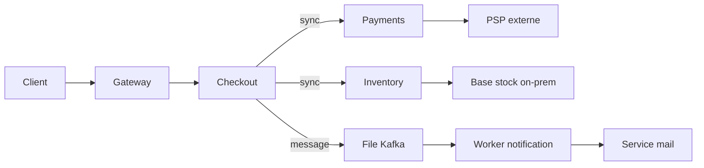
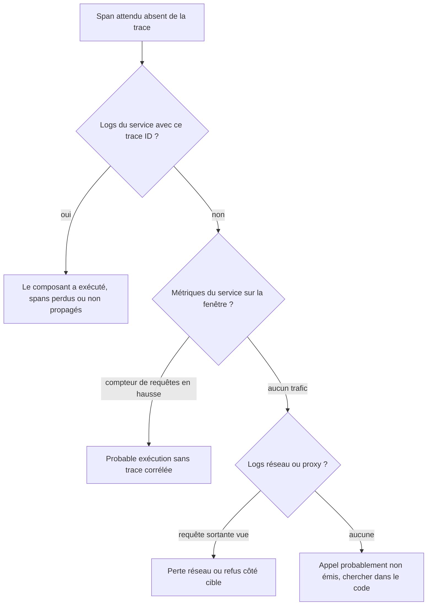

# Observabilité des architectures distribuées

## Objectifs pédagogiques

À la fin de ce module, vous saurez :

- **Reconstituer** le parcours d'une requête à travers plusieurs services, synchrones et asynchrones, à partir d'une trace.
- **Corréler** un trace ID avec les logs et les métriques dans Grafana, dans les deux sens.
- **Distinguer** une panne réseau, une dépendance lente et une erreur applicative qui se propage.
- **Conduire** l'analyse d'une dégradation partielle sans se laisser tromper par les moyennes.
- **Évaluer** ce qu'une trace incomplète prouve et ce qu'elle ne prouve pas, puis recouper avec d'autres sources.

## Mise en situation

Vous êtes SRE dans une équipe de quatre personnes qui accompagne une plateforme e-commerce : une quinzaine de services répartis entre trois équipes produit, une partie dans un cluster Kubernetes managé, une autre sur des machines virtuelles on-premise (le service de stock et sa base historique). Un bus Kafka relie la commande à la notification client.

Mardi, 10 h 40, le support remonte : « Le paiement est lent pour certains clients. » Vous ouvrez les dashboards de chaque équipe. Gateway, checkout, payments, inventory : tout est vert. Latence p50 normale, taux d'erreur sous 1 %. Pourtant, des clients attendent 8 secondes, et d'autres terminent leur commande en 300 ms.

Chaque équipe regarde son service et celui-ci va bien. Le problème se trouve entre les services, ou dans une toute petite fraction du trafic que les agrégats noient. C'est là qu'un dashboard par service ne suffit plus, et c'est ce que ce module apprend à traiter : suivre la requête elle-même, pas seulement la santé de chaque composant.

## Pourquoi un service sain ne garantit pas une requête saine

Dans un monolithe, un appel lent se voit dans un profil ou dans un log unique. Dans une architecture distribuée, c'est moins simple.

> 🏃 **Analogie : la course de relais**
>
> Une requête utilisateur est un relais : le gateway passe le témoin à checkout, qui le passe à payments, qui le passe à un prestataire externe. Le temps total est la somme des relais, plus les temps de passage de témoin. Chaque coureur peut avoir d'excellentes statistiques pendant que l'équipe perd la course dans les transmissions. Limite de l'image : ici, un coureur attend souvent le retour du suivant, et certains appels partent en parallèle.
{: .callout .callout-analogie}



Sur ce schéma, il y a deux familles de liens :

- **les liens synchrones** (`sync`) bloquent l'appelant : si payments est lent, checkout attend, donc le client aussi ;
- **le lien par message** découple : checkout publie et continue. La lenteur du worker ne se voit pas dans la réponse au client, mais ailleurs (email envoyé avec 20 minutes de retard).

Les symptômes ne se lisent donc pas de la même façon selon le type de lien.

> 🧠 **Concept clé**
>
> Une trace est un arbre de spans. Un span représente une unité de travail (un appel HTTP entrant, une requête SQL, un publish Kafka) avec un début, une durée, un statut et des attributs. Tous les spans d'une même requête partagent un trace ID. Cet identifiant circule entre services dans un en-tête, et c'est lui qui permet de recoller les morceaux.
{: .callout .callout-important}

## Ce qui fait tenir la corrélation

### La propagation du contexte

Le standard utilisé par OpenTelemetry est le W3C Trace Context. Chaque appel sortant porte un en-tête :

```text
traceparent: 00-4bf92f3577b34da6a3ce929d0e0e4736-00f067aa0ba902b7-01
             │  └───── trace ID (32 hex) ──────┘ └─ span ID (16 hex) ┘ └ flags (01 = échantillonnée)
             └ version
```

Le service qui reçoit l'appel lit cet en-tête, crée son propre span en gardant le même trace ID, et prend le span ID reçu comme parent. Si un maillon ne lit pas ou ne réémet pas l'en-tête (un proxy qui le filtre, un client HTTP non instrumenté, une librairie de messagerie sans propagation), la chaîne casse : la suite de la requête apparaît dans une autre trace, ou n'apparaît pas du tout.

### Les trois signaux, un identifiant commun

L'objectif est de pouvoir passer d'un signal à l'autre sans recopier de valeur à la main :

- **Trace → logs** : depuis un span, ouvrir les logs du même service autour de cet instant, filtrés sur le trace ID.
- **Logs → trace** : depuis une ligne de log contenant un trace ID, ouvrir la trace dans Tempo.
- **Métriques → trace** : depuis un point d'une courbe de latence, sauter vers une trace représentative grâce aux exemplars (un trace ID attaché à une observation de la métrique). Il faut que l'application les expose et que Prometheus les stocke ; l'activation dépend de la version.
- **Traces → métriques** : le metrics-generator de Tempo calcule à partir des spans des métriques de type RED (Rate, Errors, Duration) et un graphe de services, ce qui donne une vue agrégée sans instrumenter une seconde fois.

Côté Grafana, tout cela se règle sur les data sources. Exemple de provisioning (les noms de champs peuvent varier selon la version de Grafana, vérifiez dans la documentation de votre version) :

```yaml
apiVersion: 1
datasources:
  - name: Tempo
    type: tempo
    uid: tempo
    url: http://tempo:3200
    jsonData:
      tracesToLogsV2:
        datasourceUid: loki
        spanStartTimeShift: "-2m"
        spanEndTimeShift: "2m"
        filterByTraceID: true
        filterBySpanID: false
      tracesToMetrics:
        datasourceUid: prometheus
        tags:
          - key: service.name
            value: service
        queries:
          - name: Latence p99
            query: 'histogram_quantile(0.99, sum by (le) (rate(traces_spanmetrics_latency_bucket{$$__tags}[5m])))'
      serviceMap:
        datasourceUid: prometheus
      nodeGraph:
        enabled: true

  - name: Loki
    type: loki
    uid: loki
    url: http://loki:3100
    jsonData:
      derivedFields:
        - name: TraceID
          matcherType: regex
          matcherRegex: '"trace_id":"(\w+)"'
          url: '$${__value.raw}'
          datasourceUid: tempo
```

Le `$$` est un échappement propre au provisioning : Grafana interpolerait sinon `$` comme une variable d'environnement.

> 💡 **Astuce**
>
> Les fenêtres `spanStartTimeShift` et `spanEndTimeShift` élargissent la recherche de logs autour du span. Quelques minutes de marge compensent les décalages d'horloge et le délai d'ingestion de Loki, sinon le lien « Logs for this span » ouvre une requête vide alors que les logs existent.
{: .callout .callout-astuce}

> ⚠️ **Erreur fréquente**
>
> Mettre `trace_id` en label Loki pour faciliter la recherche. Chaque requête créerait un flux distinct : cardinalité explosive, ingestion dégradée. Le trace ID se garde dans le contenu de la ligne (log JSON, `| json | trace_id="..."`) ou dans les structured metadata si votre version de Loki les supporte. Les labels restent réservés aux dimensions stables (service, environnement, cluster).
{: .callout .callout-attention}

Le trace ID dans les logs n'est pas automatique : il faut que le logger de chaque service l'injecte depuis le contexte courant. Un service qui produit des traces mais pas de logs corrélés laisse un trou dans l'investigation, sans qu'aucune alerte ne le signale.

OTLP* est le protocole de transport habituel entre applications, collecteurs et backends. Il n'impose pas de stockage, et c'est bien Tempo qui conserve les traces.

*\* OTLP (OpenTelemetry Protocol) : protocole d'export des traces, métriques et logs, utilisable en gRPC ou en HTTP.*

## Lire le parcours d'une requête

Ouvrez une trace lente dans Explore et résistez à l'envie de chercher le span le plus long. La durée d'un span parent inclut celle de ses enfants : un span `checkout` de 7,9 s dont l'appel enfant `payments` dure 7,6 s ne dit rien de grave sur checkout. Ce qui compte, c'est le temps propre de chaque span et la forme générale du waterfall.

> 📖 **Définition**
>
> Le **temps propre** d'un span est sa durée moins le temps passé dans ses enfants. Dans l'exemple, checkout n'a que 0,3 s de temps propre.
{: .callout .callout-definition}

Quelques motifs que la forme révèle :

- **Escalier** : des appels enfants qui se suivent alors qu'ils pourraient être parallèles. Latence additionnée sans nécessité.
- **Peigne** : une rafale de spans identiques (même requête SQL répétée, typiquement un N+1). Chaque appel est rapide, leur nombre est le problème.
- **Répétition d'un même appel sortant** avec des durées proches du timeout : des retries. Un appel de 2 s qui échoue deux fois avant de réussir donne 6 s au client, alors que chaque tentative a l'air « normale ».
- **Trou** entre la fin d'un span client et le début du span serveur correspondant : temps réseau, file d'attente, mise en pool de connexions, ou décalage d'horloge (voir plus bas).

### Latence de dépendance

Une dépendance est lente, mais lente pour qui ? Il y a deux points de vue : celui de l'appelant (span client) et celui de l'appelé (span serveur). La différence entre les deux mesure ce qui se passe *entre* eux : DNS, établissement de connexion, TLS, réseau, saturation du pool côté client. Si le service payments répond en 120 ms de son point de vue et que checkout compte 900 ms pour le même appel, ce n'est pas payments qu'il faut tuner.

Côté métriques, mesurez la dépendance depuis l'appelant :

```promql
histogram_quantile(0.99,
  sum by (le, dependency) (
    rate(http_client_request_duration_seconds_bucket{service="checkout"}[5m])
  )
)
```

Comparez-la avec la latence serveur de la dépendance. Les noms exacts des métriques dépendent de votre instrumentation (conventions OpenTelemetry, librairie maison) ; le principe reste de comparer la mesure cliente et la mesure serveuse.

### Propagation des erreurs

Une erreur ne se propage pas toujours comme on l'attend. Selon le code, un échec de payments peut devenir :

- un 500 renvoyé tel quel au client (propagation directe) ;
- un 200 avec un statut « paiement en attente » (dégradation maîtrisée, l'erreur est masquée) ;
- un timeout côté gateway alors que payments a fini correctement (l'erreur est née d'un décalage de timeouts, pas d'une panne).

C'est pourquoi on cherche dans les traces l'erreur **la plus profonde** : un span en erreur dont les enfants sont tous sains. Avec TraceQL :

```text
{ resource.service.name = "checkout" } >> { status = error }
```

Cette requête retourne les traces où un span en erreur descend d'un span checkout. Et pour les requêtes lentes plutôt qu'en erreur :

```text
{ resource.service.name = "payments" && duration > 2s }
```

Les noms d'attributs dépendent de la version des conventions sémantiques utilisées par vos SDK (`http.status_code` ou `http.response.status_code`, par exemple). Vérifiez ce que vos spans portent réellement avant de bâtir des alertes dessus.

## Réseau disponible, application disponible : deux questions

Un `up == 1` ou un TCP connect réussi disent que quelqu'un écoute sur le port. Cela ne dit pas que l'application sait traiter une commande. Inversement, une application parfaitement saine peut être injoignable depuis un autre cloud à cause d'une règle de pare-feu ou d'un résolveur DNS.

Pour séparer les deux, croisez une sonde externe et les métriques applicatives. Avec le blackbox exporter, la cible apparaît dans le label `instance` si vous appliquez le relabeling usuel (`__param_target` → `instance`). Adaptez le sélecteur à votre configuration :

```promql
probe_success{instance="payments.internal"}
```

```promql
probe_http_duration_seconds{instance="payments.internal", phase="connect"}
```

```promql
probe_dns_lookup_time_seconds{instance="payments.internal"}
```

Lecture croisée :

| Sonde réseau | Métriques applicatives | Conclusion probable |
|---|---|---|
| Échoue (timeout, refus) | Aucun trafic entrant côté service | Chemin réseau, DNS, pare-feu, routage |
| Réussit, `connect` lent | Latence serveur normale | Saturation réseau, NAT, handshake TLS coûteux |
| Réussit rapidement | Erreurs 5xx ou latence serveur élevée | Problème applicatif ou dépendance aval |
| Réussit | Pas de span reçu côté serveur | Trafic arrêté en amont (load balancer, mesh, header filtré) ou trace non échantillonnée |

Le piège d'interprétation est la dernière ligne : l'absence de données applicatives n'établit pas une panne réseau. Elle peut aussi venir d'une instrumentation absente.

## Asynchrone : où est passé le temps ?

Dans un lien synchrone, le span enfant est contenu dans le span parent. Avec une file de messages, ce n'est plus vrai : le producteur publie et termine, le consommateur traite plus tard, parfois bien plus tard. Un seul trace ID peut donc s'étaler sur plusieurs minutes.

Techniquement, le contexte voyage dans les **headers du message** (Kafka headers, attributs SQS, propriétés AMQP). Le consommateur peut :

- créer son span comme enfant du span producteur (lecture comme un arbre classique) ;
- ou créer un nouveau span avec un **span link** vers le contexte producteur, ce qui est la façon naturelle de traiter un consommateur qui lit un lot de 200 messages d'un coup : un seul span de traitement, 200 liens.

> 💡 **À retenir**
>
> Le temps d'attente dans la file n'appartient à aucun span. C'est l'écart entre la fin du span `publish` et le début du span `process`, et c'est précisément la mesure qui manque souvent dans les dashboards.
{: .callout .callout-important}

Pour la suivre en métrique, regardez le **lag** du consumer group (par exemple via l'exporter Kafka) et rapprochez-le de la durée de traitement du worker :

- lag qui croît, traitement stable : les producteurs dépassent la capacité des consommateurs ;
- lag qui croît, traitement qui ralentit : le consommateur lui-même est freiné (dépendance lente, base saturée) ;
- lag global faible ou stable mais messages en retard : regardez le côté producteur, ou le lag par partition (une partition bloquée par un message empoisonné voit son lag croître, ce que l'agrégat peut masquer).

Un autre piège : si un message est rejoué (retry, dead letter queue), il peut porter le contexte d'origine et produire un nouveau span rattaché à une trace vieille de plusieurs heures. Recherchez dans une fenêtre assez large, ou filtrez sur les liens plutôt que sur la chronologie.

## Une trace incomplète ne prouve rien sur l'absence

Le raisonnement correct est un recoupement. L'absence dans la trace est un indice, jamais une preuve ; une preuve d'absence demande plusieurs sources indépendantes qui concordent.

> ⚠️ **Piège à traiter explicitement**
>
> Vous ouvrez la trace d'une commande défaillante. Il y a gateway, checkout, payments. Pas de span `inventory`. Conclusion tentante : « checkout n'a jamais appelé inventory. » Cette conclusion est fausse tant qu'elle n'est pas recoupée, car plusieurs mécanismes font disparaître des spans sans que le composant ait été épargné :
>
> - **Échantillonnage** : en head sampling, la décision est prise au début, mais certains services peuvent avoir leur propre politique (ou un sampler non aligné sur le parent). En tail sampling, une partie des spans peut être jetée ou arriver trop tard pour la décision.
> - **Perte à l'export** : un processus tué (OOM, redémarrage de pod) avant le flush de son buffer perd ses derniers spans. Or ce sont souvent ceux de l'incident.
> - **Limites d'ingestion** : taille maximale de trace, rate limit du collecteur ou de Tempo ; les spans en trop sont rejetés.
> - **Rupture de propagation** : un proxy, un SDK ou un client de messagerie ne transmet pas l'en-tête ; inventory a bien tourné, mais dans une autre trace.
> - **Composant non instrumenté** : la base du stock on-prem ou le PSP externe n'émettent aucun span, ce qui ne veut pas dire qu'ils ne font rien.
> - **Spans en retard** : la trace est consultée avant l'arrivée de tous les spans, surtout avec des services lointains ou des batchs d'export longs.
{: .callout .callout-attention}



Une démarche pratique :

- cherchez le trace ID dans les logs de tous les services concernés (LogQL) ;
- vérifiez le compteur de requêtes du service attendu sur la fenêtre de l'incident ;
- consultez les logs du load balancer ou du mesh ;
- pour les composants non instrumentés, consultez leurs propres journaux (audit de base de données, logs du prestataire).

C'est seulement si tous concordent que vous écrivez « non exécuté » dans le rapport.

## Analyser une dégradation partielle

Une dégradation partielle, c'est 3 % des requêtes qui échouent ou ralentissent. La moyenne ou même le p95 ne bougent presque pas, tandis que les clients touchés sont en colère. Les agrégats sont aveugles par construction ; la méthode consiste à découper jusqu'à trouver la dimension qui sépare les bons des mauvais.

1. **Quantifier** : comparer p50, p95, p99 et le taux d'erreur. Un p99 qui s'envole avec un p50 stable indique une sous-population.
2. **Segmenter** : refaire la même requête avec `sum by (...)` selon version applicative, pod, zone, endpoint, type de client, région, fournisseur cloud.
3. **Échantillonner par la trace** : chercher des traces lentes et comparer avec des traces rapides du même endpoint. En TraceQL, `{ duration > 3s }` puis le même filtre inversé. Qu'est-ce qui diffère (un span en plus, un appel plus long, un attribut) ?
4. **Formuler une hypothèse vérifiable** : « les requêtes qui touchent le pod `payments-7` sont lentes » doit pouvoir être réfutée par une requête.
5. **Tester l'hypothèse** : une seule requête PromQL ou LogQL qui confirme ou infirme.

Par exemple, pour détecter une instance isolée :

```promql
histogram_quantile(0.99,
  sum by (le, pod) (rate(http_server_request_duration_seconds_bucket{service="payments"}[5m]))
)
```

Si un pod sort du lot, vous avez un candidat (nœud dégradé, connexion DNS lente, cache froid). Si tous les pods sont uniformes, la différence vient de la requête (payload, client, chemin applicatif) et non de l'infrastructure.

> 🧠 **Concept clé**
>
> Un taux d'erreur global faible est compatible avec une panne totale pour un segment. Si un client représentant 2 % du trafic dépend d'un chemin cassé, votre SLO global reste vert. Segmentez avant de conclure que « tout va bien ».
{: .callout .callout-important}

## Architecture hybride ou multicloud

Quand une requête traverse un cluster Kubernetes, des VM on-premise et un service chez un autre fournisseur, quatre problèmes spécifiques apparaissent. Pas de rappel ici sur la fédération des data sources, couverte dans le module précédent ; on suppose que Grafana peut interroger vos backends et on s'intéresse à ce que la requête, elle, subit.

- **Horloges** : si deux hôtes ont un décalage de quelques centaines de millisecondes, un span enfant peut sembler commencer *avant* son parent, ou une latence réseau paraître négative. La symptomatologie est typique : des « trous » étranges ou des chevauchements impossibles dans le waterfall. Vérifiez la synchronisation NTP avant d'interpréter des écarts inférieurs à la seconde entre environnements différents.
- **Politiques d'échantillonnage hétérogènes** : un environnement échantillonne à 100 %, l'autre à 5 %. Les traces qui franchissent la frontière sont tronquées au hasard. Alignez-vous sur la décision du parent (parent-based) et testez-le avec une requête forcée.
- **Frontières de propagation** : les passerelles, API gateways managés, VPN et load balancers de différents fournisseurs filtrent ou réécrivent certains en-têtes. Testez explicitement à chaque frontière que `traceparent` ressort inchangé.
- **Attributs de ressource** : sans `cloud.provider`, `cloud.region` et `deployment.environment` sur les spans, impossible de segmenter par provenance. Ils se posent au niveau du collecteur ou du SDK, une seule fois.

Une latence qui augmente exactement sur les appels cross-cloud et qui disparaît en intra-cluster pointe vers le lien inter-site (bande passante, route, NAT d'egress, résolution DNS inter-environnements) plutôt que vers le code. La preuve se construit en comparant, pour un même appel, la durée du span client et celle du span serveur selon que les deux extrémités sont dans le même environnement ou non.

## Commandes essentielles

Ces commandes servent à reproduire et vérifier ce que Grafana affiche, utile lorsque l'interface elle-même est suspecte ou quand vous automatisez des contrôles. Adaptez hôtes et ports à votre déploiement.

Forcer une requête tracée de bout en bout pour tester la propagation :

```bash
TRACE_ID=$(openssl rand -hex 16); SPAN_ID=$(openssl rand -hex 8)
curl -s -o /dev/null -w "%{http_code} %{time_total}s\n" \
  -H "traceparent: 00-${TRACE_ID}-${SPAN_ID}-01" \
  https://<HOST>/api/checkout
echo "$TRACE_ID"
```

Récupérer la trace côté Tempo :

```bash
curl -s -H "Accept: application/json" http://<TEMPO_HOST>:3200/api/traces/<TRACE_ID>
```

Chercher des traces avec TraceQL :

```bash
curl -G -s "http://<TEMPO_HOST>:3200/api/search" \
  --data-urlencode 'q={ resource.service.name = "<SERVICE>" && status = error }' \
  --data-urlencode 'limit=20'
```

Retrouver toutes les lignes de log d'un trace ID, quel que soit le service :

```bash
logcli query '{namespace="<NAMESPACE>"} |= "<TRACE_ID>"' --since=1h --limit=200
```

Lister les exemplars d'une métrique pour sauter vers des traces :

```bash
curl -G -s "http://<PROM_HOST>:9090/api/v1/query_exemplars" \
  --data-urlencode 'query=http_server_request_duration_seconds_bucket{service="<SERVICE>"}' \
  --data-urlencode 'start=<TIMESTAMP_DEBUT>' --data-urlencode 'end=<TIMESTAMP_FIN>'
```

Si la commande `curl` avec `traceparent` produit une trace complète mais que le trafic réel produit des traces tronquées, le problème est dans la politique d'échantillonnage ou dans un chemin spécifique, pas dans l'instrumentation de base.

## Erreurs fréquentes et lecture des symptômes

| Symptôme | Cause probable | Correction |
|---|---|---|
| La trace s'arrête à un service, la suite apparaît dans une autre trace | Proxy, SDK ou client de messagerie qui ne propage pas `traceparent` | Tester à chaque frontière avec une requête forcée ; activer le propagateur W3C sur le composant fautif |
| Lien « Logs for this span » ouvre une requête vide | Trace ID absent du log, mauvais nom de champ, fenêtre temporelle trop étroite | Injecter le trace ID dans le logger, ajuster `derivedFields` / `tracesToLogsV2`, élargir les shifts |
| Span enfant qui démarre avant son parent | Dérive d'horloge entre hôtes | Corriger la synchronisation NTP ; ne pas interpréter les écarts sous la seconde avant |
| Tempo n'affiche ni service graph ni métriques de spans | Metrics-generator non activé, ou remote write vers Prometheus non configuré | Activer le metrics-generator et vérifier l'arrivée de `traces_service_graph_request_total` |
| Latence p50 normale, plaintes clients | Sous-population affectée, masquée par l'agrégat | Segmenter par pod, version, endpoint, région ; comparer traces rapides et lentes |
| Erreurs 504 au gateway, aucun span en erreur en aval | Timeout amont plus court que la somme des timeouts aval | Aligner les timeouts : l'appelant doit patienter plus que l'appelé (et ses retries) |
| Trace avec un composant manquant, alors que son compteur de requêtes augmente | Spans perdus (échantillonnage, flush, limites) | Recouper logs et métriques ; ne pas conclure à l'absence d'exécution |
| Lag Kafka stable mais emails en retard | Partition bloquée par un message empoisonné | Examiner lag par partition ; isoler le message, DLQ |
| Charge en augmentation sur payments sans hausse de trafic client | Retries en cascade qui amplifient la charge | Plafonner les retries, ajouter du backoff avec jitter, circuit breaker |

## Scénario illustratif : le paiement lent du mardi

Les chiffres ci-dessous sont illustratifs : ils servent à montrer la démarche, pas à documenter un incident réel.

1. **Quantification.** Le p50 de `checkout` reste à 280 ms. Le p99 passe de 900 ms à 7 s sur une demi-heure. Le taux d'erreur ne bouge pas : on a un ralentissement, pas des échecs.
2. **Segmentation.** Par endpoint, seul `POST /checkout` est touché. Par pod de `payments`, un seul sur six affiche un p99 à 6 s. Les cinq autres sont stables.
3. **Traces.** Une recherche TraceQL `{ resource.service.name = "payments" && duration > 3s }` retourne des traces dont les spans `payments` passent 5 s sur un appel sortant vers le PSP. Dans les traces rapides, ce même appel dure 400 ms.
4. **Hypothèse.** Ce pod a un problème de résolution ou de connexion vers le PSP. Une hypothèse réfutable : si c'est vrai, `probe_dns_lookup_time_seconds` mesuré depuis ce nœud (blackbox exporter déployé par nœud, ou test ponctuel avec `dig` depuis le pod) doit être anormal, et les autres nœuds non.
5. **Vérification.** La sonde confirme : le DNS depuis ce nœud met plusieurs secondes. Les logs du pod, retrouvés via le trace ID, montrent des erreurs de résolution suivies de retries réussis. Le pod est sorti de la rotation ; le p99 retombe sous 1 s.

Le rapport doit distinguer le symptôme (checkout lent), la cause immédiate (résolution DNS défaillante sur un nœud) et ce qui reste à traiter (pourquoi la santé du pod ne détectait pas l'incident : readiness probe sans dépendance externe testée). Pas de conclusion « payments est lent » : ce serait confondre le symptôme et la cause.

## Bonnes pratiques

- **Injecter le trace ID dans chaque log structuré**, sans exception pour les services « secondaires ». Un maillon sans corrélation coupe l'enquête exactement là où on en a besoin.
- **Tester la propagation à chaque frontière** (gateway, mesh, passerelle cloud, producteur de messages) avec une requête forcée, après chaque changement d'infrastructure. Un en-tête filtré par une mise à jour de proxy passe inaperçu sans cela.
- **Aligner l'échantillonnage** : décision du parent respectée partout, et tail sampling qui conserve toutes les traces en erreur et les plus lentes. Documentez le taux effectif par environnement, sinon personne ne sait interpréter une trace manquante.
- **Garder les labels Loki et Prometheus à faible cardinalité** : trace ID, user ID, ID de commande vivent dans le contenu des logs ou dans les exemplars, jamais dans les labels.
- **Mesurer les dépendances du côté de l'appelant** et comparer avec la mesure serveur, pour isoler ce qui se passe entre les deux. Ajoutez la profondeur de file et le lag consumer pour les liens asynchrones.
- **Standardiser les attributs de ressource** (`service.name`, `deployment.environment`, `cloud.provider`, `cloud.region`, version applicative) via le collecteur, pour que la segmentation soit possible sans réécrire les requêtes à chaque incident.
- **Recouper avant de conclure à une absence** : logs, métriques, journaux réseau. Une trace seule ne sert jamais de preuve négative.
- **Surveiller la qualité des traces elles-mêmes** : spans rejetés, taille maximale atteinte, traces orphelines. Si la télémétrie se dégrade silencieusement, tous vos diagnostics suivants perdent en fiabilité.

## Résumé

Dans une architecture distribuée, la santé de chaque service ne garantit pas celle de la requête : c'est la trace, et le trace ID qui la relie aux logs et aux métriques, qui permet de reconstituer le parcours réel. Grafana apporte les liens entre signaux (Tempo, Loki, exemplars, service graph) à condition que le contexte soit propagé et que les logs portent l'identifiant. Pour diagnostiquer, on sépare le temps propre d'un span du temps de ses enfants, on compare mesure cliente et serveuse pour isoler le réseau, et on traite à part les liens asynchrones où l'attente se loge entre les spans. Une dégradation partielle se découpe par segments, avec une hypothèse réfutable à chaque étape. Une trace incomplète ne prouve jamais l'absence d'un composant : elle s'accompagne de recoupements. Le module suivant s'intéresse à la façon dont les équipes se partagent ces pratiques au quotidien.

<!-- snippet
id: grafana_trace_incomplete_not_absence
type: warning
tech: grafana
level: advanced
importance: high
format: knowledge
tags: tracing,tempo,diagnostic,sampling
title: Trace incomplète ≠ composant non exécuté
content: Piège : conclure qu'un service n'a pas été appelé parce que son span manque dans la trace. Conséquence : fausse piste ou accusation à tort d'une équipe. Causes possibles : échantillonnage, flush perdu au kill du pod, limites d'ingestion, en-tête non propagé, composant non instrumenté. Correction : recouper avec les logs filtrés sur le trace ID, le compteur de requêtes du service et les logs du proxy ou du mesh avant de conclure.
description: L'absence d'un span n'est qu'un indice. Une preuve d'absence exige des sources indépendantes (logs, métriques, réseau) qui concordent.
-->

<!-- snippet
id: grafana_traceparent_format
type: concept
tech: grafana
level: advanced
importance: high
format: knowledge
tags: tracing,opentelemetry,propagation,w3c
title: Anatomie de l'en-tête traceparent
content: Format W3C : traceparent = version-traceID-spanID-flags, par exemple 00-<32 hex>-<16 hex>-01. Le service récepteur garde le trace ID, crée son span avec le span ID reçu comme parent, puis réémet un nouvel en-tête vers ses propres appels sortants. Le flag 01 indique que la trace est échantillonnée. Si un proxy ou une librairie ne relit pas et ne réémet pas l'en-tête, la chaîne casse et la suite part dans une autre trace.
description: Le trace ID reste constant, le span ID change à chaque saut. Un seul maillon qui ne propage pas suffit à couper la trace en deux.
-->

<!-- snippet
id: grafana_tracing_forced_request
type: command
tech: grafana
level: advanced
importance: medium
format: knowledge
tags: tracing,curl,propagation,test
title: Forcer une requête tracée pour tester la propagation
context: À exécuter après un changement de proxy, de gateway ou de mesh
command: curl -s -o /dev/null -w "%{http_code}\n" -H "traceparent: 00-<TRACE_ID>-<SPAN_ID>-01" https://<HOST>/<CHEMIN>
example: curl -s -o /dev/null -w "%{http_code}\n" -H "traceparent: 00-4bf92f3577b34da6a3ce929d0e0e4736-00f067aa0ba902b7-01" https://shop.example.com/api/checkout
description: Génère un trace ID connu (openssl rand -hex 16) à rechercher ensuite dans Tempo pour vérifier que tous les maillons transmettent le contexte.
-->

<!-- snippet
id: grafana_tempo_traceql_error_search
type: command
tech: grafana
level: advanced
importance: high
format: knowledge
tags: tempo,traceql,recherche,erreurs
title: Chercher des traces en erreur avec l'API de recherche Tempo
command: curl -G -s "http://<TEMPO_HOST>:3200/api/search" --data-urlencode 'q={ resource.service.name = "<SERVICE>" && status = error }' --data-urlencode 'limit=20'
example: curl -G -s "http://tempo.monitoring:3200/api/search" --data-urlencode 'q={ resource.service.name = "payments" && status = error }' --data-urlencode 'limit=20'
description: Reproduit en ligne de commande une recherche TraceQL d'Explore, utile pour scripter un contrôle ou quand l'interface Grafana est suspecte.
-->

<!-- snippet
id: grafana_loki_trace_id_filter
type: command
tech: grafana
level: advanced
importance: high
format: knowledge
tags: loki,logql,trace-id,correlation
title: Retrouver les logs de tous les services pour un trace ID
command: logcli query '{namespace="<NAMESPACE>"} |= "<TRACE_ID>"' --since=1h --limit=200
example: logcli query '{namespace="prod"} |= "4bf92f3577b34da6a3ce929d0e0e4736"' --since=1h --limit=200
description: Un filtre de ligne sur le trace ID recoupe les services, y compris ceux sans spans dans Tempo : c'est la première vérification face à une trace incomplète.
-->

<!-- snippet
id: grafana_loki_trace_id_not_label
type: warning
tech: grafana
level: advanced
importance: high
format: knowledge
tags: loki,cardinalite,trace-id,labels
title: Ne jamais mettre trace_id en label Loki
content: Piège : déclarer trace_id comme label pour retrouver vite les logs. Conséquence : un flux Loki par requête, cardinalité explosive, ingestion et requêtes dégradées. Correction : garder le trace ID dans le corps du log JSON (| json | trace_id="...") ou en structured metadata selon la version de Loki, et réserver les labels à service, namespace, cluster.
description: Un label à valeur unique par requête crée autant de flux que de requêtes. Filtrer par ligne ou metadata structurée conserve la recherche sans le coût.
-->

<!-- snippet
id: grafana_distributed_log_to_trace_link
type: tip
tech: grafana
level: advanced
importance: medium
format: knowledge
tags: loki,tempo,derived-fields,provisioning
title: Lier un log Loki à sa trace Tempo
content: Dans la data source Loki, ajouter un derived field : matcherRegex '"trace_id":"(\w+)"', url '${__value.raw}' et datasourceUid de Tempo. En provisioning YAML, échapper le dollar : '$${__value.raw}'. Le champ apparaît alors comme lien cliquable sous chaque ligne contenant un trace ID. Les noms de champs varient selon la version de Grafana.
description: Sans regex correspondant au format réel du log, aucun lien n'apparaît. Tester sur une vraie ligne dans Explore avant de déployer le provisioning.
-->

<!-- snippet
id: grafana_async_span_links
type: concept
tech: grafana
level: advanced
importance: medium
format: knowledge
tags: tracing,kafka,asynchrone,span-links
title: Tracer un lien asynchrone : headers et span links
content: Le contexte de trace voyage dans les headers du message (Kafka headers, attributs SQS). Le consommateur crée soit un span enfant du producteur, soit un nouveau span avec un span link vers le contexte producteur, ce qui convient aux lectures par lot (un span, N liens). Le temps d'attente en file n'appartient à aucun span : c'est l'écart entre la fin du publish et le début du process.
description: Dans une trace asynchrone, la latence de file est un trou entre deux spans. Il faut la suivre avec le lag consumer, pas avec la durée des spans.
-->

<!-- snippet
id: grafana_blackbox_vs_app_availability
type: concept
tech: grafana
level: advanced
importance: medium
format: knowledge
tags: blackbox,reseau,disponibilite,diagnostic
title: Disponibilité réseau et disponibilité applicative
content: probe_success du blackbox exporter valide qu'un chemin réseau répond, pas que l'application traite des commandes. Lecture croisée : sonde en échec et aucun trafic côté service = chemin réseau ou DNS ; sonde OK avec connect lent = réseau ou TLS ; sonde OK avec 5xx ou latence serveur élevée = applicatif ou dépendance aval. Les phases se lisent avec probe_http_duration_seconds{phase="connect"} et probe_dns_lookup_time_seconds.
description: Croiser une sonde externe et les métriques serveur évite d'accuser le réseau quand l'application dégrade, ou l'inverse.
-->

<!-- snippet
id: grafana_partial_degradation_segmentation
type: tip
tech: grafana
level: advanced
importance: high
format: knowledge
tags: promql,degradation,segmentation,latence
title: Isoler une dégradation partielle par segmentation
content: Si le p99 monte avec un p50 stable, refaire la requête avec sum by (le, pod) puis par version, endpoint, région : histogram_quantile(0.99, sum by (le, pod) (rate(<METRIQUE>_bucket[5m]))). Un pod ou une version qui sort du lot désigne l'infrastructure ; un profil uniforme désigne la requête elle-même. Comparer ensuite une trace lente et une trace rapide du même endpoint.
description: Les agrégats noient une sous-population de 2 à 3 % du trafic. Découper par dimension jusqu'à trouver ce qui sépare les bonnes requêtes des mauvaises.
-->

<!-- snippet
id: grafana_trace_clock_skew
type: error
tech: grafana
level: advanced
importance: medium
format: knowledge
tags: tracing,ntp,horloge,multicloud
title: Spans qui démarrent avant leur parent
content: Symptôme : dans le waterfall, un span enfant commence avant son parent ou la latence réseau paraît négative entre deux environnements. Cause : dérive d'horloge entre hôtes (NTP absent ou désynchronisé). Correction : vérifier la synchronisation de l'heure sur les hôtes concernés avant d'interpréter tout écart inférieur à la seconde entre sites différents.
description: Entre cloud et on-premise, un décalage de quelques centaines de ms fausse la lecture des traces. L'erreur vient de l'horloge, pas de l'application.
-->

<!-- snippet
id: grafana_tempo_service_graph_metrics
type: concept
tech: grafana
level: advanced
importance: medium
format: knowledge
tags: tempo,metrics-generator,service-graph,red
title: Metrics-generator de Tempo : service graph et span metrics
content: Le metrics-generator de Tempo dérive des spans des métriques envoyées à Prometheus par remote write : traces_service_graph_request_total et traces_service_graph_request_failed_total pour les arêtes entre services, traces_spanmetrics_calls_total et traces_spanmetrics_latency_bucket pour le RED par service. Il doit être activé explicitement ; sans lui, la vue service graph de Grafana reste vide.
description: Donne une vue RED par service et par dépendance sans réinstrumenter. Elle dépend du taux d'échantillonnage : à vérifier avant de s'y fier.
-->
