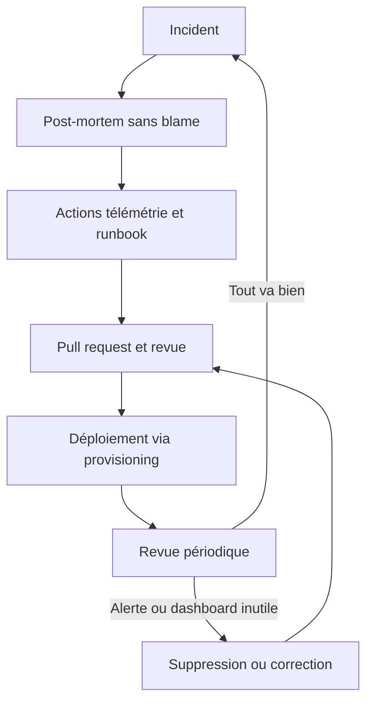


# Exploitation collaborative et amélioration continue

## Objectifs pédagogiques

À la fin de ce module, vous serez capable de :

- **Rédiger** un runbook directement exploitable à 3 h du matin et le rattacher à l'alerte qui le déclenche.
- **Définir** des conventions de nommage (dashboards, labels, alertes) qui rendent la plateforme lisible par quelqu'un qui n'a pas participé à sa construction.
- **Mettre en place** un workflow Git avec pull request et revue obligatoire pour les configurations Grafana, avec un propriétaire explicite par ressource.
- **Animer** une revue périodique des alertes et des dashboards pour supprimer ce qui ne sert plus.
- **Transformer** un post-mortem en changements concrets de télémétrie, suivis et vérifiables.

## Mise en situation

Une plateforme e-commerce tourne depuis deux ans avec Grafana, Prometheus, Loki et Tempo. Quatre équipes y déposent leurs dashboards et leurs alertes. L'instance contient environ 120 dashboards et 300 règles d'alerte. Techniquement, tout fonctionne.

Un soir, la latence du paiement explose. L'ingénieur d'astreinte reçoit une alerte intitulée « High latency prod ». Il ouvre Grafana, cherche un dashboard, et tombe sur `Prod Overview`, `Prod Overview (copy)`, `Prod Overview v2 - NE PAS TOUCHER` et `Test Jean`. Aucun ne dit qui le maintient. Le panneau de latence de l'un affiche « No data » depuis des mois, parce qu'une métrique a été renommée. L'alerte n'a pas de lien vers une procédure, et l'équipe qui l'a créée a été réorganisée l'an dernier. Il finit par résoudre l'incident, mais après quarante minutes de tâtonnement qu'une page de procédure aurait ramenées à dix.

Aucune fonctionnalité de Grafana ne manquait. Ce qui manquait, c'est le **contrat humain** autour de l'outil : qui possède quoi, comment on change, comment on apprend d'un incident. C'est ce que ce module met en place.

## Ce que c'est : l'exploitation collaborative

Une plateforme d'observabilité est un **produit interne** utilisé par plusieurs équipes, pas un projet qu'on livre une fois. L'exploitation collaborative regroupe les pratiques qui empêchent ce produit de se dégrader : des procédures écrites, des conventions partagées, des changements relus, des responsables identifiés et une boucle de retour après chaque incident.

Pensez à un atelier partagé. Si chacun range ses outils où il veut, l'atelier fonctionne tant que tout le monde se souvient de ses propres rangements. Au premier départ ou au premier imprévu, plus personne ne retrouve rien. Les conventions sont le panneau « chaque outil a sa place », et la revue périodique est l'inventaire annuel.

> 🧠 **Concept clé** : la valeur d'un dashboard ou d'une alerte se mesure à l'instant d'un incident, par quelqu'un qui est fatigué et qui ne l'a pas écrit. Toutes les pratiques de ce module servent ce scénario précis.
{: .callout .callout-important}

## Fonctionnement : cinq mécanismes qui s'entretiennent

Ces cinq pratiques forment une boucle. Un incident révèle un trou de télémétrie, le post-mortem le formalise, une pull request le corrige, la revue périodique vérifie que la correction sert vraiment, et le runbook capitalise ce qu'on a appris.



Regardons chaque maillon.

### Les runbooks : la procédure qui remplace la mémoire

⭐ Un runbook est la procédure qu'on suit quand une alerte se déclenche. Son but n'est pas d'être exhaustif, mais de **réduire le temps entre « je reçois l'alerte » et « je sais quoi faire »**. Un bon runbook s'adresse à quelqu'un de compétent mais qui ne connaît pas ce service.

Structure qui fonctionne bien en pratique :

| Section | Contenu attendu | Exemple |
|---------|-----------------|---------|
| Déclencheur | Nom exact de l'alerte et ce qu'elle signifie | `checkout-api · erreurs 5xx élevées` : plus de 5 % des requêtes en échec pendant 5 min |
| Impact | Ce que voient les utilisateurs | Des paiements échouent, le panier reste utilisable |
| Première vérification (1 min) | Un lien vers le dashboard et un lien Explore pré-rempli | Dashboard `checkout-api-health`, panneau « Erreurs par route » |
| Arbre de diagnostic | Questions fermées, chacune avec sa requête | « Les erreurs touchent une seule route ? » → requête PromQL |
| Mitigation | Actions sûres, avec la commande exacte | Rollback du dernier déploiement, bascule de trafic |
| Escalade | Qui appeler, après combien de temps | Équipe paiement après 15 min sans amélioration |
| Retour à la normale | Comment confirmer que c'est fini | Taux d'erreurs sous 1 % pendant 10 min |

L'arbre de diagnostic est la partie qui compte le plus, et celle qu'on bâcle le plus. « Vérifier les logs » n'aide personne. « Dans Explore, source Loki, exécuter `{service="checkout-api"} |= "ERROR" | json | line_format "{{.route}} {{.error}}"` et regarder si une route domine » donne un geste concret.

> ⚠️ **Erreur fréquente** : un runbook écrit une fois, jamais relu. Après trois mois, ses liens pointent vers des dashboards supprimés et ses commandes ne marchent plus. Pire qu'une absence de runbook, c'est un runbook qui trompe. Corrigez en rendant le runbook **versionné dans le même dépôt que l'alerte**, et en ajoutant une ligne « dernière vérification : date » qu'on met à jour lors de la revue périodique.
{: .callout .callout-attention}

Le lien entre l'alerte et sa procédure se fait dans les annotations de la règle. Grafana reconnaît le champ `runbook_url` et l'affiche comme un lien cliquable dans l'interface ; dans les notifications, son rendu dépend du point de contact et du template utilisés. On peut aussi pointer vers le dashboard et le panneau concernés :

```yaml
labels:
  team: checkout
  severity: page
  service: checkout-api
annotations:
  summary: "Plus de 5 % d'erreurs 5xx depuis 5 min"
  runbook_url: https://wiki.example.com/runbooks/checkout/erreurs-5xx
  __dashboardUid__: checkout-api-health
  __panelId__: "4"
```

Ce fragment est volontairement réduit : la forme exacte dépend de votre mode de provisioning, et l'interface peut varier selon la version de Grafana.

> 💡 **Astuce** : une alerte de niveau `page` sans `runbook_url` devrait être refusée en revue. Même un runbook de dix lignes vaut mieux que rien, et le fait de devoir l'écrire force à se demander si l'alerte est vraiment actionnable.
{: .callout .callout-astuce}

### Le nommage : rendre la plateforme interrogeable

Les conventions de nommage ne relèvent pas de l'esthétique. Elles permettent de **filtrer, router et retrouver**. Un label `team` cohérent permet de router vers la bonne équipe ; un titre de dashboard prévisible permet de le trouver à 3 h du matin avec la recherche.

| Élément | Convention proposée | Exemple |
|---------|--------------------|---------|
| Titre de dashboard | `[Équipe] Service — Objectif` | `[Checkout] API — Santé` |
| UID de dashboard | Stable, lisible, jamais régénéré | `checkout-api-health` |
| Tags de dashboard | Préfixés, en minuscules | `team:checkout`, `tier:1`, `type:diagnostic` |
| Nom d'alerte | Le symptôme, pas la cause | `checkout-api · erreurs 5xx élevées` |
| Labels d'alerte | Ensemble fermé et documenté | `team`, `service`, `severity`, `env` |

Trois règles font l'essentiel du travail. D'abord, **l'UID est stable** : si vous l'écrivez dans des liens de runbooks et des annotations d'alertes, le regénérer casse tout. Ensuite, le nom d'une alerte décrit **ce que l'utilisateur ou le système subit**, pas une hypothèse de cause : « CPU élevé sur node-12 » est une cause supposée, « latence checkout au-dessus du seuil » est un symptôme. Enfin, les labels forment un **vocabulaire fermé**. Si une équipe écrit `team=checkout` et une autre `squad=Checkout`, le routage cesse de fonctionner sans erreur visible.

> ⚠️ **Erreur fréquente** : multiplier les valeurs libres de labels (`severity=critical`, `severity=crit`, `severity=P1`). Les routes de notification ne matchent plus et certaines alertes tombent dans la route par défaut. Écrivez la liste des valeurs autorisées dans un fichier de conventions du dépôt et faites-la valider en revue.
{: .callout .callout-attention}

### Git et pull requests : les configurations méritent une relecture

Dès que dashboards et alertes sont gérés comme du code (provisioning, Terraform, Grafana as Code vus dans des modules précédents), ils peuvent passer par le même circuit qu'un changement applicatif. L'intérêt est double : un second regard avant qu'une règle ne réveille quelqu'un en pleine nuit, et un historique qui répond à « qui a changé ce seuil, et pourquoi ».

Une organisation de dépôt lisible :

```text
observability/
├── dashboards/
│   ├── checkout/
│   └── search/
├── alerts/
│   ├── checkout/
│   └── search/
├── runbooks/
│   ├── checkout/
│   └── search/
├── conventions/
│   └── labels.md
└── .github/
    ├── CODEOWNERS
    └── pull_request_template.md
```

Le fichier `CODEOWNERS` rend l'ownership **exécutable** : toute modification dans `alerts/checkout/` demande l'approbation de l'équipe checkout, et seule l'équipe plateforme valide les conventions communes.

```text
# .github/CODEOWNERS (la syntaxe varie selon GitLab ou autre forge)
/dashboards/checkout/   @acme/team-checkout
/alerts/checkout/       @acme/team-checkout
/runbooks/checkout/     @acme/team-checkout
/conventions/           @acme/observability-platform
```

Le modèle de pull request guide le relecteur vers les vraies questions plutôt que vers la syntaxe :

```markdown
## Ce qui change
<!-- Dashboard, alerte ou runbook concerné -->

## Pourquoi
<!-- Incident, demande, post-mortem : lien vers le ticket -->

## Vérifications
- [ ] L'alerte a un `team`, une `severity` et un `runbook_url`
- [ ] Le runbook est à jour dans cette même PR
- [ ] Le seuil a été testé sur 7 jours de données (capture jointe)
- [ ] Les titres et labels respectent `conventions/labels.md`
```

Côté automatisation, une vérification de Continuous Integration (CI) peut contrôler ce qui est mécanique : JSON valide, labels obligatoires présents, UID unique, règles Prometheus validées avec `promtool check rules`. Un outil de lint de dashboards, comme `dashboard-linter` de Grafana, détecte des défauts de requêtes ou de variables. Laissez les machines vérifier la forme, et gardez l'humain pour le fond : cette alerte réveillera-t-elle quelqu'un pour une bonne raison ?

> 💡 **Astuce** : demandez dans chaque PR une capture du seuil superposé à l'historique des sept derniers jours. En trente secondes, le relecteur voit si l'alerte aurait sonné dix fois pour rien.
{: .callout .callout-astuce}

### L'ownership : un responsable nommé, pas une équipe vague

> ⚠️ **Des dashboards sans responsable deviennent rapidement obsolètes.** Le mécanisme est toujours le même : une métrique est renommée, un panneau passe en « No data », personne ne se sent concerné, et un mois plus tard un autre dashboard est copié « pour être tranquille ». L'instance se remplit de doublons dont aucun n'est fiable. Ce qui est à tout le monde n'est à personne.
{: .callout .callout-attention}

Un ownership utile répond à trois questions :

- **Qui** corrige si ça casse ? Une équipe, pas une personne : les gens partent.
- **Comment** la joindre ? Un canal de messagerie ou une adresse de groupe dans la description du dashboard.
- **Que se passe-t-il** si l'équipe disparaît ? Un propriétaire de repli, souvent l'équipe plateforme, avec le droit de supprimer.

Concrètement, chaque dashboard porte un tag `team:<nom>` et une description avec le canal de contact. Chaque alerte porte le label `team`. Les dashboards personnels ou d'expérimentation vivent dans un dossier dédié, par exemple `Sandbox`, avec une règle claire : ce qui y reste plus de 30 jours est supprimé sans préavis.

Un audit rapide via l'API de recherche liste les dashboards sans tag d'équipe :

```bash
curl -s -H "Authorization: Bearer $GRAFANA_TOKEN" \
  "https://grafana.example.com/api/search?type=dash-db&limit=5000" \
  | jq -r '.[] | select(([.tags[] | startswith("team:")] | any) | not)
           | [.uid, (.folderTitle // "General"), .title] | @csv'
```

Cet audit est un bon premier geste : le résultat est généralement plus long qu'on ne l'espère.

### La revue périodique des alertes

Une alerte est un engagement : quelqu'un s'est engagé à réagir quand elle sonne. Avec le temps, les seuils dérivent, les services changent, et des alertes continuent de sonner sans qu'on y fasse plus rien. Le bruit s'accumule, et la fatigue d'alerte pousse à ignorer la vraie alerte le jour où elle arrive.

Une revue mensuelle de 30 à 45 minutes suffit. Pour chaque alerte qui a sonné pendant la période, l'équipe classe le résultat :

| Verdict | Signification | Action |
|---------|---------------|--------|
| Actionnable | Quelqu'un a fait quelque chose d'utile | Garder |
| Faux positif | Seuil ou durée mal réglés | Ajuster le seuil ou la durée `for` |
| Informatif | Ça sonne mais il n'y a rien à faire | Descendre en `ticket` ou supprimer |
| Doublon | Une autre alerte couvre déjà le symptôme | Supprimer |
| Jamais déclenchée | Peut-être inutile, peut-être cassée | Vérifier qu'elle peut encore se déclencher |

Pour repérer les plus bavardes sur des règles gérées par Prometheus, la série `ALERTS` donne une approximation du temps passé en état `firing` :

```promql
topk(10, sum by (alertname) (count_over_time(ALERTS{alertstate="firing"}[30d])))
```

Chaque point correspond à une évaluation de la règle. Avec un intervalle d'une minute, le résultat se lit approximativement en minutes. Pour les règles gérées par Grafana, le mécanisme dépend de la version : consultez l'historique d'état des règles ou le stockage de cet historique, s'il est activé.

> ⚠️ **Erreur fréquente** : ne regarder que les alertes bruyantes. Une alerte qui ne s'est **jamais** déclenchée en un an peut être parfaitement inutile… ou silencieusement cassée, parce que sa requête ne renvoie plus rien et que l'état `No Data` est mal configuré. Testez-la en revue : provoquez l'état, ou vérifiez que sa requête retourne bien des séries.
{: .callout .callout-attention}

Le même rituel s'applique aux dashboards : ceux qu'on n'a pas modifiés depuis longtemps et dont personne ne parle sont des candidats à l'archivage. L'API de dashboard expose une date de dernière mise à jour dans ses métadonnées. Les statistiques d'usage détaillées, elles, sont réservées à certaines offres (Cloud, Enterprise) : en OSS, la date de modification et l'avis des équipes font office de signal.

### Documenter changements et incidents

Quand une métrique dévie, la première question est « qu'est-ce qui a changé ? ». Si la réponse demande de fouiller trois outils, vous perdez du temps. Grafana permet de **poser des annotations** sur les graphiques : un déploiement, une bascule, un incident y apparaissent comme des repères verticaux, visibles sur tous les panneaux qui les affichent.

Un pipeline de déploiement peut les créer automatiquement :

```bash
curl -s -X POST -H "Authorization: Bearer $GRAFANA_TOKEN" \
  -H "Content-Type: application/json" \
  -d '{"text":"Déploiement checkout-api v2.14","tags":["deploy","checkout"]}' \
  https://grafana.example.com/api/annotations
```

Sans horodatage explicite, l'annotation est placée à l'instant de l'appel. Ajoutez ensuite une requête d'annotation dans vos dashboards de service filtrée sur le tag `deploy`, et la corrélation entre un déploiement et une dégradation devient visible d'un coup d'œil.

Pour les incidents, gardez un journal minimal et daté dans un endroit unique : début, détection, actions tentées, résolution. Ce journal servira de matière première au post-mortem, et personne n'a à reconstituer l'histoire de mémoire.

### Post-mortem et amélioration de la télémétrie

Le post-mortem répond à deux questions : pourquoi c'est arrivé, et **pourquoi on ne l'a pas vu ou compris plus vite**. La seconde est celle qui améliore la plateforme d'observabilité. On la pose sans chercher de coupable : l'objectif est de trouver ce que le système n'a pas dit, pas qui a mal fait.

Pour passer du récit aux actions, classez chaque difficulté rencontrée dans l'une de ces trois familles :

- **Trou de détection** : l'alerte est arrivée trop tard, ou pas du tout. Action : nouvelle alerte, seuil revu, alerte sur `No Data`.
- **Trou de diagnostic** : on a eu l'alerte mais on a cherché longtemps la cause. Action : panneau manquant, label absent, corrélation entre logs et traces à ajouter.
- **Trou de réponse** : on a compris mais on ne savait pas quoi faire. Action : runbook à créer ou à corriger, escalade à clarifier.

Une bonne question à poser pendant la réunion : « à la minute 3 de l'incident, qu'aurait-on voulu voir à l'écran ? ». La réponse décrit presque toujours un panneau, un label ou un lien qui n'existait pas.

Chaque action est ensuite **tracée avec un propriétaire et une échéance**, et les changements de télémétrie passent par une pull request qui référence le post-mortem. Un mois plus tard, la revue périodique vérifie que ces actions sont réellement terminées.

> ⚠️ **Erreur fréquente** : conclure un post-mortem par des actions du type « être plus vigilant » ou « améliorer le monitoring ». Rien de mesurable, rien d'assignable. Reformulez en changement vérifiable : « ajouter une alerte sur le p95 de latence du service paiement, seuil 800 ms sur 5 min, avec runbook, d'ici le 15 ».
{: .callout .callout-attention}

## Construction progressive

Inutile de tout lancer en même temps : une équipe qui adopte cinq pratiques d'un coup n'en tient aucune. Voici un ordre qui apporte de la valeur à chaque étape.

**Étape 1 — Inventorier et nommer (1 à 2 semaines).** Lancez l'audit des dashboards sans tag `team:` et la liste des alertes sans label `team`. Rédigez un `conventions/labels.md` d'une page : labels autorisés, valeurs permises, format des titres. Ne renommez pas tout d'un coup : appliquez la convention aux nouvelles ressources et à celles que vous touchez.

**Étape 2 — Mettre les configurations sous revue (1 à 2 semaines).** Placez dashboards et alertes dans le dépôt, ajoutez `CODEOWNERS` et le modèle de pull request. Commencez par les ressources de niveau 1 (celles qui servent pendant les incidents). Interdisez la modification directe dans l'interface pour ces ressources, ou au minimum faites signaler la divergence.

**Étape 3 — Écrire les runbooks des alertes qui réveillent (2 à 4 semaines).** Prenez les alertes de niveau `page` classées par fréquence, et écrivez le runbook de chacune, en commençant par la plus bavarde. Testez chaque runbook en le faisant exécuter par quelqu'un qui n'est pas son auteur.

**Étape 4 — Installer la revue mensuelle.** Réservez un créneau fixe, une personne pour animer, une liste d'alertes à passer en revue. Mesurez une chose simple : la proportion d'alertes de niveau `page` qui n'ont donné lieu à aucune action. Cette part doit baisser d'un mois à l'autre.

**Étape 5 — Fermer la boucle avec les post-mortems.** Chaque incident significatif produit un document court, au moins une action de télémétrie assignée, et une pull request liée. La revue mensuelle suit l'avancement de ces actions.

## Cas réel (scénario illustratif)

Reprenons la plateforme du début. Les chiffres ci-dessous sont illustratifs, pas issus d'une entreprise réelle.

**Point de départ.** 120 dashboards dont 35 sans propriétaire identifiable, 300 règles d'alerte dont 90 de niveau `page`. L'équipe d'astreinte reçoit en moyenne 25 pages par semaine, et seule la moitié mène à une action. Aucune alerte n'a de lien vers une procédure.

**Ce que l'équipe fait, dans l'ordre :**

1. Un audit par API révèle les dashboards sans tag d'équipe. Après discussion, 20 sont rattachés à une équipe et 15 sont archivés.
2. Les alertes `page` sont triées par fréquence. Les 10 plus bavardes concentrent la majorité du bruit : 4 deviennent des tickets, 3 voient leur seuil et leur durée `for` corrigés, 3 sont supprimées comme doublons.
3. Les 15 alertes `page` restantes les plus importantes reçoivent un runbook et un `runbook_url`. Les nouvelles règles sans `runbook_url` sont refusées par la CI.
4. Un pipeline de déploiement crée une annotation par release sur les dashboards de service.
5. Après un incident de paiement, le post-mortem identifie un trou de diagnostic : aucun panneau ne montrait les erreurs par fournisseur de paiement. Une PR ajoute le label `provider` aux métriques et un panneau dédié.

**Effet attendu après un trimestre (illustratif).** Les pages hebdomadaires passent de 25 à une dizaine, et la majorité mène à une action. Le temps de diagnostic des incidents répétés diminue parce que le runbook indique le premier geste. Surtout, quand quelqu'un rejoint l'équipe d'astreinte, il peut intervenir sans que son voisin lui explique l'architecture.

## Bonnes pratiques

**Ce qui fait tenir le dispositif**

- Gardez le runbook, l'alerte et le dashboard de diagnostic dans **la même pull request**. Séparés, ils divergent.
- Rendez l'ownership vérifiable par machine (`CODEOWNERS`, labels obligatoires en CI), pas seulement écrit dans une page de wiki.
- Fixez une règle de péremption explicite pour les espaces d'expérimentation : dossier `Sandbox`, suppression après 30 jours.
- Mesurez peu de choses mais régulièrement : part de pages sans action, nombre de dashboards sans propriétaire, âge de la dernière vérification des runbooks.

**Pièges à éviter**

- **Une convention trop lourde** : au-delà de cinq labels obligatoires, les gens contournent. Restez minimal et justifiez chaque champ par un usage concret (routage, filtrage, recherche).
- **Une revue qui devient une formalité** : si les relecteurs approuvent sans regarder, c'est que le modèle de PR est trop long ou que la charge de revue est mal répartie. Réduisez la liste à ce qui compte vraiment.
- **Un post-mortem utilisé comme tribunal** : dès que quelqu'un craint d'être désigné, les récits se simplifient et les vrais trous disparaissent du document.
- **La double source de vérité** : quand l'interface permet de modifier ce que le dépôt définit, la configuration dérive. Soit vous bloquez l'édition manuelle pour les ressources gérées, soit vous détectez les écarts avec des vérifications régulières.
- **Des runbooks trop longs** : un runbook de dix pages ne sera pas lu pendant un incident. Une page, des liens, des requêtes prêtes à exécuter.

**Critères de réussite**

Vous savez que le dispositif fonctionne quand une personne qui n'a jamais touché au service peut, à partir d'une alerte, atteindre le dashboard correct et appliquer la première action en moins de cinq minutes ; quand chaque dashboard de production a un propriétaire joignable ; et quand les actions de télémétrie issues des post-mortems apparaissent réellement dans l'historique Git.

<!-- snippet
id: grafana_alert_runbook_url_annotation
type: concept
tech: grafana
level: advanced
importance: high
format: knowledge
tags: grafana,alerting,runbook,annotations
title: Relier une alerte à son runbook et à son dashboard
context: Dans les annotations d'une règle d'alerte Grafana
content: Le champ d'annotation `runbook_url` est reconnu par Grafana et affiché comme lien dans l'interface ; dans les notifications, son rendu dépend du point de contact et du template. Les annotations `__dashboardUid__` et `__panelId__` associent la règle à un panneau précis. L'ouvreur de l'alerte arrive ainsi en un clic sur la procédure et sur le graphique concerné. Le rendu exact peut varier selon la version.
description: Trois annotations suffisent pour qu'une alerte mène directement à la procédure et au bon panneau, sans recherche manuelle.
-->

<!-- snippet
id: grafana_dashboards_audit_missing_owner
type: command
tech: grafana
level: advanced
importance: high
format: knowledge
tags: grafana,ownership,api,audit
title: Lister les dashboards sans tag d'équipe
context: Requiert un jeton de service avec droit de lecture sur les dashboards
command: curl -s -H "Authorization: Bearer $GRAFANA_TOKEN" "<GRAFANA_URL>/api/search?type=dash-db&limit=5000" | jq -r '.[] | select(([.tags[] | startswith("team:")] | any) | not) | [.uid, (.folderTitle // "General"), .title] | @csv'
example: curl -s -H "Authorization: Bearer $GRAFANA_TOKEN" "https://grafana.example.com/api/search?type=dash-db&limit=5000" | jq -r '.[] | select(([.tags[] | startswith("team:")] | any) | not) | [.uid, (.folderTitle // "General"), .title] | @csv'
description: Sort en CSV l'UID, le dossier et le titre des dashboards qui n'ont aucun tag commençant par `team:`, point de départ d'un audit d'ownership.
-->

<!-- snippet
id: grafana_deploy_annotation_api
type: command
tech: grafana
level: advanced
importance: medium
format: knowledge
tags: grafana,annotations,deploiement,api
title: Marquer un déploiement sur les graphiques
context: À appeler depuis la pipeline de déploiement
command: curl -s -X POST -H "Authorization: Bearer $GRAFANA_TOKEN" -H "Content-Type: application/json" -d '{"text":"<TEXTE>","tags":["deploy","<SERVICE>"]}' <GRAFANA_URL>/api/annotations
example: curl -s -X POST -H "Authorization: Bearer $GRAFANA_TOKEN" -H "Content-Type: application/json" -d '{"text":"Déploiement checkout-api v2.14","tags":["deploy","checkout"]}' https://grafana.example.com/api/annotations
description: Sans champ `time`, l'annotation est datée à l'instant de l'appel ; filtrée par tag `deploy` dans un dashboard, elle relie dégradation et déploiement.
-->

<!-- snippet
id: grafana_orphan_dashboards_obsolete
type: warning
tech: grafana
level: advanced
importance: high
format: knowledge
tags: grafana,ownership,dashboards,gouvernance
title: Un dashboard sans responsable devient obsolète
content: Piège : laisser des dashboards sans propriétaire. Conséquence : après un renommage de métrique, un panneau passe en « No data », personne ne le corrige, et les équipes copient le dashboard au lieu de le réparer, ce qui multiplie les doublons peu fiables. Correction : tag `team:<nom>` obligatoire, canal de contact dans la description, dossier Sandbox purgé après 30 jours.
description: Sans propriétaire, la panne d'un panneau n'est corrigée par personne et le doublon devient le réflexe, ce qui dégrade la confiance dans toute l'instance.
-->

<!-- snippet
id: grafana_alert_monthly_review_verdicts
type: concept
tech: grafana
level: advanced
importance: medium
format: knowledge
tags: grafana,alerting,revue,bruit
title: Classer chaque alerte lors de la revue mensuelle
content: Pour chaque alerte qui a sonné dans le mois, classer le résultat en cinq verdicts : actionnable (garder), faux positif (ajuster seuil ou durée `for`), informatif (passer en ticket ou supprimer), doublon (supprimer), jamais déclenchée (vérifier que sa requête renvoie encore des séries). L'indicateur à suivre est la part de pages sans action, qui doit baisser d'un mois sur l'autre.
description: Cinq verdicts simples transforment la revue des alertes en décisions concrètes, avec un indicateur unique pour mesurer la progression.
-->

<!-- snippet
id: grafana_alert_firing_minutes_promql
type: command
tech: prometheus
level: advanced
importance: medium
format: knowledge
tags: prometheus,alerting,promql,revue
title: Repérer les alertes les plus bavardes sur 30 jours
context: Valable pour les règles évaluées par Prometheus, pas pour les règles gérées par Grafana
command: topk(10, sum by (alertname) (count_over_time(ALERTS{alertstate="firing"}[<PERIODE>])))
example: topk(10, sum by (alertname) (count_over_time(ALERTS{alertstate="firing"}[30d])))
description: Chaque point est une évaluation en état firing ; avec un intervalle d'une minute, le résultat approche le nombre de minutes passées en alerte.
-->

<!-- snippet
id: grafana_codeowners_alert_review
type: tip
tech: grafana
level: advanced
importance: medium
format: knowledge
tags: grafana,git,codeowners,revue
title: Rendre l'ownership exécutable avec CODEOWNERS
content: Dans le dépôt de configuration, créer `.github/CODEOWNERS` avec une ligne par dossier, par exemple `/alerts/checkout/ @acme/team-checkout`, puis activer « Require review from Code Owners » sur la branche principale. Toute modification d'alerte ou de dashboard demande alors l'approbation de l'équipe propriétaire. La syntaxe diffère légèrement sur GitLab.
description: Une ligne par dossier plus une règle de protection de branche suffisent pour qu'aucune alerte ne change sans l'accord de son équipe.
-->

<!-- snippet
id: grafana_naming_symptom_not_cause
type: tip
tech: grafana
level: advanced
importance: medium
format: knowledge
tags: grafana,nommage,alerting,labels
title: Nommer une alerte par son symptôme, pas sa cause
content: Écrire « checkout-api · erreurs 5xx élevées » plutôt que « CPU élevé sur node-12 ». Le nom du symptôme reste vrai quelle que soit la cause, et ne lance pas l'enquêteur sur une fausse piste. Garder un vocabulaire fermé de labels (`team`, `service`, `severity`, `env`) documenté dans un fichier `conventions/labels.md` validé en revue.
description: Un nom de symptôme n'oriente pas vers une fausse cause, et un vocabulaire de labels fermé évite les écarts qui cassent le routage sans erreur visible.
-->

<!-- snippet
id: grafana_postmortem_telemetry_gap
type: concept
tech: grafana
level: advanced
importance: high
format: knowledge
tags: grafana,post-mortem,telemetrie,amelioration
title: Classer les trous de télémétrie d'un post-mortem
content: Chaque difficulté d'un incident se range dans l'une de trois familles : trou de détection (alerte tardive ou absente → nouvelle alerte ou alerte `No Data`), trou de diagnostic (cause longue à trouver → panneau, label ou lien logs/traces manquant), trou de réponse (on ne savait pas quoi faire → runbook à créer ou corriger). La question à poser : « à la minute 3, qu'aurait-on voulu voir à l'écran ? ».
description: Trois familles de trous donnent des actions précises et assignables, à livrer par pull request et à contrôler lors de la revue mensuelle.
-->

<!-- snippet
id: grafana_runbook_vague_steps_error
type: error
tech: grafana
level: advanced
importance: high
format: knowledge
tags: grafana,runbook,incident,diagnostic
title: Runbook ignoré pendant l'incident
content: Symptôme : l'astreinte ouvre le runbook puis l'abandonne pour fouiller seule. Cause : étapes vagues comme « vérifier les logs » ou liens morts vers des dashboards supprimés. Correction : une page maximum, chaque étape avec sa requête prête à exécuter (par exemple un lien Explore pré-rempli), une ligne « dernière vérification » mise à jour à chaque revue périodique.
description: Un runbook sans requête concrète ni lien valide est abandonné ; le tester avec quelqu'un qui n'est pas son auteur révèle les trous avant l'incident.
-->

<!-- snippet
id: grafana_alert_page_requires_runbook
type: tip
tech: grafana
level: advanced
importance: medium
format: knowledge
tags: grafana,alerting,ci,runbook
title: Refuser en CI une alerte page sans runbook
content: Dans la CI du dépôt de configuration, échouer si une règle de `severity: page` n'a pas d'annotation `runbook_url` ou de label `team`. Un script `jq` ou `yq` sur les fichiers d'alertes suffit. Ce garde-fou force à se demander si l'alerte est actionnable avant même qu'un humain relise la pull request.
description: Une vérification automatique de deux champs obligatoires sur les alertes de niveau page évite l'apparition d'alertes sans procédure ni propriétaire.
-->

