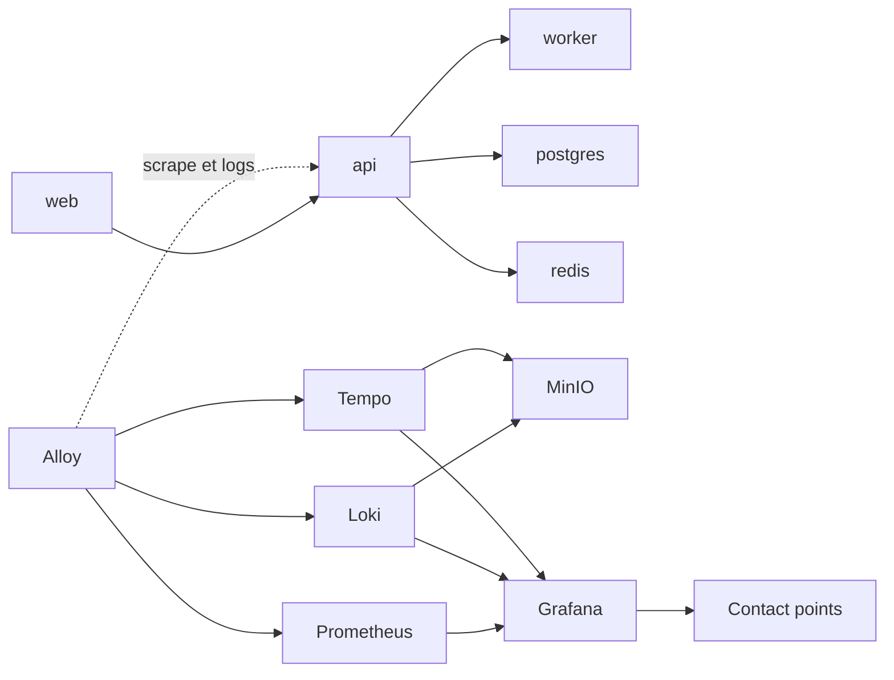
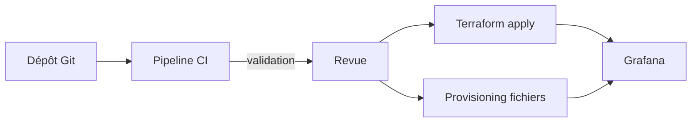

# Projet final — Plateforme d'observabilité de production

## Objectifs pédagogiques

À la fin de ce module, vous saurez :

- **Concevoir** une plateforme Grafana, Prometheus, Loki et Tempo reproductible à partir d'un dépôt Git, avec des choix de backends justifiés.
- **Assembler** trois niveaux de dashboards (infrastructure, application, SLO) qui se parcourent du symptôme vers la cause.
- **Configurer** un alerting complet : règles, routage, silences, runbooks, et détection des pannes silencieuses de la supervision elle-même.
- **Provisionner** et **protéger** la plateforme avec des fichiers de provisioning, du Terraform, des secrets maîtrisés et des sauvegardes dont la restauration a été testée.
- **Valider** l'ensemble par des pannes simulées (API, stockage, réseau, Data Source), des mesures de performance et de coût, puis par un rapport de validation.

## Mise en situation

Prenons une PME de e-commerce fictive : huit développeurs, un seul profil SRE (vous), six services (web, api, worker, base PostgreSQL, Redis, passerelle de paiement simulée) répartis sur trois machines virtuelles.

Il existe déjà un Grafana, installé à la main il y a deux ans. Les dashboards ont été modifiés dans l'interface par une dizaine de personnes, personne ne sait lesquels comptent vraiment, et les alertes partent par e-mail dans une boîte que plus personne ne lit. Le dernier incident a été signalé par un client, pas par la supervision.

La tentation est de réinstaller Grafana proprement et d'importer les anciens dashboards. Ça ne résout rien : la nouvelle installation serait tout aussi impossible à reconstruire si la VM disparaissait, personne ne saurait prouver que les alertes fonctionnent, et le jour où Prometheus tombe, la supervision se tairait sans que personne s'en aperçoive.

Ce projet consiste à construire la plateforme qu'on voudrait trouver en arrivant dans cette équipe : reconstruisible en une commande, versionnée, sécurisée, mesurée, et surtout **éprouvée par des pannes provoquées volontairement**. C'est la différence entre une plateforme qui existe et une plateforme à laquelle on peut se fier à trois heures du matin.

## Cadrage : ce qu'on construit et ce qu'on rend

Ce module ne réexplique pas PromQL, LogQL ou le fonctionnement d'une règle d'alerte. Il part du principe que vous maîtrisez chaque brique, et traite le sujet qui reste : **comment les faire tenir ensemble, et comment le démontrer**.

Le livrable final tient en cinq éléments :

| Livrable | Contenu attendu | Critère de réussite |
|---|---|---|
| Infrastructure reproductible | Dépôt Git avec Compose ou manifestes, provisioning, Terraform | Un `clone` + une commande donnent une plateforme fonctionnelle sur une machine vierge |
| Dashboards versionnés | JSON en Git, UID stables, trois niveaux | Aucune modification d'interface ne survit sans passer par une revue |
| Documentation d'exploitation | Runbooks, procédure de sauvegarde et restauration, rotation des secrets | Quelqu'un qui n'a pas construit la plateforme peut s'en servir |
| Scénarios d'incident | Au moins quatre pannes simulées, avec résultat attendu et observé | Chaque scénario est rejouable |
| Rapport de validation | Mesures, écarts, décisions, limites connues | Chaque affirmation est appuyée par une mesure ou un test |

## Architecture cible

Le fil rouge du parcours (applications → télémétrie → backends → Grafana) prend ici sa forme de production. Grafana ne stocke pas la télémétrie, il l'interroge. Chaque composant a donc un rôle précis, et surtout une façon précise de tomber en panne.

| Composant | Rôle | Choix pour ce projet |
|---|---|---|
| Collecteur | Récupère métriques, logs et traces, les pousse vers les backends | Grafana Alloy, un par hôte |
| Métriques | Stockage et requêtes de séries temporelles | Prometheus (un seul nœud, suffisant à cette échelle) |
| Logs | Indexation par labels, stockage en chunks | Loki en mode monolithique, chunks sur objet |
| Traces | Stockage et recherche de traces | Tempo en mode monolithique, blocs sur objet |
| Stockage objet | Persistance durable des chunks et blocs | MinIO en laboratoire, S3 compatible en production |
| Grafana | Exploration, dashboards, alerting | Base PostgreSQL externe, derrière un reverse proxy TLS |
| Contact points | Réception des alertes | Messagerie d'équipe + service d'astreinte + heartbeat externe |



Schéma simplifié : les flux de scrape, de push et d'interrogation sont regroupés pour rester lisibles.

À côté de cette plateforme tourne un second circuit, celui de la livraison de configuration. C'est lui qui garantit que ce qui tourne correspond à ce qui est écrit :



> 🧠 **Concept clé**
>
> Dans ce projet, **Git est la source de vérité**. L'interface de Grafana sert à explorer et à prototyper, pas à stocker. Une modification qui n'est pas passée par le dépôt est une dette, parce qu'elle disparaîtra à la prochaine reconstruction ou, pire, entrera en conflit avec elle.
{: .callout .callout-important}

## Construction progressive

Construire d'un coup la version finale est la meilleure façon de ne plus savoir quelle brique casse quoi. On avance en trois paliers, chacun avec un critère de passage.

### v1 : la boucle complète, sans prétention

L'objectif est qu'une requête utilisateur produise une métrique, un log et une trace, et que vous puissiez passer de l'un à l'autre dans Grafana. Rien de plus. Un Compose minimal suffit :

```yaml
services:
  grafana:
    image: grafana/grafana:<VERSION>
    ports: ["3000:3000"]
    volumes:
      - ./provisioning:/etc/grafana/provisioning:ro
      - ./dashboards:/var/lib/grafana/dashboards:ro
  prometheus:
    image: prom/prometheus:<VERSION>
    volumes:
      - ./prometheus/prometheus.yml:/etc/prometheus/prometheus.yml:ro
  loki:
    image: grafana/loki:<VERSION>
  tempo:
    image: grafana/tempo:<VERSION>
    command: ["-config.file=/etc/tempo/tempo.yaml"]
    volumes:
      - ./tempo/tempo.yaml:/etc/tempo/tempo.yaml:ro
  alloy:
    image: grafana/alloy:<VERSION>
    volumes:
      - ./alloy/config.alloy:/etc/alloy/config.alloy:ro
```

Épinglez les versions dès cette étape : les fichiers de configuration de Loki et de Tempo ont évolué de manière sensible d'une version à l'autre, et un `latest` flottant rend vos tests de panne non comparables d'une semaine à l'autre. Les options exactes de configuration dépendent de la version choisie, la documentation de chaque composant fait foi.

**Critère de passage** : depuis un log d'erreur dans Explore, un clic ouvre la trace correspondante. Ce lien est un vrai test d'intégration, il suppose que l'application écrit un identifiant de trace dans ses logs et que la Data Source Loki sait l'extraire :

```yaml
# provisioning/datasources/loki.yaml (extrait)
- name: Loki
  uid: loki-main
  type: loki
  access: proxy
  url: http://loki:3100
  jsonData:
    derivedFields:
      - name: TraceID
        matcherRegex: 'trace_id=(\w+)'
        url: '$${__value.raw}'
        datasourceUid: tempo-main
```

Les `uid` fixes sont volontaires : les dashboards et les liens y font référence, et un UID généré aléatoirement casserait tout à la première reconstruction.

### v2 : tout ce qui est configuré devient du code

C'est le saut qui change la nature du projet. Tout ce que vous aviez cliqué passe dans le dépôt, avec une répartition claire entre deux outils.

| Ce qui est géré | Par quoi | Pourquoi |
|---|---|---|
| Data Sources, fournisseurs de dashboards | Fichiers de provisioning | Chargés au démarrage de Grafana, donc présents dès la première seconde |
| Dossiers, règles d'alerte, contact points, politiques de notification | Terraform | Cycle de vie via API, `plan` lisible avant application |
| Dashboards | Fichiers JSON en Git, chargés par provisioning | Revue de code, historique, retour arrière |

Cette répartition règle le problème de la divergence entre interface, fichiers et Terraform : **chaque objet a un seul propriétaire**. Si une règle d'alerte est dans Terraform, on ne la modifie nulle part ailleurs.

Pour les dashboards, on verrouille l'édition par l'interface :

```yaml
# provisioning/dashboards/git.yaml
apiVersion: 1
providers:
  - name: git-dashboards
    folder: Production
    type: file
    disableDeletion: true
    allowUiUpdates: false
    options:
      path: /var/lib/grafana/dashboards
      foldersFromFilesStructure: true
```

> ⚠️ **Erreur fréquente**
>
> Un collègue ouvre un dashboard provisionné, le modifie, clique sur « Save » et obtient « Cannot save provisioned dashboard ». Ce n'est pas un bug, c'est le verrou qui fait son travail. La correction n'est pas de passer `allowUiUpdates` à `true`, mais d'exporter le JSON depuis l'interface, de le déposer dans le dépôt et de passer par la revue. Expliquez-le dans la documentation d'exploitation, sinon la règle sera perçue comme une panne.
{: .callout .callout-attention}

Côté Terraform, un compte de service dédié, avec un rôle limité et un jeton à durée de vie courte, remplace le compte admin. Voici le cœur du routage :

```hcl
resource "grafana_contact_point" "team_chat" {
  name = "team-chat"
  webhook {
    url = "<URL_WEBHOOK_EQUIPE>"
  }
}

resource "grafana_contact_point" "oncall" {
  name = "oncall"
  # remplacer par le connecteur d'astreinte choisi (pagerduty, etc.)
  webhook {
    url = "<URL_ASTREINTE>"
  }
}

resource "grafana_notification_policy" "root" {
  group_by        = ["alertname", "service"]
  contact_point   = grafana_contact_point.team_chat.name
  group_wait      = "30s"
  group_interval  = "5m"
  repeat_interval = "4h"

  policy {
    matcher {
      label = "severity"
      match = "="
      value = "critical"
    }
    contact_point = grafana_contact_point.oncall.name
  }
}
```

Les noms de ressources et d'attributs peuvent varier selon la version du provider, vérifiez-les avec un `terraform plan` dès le premier essai.

Enfin, un pipeline de CI minimal protège le dépôt : `terraform fmt -check`, `terraform validate`, un `terraform plan` affiché dans la demande de fusion, et un contrôle que chaque fichier de dashboard est un JSON valide (`jq empty`) avec un `uid` renseigné.

**Critère de passage** : détruire le conteneur Grafana et son volume, relancer, et retrouver exactement les mêmes Data Sources, dashboards et alertes sans toucher à l'interface.

### v3 : les choix de production

La v3 ne rajoute pas de fonctionnalités de supervision. Elle retire les points faibles de la v2 :

- **Persistance** : Grafana passe de SQLite à PostgreSQL externe, ce qui rend possible plusieurs instances derrière le proxy (à condition de configurer aussi la haute disponibilité de l'alerting, sans quoi les notifications sont dupliquées) et simplifie la sauvegarde.
- **Stockage objet** : Loki et Tempo écrivent sur du stockage objet plutôt que sur un volume local. Les blocs survivent à la perte d'une machine.
- **Exposition** : seul le reverse proxy TLS est joignable. Prometheus, Loki, Tempo et MinIO restent sur un réseau interne.
- **Identité** : authentification SSO en OIDC, dossiers par équipe, rôles par dossier. Le compte `admin` local est conservé pour les situations de secours, avec un mot de passe en coffre.
- **Secrets** : plus aucun mot de passe en clair dans le dépôt. Les fichiers de provisioning référencent des variables d'environnement, injectées au démarrage depuis le coffre ou depuis les secrets Docker.

```yaml
# provisioning/datasources/prometheus.yaml (extrait)
- name: Prometheus
  uid: prom-main
  type: prometheus
  access: proxy
  url: http://prometheus:9090
  basicAuth: true
  basicAuthUser: grafana
  secureJsonData:
    basicAuthPassword: ${PROM_PASSWORD}
```

> 💡 **Astuce**
>
> Grafana ne cloisonne pas les données à lui seul. Si la Data Source Loki se connecte avec un seul tenant partagé, tous les utilisateurs autorisés à l'interroger voient les logs de toutes les équipes. Pour une vraie séparation, il faut un tenant par périmètre côté Loki et une Data Source par tenant, avec les permissions de Data Source alignées.
{: .callout .callout-astuce}

## Sécurisation et sauvegardes

La sécurité de la plateforme se vérifie par des tests, pas par une liste cochée. Cinq vérifications concrètes à inscrire au rapport :

- le port de Prometheus n'est pas joignable depuis l'extérieur du réseau interne ;
- l'accès anonyme est désactivé ;
- un utilisateur de l'équipe A ne voit pas les dossiers de l'équipe B ;
- le jeton Terraform ne permet pas de gérer les utilisateurs ;
- aucun secret n'apparaît dans `git log -p`.

Pour les sauvegardes, il faut distinguer ce qui se reconstruit de ce qui se perd :

| Élément | Source de vérité | Sauvegarde nécessaire ? |
|---|---|---|
| Dashboards, Data Sources, règles d'alerte | Git + Terraform | Non, c'est reconstruit |
| Base Grafana (utilisateurs, préférences, silences, annotations, états d'alerte) | PostgreSQL | Oui |
| État Terraform | Backend distant verrouillé | Oui, avec versions |
| Métriques | Prometheus | Selon la criticité de l'historique |
| Logs et traces | Stockage objet | Versioning du bucket ou réplication |
| Secrets | Coffre | Procédure du coffre |

```bash
pg_dump -Fc -h <HOST> -U grafana -d grafana -f grafana-$(date +%F).dump
```

> ⚠️ **Erreur fréquente**
>
> Considérer qu'une sauvegarde qui s'exécute est une sauvegarde qui fonctionne. Une archive jamais restaurée n'est qu'une hypothèse. Le rapport de validation doit contenir une **restauration réelle** dans un environnement vierge, avec la durée mesurée et un contrôle du résultat (utilisateurs présents, silences présents, dashboards identiques à Git).
{: .callout .callout-attention}

## Dashboards : trois niveaux, un chemin

Un dashboard n'est pas un inventaire des métriques disponibles, c'est une réponse à une question. Le projet en pose trois, et chacune a son niveau :

- **SLO** : « Est-ce que les utilisateurs sont affectés, et à quelle vitesse consommons-nous notre marge d'erreur ? » On y affiche l'indicateur de disponibilité, le budget restant sur la fenêtre et le taux de consommation sur deux fenêtres.
- **Application** : « Quel service est en cause, et que fait-il ? » Pour chaque service, débit, taux d'erreur et latence par percentile, plus un panneau de logs filtré sur le même service et la même période.
- **Infrastructure** : « La machine ou le conteneur est-il saturé ? » CPU, mémoire, disque, réseau, avec les redémarrages de conteneurs.

Ce qui fait la valeur de l'ensemble, c'est le chemin entre ces niveaux. Depuis le dashboard SLO, un lien de données ouvre le dashboard application avec la même plage de temps et le service préselectionné. Depuis un panneau de latence, un clic conduit vers les traces lentes, puis vers les logs de l'une d'elles. Ces liens reposent sur des variables et des UID stables, c'est pourquoi on a verrouillé ces derniers en v1.

Le contrôle de qualité est simple : donnez le dashboard SLO à quelqu'un qui ne connaît pas l'application et chronométrez le temps qu'il met à désigner le service fautif pendant une panne simulée. Si c'est plus de quelques minutes, le problème vient du chemin, pas de la personne.

## Alerting : du signal à l'action

Une alerte qui ne mène à aucune action est du bruit. La conception part donc de la réponse, pas de la métrique.

**Les règles.** Deux familles suffisent pour démarrer. Des alertes de symptôme, fondées sur la consommation du budget d'erreur, et quelques alertes de cause pour ce qui prévient avant l'impact (disque, saturation). Pour l'API avec un objectif de 99,5 % de disponibilité, une alerte rapide ressemble à ceci :

```promql
(
  sum(rate(http_requests_total{service="api",code=~"5.."}[5m]))
  / sum(rate(http_requests_total{service="api"}[5m]))
) / 0.005 > 14.4
```

> 📖 **Définition**
>
> Le taux de consommation (*burn rate*) est le ratio d'erreurs observé divisé par le ratio d'erreurs toléré par l'objectif, soit 0,005 pour 99,5 %. C'est exactement ce que calcule la requête ci-dessus.
{: .callout .callout-definition}

Un taux de consommation de 14,4 épuise environ 2 % du budget mensuel en une heure. C'est le seuil classique pour une alerte qui réveille quelqu'un, généralement combinée avec une fenêtre plus longue pour éviter les faux positifs. Les noms de métriques sont ceux de l'application de démonstration, adaptez-les à vos propres instruments.

**Les états `No Data` et `Error`.** C'est là que se cachent les pannes silencieuses. Par défaut, Grafana fait passer une règle sans données ou en erreur dans les états `No Data` et `Error`, qui génèrent des alertes `DatasourceNoData` et `DatasourceError`. Le risque apparaît quand ces états sont remappés vers « normal ».

Pour chaque règle, décidez explicitement ce que signifie l'absence de données (service arrêté, collecte coupée, ou état normal) et configurez les deux états en conséquence.

> 💡 **À retenir**
>
> Une règle de disponibilité qui passe silencieusement en « normal » quand Prometheus est injoignable est pire que l'absence de règle, car elle donne une fausse sécurité.
{: .callout .callout-important}

**Le heartbeat.** Une alerte « Watchdog » toujours active est renvoyée à intervalle court vers un service externe à la plateforme. Ce service déclenche une alerte si les battements s'arrêtent. L'envoi passe par une politique de notification dédiée dont `group_interval` et `repeat_interval` sont courts : la politique racine, à 4h, ne convient pas.

C'est le seul moyen de savoir que **Grafana lui-même** ne notifie plus : un système de supervision ne peut pas s'alerter de sa propre mort.

> 🚆 **Analogie : le dispositif de l'homme mort**
>
> Dans un train, le conducteur doit actionner régulièrement une commande. S'il cesse, le train freine automatiquement. Ici aussi, c'est l'absence de signal qui déclenche la réaction, pas un message d'erreur. Limite de l'image : le service externe se contente de prévenir, il n'arrête ni ne répare rien.
{: .callout .callout-analogie}

**Le routage.** Il s'appuie sur les labels portés par les règles : `severity` et `service` au minimum. Les alertes critiques vont vers l'astreinte, les autres vers le canal d'équipe, avec regroupement par service pour éviter vingt messages pour une seule panne.

**Les silences.** Ils sont un outil de maintenance, pas un moyen de se débarrasser d'une alerte pénible. Procédure : matchers précis (jamais un silence global), expiration obligatoire, commentaire avec le ticket concerné. Sans cette discipline, un silence « temporaire » finit par masquer une vraie panne trois semaines plus tard.

**Les runbooks.** Chaque alerte critique porte une annotation `runbook_url`. Un runbook utile tient sur une page : ce que signifie l'alerte, l'impact probable, trois vérifications avec le lien direct vers le dashboard ou la requête, la mitigation connue, et à qui escalader. S'il faut ouvrir cinq pages pour comprendre ce qu'on regarde, il n'est pas encore écrit.

## Prise de décision

Un projet de ce type implique des arbitrages que vous devrez défendre dans le rapport. Voici les principaux, avec le point où chaque choix cesse d'être adapté.

| Question | Choix du projet | Quand le remettre en cause |
|---|---|---|
| Un Prometheus ou une solution distribuée ? | Prometheus seul : simple, rapide, facile à diagnostiquer | Rétention longue obligatoire, ou nombre de séries actives qui sature la mémoire du nœud (à mesurer, pas à deviner) |
| Loki monolithique ou distribué ? | Monolithique sur stockage objet | Volume de logs ou concurrence de requêtes qui dépasse un seul processus |
| Alerting Grafana ou règles Prometheus avec Alertmanager ? | Alerting Grafana : un seul endroit, requêtes multi-sources, gestion par Terraform | Besoin d'évaluation indépendante de Grafana, ou parc de règles déjà géré côté Prometheus |
| Auto-hébergé ou service managé ? | Auto-hébergé pour maîtriser le comportement lors des pannes | Équipe trop petite pour assurer l'exploitation de la plateforme elle-même |
| Terraform ou provisioning fichiers ? | Les deux, avec propriétaire unique par objet | Ajout d'un outil de gestion de configuration global qui réunit les deux |

Le compromis le plus sous-estimé est le dernier : la plateforme d'observabilité a elle-même un coût d'exploitation. Pour une équipe d'une personne, chaque brique ajoutée est une brique à maintenir, à mettre à jour et à surveiller.

## Simulation de pannes

C'est le cœur de la validation. Chaque scénario a la même structure : on injecte, on observe, on compare avec ce qu'on attendait. Un scénario non rejouable n'a pas de valeur, notez donc la commande exacte.

| Scénario | Injection | Signal attendu | À valider |
|---|---|---|---|
| API dégradée | Variables `ERROR_RATE=0.3` et `LATENCY_MS=800` sur le service api (ou un proxy d'injection de fautes) | Hausse du taux d'erreur et de la latence p95, consommation rapide du budget | Alerte critique reçue, bonne route, runbook suffisant pour localiser le service |
| Stockage indisponible | `docker compose stop minio` | Échecs de flush des ingesters Loki et Tempo vers le stockage objet (les écritures sont d'abord acceptées en mémoire ou dans le WAL) | Détection de la perte d'ingestion, distinction entre « plus de logs » et « plus d'erreurs » |
| Coupure réseau | `docker network disconnect <RESEAU> <CONTENEUR_ALLOY>` | Trous dans les courbes, métrique `up` absente | Alerte sur l'absence de données, pas sur un zéro apparent |
| Data Source en échec | `docker compose pause prometheus`, ou mauvais mot de passe injecté | Panneaux en erreur, règles en état `Error` | Alerte sur l'état d'erreur (`DatasourceError`) ; arrêt du heartbeat seulement si la règle Watchdog interroge Prometheus |

> ⚠️ **Erreur fréquente**
>
> Valider uniquement que « quelque chose s'affiche en rouge ». Le critère n'est pas visuel. Il porte sur quatre mesures : le délai entre l'injection et la première notification, la justesse du routage, la capacité d'une personne extérieure à diagnostiquer à partir du seul dashboard, et le temps de retour à la normale après réparation.
{: .callout .callout-attention}

Quelques subtilités à surveiller particulièrement :

- La coupure réseau entre le collecteur et les backends ne génère **aucune erreur lisible** côté Grafana : il y a juste moins de points. Une courbe plate peut être une panne ou un service tranquille. Seule une règle sur l'absence de données ou sur `up` lève le doute.
- Quand Prometheus s'arrête, les règles qui l'interrogent ne peuvent plus s'évaluer. Si elles sont configurées pour passer en « normal » sur erreur, la panne reste invisible, sauf pour un heartbeat dont la règle Watchdog interroge Prometheus.
- Après réparation, vérifiez le **rattrapage** : le collecteur renvoie-t-il les données mises en attente, ou y a-t-il un trou définitif ? La réponse dépend de la configuration de sa file d'attente et se mesure, elle ne se suppose pas.

Pour que l'exercice soit honnête, faites-le jouer par quelqu'un qui n'a pas écrit la plateforme. Vous, vous savez déjà où regarder.

## Mesurer les performances et les coûts

Sans mesure, « ça tient la charge » n'est qu'une impression. On génère d'abord un trafic réaliste (un outil comme `k6` fait très bien l'affaire), puis on relève ces indicateurs sur au moins quelques heures :

| Mesure | Source | Ce qu'elle révèle |
|---|---|---|
| Séries actives | `prometheus_tsdb_head_series` | Pression sur la mémoire et croissance par cardinalité |
| Durée des requêtes | `prometheus_engine_query_duration_seconds` | Dashboards qui ralentissent le backend |
| Débit d'ingestion des logs | `loki_distributor_bytes_received_total` | Volume réel facturable et croissance |
| Latence côté interface | `grafana_http_request_duration_seconds` | Ce que ressent l'utilisateur |
| Croissance du stockage | Taille du bucket et des volumes, jour après jour | Base de la projection de coût |

Pour compter les séries actives :

```bash
curl -s <PROM_URL>/api/v1/query --data-urlencode 'query=prometheus_tsdb_head_series'
```

Un calcul d'ordre de grandeur permet ensuite de projeter le stockage. Avec un intervalle de collecte de 15 secondes, une série produit 5 760 échantillons par jour. Pour 80 000 séries, cela fait environ 460 millions d'échantillons par jour. À 1 à 2 octets par échantillon compressé, on arrive à 0,5 à 1 Go par jour, soit une vingtaine de gigaoctets pour trente jours. **Ces chiffres sont illustratifs** : le rapport doit contenir les vôtres, mesurés sur votre trafic.

Pour le coût, la formule reste volontairement simple : stockage (Go × prix mensuel du fournisseur) + calcul (machines ou conteneurs) + transferts sortants + temps d'exploitation. Le dernier terme est celui qu'on oublie le plus souvent. La seule vraie question de coût à poser dans ce projet est : **quel label ou quelle ligne de log ferait exploser la facture si elle croissait de dix fois ?** Identifiez-les, documentez-les, et fixez une limite d'alerte sur la croissance des séries.

## Livrable et rapport de validation

Le rapport de validation n'est pas un compte rendu de bonne volonté, c'est un tableau de preuves. Une structure efficace :

1. **Périmètre et version** : ce qui a été déployé, avec les versions exactes des composants.
2. **Reproductibilité** : commande utilisée, durée de reconstruction depuis zéro, écarts observés.
3. **Sécurité** : résultat des cinq vérifications décrites plus haut.
4. **Sauvegarde** : date et durée de la restauration réelle, contrôle du contenu restauré.
5. **Scénarios d'incident** : pour chacun, injection, délai de détection, justesse du routage, qualité du diagnostic.
6. **Performance et coût** : mesures relevées, projection sur trois mois, points de vigilance.
7. **Limites connues** : ce que la plateforme ne couvre pas, ce qui reste manuel, les risques acceptés.

La dernière rubrique est celle qui donne le plus de crédibilité au reste. Un rapport sans aucune limite connue suggère soit qu'on n'a pas cherché, soit qu'on ne l'a pas dit.

L'organisation du dépôt reflète elle-même la structure du projet :

```text
observability-platform/
├── compose/              # définition de la plateforme
├── provisioning/
│   ├── datasources/
│   └── dashboards/
├── dashboards/           # JSON versionnés, un dossier par domaine
├── terraform/            # dossiers, règles, contact points, politiques
├── runbooks/             # un fichier par alerte critique
├── scenarios/            # scripts d'injection et résultats attendus
├── backup/               # scripts et procédure de restauration
└── REPORT.md             # rapport de validation
```

## Cas réel en entreprise

Voici un scénario illustratif, avec des chiffres fictifs, pour montrer à quoi ressemble le bénéfice quand le projet est bien mené.

Une équipe de huit personnes exploite douze services. Avant la refonte, les incidents sont découverts par les utilisateurs dans la majorité des cas, et la reconstruction de Grafana après une perte de machine prendrait une demi-journée, sans garantie de retrouver les alertes. Pendant la refonte, l'équipe suit les trois paliers. En v2, la reconstruction complète depuis le dépôt passe à une vingtaine de minutes. Pendant la v3, l'exercice de restauration révèle que les silences actifs n'étaient pas dans le périmètre de la sauvegarde, une lacune corrigée avant toute mise en production.

Lors de la simulation de panne réseau, l'équipe découvre qu'aucune alerte ne distingue l'absence de trafic de l'absence de collecte. Elle ajoute une règle sur la métrique `up` et décide qu'une absence de données sur le SLI est un état d'alerte, pas un état normal. Deux mois plus tard, une vraie coupure de collecte est détectée en quelques minutes par cette règle, alors qu'elle serait restée invisible auparavant. Dans ce scénario, la valeur du projet ne vient pas des dashboards, mais des défauts trouvés **avant** qu'ils ne comptent.

## Bonnes pratiques

- **Un seul propriétaire par objet de configuration.** Fichiers, Terraform ou interface, jamais deux à la fois : c'est la seule défense réelle contre la divergence silencieuse.
- **Rendre toute la plateforme reconstructible, puis le prouver.** Détruire et reconstruire de zéro une fois par trimestre, et mesurer le temps. L'idempotence s'éprouve : `terraform apply` répété ne doit rien changer.
- **Épingler les versions et tester les montées de version en environnement séparé.** Les formats de configuration évoluent, et une mise à jour automatique est une panne en attente.
- **Traiter les états `No Data` et `Error` comme des cas de première classe.** Pour chaque règle, une décision écrite sur ce que veut dire « pas de données ».
- **Surveiller la plateforme avec une chaîne indépendante d'elle-même.** Heartbeat externe, et alerte sur la croissance des séries et du volume de logs.
- **Appliquer le moindre privilège partout.** Compte de service Terraform limité, jetons à durée courte, dossiers par équipe, backends injoignables de l'extérieur.
- **Documenter pour quelqu'un qui n'a pas construit la plateforme.** Le meilleur test d'un runbook est de le faire exécuter par une personne extérieure à sa rédaction.
- **Rejouer les scénarios de panne après chaque évolution importante.** Une alerte qui fonctionnait en v2 peut ne plus fonctionner en v3 sans que personne ne le remarque.

## Résumé

Ce projet assemble les briques du parcours en une plateforme d'observabilité que l'on peut reconstruire, défendre et exploiter : Grafana, Prometheus, Loki et Tempo derrière un collecteur, avec du stockage objet et une base externe pour Grafana. Trois niveaux de dashboards (SLO, application, infrastructure) forment un chemin du symptôme vers la cause, et l'alerting s'appuie sur la consommation du budget d'erreur, un routage par labels, des runbooks et un heartbeat externe. Git, le provisioning et Terraform tiennent lieu de source de vérité, avec un propriétaire unique par objet. La valeur du projet vient de ce qui est prouvé : une restauration réelle, des pannes injectées, des mesures de performance et de coût, et un rapport qui assume ses limites. La suite logique n'est plus un module de plus, mais l'exploitation réelle de cette plateforme avec vos propres services, vos propres incidents et vos propres chiffres.

<!-- snippet
id: grafana_provisioning_single_owner
type: concept
tech: grafana
level: advanced
importance: high
format: knowledge
tags: provisioning,terraform,gitops,gouvernance
title: Un seul propriétaire par objet de configuration
content: Chaque objet Grafana doit avoir un seul outil qui le gère : Data Sources et fournisseurs de dashboards par fichiers de provisioning (chargés au démarrage), règles d'alerte, contact points et politiques par Terraform (cycle de vie via API), dashboards en JSON dans Git. Si deux outils écrivent le même objet, le dernier à passer écrase l'autre sans avertissement et la configuration diverge silencieusement.
description: Répartir fichiers, Terraform et Git par type d'objet évite la divergence silencieuse entre l'interface, le provisioning et l'infrastructure as code.
-->

<!-- snippet
id: grafana_dashboard_provider_locked
type: concept
tech: grafana
level: advanced
importance: medium
format: knowledge
tags: provisioning,dashboards,gitops
title: Verrouiller les dashboards provisionnés
context: fichier provisioning/dashboards/*.yaml
content: Dans le fournisseur de dashboards, allowUiUpdates à false empêche l'enregistrement depuis l'interface, et disableDeletion à true empêche la suppression. Le fichier JSON du dépôt reste la seule version valide : une modification faite dans l'interface ne peut pas être enregistrée et doit passer par Git.
description: Avec allowUiUpdates false et disableDeletion true, le JSON versionné devient la seule source valide des dashboards provisionnés.
-->

<!-- snippet
id: grafana_error_cannot_save_provisioned
type: error
tech: grafana
level: advanced
importance: medium
format: knowledge
tags: provisioning,dashboards,erreur
title: Erreur « Cannot save provisioned dashboard »
content: Symptôme : l'enregistrement d'un dashboard échoue avec « Cannot save provisioned dashboard ». Cause : il est chargé par un fournisseur avec allowUiUpdates à false, c'est le verrou voulu. Correction : exporter le JSON depuis l'interface, le déposer dans le dépôt et passer par la revue, sans désactiver le verrou.
description: Ce message n'est pas un bug mais le verrou de provisioning : la correction passe par le dépôt Git, pas par l'assouplissement du fournisseur.
-->

<!-- snippet
id: grafana_alert_nodata_error_states
type: warning
tech: grafana
level: advanced
importance: high
format: knowledge
tags: alerting,nodata,erreur,fiabilite
title: Règle sans données ou en erreur : fausse sécurité
content: Piège : par défaut, No Data et Error génèrent des alertes DatasourceNoData et DatasourceError, mais une règle dont ces états sont reconfigurés en « normal » reste verte quand Prometheus est injoignable ou que la collecte est coupée. Conséquence : une panne de supervision passe pour un système sain. Correction : décider explicitement pour chaque règle ce que signifie l'absence de données et mapper No Data et Error vers Alerting si c'est une anomalie.
description: Mapper No Data et Error vers Alerting évite que l'arrêt de la collecte ou du backend soit interprété comme un état normal.
-->

<!-- snippet
id: grafana_watchdog_heartbeat
type: tip
tech: grafana
level: advanced
importance: high
format: knowledge
tags: alerting,meta-monitoring,heartbeat,fiabilite
title: Heartbeat externe pour détecter la mort de Grafana
content: Créer une règle toujours active (par exemple vector(1) > 0) acheminée par une politique de notification dédiée, avec group_interval et repeat_interval courts (par exemple 1 min), vers un service de heartbeat externe à la plateforme, configuré pour alerter après 3 à 5 minutes sans battement. Si Grafana, son alerting ou le réseau tombe, l'alerte vient du service externe, seul capable de signaler que la supervision ne notifie plus.
description: Une alerte toujours active vers un service externe détecte l'arrêt de l'alerting, que la plateforme ne peut pas signaler elle-même.
-->

<!-- snippet
id: grafana_slo_burn_rate_14_4
type: concept
tech: grafana
level: advanced
importance: high
format: knowledge
tags: slo,alerting,burn-rate,promql
title: Seuil de burn rate 14,4 pour une alerte critique
content: Le burn rate est le ratio d'erreurs observé divisé par le taux d'erreurs toléré par l'objectif (0,005 pour 99,5 %). Un burn rate de 14,4 épuise environ 2 % du budget mensuel en une heure, ce qui justifie de réveiller quelqu'un. On l'associe en général à une fenêtre courte (5 min) et une plus longue (1 h) pour éviter les alertes sur de simples pics.
description: Un burn rate de 14,4 consomme environ 2 % du budget mensuel en une heure : seuil classique pour une alerte qui doit déclencher une intervention.
-->

<!-- snippet
id: grafana_datasource_env_secrets
type: tip
tech: grafana
level: advanced
importance: medium
format: knowledge
tags: securite,provisioning,secrets,datasource
title: Secrets de Data Source via variables d'environnement
context: fichier provisioning/datasources/*.yaml
content: Dans secureJsonData, écrire basicAuthPassword avec la valeur ${PROM_PASSWORD} et injecter PROM_PASSWORD au démarrage du conteneur depuis le coffre ou un secret Docker. Le dépôt ne contient alors aucun mot de passe, vérifiable avec un scanner de secrets dédié sur l'historique Git, et la rotation ne demande qu'un redémarrage.
description: Référencer ${PROM_PASSWORD} dans secureJsonData garde les secrets hors du dépôt Git et simplifie leur rotation.
-->

<!-- snippet
id: grafana_loki_trace_derived_field
type: concept
tech: grafana
level: advanced
importance: medium
format: knowledge
tags: loki,tempo,traces,correlation
title: Lien d'un log Loki vers sa trace Tempo
content: La Data Source Loki définit un derivedField avec une regex (par exemple trace_id=(\w+)) qui extrait l'identifiant dans chaque ligne de log, puis une URL $${__value.raw} et le datasourceUid de Tempo. L'application doit donc écrire l'identifiant de trace dans ses logs, sinon la regex ne trouve rien et aucun lien n'apparaît.
description: Le derivedField de Loki extrait l'identifiant de trace du log par regex et ouvre la trace dans Tempo, à condition que l'application le journalise.
-->

<!-- snippet
id: grafana_pg_dump_backup
type: command
tech: postgresql
level: advanced
importance: high
format: knowledge
tags: sauvegarde,postgresql,grafana
title: Sauvegarder la base PostgreSQL de Grafana
context: à planifier sur une machine ayant accès à la base, avec les identifiants en variable d'environnement
command: pg_dump -Fc -h <HOST> -U <USER> -d <BASE> -f <FICHIER>.dump
example: pg_dump -Fc -h db.internal -U grafana -d grafana -f grafana-2025-01-15.dump
description: Le format custom (-Fc) est compressé et restaurable de façon sélective avec pg_restore, ce qui accélère les tests de restauration.
-->

<!-- snippet
id: grafana_restore_drill
type: tip
tech: grafana
level: advanced
importance: high
format: knowledge
tags: sauvegarde,restauration,rto,validation
title: Tester la restauration complète trimestriellement
content: Une fois par trimestre, restaurer le dump PostgreSQL et reconstruire la plateforme depuis le dépôt sur une machine vierge, chronomètre en main. Contrôler utilisateurs, silences actifs, dashboards identiques à Git et règles d'alerte présentes. Consigner la durée obtenue : c'est le RTO réel, pas une estimation.
description: Une restauration réelle chronométrée sur machine vierge révèle les lacunes (silences non sauvegardés, secrets manquants) qu'une simple sauvegarde ne montre pas.
-->

<!-- snippet
id: docker_network_disconnect_fault
type: command
tech: docker
level: advanced
importance: medium
format: knowledge
tags: docker,reseau,chaos,simulation
title: Simuler une coupure réseau d'un conteneur
context: environnement de laboratoire uniquement, à rétablir avec docker network connect
command: docker network disconnect <RESEAU> <CONTENEUR>
example: docker network disconnect obs_backend obs-alloy-1
description: Détache le conteneur du réseau sans l'arrêter, utile pour tester la détection d'absence de données et le rattrapage de la file d'attente du collecteur.
-->

<!-- snippet
id: prometheus_head_series_query
type: command
tech: prometheus
level: advanced
importance: medium
format: knowledge
tags: prometheus,cardinalite,cout,mesure
title: Mesurer le nombre de séries actives de Prometheus
command: curl -s <PROM_URL>/api/v1/query --data-urlencode 'query=prometheus_tsdb_head_series'
example: curl -s http://prometheus:9090/api/v1/query --data-urlencode 'query=prometheus_tsdb_head_series'
description: Donne le nombre de séries en mémoire, indicateur principal de la pression sur Prometheus et base de la projection de stockage.
-->

<!-- snippet
id: grafana_terraform_service_account
type: tip
tech: terraform
level: advanced
importance: medium
format: knowledge
tags: terraform,securite,compte-de-service,provisioning
title: Compte de service dédié pour Terraform
content: Créer un compte de service Grafana réservé à Terraform avec le rôle de base le plus faible couvrant les ressources gérées (dossiers, alerting ; les Data Sources relèvent du provisioning) plutôt que le compte admin (en Grafana OSS, les rôles se limitent à Viewer, Editor et Admin), et lui associer un jeton à expiration courte, renouvelé par rotation. Si le jeton fuite, l'impact reste borné et sa rotation ne touche aucun utilisateur.
description: Un compte de service au rôle restreint et au jeton expirant limite l'impact d'une fuite et remplace l'usage du compte admin dans la CI.
-->
