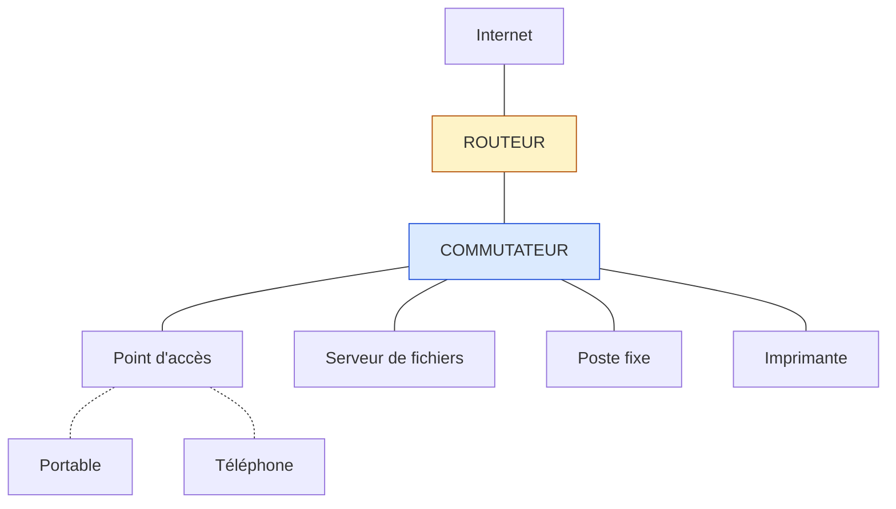
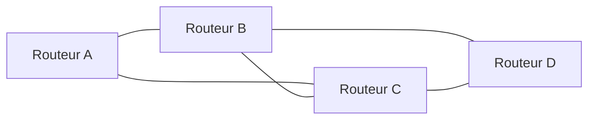

# Introduction aux réseaux informatiques

## Objectifs pédagogiques

À la fin de ce module, vous serez capable de :

- **Définir** ce qu'est un réseau informatique et **identifier** ses composants essentiels.
- **Distinguer** les réseaux local, sans fil local, étendu, Internet, intranet et extranet selon leur périmètre et leur public.
- **Associer** à chaque équipement (commutateur, routeur, point d'accès, serveur, poste) son rôle exact dans un schéma.
- **Comparer** les modèles client-serveur et pair-à-pair, ainsi que les topologies en étoile, en bus et en maillage.
- **Interpréter** les notions de bande passante, de débit, de latence, de gigue et de perte de paquets, et **mesurer** les trois dernières avec un `ping`.

## Mise en situation

Une petite agence de douze personnes emménage dans de nouveaux locaux. Le dirigeant veut que tout le monde accède aux mêmes dossiers partagés, qu'une imprimante serve l'ensemble des postes et que les visioconférences avec les clients se passent bien. Il faut aussi relier l'agence à un second bureau dans une autre ville, et donner un accès Wi-Fi aux visiteurs sans leur ouvrir les dossiers internes.

Le prestataire livre une « box » et un carton de câbles. Où brancher quoi ? Pourquoi les visios saccadent-elles dans la salle de réunion alors que les téléchargements fonctionnent ? Pourquoi l'imprimante répond-elle à certains postes et pas à d'autres ?

Ces questions ont une réponse simple dès qu'on comprend ce qu'est un réseau, ce qui le compose et comment on mesure sa qualité. C'est le but de ce module. Nous reviendrons sur cette agence à la fin pour diagnostiquer un cas concret.

## Qu'est-ce qu'un réseau, et à quoi ça sert ?

Avant les réseaux, partager un document signifiait le copier sur une clé USB et le porter à la main, et une imprimante était branchée sur un seul ordinateur. Un réseau supprime ce transport physique : les machines s'envoient directement des données.

> 🧠 **Concept fondamental**
>
> Un réseau informatique, c'est trois ingrédients réunis :
>
> 1. **Des équipements** qui émettent, reçoivent ou relaient des données (on les appelle des *nœuds*).
> 2. **Un support** qui les relie : câble de cuivre, fibre optique ou ondes radio.
> 3. **Des règles communes**, les protocoles, qui indiquent comment se parler : quel format, dans quel ordre, comment vérifier que le message est arrivé.
{: .callout .callout-important}

Retirez l'un des trois et plus rien ne fonctionne. Deux machines reliées par un câble mais sans règles communes ne se comprennent pas, tout comme deux personnes au téléphone qui ne parlent pas la même langue.

> 📮 **Analogie : le réseau postal**
>
> Les nœuds sont les expéditeurs, les centres de tri et les destinataires. Le support, ce sont les camions, les trains et les avions. Les protocoles sont le format des adresses, les codes postaux et les règles d'affranchissement. Cette analogie nous resservira.
{: .callout .callout-analogie}

À quoi sert un réseau ? Il apporte quatre bénéfices :

- **Partager des ressources** : imprimantes, stockage, applications.
- **Communiquer** : messagerie, visioconférence, téléphonie.
- **Centraliser** les données, ce qui facilite les sauvegardes et le contrôle des accès.
- **Accéder à d'autres réseaux**, dont Internet.

Ces bénéfices ont une contrepartie : tout ce qui est relié devient joignable, et donc attaquable. C'est pourquoi les modules suivants sur la sécurité s'appuient sur ce socle.

## Les périmètres : LAN, WAN, Internet et les autres

Les réseaux se classent par **portée** (jusqu'où ils s'étendent) et par **public** (qui y a accès). Ces deux critères sont souvent mélangés, d'où la confusion.

| Terme | Signification | Périmètre | Exemple |
|-------|---------------|-----------|---------|
| LAN — Local Area Network | Réseau local | Un bâtiment, un étage, une salle | Les postes et l'imprimante de l'agence |
| WLAN — Wireless Local Area Network | Réseau local sans fil | Même zone qu'un LAN, mais par ondes radio | Le Wi-Fi de l'agence |
| WAN — Wide Area Network | Réseau étendu | Plusieurs sites, villes ou pays | La liaison entre l'agence et son second bureau |
| Internet | Interconnexion mondiale de réseaux | Planète | Le réseau de réseaux que tout le monde utilise |
| Intranet | Services internes accessibles aux seuls membres de l'organisation | Selon l'organisation | Le portail RH, le wiki interne |
| Extranet | Intranet ouvert à des partenaires identifiés | Selon les accords | Un portail fournisseur avec comptes dédiés |

La distinction LAN/WAN tient moins à la distance qu'à **qui possède les liens**. Dans un LAN, l'organisation possède ou contrôle les câbles et les équipements. Dans un WAN, elle loue le plus souvent des liaisons à un opérateur, ou utilise Internet pour relier ses sites.

> 💡 **Point clé**
>
> Intranet et extranet décrivent un **type d'accès**, pas une technologie ni une distance. Un intranet peut être hébergé dans le cloud, et un extranet peut passer par Internet via un VPN* chiffré. Ce qui compte, c'est que seules les personnes autorisées y entrent.
{: .callout .callout-important}

> ⚠️ **Comportement contre-intuitif**
>
> *Internet* et *le Web* ne sont pas synonymes. Internet est l'infrastructure : les réseaux et les liaisons qui les relient. Le Web n'est qu'un service parmi d'autres qui circule dessus, comme la messagerie, la visioconférence ou le transfert de fichiers. Lorsqu'un site web est inaccessible, Internet n'est pas forcément en panne.
{: .callout .callout-attention}

*\*VPN (Virtual Private Network) : tunnel chiffré qui permet de traverser un réseau non fiable comme Internet comme si l'on était sur un réseau privé.*

## Les équipements : qui fait quoi

Voici les acteurs du réseau de l'agence, du plus simple au plus structurant.

| Équipement | Rôle | Exemple |
|------------|------|---------|
| Poste de travail | Machine de l'utilisateur, qui consomme des services | PC portable, poste fixe |
| Serveur | Machine qui fournit un service en continu | Serveur de fichiers, serveur d'impression |
| Commutateur (switch) | Relie les équipements d'**un même réseau local** et achemine les données vers le bon port | Boîtier à 24 ports Ethernet |
| Routeur | Relie **des réseaux différents** et choisit le chemin des données entre eux | Équipement entre l'agence et Internet |
| Point d'accès (AP) | Offre une porte d'entrée sans fil vers le réseau filaire | Borne Wi-Fi au plafond |

La confusion la plus courante concerne le commutateur et le routeur.

> 📮 **Analogie : le facteur et le centre de tri**
>
> Le commutateur est le facteur du quartier : il distribue le courrier entre les maisons d'un même quartier. Le routeur est le centre de tri : il oriente le courrier vers les autres villes. L'un fait communiquer les machines d'un même réseau, l'autre fait communiquer des réseaux entre eux.
{: .callout .callout-analogie}

Nous préciserons la mécanique dans les modules sur l'adressage et le routage.



Les traits pleins représentent des câbles et les traits pointillés des liaisons Wi-Fi. Ce schéma simplifié montre le réseau interne de l'agence, sans le Wi-Fi invité ni la liaison vers le second bureau.

> 💡 **Point clé**
>
> La « box » fournie par un opérateur n'est pas un équipement unique : c'est un **boîtier multifonction** qui regroupe un routeur, un petit commutateur et un point d'accès Wi-Fi. Dans un réseau d'entreprise, ces fonctions sont séparées parce qu'on veut pouvoir les dimensionner, les sécuriser et les remplacer indépendamment.
{: .callout .callout-important}

## Qui parle à qui : client-serveur ou pair-à-pair

Dans une conversation réseau, il y a toujours un côté qui demande et un côté qui répond, mais ces rôles ne sont pas figés.

**Dans l'architecture client-serveur**, un équipement dédié (le serveur) attend les demandes et les traite. Les clients se contentent de demander. Quand vous ouvrez une page web ou consultez vos mails, votre navigateur ou votre messagerie est le client, et le site ou la boîte de messagerie est servi par un serveur.

La force du modèle est la centralisation : un seul endroit à sauvegarder, à mettre à jour et à contrôler. Sa faiblesse en découle : si le serveur tombe, le service disparaît.

**Dans l'architecture pair-à-pair (P2P, Peer-to-Peer)**, chaque machine est à la fois cliente et serveuse. Deux collègues qui partagent un dossier directement entre leurs postes font du P2P, comme certaines visioconférences qui relient les participants en direct.

Pas d'infrastructure à entretenir, c'est simple à mettre en place, mais c'est difficile à administrer dès que le nombre de machines augmente : où sont les données ? Qui a le droit de quoi ? Qui sauvegarde ?

> 💡 **Point clé**
>
> Client et serveur désignent un **rôle dans un échange**, pas un type de machine. Votre portable peut servir un fichier à un collègue (rôle serveur), puis interroger un site web (rôle client) quelques secondes plus tard. Un « serveur » physique peut lui aussi être client d'un autre serveur, par exemple pour récupérer ses mises à jour.
{: .callout .callout-important}

Dans l'agence, le choix est vite fait : douze personnes, des données métier à protéger, des sauvegardes à garantir. On opte pour un serveur de fichiers central, plutôt qu'un partage entre postes.

## Filaire ou sans fil

Le choix du support change surtout la **fiabilité** et la **sécurité** du réseau, plus que la rapidité annoncée.

| Critère | Filaire | Sans fil (Wi-Fi) |
|---------|---------|------------------|
| Débit constant | Oui, dédié à chaque liaison | Variable, partagé entre tous les appareils connectés à la borne |
| Sensibilité aux perturbations | Faible | Murs, distance, autres réseaux Wi-Fi, micro-ondes |
| Mobilité | Aucune | Totale dans la zone de couverture |
| Surface d'attaque | Il faut un accès physique à un câble ou une prise | Le signal déborde du local, il peut être capté de l'extérieur |
| Usage typique | Serveurs, imprimantes, bornes Wi-Fi, postes fixes | Portables, téléphones, visiteurs |

Le point à retenir pour la suite : le Wi-Fi est un **support partagé**. Quand dix appareils sont connectés à une même borne, ils se partagent le temps d'émission. Le débit affiché sur la borne (par exemple 1 200 Mbit/s) est un maximum théorique, rarement atteint en pratique.

> 💡 **À retenir**
>
> Tout ce qui ne bouge pas se branche en filaire, et le Wi-Fi sert à ce qui se déplace. Cela vaut en particulier pour les serveurs et les bornes Wi-Fi elles-mêmes, qui doivent être reliées au commutateur par câble.
{: .callout .callout-important}

## Topologies : la forme du réseau

La **topologie** décrit la façon dont les équipements sont reliés. On la considère sous deux angles qu'il ne faut pas confondre :

- La **topologie physique** : comment les câbles et les équipements sont réellement installés.
- La **topologie logique** : comment les données circulent, et qui peut parler à qui.

| Topologie | Principe | Avantages | Limites |
|-----------|----------|-----------|---------|
| Étoile | Tous les équipements sont reliés à un point central (le commutateur) | Simple à étendre ; une panne de câble n'isole qu'un seul poste | Si le point central tombe, tout s'arrête |
| Bus | Un câble unique sur lequel tous les équipements sont branchés | Peu de câble | Une coupure divise le réseau en deux ; collisions fréquentes ; abandonnée en filaire |
| Maillage | Plusieurs chemins existent entre les équipements | Résistant aux pannes, plusieurs routes possibles | Coûteux en liens ; plus complexe à gérer |

Le **maillage** est dit *complet* quand chaque équipement est relié à tous les autres, ce qui demande n×(n−1)/2 liens. Pour 10 équipements, cela fait 45 liaisons, un coût inacceptable en pratique. On préfère un **maillage partiel**, où seuls les équipements critiques ont plusieurs chemins.



Ce schéma montre un maillage partiel : si la liaison B–D est coupée, le trafic de B vers D passe par C. C'est le principe d'Internet et des WAN d'entreprise, où la redondance entre routeurs est la règle.

En pratique, un réseau d'entreprise combine ces topologies. Les postes se branchent en **étoile** sur des commutateurs, et ces commutateurs, ainsi que les routeurs qui relient les sites, sont souvent **maillés** entre eux pour la redondance. Le **bus** a disparu des réseaux filaires modernes, mais on retrouve son esprit dans le Wi-Fi : tout le monde partage le même espace radio, comme tout le monde partageait autrefois le même câble.

> ⚠️ **Comportement contre-intuitif**
>
> Une topologie physique ne dit pas tout de la topologie logique. Dans l'agence, tous les postes sont branchés sur le même commutateur : physiquement, c'est une étoile unique. Pourtant, le Wi-Fi invité et le réseau interne peuvent être totalement séparés, comme deux réseaux distincts. Quand on dessine un schéma réseau, il faut souvent faire **deux dessins** : l'un pour les câbles, l'autre pour ce qui communique avec quoi.
{: .callout .callout-attention}

## Mesurer la qualité d'un réseau

Dire « le réseau est lent » ne veut rien dire. Cinq notions permettent de décrire précisément le problème. Pour les fixer, reprenons l'analogie routière :

| Notion | Définition | Analogie | Unité |
|--------|------------|----------|-------|
| Bande passante | Capacité maximale théorique d'une liaison | Le nombre de voies de l'autoroute | Mbit/s, Gbit/s |
| Débit | Quantité de données réellement transférée par seconde | Le nombre de véhicules qui passent réellement par heure | Mbit/s |
| Latence | Temps qu'un paquet met pour aller d'un point à un autre (souvent mesuré en aller-retour) | La durée du trajet | ms |
| Gigue | Variation de la latence d'un paquet à l'autre | L'irrégularité des temps de trajet (parfois 20 minutes, parfois 1 heure) | ms |
| Perte de paquets | Proportion de paquets qui n'arrivent jamais | Les colis perdus en route | % |

Ces notions sont **indépendantes** : un réseau peut avoir une grande bande passante et une mauvaise latence, ou l'inverse. Un lien par satellite géostationnaire offre un bon débit pour télécharger un fichier, mais sa latence tourne autour de plusieurs centaines de millisecondes (de l'ordre de 600 ms en aller-retour), ce qui rend une conversation vocale pénible.

> ⚠️ **Comportement contre-intuitif**
>
> Augmenter la bande passante ne règle pas tous les problèmes. Si la visioconférence saccade à cause de la gigue ou de la perte de paquets, passer de 100 à 1 000 Mbit/s n'y changera rien, sauf si ces défauts viennent d'une liaison saturée (par exemple un envoi montant plein pendant la visio). Un téléchargement tolère une latence élevée, mais une conversation vocale ou vidéo tolère mal les variations et les pertes.
{: .callout .callout-attention}

> 💡 **À retenir**
>
> La bande passante s'exprime en **bits** par seconde, la taille des fichiers en **octets**. Un octet vaut 8 bits : divisez par 8. Une liaison de 100 Mbit/s transfère donc au mieux environ 12,5 Mo/s, avant d'enlever les pertes dues aux protocoles.
{: .callout .callout-important}

Les ordres de grandeur ci-dessous sont indicatifs et dépendent de l'environnement :

- Dans un LAN filaire, la latence est généralement inférieure à 1 ms.
- Vers un site situé dans le même pays, comptez quelques dizaines de millisecondes.
- Une perte de paquets proche de 0 % est la normale ; au-delà de 1 %, il faut chercher la cause.

### Mesurer avec ping

Le moyen le plus simple de mesurer latence, gigue et perte est la commande `ping`. Elle envoie de petits messages de test à un équipement et chronomètre chaque réponse. Sous Linux et macOS, on limite le nombre d'envois avec `-c` ; sous Windows, c'est `-n`.

```bash
ping -c 4 192.168.1.1
```

Résultat attendu (exemple sous Linux ; macOS et Windows présentent le résumé autrement) :

```text
64 bytes from 192.168.1.1: icmp_seq=1 ttl=64 time=0.42 ms
64 bytes from 192.168.1.1: icmp_seq=2 ttl=64 time=0.38 ms
64 bytes from 192.168.1.1: icmp_seq=3 ttl=64 time=0.55 ms
64 bytes from 192.168.1.1: icmp_seq=4 ttl=64 time=0.44 ms

4 packets transmitted, 4 received, 0% packet loss, time 3004ms
rtt min/avg/max/mdev = 0.38/0.45/0.55/0.06 ms
```

Chaque ligne donne le temps d'un aller-retour (`time=`). Le résumé final contient trois informations utiles :

- `0% packet loss` : aucune perte.
- `avg` : la latence moyenne.
- `mdev` : l'écart autour de la moyenne, qui donne une bonne idée de la gigue. Plus il est grand par rapport à `avg`, plus le lien est irrégulier.

Avec seulement 4 envois, la mesure reste fragile. Pour repérer des pertes occasionnelles, il vaut mieux envoyer une centaine de paquets : `ping -c 100 <IP>`. Nous détaillerons ces outils dans le module consacré au diagnostic réseau.

## Cas pratique : les visios qui saccadent à l'agence

*Ce scénario est illustratif : les chiffres sont inventés pour les besoins de l'exemple.*

Revenons à notre agence. Les visioconférences coupent régulièrement dans la salle de réunion, alors que les téléchargements y aboutissent. Le dirigeant soupçonne l'abonnement Internet et veut passer à une offre plus rapide.

Avant de payer plus, on mesure. Depuis un portable en Wi-Fi dans la salle de réunion, puis depuis un poste fixe câblé, on lance 100 `ping` vers la box. Les résultats sont les suivants :

| Poste de test | Perte | Latence moyenne | Latence max | mdev |
|---------------|-------|-----------------|-------------|------|
| Poste fixe (câble) | 0 % | 0,5 ms | 1,1 ms | 0,1 ms |
| Portable (salle de réunion, Wi-Fi) | 3 % | 8 ms | 180 ms | 25 ms |

Le diagnostic ressort des chiffres. C'est la **perte** et la **gigue** qui sont mauvaises, uniquement en Wi-Fi, et uniquement dans cette pièce. Un téléchargement s'en accommode en ralentissant, une visio en temps réel non.

Le problème se situe donc entre le portable et la box, avant même la liaison Internet. Le signal Wi-Fi arrive trop faible dans la salle, qui se trouve à l'autre bout du bâtiment, derrière des cloisons.

La correction n'a rien à voir avec l'abonnement Internet. On installe un point d'accès dans la salle de réunion et on le relie par câble au commutateur. Après changement, un nouveau test donne une perte de 0 % et un `mdev` inférieur à 2 ms. Les visios redeviennent stables sans toucher au contrat de l'opérateur.

Ce cas illustre la méthode à retenir : on identifie d'abord **quelle** grandeur est dégradée (débit, latence, gigue ou perte), puis **où** (sur quel segment), et on agit seulement ensuite.

## Bonnes pratiques

Même à ce stade, quelques réflexes évitent de mauvaises surprises :

- **Dessinez avant de brancher.** Un schéma des équipements, avec leurs rôles et leurs liaisons, vaut mieux qu'une explication orale, et il servira à tous ceux qui interviendront après vous.
- **Séparez les rôles.** Un routeur, un commutateur et un point d'accès peuvent tenir dans une seule box à la maison, mais en entreprise, des équipements distincts permettent de changer ou de sécuriser une fonction sans toucher aux autres.
- **Câblez ce qui ne bouge pas.** Serveurs, imprimantes, bornes Wi-Fi et postes fixes se branchent en filaire. Le Wi-Fi est réservé aux terminaux mobiles.
- **Prévoyez de la redondance là où une panne coûte cher.** Une étoile simple suffit pour des postes. Pour une liaison critique entre deux sites, prévoyez un second chemin.
- **Mesurez avant d'incriminer.** Un `ping` vers la passerelle, puis vers Internet, localise le problème en moins d'une minute. Cela évite de remplacer un équipement qui fonctionne.
- **Séparez le public et l'interne.** Le Wi-Fi visiteurs ne doit pas donner accès aux ressources internes. Vous apprendrez à le mettre en place plus tard dans le parcours, mais pensez-y dès la conception.

## Résumé

| Concept | Rôle | Points clés |
|---------|------|-------------|
| Réseau | Permettre à des équipements d'échanger des données | Équipements + support + protocoles : retirez-en un et rien ne fonctionne |
| LAN / WLAN / WAN | Classer les réseaux par portée | LAN et WLAN sont locaux ; WAN relie des sites, souvent via un opérateur |
| Internet, intranet, extranet | Distinguer public, interne et partenaires | Intranet et extranet décrivent un type d'accès, pas une technologie |
| Commutateur / routeur / point d'accès | Relier les machines, les réseaux, et offrir le Wi-Fi | Commutateur = au sein d'un réseau ; routeur = entre réseaux |
| Client-serveur / P2P | Organiser les échanges | Client et serveur sont des rôles dans un échange, pas des machines |
| Étoile / bus / maillage | Décrire la forme du réseau | Physique et logique sont différentes ; l'étoile domine, le maillage assure la redondance |
| Bande passante, débit, latence, gigue, perte | Mesurer la qualité | Cinq notions indépendantes ; `ping` donne latence, gigue et perte en une commande |

Vous savez maintenant ce qui compose un réseau et comment le décrire. Reste à comprendre **comment ces équipements arrivent à se comprendre** : comment un message est découpé, adressé, transporté et réassemblé. C'est ce que les modèles de référence permettent d'expliquer.

<!-- snippet
id: reseaux_intro_definition_reseau
type: concept
tech: reseaux
level: beginner
importance: high
format: knowledge
tags: reseaux,definition,protocoles,fondamentaux
title: Les trois ingrédients d'un réseau
content: Un réseau repose sur trois éléments indissociables : des nœuds (postes, serveurs, commutateurs), un support (cuivre, fibre, ondes radio) et des protocoles, c'est-à-dire des règles communes de format et d'échange. Deux machines reliées par un câble mais sans protocole commun ne peuvent rien se dire.
description: Équipements, support et protocoles sont tous indispensables : sans règles communes, un simple câble ne suffit pas à faire communiquer deux machines.
-->

<!-- snippet
id: reseaux_intro_lan_wan_difference
type: concept
tech: reseaux
level: beginner
importance: medium
format: knowledge
tags: reseaux,lan,wan,perimetre
title: LAN et WAN : le critère est qui possède les liens
content: Un LAN couvre une zone restreinte (salle, bâtiment) où l'organisation possède ou contrôle câbles et équipements. Un WAN relie des sites distants en s'appuyant sur des liaisons louées à un opérateur ou sur Internet. La distance compte moins que la maîtrise de l'infrastructure.
description: LAN et WAN se distinguent par le contrôle des liaisons, pas seulement par la distance : le LAN est maîtrisé, le WAN passe par un opérateur.
-->

<!-- snippet
id: reseaux_intro_switch_vs_routeur
type: concept
tech: reseaux
level: beginner
importance: high
format: knowledge
tags: commutateur,routeur,equipements,reseaux
title: Commutateur et routeur : deux rôles différents
content: Le commutateur relie les équipements d'un même réseau local et envoie les données vers le bon port. Le routeur relie des réseaux différents et choisit le chemin entre eux. Analogie : le commutateur est le standard d'un immeuble, le routeur la sortie vers la rue. La box d'un opérateur cumule les deux fonctions, plus le Wi-Fi.
description: Le commutateur fait communiquer les machines d'un même réseau, le routeur fait communiquer des réseaux entre eux ; une box regroupe les deux.
-->

<!-- snippet
id: reseaux_intro_client_serveur_role
type: concept
tech: reseaux
level: beginner
importance: medium
format: knowledge
tags: client-serveur,p2p,architecture,reseaux
title: Client et serveur sont des rôles, pas des machines
content: Dans un échange, le client demande et le serveur répond. Une même machine peut tenir les deux rôles à des moments différents : un portable qui partage un dossier est serveur, puis redevient client quand il ouvre un site web. En pair-à-pair, chaque machine cumule les deux rôles en permanence, sans serveur central.
description: Client ou serveur dépend de l'échange en cours ; en pair-à-pair, chaque machine cumule les deux rôles, au prix d'une administration plus difficile.
-->

<!-- snippet
id: reseaux_intro_topologie_physique_logique
type: warning
tech: reseaux
level: beginner
importance: medium
format: knowledge
tags: topologie,etoile,maillage,schema
title: Topologie physique et logique : deux schémas distincts
content: Piège : déduire qui communique avec qui à partir du seul câblage. Conséquence : des postes branchés sur le même commutateur (étoile physique) peuvent appartenir à des réseaux logiques séparés, comme le Wi-Fi invité et le réseau interne. Correction : documenter deux schémas, l'un pour les câbles, l'autre pour les flux autorisés.
description: Le câblage ne dit pas qui peut parler à qui : une étoile physique peut héberger plusieurs réseaux logiques isolés.
-->

<!-- snippet
id: reseaux_intro_bande_passante_vs_latence
type: warning
tech: reseaux
level: beginner
importance: high
format: knowledge
tags: bande-passante,latence,gigue,performance
title: Plus de bande passante ne corrige pas toujours la gigue
content: Piège : croire qu'une liaison plus rapide règle toutes les lenteurs. Conséquence : une visio qui saccade à cause de la gigue ou de la perte de paquets reste inchangée en passant de 100 à 1 000 Mbit/s, sauf si la liaison était saturée. Correction : mesurer d'abord (ping) pour savoir si c'est le débit, la latence, la gigue ou la perte qui est dégradé.
description: Bande passante, latence, gigue et perte sont indépendantes ; la voix et la vidéo souffrent surtout des deux dernières, pas du manque de débit.
-->

<!-- snippet
id: reseaux_intro_bits_octets
type: concept
tech: reseaux
level: beginner
importance: medium
format: knowledge
tags: bande-passante,debit,unites,conversion
title: Mbit/s et Mo/s : diviser par 8
content: La bande passante s'exprime en bits par seconde, la taille des fichiers en octets, et 1 octet = 8 bits. Une liaison de 100 Mbit/s transfère donc au mieux 12,5 Mo/s, et moins en pratique à cause des en-têtes de protocoles. Un fichier de 1 Go demande ainsi plus de 80 secondes sur cette liaison.
description: Diviser les Mbit/s par 8 pour obtenir les Mo/s : 100 Mbit/s donnent au plus 12,5 Mo/s, avant déduction des surcoûts de protocole.
-->

<!-- snippet
id: reseaux_intro_ping_commande
type: command
tech: reseaux
level: beginner
importance: high
format: knowledge
tags: ping,latence,diagnostic,perte
title: Mesurer latence et perte avec ping
context: Linux et macOS utilisent -c pour le nombre d'envois ; sous Windows, l'option équivalente est -n
command: ping -c <NOMBRE> <IP>
example: ping -c 4 192.168.1.1
description: Envoie des messages de test et affiche le temps aller-retour de chacun, le pourcentage de paquets perdus et un résumé min/avg/max/mdev sous Linux (stddev sous macOS ; Minimum/Maximum/Moyenne sous Windows).
-->

<!-- snippet
id: reseaux_intro_ping_lire_resultat
type: tip
tech: reseaux
level: beginner
importance: medium
format: knowledge
tags: ping,gigue,perte,diagnostic
title: Lire la gigue et la perte dans la sortie de ping
content: Lancer ping -c 100 sur la passerelle puis sur un site externe. Lire la ligne finale : "packet loss" doit rester proche de 0 % (au-delà de 1 %, chercher la cause) et un mdev élevé par rapport à avg trahit une gigue. Si la passerelle est saine mais pas la cible externe, le problème est en aval du routeur.
description: Cent envois suffisent à voir des pertes occasionnelles ; comparer passerelle et cible externe localise le segment fautif.
-->

<!-- snippet
id: reseaux_intro_internet_vs_web
type: warning
tech: reseaux
level: beginner
importance: low
format: knowledge
tags: internet,web,services,vocabulaire
title: Internet n'est pas le Web
content: Piège : confondre le réseau et l'un de ses services. Conséquence : un site web injoignable est pris pour une panne d'Internet, alors que la messagerie ou la visio peuvent fonctionner. Correction : tester la connectivité de base avec ping vers une adresse IP, puis tester le service web séparément.
description: Internet est l'infrastructure qui relie les réseaux ; le Web n'est qu'un service parmi d'autres, et son indisponibilité ne prouve pas une panne du réseau.
-->

<!-- snippet
id: reseaux_intro_wifi_support_partage
type: concept
tech: reseaux
level: beginner
importance: medium
format: knowledge
tags: wifi,wlan,debit,filaire
title: Le Wi-Fi est un support partagé
content: Tous les appareils connectés à une même borne se partagent le temps d'émission radio, contrairement à un câble dédié à chaque poste. Le débit annoncé (par exemple 1 200 Mbit/s) est un maximum théorique, qui baisse avec le nombre d'appareils, la distance et les obstacles. Câbler les équipements fixes libère le Wi-Fi pour les terminaux mobiles.
description: Le débit Wi-Fi annoncé est un maximum théorique réparti entre tous les appareils de la borne ; le câble offre une liaison dédiée et stable.
-->
