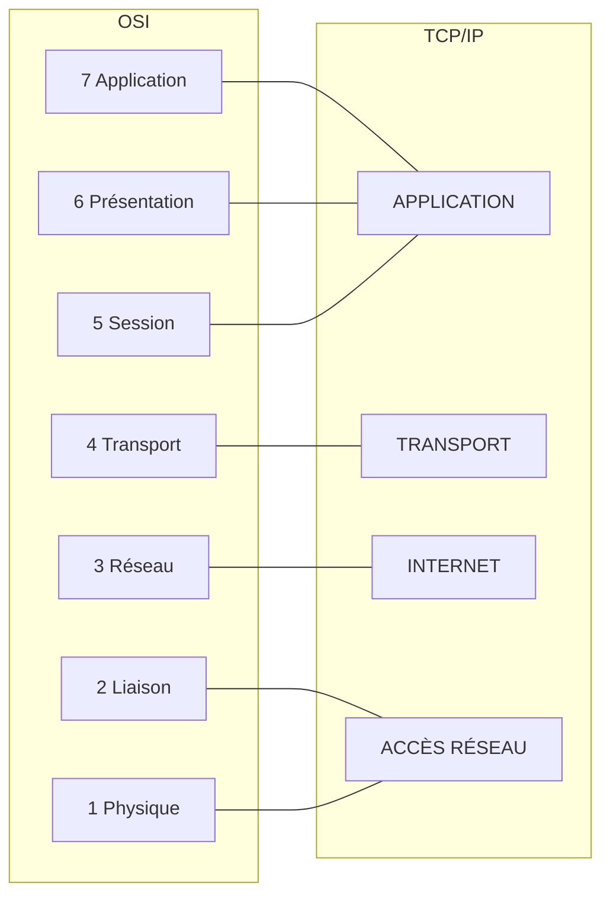
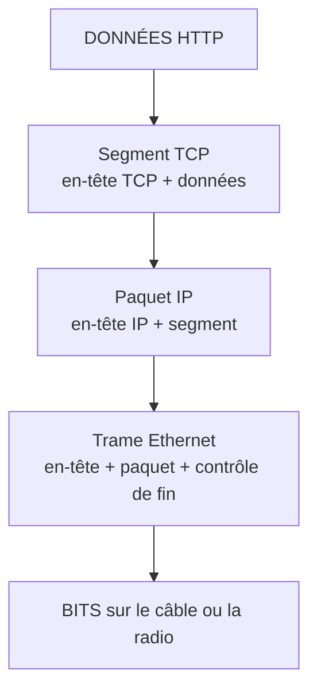
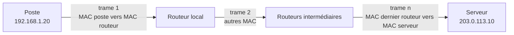

# Modèles OSI et TCP/IP

## Objectifs pédagogiques

À la fin de ce module, vous saurez :

- **Nommer** les sept couches du modèle OSI dans l'ordre et **décrire** le rôle de chacune en une phrase.
- **Faire correspondre** les couches OSI avec celles du modèle TCP/IP.
- **Expliquer** l'encapsulation et la désencapsulation, et **identifier** le PDU propre à chaque couche.
- **Retracer** le parcours d'une requête web, de l'URL tapée dans le navigateur jusqu'aux bits sur le câble.
- **Utiliser** les couches comme grille de diagnostic pour localiser une panne.

## Mise en situation

Vous venez d'arriver dans une PME de 40 postes. Un collègue vous appelle : « Internet ne marche plus. » Dans son navigateur, le site de l'entreprise affiche « site introuvable ». Pourtant sa messagerie fonctionne, et il voit ses fichiers sur le serveur partagé.

« Internet ne marche plus » ne veut rien dire d'exploitable. Le câble est-il branché ? L'ordinateur a-t-il une adresse ? Le routeur répond-il ? Le nom du site est-il résolu ? Le serveur écoute-t-il ? Chaque question vise un étage différent de la communication. Les modèles OSI et TCP/IP donnent ces étages, avec un vocabulaire commun pour les nommer. Sans eux, on teste au hasard. Avec eux, on élimine les causes méthodiquement, du bas vers le haut.

## Contexte et problématique

Faire communiquer deux machines est un problème énorme. Il faut représenter des bits sur un support physique, décider qui parle et quand, acheminer les données à travers des dizaines de réseaux intermédiaires, vérifier qu'elles arrivent complètes, puis les présenter à la bonne application. Un seul bloc de code qui ferait tout serait impossible à écrire, à faire évoluer et à faire cohabiter entre constructeurs.

La réponse consiste à **découper en couches**. Chaque couche résout un seul sous-problème, offre un service à la couche du dessus et s'appuie sur celle du dessous, sans se soucier de la façon dont elles fonctionnent. C'est comme l'envoi d'un colis : l'expéditeur emballe et écrit l'adresse, la poste trie et route, le transporteur roule. L'expéditeur ne sait pas quelles routes seront empruntées, et le chauffeur ignore ce que contient le colis.

Deux modèles décrivent ce découpage :

- Le **modèle OSI (Open Systems Interconnection)**, en sept couches, sert de référence théorique et de langage commun.
- Le **modèle TCP/IP (Transmission Control Protocol / Internet Protocol)**, en quatre couches, décrit la pile de protocoles réellement utilisée sur Internet.

🧠 **Concept fondamental** : ces modèles sont des **outils de raisonnement**. Ils ne dictent pas le code des équipements. Vous les utilisez pour comprendre, communiquer et diagnostiquer.

## Les sept couches OSI

On les numérote de bas en haut, et les professionnels parlent de « couche 2 » ou de « couche 7 » sans citer le nom. Voici la vue d'ensemble, que nous détaillons ensuite.

| N° | Couche | Rôle en une phrase | PDU | Exemples |
|----|--------|--------------------|-----|----------|
| 7 | Application | Fournit à l'application un service de communication | Données | HTTP, DNS — Domain Name System, SMTP |
| 6 | Présentation | Format, encodage, chiffrement des données | Données | TLS — Transport Layer Security*, encodages de caractères |
| 5 | Session | Ouvre, maintient et ferme un dialogue | Données | Gestion de sessions applicatives |
| 4 | Transport | Livraison de bout en bout, identifie l'application par un port | Segment (TCP) ou datagramme (UDP) | TCP — Transmission Control Protocol, UDP — User Datagram Protocol |
| 3 | Réseau | Adressage logique et acheminement entre réseaux | Paquet | IP — Internet Protocol, ICMP — Internet Control Message Protocol |
| 2 | Liaison de données | Livraison entre deux équipements voisins sur un même réseau local | Trame | Ethernet, Wi-Fi, ARP — Address Resolution Protocol |
| 1 | Physique | Transmission des bits sur le support | Bits | Câble cuivre, fibre, ondes radio |

*TLS est l'un des protocoles où la frontière entre couches est floue : il s'insère entre l'application et le transport, et on le range tantôt en couche 6, tantôt en couche 5 ou 7.

### Du bas vers le haut

**Couche 1, physique.** Elle ne connaît que des signaux : tensions, impulsions lumineuses, ondes. Un bit n'a pas de sens à ce niveau, il s'agit simplement d'un état du support. C'est aussi la première chose à vérifier en cas de panne : un câble débranché est une panne de couche 1.

**Couche 2, liaison.** Elle gère la communication entre deux équipements qui partagent le même segment local, par exemple votre poste et le switch auquel il est relié. Elle utilise des adresses **MAC (Media Access Control)**, propres à chaque carte réseau. Ces adresses n'ont de portée que locale : elles ne traversent jamais un routeur. Le module suivant détaille cette couche et Ethernet.

**Couche 3, réseau.** Là commence le voyage « à travers le monde ». La couche réseau attribue des adresses logiques (les adresses IP) et choisit à chaque étape le prochain équipement à qui confier les données. C'est la couche des routeurs.

**Couche 4, transport.** Une fois le paquet arrivé sur la bonne machine, à quelle application doit-il aller ? La couche transport répond avec les **ports**. Elle décide aussi du niveau de garantie : TCP fiabilise la livraison (accusés de réception, retransmissions, ordre), UDP envoie sans promesse, mais avec peu de latence.

**Couches 5, 6, 7.** Dans la théorie OSI, la session gère le dialogue, la présentation s'occupe du format et du chiffrement, et l'application offre le service final. En pratique, une même bibliothèque ou un même protocole couvre souvent les trois. Quand un technicien dit « problème applicatif », il pense généralement à tout ce bloc.

💡 **Point clé** : « couche 7 » désigne les protocoles qui servent directement l'application (HTTP, DNS...), pas l'application elle-même. Votre navigateur est un logiciel qui *utilise* HTTP.

## Le modèle TCP/IP et sa correspondance avec OSI

Le modèle TCP/IP est né de la pratique, et il est plus compact : il fusionne les couches hautes et les couches basses d'OSI.



| TCP/IP | Équivalent OSI | Ce qu'on y trouve |
|--------|----------------|-------------------|
| Application | 5, 6, 7 | HTTP, DNS, SMTP, TLS |
| Transport | 4 | TCP, UDP |
| Internet | 3 | IP, ICMP |
| Accès réseau | 1 et 2 | Ethernet, Wi-Fi, ARP selon les présentations |

Vous croiserez aussi un modèle TCP/IP « à cinq couches », qui sépare physique et liaison. Ce n'est pas une contradiction, simplement une autre manière d'enseigner. Les deux versions existent dans les manuels, et ce qui compte est de s'entendre sur la lecture utilisée.

En pratique, on mélange les deux : la pile de protocoles est celle de TCP/IP, mais on emploie la numérotation OSI pour parler. Quand quelqu'un évoque « un switch de couche 2 » ou « un pare-feu de couche 7 », il parle bien d'OSI.

## Encapsulation et désencapsulation

Votre navigateur veut envoyer une requête web. Il remet les données à la couche inférieure, qui ajoute **son propre en-tête**, puis passe le tout à la suivante, qui ajoute à son tour le sien. Chaque couche traite ce qu'elle reçoit comme une boîte opaque, dont elle ne lit pas le contenu : c'est l'**encapsulation**. À l'arrivée, le mécanisme inverse, la **désencapsulation**, retire les en-têtes un par un, chaque couche ne lisant que le sien.

L'image des poupées russes ou des enveloppes imbriquées est parlante : une enveloppe pour le routage local, qui contient une enveloppe pour le routage global, qui contient une enveloppe pour l'application destinataire, qui contient enfin la lettre.



### Le PDU, ou comment nommer ce qui circule

Le **PDU (Protocol Data Unit)** désigne l'unité de données telle qu'elle existe à une couche donnée. Chaque couche donne un nom différent à ce qu'elle manipule :

| Couche | Nom du PDU | Ce qu'il contient |
|--------|-----------|-------------------|
| Application | Données | Message HTTP, requête DNS |
| Transport | Segment (TCP) ou datagramme (UDP) | En-tête (ports, numéros de séquence...) + données |
| Réseau | Paquet | En-tête IP (adresses source et destination...) + segment |
| Liaison | Trame | En-tête (adresses MAC) + paquet + contrôle d'erreur |
| Physique | Bits | Signal sur le support |

Dans la vie courante, on dit « paquet » pour tout, et personne ne vous en tiendra rigueur. Mais pour décrire précisément un échange, ce vocabulaire évite les ambiguïtés : « la trame est rejetée » (couche 2) et « le paquet est abandonné » (couche 3) ne désignent pas la même panne.

💡 **Point clé** : l'encapsulation a un coût. Un segment TCP porte au minimum 20 octets d'en-tête, un paquet IPv4 en ajoute au moins 20, et la trame Ethernet encore 18 (14 octets d'en-tête et 4 octets de contrôle de fin). Sur une trame de 1 500 octets de charge utile, il reste donc au plus 1 460 octets pour les données applicatives. Pour les très petits messages, l'en-tête pèse parfois plus que le message.

## Parcours d'une requête web à travers les couches

Voyons concrètement ce qui se passe quand vous tapez `https://www.example.org/` et appuyez sur Entrée. Nous suivons la requête depuis un poste d'adresse `192.168.1.20`, derrière un routeur `192.168.1.1`. Le serveur répond à l'adresse `203.0.113.10` (une adresse de documentation, utilisée ici à titre d'exemple).

**Étape 0 : résoudre le nom.** Le navigateur ne connaît pas l'adresse de `www.example.org`. Il interroge d'abord le DNS, par une requête de couche 7, portée par un datagramme UDP vers le port 53. La réponse donne `203.0.113.10`. Ce « détour » passe lui aussi par toutes les couches, exactement comme le reste.

**Couche 7, application.** Le navigateur construit un message HTTP : « GET / » avec quelques en-têtes. Comme l'URL commence par `https`, ce message est d'abord chiffré par TLS, qui joue le rôle des couches 5 et 6 : il établit un canal sécurisé avant que le moindre contenu web ne circule.

**Couche 4, transport.** Le système d'exploitation ouvre une connexion TCP vers le port 443 du serveur. Le port source est choisi par le poste, au hasard dans une plage haute, par exemple `51724`. Le couple « adresses IP + ports » identifie la conversation de façon unique. Les données sont découpées en segments numérotés.

**Couche 3, réseau.** Chaque segment est placé dans un paquet IP, avec comme adresse source `192.168.1.20` et comme destination `203.0.113.10`. Le poste constate que cette destination n'est pas dans son réseau local. Il ne peut donc pas l'atteindre directement et confie le paquet à sa passerelle par défaut, le routeur.

**Couche 2, liaison.** Il faut maintenant une trame pour franchir le premier saut. L'adresse MAC de destination est celle du **routeur** (obtenue au besoin par ARP), et non celle du serveur situé à l'autre bout d'Internet. C'est un point qui déroute souvent les débutants.

**Couche 1, physique.** La trame devient des bits, puis un signal électrique, lumineux ou radio.

⚠️ **Comportement contre-intuitif** : au fil du voyage, **les adresses MAC changent à chaque saut, mais les adresses IP restent les mêmes** (hors traduction d'adresses comme le NAT — Network Address Translation, vu au module 08). L'adresse IP indique la destination finale, tandis que la MAC indique seulement le prochain voisin. À chaque routeur, la trame est désencapsulée jusqu'au paquet, le routeur décide du prochain saut, puis il réencapsule dans une nouvelle trame.



Sur le chemin, un switch ne regarde que la trame (couche 2) et un routeur le paquet (couche 3). Un pare-feu applicatif, lui, remonte jusqu'à la couche 7. Plus un équipement « monte » dans les couches, plus il comprend le trafic, mais plus il a de travail à faire.

À l'arrivée, le serveur remonte la pile : la carte réseau vérifie la trame, l'IP vérifie que le paquet lui est destiné, TCP réassemble les segments dans l'ordre et les livre à l'application qui écoute sur le port 443, puis TLS déchiffre et le serveur web lit enfin la requête.

## Quand les modèles ne collent pas à la réalité

⚠️ **Piège classique** : OSI et TCP/IP sont des **modèles**, pas des descriptions exactes. Les protocoles réels débordent souvent des cases :

- **TLS** chiffre des données applicatives (couche 6 ?) en établissant une session (couche 5 ?), au-dessus de TCP (couche 4). Aucune couche ne le revendique clairement.
- **ARP** résout une adresse IP (couche 3) en adresse MAC (couche 2). Il dépend des deux sans appartenir franchement à aucune.
- Les **VPN et tunnels** placent un paquet IP à l'intérieur d'un autre paquet IP, ou dans des données applicatives. La « pile » se replie sur elle-même.
- **QUIC**, utilisé par HTTP/3, fournit transport fiable et chiffrement en un seul protocole, au-dessus d'UDP. Il mélange les couches 4 à 6.
- Les **étiquettes VLAN** (vues ensuite avec Ethernet) s'insèrent dans la trame de couche 2 mais servent à segmenter logiquement le réseau, ce qu'on associerait plutôt à la couche 3.

La conséquence pratique est simple : ne cherchez pas à tout prix « la » bonne couche d'un protocole. Dans une discussion ou une certification, on vous demandera parfois la réponse « officielle ». Dans un dépannage, le plus utile est de savoir *ce que fait le protocole* et *à quel moment il intervient dans la communication*.

Il faut aussi relativiser la place d'OSI. Les protocoles de la pile OSI d'origine ont presque tous disparu face à TCP/IP. Ce qui reste d'OSI, c'est son **vocabulaire**, que tout le monde utilise.

## Raisonner par couche pour diagnostiquer

La grille OSI devient très concrète dès que l'on part d'une panne. La règle : **partir du bas et monter**, en s'arrêtant à la première couche qui échoue. Pas besoin de maîtriser les outils en détail ici (le module 09 leur est consacré), mais voici un aperçu de ce qu'on interroge à chaque étage sous Linux :

| Question | Couche | Commande |
|----------|--------|----------|
| Le lien est-il actif ? Quelle adresse ai-je ? | 1, 2, 3 | `ip -br addr` |
| Quelle est ma passerelle ? | 3 | `ip route` |
| Mon voisin direct répond-il ? | 3 | `ping -c 2 <IP>` |
| Quelles connexions sont ouvertes ? | 4 | `ss -tn` |
| Que se passe-t-il dans toute la chaîne d'une requête web ? | 3 à 7 | `curl -v https://<HOST>` |

```bash
ip -br addr
```
```text
lo      UNKNOWN   127.0.0.1/8
eth0    UP        192.168.1.20/24
```

`UP` signifie que l'interface est active (couches 1 et 2 vraisemblablement correctes), et `192.168.1.20/24` que l'adresse de couche 3 est configurée. `DOWN` ou l'absence d'adresse indique qu'il est inutile de chercher plus haut.

```bash
ss -tn
```
```text
State  Recv-Q Send-Q Local Address:Port    Peer Address:Port
ESTAB  0      0      192.168.1.20:51724    203.0.113.10:443
```

Vous retrouvez ici les éléments vus plus haut : le port éphémère local, le port 443 du serveur et l'état `ESTAB`, qui confirme qu'une connexion TCP est établie.

```bash
curl -v https://www.example.org
```

Dans la sortie, des lignes préfixées par `*` montrent la résolution DNS, la connexion TCP et la négociation TLS. Les lignes `>` sont les en-têtes de la requête HTTP envoyée, et les lignes `<` ceux de la réponse. En une commande, vous voyez les couches 7, 6, 4 et 3 à l'œuvre l'une après l'autre.

💡 **Point clé** : quand l'outil de la couche N fonctionne, les couches inférieures sont forcément saines. Un `ping` réussi vers l'IP du serveur prouve que les couches 1 à 3 fonctionnent, ce qui concentre la recherche sur la couche 4 et au-delà. L'inverse n'est pas vrai : un ping sans réponse peut aussi venir d'un filtrage ICMP.

## Cas concret : « le site est introuvable »

*Ce scénario est illustratif.* Revenons à notre collègue. Vous vous connectez à son poste et montez les couches :

```bash
ip -br addr
# eth0  UP  192.168.1.20/24            → lien actif, adresse configurée : OK
ip route
# default via 192.168.1.1 dev eth0     → passerelle définie : OK
ping -c 2 192.168.1.1
# 2 packets transmitted, 2 received    → routeur joignable : OK
ping -c 2 203.0.113.10
# 2 packets transmitted, 2 received    → Internet joignable par IP : OK
ping -c 2 www.example.org
# ping: www.example.org: Temporary failure in name resolution
```

La conclusion est nette : les couches 1 à 3 fonctionnent, puisqu'on atteint le serveur par son adresse IP. Ce qui échoue, c'est la **résolution de nom**, un service de couche application. « Internet ne marche plus » se réduit donc à un problème de DNS. Il reste à vérifier quel serveur DNS le poste utilise, s'il est joignable et si la configuration n'a pas été modifiée. La messagerie fonctionnait probablement grâce à une connexion déjà établie ou à une adresse encore présente dans le cache DNS du système, et les fichiers partagés parce qu'ils étaient atteints par IP.

En cinq commandes, sans toucher au câblage et sans redémarrer quoi que ce soit, le champ des causes est réduit à un seul service. C'est tout l'intérêt de raisonner par couche.

## Bonnes pratiques

- **Apprenez les numéros et les noms.** « Couche 2 », « couche 3 », « couche 4 » et « couche 7 » reviennent constamment dans les échanges professionnels. Visez un réflexe immédiat.
- **Diagnostiquez de bas en haut.** C'est le plus économique : ne pas chercher un problème applicatif avant d'avoir vérifié que le câble est branché et que l'adresse IP est correcte.
- **Rattachez chaque protocole rencontré à sa couche**, tout en acceptant que certains en occupent plusieurs. Se demander « à quel moment de l'échange intervient-il ? » aide plus que de mémoriser un tableau.
- **Retenez qui lit quoi.** Switch : trame. Routeur : paquet. Pare-feu applicatif : données. Cette règle simple explique ce que chaque équipement peut voir, et donc ce qu'il peut filtrer.
- **Ne confondez pas modèle et implémentation.** Dites « correspond à la couche X » plutôt que « est dans la couche X » quand le doute existe.
- **Utilisez le vocabulaire PDU à bon escient** : trame, paquet, segment. Il rend un rapport d'incident plus précis, ce qui compte en audit comme en exploitation.

## Résumé

| Concept | Rôle | Points clés |
|---------|------|-------------|
| Modèle OSI | Référence théorique et langage commun | 7 couches : physique, liaison, réseau, transport, session, présentation, application |
| Modèle TCP/IP | Pile réellement utilisée sur Internet | 4 couches : application, transport, internet, accès réseau |
| Encapsulation | Chaque couche ajoute son en-tête autour des données | La désencapsulation fait l'inverse à l'arrivée |
| PDU | Nom de l'unité de données à chaque couche | Données, segment ou datagramme, paquet, trame, bits |
| Adresses par couche | MAC pour le voisin direct, IP pour la destination finale, port pour l'application | La MAC change à chaque saut, l'IP reste |
| Limites des modèles | Les protocoles réels débordent des cases | TLS, ARP, VPN, QUIC |
| Diagnostic par couche | Localiser une panne méthodiquement | Partir du bas, s'arrêter à la première couche défaillante |

Vous avez maintenant la carte du territoire. La suite consiste à descendre vers les couches basses : le module suivant explore ce qui se passe sur le câble et dans les réseaux Ethernet, là où votre trame devient réellement un signal. Gardez en tête le trajet de la requête web, car vous le retrouverez tout au long du parcours, de l'adressage au pare-feu, jusqu'à l'analyse de trafic avec Wireshark.

<!-- snippet
id: reseau_osi_sept_couches
type: concept
tech: reseau
level: beginner
importance: high
format: knowledge
tags: osi,couches,modele,fondamentaux
title: Les 7 couches OSI et leur rôle
content: De bas en haut : 1 physique (bits sur le support), 2 liaison (livraison entre voisins, adresses MAC), 3 réseau (adressage IP et routage), 4 transport (ports, TCP/UDP), 5 session (dialogue), 6 présentation (format, chiffrement), 7 application (HTTP, DNS). Chaque couche rend un service à celle du dessus et utilise celle du dessous.
description: Ordre et rôle des 7 couches OSI, base du vocabulaire "couche 2", "couche 3", "couche 7" utilisé partout en réseau.
-->

<!-- snippet
id: reseau_tcpip_correspondance_osi
type: concept
tech: reseau
level: beginner
importance: medium
format: knowledge
tags: tcp-ip,osi,modele,correspondance
title: Correspondance TCP/IP et OSI
content: TCP/IP regroupe les couches OSI en 4 niveaux : Application = OSI 5+6+7, Transport = OSI 4, Internet = OSI 3, Accès réseau = OSI 1+2. Certains manuels séparent physique et liaison pour obtenir 5 couches. On utilise la pile TCP/IP, mais on parle avec la numérotation OSI.
description: Les 4 couches TCP/IP regroupent les 7 d'OSI, et la numérotation OSI reste le langage courant des équipes réseau.
-->

<!-- snippet
id: reseau_encapsulation_mecanisme
type: concept
tech: reseau
level: beginner
importance: high
format: knowledge
tags: encapsulation,pdu,en-tete,desencapsulation
title: Encapsulation : un en-tête ajouté par couche
content: À l'émission, chaque couche ajoute son en-tête devant les données reçues de la couche supérieure : données HTTP, puis en-tête TCP (segment), puis en-tête IP (paquet), puis en-tête et contrôle Ethernet (trame), puis bits. À la réception, chaque couche lit et retire uniquement son en-tête avant de remonter le reste.
description: L'encapsulation empile des en-têtes à l'envoi, la désencapsulation les retire un à un à l'arrivée, chaque couche ne lisant que le sien.
-->

<!-- snippet
id: reseau_pdu_noms_par_couche
type: concept
tech: reseau
level: beginner
importance: high
format: knowledge
tags: pdu,trame,paquet,segment
title: Nom du PDU selon la couche
content: Le PDU change de nom à chaque couche : données (couches 5 à 7), segment TCP ou datagramme UDP (couche 4), paquet (couche 3), trame (couche 2), bits (couche 1). "Trame rejetée" pointe un problème de liaison, "paquet abandonné" un problème de routage ou de filtrage IP.
description: Chaque couche nomme son PDU différemment, et ce vocabulaire précise la couche concernée dans un rapport d'incident.
-->

<!-- snippet
id: reseau_mac_change_ip_reste
type: concept
tech: reseau
level: beginner
importance: high
format: knowledge
tags: mac,ip,routage,saut
title: MAC qui change, IP qui reste à chaque saut
content: L'adresse IP de destination désigne la machine finale et reste identique sur tout le trajet (hors NAT). L'adresse MAC de destination ne désigne que le prochain équipement voisin : à chaque routeur, la trame est ouverte jusqu'au paquet, puis réencapsulée dans une nouvelle trame avec de nouvelles MAC. Pour un serveur distant, la MAC de destination côté poste est donc celle de la passerelle.
description: La MAC vise le prochain voisin et change à chaque routeur, l'IP vise la destination finale et reste identique pendant tout le voyage.
-->

<!-- snippet
id: reseau_modeles_limites_implementation
type: warning
tech: reseau
level: beginner
importance: medium
format: knowledge
tags: osi,tls,arp,quic
title: Les modèles ne décrivent pas toujours les protocoles réels
content: Piège : chercher la couche exacte de chaque protocole. TLS se situe entre applicatif et transport, ARP touche les couches 2 et 3, un VPN encapsule de l'IP dans de l'IP, QUIC fusionne transport et chiffrement sur UDP. Conséquence : réponses contradictoires selon les manuels. Correction : retenir ce que fait le protocole et quand il intervient, la couche n'étant qu'un repère.
description: TLS, ARP, VPN et QUIC débordent des cases OSI : OSI et TCP/IP servent à raisonner, pas à décrire exactement l'implémentation.
-->

<!-- snippet
id: reseau_ip_brief_addr
type: command
tech: reseau
level: beginner
importance: high
format: knowledge
tags: linux,ip,interface,diagnostic
title: Vérifier interfaces et adresses IP (Linux)
command: ip -br addr
description: Liste chaque interface avec son état (UP/DOWN) et son adresse. UP avec une IP indique un lien actif et une adresse configurée, sans garantir que la communication IP fonctionne.
-->

<!-- snippet
id: reseau_ping_couche3
type: command
tech: reseau
level: beginner
importance: high
format: knowledge
tags: ping,icmp,couche3,diagnostic
title: Tester la joignabilité IP avec ping
command: ping -c 2 <IP>
example: ping -c 2 192.168.1.1
description: Envoie 2 requêtes ICMP : une réponse prouve que les couches 1 à 3 fonctionnent jusqu'à cette IP. Tester la passerelle, puis une IP publique.
-->

<!-- snippet
id: reseau_ss_connexions_tcp
type: command
tech: reseau
level: beginner
importance: medium
format: knowledge
tags: ss,tcp,ports,couche4
title: Lister les connexions TCP ouvertes
command: ss -tn
description: Affiche chaque connexion TCP avec adresses, ports et état. ESTAB confirme une connexion établie, et le port local élevé correspond au port éphémère du client.
-->

<!-- snippet
id: reseau_curl_verbose_couches
type: command
tech: reseau
level: beginner
importance: medium
format: knowledge
tags: curl,http,tls,diagnostic
title: Observer DNS, TCP, TLS et HTTP avec curl -v
command: curl -v https://<HOST>
example: curl -v https://www.example.org
description: En mode verbeux, les lignes * montrent résolution, connexion TCP et handshake TLS, les lignes > la requête HTTP, les lignes < la réponse du serveur.
-->

<!-- snippet
id: reseau_diagnostic_bas_vers_haut
type: tip
tech: reseau
level: beginner
importance: high
format: knowledge
tags: diagnostic,methode,couches,ping
title: Diagnostiquer de bas en haut en 4 tests
content: Enchaîner dans l'ordre : 1) ip -br addr (interface UP et IP présente), 2) ping -c 2 <IP_PASSERELLE>, 3) ping -c 2 <IP_PUBLIQUE> (ex. 203.0.113.10), 4) ping -c 2 <NOM_DE_DOMAINE>. S'arrêter au premier échec : il désigne la couche à investiguer (un ping sans réponse peut aussi venir d'un filtrage ICMP).
description: Quatre tests ordonnés (interface, passerelle, IP distante, nom) localisent la couche en défaut.
-->

<!-- snippet
id: reseau_ping_ip_ok_nom_ko
type: error
tech: reseau
level: beginner
importance: high
format: knowledge
tags: dns,ping,resolution,diagnostic
title: Ping par IP OK mais par nom en échec
content: Symptôme : ping 203.0.113.10 répond, mais ping www.example.org affiche "Temporary failure in name resolution". Cause : les couches 1 à 3 sont saines, c'est la résolution DNS (couche application) qui échoue. Correction : vérifier le serveur DNS configuré sur le poste et sa joignabilité, plutôt que le câblage ou le routeur.
description: Quand l'IP répond mais pas le nom, le défaut se situe au niveau du DNS, pas du réseau physique ni du routage.
-->
