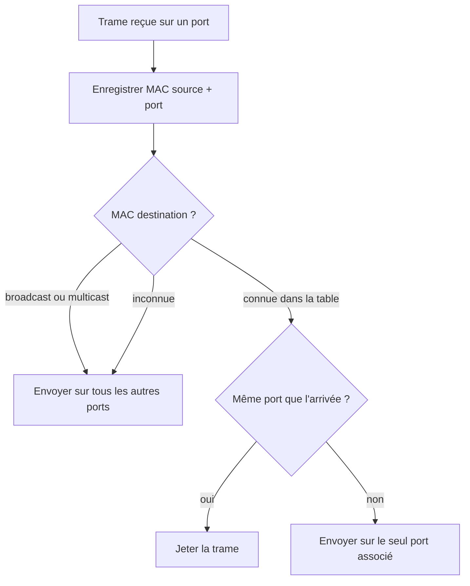
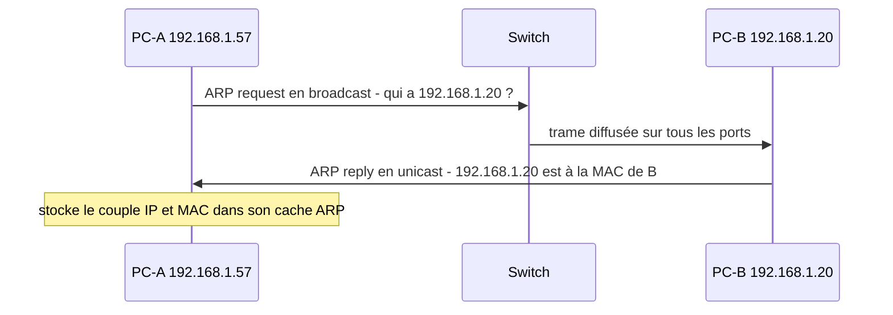

# Couche physique et réseaux Ethernet

## Objectifs pédagogiques

À la fin de ce module, vous saurez :

- **comparer** les trois grandes familles de supports (cuivre, fibre, Wi-Fi) et choisir celui qui convient à un besoin donné ;
- **décoder** une trame Ethernet champ par champ, adresses MAC et EtherType compris ;
- **expliquer** comment un switch apprend les adresses et décide où envoyer une trame ;
- **décrire** l'échange ARP et lire un cache ARP ;
- **diagnostiquer** une panne de lien avant de soupçonner la configuration IP.

## Mise en situation

Une PME de trente postes réorganise sa salle de réunion. Un technicien branche un portable sur la prise murale. L'adresse IP configurée sur le poste est correcte (`192.168.1.57`), et pourtant `ping 192.168.1.1`, la passerelle, ne répond pas. Le collègue du bureau voisin, dans le même réseau, travaille sans problème.

Le premier réflexe est de rouvrir la configuration IP, de redémarrer, de changer de masque. C'est presque toujours une perte de temps, parce qu'il n'y a ici ni routage ni filtrage en cause. Le paquet n'est jamais parti, ou il n'a jamais trouvé son voisin. Ce module sert à comprendre comment un lien se construit sous l'IP, pour savoir où regarder quand il casse.

## Ce que le lien fait avant l'IP

L'adresse IP indique où le paquet veut aller. Elle ne dit rien sur la façon de franchir le prochain mètre de câble. Cette partie revient à deux couches que vous avez déjà situées dans le modèle OSI :

- la **couche physique** transforme des bits en phénomène physique (tension, lumière, onde radio) ;
- la **couche liaison**, qui est Ethernet dans la grande majorité des réseaux filaires, organise ces bits en trames, les adresse à un voisin direct et en contrôle l'intégrité.

> 📮 **Analogie : le facteur et la sonnette**
>
> L'IP est l'adresse postale complète, l'Ethernet est le facteur qui doit savoir quelle porte de l'immeuble pousser. Si la porte est murée (câble), si le facteur ne connaît pas le nom sur la sonnette (adresse MAC), la lettre ne sera pas distribuée, aussi bien rédigée soit son adresse.
{: .callout .callout-analogie}

> 🧠 **Concept fondamental**
>
> Ethernet ne vise jamais la destination finale, seulement le **prochain équipement sur le même lien local**. Chaque saut recrée une trame neuve avec de nouvelles adresses MAC, alors que l'adresse IP voyage de bout en bout.
{: .callout .callout-important}

## Couche physique : supports, signaux et négociation

### Trois familles de supports

| Support | Débit courant | Portée typique | À retenir |
|---|---|---|---|
| Cuivre, paire torsadée UTP (Unshielded Twisted Pair) | 1 Gbit/s (Cat5e), 10 Gbit/s (Cat6a) | 100 m maximum entre deux équipements | Bon marché, universel, sensible aux interférences et à la qualité de sertissage |
| Fibre multimode | 10 Gbit/s et plus | de quelques dizaines à quelques centaines de mètres selon la qualité | Insensible aux perturbations électromagnétiques, idéale entre baies ou bâtiments proches |
| Fibre monomode | 10 Gbit/s et plus | plusieurs kilomètres, voire dizaines | Longues distances, optiques plus coûteuses |
| Wi-Fi | variable | quelques dizaines de mètres, murs compris | Support radio partagé, débit réel qui varie avec la distance et le nombre de clients |

Les valeurs exactes dépendent de la catégorie de câble, de la qualité de l'installation et de l'optique utilisée. Prenez-les comme des ordres de grandeur, pas comme des garanties.

Côté cuivre, les paires sont torsadées pour que les perturbations extérieures s'annulent à peu près d'un fil à l'autre. Un câble plié trop serré, détorsadé sur plusieurs centimètres au sertissage ou tiré le long d'un câble électrique perd cet avantage, et le signal s'abîme.

En fibre, les équipements reçoivent souvent des modules enfichables SFP (Small Form-factor Pluggable) : on choisit le module selon la distance et le type de fibre. Un module monomode ne se branche pas indifféremment sur une fibre multimode. Il faut aussi, aux deux extrémités, des modules compatibles entre eux.

Le Wi-Fi est un cas à part : le support est l'air, partagé par tous les appareils qui écoutent la même fréquence. Les stations écoutent avant d'émettre et se répartissent le temps de parole. Un point d'accès Wi-Fi traduit ensuite les trames radio (un format propre au Wi-Fi) vers de l'Ethernet filaire. Plus il y a de monde sur le canal, moins chacun en profite.

### Du bit au signal

Pour la couche physique, un bit n'est ni un 0 ni un 1 abstrait. C'est une variation de tension sur le cuivre, une impulsion lumineuse en fibre, une modulation de l'onde en radio. Le récepteur échantillonne ce signal et reconstitue les bits.

Si le signal arrive trop affaibli (atténuation) ou parasité par la paire voisine (diaphonie), le récepteur se trompe de bits. L'erreur sera détectée plus haut, par la trame, mais la cause est ici.

### Négociation du lien

Deux équipements en cuivre qui se branchent n'ont pas été configurés ensemble. Comment s'accordent-ils ? Ils **négocient**.

> 📖 **Définition**
>
> L'**auto-négociation** est l'échange par lequel chaque équipement annonce ce qu'il sait faire (100 Mbit/s, 1 Gbit/s, duplex complet ou non), pour que les deux retiennent la meilleure combinaison commune.
{: .callout .callout-definition}

Le **duplex** décrit la façon d'utiliser le lien :

- en **full duplex**, on émet et on reçoit en même temps, sans collision possible ;
- en **half duplex**, un seul sens à la fois, avec risque de collision. Les anciens hubs, qui répétaient chaque signal sur tous les ports, fonctionnaient ainsi et s'appuyaient sur CSMA/CD (Carrier Sense Multiple Access with Collision Detection)* pour gérer les collisions.

*\*CSMA/CD : avant d'émettre, une station écoute le câble, et si deux stations parlent en même temps, elles détectent la collision, s'arrêtent et réessaient après un délai aléatoire.*

> 🚚 **Analogie : les camions postaux sur la route**
>
> Le full duplex ressemble à une route à deux voies : les camions se croisent sans se gêner. Le half duplex ressemble à un pont à voie unique : un seul sens à la fois, et si deux camions s'y engagent ensemble, c'est la collision.
{: .callout .callout-analogie}

Avec des switches modernes et des liens full duplex, les collisions n'existent plus en pratique. Le half duplex ne subsiste que dans les mauvaises configurations, et on verra plus bas ce que cela donne.

> ⚠️ **Comportement contre-intuitif**
>
> Forcer la vitesse d'un seul côté du lien est souvent pire que de laisser les deux côtés négocier. Le côté resté en automatique ne reçoit aucune annonce, devine la vitesse, et retombe en half duplex par prudence.
{: .callout .callout-attention}

## Adresses MAC et cartes réseau

Chaque interface réseau, qu'il s'agisse d'une NIC (Network Interface Card) intégrée à la carte mère, d'un adaptateur USB ou d'une puce Wi-Fi, porte une adresse MAC (Media Access Control) de 48 bits, écrite en six octets hexadécimaux : `3c:52:82:aa:10:01`.

Les trois premiers octets forment l'OUI (Organizationally Unique Identifier), attribué à un constructeur. Les trois derniers sont choisis par lui pour distinguer chaque carte. L'adresse est unique au sein d'un réseau local, mais elle n'a pas de signification géographique ni hiérarchique : elle identifie une interface, pas un endroit.

Deux bits du premier octet changent le sens de l'adresse :

- le bit de poids faible indique si l'adresse est **individuelle (0)** ou **de groupe (1)**. C'est ce qui rend `ff:ff:ff:ff:ff:ff` (broadcast) et `01:00:5e:...` (multicast IPv4) reconnaissables ;
- le deuxième bit de poids faible indique si l'adresse est **universelle** (attribuée par le constructeur) ou **administrée localement**.

> 💡 **Point clé**
>
> Une adresse MAC n'est pas gravée à vie. Un système peut la remplacer par logiciel, et les smartphones récents génèrent par défaut des adresses aléatoires par réseau Wi-Fi (le bit « administrée localement » est alors à 1). Une MAC identifie une interface à un instant donné, pas une personne, et encore moins une preuve d'identité.
{: .callout .callout-important}

## Anatomie d'une trame Ethernet

Une trame est l'enveloppe qui transporte un paquet sur un lien local :

| Champ | Taille | Rôle |
|---|---|---|
| Préambule + délimiteur | 8 octets | Synchronise le récepteur, géré par le matériel et invisible dans les captures |
| MAC destination | 6 octets | À qui s'adresse la trame sur ce lien |
| MAC source | 6 octets | Qui l'a émise |
| EtherType | 2 octets | Type de contenu : `0x0800` IPv4, `0x0806` ARP, `0x86DD` IPv6 |
| Données | 46 à 1500 octets | Le paquet transporté (rembourré si trop court) |
| FCS (Frame Check Sequence) | 4 octets | Somme de contrôle calculée par un CRC (Cyclic Redundancy Check) |

Le plafond de 1500 octets de données est la MTU (Maximum Transmission Unit) standard d'Ethernet. Avec les en-têtes et le FCS, une trame fait entre 64 et 1518 octets (hors préambule).

La destination arrive **avant** la source, ce qui permet à un switch de décider très tôt où envoyer la trame. Quant au FCS, il vérifie que la trame n'a pas été altérée. Le récepteur le recalcule, et s'il ne correspond pas, il jette la trame sans rien dire. Aucune alerte n'est envoyée à l'émetteur.

Voici ce que donne le début d'une trame en hexadécimal :

```
ff ff ff ff ff ff   3c 52 82 aa 10 01   08 06   00 01 08 00 ...
└── destination ──┘ └──── source ─────┘ └type┘ └─ début des données ─
```

La destination est le broadcast, la source est notre portable, et `08 06` indique de l'ARP. On est face à une demande de résolution d'adresse, ce que le paragraphe suivant détaille.

## Le switch et sa table MAC

Un switch ne se configure pas pour apprendre qui est branché où. Il le déduit de ce qu'il voit passer. À chaque trame reçue sur un port, il note l'adresse MAC **source** et le port d'arrivée dans sa table MAC. Il décide ensuite quoi faire avec l'adresse **destination** :



Au démarrage, la table est vide. Le switch inonde donc tous les ports avec les premières trames, puis il se calme à mesure qu'il apprend. Les entrées expirent après un certain temps sans trafic de la machine (souvent 300 secondes, selon l'équipement), ce qui permet de suivre un poste qui change de prise.

Par rapport à un hub, la différence est considérable. Le hub répétait tout sur tous les ports et tout le monde voyait tout. Le switch ne livre une trame unicast qu'au port concerné. Les performances sont meilleures et il est plus difficile d'écouter ce qui ne vous est pas destiné.

> ⚠️ **Comportement contre-intuitif**
>
> Le switch apprend à partir de l'adresse **source**, jamais de la destination. Une machine silencieuse reste donc inconnue du switch tant qu'elle n'a rien émis. Ses trames entrantes sont inondées sur tous les ports (c'est le « unknown unicast flooding »).
{: .callout .callout-attention}

La table MAC du switch (MAC → port) n'a rien à voir avec le cache ARP d'un poste (IP → MAC). Les deux tables résolvent des questions différentes, et on les confond souvent.

## ARP : retrouver la MAC d'un voisin IPv4

Votre poste veut parler à `192.168.1.20`. Il connaît son IP, mais la trame exige une adresse MAC de destination : comment la trouver ? C'est le rôle d'ARP (Address Resolution Protocol) de faire le lien : il pose la question à tout le segment, et le propriétaire de l'IP répond.



Trois détails comptent :

- la **requête est un broadcast**, donc tous les postes du segment la reçoivent, mais seul le propriétaire de l'IP répond ;
- la **réponse est un unicast**, adressé directement à celui qui a posé la question ;
- le résultat est gardé dans un **cache ARP** à durée de vie courte (de quelques dizaines de secondes à quelques minutes selon le système), pour éviter de reposer la question à chaque paquet.

Pendant cet échange, le switch apprend les deux adresses MAC, puisque chaque machine a émis une trame.

Si la destination est hors du réseau local, votre poste ne cherche pas la MAC de la destination finale : il demande celle de sa passerelle. Le routage détaillera ce point ensuite. Notez aussi qu'ARP est propre à IPv4 et qu'IPv6 utilise un autre mécanisme.

## Unicast, broadcast, multicast

| Mode | MAC destination | Qui traite la trame | Exemple d'usage |
|---|---|---|---|
| Unicast | MAC d'une interface précise | Une seule machine | Un transfert de fichier entre deux postes |
| Broadcast | `ff:ff:ff:ff:ff:ff` | Toutes les machines du segment | Requête ARP |
| Multicast | Adresse de groupe, par exemple `01:00:5e:...` | Les machines abonnées au groupe | Flux vidéo ou audio, certaines annonces de découverte |

Le broadcast est utile, mais coûteux : chaque carte doit lire la trame et la remonter au système pour savoir si elle le concerne. Un réseau qui diffuse trop finit par ralentir tous ses postes. Le multicast limite le travail aux seuls abonnés, mais un switch sans fonction dédiée le traite comme un broadcast.

> ⚠️ **Comportement contre-intuitif**
>
> Une trame Ethernet n'a pas de durée de vie (pas de TTL). Si deux switches sont reliés par deux câbles et qu'aucun protocole anti-boucle comme Spanning Tree n'est actif, un broadcast circule indéfiniment et se multiplie : c'est une tempête de broadcast. Le réseau devient inutilisable en quelques secondes.
{: .callout .callout-attention}

## Commandes et outils de diagnostic

Face à une machine qui ne communique pas, on remonte les couches **par le bas**. Voici les commandes à connaître, avec ce qu'on lit dans leur sortie.

### 1. Le lien est-il physiquement vivant ?

```bash
ip link show eth0
```

```
2: eth0: <NO-CARRIER,BROADCAST,MULTICAST,UP> mtu 1500 qdisc fq_codel state DOWN
    link/ether 3c:52:82:aa:10:01 brd ff:ff:ff:ff:ff:ff
```

`UP` ne signifie ici que « interface activée côté système ». Le drapeau `NO-CARRIER` et `state DOWN` indiquent qu'aucun signal n'est détecté sur le câble. Dans notre salle de réunion, c'est exactement ce qu'on observerait si la prise murale n'était pas reliée au switch.

```bash
ethtool eth0
```

```
Speed: 1000Mb/s
Duplex: Full
Auto-negotiation: on
Link detected: yes
```

On vérifie la vitesse et le duplex négociés. `Link detected: yes` avec `100Mb/s` et `Half` sur un lien censé être en gigabit est un signal fort : le câble ou la négociation pose problème.

### 2. Y a-t-il des erreurs ?

```bash
ip -s link show eth0
```

Le bloc `RX` affiche notamment `errors` et `dropped`. Des compteurs d'erreurs qui augmentent alors que le trafic est faible orientent vers un câble abîmé, un sertissage défectueux ou un problème de duplex.

### 3. Le voisin est-il résolu ?

```bash
ip neigh show dev eth0
```

```
192.168.1.1 dev eth0 lladdr 00:1b:44:11:3a:b7 REACHABLE
192.168.1.20 dev eth0 FAILED
```

`REACHABLE` signifie que la MAC du voisin est connue et récente. `FAILED` (ou `INCOMPLETE` pendant l'attente) veut dire que la requête ARP n'a reçu aucune réponse : soit le voisin est éteint ou déconnecté, soit la trame n'arrive pas jusqu'à lui. Sous Windows, `arp -a` donne la même information.

### 4. Que voit le switch ?

Sur un switch Cisco (la syntaxe varie selon constructeur et version) :

```
show mac address-table dynamic
```

```
Vlan    Mac Address       Type        Ports
----    -----------       --------    -----
   1    3c52.82aa.1001    DYNAMIC     Gi0/5
   1    001b.4411.3ab7    DYNAMIC     Gi0/24
```

La colonne `Vlan` peut être ignorée pour l'instant. Le switch montre qu'il a appris la MAC du portable sur `Gi0/5`. Si la MAC attendue n'apparaît pas, le switch n'a jamais reçu de trame de cette machine, donc le problème est entre la machine et le switch.

### Remonter dans l'ordre

On suit une logique simple, de bas en haut, et on s'arrête à la première anomalie :

1. Le lien est-il détecté (`NO-CARRIER` absent, `Link detected: yes`) ?
2. La vitesse et le duplex correspondent-ils à ce qu'on attend ?
3. Le compteur d'erreurs augmente-t-il ?
4. ARP résout-il le voisin ou la passerelle ?
5. Seulement ensuite : adresse IP, masque, passerelle, routage, pare-feu.

Dans notre scénario, l'étape 1 aurait suffi à résoudre le problème en deux minutes, sans toucher à l'IP.

## Cas réel en entreprise : un transfert anormalement lent

*Scénario illustratif, avec des chiffres choisis pour la démonstration.*

Un cabinet comptable copie chaque soir une sauvegarde de 4 Go vers un NAS (Network Attached Storage). Sur un lien gigabit sain, la copie devrait prendre une minute ou deux. Depuis une semaine, elle dure plus d'une heure. Les `ping` répondent normalement, tout semble « fonctionner ».

Premier réflexe : regarder le lien du NAS et du switch.

```
Port du switch : forcé à 100 Mbit/s, full duplex
NAS            : auto-négociation activée
```

Un administrateur avait forcé manuellement le port du switch lors d'une ancienne intervention. Le NAS, en automatique, ne reçoit plus d'annonce : il détecte 100 Mbit/s, mais retombe en **half duplex**. Les deux extrémités ne parlent donc pas le même duplex.

Les compteurs trahissent le désaccord :

- côté NAS (half duplex) : collisions et « late collisions », parce qu'il croit partager le lien alors que l'autre côté émet quand il veut ;
- côté switch (full duplex) : erreurs de FCS et trames tronquées, parce qu'il reçoit des trames interrompues par ces collisions.

Chaque trame abîmée est jetée, TCP la retransmet, et le débit s'effondre. Un simple `ping` passe parce que ses paquets sont petits et rares, donc rarement touchés par une collision.

La correction est une suppression de configuration : remettre le port du switch en auto-négociation. Après renégociation, le lien passe à 1000 Mbit/s en full duplex, les compteurs d'erreurs cessent d'augmenter, et la copie nocturne retombe à quelques minutes.

## Ce que le lien ne protège pas

Ethernet et ARP ont été conçus pour des réseaux où l'on se faisait confiance. Deux faiblesses sont à connaître dès maintenant, sans entrer dans les détails :

- **ARP n'authentifie rien.** N'importe quelle machine du segment peut répondre à une requête, même si elle n'est pas le propriétaire de l'IP. Un attaquant local peut ainsi se faire passer pour la passerelle.
- **La table MAC d'un switch a une taille limitée.** En la saturant de fausses adresses sources, on peut forcer certains équipements à inonder les trames, ce qui permet d'écouter du trafic qui ne nous est pas destiné.

Les contre-mesures (sécurité de port, inspection ARP, segmentation) viendront plus tard dans le parcours. Il suffit ici de retenir que le niveau lien est **local mais pas sûr**.

## Bonnes pratiques

- **Testez le câble avant de modifier la configuration.** Un testeur de câble ou un échange d'un cordon connu bon règle une grande partie des pannes en quelques minutes.
- **Laissez l'auto-négociation active des deux côtés** pour le cuivre. Si vous devez forcer une vitesse, forcez-la sur les deux extrémités, mais ce choix devient rarement nécessaire.
- **Respectez 100 m par segment cuivre**, cordons de brassage compris, et n'exigez pas d'un câble un débit supérieur à celui de sa catégorie.
- **En fibre**, adaptez le module SFP au type de fibre (multimode ou monomode) et à la distance, et nettoyez les connecteurs avant branchement, car une poussière suffit à dégrader le signal.
- **Étiquetez prises et ports du switch.** Retrouver quel câble mène où est la moitié du dépannage.
- **Surveillez les compteurs d'erreurs** (`CRC`, collisions, `drops`) : ils signalent un lien dégradé bien avant la panne franche.
- **Ne reliez pas deux switches par deux câbles sans protocole anti-boucle** actif, au risque d'une tempête de broadcast.
- **N'utilisez jamais l'adresse MAC comme preuve d'identité.** Elle se modifie facilement et peut être aléatoire.

## Résumé

| Concept | Rôle | Points clés |
|---|---|---|
| Couche physique | Transformer les bits en signal (électrique, lumineux, radio) | Cuivre limité à 100 m, fibre pour les distances ou l'immunité aux perturbations, Wi-Fi sur support partagé |
| Négociation du lien | Fixer vitesse et duplex entre deux équipements | Auto des deux côtés, jamais un seul côté forcé, risque de duplex mismatch |
| Adresse MAC | Identifier une interface sur un lien local | 48 bits, OUI du constructeur, modifiable, bit individuel/groupe |
| Trame Ethernet | Transporter un paquet vers le voisin direct | MAC destination puis source, EtherType, 46 à 1500 octets de données, FCS |
| Switch et table MAC | Livrer chaque trame au bon port | Apprentissage par MAC source, inondation si destination inconnue, expiration des entrées |
| ARP | Associer une IPv4 à une MAC | Requête en broadcast, réponse en unicast, cache à durée courte |
| Unicast, broadcast, multicast | Choisir qui reçoit la trame | `ff:ff:ff:ff:ff:ff` pour tous, bit de groupe pour le multicast, broadcast coûteux |
| Diagnostic de lien | Éliminer la couche basse avant de soupçonner l'IP | Lien, vitesse et duplex, erreurs, ARP, puis seulement IP |

Quand les machines savent se parler directement, le réseau reste tout petit : un segment, une poignée de voisins. Pour faire communiquer des réseaux entre eux, il faut leur donner des adresses organisées, c'est ce que construit le module suivant avec l'adressage IPv4.

<!-- snippet
id: ethernet_ip_link_show_carrier
type: command
tech: ethernet
level: beginner
importance: high
format: knowledge
tags: ethernet,linux,diagnostic,couche-physique
title: Vérifier la présence du signal avec ip link
context: Sous Linux, premier test d'un diagnostic réseau
command: ip link show <IFACE>
example: ip link show eth0
description: NO-CARRIER ou state DOWN signifie qu'aucun signal n'est détecté sur le câble, même si l'interface est marquée UP côté système
-->

<!-- snippet
id: ethernet_ethtool_negociation
type: command
tech: ethernet
level: beginner
importance: high
format: knowledge
tags: ethernet,ethtool,duplex,negociation
title: Lire vitesse et duplex d'un lien avec ethtool
context: Sous Linux, nécessite souvent les droits root selon la distribution
command: ethtool <IFACE>
example: ethtool eth0
description: Affiche Speed, Duplex, Auto-negotiation et Link detected ; 100Mb/s Half sur un lien censé être gigabit révèle un câble défaillant ou un désaccord de duplex
-->

<!-- snippet
id: ethernet_ip_stats_erreurs
type: command
tech: ethernet
level: beginner
importance: medium
format: knowledge
tags: ethernet,linux,erreurs,diagnostic
title: Consulter les compteurs d'erreurs d'une interface
command: ip -s link show <IFACE>
example: ip -s link show eth0
description: Le bloc RX affiche errors et dropped ; des erreurs qui augmentent avec peu de trafic orientent vers un câble abîmé ou un problème de duplex
-->

<!-- snippet
id: ethernet_ip_neigh_cache_arp
type: command
tech: ethernet
level: beginner
importance: high
format: knowledge
tags: arp,linux,diagnostic,cache
title: Lire le cache ARP avec ip neigh
context: Équivalent Windows : arp -a
command: ip neigh show dev <IFACE>
example: ip neigh show dev eth0
description: REACHABLE indique une MAC voisine connue et récente ; FAILED ou INCOMPLETE signifie que la requête ARP est restée sans réponse
-->

<!-- snippet
id: ethernet_cisco_show_mac_table
type: command
tech: ethernet
level: beginner
importance: medium
format: knowledge
tags: switch,table-mac,cisco,diagnostic
title: Consulter la table MAC d'un switch Cisco
context: Mode privilégié sur un switch Cisco IOS, la syntaxe varie selon constructeur et version
command: show mac address-table dynamic interface <PORT>
example: show mac address-table dynamic interface gigabitEthernet 0/5
description: Liste les MAC apprises sur un port ; si la MAC d'un poste n'apparaît pas, le switch n'a reçu aucune trame de lui et la panne se situe entre le poste et le switch
-->

<!-- snippet
id: ethernet_switch_apprentissage_mac
type: concept
tech: ethernet
level: beginner
importance: high
format: knowledge
tags: switch,table-mac,apprentissage,inondation
title: Comment un switch apprend les adresses MAC
content: À chaque trame reçue, le switch enregistre la MAC source et le port d'arrivée. Pour la destination, il consulte sa table. Destination connue, il envoie sur un seul port. Destination inconnue, broadcast ou multicast, il envoie sur tous les autres ports. Les entrées expirent après un délai d'inactivité, souvent 300 s selon l'équipement.
description: L'apprentissage se fait uniquement sur l'adresse source ; une machine silencieuse reste inconnue et ses trames entrantes sont inondées
-->

<!-- snippet
id: ethernet_trame_structure
type: concept
tech: ethernet
level: beginner
importance: high
format: knowledge
tags: ethernet,trame,ethertype,fcs
title: Structure d'une trame Ethernet
content: Une trame contient MAC destination (6 octets), MAC source (6), EtherType (2), données (46 à 1500) et FCS (4). EtherType indique le contenu : 0x0800 IPv4, 0x0806 ARP, 0x86DD IPv6. Si le FCS recalculé par le récepteur ne correspond pas, la trame est jetée sans notification à l'émetteur.
description: La destination précède la source pour qu'un switch décide tôt ; le FCS ne corrige rien, il fait seulement rejeter les trames altérées
-->

<!-- snippet
id: ethernet_arp_echange
type: concept
tech: ethernet
level: beginner
importance: high
format: knowledge
tags: arp,broadcast,unicast,cache
title: Déroulé d'une résolution ARP
content: Le poste diffuse une requête ARP à ff:ff:ff:ff:ff:ff pour demander qui possède une IPv4. Seul le propriétaire répond, en unicast, avec sa MAC. Le demandeur stocke le couple IP/MAC dans son cache ARP, dont la durée de vie est courte (de quelques dizaines de secondes à quelques minutes selon l'OS).
description: La requête est un broadcast et la réponse un unicast ; hors du réseau local, c'est la MAC de la passerelle qui est résolue, pas celle de la destination
-->

<!-- snippet
id: ethernet_mac_bits_groupe
type: concept
tech: ethernet
level: intermediate
importance: medium
format: knowledge
tags: mac,multicast,broadcast,oui
title: Les bits spéciaux d'une adresse MAC
content: Le bit de poids faible du premier octet vaut 0 pour une adresse individuelle et 1 pour une adresse de groupe (broadcast ff:ff:ff:ff:ff:ff, multicast 01:00:5e:...). Le deuxième bit de poids faible indique une adresse administrée localement, cas des MAC aléatoires des smartphones. Les trois premiers octets forment l'OUI du constructeur.
description: Lire le premier octet suffit à savoir si une MAC est individuelle, de groupe ou générée localement
-->

<!-- snippet
id: ethernet_diagnostic_ordre_couches
type: tip
tech: ethernet
level: beginner
importance: high
format: knowledge
tags: diagnostic,couche-physique,ping,methodologie
title: Diagnostiquer de bas en haut avant de toucher l'IP
content: Quand un ping échoue, vérifier dans l'ordre : lien détecté (ip link, ethtool), vitesse et duplex attendus, compteurs d'erreurs stables, voisin résolu (ip neigh). Ne modifier l'IP, le masque ou la passerelle qu'après avoir validé ces quatre points, car la plupart des pannes de poste isolé sont physiques.
description: Cinq minutes passées sur les couches 1 et 2 évitent de reconfigurer l'IP pour une prise non branchée ou un cordon défectueux
-->

<!-- snippet
id: ethernet_cuivre_limite_100m
type: tip
tech: ethernet
level: beginner
importance: medium
format: knowledge
tags: cuivre,cable,distance,fibre
title: Respecter la limite de 100 m en cuivre
content: Un segment en paire torsadée (cordons de brassage inclus) ne dépasse pas 100 m. Au-delà, ou pour relier deux bâtiments, passer en fibre avec des modules SFP adaptés au type de fibre. Un testeur de câble permet de vérifier le sertissage et la continuité avant de suspecter la configuration.
description: Dépasser 100 m ou serrer trop un câble dégrade le signal ; la fibre résout distance et perturbations électromagnétiques
-->

<!-- snippet
id: ethernet_duplex_mismatch
type: warning
tech: ethernet
level: intermediate
importance: high
format: knowledge
tags: duplex,negociation,performance,erreurs
title: Forcer un seul côté d'un lien crée un duplex mismatch
content: Piège - forcer vitesse et duplex sur un seul équipement, l'autre restant en auto-négociation. Conséquence - le côté auto ne reçoit aucune annonce et retombe en half duplex ; collisions d'un côté, erreurs FCS de l'autre, ping normal mais transferts très lents. Correction - remettre les deux côtés en auto, ou forcer les deux de façon identique.
description: Le ping passe car ses paquets sont petits et rares, mais les gros transferts s'effondrent à cause des retransmissions
-->

<!-- snippet
id: ethernet_tempete_broadcast_boucle
type: warning
tech: ethernet
level: intermediate
importance: high
format: knowledge
tags: broadcast,boucle,switch,spanning-tree
title: Une boucle entre switches provoque une tempête de broadcast
content: Piège - relier deux switches par deux câbles sans protocole anti-boucle. Conséquence - une trame Ethernet n'a pas de TTL, donc un broadcast tourne indéfiniment et se multiplie, ce qui sature le réseau en quelques secondes. Correction - activer un protocole anti-boucle comme Spanning Tree et retirer un des deux câbles en cas de doute.
description: Contrairement à un paquet IP, une trame ne s'éteint jamais d'elle-même ; seul un mécanisme anti-boucle arrête la circulation
-->

<!-- snippet
id: ethernet_arp_failed_incomplete
type: error
tech: ethernet
level: beginner
importance: high
format: knowledge
tags: arp,diagnostic,ping,liaison
title: Entrée ARP FAILED ou INCOMPLETE pour un voisin
content: Symptôme - ip neigh affiche FAILED ou INCOMPLETE pour une IP du même réseau, et le ping échoue. Cause - la requête ARP est restée sans réponse (voisin éteint, câble ou port défaillant, voisin branché sur un autre segment). Correction - vérifier le lien physique des deux côtés, puis que les deux machines sont bien sur le même segment local.
description: Une résolution ARP échouée prouve que le problème précède le routage ; inutile de chercher du côté du pare-feu ou de la passerelle
-->

<!-- snippet
id: ethernet_no_carrier_interface_up
type: error
tech: ethernet
level: beginner
importance: high
format: knowledge
tags: ethernet,linux,couche-physique,diagnostic
title: NO-CARRIER alors que l'interface est UP
content: Symptôme - ip link affiche UP mais aussi NO-CARRIER et state DOWN. Cause - l'interface est activée côté système, mais aucun signal n'arrive (câble débranché, prise non brassée, port switch éteint). Correction - tester le cordon, vérifier le brassage et l'état du port côté switch.
description: UP désigne l'état administratif de l'interface, pas la présence d'un signal ; seul NO-CARRIER révèle l'absence de lien physique
-->

<!-- snippet
id: ethernet_table_mac_vs_cache_arp
type: tip
tech: ethernet
level: beginner
importance: medium
format: knowledge
tags: arp,table-mac,switch,diagnostic
title: Ne pas confondre table MAC et cache ARP
content: La table MAC appartient au switch et relie une MAC à un port (consultée avec show mac address-table). Le cache ARP appartient à chaque poste et relie une IP à une MAC (consulté avec ip neigh ou arp -a). Pour un diagnostic, interroger le cache ARP du poste puis la table MAC du switch.
description: Deux tables, deux équipements, deux questions différentes ; les consulter dans cet ordre localise vite la rupture entre le poste et le switch
-->
