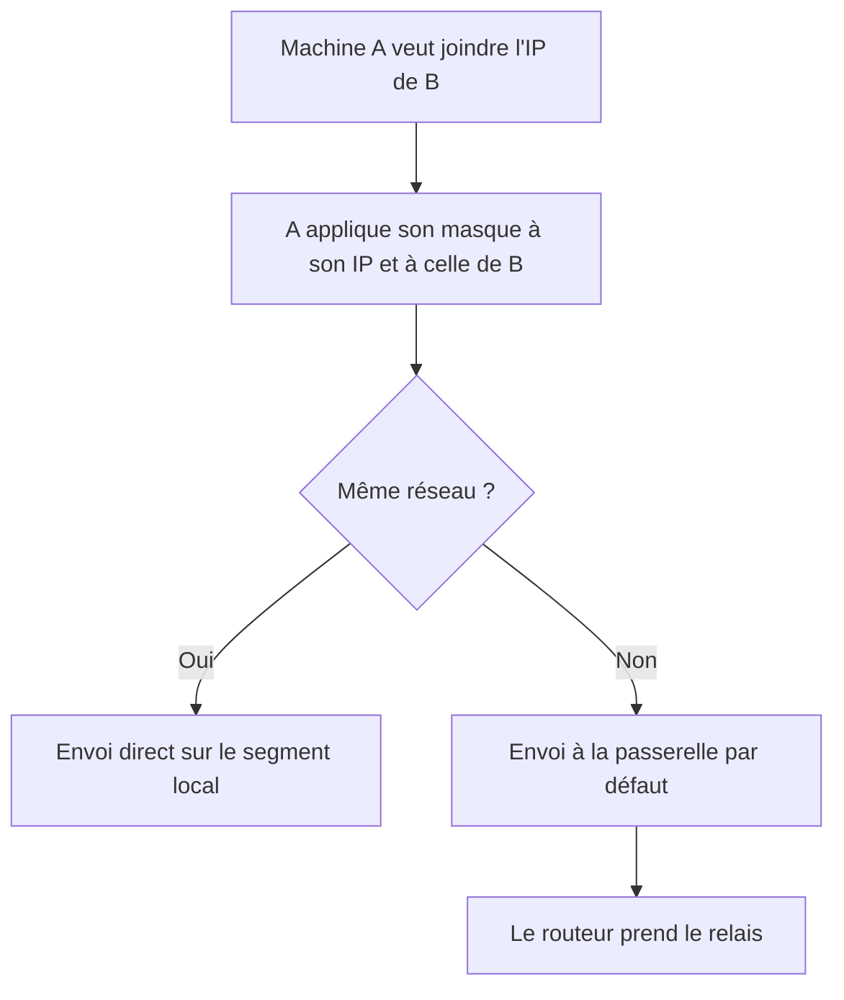

# Adressage IPv4 et calcul de sous-réseaux

## Objectifs pédagogiques

À la fin de ce module, vous saurez :

- **décomposer** une adresse IPv4 (Internet Protocol version 4) en binaire et expliquer le rôle du masque ;
- **calculer** l'adresse réseau, la plage d'hôtes utilisables et le broadcast à partir d'une adresse en notation CIDR ;
- **découper** un bloc d'adresses en sous-réseaux adaptés à des besoins précis ;
- **déterminer** si deux machines appartiennent au même sous-réseau, et ce qui se passe si ce n'est pas le cas ;
- **vérifier** une configuration IP sous Linux et Windows, puis **construire** un plan d'adressage pour une petite entreprise.

## Mise en situation

Une PME de 35 personnes vient de faire installer son réseau par un prestataire. Un routeur relie l'entreprise à Internet, et un switch distribue le tout aux postes, aux serveurs et aux imprimantes. Un lundi matin, Camille, de la comptabilité, n'arrive plus à imprimer. Elle navigue sur Internet sans problème, elle joint la passerelle, mais l'imprimante du couloir reste muette. Son voisin, lui, imprime très bien.

Rien n'est cassé côté câble ni côté switch : le module précédent a déjà permis d'écarter ces causes. Le problème se joue une couche au-dessus, dans les chiffres que Camille a tapés dans la configuration de son poste. À la fin du module, vous saurez lire ces chiffres et expliquer la panne en trois lignes.

## Contexte et problématique

Ethernet sait faire communiquer des machines sur un même segment, mais il ne sait pas organiser un réseau à grande échelle. Une adresse MAC n'a aucune structure : rien dans `3C:22:FB:10:A4:7E` n'indique où se trouve la machine. Un équipement qui devrait retenir l'emplacement de chaque MAC de la planète n'existerait pas.

L'adresse IP résout ce problème avec une hiérarchie. Elle contient une partie **réseau** et une partie **hôte**.

> 📮 **Analogie : l'adresse postale.** « 12 rue des Lilas » se découpe en une rue (la partie réseau) et un numéro dans cette rue (la partie hôte). Le postier n'a pas besoin de connaître toutes les maisons du pays : il lui suffit de reconnaître la rue.
{: .callout .callout-analogie}

Le **masque** de sous-réseau indique où s'arrête la rue et où commence le numéro. Presque tout ce module consiste à manipuler cette frontière.

## Anatomie d'une adresse IPv4

> 🧠 **Concept fondamental** : une adresse IPv4 est un nombre de 32 bits. La notation « décimale pointée » (`192.168.10.37`) n'est qu'une façon lisible de l'écrire. Les 32 bits sont regroupés en 4 octets de 8 bits, chacun converti en décimal, d'où des valeurs de 0 à 255.
{: .callout .callout-important}

Voici `192.168.10.37` en binaire :

```
192      168      10       37
11000000.10101000.00001010.00100101
```

Pour convertir sans calculette, retenez les poids des bits d'un octet : `128 64 32 16 8 4 2 1`. Prenez 168. Il contient 128 (reste 40), puis 32 (reste 8), puis 8. Les bits 128, 32 et 8 sont à 1, ce qui donne `10101000`. Après quelques exercices, on ne le fait plus que pour les octets qui comptent.

Avec 32 bits, il existe 2³², soit environ 4,3 milliards d'adresses. Cela paraît énorme, mais beaucoup sont réservées, et c'est une des raisons de l'existence de l'IPv6, qui fait l'objet du module suivant.

### Publiques, privées, réservées

Toutes les adresses ne sont pas utilisables de la même façon :

- les adresses **publiques** sont routées sur Internet et attribuées de manière unique ;
- les adresses **privées** sont réservées aux réseaux internes. N'importe quelle entreprise peut les utiliser : c'est pour cela que votre box et celle de votre voisin ont probablement la même plage.

Une machine privée accède à Internet grâce à NAT (Network Address Translation), un mécanisme de traduction étudié dans le module de routage.

| Plage | Usage | Remarque |
|-------|-------|----------|
| `10.0.0.0/8` | Privée | 16 millions d'adresses, plage des grandes organisations |
| `172.16.0.0/12` | Privée | De `172.16.0.0` à `172.31.255.255` seulement |
| `192.168.0.0/16` | Privée | Box domestiques, petits sites |
| `127.0.0.0/8` | Boucle locale (loopback) | `127.0.0.1` désigne la machine elle-même |
| `169.254.0.0/16` | Link-local | Auto-attribuée quand aucune configuration n'est obtenue |
| `224.0.0.0/4` | Multicast | Communication vers un groupe de machines |
| `255.255.255.255` | Broadcast limité | Ne franchit jamais un routeur |
| `192.0.2.0/24` | Documentation | Adresses des exemples, jamais routées |

> ⚠️ **Piège classique** : la plage privée du milieu s'arrête à `172.31.255.255`. Une adresse en `172.32.x.x` ou en `172.15.x.x` est publique, même si elle ressemble à une adresse privée.
{: .callout .callout-attention}

## Masque, CIDR et préfixe

> 📖 **Définition.** Le masque est une valeur de 32 bits composée d'une suite continue de 1, puis d'une suite de 0. Les bits à 1 marquent la partie réseau, les bits à 0 la partie hôte.
{: .callout .callout-definition}

Comment la machine retrouve-t-elle le réseau d'une adresse ? Elle fait un **ET logique bit à bit** entre l'adresse et le masque : là où le masque vaut 0, tout est effacé.

```
Adresse   192.168.10.37   11000000.10101000.00001010.00100101
Masque    255.255.255.192 11111111.11111111.11111111.11000000
ET        192.168.10.0    11000000.10101000.00001010.00000000
```

Écrire `255.255.255.192` est lourd. La notation CIDR* (Classless Inter-Domain Routing) la remplace par le nombre de bits à 1, précédé d'une barre oblique : `192.168.10.37/26`. Ce nombre s'appelle le **préfixe**.

\* CIDR a remplacé l'ancien découpage rigide en classes A, B et C par un préfixe de longueur libre, ce qui explique qu'on parle aujourd'hui de « /26 » plutôt que de « classe C ».

### Ce que contient un sous-réseau

Un bloc de préfixe `/p` laisse `32 − p` bits à la partie hôte, donc `2^(32−p)` adresses. Deux d'entre elles ne vont à aucune machine : la première (**adresse réseau**, tous les bits hôte à 0) et la dernière (**adresse de broadcast**, tous les bits hôte à 1). Le nombre d'hôtes utilisables est donc `2^(32−p) − 2`.

| Préfixe | Masque | Adresses | Hôtes utilisables |
|---------|--------|----------|-------------------|
| /8 | 255.0.0.0 | 16 777 216 | 16 777 214 |
| /16 | 255.255.0.0 | 65 536 | 65 534 |
| /24 | 255.255.255.0 | 256 | 254 |
| /25 | 255.255.255.128 | 128 | 126 |
| /26 | 255.255.255.192 | 64 | 62 |
| /27 | 255.255.255.224 | 32 | 30 |
| /28 | 255.255.255.240 | 16 | 14 |
| /29 | 255.255.255.248 | 8 | 6 |
| /30 | 255.255.255.252 | 4 | 2 |

Les cas extrêmes suivent d'autres règles : un `/31` sert aux liaisons point à point entre deux équipements, et un `/32` désigne une machine unique. Nous les laissons de côté pour l'instant.

### Calculer vite : la méthode du pas

Convertir en binaire à chaque fois serait épuisant. On regarde plutôt le seul octet « mixte », celui où le masque passe de 1 à 0. La taille du bloc dans cet octet vaut `256 − valeur du masque`.

Prenons `172.16.45.200/20`. Le masque est `255.255.240.0`, et l'octet mixte est le troisième. Le pas vaut 256 − 240 = **16**. Les réseaux se succèdent donc de 16 en 16 dans cet octet : 0, 16, 32, 48… Comme 45 est compris entre 32 et 47, on obtient :

- adresse réseau : `172.16.32.0`
- broadcast : `172.16.47.255` (le dernier bloc, avec tous les bits hôte à 1)
- plage utilisable : `172.16.32.1` à `172.16.47.254`
- hôtes : 2¹² − 2 = 4 094

Même mécanique pour `192.168.10.37/26` : pas de 64 sur le quatrième octet, 37 tombe dans le bloc 0–63, donc réseau `192.168.10.0`, broadcast `192.168.10.63`, hôtes de `.1` à `.62`.

> ⚠️ **Piège : une adresse qui finit par .0 n'est pas forcément une adresse réseau, et une adresse qui finit par .255 n'est pas forcément un broadcast.** L'adresse réseau est celle dont tous les bits hôte valent 0, ce qui n'a rien à voir avec la façon dont elle se termine en décimal. Dans `192.168.10.0/23` (pas de 2 sur le troisième octet), le bloc s'étend de `192.168.10.0` à `192.168.11.255`. L'adresse `192.168.11.0` y est donc un hôte parfaitement valide, alors que `192.168.10.64/26` est bien une adresse réseau malgré son « .64 ». Avant d'attribuer une adresse à une machine, calculez toujours son bloc. La conséquence typique d'une erreur : une machine configurée avec l'adresse réseau ou avec le broadcast de son propre sous-réseau, ce qui produit des comportements incohérents plutôt qu'une erreur claire.
{: .callout .callout-attention}

## Découper un bloc en sous-réseaux

Découper, c'est **emprunter des bits** à la partie hôte pour les ajouter à la partie réseau. Chaque bit emprunté double le nombre de sous-réseaux et divise par deux leur taille. Partons de `192.168.10.0/24` et empruntons 2 bits, ce qui donne quatre sous-réseaux en `/26` :

| Sous-réseau | Adresse réseau | Hôtes utilisables | Broadcast |
|-------------|----------------|-------------------|-----------|
| 1 | 192.168.10.0/26 | .1 à .62 | .63 |
| 2 | 192.168.10.64/26 | .65 à .126 | .127 |
| 3 | 192.168.10.128/26 | .129 à .190 | .191 |
| 4 | 192.168.10.192/26 | .193 à .254 | .255 |

On peut raisonner dans l'autre sens, en partant du besoin : « combien de machines dois-je prévoir ? » Cherchez la plus petite puissance de 2 dont le résultat moins 2 couvre ce nombre. Pour 25 machines, un `/27` (30 hôtes) suffit. Pour 40, il faut un `/26` (62 hôtes), car `/27` ne contiendrait que 30 machines.

Quand les besoins diffèrent d'un service à l'autre, on n'impose pas la même taille à tout le monde. Cette technique s'appelle VLSM (Variable Length Subnet Mask) : on découpe par blocs de tailles différentes, en plaçant les plus gros d'abord.

> 💡 **À retenir** : chaque bloc commence à une adresse multiple de sa propre taille. Un `/27` (32 adresses) peut commencer en `.64`, jamais en `.80`.
{: .callout .callout-important}

## La passerelle par défaut

Quand une machine veut envoyer un paquet, elle se pose une seule question : « la destination est-elle dans mon sous-réseau ? » Si oui, elle livre directement sur le segment local. Sinon, elle confie le paquet à son routeur, la **passerelle par défaut**.



> 💡 **Point clé** : la passerelle doit impérativement se trouver dans le même sous-réseau que la machine. C'est logique : pour lui remettre un paquet, la machine doit pouvoir la joindre directement. Selon le système, une passerelle hors du sous-réseau est refusée (Linux, sauf option spécifique) ou acceptée avec un simple avertissement (Windows) : dans tous les cas, c'est une erreur de configuration.
{: .callout .callout-important}

Par convention, on donne à la passerelle la première ou la dernière adresse utilisable du sous-réseau (`.1` ou `.254` dans un `/24`). L'important est de choisir une règle et de s'y tenir sur tout le réseau, pour que n'importe quel technicien devine la passerelle sans ouvrir de documentation.

La passerelle n'est qu'une pièce de la configuration IP d'un hôte. La configuration complète comprend l'adresse, le masque, la passerelle et le serveur DNS. Sur un poste de travail, ces valeurs sont généralement distribuées par DHCP (Dynamic Host Configuration Protocol), un service que vous verrez plus tard. Sur un serveur ou une imprimante, on les fixe souvent à la main.

## Deux machines sont-elles dans le même sous-réseau ?

C'est la compétence la plus utile au quotidien : elle sert à diagnostiquer une panne et à vérifier un plan d'adressage. La méthode se résume en trois étapes : calculer le réseau de chaque machine avec **son propre masque**, comparer les résultats, et conclure.

**Exemple 1.** A = `192.168.1.130/25`, B = `192.168.1.20/25`. Le pas est de 128. A est dans le bloc 128–255 et B dans le bloc 0–127. Les deux machines sont donc dans des réseaux différents, bien qu'elles partagent les trois premiers octets.

**Exemple 2.** A = `10.0.5.200/22`, B = `10.0.7.15/22`. Le masque est `255.255.252.0`, donc un pas de 4 sur le troisième octet. Le 5 et le 7 tombent tous les deux dans le bloc 4–7. Le réseau commun est `10.0.4.0/22`, de `10.0.4.0` à `10.0.7.255`. Les deux machines sont dans le même sous-réseau, alors que leurs troisièmes octets diffèrent.

**Exemple 3, le plus vicieux.** A = `192.168.1.10/24` et B = `192.168.1.200/26`. Les masques sont différents, et chaque machine raisonne avec le sien :

- A calcule son réseau `192.168.1.0/24`, trouve B dedans et lui parle directement.
- B calcule son réseau `192.168.1.192/26`, constate que `192.168.1.10` n'y est pas et envoie sa réponse à sa passerelle.

La communication devient asymétrique : chacun tient un raisonnement cohérent, mais il n'y a aucune concordance entre les deux. C'est exactement la panne de Camille.

## Commandes et outils de diagnostic

Avant de soupçonner le réseau, regardez ce que la machine pense de sa propre configuration. Sous Linux :

```bash
ip -4 addr show dev eth0
```

```
2: eth0: <BROADCAST,MULTICAST,UP,LOWER_UP> mtu 1500 ...
    inet 192.168.10.37/26 brd 192.168.10.63 scope global eth0
```

La ligne `inet` donne l'adresse avec son préfixe, et `brd` le broadcast calculé. Si le broadcast affiché ne correspond pas à votre calcul, c'est que le préfixe saisi n'est pas celui que vous croyiez.

```bash
ip route show
```

```
default via 192.168.10.1 dev eth0
192.168.10.0/26 dev eth0 proto kernel scope link src 192.168.10.37
```

La première ligne est la route par défaut (la passerelle). La seconde dit « tout ce qui est dans `192.168.10.0/26` se joint directement sur `eth0` ». C'est cette ligne qui matérialise la notion de sous-réseau pour le système, et c'est la première à examiner lors d'un problème d'accès local.

Sous Windows, la commande équivalente est :

```
ipconfig /all
```

Cherchez les lignes « Adresse IPv4 », « Masque de sous-réseau » et « Passerelle par défaut » (les libellés varient avec la langue du système). La ligne « DHCP activé » indique si la configuration est automatique ou manuelle.

Pour valider vos calculs, l'outil `ipcalc` (à installer sur la plupart des distributions) affiche tout d'un coup :

```bash
ipcalc 192.168.10.37/26
```

```
Network:   192.168.10.0/26
HostMin:   192.168.10.1
HostMax:   192.168.10.62
Broadcast: 192.168.10.63
Hosts/Net: 62
```

La présentation exacte dépend de la version et de la distribution. Entraînez-vous toutefois à calculer à la main d'abord, puis à vérifier avec l'outil : en entretien comme en audit, on vous demandera rarement de sortir un `ipcalc`.

> ⚠️ **Adresse en `169.254.x.x` sur un poste** : c'est le signe que la machine n'a obtenu aucune configuration automatique et s'est attribué une adresse de secours. Il faut chercher du côté du service DHCP ou de la liaison, pas retoucher le masque.
{: .callout .callout-attention}

Pour tester, procédez du plus proche au plus lointain : `ping` de sa propre adresse, puis de la passerelle, puis d'une machine d'un autre sous-réseau, puis d'une adresse Internet. Le premier échec indique la zone à examiner.

## Construire un plan d'adressage pour une petite entreprise

Revenons à notre PME de 35 personnes. Le prestataire dispose de `192.168.10.0/24`, et la structure demande cinq zones, chacune avec ses propres règles de sécurité à venir : postes, Wi-Fi invités, serveurs, imprimantes et administration des équipements réseau. Une dernière liaison relie le routeur à l'autre équipement.

On part des besoins en prévoyant une marge de croissance, puis on place les blocs du plus grand au plus petit pour éviter les trous.

| Zone | Besoin visé | Bloc | Plage utilisable | Broadcast | Passerelle |
|------|-------------|------|------------------|-----------|------------|
| Postes | ~60 | 192.168.10.0/26 | .1 à .62 | .63 | .1 |
| Invités Wi-Fi | ~25 | 192.168.10.64/27 | .65 à .94 | .95 | .65 |
| Serveurs | ~12 | 192.168.10.96/28 | .97 à .110 | .111 | .97 |
| Imprimantes | ~10 | 192.168.10.112/28 | .113 à .126 | .127 | .113 |
| Administration | ~10 | 192.168.10.128/28 | .129 à .142 | .143 | .129 |
| Liaison routeur | 2 | 192.168.10.144/30 | .145 à .146 | .147 | aucune |

Reste libre : de `192.168.10.148` à `192.168.10.255`, pour de futurs services. Remarquez que chaque bloc commence bien à un multiple de sa propre taille (64, 32, 16, 4), ce qui garantit l'absence de chevauchement.

Dans la pratique, les postes obtiennent leur adresse par DHCP, tandis que les serveurs, imprimantes et équipements réseau reçoivent une adresse fixe (ou une réservation). Pour fixer à la main une adresse sur un serveur Linux, par exemple :

```bash
ip addr add 192.168.10.98/28 dev eth0
ip route add default via 192.168.10.97
```

Ces commandes ne survivent pas à un redémarrage : la configuration persistante dépend de la distribution (Netplan, NetworkManager, fichiers de configuration réseau).

**Ce plan est volontairement serré**, ce qui est un bon exercice de découpage. Pour un nouveau réseau, en revanche, je recommande de partir de `10.20.0.0/16` et d'attribuer un `/24` par zone. Le troisième octet correspond alors à la zone (`10.20.10.0/24` pour les postes, `10.20.20.0/24` pour les serveurs…).

On y perd en économie d'adresses, ce qui n'a aucune importance en privé. On y gagne en lisibilité : on reconnaît la zone d'une machine au premier coup d'œil.

Entre ces sous-réseaux, rien ne circule sans routeur. Comment ces échanges s'organisent est l'objet du module de routage, et comment on les filtre viendra avec les pare-feu.

## Cas réel : le diagnostic de Camille

*Scénario illustratif, les valeurs sont inventées pour l'exemple.*

Camille a configuré son poste à la main après un incident, avec `192.168.10.50`, un masque `255.255.255.0` (donc `/24`) et la passerelle `192.168.10.1`. Selon le plan ci-dessus, son poste appartient en réalité au `/26` des postes. L'imprimante du couloir, elle, est en `192.168.10.120/28`.

On commence par regarder la table de routage de son poste :

```bash
ip route show
```

```
default via 192.168.10.1 dev eth0
192.168.10.0/24 dev eth0 proto kernel scope link src 192.168.10.50
```

La ligne du sous-réseau annonce `/24` au lieu de `/26`. Le poste est donc persuadé que tout ce qui va de `192.168.10.0` à `192.168.10.255` se trouve sur son segment.

Pour joindre `192.168.10.120`, il ne passe pas par la passerelle : il cherche l'imprimante directement sur son segment local. Or elle ne s'y trouve pas, car chaque zone du plan dispose de son propre segment (un VLAN par zone sur le switch). Aucune réponse ne revient.

Cela explique tous les symptômes :

- Internet fonctionne, car `8.8.8.8` n'est pas dans le `/24` supposé : le paquet part vers la passerelle.
- La passerelle répond, puisqu'elle est dans la même plage (`192.168.10.1`).
- Tout ce qui est situé de `192.168.10.64` à `192.168.10.255` est injoignable : imprimantes, serveurs, administration.
- Le voisin, configuré en `/26` via DHCP, n'a aucun souci.

La correction tient en une valeur : remplacer le masque par `255.255.255.192`, ou revenir au DHCP. La route du sous-réseau devient `192.168.10.0/26`, l'imprimante est désormais « hors réseau » du point de vue du poste, et le trafic passe par la passerelle, qui sait le relayer.

## Bonnes pratiques

Documentez le plan d'adressage dès le premier jour, même dans un simple tableur : zone, bloc, plage, passerelle, usage (statique ou DHCP). Une panne d'adressage se résout vite quand le plan existe, et devient un travail d'enquête quand il n'existe pas.

Gardez une marge. Un sous-réseau rempli à 90 % est un futur problème : prévoyez 30 à 50 % de croissance, et laissez un bloc libre à la fin pour les imprévus.

Évitez les plages les plus répandues (`192.168.0.0/24`, `192.168.1.0/24`, `10.0.0.0/24`) pour un réseau d'entreprise. Ce sont celles des box domestiques, et elles entrent en collision avec les connexions VPN depuis le domicile des employés : deux réseaux identiques ne peuvent pas être joints l'un à l'autre.

Enfin, découpez pour séparer des usages, pas seulement pour économiser des adresses. Un sous-réseau distinct pour les serveurs ou les invités permettra plus tard d'appliquer des règles de filtrage précises. C'est la raison pour laquelle l'adressage est le premier pas de la sécurité réseau.

## Résumé

| Concept | Rôle | Points clés |
|---------|------|-------------|
| Adresse IPv4 | Identifier une interface au niveau réseau | 32 bits en 4 octets, partie réseau + partie hôte |
| Plages privées | Adressage interne non routé sur Internet | `10/8`, `172.16/12` (jusqu'à `172.31`), `192.168/16` |
| Masque / préfixe | Marquer la frontière réseau / hôte | `/26` = `255.255.255.192` ; ET bit à bit avec l'adresse |
| Adresse réseau et broadcast | Délimiter un bloc | Premier et dernier du bloc, jamais attribuables à un hôte |
| Hôtes utilisables | Dimensionner un sous-réseau | `2^(32−p) − 2` |
| Sous-réseaux / VLSM | Découper selon les besoins | Bits empruntés, blocs de tailles variables, alignés sur leur taille |
| Passerelle par défaut | Sortir du sous-réseau | Dans le même sous-réseau que l'hôte, convention fixe |
| Test « même réseau » | Prédire le chemin d'un paquet | Calculer avec son propre masque, comparer les résultats |

Vous savez maintenant lire et construire un plan d'adressage IPv4, et surtout comprendre pourquoi une machine envoie un paquet directement ou à sa passerelle. Cette logique à 32 bits atteint toutefois une limite : les adresses disponibles se raréfient, et NAT n'est qu'un palliatif. C'est ce qui motive l'arrivée d'un nouvel adressage, que le module suivant abordera avec l'IPv6 et la façon dont les deux versions cohabitent.

<!-- snippet
id: ipv4_calcul_hotes_utilisables
type: concept
tech: ipv4
level: beginner
importance: high
format: knowledge
tags: ipv4,cidr,sous-reseaux,calcul
title: Nombre d'hôtes utilisables dans un sous-réseau
content: Un préfixe /p laisse 32−p bits à la partie hôte, soit 2^(32−p) adresses. On retire 2 adresses : la première (adresse réseau, bits hôte à 0) et la dernière (broadcast, bits hôte à 1). Exemple : /26 → 2^6 = 64 adresses → 62 hôtes ; /28 → 14 hôtes ; /30 → 2 hôtes.
description: Formule 2^(32−p) − 2 pour dimensionner un sous-réseau, avec les valeurs à connaître par cœur de /24 à /30.
-->

<!-- snippet
id: ipv4_adresse_reseau_non_utilisable
type: warning
tech: ipv4
level: beginner
importance: high
format: knowledge
tags: ipv4,adresse-reseau,broadcast,piege
title: Adresse réseau et broadcast non attribuables
content: Piège : attribuer à une machine la première ou la dernière adresse de son bloc. Conséquence : comportement incohérent, la machine est confondue avec le réseau ou le broadcast. Correction : calculer le bloc avant d'attribuer. Attention, la fin décimale ne suffit pas : 192.168.11.0/23 est un hôte valide, alors que 192.168.10.64/26 est une adresse réseau.
description: L'adresse réseau a tous ses bits hôte à 0, ce qui n'a rien à voir avec un « .0 » décimal ; seul le calcul avec le masque tranche.
-->

<!-- snippet
id: ipv4_methode_pas_du_bloc
type: tip
tech: ipv4
level: beginner
importance: medium
format: knowledge
tags: ipv4,sous-reseaux,calcul,masque
title: Méthode du pas pour trouver le réseau
content: Repérer l'octet « mixte » du masque (celui qui n'est ni 255 ni 0), calculer le pas = 256 − valeur du masque, puis trouver le multiple du pas juste inférieur ou égal à l'octet de l'adresse. Exemple : 172.16.45.200/20 → masque 240, pas de 16 → 45 tombe dans le bloc 32 → réseau 172.16.32.0, broadcast 172.16.47.255.
description: Évite la conversion binaire : un pas à calculer, un multiple à repérer, et on obtient réseau et broadcast en quelques secondes.
-->

<!-- snippet
id: ipv4_test_meme_sous_reseau
type: concept
tech: ipv4
level: beginner
importance: high
format: knowledge
tags: ipv4,sous-reseaux,masque,routage
title: Deux IP sont-elles dans le même sous-réseau ?
content: Chaque machine applique SON masque à son adresse et à celle de la destination (ET bit à bit). Si les deux résultats sont identiques, l'envoi est direct sur le segment local ; sinon, le paquet part vers la passerelle. Exemple : 10.0.5.200/22 et 10.0.7.15/22 → pas de 4 sur le 3e octet → bloc 10.0.4.0/22 pour les deux → même réseau.
description: Le raisonnement est fait séparément par chaque machine avec son propre masque, d'où des pannes asymétriques en cas de masques différents.
-->

<!-- snippet
id: ipv4_masques_differents_asymetrie
type: error
tech: ipv4
level: beginner
importance: high
format: knowledge
tags: ipv4,masque,diagnostic,asymetrie
title: Masques différents : une machine joint l'autre, pas l'inverse
content: Symptôme : A atteint B mais B ne répond pas, ou la passerelle et Internet fonctionnent alors qu'une zone locale reste injoignable. Cause : masques incohérents, chaque machine calcule un réseau différent (ex : A en /24 cherche B en direct, B en /26 renvoie vers sa passerelle). La panne est franche quand les sous-réseaux sont sur des segments séparés (VLAN) ; sur un segment à plat, le comportement varie. Correction : aligner le masque sur le plan d'adressage, ou repasser en DHCP.
description: Quand Internet marche mais qu'une partie du réseau local est muette, comparer le préfixe du poste avec celui du plan d'adressage.
-->

<!-- snippet
id: ipv4_plages_privees_172
type: warning
tech: ipv4
level: beginner
importance: medium
format: knowledge
tags: ipv4,adresses-privees,rfc1918,piege
title: La plage privée 172.16/12 s'arrête à 172.31
content: Piège : prendre toute adresse en 172.x pour une adresse privée. Conséquence : 172.32.x.x ou 172.15.x.x sont publiques, et les utiliser en interne cause des conflits avec des sites réels. Correction : limiter les adresses privées à 172.16.0.0 – 172.31.255.255 (172.16.0.0/12), 10.0.0.0/8 et 192.168.0.0/16.
description: Les trois plages privées sont 10/8, 172.16/12 (de .16 à .31 seulement) et 192.168/16 ; tout le reste est routable sur Internet.
-->

<!-- snippet
id: ipv4_ip_addr_show_linux
type: command
tech: ipv4
level: beginner
importance: high
format: knowledge
tags: ipv4,linux,diagnostic,iproute2
title: Afficher l'adresse IPv4 et le préfixe d'une interface
context: Linux avec iproute2
command: ip -4 addr show dev <INTERFACE>
example: ip -4 addr show dev eth0
description: La ligne inet donne l'adresse avec son /préfixe, et brd le broadcast calculé ; un brd inattendu trahit un mauvais préfixe.
-->

<!-- snippet
id: ipv4_ip_route_show
type: command
tech: ipv4
level: beginner
importance: high
format: knowledge
tags: ipv4,linux,routage,passerelle
title: Lire la route par défaut et la route du sous-réseau
context: Linux avec iproute2
command: ip route show
description: La ligne « default via » donne la passerelle ; la ligne avec le préfixe local montre le sous-réseau que le système croit joignable en direct.
-->

<!-- snippet
id: ipv4_ipconfig_all_windows
type: command
tech: ipv4
level: beginner
importance: medium
format: knowledge
tags: ipv4,windows,diagnostic,dhcp
title: Afficher la configuration IP complète sous Windows
context: Invite de commandes ou PowerShell ; les libellés dépendent de la langue du système
command: ipconfig /all
description: Montre adresse IPv4, masque, passerelle, DNS et si le DHCP est actif : à comparer avec le plan d'adressage avant toute autre recherche.
-->

<!-- snippet
id: ipv4_ipcalc_verifier_calcul
type: command
tech: ipv4
level: beginner
importance: low
format: knowledge
tags: ipv4,ipcalc,sous-reseaux,calcul
title: Vérifier un calcul de sous-réseau avec ipcalc
context: Paquet ipcalc à installer ; format de sortie variable selon la distribution
command: ipcalc <IP>/<PREFIXE>
example: ipcalc 192.168.10.37/26
description: Affiche réseau, plage d'hôtes, broadcast et nombre d'hôtes ; sert à contrôler un calcul fait à la main, pas à le remplacer.
-->

<!-- snippet
id: ipv4_adresse_169_254_apipa
type: error
tech: ipv4
level: beginner
importance: medium
format: knowledge
tags: ipv4,dhcp,link-local,diagnostic
title: Poste en 169.254.x.x : aucune configuration obtenue
content: Symptôme : le poste affiche une adresse en 169.254.x.x, sans passerelle, et ne joint rien en dehors du segment. Cause : aucune adresse n'a été obtenue automatiquement, le système s'est attribué une adresse link-local. Correction : vérifier le lien physique puis le service DHCP (serveur actif, plage non épuisée), plutôt que de modifier le masque.
description: Une adresse 169.254 indique un échec d'obtention de configuration, pas un problème de masque ou de routage.
-->

<!-- snippet
id: ipv4_passerelle_meme_sous_reseau
type: warning
tech: ipv4
level: beginner
importance: medium
format: knowledge
tags: ipv4,passerelle,configuration,sous-reseaux
title: La passerelle doit être dans le sous-réseau de l'hôte
content: Piège : saisir une passerelle située en dehors du bloc de la machine (ex : hôte 192.168.10.37/26 avec passerelle 192.168.10.129). Conséquence : le système refuse la route ou ne peut pas atteindre le routeur. Correction : choisir une passerelle dans la plage utilisable du bloc (ici .1 à .62) et appliquer la même convention partout.
description: Un hôte ne peut remettre un paquet qu'à une adresse qu'il joint directement : la passerelle doit donc partager son sous-réseau.
-->

<!-- snippet
id: ipv4_plan_adressage_alignement_blocs
type: tip
tech: ipv4
level: beginner
importance: medium
format: knowledge
tags: ipv4,plan-adressage,vlsm,sous-reseaux
title: Placer les blocs VLSM du plus grand au plus petit
content: Trier les besoins par taille décroissante, puis attribuer chaque bloc à une adresse multiple de sa taille : /26 sur 0, /27 sur 64, /28 sur 96, 112, 128, /30 sur 144. Laisser le reste libre en fin de plage. Évite les chevauchements et les trous inutilisables.
description: Un bloc de N adresses commence toujours à un multiple de N ; commencer par les plus gros garde la fin de plage libre pour la croissance.
-->

<!-- snippet
id: ipv4_plan_adressage_eviter_plages_domestiques
type: tip
tech: ipv4
level: beginner
importance: low
format: knowledge
tags: ipv4,plan-adressage,vpn,bonnes-pratiques
title: Éviter 192.168.0.0/24 et 192.168.1.0/24 en entreprise
content: Ces plages sont celles des box domestiques : un salarié en VPN depuis chez lui aura deux réseaux identiques, impossibles à distinguer pour le routage. Préférer un bloc moins courant, par exemple 10.20.0.0/16 découpé en /24, avec le 3e octet qui identifie la zone (10.20.10.0/24 postes, 10.20.20.0/24 serveurs).
description: Choisir une plage rare évite les collisions avec les réseaux domestiques et ceux des partenaires connectés par VPN.
-->
