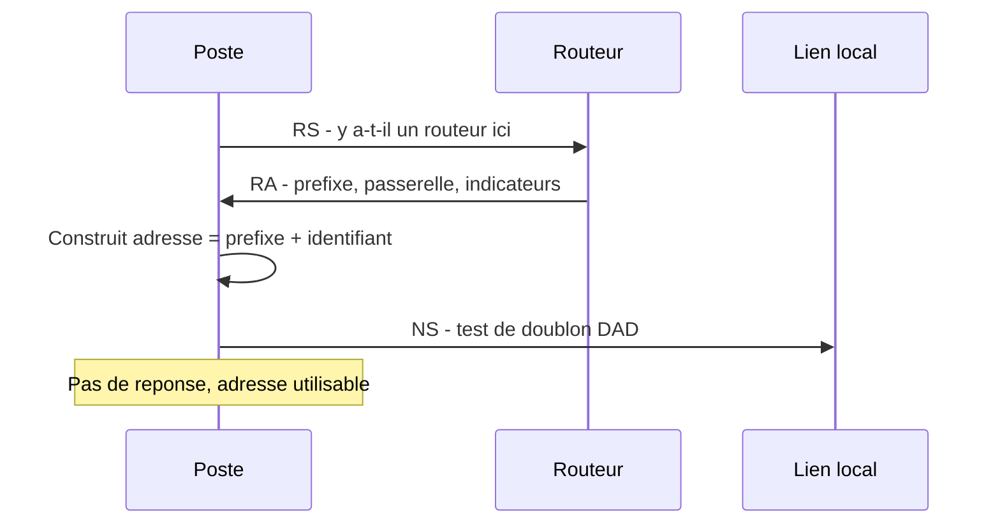

# Adressage IPv6 et coexistence IPv4

## Objectifs pédagogiques

À la fin de ce module, vous saurez :

- **Lire et abréger** une adresse IPv6, puis identifier la partie préfixe et la partie interface.
- **Distinguer** les adresses globales, link-local, locales uniques et multicast, et dire quand chacune sert.
- **Expliquer** comment un poste obtient sa configuration sans intervention : annonces de routeur, SLAAC et DHCPv6.
- **Diagnostiquer** une connectivité IPv6 de base avec les commandes Linux et Windows.
- **Décrire** comment IPv4 et IPv6 vivent ensemble sur un réseau (dual-stack, tunnels, traduction) et pourquoi IPv6 n'est pas « sécurisé par nature ».

## Mise en situation

Vous venez d'arriver dans l'équipe informatique d'une PME d'une centaine de postes. En ouvrant un terminal sur un poste de la comptabilité, vous découvrez trois adresses IPv6 sur la carte réseau. Personne n'a jamais installé de serveur pour les distribuer, et le responsable n'est pas sûr qu'IPv6 soit utilisé.

Quelques jours plus tard, un audit interne pose une question simple : « Si IPv6 est actif, qui le filtre ? » Le pare-feu de l'entreprise n'a pourtant que des règles IPv4.

L'enjeu de ce module est de comprendre d'où viennent ces adresses, comment elles fonctionnent, et pourquoi ignorer IPv6 ne le fait pas disparaître.

## Contexte et problématique

Pourquoi un nouveau protocole ? IPv4 offre environ 4,3 milliards d'adresses, avec 32 bits. C'était confortable dans les années 80, mais l'IANA (organisme qui distribue les blocs d'adresses au niveau mondial) a épuisé ses réserves libres en 2011.

Depuis, les opérateurs et les entreprises s'en sortent avec des astuces. La plus répandue est la traduction d'adresses, NAT (Network Address Translation), qui fait partager une adresse publique à de nombreuses machines. Elle fonctionne, mais elle casse le principe d'origine d'Internet : chaque machine doit pouvoir joindre directement chaque autre.

IPv6 (Internet Protocol version 6) règle le problème à la racine avec des adresses de 128 bits, soit environ 3,4 × 10³⁸ combinaisons. Il en profite pour simplifier le travail des routeurs : l'en-tête a une taille fixe de 40 octets, il n'y a plus de somme de contrôle à recalculer à chaque saut, et les routeurs ne fragmentent plus les paquets en route.

IPv6 reste un protocole de couche 3 du modèle OSI, au même niveau qu'IPv4. Il s'appuie sur la même couche Ethernet en dessous, et il transporte au-dessus les mêmes protocoles de transport (TCP, UDP), sans changement conceptuel. Ce qui change, c'est la façon dont les machines découvrent leurs voisins et se configurent.

> 💡 **À retenir**
>
> IPv6 n'est pas « IPv4 avec des adresses plus longues ». Plusieurs mécanismes que vous connaissez (broadcast, ARP, DHCP comme seul mode de configuration automatique) sont remplacés ou complétés par d'autres.
{: .callout .callout-important}

## Lire une adresse IPv6

### Notation et abréviation

Une adresse IPv6 s'écrit en 8 groupes de 16 bits, chacun noté en hexadécimal et séparés par `:`.

```
2001:0db8:0000:0000:0000:0000:0000:0001
```

Personne n'écrit cela en entier. Deux règles permettent de raccourcir :

1. Dans chaque groupe, on supprime les zéros de tête : `0db8` devient `db8`, `0000` devient `0`.
2. Une seule suite de groupes consécutifs à zéro peut être remplacée par `::`.

L'adresse ci-dessus devient donc `2001:db8::1`.

> ⚠️ **Comportement contre-intuitif**
>
> `::` ne peut apparaître qu'une fois par adresse. Dans `2001:0:0:1:0:0:0:1`, deux suites de zéros sont possibles. Si l'on remplaçait les deux, on ne saurait plus combien de groupes chaque `::` représente. La règle consiste à compresser la suite la plus longue (ici la seconde) : `2001:0:0:1::1`.
{: .callout .callout-attention}

Dans une URL, l'adresse se met entre crochets, car les `:` prêteraient à confusion avec le séparateur de port : `http://[2001:db8::1]/`.

Les exemples de ce module utilisent le préfixe `2001:db8::/32`. Il est réservé à la documentation et n'est jamais attribué à personne, comme `192.0.2.0/24` en IPv4.

### 🧠 Le préfixe : la notion à ancrer

En IPv4, vous calculiez des masques en binaire, comptiez des hôtes et ajustiez des tailles de sous-réseaux. En IPv6, presque tout cela disparaît. Une adresse se découpe en deux moitiés :

- **les 64 premiers bits** : le préfixe, qui identifie le réseau (le lien) ;
- **les 64 derniers bits** : l'identifiant d'interface, qui désigne la machine sur ce réseau.

Un réseau local (LAN) reçoit un `/64`, toujours. On ne se demande pas « combien d'hôtes ? » : 2⁶⁴ adresses dépassent tout besoin réel. Le travail de conception consiste surtout à découper un préfixe plus grand, fourni par l'opérateur, en `/64`.

Voici comment lire une adresse avec un site doté d'un `/48` :

```
2001:0db8:acad : 0010 : 3f1a:8c2e:5d90:41b7
|---- 48 bits ----|  16 bits  |------- 64 bits -------|
 préfixe du site    sous-réseau   identifiant d'interface
```

Comme un chiffre hexadécimal vaut 4 bits, la lecture est directe : un `/48` correspond à 12 chiffres, soit exactement 3 groupes ; un `/64` correspond à 4 groupes. Le découpage en sous-réseaux se fait alors en choisissant la valeur du quatrième groupe : `2001:db8:acad:1::/64`, `2001:db8:acad:2::/64`, `2001:db8:acad:3::/64`, etc. Un `/48` offre 65 536 réseaux de ce type, un `/56` en offre 256.

> 💡 **Point clé**
>
> La taille `/64` n'est pas une convention esthétique. SLAAC, le mécanisme d'autoconfiguration vu plus bas, suppose un identifiant d'interface de 64 bits. Un LAN configuré en `/80` ou `/120` casse l'autoconfiguration sur les machines qui l'utilisent.
{: .callout .callout-important}

## Les familles d'adresses

Une même interface porte normalement plusieurs adresses IPv6 en même temps. Cela surprend en venant d'IPv4, mais c'est le fonctionnement prévu.

| Type | Préfixe | Portée | Usage |
|------|---------|--------|-------|
| GUA — Global Unicast Address | `2000::/3` (commence par `2` ou `3`) | Internet | Adresse routable mondialement, équivalent d'une adresse IPv4 publique |
| Link-local | `fe80::/10` | Un seul lien | Générée automatiquement, indispensable au fonctionnement du protocole |
| ULA — Unique Local Address | `fc00::/7` (en pratique `fd00::/8`) | Interne à l'organisation | Adressage privé stable, équivalent conceptuel des plages privées IPv4 |
| Multicast | `ff00::/8` | Variable | Communication vers un groupe, remplace le broadcast |
| Loopback | `::1` | La machine | Équivalent de `127.0.0.1` |

L'adresse **link-local** est la plus particulière. Dès qu'IPv6 est activé sur une interface, la machine se fabrique une adresse `fe80::...` sans rien demander à personne. Elle est valable uniquement sur le segment local : un routeur ne la transmet jamais.

Elle sert de socle à tout le reste :

- le poste s'en sert pour parler au routeur avant d'avoir une adresse globale ;
- une route par défaut IPv6 pointe d'ailleurs souvent vers l'adresse link-local du routeur.

Comme la même adresse `fe80::1` peut exister sur chaque interface, on précise l'interface avec un suffixe : `fe80::1%eth0` (Linux) ou `fe80::1%12` (Windows, numéro d'interface).

> 📮 **Analogie : le casier interne**
>
> Une adresse link-local ressemble au casier interne d'un immeuble de bureaux : « casier 1 » a un sens à l'intérieur, mais la poste ne sait pas y livrer depuis l'extérieur. Si vous êtes relié à plusieurs immeubles, « casier 1 » peut exister dans chacun : il faut préciser lequel, d'où le suffixe `%interface`. Limite de l'image : personne n'attribue ce casier, la machine se l'attribue seule.
{: .callout .callout-analogie}

Les **ULA** servent à avoir un adressage interne qui ne change pas, même si l'opérateur modifie le préfixe public. L'organisation tire au hasard 40 bits pour former un préfixe `fdxx:xxxx:xxxx::/48`, ce qui limite le risque de collision lors d'une fusion de réseaux. Elles ne sont pas routées sur Internet. Elles complètent les adresses globales et ne les remplacent pas.

Le **multicast** prend la place du broadcast, qui n'existe plus du tout en IPv6. Deux adresses sont à connaître : `ff02::1` (tous les nœuds du lien) et `ff02::2` (tous les routeurs du lien).

## Comment les voisins se découvrent : ICMPv6 et NDP

En IPv4, ICMP est utile mais souvent filtré sans conséquence grave. En IPv6, ICMPv6 (Internet Control Message Protocol version 6) est vital : il transporte les messages d'erreur, le `ping`, et surtout NDP (Neighbor Discovery Protocol), qui remplace ARP et prend en charge plusieurs autres fonctions.

NDP repose sur cinq messages ICMPv6 :

| Message | Type | Rôle |
|---------|------|------|
| Router Solicitation (RS) | 133 | Un poste demande « y a-t-il un routeur ici ? » |
| Router Advertisement (RA) | 134 | Le routeur annonce préfixe, passerelle et options |
| Neighbor Solicitation (NS) | 135 | « Qui a cette adresse IPv6 ? » (équivalent ARP request) |
| Neighbor Advertisement (NA) | 136 | « C'est moi, voici mon adresse MAC » |
| Redirect | 137 | Le routeur indique un meilleur chemin |

> 📖 **Définition**
>
> NDP : ensemble de messages ICMPv6 qui assure la résolution adresse IP → adresse MAC, la découverte des routeurs et la détection de doublons d'adresses.
{: .callout .callout-definition}

> 🔑 **Moyen mnémotechnique**
>
> Pour les types 133 à 136, le **R**outeur passe avant le **N**eighbor, et la **S**olicitation (question) avant l'**A**dvertisement (réponse). Cela donne RS, RA, NS, NA, puis Redirect ferme la liste en 137.
{: .callout .callout-memo}

Autre différence : une NS n'est pas diffusée à tout le monde. Elle est envoyée à une adresse multicast dérivée de l'adresse recherchée (solicited-node, de la forme `ff02::1:ffXX:XXXX`), que seules les machines concernées écoutent. Le lien est donc moins bruyant qu'avec la diffusion ARP.

Avant d'utiliser une adresse, un poste effectue aussi une DAD (Duplicate Address Detection) : il envoie une NS pour sa propre adresse. Si quelqu'un répond, l'adresse est déjà prise et il ne l'utilise pas. S'il n'y a pas de réponse, l'adresse est libre.

> ⚠️ **Piège réseau classique**
>
> Filtrer tout ICMPv6 sur un pare-feu « par prudence » casse IPv6. Les messages NDP cessent de passer et l'autoconfiguration échoue. Même dans le cas des paquets qui traversent le réseau, le message « Packet Too Big » est indispensable : les routeurs ne fragmentent plus, c'est la source qui adapte la taille de ses paquets grâce à ce message. S'il est bloqué, certaines connexions se figent sur les gros transferts, sans erreur claire.
{: .callout .callout-attention}

## Obtenir une configuration : RA, SLAAC et DHCPv6

### SLAAC, le mode par défaut

Qui configure le poste ? Dans la plupart des réseaux locaux, c'est le routeur, par ses annonces RA, que le poste reçoit en réponse à un RS ou périodiquement. L'annonce contient :

- le préfixe du lien (le `/64`) ;
- des indicateurs de comportement ;
- la durée de vie du routeur comme passerelle par défaut ;
- optionnellement, l'adresse d'un serveur DNS (Domain Name System) via l'option RDNSS (Recursive DNS Server).

À réception, le poste applique SLAAC* (Stateless Address Autoconfiguration) : il construit son adresse en collant le préfixe annoncé à un identifiant d'interface qu'il génère lui-même.

\* SLAAC : mécanisme où chaque machine fabrique seule son adresse à partir du préfixe annoncé par le routeur, sans serveur qui garde la liste des adresses attribuées.



Pour l'identifiant d'interface, les anciens systèmes utilisaient EUI-64 (Extended Unique Identifier, 64 bits), dérivé de l'adresse MAC. Ce mécanisme pose un problème de vie privée : l'identifiant suit la carte réseau d'un réseau à l'autre. Les systèmes actuels utilisent des identifiants stables mais opaques, et génèrent en plus des adresses temporaires qui changent régulièrement pour les connexions sortantes. C'est pour cela qu'un même poste affiche parfois plusieurs adresses globales.

### DHCPv6 et indicateurs M et O

Si l'organisation veut garder la main sur les adresses distribuées, ou fournir des options supplémentaires, elle peut utiliser DHCPv6 (Dynamic Host Configuration Protocol version 6). Le routeur indique alors dans le RA, grâce à deux indicateurs, ce que le poste doit faire :

| M | O | Comportement du poste |
|---|---|-----------------------|
| 0 | 0 | SLAAC seul, DNS éventuellement via RDNSS |
| 0 | 1 | Adresse par SLAAC, autres informations (DNS, domaine) par DHCPv6 sans état |
| 1 | – | Adresse obtenue via DHCPv6 avec état, le serveur garde la trace des attributions |

> 💡 **Point clé**
>
> DHCPv6 ne fournit pas la passerelle par défaut. La route par défaut vient uniquement du RA. Un serveur DHCPv6 parfaitement configuré ne suffit donc pas si le routeur n'annonce rien. De plus, certains systèmes, notamment Android, n'utilisent pas DHCPv6 pour obtenir leur adresse. Pour un parc hétérogène, SLAAC reste la base et DHCPv6 est un complément.
{: .callout .callout-important}

## Faire cohabiter IPv4 et IPv6

Personne ne bascule d'un coup. Pendant des années, les deux protocoles coexistent. Trois approches se combinent selon les situations.

**Dual-stack** : chaque machine et chaque équipement porte les deux protocoles en parallèle. Un poste a une adresse IPv4 et des adresses IPv6, deux tables de routage, et le DNS publie deux types d'enregistrements pour un nom : `A` (IPv4) et `AAAA` (IPv6, quatre fois la taille d'un `A`, d'où quatre `A`). Quand un client a le choix, il essaie les deux presque simultanément et retient la connexion la plus rapide (mécanisme *Happy Eyeballs*). Cela évite qu'un chemin IPv6 défaillant ne ralentisse l'utilisateur. C'est le mode le plus courant en entreprise.

**Tunnels** : des paquets IPv6 sont encapsulés dans des paquets IPv4 pour traverser une zone qui ne supporte pas IPv6. C'est une solution transitoire, utile quand un site distant n'a pas encore de connectivité native.

**Traduction** : dans un réseau IPv6 seul, une passerelle NAT64, associée à un DNS qui fabrique des adresses IPv6 pour les services restés en IPv4 (DNS64), permet aux clients d'atteindre les serveurs IPv4. Plusieurs réseaux mobiles fonctionnent ainsi. C'est la forme de coexistence la plus éloignée du dual-stack, car les clients n'ont plus d'IPv4 du tout.

Le dual-stack n'est pas gratuit pour autant. Tout ce que vous avez en IPv4 doit exister en double : plan d'adressage, routage, règles de filtrage, supervision, inventaire. Ce que l'on oublie de dupliquer devient un angle mort.

## Commandes et outils de diagnostic

Le principe est le même qu'en IPv4 : regarder l'adresse, la route, les voisins, puis tester la connectivité. Les noms d'interfaces varient selon le système (`eth0`, `ens18`, `Ethernet`...).

**Sous Linux :**

```bash
ip -6 addr show dev eth0
```

```
2: eth0: <BROADCAST,MULTICAST,UP,LOWER_UP> mtu 1500 state UP qlen 1000
    inet6 2001:db8:acad:100:3f1a:8c2e:5d90:41b7/64 scope global dynamic
       valid_lft 86380sec preferred_lft 14380sec
    inet6 fe80::a00:27ff:fe4e:66a1/64 scope link
       valid_lft forever preferred_lft forever
```

La première ligne est une adresse globale (`scope global`, obtenue via RA, `dynamic`), avec une durée de validité. La seconde est la link-local (`scope link`, valide indéfiniment). Un poste qui n'a que la seconde n'a reçu aucun préfixe.

```bash
ip -6 route show
```

```
2001:db8:acad:100::/64 dev eth0 proto ra metric 100
fe80::/64 dev eth0 proto kernel metric 256
default via fe80::1 dev eth0 proto ra metric 100
```

On y lit le réseau local, appris par RA, et la passerelle par défaut, qui est une adresse link-local (`fe80::1`). C'est normal et voulu, `proto ra` confirme qu'elle vient d'une annonce.

```bash
ip -6 neigh show
```

```
fe80::1 dev eth0 lladdr 00:11:22:33:44:55 router REACHABLE
```

C'est la table des voisins, l'équivalent de la table ARP. Le mot `router` signale qu'il s'agit d'un routeur, `REACHABLE` que la résolution est récente et valide.

Pour tester :

```bash
ping -6 fe80::1%eth0
ping -6 2001:4860:4860::8888
traceroute -6 2001:4860:4860::8888
```

Le suffixe `%eth0` est obligatoire pour une adresse link-local, car la machine doit savoir sur quelle interface envoyer.

**Sous Windows :**

```powershell
ipconfig
Get-NetIPAddress -AddressFamily IPv6
netsh interface ipv6 show neighbors
ping -6 2001:4860:4860::8888
```

Les sorties sont organisées différemment, mais on retrouve les mêmes informations : adresses globales, temporaires, link-local, passerelle, voisins.

Quand la capture de paquets est nécessaire, pour vérifier si un RA arrive vraiment sur le poste :

```bash
sudo tcpdump -i eth0 -n 'icmp6 and ip6[40] == 134'
```

Le type 134 correspond aux annonces de routeur. Si rien n'apparaît après une minute, le routeur n'en envoie pas, ou quelque chose les bloque.

## Sécurité réseau liée

Les risques concrets viennent plutôt de ce qui est mal compris :

> ⚠️ **IPv6 ne garantit pas automatiquement une meilleure sécurité**
>
> L'idée circule parce qu'IPsec (Internet Protocol Security) était prévu comme obligatoire dans la spécification d'origine. Ce n'est plus le cas aujourd'hui : il est disponible, comme en IPv4, mais pas imposé. Et surtout, un protocole plus récent n'apporte aucune protection si personne ne le contrôle.
{: .callout .callout-attention}

- **IPv6 actif mais non filtré** : Windows et la plupart des distributions Linux l'activent par défaut. Si le pare-feu n'a de règles que pour IPv4, une machine peut être joignable en IPv6 sans que personne l'ait voulu, c'est exactement la question de l'audit de notre PME.
- **Plus de NAT par défaut** : le NAT masque l'adressage interne en IPv4, mais ce n'est pas un pare-feu. En IPv6, chaque machine a une adresse globale potentiellement joignable : il faut un vrai filtrage à état (la cohérence avec le module sur les pare-feu viendra plus tard).
- **Annonces de routeur frauduleuses** : un poste malveillant envoie de faux RA et devient la passerelle de tous les voisins, qui lui transmettent alors leur trafic. NDP n'est pas authentifié par défaut, il fait confiance au lien.
- **Usurpation de voisin** : de fausses NA peuvent empoisonner la table des voisins, comme l'empoisonnement ARP en IPv4.
- **Fausse impression d'invisibilité** : avec 2⁶⁴ adresses par réseau, balayer un `/64` à l'aveugle est irréaliste. Mais les adresses réelles se retrouvent via le DNS, les journaux, le multicast `ff02::1` ou des schémas d'adressage prévisibles.

Les mesures de protection reprennent les mêmes logiques qu'en IPv4 :

- des règles de filtrage IPv6 équivalentes à celles d'IPv4, en autorisant les types ICMPv6 nécessaires au lieu de tout bloquer ;
- sur les commutateurs, RA Guard et DHCPv6 Guard, qui bloquent les annonces et les offres venant de ports utilisateurs, et l'inspection NDP, qui contrôle les associations IP/MAC ;
- une supervision qui couvre les deux protocoles.

Désactiver IPv6 partout est parfois présenté comme une solution : c'est une décision qui doit être assumée et testée, pas un réflexe, car certains services système en dépendent.

## Cas réel en entreprise (scénario illustratif)

Le scénario suivant est fictif, avec des valeurs d'exemple. Dans l'entreprise du début, l'opérateur a délégué le préfixe `2001:db8:acad:100::/56`. Vous disposez donc de 256 réseaux `/64`, de `2001:db8:acad:100::/64` à `2001:db8:acad:1ff::/64`. Vous décidez du plan suivant :

| Segment | Préfixe | Remarque |
|---------|---------|----------|
| Bureaux | `2001:db8:acad:100::/64` | SLAAC, RA avec option DNS |
| Serveurs | `2001:db8:acad:101::/64` | Adresses fixes |
| Invités | `2001:db8:acad:102::/64` | SLAAC, accès Internet uniquement |
| Réserve | `2001:db8:acad:103::/64` à `1ff` | Extensions futures |

Quelques semaines plus tard, un nouveau poste du segment invités n'a plus accès à certains sites alors qu'IPv4 fonctionne. Voici la démarche :

1. **Adresse** : `ip -6 addr show dev eth0` ne montre qu'une adresse `fe80::...`. Le poste n'a donc pas de préfixe global.
2. **Route** : `ip -6 route show` ne contient aucune route par défaut. Rien n'est arrivé par RA.
3. **Capture** : `tcpdump -i eth0 -n 'icmp6 and ip6[40] == 134'` reste silencieux pendant plusieurs minutes. Le routeur n'annonce rien sur ce segment.
4. **Cause** : sur l'interface du routeur côté invités, l'émission des RA n'avait pas été activée lors de la création du segment.
5. **Correction** : après activation, un RA arrive dans la minute, le poste obtient son adresse `2001:db8:acad:102:...`, la route par défaut apparaît via l'adresse link-local du routeur, et `ping -6 2001:4860:4860::8888` répond.

Un effet de bord se confirme : tant que ce poste n'avait pas d'IPv6, il passait par IPv4 pour la plupart des services, ce qui masquait le problème. Seuls quelques services joignables uniquement en IPv6 échouaient. Voilà pourquoi tester séparément chaque pile fait gagner du temps.

## Bonnes pratiques

- **Un `/64` par réseau local**, sans exception, pour que SLAAC fonctionne.
- **Alignez le plan d'adressage** sur les frontières hexadécimales : un numéro de sous-réseau par segment, documenté dans le même tableau que le plan IPv4.
- **Ne bloquez pas ICMPv6 en bloc** : autorisez les types nécessaires (NDP, MLD, Destination Unreachable, Packet Too Big, Time Exceeded, Parameter Problem, Echo selon la politique) et filtrez le reste.
- **Doublez vos contrôles** : toute règle de pare-feu, de supervision ou d'inventaire qui existe en IPv4 doit avoir un équivalent IPv6.
- **Protégez le lien** : activez RA Guard et DHCPv6 Guard sur les ports d'accès des commutateurs, en gardant comme ports de confiance ceux qui mènent aux routeurs.
- **Testez les deux piles** séparément (`ping -4` et `ping -6`) avant de conclure qu'un service est joignable.
- **Ne désactivez IPv6 qu'en connaissance de cause**, et dans ce cas, de façon cohérente sur tout le parc.

## Résumé

| Concept | Rôle | Points clés |
|---------|------|-------------|
| Adresse de 128 bits | Identifier une interface sans pénurie | 8 groupes hexadécimaux, `::` une seule fois, zéros de tête omis |
| Préfixe `/64` | Identifier le réseau local | 64 bits réseau, 64 bits interface, un `/64` par LAN |
| Types d'adresses | Adapter la portée | Globale (Internet), link-local (lien), ULA (interne), multicast (groupe) |
| ICMPv6 et NDP | Découvrir voisins et routeurs | Remplace ARP, ne doit jamais être filtré en bloc |
| RA et SLAAC | Autoconfigurer les postes | Le routeur annonce préfixe et passerelle, le poste fabrique son adresse |
| DHCPv6 | Compléter la configuration | Adresse ou options, jamais la passerelle |
| Dual-stack et transition | Faire coexister les deux protocoles | Double configuration, tunnels, NAT64 |
| Sécurité IPv6 | Éviter les angles morts | Filtrage dédié, protection des RA, supervision des deux piles |

Vous savez maintenant comment une machine est identifiée sur un réseau, en IPv4 comme en IPv6. Reste à comprendre comment les données arrivent au bon programme une fois le paquet livré à la bonne machine, ce que couvre le module suivant.

<!-- snippet
id: ipv6_diag_addr_show
type: command
tech: ipv6
level: beginner
importance: high
format: knowledge
tags: ipv6,linux,diagnostic,adressage
title: Lister les adresses IPv6 d'une interface Linux
command: ip -6 addr show dev <INTERFACE>
example: ip -6 addr show dev eth0
description: Affiche adresses globales, link-local et leurs durées de validité. Une interface avec seulement fe80:: n'a reçu aucun préfixe via RA.
-->

<!-- snippet
id: ipv6_diag_route_show
type: command
tech: ipv6
level: beginner
importance: high
format: knowledge
tags: ipv6,routage,linux,diagnostic
title: Afficher la table de routage IPv6
command: ip -6 route show
description: Vérifie la route par défaut. Une ligne "default via fe80::... proto ra" est normale : la passerelle est une adresse link-local apprise par annonce de routeur.
-->

<!-- snippet
id: ipv6_diag_neigh_show
type: command
tech: ipv6
level: beginner
importance: medium
format: knowledge
tags: ipv6,ndp,linux,diagnostic
title: Consulter la table des voisins IPv6
command: ip -6 neigh show
description: Équivalent de la table ARP : associe adresses IPv6 et MAC. Le mot router repère la passerelle, REACHABLE confirme une résolution récente.
-->

<!-- snippet
id: ipv6_diag_ping_linklocal
type: command
tech: ipv6
level: beginner
importance: high
format: knowledge
tags: ipv6,ping,link-local,diagnostic
title: Tester une adresse link-local avec ping
context: Le suffixe %interface est nécessaire car fe80::/10 existe sur chaque interface
command: ping -6 <IPV6>%<INTERFACE>
example: ping -6 fe80::1%eth0
description: Sans le suffixe %interface, le système ne sait pas sur quel lien envoyer le paquet et refuse la commande. Permet de tester la passerelle locale.
-->

<!-- snippet
id: ipv6_diag_capture_ra
type: command
tech: ipv6
level: intermediate
importance: medium
format: knowledge
tags: ipv6,icmpv6,tcpdump,diagnostic
title: Capturer les annonces de routeur reçues
context: À lancer sur le poste qui n'obtient pas d'adresse globale
command: sudo tcpdump -i <INTERFACE> -n 'icmp6 and ip6[40] == 134'
example: sudo tcpdump -i eth0 -n 'icmp6 and ip6[40] == 134'
description: Le type 134 est le Router Advertisement. Aucune trame en une à deux minutes signifie que le routeur n'annonce pas de préfixe ou que le lien les bloque.
-->

<!-- snippet
id: ipv6_format_compression
type: concept
tech: ipv6
level: beginner
importance: high
format: knowledge
tags: ipv6,notation,adressage
title: Règles d'abréviation d'une adresse IPv6
content: Deux règles. 1) Supprimer les zéros de tête de chaque groupe (0db8 devient db8). 2) Remplacer une seule suite de groupes à zéro par "::". 2001:0db8:0000:0000:0000:0000:0000:0001 devient 2001:db8::1. Deux "::" rendraient l'adresse ambiguë, car on ne saurait plus répartir les groupes manquants. Si deux suites existent, on compresse la plus longue.
description: "::" ne peut apparaître qu'une fois par adresse. En cas de deux suites de zéros, la plus longue est compressée.
-->

<!-- snippet
id: ipv6_prefix_structure_64
type: concept
tech: ipv6
level: beginner
importance: high
format: knowledge
tags: ipv6,prefixe,sous-reseau,slaac
title: Structure préfixe /64 et identifiant d'interface
content: Une adresse IPv6 unicast se coupe en deux moitiés de 64 bits : les 64 premiers désignent le réseau (préfixe), les 64 derniers la machine (identifiant d'interface). Un chiffre hexadécimal valant 4 bits, un /64 couvre 4 groupes et un /48 en couvre 3. Un site avec un /48 dispose de 65 536 réseaux /64, un /56 de 256. Tout LAN utilise un /64 car SLAAC suppose 64 bits d'identifiant.
description: Un /64 par LAN sans compter les hôtes : le travail consiste à découper le préfixe fourni en /64, pas à économiser des adresses.
-->

<!-- snippet
id: ipv6_linklocal_role
type: concept
tech: ipv6
level: beginner
importance: high
format: knowledge
tags: ipv6,link-local,ndp,routage
title: Adresse link-local : générée seule et jamais routée
content: Dès qu'IPv6 est actif sur une interface, la machine s'attribue une adresse fe80::/10 sans serveur ni routeur. Elle n'est valable que sur le lien local et aucun routeur ne la transmet. Elle sert aux échanges NDP et comme prochain saut des routes (default via fe80::1). Comme elle existe sur chaque interface, on précise la zone avec %interface.
description: Sans adresse globale, un poste communique déjà sur son lien grâce à fe80::. Une route par défaut vers une link-local est normale.
-->

<!-- snippet
id: ipv6_slaac_ra_flags
type: concept
tech: ipv6
level: intermediate
importance: high
format: knowledge
tags: ipv6,slaac,dhcpv6,router-advertisement
title: SLAAC, flags M et O des annonces de routeur
content: Le routeur envoie des RA contenant préfixe /64, passerelle et deux indicateurs. M=0 et O=0 : adresse par SLAAC seul. M=0 et O=1 : adresse par SLAAC, DNS et domaine via DHCPv6 sans état. M=1 : adresse fournie par DHCPv6 avec état. Le poste construit son adresse en combinant le préfixe annoncé avec un identifiant d'interface qu'il génère lui-même.
description: Les flags M et O du RA décident si le poste utilise DHCPv6. Le routeur reste l'unique source du préfixe et de la passerelle.
-->

<!-- snippet
id: ipv6_dhcpv6_no_gateway
type: warning
tech: ipv6
level: intermediate
importance: high
format: knowledge
tags: ipv6,dhcpv6,passerelle,router-advertisement
title: DHCPv6 ne fournit jamais la passerelle par défaut
content: Piège : on configure DHCPv6 en pensant, comme en DHCP IPv4, distribuer aussi la passerelle. Conséquence : les postes obtiennent une adresse mais n'ont aucune route par défaut. Correction : la route par défaut IPv6 vient uniquement des Router Advertisement, il faut donc activer les RA sur l'interface du routeur même si DHCPv6 est utilisé.
description: Un serveur DHCPv6 parfait ne suffit pas : sans RA émis par le routeur, aucun poste ne reçoit de route par défaut.
-->

<!-- snippet
id: ipv6_icmpv6_filtering
type: warning
tech: ipv6
level: beginner
importance: high
format: knowledge
tags: ipv6,icmpv6,pare-feu,ndp
title: Bloquer tout ICMPv6 casse IPv6
content: Piège : filtrer ICMPv6 comme on filtrait parfois ICMP en IPv4. Conséquence : NDP ne passe plus, l'autoconfiguration échoue, et le message Packet Too Big étant bloqué, les gros transferts se figent car les routeurs ne fragmentent pas. Correction : autoriser au minimum les types NDP (133 à 136), Destination Unreachable (1), Packet Too Big (2), Time Exceeded (3), Parameter Problem (4) et MLD (130 à 132, 143), puis filtrer le reste selon la politique (voir RFC 4890).
description: ICMPv6 porte NDP et la gestion de taille des paquets. Il se filtre type par type, jamais en bloc.
-->

<!-- snippet
id: ipv6_security_not_automatic
type: warning
tech: ipv6
level: beginner
importance: high
format: knowledge
tags: ipv6,securite,pare-feu,dual-stack
title: IPv6 actif mais non filtré : angle mort fréquent
content: Piège : croire qu'IPv6 est plus sûr, ou l'ignorer parce qu'on ne l'a pas déployé. Windows et la plupart des Linux l'activent par défaut. Conséquence : machines joignables en IPv6 alors que le pare-feu n'a que des règles IPv4, et sans NAT pour masquer l'adressage. Correction : dupliquer chaque règle de filtrage et chaque contrôle IPv4 en IPv6, ou désactiver IPv6 de manière volontaire et documentée.
description: En dual-stack, tout ce qui existe en IPv4 doit exister en IPv6 : filtrage, supervision, inventaire. IPsec n'est plus imposé par IPv6.
-->

<!-- snippet
id: ipv6_ra_guard_tip
type: tip
tech: ipv6
level: intermediate
importance: medium
format: knowledge
tags: ipv6,ra-guard,commutateur,securite
title: Activer RA Guard sur les ports d'accès des commutateurs
content: Un poste malveillant peut envoyer de faux Router Advertisement et devenir la passerelle de tout le segment. Sur le commutateur, activer RA Guard sur les ports utilisateurs (RA entrants bloqués) et ne laisser les RA passer que sur les ports menant aux routeurs. Même principe pour DHCPv6 Guard. Le nom exact de la fonction varie selon le constructeur.
description: Bloquer les RA entrants sur les ports utilisateurs empêche un faux routeur de détourner le trafic du segment.
-->

<!-- snippet
id: ipv6_dualstack_dns_records
type: concept
tech: ipv6
level: beginner
importance: medium
format: knowledge
tags: ipv6,dual-stack,dns,transition
title: Dual-stack : enregistrements A et AAAA, deux piles à tenir
content: En dual-stack, une machine porte IPv4 et IPv6 en parallèle, avec deux tables de routage. Le DNS publie un enregistrement A (IPv4) et un AAAA (IPv6, quatre fois la taille d'un A) pour le même nom. Le client essaie les deux presque simultanément (Happy Eyeballs) et garde la connexion la plus rapide, ce qui limite l'impact d'un chemin IPv6 défaillant.
description: Un nom peut avoir un A et un AAAA. Le client teste les deux et retient le plus rapide, donc un problème IPv6 peut rester masqué par IPv4.
-->

<!-- snippet
id: ipv6_no_global_address_error
type: error
tech: ipv6
level: beginner
importance: medium
format: knowledge
tags: ipv6,slaac,router-advertisement,diagnostic
title: Poste avec seulement fe80:: et sans route par défaut
content: Symptôme : ip -6 addr n'affiche que fe80:: et ip -6 route n'a pas de default. Cause probable : aucun Router Advertisement n'arrive, soit parce que le routeur ne les émet pas sur ce segment, soit parce qu'un filtre les bloque. Correction : capturer avec tcpdump 'icmp6 and ip6[40] == 134', puis activer les RA sur l'interface du routeur ou autoriser ICMPv6 type 134.
description: Un poste sans préfixe global ni route par défaut n'a pas reçu de RA. Vérifier l'émission côté routeur avant de chercher côté poste.
-->
