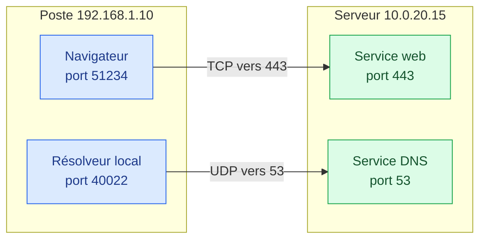
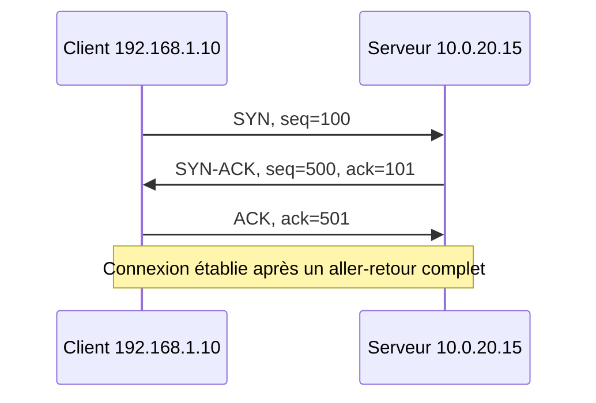
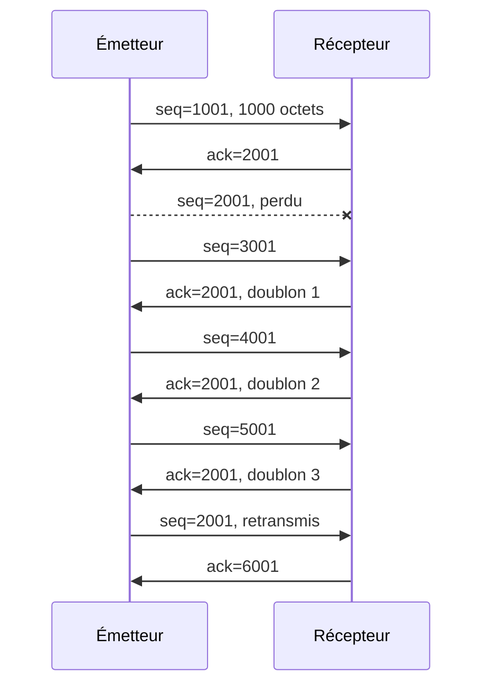
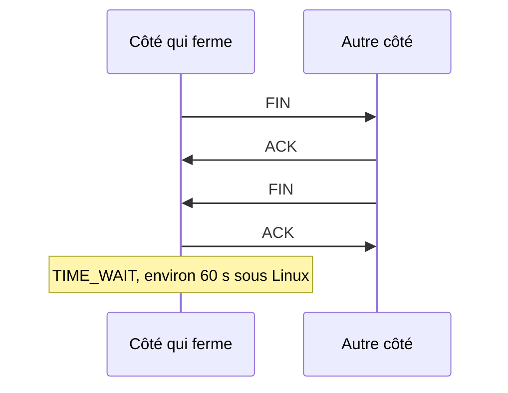
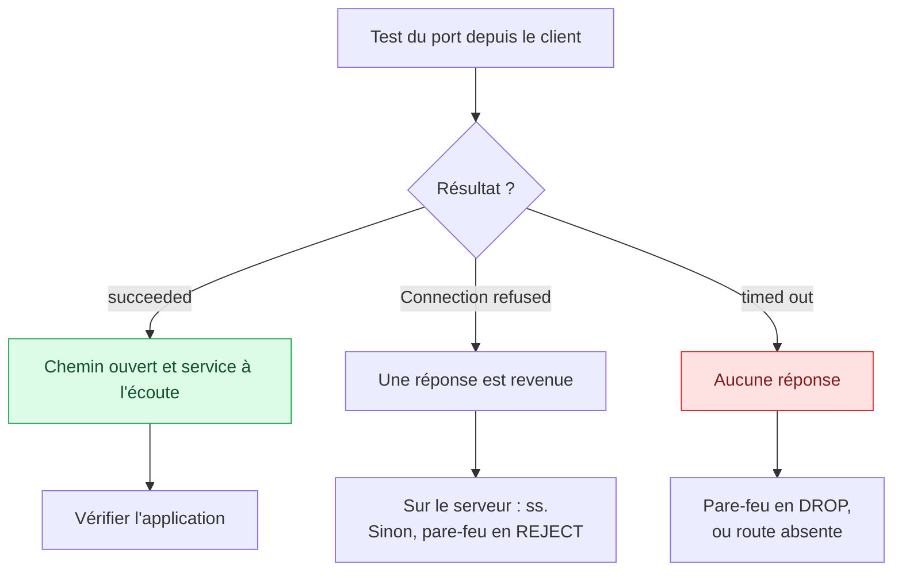

# TCP, UDP, ports et sockets

## Objectifs pédagogiques

À la fin de ce module, vous saurez :

- **Expliquer** ce que la couche transport ajoute à la couche IP.
- **Décrire** l'ouverture, le suivi et la fermeture d'une connexion TCP (Transmission Control Protocol).
- **Choisir** entre TCP et UDP (User Datagram Protocol) selon l'usage.
- **Identifier** une connexion à partir de ses adresses et de ses ports.
- **Diagnostiquer** une application injoignable en distinguant un problème de service d'un problème de chemin.

## Mise en situation

*Scénario illustratif.* Un développeur déploie une application interne et vous dit : « Le serveur répond au ping, mais le navigateur n'ouvre pas la page. »

Le ping prouve que les paquets atteignent la machine. Mais le programme qui doit répondre est-il bien là ? Le ping n'en dit rien. Ce module vous donne de quoi trancher en deux commandes.

## 1. Du bâtiment à l'appartement

> 🏢 **Analogie : l'immeuble et ses appartements.** L'adresse IP désigne une machine, comme l'adresse d'un immeuble. Plusieurs programmes y partagent la même adresse, et c'est le **port** qui indique l'appartement. Limite de l'image : côté client, l'« appartement » n'est attribué que temporairement, le temps d'une connexion.
{: .callout .callout-analogie}



À retenir sur ce schéma : **côté serveur, le port est fixe et connu ; côté client, le système en choisit un temporaire.**

La couche transport rend trois services :

| Service | Question résolue | Mécanisme |
|---|---|---|
| **Multiplexage** | À quel programme livrer ces données ? | Ports source et destination |
| **Segmentation** | Comment transporter un gros volume ? | Découpage, puis réassemblage |
| **Fiabilité, en option** | Faut-il garantir la livraison ? | TCP oui, UDP non |

IP livre de machine à machine ; le transport fait dialoguer deux programmes. Un routeur simple ne regarde que l'en-tête IP, mais les équipements de NAT et les pare-feu à états lisent aussi les ports.

## 2. TCP ou UDP

| Critère | TCP | UDP |
|---|---|---|
| Connexion préalable | Oui | Non |
| Livraison | Retransmission en cas de perte | Aucune garantie |
| Ordre | Rétabli à la réception | Non garanti |
| Régulation du débit | Flux et congestion | À gérer dans l'application |
| En-tête | 20 octets minimum | 8 octets |
| Une perte provoque | Un retard, le temps de retransmettre | Une donnée manquante |
| Exemples | Web, SSH, transfert de fichiers | DNS, voix, vidéo, HTTP/3 |

> 💡 **À retenir.** Prenez TCP lorsqu'une donnée manquante est inacceptable. Prenez UDP lorsqu'une donnée arrivée en retard ne sert plus, comme une image de visioconférence vieille de deux secondes. Prenez-le aussi pour un petit échange que l'application peut simplement rejouer.
{: .callout .callout-important}

UDP n'est pas un TCP défectueux. HTTP/3, par exemple, reconstruit sa propre fiabilité au-dessus d'UDP.

## 3. TCP : le cycle de vie d'une connexion

### Ouvrir : le three-way handshake



| Message | Ce qu'il veut dire |
|---|---|
| **SYN** (Synchronize) | « Ouvrons une connexion, je numérote à partir de 100. » |
| **SYN-ACK** | « D'accord, j'attends le 101, et je numérote à partir de 500. » |
| **ACK** (Acknowledgment) | « Reçu, j'attends le 501. » |

Chaque côté tire son numéro de départ au hasard, ce qui complique l'injection de faux segments. Le coût est d'un aller-retour : avec 100 ms de RTT (Round-Trip Time), la connexion s'ouvre au moins 100 ms après le premier envoi.

### Échanger : acquittements et retransmissions

Chaque octet est numéroté. Le récepteur annonce le prochain numéro attendu, ce qui confirme tout ce qui précède.

> 📚 **Analogie : les pages numérotées.** Dire « j'attends la page 21 », c'est confirmer d'un coup la réception des pages 1 à 20. Limite de l'image : TCP numérote des octets, pas des messages entiers.
{: .callout .callout-analogie}



Ce schéma montre qu'un trou dans la numérotation se voit vite : l'émetteur retransmet généralement dès le troisième acquittement dupliqué. Sinon, il attend l'expiration d'un délai ajusté au RTT mesuré. L'application ne voit aucune perte, seulement un peu de lenteur.

### Réguler : deux freins différents

| | Contrôle de flux | Contrôle de congestion |
|---|---|---|
| **Protège** | Le récepteur | Le réseau |
| **Signal** | La fenêtre annoncée par le récepteur | Pertes et délais observés |
| **Effet** | Limite les octets envoyés sans acquittement | Réduit le débit d'émission |

> 📖 **Définition.** La **fenêtre** indique l'espace libre dans le tampon du récepteur. Si elle tombe à zéro, l'émetteur attend.
{: .callout .callout-definition}

### Fermer : FIN, ou RST en urgence



Chaque sens se ferme séparément. L'état `TIME_WAIT` évite qu'un segment tardif se mêle à une nouvelle connexion utilisant les mêmes ports. À l'inverse, un **RST** (Reset) coupe net : c'est notamment la réponse à un SYN envoyé vers un port où rien n'écoute.

## 4. Port, socket et connexion

| Notion | Définition | Exemple |
|---|---|---|
| **Port** | Numéro sur 16 bits, de 0 à 65535 | `443` |
| **Socket** | Point de communication : protocole, adresse, port | `TCP 10.0.20.15:443` |
| **Connexion TCP** | Les 4 valeurs : IP et port de chaque extrémité | `192.168.1.10:51234 → 10.0.20.15:443` |

Un serveur peut ainsi servir des milliers de clients sur le même port, car il suffit qu'une des quatre valeurs change :

```text
192.168.1.10:51234  →  10.0.20.15:443
192.168.1.10:51235  →  10.0.20.15:443   deuxième connexion, autre port source
192.168.1.22:51234  →  10.0.20.15:443   même port source, autre adresse
```

### Les plages de ports

| Plage | Nom | Usage |
|---|---|---|
| 0 à 1023 | Ports connus | Services standards, souvent réservés aux processus privilégiés |
| 1024 à 49151 | Ports enregistrés | Applications déclarées auprès de l'IANA (Internet Assigned Numbers Authority) |
| 49152 à 65535 | Ports dynamiques | Usage temporaire |

Le port source d'un client s'appelle un **port éphémère**. Sa plage dépend du système : par défaut, 32768 à 60999 sous Linux, et 49152 à 65535 sous Windows récent.

### Les ports à connaître

| Port | Transport | Service |
|---|---|---|
| 22 | TCP | SSH — Secure Shell |
| 53 | UDP et TCP | DNS — Domain Name System |
| 80 | TCP | HTTP |
| 443 | TCP, et UDP pour HTTP/3 | HTTPS |
| 445 | TCP | SMB — Server Message Block |
| 3389 | TCP, et UDP | RDP — Remote Desktop Protocol |

### Trois notions à ne pas confondre

- **TCP ou UDP** est la méthode d'acheminement.
- **Le port** est un numéro.
- **Le service** est le programme qui répond.

« 443, c'est HTTPS » est une convention : n'importe quel programme peut y écouter. D'où trois conséquences :

- Un port ouvert ne dit pas ce qui écoute : il faut regarder le processus.
- Déplacer SSH sur le port 2222 réduit le bruit des scans automatiques, mais ne protège pas le service.
- `53/tcp` et `53/udp` sont distincts : chacun demande sa propre règle de pare-feu.

## 5. Diagnostiquer en trois questions

### Le service écoute-t-il ? (sur le serveur)

```bash
sudo ss -tulnp
```

| Option | Rôle |
|---|---|
| `-t`, `-u` | TCP, UDP |
| `-l` | Sockets en écoute |
| `-n` | Numéros plutôt que noms |
| `-p` | Processus associé, avec des droits suffisants |

Exemple de sortie, simplifié (la présentation varie selon le système) :

```text
Netid State  Local Address:Port  Process
tcp   LISTEN       0.0.0.0:22    users:(("sshd",pid=812,fd=3))
tcp   LISTEN     127.0.0.1:8443  users:(("node",pid=2481,fd=19))
tcp   LISTEN          [::]:22    users:(("sshd",pid=812,fd=4))
udp   UNCONN    127.0.0.53:53    users:(("systemd-resolve",pid=540,fd=13))
```

Lisez d'abord l'adresse locale, car elle décide qui peut joindre le service :

| Adresse d'écoute | Portée |
|---|---|
| `0.0.0.0` | Toutes les interfaces IPv4 |
| `[::]` | Toutes les interfaces IPv6, et souvent IPv4 selon la configuration |
| `127.0.0.1` | La machine elle-même uniquement |

### Le chemin est-il ouvert ? (depuis le client)

```bash
nc -zv -w 3 10.0.20.15 443
```

`-z` teste sans envoyer de données, `-v` affiche le résultat, et `-w 3` arrête l'attente après 3 secondes. Sous PowerShell, utilisez `Test-NetConnection -ComputerName 10.0.20.15 -Port 443`.



Le refus est souvent une bonne nouvelle : **quelqu'un a répondu**, donc le chemin fonctionne au moins jusqu'à l'équipement qui a répondu.

> ⚠️ **Piège :** un refus n'innocente pas totalement le pare-feu. Une règle en `REJECT` peut renvoyer elle-même un RST ou un message ICMP, et produire le même symptôme. Seul `ss` sur le serveur permet de trancher.
{: .callout .callout-attention}

### Et UDP ?

Sans handshake, le test est moins parlant : `nc -zvu` peut annoncer un succès sans preuve que le service répond. Testez plutôt avec le protocole lui-même, par exemple `dig @10.0.20.15 example.com` pour DNS.

## 6. Ce que le transport expose

| Risque | Mécanisme | Parade |
|---|---|---|
| **Service oublié** | Un service sur `0.0.0.0` devient une cible pour les scans | Inventaire avec `ss`, filtrage |
| **SYN flood** | Des SYN sans suite épuisent les demi-connexions | SYN cookies, limitation en amont |
| **Réflexion UDP** | Une adresse source falsifiée fait envoyer une grosse réponse à la victime | Filtrage des sources, limiter les services ouverts |

Le réflexe à garder : savoir exactement ce qui écoute, et pourquoi.

## 7. Cas pratique : « ça ping, mais la page ne s'ouvre pas »

*Scénario illustratif, adresses fictives.* L'application tourne sur `10.0.20.15`.

**Étape 1, depuis un poste :**

```bash
nc -zv -w 3 10.0.20.15 443
# connect to 10.0.20.15 port 443 (tcp) failed: Connection refused
```

Une réponse arrive immédiatement, donc on regarde le serveur.

**Étape 2, sur le serveur :**

```bash
sudo ss -tlnp 'sport = :443'    # seul l'en-tête s'affiche : rien n'écoute sur 443
sudo ss -tlnp                   # on élargit à tous les ports
# LISTEN  127.0.0.1:8443  users:(("node",pid=2481,fd=19))
```

L'application écoute sur le mauvais port et en local uniquement.

> ⚠️ **Piège :** `ss -tlnp | grep 443` aurait aussi affiché `8443`. Utilisez le filtre `sport = :443`, ou `grep ':443 '`.
{: .callout .callout-attention}

**Étape 3, choisir la correction :**

| Option | Avantage | Limite |
|---|---|---|
| Application sur `0.0.0.0:443` | Simple | Port privilégié, et TLS à gérer dans l'application |
| Reverse proxy sur `443`, application sur `127.0.0.1:8443` | TLS centralisé, application non exposée | Un composant de plus |

L'écoute en local était peut-être voulue : la seconde option la conserve, et c'est le choix habituel en production. Le développeur ajoute donc un reverse proxy sur 443. Le test de l'étape 1 renvoie alors `succeeded`.

En deux commandes, on a séparé un problème de **service** d'un problème de **chemin**, ce que le ping ne pouvait pas faire.

## Bonnes pratiques

1. **Testez dans l'ordre :** service (`ss`), chemin (`nc`), puis application.
2. **Vérifiez l'adresse d'écoute, pas seulement le port.** C'est une cause fréquente de « ça marche chez moi ».
3. **Limitez toujours l'attente** avec `-w`, pour ne pas confondre lenteur et silence.
4. **Documentez les ports ouverts.** Un port que personne ne sait expliquer est candidat à la fermeture.
5. **Écrivez une règle par protocole :** `53/udp` ouvert n'ouvre pas `53/tcp`.

## Résumé

- IP désigne la machine ; le **port** désigne le programme.
- **TCP** ouvre une connexion et garantit livraison et ordre. **UDP** envoie sans connexion, à l'application de gérer les pertes.
- Une **connexion TCP** se définit par quatre valeurs : IP et port de chaque extrémité.
- Un port n'identifie pas le service : c'est une convention.
- Pour diagnostiquer : `ss` côté serveur, `nc` côté client, et distinguer **succès, refus et silence**.

Le module suivant ouvre ce qui circule une fois la connexion établie : les protocoles applicatifs.

<!-- snippet
id: tcp_handshake_three_way
type: concept
tech: tcp
level: beginner
importance: high
format: knowledge
tags: tcp,handshake,connexion,transport
title: Three-way handshake TCP : SYN, SYN-ACK, ACK
content: Le client envoie SYN avec un numéro de séquence initial, le serveur répond SYN-ACK en confirmant ce numéro +1 et en donnant le sien, puis le client termine par ACK. Coût : un aller-retour réseau avant l'envoi de la première donnée.
description: Les 3 messages qui ouvrent une connexion TCP, et pourquoi la latence pèse dès l'ouverture.
-->

<!-- snippet
id: tcp_socket_four_tuple
type: concept
tech: tcp
level: beginner
importance: high
format: knowledge
tags: socket,port,connexion,transport
title: Une connexion TCP = quatre valeurs
content: Une connexion est identifiée par IP source, port source, IP destination et port destination. Un serveur sur 443 accepte des milliers de clients, car il suffit qu'une de ces valeurs diffère. Deux onglets du même poste utilisent deux ports sources différents.
description: Pourquoi un seul port serveur suffit à servir de nombreux clients en parallèle.
-->

<!-- snippet
id: tcp_udp_connectionless_mechanism
type: concept
tech: udp
level: beginner
importance: medium
format: knowledge
tags: udp,tcp,transport,datagramme
title: UDP : datagramme sans handshake ni retransmission
content: UDP envoie chaque datagramme indépendamment, sans connexion, numérotation ni acquittement. Son en-tête fait 8 octets, contre 20 minimum pour TCP. Une perte n'est pas redemandée, ce qui convient à la voix, à la vidéo ou à une requête DNS que l'application peut rejouer.
description: Quand UDP convient : une donnée en retard ne sert plus, ou l'échange peut être rejoué.
-->

<!-- snippet
id: tcp_ephemeral_ports_range
type: concept
tech: tcp
level: beginner
importance: medium
format: knowledge
tags: ports,ephemeres,client,socket
title: Ports éphémères : le port source du client
content: À chaque connexion sortante, le système attribue au client un port libre d'une plage dynamique. Linux : 32768 à 60999 par défaut. Windows récent : 49152 à 65535. Dans une capture, un port source de cette plage face au port 443 désigne en général le client.
description: D'où vient le port source, et comment reconnaître le client dans une capture.
-->

<!-- snippet
id: tcp_flow_control_window
type: concept
tech: tcp
level: beginner
importance: medium
format: knowledge
tags: tcp,fenetre,controle-flux,transport
title: Contrôle de flux TCP : la fenêtre annoncée
content: La fenêtre indique l'espace libre dans le tampon du récepteur, donc le volume que l'émetteur peut envoyer sans acquittement. À zéro, l'émetteur attend. Le contrôle de flux protège le récepteur ; le contrôle de congestion protège le réseau.
description: Comment TCP empêche un émetteur rapide de saturer un récepteur lent.
-->

<!-- snippet
id: tcp_ss_list_listening_ports
type: command
tech: tcp
level: beginner
importance: high
format: knowledge
tags: ss,ports,diagnostic,linux
title: Lister les ports en écoute avec ss
context: À exécuter sur le serveur à vérifier
command: ss -tuln
description: Affiche les sockets TCP et UDP en écoute, en numérique. Lire l'adresse locale : 0.0.0.0 pour toutes les interfaces IPv4, 127.0.0.1 pour la machine seule.
-->

<!-- snippet
id: tcp_ss_show_process
type: command
tech: tcp
level: beginner
importance: medium
format: knowledge
tags: ss,processus,ports,linux
title: Voir quel processus écoute sur un port précis
context: Droits d'administration nécessaires pour les processus des autres utilisateurs
command: sudo ss -tlnp 'sport = :<PORT>'
example: sudo ss -tlnp 'sport = :443'
description: Le filtre sport vise le port exact, alors que grep 443 attraperait aussi 8443.
-->

<!-- snippet
id: tcp_nc_test_port
type: command
tech: tcp
level: beginner
importance: high
format: knowledge
tags: netcat,ports,diagnostic,tcp
title: Tester un port TCP avec nc
context: À lancer depuis le poste client
command: nc -zv -w 3 <IP> <PORT>
example: nc -zv -w 3 10.0.20.15 443
description: -z teste sans données, -v affiche le résultat, -w 3 limite l'attente. Succès, refus et délai dépassé orientent vers des causes différentes.
-->

<!-- snippet
id: tcp_test_netconnection_windows
type: command
tech: tcp
level: beginner
importance: medium
format: knowledge
tags: powershell,windows,ports,diagnostic
title: Tester un port TCP sous Windows
context: PowerShell sous Windows
command: Test-NetConnection -ComputerName <IP> -Port <PORT>
example: Test-NetConnection -ComputerName 10.0.20.15 -Port 443
description: Le champ TcpTestSucceeded indique si la connexion TCP a abouti, sans outil à installer.
-->

<!-- snippet
id: tcp_refused_vs_timeout
type: error
tech: tcp
level: beginner
importance: high
format: knowledge
tags: diagnostic,pare-feu,tcp,troubleshooting
title: Connection refused ou timeout : deux pistes
content: Symptôme "Connection refused" : une réponse est revenue. Cause : rien n'écoute sur ce port, ou un pare-feu en REJECT répond à sa place. Correction : vérifier avec ss sur le serveur. Symptôme "timed out" : aucune réponse. Cause : pare-feu en DROP ou route absente. Correction : vérifier le filtrage et le routage sur le chemin.
description: Un refus prouve qu'un équipement a répondu ; un silence impose de chercher entre les deux machines.
-->

<!-- snippet
id: tcp_port_not_service_warning
type: warning
tech: tcp
level: beginner
importance: high
format: knowledge
tags: ports,services,securite,pare-feu
title: Un numéro de port n'identifie pas le service
content: Piège : croire que 443 est forcément HTTPS, ou que déplacer SSH sur 2222 le protège. Conséquence : un service exposé reste trouvé par un scan. Correction : identifier le processus avec ss -p, et protéger par authentification et filtrage.
description: Protocole de transport, port et service sont trois notions distinctes.
-->

<!-- snippet
id: tcp_dns_port53_both_protocols
type: tip
tech: dns
level: beginner
importance: medium
format: knowledge
tags: pare-feu,dns,udp,tcp
title: Ouvrir le port 53 en UDP et en TCP
content: 53/udp et 53/tcp sont distincts. Les requêtes courantes passent en UDP, et les réponses volumineuses basculent en TCP. N'ouvrir que 53/udp provoque des échecs sporadiques : prévoir une règle par protocole.
description: Une règle limitée à UDP peut casser les réponses DNS volumineuses.
-->
