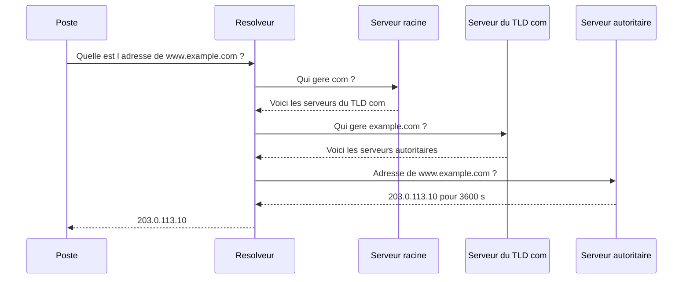
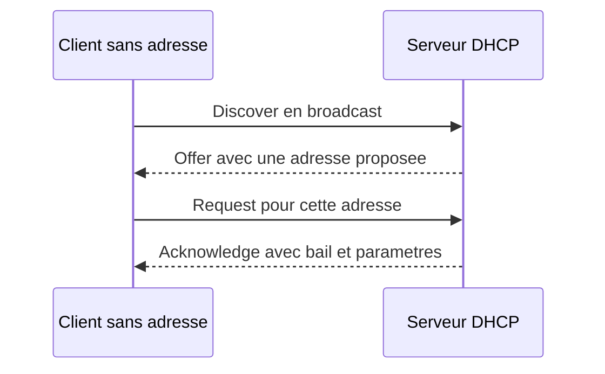
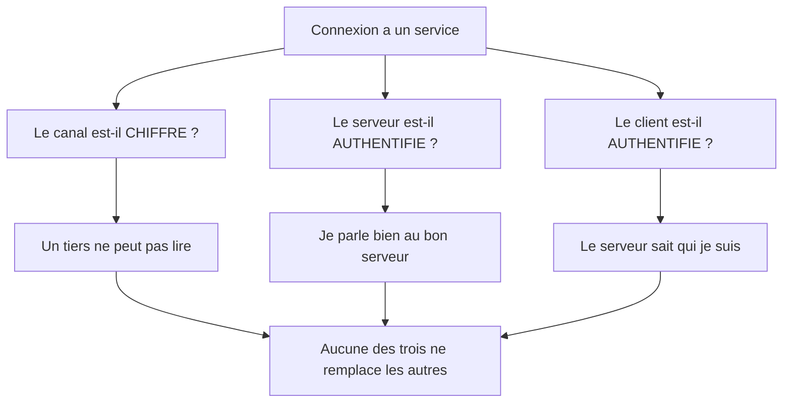
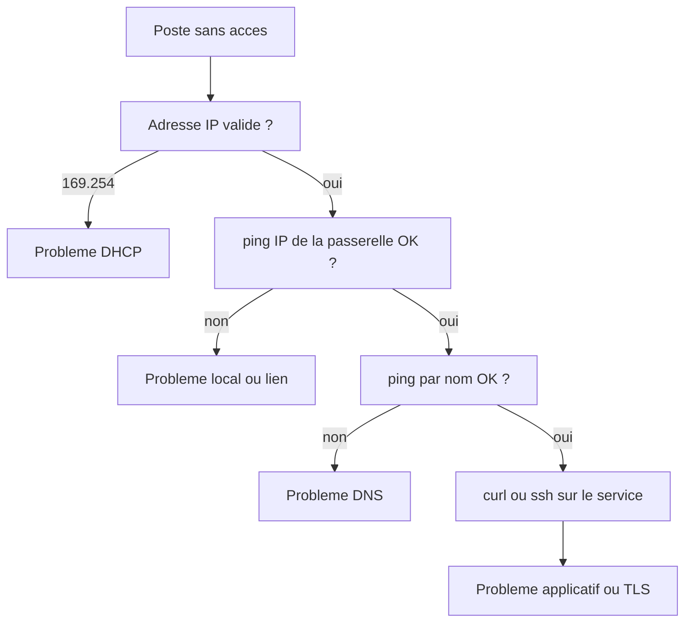

# Protocoles et services essentiels

## Objectifs pédagogiques

À la fin de ce module, vous saurez :

- retracer pas à pas la résolution d'un nom de domaine par DNS (Domain Name System) et expliquer le rôle de chaque niveau de la hiérarchie ;
- décrire comment un poste obtient automatiquement sa configuration réseau grâce à DHCP (Dynamic Host Configuration Protocol) ;
- choisir le bon protocole pour un besoin donné : accès distant, transfert de fichiers, messagerie, partage de fichiers ;
- diagnostiquer un problème de service avec `dig`, `curl`, `ssh -v` et `ping` ;
- expliquer pourquoi « chiffré » ne veut pas dire « authentifié », et ce que cela change pour la sécurité.

## Mise en situation

Lundi matin, dans une PME de 40 personnes, le support reçoit trois tickets en dix minutes.

Karim, le nouveau comptable, a branché son portable et rien ne s'ouvre. Laure arrive à joindre le serveur de l'intranet par son adresse IP, mais pas par son nom. Paul voit sur tous les sites un avertissement de certificat « non valide », alors que la veille tout fonctionnait.

Trois symptômes, trois protocoles différents, et pourtant tout le monde dit « le réseau est en panne ». C'est le réflexe à désamorcer. Ces protocoles sont des services qui s'appuient sur le transport (TCP, UDP, les ports), chacun avec son rôle et ses modes de défaillance. Savoir lequel est en cause fait gagner des heures. On résout ces trois tickets à la fin du module.

## Contexte et problématique

Le module précédent vous a montré comment deux machines établissent une conversation fiable (TCP) ou rapide (UDP), et comment les ports orientent les données vers la bonne application. Mais un tuyau ne sert à rien si personne ne sait quoi y mettre. Il manque des conventions :

- comment trouver l'adresse d'un serveur quand on ne connaît que son nom ?
- comment un poste sait-il quelle adresse prendre en arrivant sur un réseau ?
- comment demander une page web, ouvrir une session à distance ou envoyer un courriel de façon que l'autre côté comprenne ?

Chaque protocole de ce module est une réponse standardisée à l'une de ces questions. Ils appartiennent à la couche application, au sommet du modèle TCP/IP. C'est là que les utilisateurs et les attaquants passent le plus de temps, parce que c'est là que se trouvent les services réellement exposés.

Un détail utile pour la suite : le choix du transport n'est pas anodin. DNS et DHCP échangent de petits messages, donc UDP leur convient. SSH, HTTP et la messagerie ont besoin d'un flux fiable et ordonné, donc ils s'appuient sur TCP. ICMP, lui, sort du schéma : on y revient plus loin.

## Fonctionnement détaillé

### DNS : l'annuaire hiérarchique d'Internet

Les humains retiennent `www.example.com`, les machines n'acheminent que des adresses IP. DNS fait la traduction, par délégation.

> 📒 **Analogie : un annuaire en plusieurs volumes**
>
> Imaginez un annuaire d'entreprise qui n'existerait pas en un seul volume. Un standard renvoie vers le bon site, le site renvoie vers le bon service, et le service connaît le numéro du collègue.
{: .callout .callout-analogie}

Un nom se lit de droite à gauche. Dans `www.example.com.`, le point final représente la racine, `com` est le domaine de premier niveau, `example` est le domaine de l'organisation et `www` désigne une machine de ce domaine. À chaque niveau correspond un ensemble de serveurs qui ne connaissent que leur niveau et savent vers qui renvoyer.

Un poste ne fait presque jamais ce parcours lui-même. Il interroge un **résolveur récursif** (celui du fournisseur d'accès, de l'entreprise ou un service public), qui fait le travail à sa place :



> 📖 **Définition**
>
> Le serveur **autoritaire** détient la réponse officielle pour une zone. Le résolveur ne fait que chercher et mémoriser.
{: .callout .callout-definition}

Cette distinction explique de nombreux diagnostics : si le résolveur répond mal, la source peut quand même être correcte.

Chaque réponse porte un **TTL (Time To Live)**, la durée en secondes pendant laquelle le résolveur peut la garder en cache. Il évite ainsi de refaire tout le parcours à chaque requête.

> ⚠️ **Comportement contre-intuitif**
>
> On parle de « propagation DNS » après un changement d'enregistrement, mais rien ne se propage. Ce sont des caches qui expirent chacun à leur rythme. Si l'ancien enregistrement avait un TTL de 24 h, certains utilisateurs verront l'ancienne adresse jusqu'à 24 h après votre changement. Baissez le TTL à l'avance (par exemple à 300 s la veille d'une migration), pas après. Ce TTL n'a rien à voir avec celui des paquets IP, même si les deux noms sont identiques.
{: .callout .callout-attention}

Les enregistrements qu'on croise tous les jours :

| Type | Ce qu'il associe | Exemple |
|------|------------------|---------|
| A | nom → adresse IPv4 | `www.example.com → 203.0.113.10` |
| AAAA | nom → adresse IPv6 | `www.example.com → 2001:db8::10` |
| CNAME | alias → autre nom | `blog.example.com → www.example.com` |
| MX | domaine → serveur de messagerie | `example.com → mail.example.com` |
| NS | zone → serveurs autoritaires | `example.com → ns1.example.com` |
| TXT | texte libre (vérifications, politiques anti-usurpation) | `v=spf1 ...` |
| PTR | adresse → nom (résolution inverse) | `10.113.0.203.in-addr.arpa → www.example.com` |

DNS utilise le port 53, en UDP pour la plupart des requêtes et en TCP quand la réponse est trop grosse ou pour les transferts de zone entre serveurs.

> 💡 **Point clé**
>
> DNS est une dépendance cachée de presque tout. Quand « Internet ne marche plus », le réseau est souvent intact et c'est la résolution de noms qui est cassée. Le test `ping <adresse IP>` qui réussit alors que `ping <nom>` échoue est le meilleur réflexe de tri.
{: .callout .callout-important}

### DHCP : arriver sur un réseau sans rien configurer

Un poste qui se connecte n'a ni adresse, ni passerelle, ni serveur DNS. Faut-il le configurer à la main ? Pour 40 machines (et leurs téléphones), ce serait ingérable, d'où DHCP.

Le serveur DHCP tient un **pool** d'adresses et prête une adresse pour une durée limitée appelée **bail** (*lease*). Il distribue en même temps le masque, la passerelle par défaut et les serveurs DNS.

L'échange tient en quatre messages, surnommés DORA :



Le client n'a pas encore d'adresse IP, il ne peut donc pas adresser le serveur directement. Il crie dans la pièce (broadcast) depuis le port UDP 68, et le serveur répond sur le port UDP 67. Le *Request* diffuse aussi le choix du client, au cas où plusieurs serveurs auraient fait une offre.

À mi-bail, le client demande discrètement à renouveler. S'il n'obtient pas de réponse, il retente avant l'expiration, puis recommence à zéro si le bail est perdu.

> ⚠️ **Piège**
>
> Si un poste n'obtient aucune réponse DHCP, Windows (et beaucoup de systèmes) s'attribue lui-même une adresse en `169.254.x.x`. Cette adresse indique qu'il n'a pas pu joindre le serveur DHCP, et en aucun cas que le serveur lui a donné une adresse valide. Elle suffit pour parler à d'autres machines dans le même cas, mais pas pour sortir du réseau local.
{: .callout .callout-attention}

### HTTP et HTTPS : questions, réponses, et un certificat

HTTP est un dialogue très simple : le client envoie une requête, le serveur renvoie une réponse. La requête contient une méthode (`GET` pour lire, `POST` pour envoyer des données), un chemin et des en-têtes. La réponse contient un code de statut, des en-têtes et le contenu.

Le code de statut raconte l'histoire en un chiffre :

- **2xx** : succès (`200 OK`) ;
- **3xx** : redirection (`301`, `302`) ;
- **4xx** : erreur du client (`403 Forbidden`, `404 Not Found`) ;
- **5xx** : erreur du serveur (`500`, `502`, `503`).

> 🔑 **Moyen mnémotechnique**
>
> Le premier chiffre désigne le responsable. **4**xx, c'est la demande : mal formée, non autorisée ou visant une ressource absente. **5**xx, c'est le serveur : il n'arrive pas à y répondre.
{: .callout .callout-memo}

L'en-tête `Host` mérite d'être connu. Plusieurs sites web partagent souvent une même adresse IP, et c'est `Host: www.example.com` qui indique au serveur quel site vous voulez. Sans lui, le serveur ne sait pas qui servir.

HTTP seul circule en clair sur le port TCP 80 : quiconque se trouve sur le chemin peut lire et modifier les échanges. **HTTPS (Hypertext Transfer Protocol Secure)** n'est pas un autre protocole, c'est HTTP transporté dans un tunnel **TLS (Transport Layer Security)**\*, sur le port TCP 443. Avant toute requête HTTP, client et serveur négocient les paramètres de chiffrement et le serveur présente son certificat. Le client vérifie alors que :

1. le certificat est signé par une autorité qu'il reconnaît (une chaîne de confiance) ;
2. le nom du certificat correspond au site demandé ;
3. la date du jour tombe bien dans la période de validité du certificat.

Ce dernier point sera important pour le ticket de Paul.

*\*TLS s'insère entre TCP et le protocole applicatif pour chiffrer l'échange et authentifier le serveur ; son ancêtre SSL (Secure Sockets Layer) est aujourd'hui abandonné, mais on parle encore couramment de « certificat SSL ».*

### SSH : l'accès distant qui a remplacé Telnet

Pour administrer un serveur sans y être physiquement, on ouvre un terminal à distance. Telnet le faisait, mais en clair, mots de passe compris. **SSH (Secure Shell)** a pris sa place, sur le port TCP 22. Tout y est chiffré, et le même canal permet de lancer des commandes, de transférer des fichiers ou de créer des tunnels.

À la première connexion, le serveur présente sa **clé d'hôte**, une sorte de carte d'identité cryptographique. Votre client vous montre l'empreinte et demande si vous la reconnaissez. Si vous acceptez, elle est mémorisée dans `~/.ssh/known_hosts`. Aux connexions suivantes, le client compare silencieusement : si la clé a changé, il bloque avec un grand avertissement.

Pour s'authentifier, deux grandes approches :

- le **mot de passe**, simple mais exposé aux essais répétés ;
- la **paire de clés** : la clé privée reste sur votre poste, la clé publique est copiée sur le serveur. Le serveur vous pose un défi que seule la clé privée peut résoudre, et aucun secret ne transite sur le réseau.

### FTP, SFTP, FTPS : trois noms, deux familles

Le piège est dans les noms. Ces trois protocoles transfèrent des fichiers, mais ils n'ont pas la même origine.

**FTP (File Transfer Protocol)** est le plus ancien. Il utilise deux connexions : un canal de contrôle sur le port TCP 21 (commandes, authentification) et un canal de données séparé. Tout est en clair, y compris le mot de passe. Les canaux de données compliquent aussi le travail des pare-feu, ce qui rend FTP pénible à filtrer.

**FTPS (FTP Secure)** est le même FTP, enveloppé dans TLS. Il garde donc l'architecture à deux canaux et ses difficultés de filtrage, mais protège le contenu et les identifiants.

**SFTP (SSH File Transfer Protocol)** n'a rien à voir avec FTP malgré son nom : c'est un sous-système de SSH. Une seule connexion sur le port 22, tout est chiffré, et on réutilise l'authentification SSH.

| Critère | FTP | FTPS | SFTP |
|---------|-----|------|------|
| Base technique | protocole d'origine | FTP + TLS | sous-système SSH |
| Port(s) typique(s) | 21 + données | 21 (explicite) ou 990 (implicite) + données | 22 |
| Chiffrement | aucun | oui | oui |
| Facilité de filtrage | difficile | difficile | simple (un seul port) |
| Authentification | mot de passe en clair | mot de passe ou certificat | mot de passe ou clé SSH |

Pour un nouveau projet, SFTP est presque toujours le bon choix. FTPS se justifie quand un partenaire l'impose. FTP seul ne se défend plus, sauf sur un réseau totalement isolé.

### Messagerie : SMTP envoie, IMAP et POP3 consultent

Un courriel emprunte deux protocoles différents, selon qu'on envoie ou qu'on lit.

> 📮 **Analogie : la poste**
>
> SMTP, c'est déposer une lettre à La Poste. IMAP et POP3, c'est ouvrir sa boîte aux lettres. Limite de l'image : avec IMAP, les lettres restent au bureau de poste, et chacun de vos appareils vient les consulter.
{: .callout .callout-analogie}

**SMTP (Simple Mail Transfer Protocol)** pousse le message : de votre client vers votre serveur, puis de serveur en serveur jusqu'à la destination. Pour trouver le serveur de destination, il interroge DNS et lit l'enregistrement MX du domaine. Il se décline en plusieurs ports :

- **25** : transfert entre serveurs ;
- **587** : soumission par un client authentifié (le port à configurer dans un logiciel de messagerie) ;
- **465** : soumission avec TLS dès la connexion.

Pour lire ses messages, deux options :

- **IMAP (Internet Message Access Protocol)**, ports 143 ou 993 avec TLS. Les messages restent sur le serveur et plusieurs appareils voient le même état (lu, classé, supprimé).
- **POP3 (Post Office Protocol version 3)**, ports 110 ou 995 avec TLS. Il télécharge les messages vers un seul appareil et les supprime souvent du serveur. Utile pour archiver localement, très mal adapté à un usage sur téléphone et ordinateur à la fois.

### SMB et NFS : partager des fichiers à l'échelle du réseau local

Contrairement à SFTP, qui transfère un fichier à la demande, ces protocoles font apparaître un dossier distant comme s'il était local.

**SMB (Server Message Block)**, port TCP 445, est le protocole natif de Windows : dossiers partagés, imprimantes, et omniprésent dans les réseaux d'entreprise liés à Active Directory. Sous Linux, Samba parle SMB.

**NFS (Network File System)**, port TCP 2049, est son équivalent dans le monde Unix et Linux. Dans sa configuration historique, il fait surtout confiance à l'adresse IP et aux identifiants numériques du client. Les versions récentes savent s'authentifier plus rigoureusement, mais cela demande une configuration dédiée.

Ces deux protocoles sont conçus pour des réseaux de confiance. Exposer SMB ou NFS directement sur Internet est une erreur classique : ils ont été l'un et l'autre la cible de nombreuses vulnérabilités.

### ICMP et NTP : les protocoles de l'ombre

**ICMP (Internet Control Message Protocol)** est un cas à part : il ne passe ni par TCP ni par UDP, donc il n'y a pas de port. Il voyage directement dans les paquets IP et sert à signaler des événements : une destination injoignable, un paquet expiré, ou la simple question « êtes-vous là ? ». C'est ce que fait `ping`, avec un *Echo Request* auquel la cible répond par un *Echo Reply*.

> ⚠️ **Attention**
>
> Un `ping` qui échoue ne prouve pas que la machine est éteinte. Beaucoup de pare-feu bloquent ICMP par prudence, tout en laissant passer les services utiles. Avant de conclure, testez le port du service concerné.
{: .callout .callout-attention}

**NTP (Network Time Protocol)**, port UDP 123, synchronise les horloges. On y pense peu, mais l'heure juste soutient beaucoup de choses :

- les certificats TLS ont des dates de validité, et une horloge fausse les fait paraître périmés ou pas encore valides ;
- corréler des journaux de plusieurs machines suppose des horloges alignées ;
- l'authentification Kerberos (qu'on verra plus loin dans le parcours) refuse les décalages de plus de quelques minutes.

Les serveurs NTP sont organisés en niveaux (strates) : les plus précis sont reliés à des horloges de référence, les autres s'alignent sur eux.

### Récapitulatif des ports

| Protocole | Port(s) par défaut | Transport | Chiffré par défaut |
|-----------|-------------------|-----------|---------------------|
| DNS | 53 | UDP (et TCP) | non |
| DHCP | 67 (serveur), 68 (client) | UDP | non |
| HTTP | 80 | TCP | non |
| HTTPS | 443 | TCP | oui |
| SSH / SFTP | 22 | TCP | oui |
| FTP | 21 + données | TCP | non |
| SMTP | 25, 587, 465 | TCP | selon le port |
| IMAP | 143, 993 | TCP | 993 seulement |
| POP3 | 110, 995 | TCP | 995 seulement |
| SMB | 445 | TCP | selon la version et la configuration |
| NFS | 2049 | TCP | non, sauf configuration spécifique |
| NTP | 123 | UDP | non |
| ICMP | aucun | directement sur IP | non |

## Commandes et outils de diagnostic

Les noms et options exacts varient d'un système à l'autre (Linux, macOS, Windows). Le principe reste le même : interroger le service directement, en dehors de l'application habituelle, pour voir ce qui se passe réellement. Le module 09 revient plus en détail sur les outils d'administration ; voici l'essentiel pour ces protocoles.

**DNS — que répond la résolution ?**

```bash
dig www.example.com A +noall +answer
# www.example.com.   3600  IN  A  203.0.113.10
```

Le nombre au milieu est le TTL restant dans le cache du résolveur. Pour tester un résolveur précis, ajoutez `@<IP>` : `dig @10.20.30.2 intranet.corp.example`. Pour suivre toute la chaîne depuis la racine, utilisez `dig +trace`. Sous Windows, `nslookup <nom> <serveur>` joue un rôle équivalent.

**DHCP — quelle configuration ai-je reçue ?**

```bash
ip -br address        # Linux : adresses par interface, sous forme compacte
ipconfig /all         # Windows : adresse, passerelle, DNS, serveur DHCP, bail
```

Le serveur DHCP et les dates du bail apparaissent dans la sortie de `ipconfig /all`. Une adresse en `169.254.x.x` signale un DHCP injoignable.

**HTTP et HTTPS — où ça casse ?**

```bash
curl -sv -o /dev/null https://www.example.com
```

`-v` affiche les étapes : résolution du nom, connexion TCP, négociation TLS avec la vérification du certificat, puis en-têtes et code de statut. `-I` ne récupère que les en-têtes. Pour inspecter un certificat à la main : `openssl s_client -connect <HOTE>:443 -servername <HOTE>`.

**SSH — pourquoi la connexion échoue ?**

```bash
ssh -v utilisateur@192.0.2.20
```

Le mode verbeux montre les étapes : connexion TCP, échange de clés, méthodes d'authentification proposées et refusées. Si l'échec a lieu avant l'authentification, le problème est réseau ou de configuration serveur. S'il a lieu pendant, c'est une question de clés ou de mot de passe.

**ICMP et NTP — joignable ? à l'heure ?**

```bash
ping -c 4 198.51.100.7       # 4 paquets (sous Windows : ping -n 4)
timedatectl status           # Linux : heure courante et état de la synchronisation
```

Si la ligne de synchronisation indique « no » ou « inactive », l'horloge dérive librement.

## Sécurité réseau liée

Ces protocoles ont été conçus à une époque où le réseau était un cercle de confiance. Certains sont restés en clair par défaut et tous deviennent des cibles dès qu'ils sont exposés.

### Chiffré ne veut pas dire authentifié

> ⚠️ **Attention**
>
> C'est le piège central de ce module. Vous pouvez parler dans un tunnel parfaitement chiffré… avec la mauvaise personne.
{: .callout .callout-attention}

> 🧠 **Concept fondamental**
>
> Une communication sûre répond à trois questions distinctes.
{: .callout .callout-important}



- le **chiffrement** protège le contenu des regards extérieurs ;
- l'**authentification du serveur** garantit l'identité de celui qui est au bout ;
- l'**authentification du client** prouve l'identité de celui qui se connecte, et l'autorisation décide ensuite de ce qu'il a le droit de faire.

Une attaque de l'homme du milieu réussit précisément quand le chiffrement est présent et l'authentification absente : vous établissez un canal chiffré avec l'attaquant, qui rouvre un autre canal chiffré vers le vrai serveur.

Les cas concrets où ça se produit :

- **HTTPS** : cliquer sur « continuer malgré l'avertissement » ou utiliser `curl -k` désactive justement la vérification du certificat. Le chiffrement reste actif, mais plus rien ne prouve avec qui vous l'avez établi.
- **SSH** : accepter l'empreinte d'une clé d'hôte à la première connexion sans la comparer à une source fiable revient à croire sur parole que le serveur est le bon.
- **SMTP** : le chiffrement négocié entre serveurs (STARTTLS) est souvent opportuniste. Si la vérification du certificat n'est pas imposée, un attaquant peut forcer un retour en clair ou présenter n'importe quel certificat.
- **Certificats auto-signés** (souvent en FTPS ou en interne) : ils chiffrent, mais personne ne les a validés.
- **L'inverse existe aussi** : un serveur SSH ouvert sur Internet avec un mot de passe faible offre un canal chiffré à n'importe quel attaquant. Le chiffrement est là, l'authentification du client ne vaut pas grand-chose.

### Autres vecteurs à connaître

| Cible | Attaque classique | Mesure de base |
|-------|-------------------|----------------|
| DNS | réponse falsifiée ou empoisonnement du cache pour rediriger vers un faux site | résolveurs maîtrisés, DNSSEC pour authentifier les données, vérification TLS en aval |
| DHCP | faux serveur DHCP qui distribue une fausse passerelle ou un faux DNS | protections côté commutateur (DHCP snooping, selon l'équipement) |
| SSH | essais massifs de mots de passe | authentification par clé, mot de passe désactivé, accès restreint |
| SMB / NFS | exploitation de vulnérabilités, partages trop ouverts | jamais exposés à Internet, accès limités par groupe |
| FTP | capture des identifiants en clair | remplacement par SFTP |
| NTP | dérive ou manipulation de l'heure | serveurs de temps internes de confiance |

## Cas réel en entreprise

Reprenons les trois tickets du lundi matin. Les valeurs ci-dessous sont illustratives, mais la démarche est réaliste. Elle consiste à aller du plus bas au plus haut, sans sauter d'étape.



**Ticket 1 — Karim, rien ne s'ouvre.**

```text
C:\> ipconfig /all
   Adresse IPv4 autoconfiguration . : 169.254.37.12
   Serveur DHCP . . . . . . . . . . : (vide)
```

Adresse en 169.254 : le poste n'a obtenu aucun bail. Côté serveur, le pool contient 51 adresses (`10.20.30.100` à `10.20.30.150`), mais 40 postes fixes, une vingtaine de téléphones et les visiteurs de la semaine ont déjà épuisé la réserve, avec des baux de 7 jours. Remède : élargir le pool et raccourcir la durée des baux.

**Ticket 2 — Laure, intranet joignable par IP seulement.**

```bash
$ ping -c 2 10.20.30.50
2 packets transmitted, 2 received
$ ping -c 2 intranet.corp.example
ping: intranet.corp.example: Name or service not known
$ dig @10.20.30.2 intranet.corp.example +short
10.20.30.50
```

Le serveur DNS interne répond correctement quand on l'interroge directement. Le problème vient donc du poste : la vérification de sa configuration réseau montre que Laure a gardé un serveur DNS saisi à la main, qui pointe vers l'ancien résolveur désormais éteint. Remède : repasser sa carte réseau en configuration automatique pour récupérer le DNS fourni par DHCP.

**Ticket 3 — Paul, certificats « non valides » partout.**

```bash
$ date
Mon Mar  3 09:12:44 2014
$ timedatectl | grep synchronized
System clock synchronized: no
```

Le poste croit être en 2014. Tous les certificats modernes lui paraissent « pas encore valides », donc rejetés. Pourquoi ? La pile de l'horloge matérielle, en fin de vie, a laissé l'horloge repartir d'une date ancienne au démarrage. Et comme la synchronisation NTP du poste est inactive (« synchronized: no »), rien ne corrige l'écart.

Remède : replacer le poste sur le serveur de temps interne, remplacer la pile à la prochaine intervention, et ne surtout pas conseiller à Paul de cliquer sur « continuer » (voir la section précédente).

Trois pannes qui se ressemblent pour l'utilisateur, trois protocoles différents, et un seul réflexe qui les résout : vérifier le service plutôt que d'accuser « le réseau ».

## Bonnes pratiques

**Pour tout ce qui concerne la confiance.** Activez HTTPS partout et ne désactivez jamais la vérification des certificats, même « temporairement » dans un script. Pour SSH, vérifiez l'empreinte de la clé d'hôte la première fois par un autre canal (console du fournisseur, collègue, documentation interne), puis passez aux clés et désactivez le mot de passe pour les comptes exposés.

**Pour les transferts de fichiers.** Remplacez FTP par SFTP dès que possible. N'ouvrez FTPS que si un partenaire l'exige, et vérifiez alors le certificat.

**Pour les services d'infrastructure.** Gardez au moins deux résolveurs DNS et deux serveurs DHCP (ou un mécanisme de bascule). Ces services sont des points de défaillance uniques, et leur panne ressemble à une panne générale. Dimensionnez les pools DHCP avec de la marge et adaptez la durée des baux : courts pour les invités, plus longs pour les postes stables.

**Pour la messagerie.** Configurez les clients sur le port 587 ou 465 avec authentification, et pas sur le 25. Prévoyez IMAP pour les usagers multi-appareils.

**Pour le temps.** Pointez tous les équipements vers le même jeu de serveurs NTP internes, eux-mêmes synchronisés sur des sources fiables. Vos journaux et vos certificats en dépendent.

**Pour l'exposition.** SMB, NFS, bases de données et interfaces d'administration n'ont rien à faire sur Internet. Si un accès distant est nécessaire, passez par un accès contrôlé et authentifié plutôt que d'ouvrir un port.

## Résumé

| Concept | Rôle | Points clés |
|---------|------|-------------|
| DNS | traduire un nom en adresse | hiérarchie racine → TLD → autoritaire ; résolveur récursif ; TTL et cache ; port 53 |
| DHCP | fournir la configuration réseau | DORA ; broadcast UDP 67/68 ; bail ; `169.254.x.x` = pas de réponse |
| HTTP / HTTPS | échanger des ressources web | requête/réponse, codes 2xx à 5xx ; HTTPS = HTTP dans TLS, port 443 ; vérification du certificat |
| SSH | accès distant sécurisé | port 22 ; clé d'hôte vérifiée à la première connexion ; authentification par clé recommandée |
| FTP / FTPS / SFTP | transférer des fichiers | SFTP = SSH, pas FTP ; FTP en clair ; FTPS = FTP + TLS, deux canaux |
| SMTP / IMAP / POP3 | envoyer et lire le courrier | SMTP pousse (587 pour les clients) ; IMAP synchronise ; POP3 télécharge |
| SMB / NFS | partager des dossiers | SMB 445 côté Windows ; NFS 2049 côté Unix ; réseaux de confiance uniquement |
| ICMP | signaler et tester | pas de port ; `ping` peut être bloqué sans que la cible soit hors service |
| NTP | synchroniser les horloges | UDP 123 ; certificats, journaux et authentification en dépendent |
| Chiffré ≠ authentifié | distinguer confidentialité et identité | trois questions : canal chiffré, serveur authentifié, client authentifié |

Vous savez maintenant quel service fait quoi, et comment le tester. Mais jusqu'ici, on a supposé que les paquets arrivent à destination. Dès qu'un message doit quitter son réseau pour en rejoindre un autre, il faut savoir comment il trouve son chemin. C'est le sujet du module suivant.

<!-- snippet
id: dns_dig_trace_resolution
type: command
tech: dns
level: beginner
importance: medium
format: knowledge
tags: dns,dig,diagnostic,resolution
title: Suivre toute la résolution DNS avec dig +trace
context: Utile quand un nom ne se résout pas et qu'on veut voir à quel niveau la chaîne se casse
command: dig +trace <DOMAINE>
example: dig +trace www.example.com
description: Refait la résolution depuis les serveurs racine, puis TLD, puis serveur autoritaire sans passer par le cache, pour repérer l'étape où la chaîne casse.
-->

<!-- snippet
id: dns_resolver_vs_authoritative
type: concept
tech: dns
level: beginner
importance: high
format: knowledge
tags: dns,resolveur,autoritaire,hierarchie
title: Résolveur récursif et serveur autoritaire : deux rôles distincts
content: Le poste interroge un résolveur récursif qui fait le parcours à sa place : racine, puis serveur du TLD (.com), puis serveur autoritaire du domaine. Seul le serveur autoritaire détient la réponse officielle de la zone, le résolveur ne fait que la chercher et la garder en cache pour la durée du TTL. Si le résolveur répond faux, la source peut être correcte.
description: Distinguer qui cherche (résolveur) et qui détient la vérité (autoritaire) oriente le diagnostic DNS dès la première minute.
-->

<!-- snippet
id: dns_ttl_cache_propagation
type: warning
tech: dns
level: intermediate
importance: high
format: knowledge
tags: dns,ttl,cache,migration
title: Après un changement DNS, ce sont les caches qui expirent
content: Piège : croire que le changement d'un enregistrement "se propage". Conséquence : avec un TTL de 86400 s, certains utilisateurs gardent l'ancienne adresse jusqu'à 24 h. Correction : abaisser le TTL à 300 s la veille de la migration, faire le changement, puis le remonter ensuite.
description: Le TTL est lu au moment où la réponse est mise en cache ; le baisser après le changement n'accélère rien pour les caches déjà remplis.
-->

<!-- snippet
id: dhcp_dora_exchange
type: concept
tech: dhcp
level: beginner
importance: high
format: knowledge
tags: dhcp,dora,broadcast,bail
title: DHCP en quatre messages : Discover, Offer, Request, Acknowledge
content: Le client n'a pas d'adresse IP, donc il envoie un Discover en broadcast depuis le port UDP 68 vers le port 67. Le serveur répond par un Offer (adresse proposée). Le client confirme son choix par un Request, puis le serveur valide par un Acknowledge qui contient le bail, la passerelle et les serveurs DNS. Le client tente de renouveler à mi-bail.
description: Le broadcast est nécessaire parce que le client ne peut pas adresser le serveur directement avant d'avoir une adresse.
-->

<!-- snippet
id: dhcp_apipa_169_254
type: error
tech: dhcp
level: beginner
importance: high
format: knowledge
tags: dhcp,apipa,diagnostic,adresse
title: Adresse 169.254.x.x : le poste n'a pas obtenu de bail DHCP
content: Symptôme : le poste affiche une adresse 169.254.x.x et n'accède à rien hors du réseau local. Cause : aucune réponse DHCP (serveur arrêté, pool épuisé, mauvais VLAN, câble sur un port non configuré). Correction : vérifier le pool et les baux côté serveur, puis la liaison du poste, avant d'incriminer DNS.
description: Cette adresse est auto-attribuée par le système en dernier recours et prouve l'absence de réponse DHCP, pas une configuration réussie.
-->

<!-- snippet
id: http_curl_verbose_handshake
type: command
tech: http
level: beginner
importance: medium
format: knowledge
tags: http,https,curl,diagnostic
title: Voir les étapes d'une requête HTTPS avec curl -v
command: curl -sv -o /dev/null <URL>
example: curl -sv -o /dev/null https://www.example.com
description: Affiche la résolution du nom, la connexion TCP, la négociation TLS avec la vérification du certificat, puis les en-têtes et le code de statut, sans le contenu de la page.
-->

<!-- snippet
id: http_status_code_families
type: concept
tech: http
level: beginner
importance: medium
format: knowledge
tags: http,codes,diagnostic,serveur
title: Lire un code HTTP : 4xx côté demande, 5xx côté serveur
content: Le premier chiffre du code de statut oriente le diagnostic : 2xx = succès, 3xx = redirection, 4xx = la demande est mal formée, non autorisée ou vise une ressource absente (403 accès refusé, 404 ressource absente), 5xx = le serveur n'arrive pas à répondre (500 erreur interne, 502 ou 503 service amont indisponible).
description: Un 502 ou un 503 pointe vers un serveur ou un service en amont, pas vers le navigateur ni la saisie de l'utilisateur.
-->

<!-- snippet
id: ssh_host_key_changed_error
type: error
tech: ssh
level: intermediate
importance: high
format: knowledge
tags: ssh,cle-hote,known-hosts,securite
title: SSH bloque avec "REMOTE HOST IDENTIFICATION HAS CHANGED"
content: Symptôme : le client refuse la connexion et affiche un avertissement sur la clé d'hôte. Cause : la clé enregistrée dans known_hosts ne correspond plus à celle du serveur (réinstallation légitime, ou usurpation). Correction : vérifier l'empreinte par un canal fiable, puis seulement supprimer l'ancienne entrée avec ssh-keygen -R <HOTE>.
description: Supprimer l'entrée sans vérification revient à désactiver la protection contre l'usurpation de serveur.
-->

<!-- snippet
id: ssh_keygen_ed25519
type: command
tech: ssh
level: beginner
importance: medium
format: knowledge
tags: ssh,cles,authentification,ed25519
title: Générer une paire de clés SSH moderne
context: À exécuter sur le poste client, la clé privée ne doit jamais quitter cette machine
command: ssh-keygen -t ed25519 -C "<COMMENTAIRE>"
example: ssh-keygen -t ed25519 -C "karim@poste-compta"
description: Crée une clé privée et une clé publique ; protège la clé privée par une passphrase, puis copie la clé publique sur le serveur avec ssh-copy-id.
-->

<!-- snippet
id: ftp_sftp_ftps_difference
type: concept
tech: ftp
level: beginner
importance: high
format: knowledge
tags: ftp,sftp,ftps,transfert
title: SFTP n'est pas du FTP : c'est un sous-système de SSH
content: FTP utilise deux connexions (contrôle sur le port 21, données séparées) et envoie tout en clair. FTPS est ce même FTP enveloppé dans TLS, donc avec les mêmes contraintes de pare-feu. SFTP est un sous-système de SSH : une seule connexion sur le port 22, chiffrée, avec l'authentification SSH. Pour un nouveau projet, privilégier SFTP.
description: La ressemblance des noms masque deux architectures différentes : SFTP se filtre facilement (un port), FTP et FTPS beaucoup moins.
-->

<!-- snippet
id: smtp_submission_port_587
type: tip
tech: smtp
level: beginner
importance: medium
format: knowledge
tags: smtp,messagerie,ports,configuration
title: Configurer un client de messagerie sur le port 587 ou 465
content: Pour l'envoi depuis un client (Outlook, Thunderbird, téléphone), utiliser le port 587 avec STARTTLS ou le port 465 avec TLS dès la connexion, toujours avec authentification. Le port 25 est réservé au transfert entre serveurs et il est souvent bloqué en sortie par les fournisseurs d'accès.
description: Un client configuré sur le port 25 échoue souvent sans message clair parce que le fournisseur filtre ce port en sortie.
-->

<!-- snippet
id: imap_vs_pop3_difference
type: concept
tech: imap
level: beginner
importance: medium
format: knowledge
tags: imap,pop3,messagerie,synchronisation
title: IMAP synchronise, POP3 télécharge
content: IMAP (ports 143 ou 993 avec TLS) laisse les messages sur le serveur : tous les appareils voient le même état (lu, classé, supprimé). POP3 (ports 110 ou 995 avec TLS) rapatrie les messages vers un seul appareil et les supprime souvent du serveur. Pour un usage sur plusieurs appareils, choisir IMAP.
description: Avec POP3, un message lu sur le poste n'apparaît pas comme lu sur le téléphone ; avec IMAP, l'état est partagé.
-->

<!-- snippet
id: icmp_no_ports_ping_blocked
type: concept
tech: icmp
level: beginner
importance: high
format: knowledge
tags: icmp,ping,diagnostic,pare-feu
title: ICMP n'a pas de port et ping peut être bloqué volontairement
content: ICMP voyage directement dans des paquets IP, sans passer par TCP ni UDP, donc sans numéro de port. Beaucoup de pare-feu bloquent l'Echo Request par prudence. Un ping sans réponse ne prouve donc pas qu'une machine est hors service : tester ensuite le port du service concerné, par exemple avec curl vers le port 443.
description: Conclure à une panne sur la seule base d'un ping échoué est une erreur de diagnostic fréquente.
-->

<!-- snippet
id: ntp_clock_certificate_error
type: error
tech: ntp
level: intermediate
importance: high
format: knowledge
tags: ntp,certificat,horloge,tls
title: Certificats "non valides" partout : vérifier l'horloge
content: Symptôme : tous les sites HTTPS affichent une erreur de certificat sur un seul poste. Cause : l'horloge est fausse, donc les certificats paraissent expirés ou pas encore valides, souvent à cause d'une synchronisation NTP en échec. Correction : vérifier la date avec date puis timedatectl status, rétablir NTP, et ne pas contourner l'avertissement.
description: Les certificats TLS portent une période de validité, une horloge décalée suffit à les faire rejeter sans que le serveur soit en cause.
-->

<!-- snippet
id: tls_encrypted_not_authenticated
type: warning
tech: tls
level: beginner
importance: high
format: knowledge
tags: tls,authentification,mitm,certificat
title: Un canal chiffré n'est pas un canal authentifié
content: Piège : croire que le cadenas ou une connexion SSH suffisent à garantir l'interlocuteur. Conséquence : avec un certificat ignoré (clic sur "continuer", curl -k) ou une empreinte SSH acceptée sans vérification, un attaquant s'insère et déchiffre tout. Correction : toujours valider le certificat ou l'empreinte de la clé d'hôte, et ne jamais désactiver cette vérification dans un script.
description: Le chiffrement protège contre la lecture par un tiers, seule l'authentification du serveur garantit qu'on parle bien au bon interlocuteur.
-->

<!-- snippet
id: smb_nfs_not_internet
type: warning
tech: smb
level: intermediate
importance: high
format: knowledge
tags: smb,nfs,exposition,pare-feu
title: Ne jamais exposer SMB ou NFS directement sur Internet
content: Piège : ouvrir le port TCP 445 (SMB) ou 2049 (NFS) vers Internet pour accéder à un partage à distance. Conséquence : ces protocoles ont été conçus pour des réseaux de confiance et ont connu de nombreuses vulnérabilités exploitables à distance. Correction : n'autoriser l'accès qu'en interne ou via un accès distant authentifié, et auditer régulièrement les ports ouverts.
description: Un partage de fichiers accessible depuis Internet est l'une des erreurs d'exposition les plus classiques lors d'un audit.
-->
