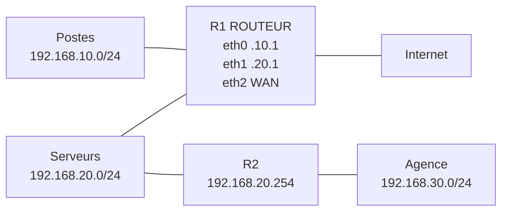
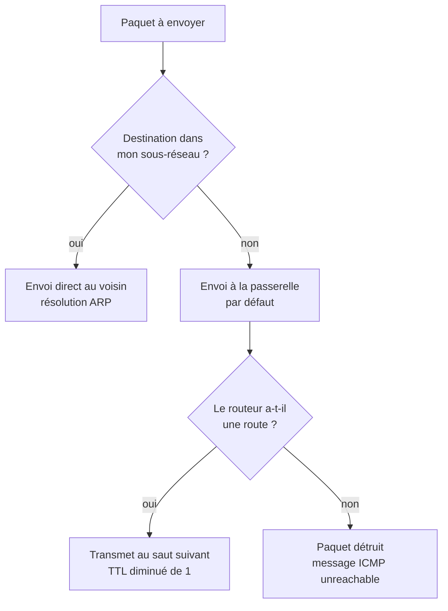
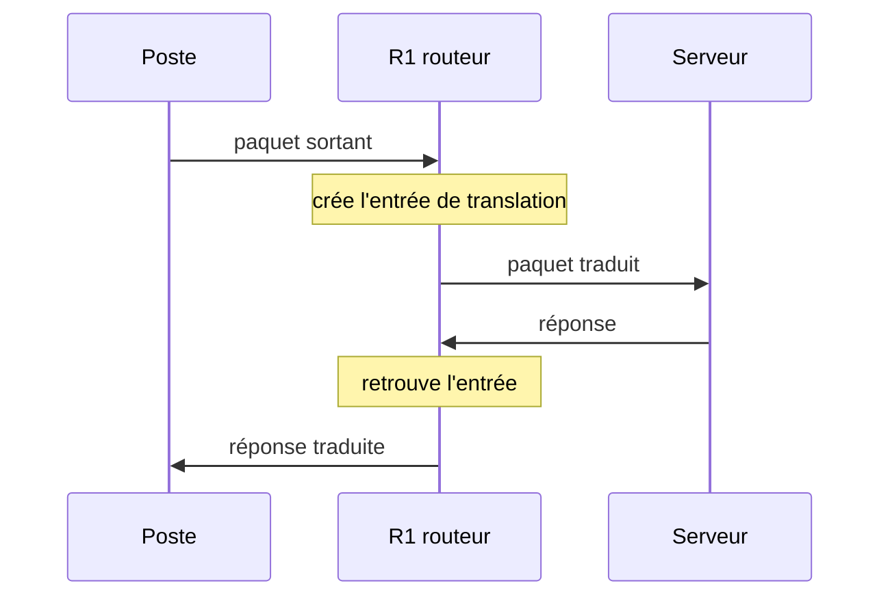

# Routage, NAT et circulation des paquets

## Objectifs pédagogiques

À la fin de ce module, vous saurez :

- **expliquer** comment une machine décide d'envoyer un paquet directement à son voisin ou de le confier à sa passerelle ;
- **lire** une table de routage et prédire quelle route sera retenue pour une destination donnée ;
- **configurer** un routeur Linux : activation du forwarding, routes statiques, route par défaut ;
- **distinguer** SNAT, DNAT et PAT, et écrire les règles correspondantes ;
- **situer** OSPF et BGP, et savoir quand le routage statique ne suffit plus ;
- **suivre** le parcours d'un paquet entre plusieurs réseaux et repérer l'endroit où il se perd.

## Mise en situation

Une PME d'une soixantaine de personnes a trois segments réseau, tous reliés à un même routeur Linux, `R1` :

- les postes utilisateurs en `192.168.10.0/24` ;
- les serveurs en `192.168.20.0/24` ;
- le lien vers Internet, côté opérateur.

Les adresses de ce module sont illustratives : les réseaux internes utilisent des plages privées (RFC 1918), et les adresses publiques de la topologie des plages réservées à la documentation (RFC 5737).

Tout fonctionne : navigation web, accès à l'intranet. Puis l'entreprise ouvre une petite agence en `192.168.30.0/24`, raccordée par un second routeur, `R2`, branché sur le réseau des serveurs. Le lundi matin, deux demandes arrivent :

1. les postes du siège n'arrivent pas à joindre l'agence ;
2. la direction veut que l'intranet (un serveur en `192.168.20.10`) soit accessible depuis l'extérieur.

Ces deux demandes reposent sur le même savoir-faire : comprendre comment un paquet choisit son chemin, et ce qui lui arrive quand il franchit une frontière entre réseau privé et Internet. Le module suit cette progression, et le scénario est résolu dans la section « Cas réel ».



## Ce que fait vraiment un routeur

Un routeur ne connaît pas le chemin complet vers la destination. Il sait seulement **à qui confier le paquet ensuite**.

> 📮 **Analogie : le centre de tri**
>
> Un centre de tri lit le code postal et envoie le sac au centre suivant, sans connaître tout le trajet. À chaque étape, une nouvelle décision locale est prise, et le paquet finit par arriver parce que chaque saut fait un bon choix.
{: .callout .callout-analogie}

> 🧠 **Concept fondamental**
>
> Le routage fonctionne **saut par saut**. Chaque équipement ne décide que du prochain saut, jamais du trajet complet.
{: .callout .callout-important}

La première décision se prend sur la machine émettrice, avant même qu'un routeur n'intervienne. Votre poste compare l'adresse de destination à sa propre adresse et à son masque :



> 📖 **Définition**
>
> La **passerelle** désigne un rôle : celui de porte de sortie du sous-réseau. C'est une adresse IP configurée sur chaque hôte (la fameuse « passerelle par défaut »), qui appartient à un routeur situé sur le même réseau que l'hôte.
{: .callout .callout-definition}

Pour le poste `192.168.10.25`, la passerelle est `192.168.10.1`, l'interface `eth0` de `R1`.

Quand un paquet traverse un routeur, deux choses changent et une reste stable :

- l'adresse MAC source et destination est réécrite, parce qu'elle n'a de sens que sur le segment local ;
- le TTL (Time To Live), un compteur placé dans l'en-tête IP, est décrémenté de 1. À zéro, le routeur jette le paquet : c'est ce qui empêche les boucles de tourner indéfiniment ;
- les adresses IP source et destination restent identiques, sauf si un NAT intervient, ce que nous verrons plus loin.

> 💡 **Point clé**
>
> L'adresse IP de destination reste celle de la machine finale, mais l'adresse MAC de destination est celle du **prochain routeur**. Quand une capture montre un paquet adressé à l'IP d'un serveur mais à la MAC du routeur, c'est parfaitement normal.
{: .callout .callout-important}

## Lire une table de routage

Pour chaque paquet, le routeur consulte sa table de routage : une liste de lignes « pour tel préfixe, passer par tel voisin, via telle interface ». Voici celle de `R1` dans sa version finale :

```bash
ip route show
```

```
default via 203.0.113.1 dev eth2
192.168.10.0/24 dev eth0 proto kernel scope link src 192.168.10.1
192.168.20.0/24 dev eth1 proto kernel scope link src 192.168.20.1
192.168.30.0/24 via 192.168.20.254 dev eth1
203.0.113.0/24 dev eth2 proto kernel scope link src 203.0.113.10
```

Ces lignes ont trois origines différentes :

- Les lignes `proto kernel scope link` sont des **réseaux directement connectés**. Le noyau les crée tout seul dès qu'une interface reçoit une adresse. Il n'y a pas de `via`, car le voisin est sur le même segment.
- La ligne `192.168.30.0/24 via 192.168.20.254` est une **route statique** posée à la main : « pour l'agence, passer par R2 ».
- La ligne `default` est la **route par défaut**, le « sinon » de la table. Elle correspond à `0.0.0.0/0`, le préfixe qui englobe tout.

Que se passe-t-il si plusieurs lignes correspondent à la destination ? Le routeur applique la règle du **préfixe le plus long** (longest prefix match). Prenons une autre table, qui contiendrait `10.1.0.0/16`, `10.0.0.0/8` et une route par défaut :

| Destination | Routes qui correspondent | Route retenue |
|---|---|---|
| `10.1.5.20` | `10.1.0.0/16`, `10.0.0.0/8`, `default` | `10.1.0.0/16` (la plus précise) |
| `10.2.0.5` | `10.0.0.0/8`, `default` | `10.0.0.0/8` |
| `8.8.8.8` | `default` | `default` |

> ⚠️ **Comportement contre-intuitif**
>
> L'ordre d'affichage ne compte pas, et la route par défaut n'est consultée qu'en dernier recours, quelle que soit sa position. La métrique (`metric`), elle, ne sert qu'à départager deux routes de **même préfixe**. Une route `/24` avec une mauvaise métrique l'emporte toujours sur une `/16` avec une excellente métrique.
{: .callout .callout-attention}

Pour savoir ce que décidera le noyau pour une destination précise, sans envoyer de trafic, demandez-le-lui :

```bash
ip route get 192.168.30.10
```

```
192.168.30.10 via 192.168.20.254 dev eth1 src 192.168.20.1 uid 1000
    cache
```

La réponse indique le voisin choisi (`via`), l'interface de sortie (`dev`) et l'adresse source qui sera utilisée (`src`). C'est la première chose à vérifier quand un trafic prend un chemin inattendu.

## Poser des routes : statiques, par défaut, entre sous-réseaux

### Faire d'une machine Linux un routeur

Par défaut, un système Linux qui reçoit un paquet qui ne lui est pas destiné le **jette**. Il se comporte en hôte, pas en routeur. Il faut l'autoriser à relayer le trafic d'une interface à l'autre :

```bash
sudo sysctl -w net.ipv4.ip_forward=1
```

Cette commande agit immédiatement, mais ne survit pas au redémarrage. Pour la rendre permanente, on ajoute `net.ipv4.ip_forward = 1` dans un fichier de `/etc/sysctl.d/`, par exemple `99-routage.conf`. Sur un routeur matériel ou une box, le forwarding est actif d'origine.

Une fois le forwarding actif, le routage **entre sous-réseaux** est automatique pour tous les réseaux directement connectés. `R1` sait déjà relayer entre `192.168.10.0/24` et `192.168.20.0/24`, puisqu'il possède une interface dans chacun. Il suffit que les hôtes de chaque segment aient `R1` comme passerelle.

### Routes statiques et route par défaut

Pour les réseaux qui ne sont pas directement connectés, comme l'agence derrière `R2`, il faut dire au routeur où les trouver :

```bash
sudo ip route add 192.168.30.0/24 via 192.168.20.254
```

Le `via` doit être une adresse **joignable directement** : ici `R2` est dans le réseau des serveurs, que `R1` touche par `eth1`. Pointer un `via` situé de l'autre côté d'un autre routeur est refusé par le noyau (le libellé exact du message d'erreur varie selon la version d'iproute2).

La route par défaut se pose de la même manière :

```bash
sudo ip route add default via 203.0.113.1 dev eth2
```

Un routeur de bordure n'en a généralement qu'une, pointée vers l'opérateur. Un poste de travail aussi : c'est ce que la configuration réseau appelle la passerelle.

> ⚠️ **Piège classique**
>
> Les routes ajoutées avec `ip route add` **disparaissent au redémarrage**. Il faut les inscrire dans la configuration persistante de la distribution (Netplan, NetworkManager, fichiers `/etc/network/`, etc., selon le système). Le mécanisme varie, mais le principe est constant : la commande en ligne est un test, la configuration est un fichier.
{: .callout .callout-attention}

Sous Windows, les équivalents existent, avec l'option `-p` pour rendre la route persistante :

| Action | Linux | Windows |
|---|---|---|
| Afficher la table | `ip route show` | `route print` |
| Ajouter une route statique | `ip route add 192.168.30.0/24 via 192.168.20.254` | `route add 192.168.30.0 mask 255.255.255.0 192.168.20.254 -p` |
| Route utilisée pour une destination | `ip route get <IP>` | `Find-NetRoute -RemoteIPAddress <IP>` (PowerShell) |

### Le piège du retour

Poser la route à l'aller ne suffit pas. Un paquet réussit son voyage seulement si la **réponse** retrouve aussi son chemin. Si `R2` ne sait pas comment joindre `192.168.10.0/24`, il enverra les réponses à sa propre route par défaut, qui les enverra n'importe où, et l'utilisateur constatera simplement « ça ne répond pas ».

L'aller fonctionne et le retour s'égare : c'est le routage asymétrique, la cause la plus fréquente des tickets « ping sans réponse » juste après l'ajout d'un nouveau réseau.

## NAT : réécrire les adresses en passant

Les adresses `10.0.0.0/8`, `172.16.0.0/12` et `192.168.0.0/16` sont privées. Elles sont réutilisées dans des millions de réseaux et, de ce fait, ne sont pas routées sur Internet. Un poste en `192.168.10.25` ne peut pas s'adresser directement à un serveur public : ses paquets partiraient avec une source que personne ne sait renvoyer.

Le NAT (Network Address Translation) répond à ce problème : le routeur de bordure **réécrit les adresses** dans les en-têtes IP au passage, et se souvient des correspondances pour traiter les réponses. Selon ce qui est réécrit, on parle de variantes différentes.

> 🔑 **Moyen mnémotechnique**
>
> **S**NAT comme **S**ource, **D**NAT comme **D**estination. Le SNAT réécrit la source des paquets qui sortent, le DNAT la destination des paquets qui entrent.
{: .callout .callout-memo}

### SNAT et PAT : sortir sous une adresse publique

Le SNAT (Source Network Address Translation) modifie l'adresse **source** d'un paquet sortant : `192.168.10.25` devient `203.0.113.10`, l'adresse publique du routeur. Le serveur distant répond à `203.0.113.10`, et le routeur, qui a mémorisé la correspondance, retraduit vers le poste d'origine.

Reste un problème : si soixante postes sortent simultanément derrière une seule adresse publique, comment le routeur sait-il à qui rendre chaque réponse ? Il se sert des **ports**. C'est le PAT (Port Address Translation) : le routeur remplace aussi le port source, et distingue les conversations par le couple adresse/port.



Voici ce que le routeur modifie, en surbrillance. Tout le reste ne bouge pas :

| Étape | Source | Destination |
|---|---|---|
| Aller, avant R1 | `192.168.10.25:51514` | `198.51.100.20:443` |
| Aller, après R1 | <mark><code>203.0.113.10:40001</code></mark> | `198.51.100.20:443` |
| Retour, avant R1 | `198.51.100.20:443` | `203.0.113.10:40001` |
| Retour, après R1 | `198.51.100.20:443` | <mark><code>192.168.10.25:51514</code></mark> |
{: .fig-change}


Dans la pratique, ce que l'on appelle simplement « le NAT » d'une box ou d'un pare-feu est presque toujours du PAT. Chez certains constructeurs, il porte le nom de « NAT overload ».

Sous Linux, la règle tient en trois lignes avec nftables (l'outil iptables, plus ancien, fait la même chose avec une syntaxe différente) :

```bash
sudo nft add table ip nat
sudo nft 'add chain ip nat postrouting { type nat hook postrouting priority 100 ; }'
sudo nft add rule ip nat postrouting oifname "eth2" masquerade
```

`masquerade` est un SNAT qui prend automatiquement l'adresse de l'interface de sortie. C'est pratique quand l'adresse publique change (abonnement grand public). Avec une adresse fixe, on écrit `snat to 203.0.113.10`, un peu plus efficace. Le contenu de la table de translation se consulte avec `sudo conntrack -L` (paquet `conntrack`).

> ⚠️ **Piège**
>
> La règle est limitée à `oifname "eth2"`, l'interface WAN. Sans cette restriction, le trafic entre le siège et l'agence serait lui aussi masqué, et les serveurs de l'agence ne verraient plus que `R1` comme source. Les journaux d'audit deviennent alors inexploitables.
{: .callout .callout-attention}

### DNAT : publier un service interne

Le DNAT (Destination Network Address Translation) fait l'inverse : il modifie la destination d'un paquet **entrant**. C'est le mécanisme du « port forwarding ». Quelqu'un contacte `203.0.113.10:443`, le routeur réécrit la destination vers `192.168.20.10:443`, et le serveur interne répond normalement.

```bash
sudo nft 'add chain ip nat prerouting { type nat hook prerouting priority -100 ; }'
sudo nft add rule ip nat prerouting iifname "eth2" tcp dport 443 dnat to 192.168.20.10:443
```

La règle n'ouvre rien à elle seule : elle réécrit l'adresse, mais le paquet doit encore être autorisé à traverser le routeur. Cette autorisation fait l'objet de la section suivante.

## Du routeur minimal au routeur fiable

Mettons bout à bout ce que nous venons de voir. Une configuration **minimale** qui fonctionne se résume à :

1. forwarding activé ;
2. une route par défaut vers l'opérateur ;
3. une route statique vers l'agence ;
4. une règle `masquerade` sur l'interface WAN.

C'est suffisant pour que tout circule. C'est aussi, en l'état, un routeur qui **laisse tout passer** dans tous les sens. La version **sécurisée** ajoute un filtrage du trafic relayé : tout est refusé par défaut, puis on autorise explicitement ce qui doit passer.

```bash
sudo nft add table inet filter
sudo nft 'add chain inet filter forward { type filter hook forward priority 0 ; policy drop ; }'
sudo nft add rule inet filter forward ct state established,related accept
sudo nft add rule inet filter forward iifname "eth0" oifname "eth2" accept
sudo nft add rule inet filter forward iifname "eth0" oifname "eth1" accept
sudo nft add rule inet filter forward iifname "eth2" oifname "eth1" ip daddr 192.168.20.10 tcp dport 443 accept
```

Les lignes se lisent ainsi : les réponses aux connexions déjà établies sont acceptées ; les postes (`eth0`) peuvent sortir vers Internet et vers les serveurs ou l'agence (`eth1`) ; depuis Internet, **un seul flux** est autorisé : HTTPS vers l'intranet. Tout le reste est jeté. Ces règles sont aussi à rendre persistantes (fichier `/etc/nftables.conf` sur la plupart des distributions) et la syntaxe peut varier selon la version de nftables.

La troisième étape, la **haute disponibilité**, tient en une idée : un routeur unique est un point de défaillance unique.

On installe un second routeur et on fait partager aux deux une adresse de passerelle virtuelle grâce à VRRP (Virtual Router Redundancy Protocol), souvent via `keepalived` sous Linux. Les postes gardent la même passerelle `192.168.10.1`. Si le routeur actif tombe, le secours reprend l'adresse en quelques secondes. Le mécanisme est approfondi plus loin dans le parcours.

## Quand les routes statiques ne suffisent plus

Avec deux ou trois réseaux, on maintient les routes à la main. Au-delà, cela devient fragile : chaque nouveau réseau demande de modifier plusieurs routeurs, et si un lien tombe, personne ne bascule sur un chemin alternatif. Le routage dynamique résout cela : les routeurs **échangent** leurs informations et recalculent seuls les chemins.

Deux protocoles méritent d'être connus, parce qu'ils ne jouent pas dans la même cour :

| | OSPF | BGP |
|---|---|---|
| Terrain d'usage | À l'intérieur d'une organisation | Entre organisations, au niveau d'Internet |
| Principe | État des liens : chaque routeur reconstruit la carte complète du réseau | Annonce de préfixes accompagnés du chemin d'AS traversés |
| Critère de choix | Coût du chemin (lié à la bande passante) | Politique décidée par chaque opérateur |
| Qui l'utilise | Administrateurs réseau d'entreprise, campus | Opérateurs, hébergeurs, grandes entreprises multi-opérateurs |

OSPF (Open Shortest Path First) est un protocole « à état de liens ». Chaque routeur annonce ses liens à tous les autres, chacun dispose alors de la même carte et calcule lui-même le plus court chemin. Quand un lien tombe, la carte est mise à jour et les routes sont recalculées en quelques secondes.

Sous Linux, on l'obtient avec la suite FRRouting, dont la configuration ressemble à ceci (la syntaxe peut varier selon la version) :

```
router ospf
 network 192.168.10.0/24 area 0
 network 192.168.20.0/24 area 0
```

BGP (Border Gateway Protocol) est le protocole qui relie les réseaux d'Internet entre eux. Chaque organisation indépendante, appelée AS (Autonomous System), annonce aux autres les préfixes qu'elle sait joindre.

Si vous n'avez qu'un seul accès Internet, vous ne ferez pas de BGP : c'est un sujet d'opérateurs et de grandes infrastructures. Il faut cependant savoir qu'il existe, que ses erreurs de configuration ou d'annonce peuvent détourner du trafic à grande échelle, et que ce protocole fait tenir Internet ensemble.

> 📝 **Note**
>
> BGP ne cherche pas le chemin le plus court. Il applique des politiques commerciales et techniques propres à chaque opérateur : c'est autant un protocole de négociation qu'un protocole de routage.
{: .callout .callout-note}

## Suivre un paquet de bout en bout

Quand un trafic ne passe pas, une question vient en premier : **jusqu'où** va-t-il ?

La méthode la plus directe est `traceroute`, qui s'appuie sur le TTL. Il envoie des paquets avec un TTL de 1, puis 2, puis 3. Le routeur qui fait tomber le TTL à 0 en le décrémentant détruit le paquet et renvoie un message d'erreur ICMP (Time Exceeded) ; ce message révèle son adresse. En collectant ces réponses, on reconstitue la liste des sauts.

```bash
traceroute -n 192.168.30.10
```

```
traceroute to 192.168.30.10, 30 hops max, 60 byte packets
 1  192.168.10.1    0.42 ms  0.38 ms  0.35 ms
 2  192.168.20.254  0.81 ms  0.77 ms  0.74 ms
 3  192.168.30.10   1.20 ms  1.15 ms  1.12 ms
```

L'option `-n` évite les résolutions DNS, qui ralentissent l'affichage et brouillent la lecture. Chaque ligne est un routeur traversé, et les trois durées sont les temps aller-retour des trois sondes. Ici, le paquet passe par `R1`, puis `R2`, puis arrive à destination. Sous Windows, la commande équivalente est `tracert -d`.

> ⚠️ **Comportement contre-intuitif**
>
> Une ligne `* * *` ne signifie pas forcément que le saut est en panne. Beaucoup de routeurs et de pare-feu filtrent ou limitent les messages ICMP, et transmettent pourtant très bien le trafic réel. Ce qui compte, c'est que **les sauts suivants répondent** ou non.
{: .callout .callout-attention}

Pour comprendre un mauvais choix de chemin, on combine `traceroute` (le chemin réel) avec `ip route get` (la décision locale), puis on remonte hop par hop. Les outils de diagnostic sont traités en détail dans le module suivant.

## NAT n'est pas un pare-feu

C'est une idée très répandue : « mon réseau est en adresses privées derrière un NAT, donc personne ne peut l'attaquer ». Elle est trompeuse, et il vaut mieux comprendre pourquoi.

Il est vrai qu'avec du PAT, un paquet non sollicité venant d'Internet n'a aucune entrée de translation correspondante et sera jeté. Mais ce comportement vient du **suivi de connexions** (l'état mémorisé par le routeur), pas de la traduction d'adresses elle-même.

On peut très bien faire du NAT sans aucune protection, et on peut protéger un réseau sans NAT. C'est d'ailleurs ce qui se passe en IPv6, où chaque machine a une adresse globale et où c'est le pare-feu qui bloque ce qui doit l'être.

Concrètement, le NAT ne protège de rien dans plusieurs situations :

- **Les connexions sortantes** : un poste infecté contacte lui-même son serveur de contrôle. Le NAT traduit docilement, la connexion est légitime du point de vue du routeur.
- **Les services publiés** : une règle DNAT expose le serveur interne au monde entier. Le NAT l'a rendu joignable, il ne le défend pas.
- **Les ouvertures automatiques** : certains équipements demandent au routeur d'ouvrir des ports via UPnP (Universal Plug and Play), sans intervention de l'administrateur.
- **Les menaces internes** : un NAT de bordure ne dit rien du trafic entre deux postes du même réseau, ni d'un poste vers un serveur.

La protection vient d'un filtrage explicite (politique de refus par défaut, comme dans la section précédente), d'une segmentation en sous-réseaux avec des règles entre eux et d'un contrôle du trafic sortant. Le NAT est un outil d'adressage ; le pare-feu est un outil de sécurité. Le module sur les pare-feu approfondira ce point.

## Cas réel : l'agence injoignable

Reprenons le scénario du début (les valeurs sont illustratives). Un utilisateur du siège, `192.168.10.25`, ne peut pas ouvrir le partage de l'agence en `192.168.30.10`.

**Premier réflexe** : demander à `R1` ce qu'il ferait de ce paquet.

```bash
ip route get 192.168.30.10
```

```
192.168.30.10 via 203.0.113.1 dev eth2 src 203.0.113.10
```

La réponse est révélatrice : `R1` envoie le trafic vers l'**opérateur**. Aucune route spécifique pour `192.168.30.0/24`, donc la route par défaut s'applique. Un `traceroute` depuis le poste le confirme : le premier saut est `192.168.10.1` (`R1`), le second est l'adresse de l'opérateur, puis `* * *`, car Internet ne sait évidemment pas où trouver un réseau privé.

**Correction** : poser la route statique vers l'agence, via `R2`.

```bash
sudo ip route add 192.168.30.0/24 via 192.168.20.254
```

Un nouveau test ne répond toujours pas. Cette fois le `traceroute` affiche `192.168.10.1` au premier saut, puis uniquement des `* * *` : le paquet atteint bien `R2`, mais ni les messages ICMP de `R2` ni les réponses de l'agence ne reviennent. C'est le piège du retour : `R2` n'a pas de route vers `192.168.10.0/24`, et sa route par défaut ne passe pas par `R1`. On ajoute la route sur `R2` :

```bash
sudo ip route add 192.168.10.0/24 via 192.168.20.1
```

Cette fois, le `traceroute` affiche les trois sauts attendus et le partage s'ouvre.

Il reste à traiter la seconde demande, la publication de l'intranet. On applique la règle DNAT vue plus haut, accompagnée de l'autorisation HTTPS ciblée dans la chaîne `forward`, et rien d'autre. Un test depuis une connexion extérieure valide l'ensemble.

L'enchaînement mérite d'être retenu : **où part le paquet (`ip route get`), jusqu'où va-t-il (`traceroute`), la réponse revient-elle (routes de retour)**. Dans la majorité des cas, ces trois questions suffisent.

## Bonnes pratiques

Quelques habitudes évitent la plupart des incidents de routage :

- **Documenter** chaque route statique : réseau, saut suivant, raison d'être. Dans six mois, personne ne se souviendra pourquoi `192.168.30.0/24` passe par `.254`.
- **Toujours vérifier le retour** : après avoir ajouté un réseau, contrôler que chaque routeur concerné sait répondre vers la source.
- **Limiter le NAT à l'interface WAN** et ne jamais traduire le trafic entre réseaux internes, sauf besoin précis.
- **Activer le forwarding uniquement sur les machines qui routent** : un serveur ordinaire qui relaye du trafic sans que ce soit voulu constitue un risque.
- **Partir d'un refus par défaut** sur la chaîne de transfert, puis ouvrir flux par flux. Chaque règle DNAT doit avoir sa règle d'autorisation jumelle, aussi étroite que possible.
- **Rendre toute configuration persistante** (routes, `ip_forward`, règles de filtrage), puis tester un redémarrage avant la mise en production.
- **Prévoir la redondance** dès que la passerelle est critique : une seule passerelle, c'est un seul équipement dont la panne coupe tout le réseau.

## Résumé

| Concept | Rôle | Points clés |
|---|---|---|
| Passerelle par défaut | Porte de sortie d'un sous-réseau | Adresse d'un routeur du même segment, configurée sur chaque hôte |
| Table de routage | Associe un préfixe à un prochain saut | Préfixe le plus long gagne ; la métrique ne départage que les préfixes égaux |
| Route statique | Indique manuellement un réseau distant | Le `via` doit être joignable directement ; non persistante par défaut |
| Route par défaut | Chemin du « sinon » (`0.0.0.0/0`) | Consultée en dernier recours ; généralement vers l'opérateur |
| Forwarding | Autorise un système à relayer des paquets | `net.ipv4.ip_forward=1`, à rendre permanent |
| SNAT / PAT | Réécrit la source des paquets sortants | PAT distingue les conversations par les ports ; masquer seulement l'interface WAN |
| DNAT | Réécrit la destination des paquets entrants | Publie un service interne ; nécessite aussi une règle d'autorisation |
| OSPF | Routage dynamique interne | État des liens, convergence rapide après panne |
| BGP | Routage entre organisations | Politiques d'opérateurs, pas de plus court chemin |
| Traceroute | Révèle les sauts traversés | Repose sur le TTL ; un `* * *` n'est pas forcément une panne |

Vous savez maintenant comment un paquet est guidé d'un réseau à l'autre et comment il change d'apparence en franchissant une frontière NAT. Dans le module suivant, vous verrez comment confirmer ces comportements avec les outils de diagnostic : vérifier, mesurer et comprendre ce qui se passe réellement sur le réseau.

<!-- snippet
id: routage_longest_prefix_match
type: concept
tech: routage
level: beginner
importance: high
format: knowledge
tags: routage,table-routage,prefixe,decision
title: Longest prefix match : la route la plus précise gagne
content: Face à plusieurs routes qui correspondent à une destination, le routeur retient celle dont le masque est le plus long. Pour 10.1.5.20 avec 10.0.0.0/8, 10.1.0.0/16 et default, c'est le /16 qui gagne. L'ordre d'affichage est sans effet. La métrique ne départage que deux routes de même préfixe.
description: Le routeur compare les préfixes, pas les positions dans la table : le /24 passe avant le /16, qui passe avant le /8 et la route par défaut.
-->

<!-- snippet
id: routage_ip_route_show
type: command
tech: routage
level: beginner
importance: high
format: knowledge
tags: routage,linux,table-routage,diagnostic
title: Afficher la table de routage sous Linux
command: ip route show
description: Liste les routes actives : réseaux connectés (proto kernel), routes statiques (via) et route par défaut (default via). Point de départ de tout diagnostic.
-->

<!-- snippet
id: routage_ip_route_get
type: command
tech: routage
level: beginner
importance: high
format: knowledge
tags: routage,linux,diagnostic,passerelle
title: Voir quelle route sera utilisée pour une destination
command: ip route get <IP_DESTINATION>
example: ip route get 192.168.30.10
description: Affiche le saut suivant (via), l'interface de sortie (dev) et l'IP source choisis par le noyau, sans envoyer de trafic.
-->

<!-- snippet
id: routage_route_statique_ajout
type: command
tech: routage
level: beginner
importance: medium
format: knowledge
tags: routage,route-statique,linux,sous-reseau
title: Ajouter une route statique vers un réseau distant
command: sudo ip route add <RESEAU_CIDR> via <IP_SAUT_SUIVANT>
example: sudo ip route add 192.168.30.0/24 via 192.168.20.254
description: Le saut suivant doit être joignable directement (même segment). Route perdue au redémarrage tant qu'elle n'est pas inscrite en configuration persistante.
-->

<!-- snippet
id: routage_route_defaut_ajout
type: command
tech: routage
level: beginner
importance: medium
format: knowledge
tags: routage,route-par-defaut,passerelle,linux
title: Définir la route par défaut vers la passerelle
command: sudo ip route add default via <IP_PASSERELLE> dev <INTERFACE>
example: sudo ip route add default via 203.0.113.1 dev eth2
description: Équivaut à 0.0.0.0/0, la route du « sinon ». Un hôte ou un routeur de bordure n'en garde normalement qu'une seule, vers la passerelle de l'opérateur.
-->

<!-- snippet
id: routage_ip_forward_activation
type: command
tech: routage
level: beginner
importance: high
format: knowledge
tags: routage,linux,forwarding,sysctl
title: Activer le forwarding IPv4 sur un routeur Linux
context: À exécuter sur la machine qui doit relayer les paquets entre ses interfaces
command: sudo sysctl -w net.ipv4.ip_forward=1
description: Sans cela, Linux jette tout paquet non destiné à lui-même. Effet immédiat mais non persistant : ajouter la ligne dans un fichier de /etc/sysctl.d/.
-->

<!-- snippet
id: routage_route_retour_manquante
type: error
tech: routage
level: beginner
importance: high
format: knowledge
tags: routage,diagnostic,asymetrique,route-retour
title: Ping sans réponse après l'ajout d'un nouveau réseau
content: Symptôme → le ping reste muet, et le traceroute n'affiche plus que des * * * après le dernier routeur capable de répondre vers la source (le routeur du nouveau réseau lui-même ne répond pas). Cause → l'aller est routé, mais l'équipement distant n'a pas de route vers le réseau source et renvoie ses réponses vers sa route par défaut. Correction → ajouter sur le routeur distant une route vers le réseau d'origine, par exemple ip route add 192.168.10.0/24 via 192.168.20.1.
description: Un trafic qui passe à l'aller et pas au retour est la cause la plus fréquente des échecs juste après la création d'un nouveau réseau.
-->

<!-- snippet
id: routage_route_non_persistante
type: warning
tech: routage
level: beginner
importance: medium
format: knowledge
tags: routage,persistance,linux,configuration
title: Les routes ip route add disparaissent au redémarrage
content: Piège → une route ajoutée en ligne de commande vit uniquement dans la mémoire du noyau. Conséquence → après un reboot, le réseau distant redevient injoignable sans qu'aucune configuration visible n'ait changé. Correction → inscrire la route dans la configuration persistante de la distribution (Netplan, NetworkManager, fichiers réseau) et tester un redémarrage. Sous Windows, ajouter l'option -p à route add.
description: La commande sert à tester ; la configuration persistante sert à produire. Vérifier après un redémarrage que la route est toujours présente.
-->

<!-- snippet
id: routage_nat_masquerade_wan
type: command
tech: routage
level: beginner
importance: high
format: knowledge
tags: nat,snat,nftables,masquerade
title: Masquer le trafic sortant sur l'interface WAN
context: Suppose que la table ip nat et la chaîne postrouting existent déjà
command: sudo nft add rule ip nat postrouting oifname "<INTERFACE_WAN>" masquerade
example: sudo nft add rule ip nat postrouting oifname "eth2" masquerade
description: SNAT dynamique qui prend l'adresse de l'interface de sortie. Toujours limiter à l'interface WAN pour ne pas masquer le trafic entre réseaux internes.
-->

<!-- snippet
id: routage_pat_table_translation
type: concept
tech: routage
level: beginner
importance: high
format: knowledge
tags: nat,pat,ports,translation
title: Comment le PAT distingue des centaines de postes
content: Le PAT réécrit l'adresse source ET le port source. Un poste 192.168.10.25 port 51514 sort comme 203.0.113.10 port 40001, et le routeur garde cette correspondance dans une table. À la réponse, il cherche le port 40001 dans la table et restaure l'adresse et le port d'origine. Une seule IP publique peut ainsi servir des milliers de conversations, limitées par le nombre de ports disponibles.
description: La table de translation est consultable avec conntrack -L sous Linux ; elle est la mémoire qui permet de renvoyer chaque réponse au bon poste.
-->

<!-- snippet
id: routage_dnat_publication_service
type: command
tech: routage
level: intermediate
importance: medium
format: knowledge
tags: nat,dnat,nftables,port-forwarding
title: Publier un service interne avec une règle DNAT
context: Suppose que la chaîne prerouting de la table ip nat existe
command: sudo nft add rule ip nat prerouting iifname "<INTERFACE_WAN>" tcp dport <PORT> dnat to <IP_INTERNE>:<PORT>
example: sudo nft add rule ip nat prerouting iifname "eth2" tcp dport 443 dnat to 192.168.20.10:443
description: Réécrit la destination des paquets entrants. Ne suffit pas : une règle d'autorisation dans la chaîne forward doit aussi laisser passer ce flux.
-->

<!-- snippet
id: routage_nat_pas_securite
type: warning
tech: routage
level: beginner
importance: high
format: knowledge
tags: nat,securite,pare-feu,pat
title: Le NAT ne protège pas votre réseau
content: Piège → croire qu'un réseau en adresses privées derrière du NAT est inattaquable. Conséquence → un poste compromis établit lui-même la connexion vers l'attaquant, qui traverse sans obstacle, et un DNAT publie le serveur tel quel. Correction → politique de refus par défaut sur la chaîne forward, segmentation entre sous-réseaux et filtrage du trafic sortant. Le blocage des paquets non sollicités vient du suivi de connexions, pas de la traduction d'adresses.
description: Le NAT est un outil d'adressage ; la sécurité vient du filtrage explicite. IPv6 sans NAT n'est pas moins protégé s'il y a un pare-feu.
-->

<!-- snippet
id: routage_traceroute_ttl
type: concept
tech: routage
level: beginner
importance: medium
format: knowledge
tags: traceroute,ttl,icmp,diagnostic
title: Comment traceroute découvre les sauts
content: Traceroute envoie des paquets avec un TTL de 1, puis 2, puis 3. Chaque routeur décrémente le TTL ; à zéro, il détruit le paquet et renvoie un message ICMP Time Exceeded dont l'adresse source révèle le routeur. En collectant ces réponses saut après saut, on reconstitue le chemin. Option -n pour éviter les résolutions DNS (tracert -d sous Windows).
description: Le TTL empêche aussi les boucles : à chaque routeur traversé il diminue de 1, et le paquet est jeté quand il atteint zéro.
-->

<!-- snippet
id: routage_traceroute_etoiles
type: tip
tech: routage
level: beginner
importance: medium
format: knowledge
tags: traceroute,icmp,diagnostic,lecture
title: Interpréter une ligne * * * dans traceroute
content: Une ligne * * * isolée ne prouve pas une panne : le routeur filtre souvent les réponses ICMP tout en relayant le trafic normal. Regarder les sauts suivants : s'ils répondent, le chemin est bon. Si plus aucun saut ne répond à partir de là, le problème se situe au dernier saut qui a répondu, ou juste après (route manquante, filtrage, route de retour absente).
description: Le dernier saut qui répond, suivi d'un silence total, désigne l'équipement à examiner ; une étoile au milieu d'un chemin qui aboutit est sans gravité.
-->

<!-- snippet
id: routage_ospf_bgp_difference
type: concept
tech: routage
level: beginner
importance: medium
format: knowledge
tags: ospf,bgp,routage-dynamique,as
title: OSPF et BGP : deux protocoles pour deux terrains
content: OSPF fonctionne à l'intérieur d'une organisation : chaque routeur annonce ses liens, tous reconstruisent la même carte et calculent le plus court chemin en fonction d'un coût lié à la bande passante. BGP relie des organisations (AS) entre elles : il échange des préfixes accompagnés de la liste des AS traversés, et le choix du chemin suit des politiques d'opérateur, pas la distance.
description: OSPF sert à faire converger rapidement un réseau d'entreprise après une panne ; BGP fait tenir Internet ensemble et relève des opérateurs.
-->
