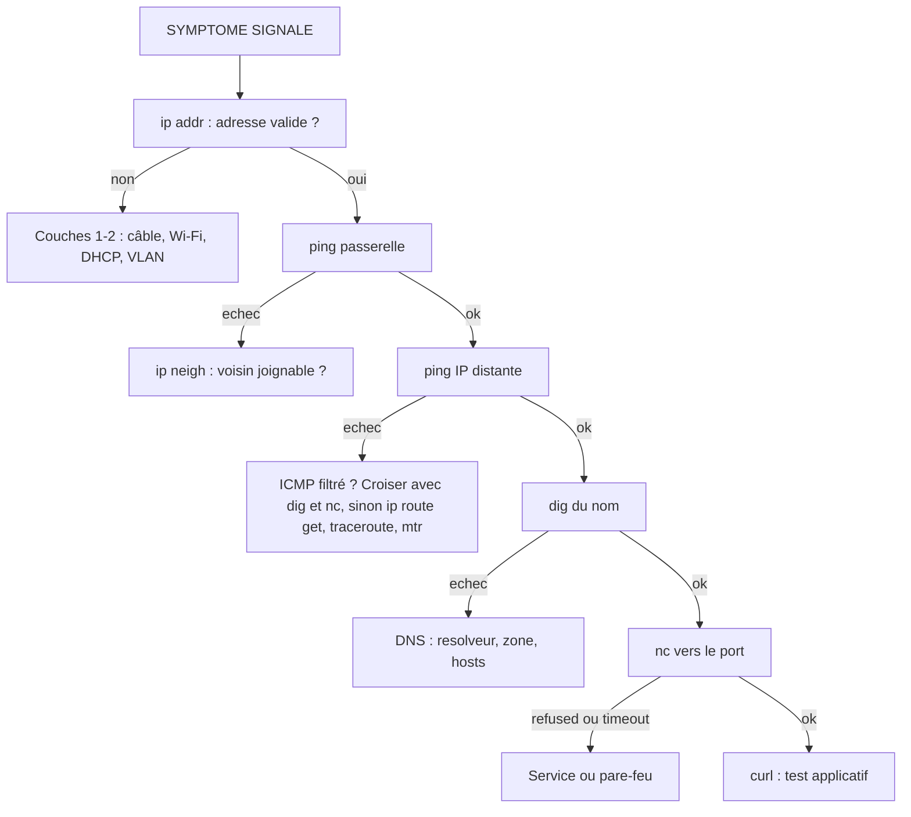

# Outils d'administration et de diagnostic réseau

## Objectifs pédagogiques

À la fin de ce module, vous saurez :

- **Interpréter** les résultats de `ping`, `traceroute` et `mtr`, y compris quand ils échouent
- **Inspecter** la configuration locale (adresses, routes, voisins) avec `ip` et ses équivalents Windows
- **Vérifier** une résolution DNS avec `dig` ou `nslookup`, et savoir ce que ces outils testent réellement
- **Distinguer** un port fermé, filtré ou en écoute sur la mauvaise interface avec `ss`, `nc` et `curl`
- **Appliquer** une méthode de diagnostic par couches et la compléter avec `tcpdump` quand les autres tests ne suffisent plus

## Mise en situation

Lundi matin, dans une PME d'une soixantaine de postes. Un collègue de la comptabilité vous appelle : « L'application de facturation ne répond plus. » Elle tourne sur un serveur Linux du VLAN serveurs, en `10.20.0.15`. Le poste du collègue est dans le VLAN utilisateurs. La veille, quelqu'un a modifié la configuration du serveur web.

Vous avez devant vous une dizaine de causes possibles : câble débranché, passerelle en panne, route manquante, DNS qui renvoie une mauvaise adresse, pare-feu, service arrêté, service qui écoute au mauvais endroit, certificat expiré. Essayer au hasard ferait perdre une heure. Ce module vous donne les outils et surtout l'ordre dans lequel les utiliser pour éliminer ces causes une par une.

## Diagnostiquer, c'est éliminer

Un médecin ne prescrit pas un scanner à chaque patient. Il part des symptômes, fait des examens simples et élimine les hypothèses jusqu'à isoler la cause. Le diagnostic réseau fonctionne pareil, et chaque outil de ce module répond à une question précise :

| Question | Outil principal |
|---|---|
| Ma machine a-t-elle une adresse et une route valides ? | `ip addr`, `ip route` |
| Mon voisin direct répond-il ? | `ping`, `ip neigh` |
| Où le chemin s'interrompt-il ? | `traceroute`, `mtr` |
| Le nom devient-il la bonne adresse ? | `dig`, `nslookup` |
| Quelque chose écoute-t-il sur ce port ? | `ss`, `nc` |
| L'application répond-elle correctement ? | `curl` |
| Que se passe-t-il vraiment sur le fil ? | `tcpdump` |

Le module précédent expliquait comment un paquet est routé et traduit. Ici, on regarde ce qui se passe quand ça ne marche pas, et comment le prouver.

> 💡 Les commandes Linux sont présentées en premier, avec leurs équivalents Windows quand ils existent. Les options et les messages exacts varient selon la distribution et la version des outils. Si une sortie diffère légèrement de celles montrées ici, le principe reste le même.
{: .callout .callout-important}

## ping : la première question, pas le verdict

`ping` envoie des messages ICMP (Internet Control Message Protocol) de type « echo request » et attend des « echo reply ». C'est un coup de sonar : vous envoyez une impulsion, vous mesurez l'écho.

```bash
ping -c 4 10.20.0.1        # Linux : 4 envois puis arrêt
ping -n 4 10.20.0.1        # Windows : équivalent
```

```text
PING 10.20.0.1 (10.20.0.1) 56(84) bytes of data.
64 bytes from 10.20.0.1: icmp_seq=1 ttl=64 time=0.412 ms
64 bytes from 10.20.0.1: icmp_seq=2 ttl=64 time=0.398 ms
64 bytes from 10.20.0.1: icmp_seq=3 ttl=64 time=0.466 ms
64 bytes from 10.20.0.1: icmp_seq=4 ttl=64 time=0.401 ms

--- 10.20.0.1 ping statistics ---
4 packets transmitted, 4 received, 0% packet loss, time 3050ms
rtt min/avg/max/mdev = 0.398/0.419/0.466/0.027 ms
```

Trois informations comptent dans cette sortie :

- **Le pourcentage de perte.** 0 % est sain. Quelques pourcents de perte, même intermittente, suffisent déjà à dégrader sensiblement une application, en particulier TCP et les flux temps réel.
- **Le temps** (`time=`), c'est-à-dire le délai aller-retour. Il n'a de sens que par comparaison : 0,4 ms sur un LAN est normal, 0,4 ms vers un serveur à l'autre bout du monde serait suspect.
- **Le `ttl`** de la réponse. Il diminue d'une unité à chaque routeur traversé. Une valeur proche de 64 ou 128 suggère peu de sauts. Elle donne aussi une vague idée de l'OS distant, sans certitude.

Deux options servent régulièrement. `-s <taille>` change la taille des paquets, pratique pour tester une MTU (la taille maximale d'un paquet sur le lien) douteuse. Sous Linux, `-M do` interdit la fragmentation, alors que Windows utilise `-f -l <taille>`.

Les messages d'erreur disent aussi où chercher. « Destination Host Unreachable » venant de **votre propre adresse** signifie que votre machine n'a pas réussi à joindre la cible sur son segment (souvent un échec de résolution ARP). Venant de **l'adresse d'un routeur**, c'est ce routeur qui n'a pas de route vers la destination. Une absence totale de réponse (timeout) est la situation la plus ambiguë.

> ⚠️ **Un ping qui échoue ne prouve pas que le serveur est hors ligne.** Beaucoup d'équipements filtrent ICMP : pare-feu d'entreprise, règles par défaut de Windows Server, groupes de sécurité cloud qui n'autorisent pas ICMP tant qu'on ne l'a pas demandé. Le serveur peut très bien servir des milliers de requêtes web pendant que `ping` affiche 100 % de perte. Le raisonnement inverse est tout aussi dangereux : un ping qui réussit prouve seulement que le chemin ICMP fonctionne, pas que votre application est joignable. Ping vous dit « quelqu'un répond à ce niveau », jamais « le service est en bonne santé ».
{: .callout .callout-attention}

> 🧠 Retenez cette hiérarchie : une réponse prouve quelque chose, une absence de réponse ne prouve rien tant qu'un second test n'a pas confirmé. Ce second test sera souvent `nc` ou `curl`, vus plus bas.
{: .callout .callout-important}

## traceroute et mtr : suivre le colis

Si `ping` vous dit si ça arrive, `traceroute` vous dit par où ça passe. Il envoie des paquets avec un TTL de 1, puis 2, puis 3. Chaque routeur qui reçoit un paquet dont le TTL tombe à zéro le détruit et renvoie un message d'erreur, ce qui révèle son adresse. C'est comme suivre un colis en demandant à chaque étape de se signaler.

```bash
traceroute -n 10.30.0.20       # Linux, -n évite la résolution DNS des sauts
tracert -d 10.30.0.20          # Windows, -d fait la même chose
```

```text
 1  10.10.0.1     0.5 ms   0.4 ms   0.4 ms
 2  10.255.0.2    1.1 ms   1.0 ms   1.2 ms
 3  * * *
 4  10.30.0.1     2.3 ms   2.1 ms   2.4 ms
 5  10.30.0.20    2.6 ms   2.5 ms   2.7 ms
```

Le saut 3 affiche `* * *`, et pourtant le chemin atteint sa destination. Ce routeur ne répond tout simplement pas à ces sondes, parce qu'il est configuré ainsi ou parce qu'il limite le débit des messages d'erreur. Les étoiles ne deviennent un vrai problème que si **tous les sauts suivants** restent muets jusqu'à la fin.

Différence de comportement à connaître : le `traceroute` Linux envoie par défaut des paquets UDP, `tracert` Windows envoie de l'ICMP. Un pare-feu qui filtre l'un et pas l'autre donnera donc des résultats différents pour le même chemin. Sous Linux, `traceroute -I` force ICMP, et `traceroute -T -p 443` utilise des segments TCP vers le port 443, utile quand seul le trafic web passe (ce mode demande souvent les droits root).

`mtr` combine `ping` et `traceroute` en continu. Plutôt qu'une photo, vous obtenez un film : perte et latence mesurées sur chaque saut, sur des dizaines de passages.

```bash
mtr -rwn -c 50 10.30.0.20      # -r rapport, -w noms complets, -n numérique, 50 cycles
```

```text
HOST: poste01            Loss%   Snt   Last   Avg  Best  Wrst StDev
  1. 10.10.0.1            0.0%    50    0.5   0.5   0.4   0.9   0.1
  2. 10.255.0.2           0.0%    50    1.1   1.1   1.0   1.5   0.1
  3. 10.255.1.2          40.0%    50    2.0   2.2   1.8   3.0   0.3
  4. 10.30.0.1            0.0%    50    2.3   2.2   2.1   2.6   0.1
  5. 10.30.0.20           0.0%    50    2.6   2.6   2.5   3.0   0.1
```

> ⚠️ Ici le saut 3 affiche 40 % de perte, mais les sauts 4 et 5 sont à 0 %. Ce n'est donc pas un lien défectueux : ce routeur traite le trafic sans problème, il ne répond simplement qu'à une partie des sondes ICMP qui lui sont destinées. Règle de lecture : **une perte n'est réelle que si elle se retrouve sur le dernier saut**. Si la perte démarre au saut 3 et persiste jusqu'à la destination, là vous avez un vrai problème.
{: .callout .callout-attention}

## Inspecter sa propre machine : ip et ses équivalents

Avant d'accuser le réseau, regardez ce que votre machine croit savoir. Un grand nombre de pannes viennent d'une adresse manquante, d'une mauvaise passerelle ou d'une table de voisins périmée.

| Besoin | Linux | Windows |
|---|---|---|
| Adresses des interfaces | `ip -br addr` | `ipconfig /all` ou `Get-NetIPAddress` |
| État des liens | `ip -br link` | `Get-NetAdapter` |
| Table de routage | `ip route` | `route print` ou `Get-NetRoute` |
| Route utilisée pour une destination | `ip route get <IP>` | `Find-NetRoute -RemoteIPAddress <IP>` |
| Voisins de niveau 2 | `ip neigh` | `arp -a` ou `Get-NetNeighbor` |

```bash
ip -br addr
```

```text
lo      UNKNOWN   127.0.0.1/8 ::1/128
eth0    UP        10.10.0.57/24 fe80::a00:27ff:fe4e:66a1/64
```

Cette forme condensée (`-br`, pour *brief*) tient en deux lignes là où `ip addr` en déroule vingt. Vous vérifiez trois choses : l'interface est `UP`, elle a une adresse IPv4, et le masque correspond à votre réseau.

> 🧠 Une adresse en `169.254.x.x` (Windows parle d'adresse APIPA, Linux parle de lien local) signifie que la machine n'a **pas obtenu d'adresse DHCP** et s'est attribué une adresse de secours. Le problème est alors en amont : câble, Wi-Fi, VLAN ou serveur DHCP, pas dans l'application.
{: .callout .callout-important}

Ensuite, la commande la plus sous-estimée de la boîte à outils :

```bash
ip route get 10.20.0.15
```

```text
10.20.0.15 via 10.10.0.1 dev eth0 src 10.10.0.57 uid 1000
    cache
```

Plutôt que de lire toute la table de routage en la simulant dans votre tête, vous demandez directement au noyau : « Par où passeriez-vous pour cette destination ? » La réponse donne la passerelle (`via`), l'interface (`dev`) et l'adresse source choisie (`src`). Si la ligne annonce une mauvaise interface ou une mauvaise passerelle, vous tenez votre cause.

`ip neigh` montre le cache des voisins de niveau 2, c'est-à-dire les correspondances adresse IP → adresse MAC apprises récemment :

```text
10.10.0.1 dev eth0 lladdr 00:1a:2b:3c:4d:5e REACHABLE
10.10.0.88 dev eth0 FAILED
```

`REACHABLE` ou `STALE` (entrée ancienne mais utilisable) sont normaux. `FAILED` ou `INCOMPLETE` indiquent que personne n'a répondu à la demande : le voisin est éteint, sur un autre VLAN, ou le lien est coupé. C'est précieux pour tester la passerelle : si son entrée est `FAILED`, inutile de chercher plus loin que le segment local.

## DNS : vérifier que le nom devient la bonne adresse

Beaucoup de pannes « réseau » sont en réalité des pannes de nom. L'utilisateur tape `facturation.entreprise.local`, la machine interroge un résolveur, et si la réponse est fausse ou absente, tout le reste ne sert à rien.

```bash
dig facturation.entreprise.local
```

```text
;; ->>HEADER<<- opcode: QUERY, status: NOERROR, id: 41873
;; flags: qr rd ra; QUERY: 1, ANSWER: 1, AUTHORITY: 0, ADDITIONAL: 1

;; ANSWER SECTION:
facturation.entreprise.local. 300 IN A 10.20.0.15

;; Query time: 3 msec
;; SERVER: 10.20.0.10#53(10.20.0.10)
```

À regarder, dans l'ordre :

- **`status`.** `NOERROR` signifie que la requête a abouti. `NXDOMAIN` signifie que le nom n'existe pas pour ce serveur. `SERVFAIL` signifie que le serveur a rencontré un problème en cherchant la réponse.
- **L'`ANSWER SECTION`.** Elle contient l'adresse renvoyée. Comparez-la à ce que vous attendez. Le `300` est la durée de vie en secondes pendant laquelle cette réponse peut être mise en cache.
- **Le `SERVER`.** C'est le résolveur réellement interrogé, qui n'est pas toujours celui que vous croyez.

Les variantes à garder en main :

```bash
dig +short facturation.entreprise.local        # uniquement la réponse
dig @8.8.8.8 facturation.entreprise.local      # interroger un résolveur précis
dig -x 10.20.0.15                              # résolution inverse
```

Interroger deux résolveurs différents sur le même nom est une manœuvre classique : si l'un répond et pas l'autre, le problème vient d'un serveur ou d'une zone, pas du poste.

Sous Windows, `nslookup` joue le même rôle, avec une syntaxe plus simple : `nslookup facturation.entreprise.local 10.20.0.10`. PowerShell offre aussi `Resolve-DnsName`. `nslookup` existe également sous Linux, mais il est moins détaillé que `dig`.

> ⚠️ `dig` et `nslookup` interrogent directement un serveur DNS. Ils **contournent** le mécanisme de résolution de votre système. Or celui-ci consulte aussi le fichier `hosts`, son propre cache et parfois d'autres sources. Il arrive donc que `dig` renvoie la bonne adresse alors que `ping` ou le navigateur utilisent une autre adresse, issue d'une vieille entrée dans `/etc/hosts`. Pour voir ce que voit réellement le système sous Linux, utilisez `getent hosts <NOM>`. Si `dig` et `getent` divergent, vous avez trouvé un écart local.
{: .callout .callout-attention}

## Ports et connexions : ss, netstat et nc

Une adresse qui répond ne suffit pas. Il faut aussi qu'un programme écoute sur le bon port, sur la bonne interface. Les deux outils suivants regardent ce point sous deux angles : `ss` depuis l'intérieur de la machine, `nc` depuis l'extérieur.

### ss : voir ce qui écoute

```bash
sudo ss -tulpn
```

Les options se retiennent comme un mot : **t** pour TCP, **u** pour UDP, **l** pour les sockets en écoute, **p** pour le processus propriétaire, **n** pour des valeurs numériques sans résolution de noms.

```text
Netid State   Recv-Q Send-Q Local Address:Port  Peer Address:Port Process
tcp   LISTEN  0      511    127.0.0.1:443       0.0.0.0:*         users:(("nginx",pid=812,fd=6))
tcp   LISTEN  0      128    0.0.0.0:22          0.0.0.0:*         users:(("sshd",pid=701,fd=3))
udp   UNCONN  0      0      127.0.0.53:53       0.0.0.0:*         users:(("systemd-resolve",pid=540,fd=13))
```

La colonne qui décide de tout est **Local Address**. `0.0.0.0` (ou `[::]` en IPv6) signifie « j'écoute sur toutes les interfaces ». `127.0.0.1` signifie « j'écoute uniquement pour les connexions venant de cette machine ». Dans l'exemple, `nginx` écoute sur `127.0.0.1:443` : le service est bien en marche, mais **personne d'autre que le serveur lui-même ne peut le joindre**. On retrouvera ce piège dans le cas pratique.

Sous Windows, l'équivalent est `netstat -ano`, où `-o` affiche l'identifiant du processus (à rapprocher du Gestionnaire des tâches). Sous Linux, `netstat` existe encore mais il est considéré comme historique, et `ss` l'a remplacé.

### nc : frapper à la porte depuis l'extérieur

`nc` (netcat) tente d'ouvrir une connexion vers un port, sans rien envoyer d'autre :

```bash
nc -zv 10.20.0.15 443     # -z : tester seulement, -v : détailler
```

Le résultat donne trois cas, à distinguer soigneusement parce qu'ils racontent des histoires opposées :

| Résultat | Ce qui s'est passé | Interprétation |
|---|---|---|
| `succeeded` / `open` | La connexion TCP s'est établie | Le port est ouvert, le chemin est bon |
| `Connection refused` | Un refus actif est revenu (reset TCP ou ICMP) | Le plus souvent, la machine est **joignable** mais rien n'écoute sur ce port (ou pas sur cette interface). Un pare-feu en mode REJECT produit toutefois le même message |
| Timeout (aucune réponse) | Les paquets sont partis sans retour | Un pare-feu les jette, la route est cassée, ou la machine est éteinte |

> 💡 Le refus est une *bonne nouvelle* pour le diagnostic : quelqu'un a répondu, la cible elle-même ou un pare-feu en REJECT sur le chemin, ce qui réduit déjà les hypothèses. Le timeout est plus pénible parce qu'il ne dit pas qui est en cause.
{: .callout .callout-important}

Sous Windows, `nc` n'est pas installé par défaut, mais PowerShell propose mieux : `Test-NetConnection -ComputerName 10.20.0.15 -Port 443`, qui affiche `TcpTestSucceeded : True` ou `False`.

Pour l'UDP (`nc -zvu`), méfiez-vous : UDP n'établit pas de connexion, donc l'absence de réponse n'indique pas forcément un port fermé. Le test est peu fiable et doit être confirmé autrement, par exemple par une vraie requête DNS pour le port 53.

## curl : tester comme le ferait l'application

Un port ouvert ne garantit pas une application qui fonctionne. Le serveur peut accepter la connexion puis répondre une erreur 500, un certificat expiré ou une redirection en boucle. `curl` joue le rôle du client applicatif en ligne de commande.

```bash
curl -I https://facturation.entreprise.local     # en-têtes seuls
curl -v https://facturation.entreprise.local     # détail de la conversation
```

`-v` est l'option la plus instructive : elle montre la résolution du nom, la tentative de connexion, la négociation TLS (le chiffrement) avec les détails du certificat, puis la requête et la réponse HTTP. Quand quelque chose échoue, on voit exactement à quelle étape.

Autre usage, très utile quand on soupçonne la lenteur : relever l'instant où chaque phase se termine. Les valeurs sont cumulées depuis le début de la requête, et non des durées par phase.

```bash
curl -s -o /dev/null \
  -w "dns:%{time_namelookup}s connect:%{time_connect}s tls:%{time_appconnect}s premier-octet:%{time_starttransfer}s total:%{time_total}s code:%{http_code}\n" \
  https://facturation.entreprise.local
```

```text
dns:0.004s connect:0.006s tls:0.031s premier-octet:2.870s total:2.912s code:200
```

Ici le DNS, la connexion et TLS sont rapides, mais le premier octet de la réponse arrive après presque 3 secondes : le goulot est dans l'application ou sa base, pas dans le réseau. Cette décomposition évite de perdre du temps à chercher au mauvais endroit.

Deux options supplémentaires à connaître :

- `--resolve <NOM>:443:<IP>` force le nom vers une adresse précise sans toucher au DNS. C'est pratique pour tester un serveur précis derrière un répartiteur de charge.
- `--connect-timeout 5` évite d'attendre indéfiniment. Sous Windows, utilisez `curl.exe` pour ne pas tomber sur l'alias PowerShell de `Invoke-WebRequest`.

> ⚠️ `-k` désactive la vérification du certificat. Il aide à vérifier rapidement si le problème vient du certificat, mais l'utiliser en routine masque un vrai défaut de sécurité.
{: .callout .callout-attention}

## tcpdump : regarder passer les paquets

Quand les tests précédents donnent des résultats contradictoires, il reste à observer le fil. `tcpdump` capture le trafic en direct sur une interface. Le module suivant approfondira l'analyse avec Wireshark, ici on se contente de poser la question la plus simple : **le paquet est-il parti, et une réponse est-elle revenue ?**

```bash
sudo tcpdump -ni eth0 host 10.20.0.15 and port 443
```

`-n` évite les résolutions DNS (qui ralentissent et polluent la sortie), `-i` choisit l'interface, et la suite est un filtre. Sans filtre, vous noyez l'information utile dans le bruit.

```text
10:42:11.203 IP 10.10.0.57.51514 > 10.20.0.15.443: Flags [S], seq 3345, length 0
10:42:12.205 IP 10.10.0.57.51514 > 10.20.0.15.443: Flags [S], seq 3345, length 0
10:42:14.209 IP 10.10.0.57.51514 > 10.20.0.15.443: Flags [S], seq 3345, length 0
```

Le drapeau `[S]` marque une demande d'ouverture de connexion TCP. Elle est envoyée trois fois sans qu'aucune réponse n'arrive : le poste fait son travail, la réponse ne revient jamais. En capturant en même temps sur le serveur, on saura si la demande y est arrivée ou si elle a été perdue en route.

Quelques filtres et options à garder en tête :

- `icmp` pour suivre les pings
- `port 53` pour voir les requêtes DNS
- `-c 20` pour s'arrêter après 20 paquets
- `-w capture.pcap` pour enregistrer dans un fichier qu'on pourra ouvrir plus tard dans Wireshark

> 🔒 Capturer du trafic expose des données sensibles : mots de passe en clair sur des protocoles non chiffrés, adresses, identifiants de session. Faites-le uniquement sur des équipements que vous avez le droit d'administrer, gardez les fichiers `.pcap` en lieu sûr et supprimez-les quand l'enquête est terminée.
{: .callout .callout-securite}

## La méthode : diagnostiquer par couches

Tous ces outils ne servent à rien sans un ordre d'emploi. Le principe : avancer de la couche la plus basse vers la plus haute, puisque chaque couche dépend de celle du dessous. Si l'adresse IP n'existe pas, inutile de tester le DNS. Si le port est fermé, inutile de lire les logs applicatifs.



Quelques principes pour que la méthode fonctionne :

1. **Commencez là où l'hypothèse est la plus probable, pas forcément en bas.** Si tout le monde a perdu Internet, inutile de vérifier le câble de chaque poste. Si un seul utilisateur est touché, commencez par lui.
2. **Comparez avec un poste témoin.** Si la même requête réussit ailleurs, vous savez que le serveur va bien et que la cause est côté client, ou entre les deux.
3. **Croisez deux tests avant de conclure.** Un `ping` en échec seul ne vaut rien (on l'a vu). `ping` en échec plus `nc` en timeout, là, ça commence à parler.
4. **Un seul changement à la fois**, avec l'heure notée. Sinon, vous ne saurez jamais ce qui a réparé la panne.

## Cas pratique : la facturation qui ne répond plus

Reprenons notre appel du lundi matin. Les adresses sont celles du scénario et les sorties sont illustratives. Depuis le poste du collègue (`10.10.0.57`), vous déroulez la méthode.

**1. Le poste va-t-il bien ?**

```bash
ip -br addr
```
```text
eth0    UP     10.10.0.57/24
```
L'adresse est valide, on passe à la suite. Le poste n'est pas en cause.

**2. La passerelle répond-elle ?**

```bash
ping -c 2 10.10.0.1
```
```text
2 packets transmitted, 2 received, 0% packet loss
```
Le segment local fonctionne.

**3. Le serveur répond-il au ping ?**

```bash
ping -c 2 10.20.0.15
```
```text
2 packets transmitted, 0 received, 100% packet loss
```
Piège ! La tentation serait de déclarer le serveur éteint. Mais on sait qu'un ping muet ne prouve rien.

**4. Le nom est-il bien résolu ?**

```bash
dig +short facturation.entreprise.local
```
```text
10.20.0.15
```
Le DNS renvoie l'adresse attendue, donc ce n'est pas lui.

**5. Le port web est-il joignable ?**

```bash
nc -zv 10.20.0.15 443
```
```text
nc: connect to 10.20.0.15 port 443 (tcp) failed: Connection refused
```
Voilà l'indice décisif. Un refus, pas un timeout : quelque chose a répondu activement. C'est le plus souvent le serveur lui-même, **allumé et joignable**, mais un pare-feu en REJECT produirait le même message, d'où la vérification côté serveur qui suit. Le ping échouait donc probablement à cause d'un filtrage ICMP, ce qui est cohérent avec une politique de pare-feu stricte sur le VLAN serveurs. Le problème est que rien n'accepte les connexions sur ce port pour nous.

**6. Que se passe-t-il côté serveur ?** Connecté en SSH :

```bash
sudo ss -tlnp | grep 443
```
```text
LISTEN 0 511 127.0.0.1:443 0.0.0.0:* users:(("nginx",pid=812,fd=6))
```
Voilà la cause : `nginx` tourne, mais il écoute uniquement sur `127.0.0.1`. La modification de la veille a remplacé l'adresse d'écoute `0.0.0.0` par `127.0.0.1`. L'application fonctionne parfaitement pour le serveur lui-même et reste inaccessible pour tous les autres.

**7. Correction et validation.** Après avoir remis l'écoute sur toutes les interfaces dans la configuration du service et rechargé celui-ci, vous validez depuis le poste :

```bash
curl -sI https://facturation.entreprise.local | head -n 1
```
```text
HTTP/2 200
```

En sept commandes, sans deviner, vous êtes passé de « le réseau est en panne » à « une directive d'écoute modifiée la veille ». Sans la méthode et sans l'interprétation fine de `Connection refused`, vous auriez probablement passé une heure à regarder le pare-feu.

## Bonnes pratiques

- **Gardez une trace.** Notez l'heure, la commande et le résultat de chaque test. Ces notes servent à l'équipe, au ticket d'incident, et à vous quand vous reprenez l'enquête le lendemain.
- **Utilisez `-n` par défaut** avec `traceroute`, `tcpdump`, `ss` et `mtr`. Les résolutions de noms ralentissent les outils et peuvent masquer un problème DNS en l'introduisant dans votre propre diagnostic.
- **Ne concluez jamais sur un seul outil.** Chaque outil voit le réseau sous un angle et peut se tromper. Les conclusions solides viennent de deux tests indépendants qui concordent.
- **Testez dans les deux sens quand c'est possible.** Un chemin aller qui marche ne garantit pas le retour, par exemple lorsqu'une route de retour manque ou qu'un routage asymétrique traverse un pare-feu avec état.
- **Respectez le cadre.** `nc`, `tcpdump` et tout test actif ne s'appliquent qu'aux équipements dont vous avez la charge ou pour lesquels vous avez une autorisation explicite. Ce réflexe deviendra central dans les modules de sécurité.
- **Restez prudent en production.** Un `ping -f` agressif ou un `mtr` avec des centaines de cycles ajoute de la charge sur un équipement déjà fragile.

## Résumé

| Concept | Rôle | Points clés |
|---|---|---|
| `ping` | Tester l'accessibilité via ICMP | Échec ≠ panne, car ICMP est souvent filtré. Lire perte et délai |
| `traceroute` / `tracert` | Révéler le chemin saut par saut | Les `* * *` isolés sont normaux. Linux utilise UDP, Windows ICMP |
| `mtr` | Mesurer perte et latence en continu | Une perte n'est réelle que si elle atteint le dernier saut |
| `ip addr` / `route` / `neigh` | Inspecter la configuration locale | `ip route get` donne le chemin exact. `FAILED` signale un voisin muet |
| `dig` / `nslookup` | Vérifier la résolution DNS | Interrogent un serveur en contournant `hosts`. Lire `status` et `SERVER` |
| `ss` / `netstat` | Lister ports et connexions locaux | `127.0.0.1` = joignable en local seulement. `0.0.0.0` = toutes interfaces |
| `nc` | Tester un port depuis l'extérieur | Refused = en général joignable mais fermé (ou pare-feu en REJECT). Timeout = filtrage ou route cassée |
| `curl` | Tester l'application | `-v` détaille la conversation, `-w` affiche les temps cumulés de chaque étape |
| `tcpdump` | Observer les paquets réels | Toujours filtrer, `-n`, `-w` pour sauvegarder |
| Diagnostic par couches | Éliminer méthodiquement les causes | Du bas vers le haut, deux tests croisés avant de conclure |

Ces outils vous donnent des indices rapides, mais ils résument le trafic sans le détailler. Quand un échange se comporte étrangement (connexion qui s'établit puis tombe, réponses lentes, retransmissions), il faut lire les paquets eux-mêmes, champ par champ. C'est ce que permet Wireshark, et le fichier `.pcap` produit par `tcpdump` en sera le point de départ.

<!-- snippet
id: reseau_ping_echec_pas_panne
type: warning
tech: reseau
level: beginner
importance: high
format: knowledge
tags: ping,icmp,diagnostic,pare-feu
title: Ping sans réponse ne prouve pas que le serveur est éteint
content: Piège : conclure qu'un serveur est hors ligne parce que ping affiche 100 % de perte. Conséquence : fausse piste et temps perdu, car pare-feu, Windows Server et groupes de sécurité cloud bloquent souvent ICMP alors que les services répondent normalement. Correction : confirmer avec un test TCP sur le port réel (nc -zv <IP> <PORT> ou curl) avant de conclure.
description: ICMP est fréquemment filtré. Seul un test sur le port applicatif confirme l'état réel d'un service.
-->

<!-- snippet
id: reseau_ping_options_comptage
type: command
tech: reseau
level: beginner
importance: medium
format: knowledge
tags: ping,icmp,linux,windows
title: Limiter le nombre d'envois de ping
context: Linux envoie en continu par défaut, Windows s'arrête à 4
command: ping -c <NOMBRE> <HOTE>
example: ping -c 4 10.20.0.1
description: Envoie 4 paquets puis affiche perte et délai min/moy/max. Sous Windows, l'option équivalente est -n au lieu de -c.
-->

<!-- snippet
id: reseau_mtr_rapport_perte_reelle
type: command
tech: reseau
level: intermediate
importance: high
format: knowledge
tags: mtr,traceroute,latence,perte
title: Mesurer perte et latence par saut avec mtr
command: mtr -rwn -c <CYCLES> <HOTE>
example: mtr -rwn -c 50 10.30.0.20
description: Produit un rapport sur 50 passages. La perte d'un saut intermédiaire n'est réelle que si elle persiste jusqu'au dernier saut.
-->

<!-- snippet
id: reseau_traceroute_etoiles_sauts
type: concept
tech: reseau
level: beginner
importance: medium
format: knowledge
tags: traceroute,tracert,icmp,ttl
title: Que signifient les étoiles dans un traceroute
content: traceroute envoie des paquets avec un TTL croissant (1, 2, 3...) et chaque routeur qui détruit un paquet à TTL 0 renvoie une erreur révélant son adresse. Un saut qui affiche * * * ne répond simplement pas à ces sondes (filtrage ou limitation de débit). Si les sauts suivants répondent, le chemin fonctionne. Seul un silence continu jusqu'à la fin est suspect.
description: Un saut muet isolé est courant et sans gravité. Le vrai signal est l'absence de réponse sur tous les sauts jusqu'à la destination.
-->

<!-- snippet
id: reseau_ip_route_get_chemin
type: command
tech: reseau
level: beginner
importance: high
format: knowledge
tags: ip,routage,linux,diagnostic
title: Demander au noyau la route exacte vers une destination
command: ip route get <IP>
example: ip route get 10.20.0.15
description: Affiche passerelle (via), interface (dev) et adresse source choisies. Évite de lire toute la table de routage à la main.
-->

<!-- snippet
id: reseau_ip_neigh_etats_failed
type: concept
tech: reseau
level: beginner
importance: medium
format: knowledge
tags: ip,arp,voisins,diagnostic
title: Lire les états de ip neigh
content: ip neigh liste les correspondances IP → adresse MAC du segment local. REACHABLE et STALE sont normaux (entrée récente ou ancienne mais utilisable). FAILED ou INCOMPLETE signifient qu'aucune réponse n'est venue après la demande de résolution : voisin éteint, autre VLAN ou lien coupé. Si la passerelle est en FAILED, le problème est sur le segment local.
description: FAILED sur la passerelle localise la panne au niveau du segment local, avant tout routage ou DNS.
-->

<!-- snippet
id: reseau_apipa_169_254_dhcp
type: error
tech: reseau
level: beginner
importance: medium
format: knowledge
tags: dhcp,apipa,adressage,diagnostic
title: Adresse 169.254.x.x sur un poste
content: Symptôme : le poste affiche une adresse en 169.254.x.x et n'accède à rien. Cause : aucune réponse DHCP, la machine s'est attribué une adresse de lien local. Correction : vérifier le lien (câble, Wi-Fi), le VLAN du port et la joignabilité du serveur DHCP ou du relais, puis relancer la demande (ipconfig /renew sous Windows).
description: Une adresse 169.254.x.x indique un échec DHCP, donc un problème en amont du poste et pas dans l'application.
-->

<!-- snippet
id: reseau_dig_resolveur_precis
type: command
tech: reseau
level: beginner
importance: high
format: knowledge
tags: dig,dns,resolveur,diagnostic
title: Interroger un résolveur DNS précis avec dig
command: dig @<DNS_IP> <NOM> +short
example: dig @10.20.0.10 facturation.entreprise.local +short
description: Compare les réponses de deux résolveurs sur un même nom pour savoir si le problème vient d'un serveur ou d'une zone plutôt que du poste.
-->

<!-- snippet
id: reseau_dig_contourne_systeme
type: warning
tech: reseau
level: intermediate
importance: medium
format: knowledge
tags: dig,dns,hosts,getent
title: dig ne reflète pas toujours la résolution du système
content: Piège : dig et nslookup interrogent directement un serveur DNS et ignorent /etc/hosts et le cache local. Conséquence : dig renvoie la bonne adresse alors que ping ou le navigateur en utilisent une autre. Correction : lancer getent hosts <NOM> sous Linux pour voir la résolution réelle du système, puis comparer avec dig.
description: Un écart entre dig et getent hosts révèle une entrée locale (hosts, cache) qui masque la réponse du DNS.
-->

<!-- snippet
id: reseau_ss_ports_en_ecoute
type: command
tech: reseau
level: beginner
importance: high
format: knowledge
tags: ss,ports,linux,diagnostic
title: Lister les ports en écoute avec leur processus
context: À exécuter sur le serveur concerné, avec sudo pour voir les processus
command: sudo ss -tulpn
description: t=TCP, u=UDP, l=en écoute, p=processus, n=numérique. La colonne Local Address indique si le service est exposé (0.0.0.0) ou local seulement (127.0.0.1).
-->

<!-- snippet
id: reseau_ss_bind_loopback_refused
type: error
tech: reseau
level: intermediate
importance: high
format: knowledge
tags: ss,bind,connection-refused,service
title: Service en marche mais Connection refused depuis le réseau
content: Symptôme : nc ou curl renvoie Connection refused alors que le service tourne. Cause : il écoute sur 127.0.0.1 au lieu de 0.0.0.0, visible dans la colonne Local Address de ss -tlnp. Correction : modifier l'adresse d'écoute (directive listen ou bind du service), recharger le service et retester depuis un autre poste.
description: Un service lié à 127.0.0.1 n'accepte que les connexions locales. Vérifier Local Address dans ss avant d'accuser le pare-feu.
-->

<!-- snippet
id: reseau_nc_refused_vs_timeout
type: concept
tech: reseau
level: beginner
importance: high
format: knowledge
tags: nc,tcp,refused,timeout
title: Connection refused et timeout racontent deux histoires
content: Avec nc -zv, un refus (Connection refused) signifie qu'un refus actif est revenu (reset TCP ou ICMP port-unreachable). Le plus souvent, la machine est joignable mais rien n'écoute sur ce port. Un pare-feu en REJECT produit toutefois le même message. Un timeout signifie qu'aucune réponse n'est revenue : pare-feu qui jette les paquets, route cassée ou machine éteinte. Le refus réduit fortement les hypothèses, le timeout ne localise rien.
description: Refused = en général joignable mais port fermé, ou pare-feu en REJECT. Timeout = filtrage ou chemin cassé. Les deux orientent vers des causes différentes.
-->

<!-- snippet
id: reseau_curl_decomposer_temps
type: command
tech: reseau
level: intermediate
importance: medium
format: knowledge
tags: curl,latence,tls,http
title: Décomposer le temps d'une requête avec curl
command: curl -s -o /dev/null -w "dns:%{time_namelookup} connect:%{time_connect} tls:%{time_appconnect} ttfb:%{time_starttransfer} total:%{time_total}\n" <URL>
example: curl -s -o /dev/null -w "dns:%{time_namelookup} connect:%{time_connect} tls:%{time_appconnect} ttfb:%{time_starttransfer} total:%{time_total}\n" https://facturation.entreprise.local
description: Les valeurs sont cumulées depuis le début de la requête. Si dns, connect et tls sont courts mais que ttfb est très supérieur à tls, la lenteur vient de l'application et pas du réseau.
-->

<!-- snippet
id: reseau_tcpdump_filtre_hote_port
type: command
tech: reseau
level: intermediate
importance: medium
format: knowledge
tags: tcpdump,capture,filtre,paquets
title: Capturer uniquement le trafic vers un hôte et un port
context: Droits root requis, à utiliser seulement sur un équipement dont on a l'administration
command: sudo tcpdump -ni <INTERFACE> host <IP> and port <PORT>
example: sudo tcpdump -ni eth0 host 10.20.0.15 and port 443
description: Des [S] répétés sans réponse montrent que la demande part mais que rien ne revient. Ajouter -w fichier.pcap pour sauvegarder.
-->

<!-- snippet
id: reseau_diagnostic_couches_methode
type: tip
tech: reseau
level: beginner
importance: high
format: knowledge
tags: diagnostic,methode,couches,troubleshooting
title: Ordre de test pour un diagnostic par couches
content: Enchaîner dans cet ordre : ip -br addr (adresse valide) → ping passerelle → ping IP distante → dig du nom → nc -zv <IP> <PORT> → curl -v. Chaque étape valide une couche. Quand une étape échoue, la croiser avec un second test avant de conclure : si le ping IP échoue mais que nc réussit, c'est ICMP qui est filtré et on poursuit vers les couches supérieures.
description: Remonter les couches du bas vers le haut et croiser deux tests élimine les fausses pistes comme le ping filtré.
-->
