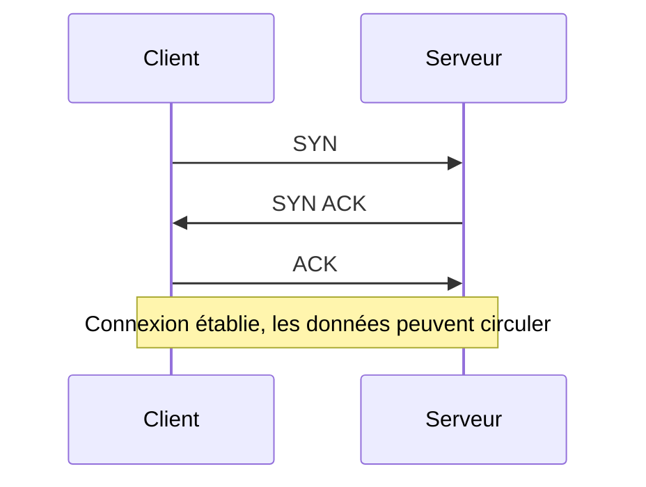
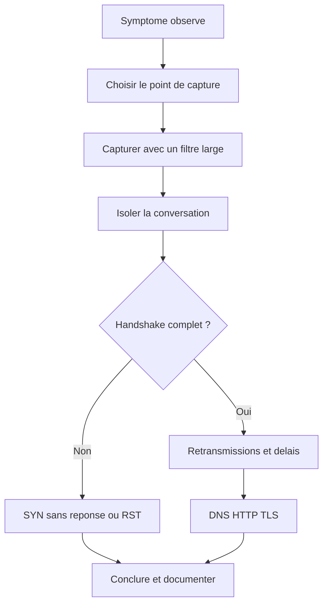

# Wireshark et analyse des échanges réseau

## Objectifs pédagogiques

À la fin de ce module, vous saurez :

- **Capturer** un trafic depuis le bon point du réseau, avec un filtre de capture adapté.
- **Isoler** une conversation avec les filtres d'affichage et la lire paquet par paquet, en-têtes compris.
- **Reconnaître** dans une capture les échanges ARP, ICMP, DNS, HTTP et TCP, y compris le three-way handshake, les retransmissions et les resets.
- **Repérer** les premières traces TLS (Transport Layer Security) d'une connexion chiffrée et savoir ce qu'on peut en déduire.
- **Exporter** une capture PCAP (Packet Capture) en l'anonymisant, et **juger** si elle est assez complète pour étayer une conclusion.

## Mise en situation

Une PME vient de mettre en ligne un outil interne sur un serveur applicatif, `10.20.0.15`, qui écoute sur le port 8443. Depuis le poste d'un utilisateur, `ping` répond sans problème, mais le navigateur reste sur « connexion en cours » jusqu'à l'expiration. Le chef de projet pense à un bug de l'application, l'équipe réseau à un poste mal configuré, et personne n'a de preuve.

Une capture de trafic peut départager les deux. Elle montre si la demande de connexion part du poste, si elle arrive, qui répond, et au bout de combien de temps. On la fera à la fin du module, une fois les outils en main.

## Pourquoi capturer : ce que `ping` ne vous dit pas

Les outils du module précédent donnent des verdicts : ça répond, ça ne répond pas, le chemin passe par tel routeur. C'est utile, mais c'est un résumé. Wireshark montre le détail de chaque échange, comme si vous aviez enregistré une conversation téléphonique plutôt que lu un compte rendu d'appel.

Il ne fait pas de miracle pour autant. Il affiche ce que la carte réseau a vu, à l'endroit où vous l'avez placé et pendant le temps où elle écoutait. Une grande partie du métier consiste à savoir ce que la capture ne montre pas. C'est le piège principal de ce module, on y revient plus bas.

> 🧠 **Concept fondamental** : une capture n'est pas le réseau, c'est un point de vue sur le réseau. Deux captures prises à deux endroits sur le même flux peuvent raconter deux histoires différentes, et les deux peuvent être exactes.
{: .callout .callout-important}

## Capturer sans se tromper

### Choisir où écouter

Wireshark écoute une interface (Ethernet, Wi-Fi, boucle locale, interface virtuelle). Le plus simple est de capturer **sur la machine concernée** : elle voit ce qu'elle envoie et ce qu'elle reçoit.

Capturer ailleurs est plus délicat. Sur un réseau commuté, une machine ne reçoit que son propre trafic, le broadcast et le multicast, pas les échanges des autres. Pour observer un flux entre deux autres équipements, il faut dupliquer le trafic :

- un port miroir SPAN* configuré sur le switch ;
- un TAP (Test Access Point), petit boîtier placé physiquement sur le câble ;
- ou une capture sur un équipement qui voit déjà le flux (pare-feu, routeur, serveur).

> 📖 **Définition.** Le mode promiscuous permet à la carte réseau d'accepter les trames destinées à d'autres adresses MAC. Sur un réseau commuté, il ne change donc presque rien : le switch n'envoie pas ces trames à votre port.
{: .callout .callout-definition}

*SPAN (Switched Port Analyzer) : fonction d'un switch qui recopie le trafic d'un ou plusieurs ports vers un port de supervision.*

### Filtre de capture et filtre d'affichage : deux outils différents

Ces deux filtres ne se ressemblent ni par la syntaxe ni par la portée.

> 🎥 **Analogie : le tournage et le montage.** Le filtre de capture, c'est le cadrage au tournage : ce qui reste hors champ n'est jamais filmé. Le filtre d'affichage, c'est le montage : vous choisissez ce que vous montrez, mais les rushes restent intacts.
{: .callout .callout-analogie}

| | Filtre de capture | Filtre d'affichage |
|---|---|---|
| Quand | Avant et pendant la capture | Après, sur ce qui est déjà enregistré |
| Effet | Les paquets non retenus sont **perdus** | Les paquets sont masqués, **rien n'est supprimé** |
| Syntaxe | BPF* : `host 10.20.0.15 and port 8443` | Wireshark : `ip.addr == 10.20.0.15 && tcp.port == 8443` |
| Quand l'utiliser | Pour limiter le volume (lien chargé, capture longue) | Pour analyser, tout le temps |

*BPF (Berkeley Packet Filter) : langage de filtrage exécuté très tôt dans la pile réseau, qui permet de ne garder que les paquets voulus avant même qu'ils atteignent Wireshark.*

Quelques filtres de capture utiles :

```text
host 10.20.0.15
tcp port 8443 and host 10.20.0.15
port 53
not port 22
```

Le dernier est un classique : si vous capturez sur un serveur en y étant connecté en SSH, votre propre session remplirait la capture de paquets qui n'intéressent personne.

La barre de filtre d'affichage se colore : **verte** si la syntaxe est valide, **rouge** si elle est invalide, **jaune** si elle est valide mais ambiguë. Appuyez sur Entrée seulement quand elle est verte.

> 💡 **Point clé** : en cas de doute, capturez large puis filtrez à l'affichage. Un filtre de capture trop restrictif ne se rattrape pas, alors qu'un filtre d'affichage se change à volonté.
{: .callout .callout-important}

### ⚠️ Une capture incomplète conduit à une mauvaise conclusion

C'est le piège principal du module. Une capture peut être incomplète de plusieurs façons, et rien n'avertit toujours le lecteur :

- **Mauvaise interface** : vous écoutez le Wi-Fi alors que le trafic passe par le câble, ou l'inverse.
- **Démarrage trop tardif** : la connexion est déjà établie, vous n'avez jamais vu le handshake. Wireshark numérote alors les séquences à partir du premier paquet capturé, ce qui donne des valeurs trompeuses.
- **Filtre de capture trop strict** : un seul de vos deux sens de circulation passe, ou le DNS a été exclu.
- **Mauvais endroit** : un serveur qui ne reçoit rien dans sa capture ne prouve pas que le client n'a rien envoyé. Le paquet a peut-être été bloqué en route.
- **Paquets tronqués** : si la taille de capture par paquet est limitée, les données applicatives manquent. Wireshark l'indique par une longueur capturée inférieure à la longueur réelle.
- **Paquets perdus par la capture elle-même** : sur un lien très chargé, la machine qui capture peut ne pas tout enregistrer.

Un autre piège, plus discret : si vous capturez sur la machine qui **envoie** les paquets, Wireshark peut signaler des sommes de contrôle (checksum) incorrectes. Ce n'est pas un défaut du réseau. La carte réseau calcule souvent cette somme *après* que Wireshark a vu le paquet (c'est l'offload), donc il lit une valeur pas encore remplie.

> 🔑 **Moyen mnémotechnique** : avant de conclure, pensez **Où, Quand, Quoi**. Où est placée la capture ? Quand a-t-elle commencé ? Quels paquets ont pu être exclus ?
{: .callout .callout-memo}

## Lire l'interface et une conversation

Wireshark découpe sa fenêtre en trois zones :

1. **La liste des paquets** : une ligne par paquet, avec numéro, temps, source, destination, protocole et un résumé.
2. **Le détail du paquet** : les en-têtes empilés couche par couche (Frame, Ethernet, IP, TCP, puis l'application). Cette pile suit le modèle OSI : on peut déplier chaque niveau.
3. **Les octets bruts** : la version hexadécimale, utile quand on veut voir exactement ce qui a transité.

Pour lire une conversation plutôt qu'un paquet isolé, trois outils sont à connaître :

- **Statistics → Conversations** liste les échanges par couple d'adresses ou de ports, avec volume et durée. C'est le meilleur point de départ sur une capture inconnue.
- **Clic droit → Follow → TCP Stream** reconstitue un flux et l'isole en filtrant sur `tcp.stream eq N`.
- **Analyze → Expert Information** regroupe les anomalies détectées : retransmissions, résets, paquets hors ordre, etc. Utile pour savoir où regarder en premier.

L'affichage par défaut du temps est en secondes depuis le début de la capture. Pour mesurer un délai entre deux paquets d'une même conversation, le plus rapide est d'ajouter la colonne « temps depuis le paquet précédent affiché », ou de lire les écarts à la main.

> 🧠 **Concept fondamental** : Wireshark ne se contente pas de décoder, il interprète. Des mentions comme `TCP Retransmission` ou `TCP Previous segment not captured` ne sont pas dans le paquet, elles sont déduites par Wireshark en comparant ce qu'il a vu avant. Ces déductions dépendent donc entièrement de la qualité de la capture.
{: .callout .callout-important}

## Les protocoles du quotidien dans une capture

Voici ce qu'il faut chercher dans chacun, avec le filtre d'affichage pour y arriver.

| Protocole | Filtre | Ce qu'on regarde | Anomalie typique |
|---|---|---|---|
| ARP | `arp` | « Who has 10.10.0.1 ? Tell 10.10.0.42 » puis la réponse « is at » avec l'adresse MAC | Demandes répétées sans réponse ; `arp.duplicate-address-detected` signale deux machines avec la même IP |
| ICMP | `icmp` | Echo request / Echo reply ; messages d'erreur du type Destination unreachable | Port unreachable (service absent ou rejet explicite par un pare-feu), TTL exceeded |
| DNS | `dns` | Une requête, une réponse, même identifiant de transaction ; nom demandé et adresse renvoyée | Réponse en erreur (`dns.flags.rcode != 0`, NXDOMAIN notamment), requêtes sans réponse, délai long |
| HTTP | `http` | Méthode (`GET`, `POST`), chemin, code de réponse | Codes 4xx ou 5xx : `http.response.code >= 400` |

Deux remarques pratiques :

- **ARP est local.** Si un poste n'obtient aucune réponse ARP pour sa passerelle, le problème est au niveau 2, et aucun diagnostic de niveau supérieur n'a de sens.
- **DNS précède presque tout.** Quand une application « ne se connecte pas », regardez d'abord si le nom a été résolu. Une capture où le premier paquet est déjà un SYN vers une IP peut cacher un cache DNS ou un fichier `hosts`.

> ⚠️ **Comportement contre-intuitif** : HTTP en clair est lisible en entier, y compris les identifiants envoyés dans un formulaire. C'est utile en laboratoire pour comprendre, et c'est aussi la raison pour laquelle il ne faut plus l'utiliser pour des échanges sensibles. Si vous capturez du trafic réel, traitez le fichier comme un document confidentiel.
{: .callout .callout-attention}

## TCP sous la loupe

### Le three-way handshake

Avant d'échanger des données, un client et un serveur TCP se mettent d'accord en trois paquets.

> 📞 **Analogie : le début d'un appel.** « Vous m'entendez ? » (SYN), « Oui, et vous, vous m'entendez ? » (SYN ACK), « Oui » (ACK) : la conversation peut commencer. Limite de l'image : chaque côté annonce aussi son numéro de séquence initial, ce que l'appel ne montre pas.
{: .callout .callout-analogie}

Les indicateurs (flags) de l'en-tête TCP les identifient :

| Indicateur | Rôle |
|---|---|
| SYN — Synchronize | Demande d'ouverture de connexion, avec le numéro de séquence initial |
| ACK — Acknowledgment | Accusé de réception, présent dans presque tous les paquets après le premier |
| FIN — Finish | Fermeture ordonnée d'un sens de la connexion |
| RST — Reset | Interruption brutale : la connexion est refusée ou abandonnée immédiatement |



Pour retrouver le début des connexions dans une capture, filtrez les SYN purs, sans ACK :

```text
tcp.flags.syn == 1 && tcp.flags.ack == 0
```

Dans le détail de chaque paquet, regardez aussi les options TCP : la taille maximale de segment (MSS) et la taille de fenêtre y sont annoncées.

> 💡 **Point clé** : sur une capture côté client, l'écart entre le SYN et le SYN ACK donne une bonne estimation du RTT (Round-Trip Time), le temps d'un aller-retour réseau entre les deux machines. Côté serveur, cet écart reflète le traitement local : lisez plutôt l'écart entre le SYN ACK et le ACK. Vous obtenez une mesure de latence sans outil dédié.
{: .callout .callout-important}

### Silence ou RST : deux échecs, deux causes

Quand un SYN reste sans succès, la façon dont l'échec se manifeste renseigne sur la cause :

- **Un RST (souvent RST ACK) en réponse** : le paquet est arrivé, la machine de destination l'a reçu et il n'y a rien qui écoute sur ce port. C'est un refus actif.
- **Rien du tout, et le client réémet son SYN** après 1 s, 2 s, 4 s, etc. (intervalles qui doublent, valeurs exactes variables selon l'OS) : le SYN ne reçoit aucune réponse. Souvent un pare-feu qui jette le paquet, un routage manquant ou une machine éteinte.
- **Un message ICMP « Destination unreachable »** : un équipement intermédiaire rejette explicitement le flux.

### Retransmissions et resets en cours de connexion

Une fois la connexion établie, TCP garantit la livraison. Quand un segment n'est pas acquitté à temps, l'émetteur le renvoie. Wireshark signale ces cas par plusieurs étiquettes :

- `TCP Retransmission` : un segment est renvoyé après expiration du délai de retransmission, le RTO (Retransmission Timeout).
- `TCP Dup ACK` : le récepteur redemande plusieurs fois le même segment parce qu'il en a reçu un autre, plus loin dans la séquence.
- `TCP Fast Retransmission` : l'émetteur renvoie sans attendre le RTO, après plusieurs Dup ACK consécutifs.
- `TCP Previous segment not captured` : un trou dans la séquence, côté capture.

Le filtre d'ensemble pour les voir :

```text
tcp.analysis.flags && !tcp.analysis.window_update
```

Quelques retransmissions sont normales sur un lien Wi-Fi ou un lien chargé. Ce qui doit alerter, c'est leur proportion, leur regroupement dans le temps, et leur concentration sur un seul flux.

> ⚠️ **Comportement contre-intuitif** : le même incident s'étiquette différemment selon l'endroit de capture. Si un paquet est perdu *avant* le point de capture, Wireshark verra un `Previous segment not captured` puis l'arrivée tardive d'une retransmission. S'il est perdu *après*, il verra la retransmission de l'émetteur sans comprendre pourquoi.
{: .callout .callout-attention}

Pour les RST, la question à se poser est : qui l'envoie, et à quel moment ?

- Juste après un SYN : port fermé.
- Au milieu d'un échange : application plantée, délai d'inactivité dépassé ou équipement intermédiaire qui coupe la session.
- À la place d'un FIN : certaines applications ferment brutalement, ce qui n'est pas forcément une anomalie.

> 💡 **Point clé** : un RST dont le TTL IP diffère de celui des autres paquets du même serveur suggère qu'il vient d'un équipement intermédiaire plutôt que du serveur lui-même.
{: .callout .callout-important}

Voici la démarche complète d'un diagnostic avec Wireshark :



## Premières traces TLS

Quand le trafic est chiffré, la capture ne montre plus le contenu, mais elle révèle quand même beaucoup de choses sur la façon dont la session s'établit.

Le filtre `tls.handshake.type == 1` isole les **Client Hello**, le premier message envoyé par le client après le handshake TCP. On y lit :

- les versions de TLS acceptées par le client (extension `supported_versions`) ;
- la liste des suites de chiffrement proposées ;
- le nom du serveur visé, dans l'extension SNI (Server Name Indication), que vous pouvez afficher avec `tls.handshake.extensions_server_name`.

Le serveur répond avec un **Server Hello**, qui fixe la version et la suite retenues. En TLS 1.2, le certificat circule encore en clair dans la capture. En TLS 1.3, il est chiffré dès cette étape.

En cas d'échec, cherchez les alertes avec `tls.alert_message`. Un `handshake_failure` ou une alerte liée au certificat indique où la négociation s'est cassée, sans qu'on ait besoin de déchiffrer quoi que ce soit.

> ⚠️ **Comportement contre-intuitif** : le SNI est lisible parce qu'il est envoyé avant que le chiffrement soit en place. Une capture réseau permet donc de savoir quels sites ont été contactés, même en HTTPS. Certaines évolutions (comme ECH, Encrypted Client Hello) visent à le masquer, mais leur déploiement reste partiel.
{: .callout .callout-attention}

Pour lire le contenu d'une session TLS, il faut les clés de session, que certains navigateurs peuvent exporter dans un fichier via la variable `SSLKEYLOGFILE`. C'est un outil de laboratoire à réserver à vos propres tests.

## Commandes et outils en ligne de commande

Wireshark a un équivalent en ligne de commande, `tshark`, utile sur un serveur sans interface graphique ou pour automatiser. Les options clés :

| Commande | Rôle |
|---|---|
| `tshark -D` | Liste les interfaces disponibles |
| `tshark -i <IFACE> -f "<FILTRE>" -w <FICHIER>.pcapng` | Capture avec filtre de capture, enregistrée dans un fichier |
| `tshark -r <FICHIER> -Y "<FILTRE>"` | Relit un fichier avec un filtre d'affichage |
| `tshark -r <FICHIER> -q -z conv,tcp` | Affiche les statistiques des conversations TCP |
| `-c <N>` / `-a duration:<S>` | Arrête la capture après N paquets ou S secondes |
| `-b filesize:<KO> -b files:<N>` | Capture en tampon circulaire, N fichiers de taille donnée |

Un exemple concret : capturer le DNS pendant 30 secondes.

```bash
tshark -i eth0 -f "port 53" -a duration:30 -w dns.pcapng
```

Le tampon circulaire est indispensable pour les captures longues. Sur un lien à pleine charge, un fichier peut grossir de plusieurs gigaoctets par minute. Avec cinq fichiers de 100 Mo en rotation, vous gardez les derniers instants avant un incident, sans saturer le disque.

Sur Linux, la capture demande des privilèges : soit `sudo`, soit l'appartenance au groupe configuré à l'installation de Wireshark. Sur Windows, la capture repose sur un pilote (Npcap) installé avec Wireshark.

## Exporter et anonymiser une capture

Il arrive qu'une capture doive être partagée avec un collègue, un prestataire ou un éditeur. Quelques règles pour le faire correctement.

**Format.** Wireshark enregistre par défaut en PCAPNG (PCAP Next Generation), format qui conserve des métadonnées (commentaires, interfaces). L'ancien format `.pcap` est plus compatible avec d'anciens outils.

**Exporter seulement ce qui est utile.** *File → Export Specified Packets* permet de n'enregistrer que les paquets affichés après filtrage. C'est la façon la plus simple de réduire une capture à la conversation concernée.

**Réduire le contenu.** Si seuls les en-têtes comptent, on peut tronquer chaque paquet. Par exemple, `editcap -s 96 entree.pcapng sortie.pcapng` ne garde que les 96 premiers octets de chaque paquet, ce qui supprime l'essentiel des données applicatives.

**Anonymiser.** Remplacer les adresses IP ne suffit pas. Une capture contient d'autres informations d'identification :

- les noms de machines et de domaines dans le DNS et le SNI ;
- les adresses MAC, qui désignent du matériel précis ;
- les en-têtes HTTP (cookies, jetons, noms d'utilisateur) ;
- les commentaires ajoutés à la capture.

Wireshark ne propose pas d'anonymisation complète en natif. Il faut passer par des outils tiers dédiés (par exemple TraceWrangler) ou réécrire les paquets avec les utilitaires de la suite tcpreplay, puis **rouvrir le résultat et vérifier**.

> ⚠️ **Piège** : une capture « anonymisée » mais où le nom du serveur reste visible dans le SNI ou le DNS permet encore d'identifier l'organisation. Relisez toujours le fichier produit avant de l'envoyer.
{: .callout .callout-attention}

Enfin, les adresses IP peuvent constituer des données personnelles, et capturer le trafic d'autres personnes suppose une autorisation. Capturez uniquement sur des réseaux dont vous avez la responsabilité ou pour lesquels vous avez un accord écrit.

## Cas d'entreprise : l'application qui ne s'ouvre pas

*Scénario illustratif. Les adresses et les durées sont fictives.*

On reprend la situation de départ : le poste `10.10.0.42` n'arrive pas à joindre l'application sur `10.20.0.15:8443`.

**Étape 1 : capturer côté client.** Sur le poste, une capture avec `tcp port 8443 and host 10.20.0.15`, pendant que l'utilisateur tente d'ouvrir la page :

```text
1   0.000000  10.10.0.42 → 10.20.0.15  TCP 74 51522 → 8443 [SYN] Seq=0
2   1.003114  10.10.0.42 → 10.20.0.15  TCP 74 [TCP Retransmission] 51522 → 8443 [SYN]
3   3.007209  10.10.0.42 → 10.20.0.15  TCP 74 [TCP Retransmission] 51522 → 8443 [SYN]
4   7.015480  10.10.0.42 → 10.20.0.15  TCP 74 [TCP Retransmission] 51522 → 8443 [SYN]
```

Le poste envoie bien sa demande, et la réémet à intervalles qui doublent. Il n'y a ni SYN ACK, ni RST. Le filtre de capture ne retient que TCP/8443 : un éventuel message ICMP n'apparaîtrait pas ici, cette capture ne permet pas de l'exclure. En revanche, ce n'est ni un port fermé (on aurait un RST), ni un défaut du poste.

**Étape 2 : ne pas conclure trop vite.** Un collègue a déjà capturé côté serveur et ne voit rien. Il en déduit que « le client n'envoie rien ». Ce raisonnement est incorrect : la capture serveur montre seulement que rien n'arrive, pas que rien ne part. Les deux captures ensemble racontent la scène complète : le SYN part du client et n'arrive jamais au serveur.

**Étape 3 : conclure.** Le paquet disparaît entre les deux. Le suspect le plus probable est un équipement de filtrage sur le chemin, par exemple une règle de pare-feu manquante pour ce port. La demande envoyée à l'équipe concernée peut être précise : flux `10.10.0.42` → `10.20.0.15` en TCP/8443, avec les deux captures filtrées en pièces jointes.

**Étape 4 : vérifier après correction.** Une fois la règle ajoutée, une nouvelle capture montre le handshake complet : SYN, SYN ACK, ACK, avec un RTT de quelques millisecondes, puis un Client Hello TLS et les échanges applicatifs. Le problème est résolu, et on a la preuve que la cause se situait bien sur le chemin réseau.

## Bonnes pratiques

- **Notez le contexte de chaque capture** : où elle a été prise, à quelle heure, avec quel filtre de capture. Sans cela, elle est difficile à interpréter plus tard.
- **Capturez large, filtrez ensuite.** Réservez les filtres de capture serrés aux liens très chargés.
- **Croisez les points de vue** quand c'est possible : une capture côté client et une côté serveur valent mieux qu'une seule.
- **Reproduisez le problème pendant la capture.** Une capture « au cas où » sur plusieurs heures est difficile à exploiter.
- **Gardez une capture de référence** du fonctionnement normal : elle sert à comparer avec le trafic en panne.
- **Traitez les fichiers PCAP comme des données sensibles** : stockage restreint, partage minimal, suppression après usage.
- **Ne capturez jamais sans autorisation**, même sur un réseau que vous administrez en partie.

## Résumé

| Concept | Rôle | Points clés |
|---|---|---|
| Point de capture | Détermine ce qu'on voit | Capturer sur la machine concernée, ou utiliser SPAN ou un TAP ; une capture est un point de vue |
| Filtre de capture (BPF) | Limite ce qui est enregistré | Irréversible : les paquets exclus sont perdus ; syntaxe `host`, `port`, `not` |
| Filtre d'affichage | Isole ce qu'on veut lire | Non destructif ; syntaxe Wireshark (`ip.addr == …`) ; barre verte = valide |
| Conversations et Follow Stream | Lire un échange complet | Statistics → Conversations ; `tcp.stream eq N` |
| Handshake TCP | Établir la connexion | SYN, SYN ACK, ACK ; côté client, l'écart SYN / SYN ACK donne le RTT |
| Silence ou RST | Distinguer filtrage et port fermé | RST = refus actif ; réémissions sans réponse = paquet bloqué ou perdu |
| Retransmissions | Détecter pertes et congestion | `tcp.analysis.flags` ; l'interprétation dépend du point de capture |
| TLS | Observer une session chiffrée | Client Hello, SNI lisible, alertes ; contenu illisible sans clés |
| Export et anonymisation | Partager sans exposer | Filtrer, tronquer, retirer IP, MAC, noms et en-têtes, puis relire |
| Capture incomplète | Risque de conclusion fausse | Vérifier interface, début, filtre, troncature, position |

Dans le module suivant, vous passerez de l'observation à la configuration de réseaux locaux et sans fil. Vous pourrez alors utiliser ce que vous venez d'apprendre pour vérifier vos propres changements : un réseau bien configuré se prouve avec une capture.

<!-- snippet
id: wireshark_filtres_capture_vs_affichage
type: concept
tech: wireshark
level: beginner
importance: high
format: knowledge
tags: wireshark,filtres,capture,bpf
title: Filtre de capture et filtre d'affichage : deux outils distincts
content: Le filtre de capture (syntaxe BPF, ex. host 10.20.0.15 and port 8443) s'applique avant l'enregistrement : les paquets exclus sont définitivement perdus. Le filtre d'affichage (syntaxe Wireshark, ex. ip.addr == 10.20.0.15 && tcp.port == 8443) masque seulement des paquets déjà capturés, sans rien supprimer. Les deux syntaxes ne sont pas interchangeables.
description: Le filtre de capture élimine définitivement des paquets, le filtre d'affichage non. Les syntaxes diffèrent, ne pas les mélanger.
-->

<!-- snippet
id: wireshark_capture_incomplete_conclusion
type: warning
tech: wireshark
level: beginner
importance: high
format: knowledge
tags: wireshark,capture,diagnostic,piege
title: Une capture incomplète conduit à une conclusion fausse
content: Piège : conclure à partir d'une capture mal placée, démarrée trop tard ou filtrée trop strictement. Conséquence : un serveur qui ne voit rien n'a pas prouvé que le client n'envoie rien, le paquet a pu être bloqué en route. Correction : avant de conclure, vérifier l'interface, l'heure de début, le filtre de capture et le point d'écoute, et croiser deux captures (client et serveur) si possible.
description: Une capture montre un point de vue. Vérifier interface, début, filtre et position avant de tirer une conclusion.
-->

<!-- snippet
id: wireshark_filtre_syn_handshake
type: command
tech: wireshark
level: beginner
importance: high
format: knowledge
tags: wireshark,tcp,handshake,filtre
title: Afficher le début de chaque connexion TCP
command: tcp.flags.syn == 1 && tcp.flags.ack == 0
description: Filtre d'affichage qui ne garde que les SYN initiaux : un paquet par tentative de connexion, pratique pour repérer les SYN réémis sans réponse.
-->

<!-- snippet
id: wireshark_syn_silence_ou_rst
type: concept
tech: wireshark
level: beginner
importance: high
format: knowledge
tags: wireshark,tcp,rst,pare-feu
title: SYN sans réponse ou RST : deux causes différentes
content: Un RST (souvent RST ACK) en réponse à un SYN signifie que le paquet est arrivé et que rien n'écoute sur ce port : refus actif. Des SYN réémis à intervalles qui doublent (1 s, 2 s, 4 s, valeurs variables selon l'OS) sans aucune réponse signifient que le paquet est bloqué ou perdu en chemin, souvent par un pare-feu ou un routage manquant.
description: RST = port fermé sur une machine joignable. Silence avec réémissions = paquet jeté ou perdu en route.
-->

<!-- snippet
id: wireshark_filtre_anomalies_tcp
type: command
tech: wireshark
level: beginner
importance: medium
format: knowledge
tags: wireshark,tcp,retransmission,filtre
title: Afficher retransmissions, Dup ACK et segments manquants
command: tcp.analysis.flags && !tcp.analysis.window_update
description: Regroupe toutes les anomalies TCP détectées par Wireshark, en écartant les simples mises à jour de fenêtre qui ne sont pas des problèmes.
-->

<!-- snippet
id: wireshark_retransmission_point_capture
type: concept
tech: wireshark
level: intermediate
importance: medium
format: knowledge
tags: wireshark,tcp,retransmission,diagnostic
title: Les étiquettes de retransmission dépendent du point de capture
content: Wireshark déduit les retransmissions en comparant les paquets vus. Si le paquet est perdu avant le point de capture, il affiche Previous segment not captured puis l'arrivée tardive du segment. S'il est perdu après, il affiche la retransmission de l'émetteur sans en voir la cause. Le même incident s'étiquette donc différemment selon l'endroit d'écoute.
description: Une même perte de paquet apparaît sous des étiquettes différentes selon que la capture est avant ou après le point de perte.
-->

<!-- snippet
id: wireshark_tshark_capture_fichier
type: command
tech: wireshark
level: beginner
importance: medium
format: knowledge
tags: wireshark,tshark,capture,pcapng
title: Capturer dans un fichier avec tshark
command: tshark -i <IFACE> -f "<FILTRE>" -a duration:<SECONDES> -w <FICHIER>.pcapng
example: tshark -i eth0 -f "port 53" -a duration:30 -w dns.pcapng
description: Capture pendant une durée fixe avec un filtre de capture BPF et enregistre en PCAPNG. Lister les interfaces avec tshark -D.
context: Nécessite sudo ou l'appartenance au groupe autorisé à capturer.
-->

<!-- snippet
id: wireshark_tshark_lecture_filtre
type: command
tech: wireshark
level: beginner
importance: medium
format: knowledge
tags: wireshark,tshark,filtre,pcapng
title: Relire une capture avec un filtre d'affichage
command: tshark -r <FICHIER> -Y "<FILTRE>"
example: tshark -r dns.pcapng -Y "dns.flags.rcode != 0"
description: Affiche en ligne de commande uniquement les paquets du fichier qui correspondent au filtre. Pratique sur un serveur sans interface graphique.
-->

<!-- snippet
id: wireshark_conversations_point_depart
type: tip
tech: wireshark
level: beginner
importance: medium
format: knowledge
tags: wireshark,conversations,statistiques,analyse
title: Démarrer l'analyse par les conversations
content: Sur une capture inconnue, ouvrir Statistics → Conversations avant de lire les paquets : l'onglet TCP classe les échanges par volume et durée. Repérer le flux suspect, clic droit → Apply as Filter, ou en ligne de commande tshark -r <FICHIER> -q -z conv,tcp. Cela évite de parcourir des milliers de lignes à la main.
description: Statistics → Conversations donne une vue d'ensemble par flux et désigne les échanges à examiner en premier.
-->

<!-- snippet
id: wireshark_dns_filtre_erreurs
type: command
tech: wireshark
level: beginner
importance: medium
format: knowledge
tags: wireshark,dns,filtre,diagnostic
title: Afficher les réponses DNS en erreur
command: dns.flags.rcode != 0
description: Ne garde que les réponses DNS dont le code est différent de 0 (NXDOMAIN, SERVFAIL, etc.), souvent la première cause d'une application qui ne se connecte pas.
-->

<!-- snippet
id: wireshark_tls_client_hello_sni
type: command
tech: wireshark
level: intermediate
importance: medium
format: knowledge
tags: wireshark,tls,sni,filtre
title: Isoler les Client Hello TLS
command: tls.handshake.type == 1
description: Affiche les Client Hello. Ajouter tls.handshake.extensions_server_name en colonne pour lire le nom du serveur visé, visible même en HTTPS.
-->

<!-- snippet
id: wireshark_arp_ip_dupliquee
type: command
tech: wireshark
level: beginner
importance: low
format: knowledge
tags: wireshark,arp,conflit,diagnostic
title: Détecter une adresse IP en doublon
command: arp.duplicate-address-detected
description: Affiche les paquets ARP pour lesquels Wireshark a détecté qu'une même IP est annoncée par deux adresses MAC différentes.
-->

<!-- snippet
id: wireshark_checksum_offload_faux_positif
type: error
tech: wireshark
level: intermediate
importance: medium
format: knowledge
tags: wireshark,checksum,offload,capture
title: Checksum incorrect sur les paquets sortants
content: Symptôme : Wireshark signale des sommes de contrôle incorrectes sur les paquets envoyés par la machine qui capture. Cause : la carte réseau calcule la somme après que Wireshark a vu le paquet (offload), il lit donc une valeur non remplie. Correction : ignorer l'alerte pour ces paquets, ou désactiver la vérification dans Edit → Preferences → Protocols → TCP (Validate the TCP checksum if possible).
description: Un checksum faux dans une capture prise sur l'émetteur vient presque toujours de l'offload de la carte réseau, pas du réseau.
-->

<!-- snippet
id: wireshark_editcap_tronquer_paquets
type: command
tech: wireshark
level: intermediate
importance: low
format: knowledge
tags: wireshark,editcap,anonymisation,pcap
title: Tronquer les paquets avant partage
command: editcap -s <OCTETS> <ENTREE> <SORTIE>
example: editcap -s 96 incident.pcapng incident-court.pcapng
description: Ne garde que les premiers octets de chaque paquet : les en-têtes restent lisibles, les données applicatives disparaissent. Ne remplace pas une vraie anonymisation.
-->

<!-- snippet
id: wireshark_anonymisation_incomplete
type: warning
tech: wireshark
level: intermediate
importance: high
format: knowledge
tags: wireshark,anonymisation,pcap,confidentialite
title: Remplacer les IP ne suffit pas à anonymiser un PCAP
content: Piège : n'anonymiser que les adresses IP. Conséquence : les noms DNS, le SNI TLS, les adresses MAC, les en-têtes HTTP (cookies, jetons) et les commentaires du fichier permettent encore d'identifier l'organisation ou les utilisateurs. Correction : utiliser un outil dédié (TraceWrangler, tcprewrite), puis rouvrir le fichier produit dans Wireshark et vérifier chaque champ avant de le partager.
description: Une capture contient bien plus que des IP. Relire le fichier anonymisé avant tout envoi à un tiers.
-->
