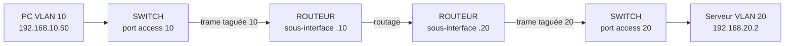
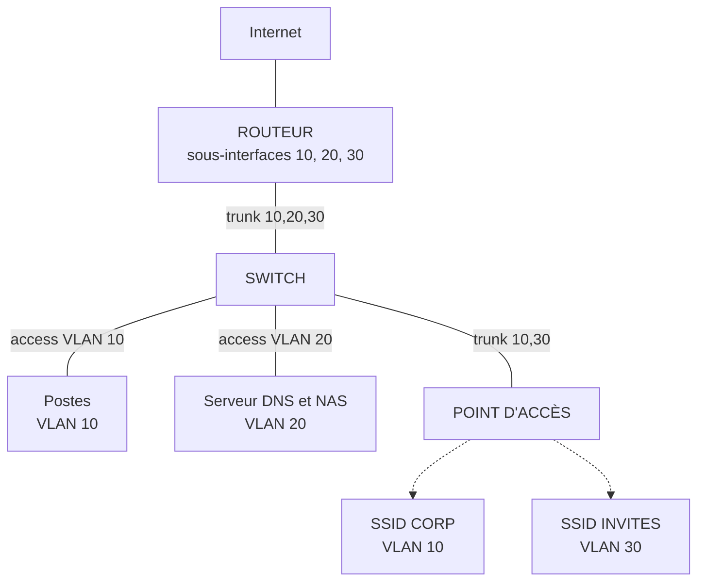

# Configuration de réseaux locaux et sans fil

## Objectifs pédagogiques

- Configurer l'adressage d'une machine Linux ou Windows, en statique comme en DHCP, et vérifier que la configuration est réellement appliquée.
- Expliquer le rôle de la passerelle et du serveur DNS dans un poste client, et mettre en place un DNS local simple.
- Segmenter un réseau avec des VLAN (Virtual Local Area Network), configurer ports d'accès et trunks, puis activer le routage entre VLAN.
- Choisir les paramètres d'un réseau Wi-Fi (nom, canal, mode de sécurité) et le rattacher au bon segment.
- Contrôler la circulation entre segments et diagnostiquer méthodiquement une panne de configuration locale.

## Mise en situation

*Scénario fictif.* Un cabinet d'expertise comptable de 35 personnes fonctionne sur un seul réseau `192.168.1.0/24`. Les postes, le serveur de fichiers, l'imprimante et la box Wi-Fi sont tous sur le même plan. Les visiteurs se connectent au Wi-Fi avec le même mot de passe que les salariés. Un jour, un client en rendez-vous voit apparaître le serveur de fichiers du cabinet dans l'explorateur de son ordinateur portable.

Le dirigeant demande trois zones : les postes de travail, les serveurs et les invités. Les invités ne doivent avoir accès qu'à Internet. Vous disposez d'un switch administrable, d'un routeur, d'un point d'accès Wi-Fi et d'un petit serveur Linux. Ce cabinet sert de fil rouge au module.

## Pourquoi configurer plutôt que laisser faire

Dans le module précédent, vous avez appris à observer ce qui circule sur un réseau. Il s'agit maintenant de décider ce qui doit circuler, et entre quelles machines.

Un réseau « plug and play » fonctionne très bien tant que personne ne se pose la question de la frontière. Le jour où l'on veut qu'une imprimante garde la même adresse, qu'un invité n'atteigne pas un serveur ou qu'un nom remplace une adresse IP, il faut intervenir sur trois niveaux :

- l'identité des machines (adresse, passerelle, DNS) ;
- la structure du réseau (VLAN, trunks, routage) ;
- l'accès sans fil.

Nous les prenons dans cet ordre.

## Donner une identité à une machine

Pour communiquer hors de son câble, une machine a besoin de quatre informations : son adresse IP, son masque, sa passerelle et son serveur DNS.

> 📮 **Analogie : le courrier**
>
> L'adresse IP et le masque forment l'adresse postale de la machine. La passerelle est le bureau de poste auquel on confie tout ce qui n'est pas dans le quartier. Le serveur DNS est l'annuaire qui transforme un nom en adresse.
{: .callout .callout-analogie}

### Statique ou DHCP : une règle simple

Les postes utilisateurs se mettent en DHCP, car personne n'a envie de tenir un tableur d'adresses pour 35 PC. Les équipements dont les autres dépendent (serveurs, imprimantes, routeurs, points d'accès) doivent garder une adresse stable. Deux méthodes existent :

- une adresse fixe configurée sur la machine ;
- mieux, une réservation DHCP, où le serveur donne toujours la même adresse à une adresse MAC donnée.

Dans les deux cas, découpez votre sous-réseau une fois pour toutes. Sur un `/24`, voici un découpage courant :

- `.1` pour la passerelle ;
- `.2` à `.99` pour les adresses fixes ;
- `.100` à `.200` pour le pool DHCP.

> 💡 **À retenir**
>
> Une adresse fixe placée dans le pool DHCP provoque tôt ou tard un conflit d'adresse. Le symptôme est une coupure intermittente, difficile à relier à sa cause.
{: .callout .callout-important}

### Côté Linux

Commencez toujours par regarder ce que la machine pense avoir, avant de modifier quoi que ce soit :

```bash
ip -br addr          # interfaces, état, adresses
ip route             # table de routage, dont la route par défaut
resolvectl status    # serveurs DNS réellement utilisés (systemd-resolved)
```

Sur un poste en DHCP du VLAN 10 de notre cabinet, on obtient quelque chose comme :

```
$ ip -br addr
lo        UNKNOWN   127.0.0.1/8 ::1/128
enp0s3    UP        192.168.10.123/24 fe80::a00:27ff:fe4e:66a1/64

$ ip route
default via 192.168.10.1 dev enp0s3 proto dhcp metric 100
192.168.10.0/24 dev enp0s3 proto kernel scope link src 192.168.10.123
```

La première ligne de `ip route` donne la passerelle. La seconde dit que tout ce qui est dans `192.168.10.0/24` se joint directement, sans intermédiaire. Pour savoir comment Linux enverrait un paquet précis, posez-lui la question :

```bash
ip route get 192.168.20.2
# 192.168.20.2 via 192.168.10.1 dev enp0s3 src 192.168.10.123
```

Le mot `via` indique que la destination est hors du réseau local et que le paquet part chez la passerelle. S'il n'y a pas de `via`, la destination est considérée comme voisine directe.

> 💡 **Point clé**
>
> `ip addr add 192.168.10.50/24 dev enp0s3` fonctionne instantanément, mais il ne modifie que la mémoire du noyau. Au prochain redémarrage ou rechargement du réseau, tout disparaît. C'est parfait pour un test rapide et trompeur pour une vraie configuration.
{: .callout .callout-important}

Pour rendre la configuration persistante, l'outil dépend de la distribution. Sur Ubuntu serveur, c'est généralement Netplan :

```yaml
# /etc/netplan/01-lan.yaml
network:
  version: 2
  ethernets:
    enp0s3:
      dhcp4: false
      addresses: [192.168.20.10/24]
      routes:
        - to: default
          via: 192.168.20.1
      nameservers:
        addresses: [192.168.20.2]
```

```bash
sudo netplan try     # applique, puis annule seul au bout de 120 s sans confirmation
sudo netplan apply
```

Sur un poste de travail géré par NetworkManager, la même chose se fait avec `nmcli` :

```bash
nmcli con mod "Wired connection 1" ipv4.method manual \
  ipv4.addresses 192.168.20.10/24 ipv4.gateway 192.168.20.1 ipv4.dns 192.168.20.2
nmcli con up "Wired connection 1"
```

`netplan try` est utile si vous configurez une machine à distance. Une erreur de passerelle vous coupe de la machine, et l'annulation automatique vous la rend. La syntaxe Netplan, notamment `to: default`, varie selon les versions : sur les plus anciennes, on rencontre `gateway4`.

### Côté Windows

`ipconfig /all` donne l'état complet de chaque carte :

- adresse et masque ;
- passerelle ;
- serveurs DNS ;
- serveur DHCP et dates du bail.

La ligne « DHCP activé » indique d'un coup d'œil si l'adresse est statique. Pour configurer en PowerShell :

```powershell
Get-NetIPConfiguration

New-NetIPAddress -InterfaceAlias "Ethernet" -IPAddress 192.168.10.50 `
  -PrefixLength 24 -DefaultGateway 192.168.10.1
Set-DnsClientServerAddress -InterfaceAlias "Ethernet" -ServerAddresses 192.168.20.2
```

Pour revenir au DHCP, il faut retirer ce qui a été posé à la main. Activer le DHCP ne suffit pas, car l'ancienne adresse reste en place :

```powershell
Remove-NetRoute -InterfaceAlias "Ethernet" -DestinationPrefix "0.0.0.0/0" -Confirm:$false
Remove-NetIPAddress -InterfaceAlias "Ethernet" -IPAddress 192.168.10.50 -Confirm:$false
Set-NetIPInterface -InterfaceAlias "Ethernet" -Dhcp Enabled
Set-DnsClientServerAddress -InterfaceAlias "Ethernet" -ResetServerAddresses
ipconfig /renew
```

Si vous préférez l'interface graphique, le chemin est `ncpa.cpl` → propriétés de la carte → Protocole Internet version 4. L'écran dépend de la version de Windows.

### Quand le DHCP ne répond pas

Un poste qui affiche une adresse en `169.254.x.x` n'a reçu aucune réponse DHCP et s'est attribué lui-même une adresse. Ce n'est presque jamais un problème de poste. La cause est en amont :

- le serveur DHCP est arrêté ;
- son pool est épuisé ;
- le port du switch est dans le mauvais VLAN, ce qui est plus fréquent qu'on ne le croit.

Nous y reviendrons dans la partie diagnostic.

## Un DNS local pour nommer vos machines

Taper `192.168.20.10` pour joindre le serveur de fichiers est pénible, et l'adresse peut changer. Un DNS local permet d'utiliser `nas.lab.lan`. Sur un petit réseau, `dnsmasq` est l'outil le plus léger : il peut faire à la fois DHCP et DNS, mais ici nous ne l'utilisons que comme résolveur.

```ini
# /etc/dnsmasq.conf sur le serveur 192.168.20.2
interface=enp0s3
domain=lab.lan
local=/lab.lan/                      # ne jamais envoyer ces noms à l'extérieur
host-record=nas.lab.lan,192.168.20.10
server=9.9.9.9                       # le reste est délégué à un résolveur public
```

```bash
sudo systemctl restart dnsmasq
nslookup nas.lab.lan 192.168.20.2     # fonctionne aussi bien sous Windows que sous Linux
```

Le serveur répond directement pour `lab.lan` à partir de ses données locales, sans jamais transmettre ces noms à l'extérieur. Pour tout le reste, il relaie la question au résolveur public. Ensuite, on distribue l'adresse `192.168.20.2` aux clients par le DHCP.

Le nom de domaine interne mérite réflexion. Évitez `.local`, réservé au mDNS, qui provoque des résolutions capricieuses. En production, utilisez plutôt un sous-domaine d'un nom que vous possédez (par exemple `int.votre-domaine.fr`). `lab.lan` convient pour un laboratoire.

> 💡 **À retenir**
>
> La passerelle ne résout pas les noms, elle ne fait que transmettre des paquets. Si le ping vers une adresse IP externe fonctionne et que le ping vers un nom échoue, la passerelle est hors de cause : cherchez du côté du DNS.
{: .callout .callout-important}

## VLAN : cloisonner sans changer de câblage

Imaginez un open-space où chaque annonce faite à voix haute est entendue par tout le monde. C'est un réseau local classique : un broadcast atteint toutes les machines. Un VLAN installe des cloisons dans la pièce, sans déplacer le moindre bureau.

> 🧠 **Concept fondamental**
>
> Un VLAN est un domaine de broadcast distinct. Le switch ne livre une trame qu'aux ports qui appartiennent au même VLAN. Par convention, un VLAN correspond à un sous-réseau IP, donc deux machines de VLAN différents ne peuvent pas se parler au niveau 2. Il faut passer par un routeur.
{: .callout .callout-important}

### Comment le switch distingue les VLAN

Un switch utilise deux types de ports :

- **Port access** : il appartient à un seul VLAN. Le PC ou le serveur branché dessus ignore tout des VLAN et envoie des trames normales. C'est le switch qui sait à quel VLAN le port est rattaché.
- **Port trunk** : il transporte plusieurs VLAN sur un seul câble (entre deux switches, vers un routeur ou vers un point d'accès). Chaque trame y reçoit une étiquette, définie par la norme 802.1Q : 4 octets, dont un identifiant de VLAN sur 12 bits, soit 1 à 4094 utilisables. Pensez à une gaine technique d'immeuble où le courrier de tous les étages circule, avec le numéro d'étage inscrit sur chaque enveloppe.

Les trames sans étiquette qui arrivent sur un trunk sont rattachées au VLAN natif. Par défaut, c'est le VLAN 1, et les deux extrémités doivent s'accorder sur la valeur.

### Configuration sur un switch

La syntaxe ci-dessous suit le style Cisco IOS. Les constructeurs diffèrent, mais la logique est partout la même :

- créer le VLAN ;
- affecter des ports en mode access ;
- déclarer les liaisons montantes en trunk.

```
vlan 10
 name USERS
vlan 20
 name SERVERS
vlan 30
 name GUEST
vlan 999
 name PARKING

interface GigabitEthernet0/1
 switchport mode access
 switchport access vlan 10

interface GigabitEthernet0/3
 switchport mode access
 switchport access vlan 20

interface GigabitEthernet0/24
 description Vers routeur
 switchport mode trunk
 switchport trunk allowed vlan 10,20,30
 switchport trunk native vlan 999
```

Sur certains switches de niveau 3 plus anciens, il faut ajouter `switchport trunk encapsulation dot1q` avant de passer en `mode trunk`.

Deux choix de cette configuration méritent attention :

- `allowed vlan 10,20,30` limite le trunk aux VLAN utiles ; sans cette ligne, tous les VLAN y passent.
- `native vlan 999` (un VLAN sans machine ni adresse IP) évite d'exposer le VLAN 1, pris pour cible par plusieurs attaques par double étiquetage. Il faut configurer cette valeur des deux côtés du trunk.

Vérification :

```
Switch# show vlan brief
VLAN Name       Status   Ports
10   USERS      active   Gi0/1, Gi0/2
20   SERVERS    active   Gi0/3
30   GUEST      active
999  PARKING    active

Switch# show interfaces trunk
Port    Mode  Encapsulation  Status    Native vlan
Gi0/24  on    802.1q         trunking  999
Port    Vlans allowed on trunk
Gi0/24  10,20,30
```

> ⚠️ **Comportement contre-intuitif**
>
> Le port `Gi0/24` n'apparaît pas dans `show vlan brief`, alors qu'il porte tous les VLAN. Cette commande ne liste que les ports access. Ceux qui cherchent leur trunk dans cette sortie concluent à tort qu'il est cassé. Il faut aller dans `show interfaces trunk`, qui indique aussi le VLAN natif et la liste des VLAN autorisés.
{: .callout .callout-attention}

Pour tester un trunk depuis une machine Linux, vous pouvez créer une interface VLAN virtuelle. Elle n'a pas besoin de switch physique pour s'entraîner dans une machine virtuelle :

```bash
sudo ip link add link enp0s3 name enp0s3.10 type vlan id 10
sudo ip addr add 192.168.10.50/24 dev enp0s3.10
sudo ip link set enp0s3.10 up
```

## Routage inter-VLAN : faire dialoguer les segments

Une fois les VLAN créés, aucune machine d'un VLAN ne peut joindre une machine d'un autre. C'est logique : ce sont des réseaux IP distincts, il faut un routeur. Le plus courant en petite structure est le « routeur sur un bâton » (router-on-a-stick), où un seul câble trunk relie le switch au routeur. Le routeur le découpe en sous-interfaces logiques, une par VLAN :

```
interface GigabitEthernet0/0
 no shutdown
interface GigabitEthernet0/0.10
 encapsulation dot1Q 10
 ip address 192.168.10.1 255.255.255.0
interface GigabitEthernet0/0.20
 encapsulation dot1Q 20
 ip address 192.168.20.1 255.255.255.0
interface GigabitEthernet0/0.30
 encapsulation dot1Q 30
 ip address 192.168.30.1 255.255.255.0
```

Chaque adresse `.1` est la passerelle de son VLAN. L'encapsulation `dot1Q` suivie de l'identifiant dit au routeur quelle étiquette lire et écrire. Voici le trajet d'un paquet entre un PC du VLAN 10 et un serveur du VLAN 20 :



Le paquet monte vers le routeur par le trunk, est routé, puis redescend par le même câble avec une autre étiquette. Cela fonctionne très bien pour un petit réseau, mais tout le trafic inter-VLAN et vers Internet emprunte ce seul lien, qui devient le goulot d'étranglement d'un réseau chargé.

Avec un switch de niveau 3, on évite ce détour en créant des interfaces virtuelles `interface vlan 10` portant l'adresse de passerelle. On ajoute `ip routing`, et le switch route lui-même entre ses VLAN grâce à des SVI (Switched Virtual Interface)\*. La logique reste celle que nous venons de voir, seul l'endroit où se passe le routage change.

\* Une SVI est l'interface virtuelle d'un switch de niveau 3 qui porte l'adresse IP de passerelle d'un VLAN.

### ⚠️ Séparer n'est pas interdire

C'est le piège principal de ce module. Une fois le routage inter-VLAN en place, testez depuis un portable branché en VLAN 30 :

```bash
ping 192.168.20.2
# 64 bytes from 192.168.20.2: icmp_seq=1 ttl=63 time=1.2 ms
```

Ça répond. Le routeur a une interface dans chaque VLAN, et il considère que ces réseaux sont directement connectés : il route entre eux sans aucune restriction. Les VLAN séparent le niveau 2, mais le niveau 3 ouvre à nouveau tout. Dire « les invités sont dans leur VLAN » ne signifie donc pas « les invités n'accèdent pas aux serveurs ». Il faut écrire la règle.

L'outil le plus simple sur un routeur est l'ACL.

> 📖 **Définition**
>
> Une ACL (Access Control List) est une liste de règles lues de haut en bas. La première qui correspond s'applique, et un refus implicite termine la liste. On l'applique à une interface, dans un sens donné.
{: .callout .callout-definition}

Pour isoler les invités, on filtre à l'entrée de leur sous-interface, au plus près de la source :

```
ip access-list extended GUEST-IN
 permit udp any eq bootpc any eq bootps
 deny   ip 192.168.30.0 0.0.0.255 192.168.10.0 0.0.0.255
 deny   ip 192.168.30.0 0.0.0.255 192.168.20.0 0.0.0.255
 permit ip any any

interface GigabitEthernet0/0.30
 ip access-group GUEST-IN in
```

La première règle autorise explicitement les demandes DHCP. Ici, le `permit ip any any` final les laisserait passer de toute façon, mais cette ligne devient indispensable si la liste se termine par un refus. Les deux `deny` interdisent les réseaux internes, et le dernier `permit` laisse le reste, c'est-à-dire Internet. L'ordre compte : placer le `permit ip any any` en tête rendrait la liste inutile.

Cette ACL est sans état : elle ne suit pas les connexions et ne sait pas qu'une réponse correspond à une requête sortie. Pour un filtrage plus fin, les pare-feu sont le sujet d'un module ultérieur. Pour isoler un VLAN invité, elle suffit.

## Wi-Fi : un réseau, des ondes et des choix

Un point d'accès, ou AP (Access Point), relie les ondes radio au réseau filaire. Il diffuse un ou plusieurs SSID (Service Set Identifier), le nom que vous voyez dans la liste des réseaux. Lorsque l'AP gère plusieurs SSID, chacun peut être associé à un VLAN différent. On aura donc un SSID `CABINET-CORP` placé dans le VLAN 10 et un SSID `CABINET-INVITES` placé dans le VLAN 30. Le port du switch qui alimente l'AP est alors un trunk, qui doit autoriser seulement ces deux VLAN.

### Choisir un canal

Les ondes se partagent comme une pièce où tout le monde parle en même temps. Plus il y a de voisins sur le même canal, plus chacun doit attendre son tour.

- **2,4 GHz** : portée correcte, mais peu de canaux réellement distincts. En largeur de 20 MHz, on se limite à 1, 6 et 11, qui ne se chevauchent pas.
- **5 GHz** : bien plus de canaux, moins de recouvrement, mais une portée plus faible. En zone dense, une largeur de 20 ou 40 MHz est souvent préférable à 80 : un canal plus large est plus rapide mais plus exposé aux interférences. Certains canaux demandent la DFS (Dynamic Frequency Selection) : si l'AP détecte un radar, il quitte le canal, ce qui peut provoquer une coupure.

Avant de choisir, regardez ce qui occupe déjà l'air :

```bash
nmcli -f SSID,CHAN,SIGNAL,SECURITY device wifi list     # Linux
netsh wlan show networks mode=bssid                      # Windows
```

```
SSID           CHAN  SIGNAL  SECURITY
CABINET-CORP   6     78      WPA2
Voisin-Box     6     64      WPA2
FreeWifi_xx    11    41      --
Cabinet2       1     35      WPA2 WPA3
```

Deux réseaux voisins sont sur le canal 6. Le canal 1 est le moins perturbé (le voisin le plus proche y émet à 35), c'est donc un bon candidat.

Réduire la puissance d'émission améliore parfois la situation. Un AP à pleine puissance se fait entendre de loin, mais le téléphone, plus faible, ne peut pas lui répondre. Le client voit alors un bon signal et une connexion pourtant mauvaise.

### Sécuriser l'accès

Le chiffrement du Wi-Fi s'appelle WPA (Wi-Fi Protected Access). Voici les modes que vous rencontrerez :

| Mode | Mécanisme | Verdict |
|------|-----------|---------|
| Ouvert | aucun chiffrement | À réserver à des portails captifs bien pensés |
| WEP (Wired Equivalent Privacy) et WPA d'origine (TKIP) | chiffrement obsolète | WEP cassable en quelques minutes, WPA-TKIP affaibli par des attaques connues : à proscrire |
| WPA2-Personal | clé partagée PSK (Pre-Shared Key) | Acceptable avec une passphrase longue et aléatoire |
| WPA3-Personal | échange SAE (Simultaneous Authentication of Equals)\* | Meilleur choix pour un réseau à mot de passe partagé |
| Entreprise (WPA2 ou WPA3) | authentification 802.1X vers un serveur RADIUS (Remote Authentication Dial-In User Service) | Identifiants individuels, la bonne option pour une entreprise |

\* SAE remplace l'échange de clé de WPA2 par un protocole où chaque essai de mot de passe exige un échange avec l'AP, ce qui interdit le test massif hors ligne.

Le mode entreprise suppose une gestion des identités, qui est l'objet d'un module ultérieur. Pour un petit réseau, WPA3-Personal ou, à défaut, le mode mixte WPA2/WPA3 (utile pour les clients anciens) fait le travail.

> ⚠️ **Piège**
>
> Le handshake WPA2 peut être capturé par n'importe qui à portée radio. Avec une passphrase courte ou tirée du dictionnaire, un attaquant la retrouve ensuite chez lui, hors ligne, sans que vous voyiez rien. Utilisez au moins 16 caractères aléatoires, ou passez en WPA3.
{: .callout .callout-attention}

Parmi les réglages qui donnent une fausse impression de sécurité, on trouve le SSID masqué, qui se lit en une capture, et le filtrage par adresse MAC, qui se contourne en copiant une adresse observée. Désactivez aussi le WPS (Wi-Fi Protected Setup), dont le code PIN a des faiblesses connues. Sur un SSID invité, activez l'isolation des clients si l'AP la propose, pour que deux invités ne se voient pas entre eux.

La plupart des AP se configurent par interface web ou contrôleur. Le chemin ressemble à *Wireless → SSID → Create → Security (WPA3-Personal) → VLAN ID (30)*. Les intitulés varient d'un constructeur à l'autre, mais ces trois réglages se retrouvent partout.

## Mettre en place un petit réseau segmenté

Voici l'ensemble de ce que nous allons construire :



### Étape 1 : décider avant de taper

Le plan d'adressage s'écrit avant la première commande, et il reste la référence de tout le réseau :

| VLAN | Nom | Sous-réseau | Passerelle | Contenu |
|------|-----|-------------|------------|---------|
| 10 | USERS | 192.168.10.0/24 | .1 | Postes salariés, SSID CORP |
| 20 | SERVERS | 192.168.20.0/24 | .1 | Serveur DNS (.2), NAS (.10), adresses fixes |
| 30 | GUEST | 192.168.30.0/24 | .1 | Wi-Fi invités |
| 999 | PARKING | aucun | aucune | Ports inutilisés, VLAN natif des trunks |

### Étape 2 : switch et routeur

Sur le switch, reprenez la configuration vue plus haut et complétez-la pour le point d'accès :

```
interface GigabitEthernet0/23
 description Vers point d'acces
 switchport mode trunk
 switchport trunk allowed vlan 10,30
 switchport trunk native vlan 999
```

Sur le routeur, gardez les sous-interfaces déjà définies et ajoutez les services DHCP. On suppose que l'interface WAN, la route par défaut et le NAT vers Internet sont déjà en place sur le routeur ; ils ne sont pas détaillés ici. Les adresses de `.1` à `.99` sont exclues pour rester disponibles pour les adresses fixes, et celles de `.201` à `.254` pour limiter le pool à `.100-.200` :

```
ip dhcp excluded-address 192.168.10.1 192.168.10.99
ip dhcp excluded-address 192.168.10.201 192.168.10.254
ip dhcp excluded-address 192.168.30.1 192.168.30.99
ip dhcp excluded-address 192.168.30.201 192.168.30.254

ip dhcp pool USERS
 network 192.168.10.0 255.255.255.0
 default-router 192.168.10.1
 dns-server 192.168.20.2
 domain-name lab.lan
 lease 1

ip dhcp pool GUEST
 network 192.168.30.0 255.255.255.0
 default-router 192.168.30.1
 dns-server 9.9.9.9 149.112.112.112
 lease 0 4
```

Deux détails sont voulus. Les invités reçoivent des DNS publics, pas votre DNS interne, car il n'a pas à leur révéler vos noms de machines. Et leur bail ne dure que 4 heures, contre un jour pour les salariés, ce qui libère vite les adresses des visiteurs partis.

Le serveur DNS (`.2`) et le NAS (`.10`) gardent des adresses fixes, configurées sur chaque machine (avec Netplan, comme dans l'exemple vu plus haut pour le NAS).

### Étape 3 : tester par les deux bouts

Testez depuis un poste de chaque VLAN avant d'aller plus loin :

| Depuis | Test | Résultat attendu |
|--------|------|------------------|
| Poste VLAN 10 | `ip -br addr` | Adresse en `192.168.10.100-200` |
| Poste VLAN 10 | `ping 192.168.20.2` | Réponse (routage inter-VLAN) |
| Poste VLAN 10 | `nslookup nas.lab.lan` | `192.168.20.10` |
| Portable Wi-Fi invité | `ip -br addr` | Adresse en `192.168.30.x` |
| Portable Wi-Fi invité | `ping 9.9.9.9` | Réponse (Internet) |
| Portable Wi-Fi invité | `ping 192.168.20.2` | **Réponse… pour l'instant.** |

La dernière ligne est le piège vu plus haut. À cette étape, la segmentation n'existe pas encore.

### Étape 4 : durcir

Appliquez l'ACL `GUEST-IN` vue précédemment. Puis, rangez les ports inutilisés dans le VLAN de parking et éteignez-les, pour qu'un câble branché ne donne pas accès au réseau :

```
interface range GigabitEthernet0/5 - 22
 switchport mode access
 switchport access vlan 999
 shutdown
```

Enfin, sauvegardez. La configuration modifiée vit en RAM, et un redémarrage la remplace par la précédente :

```
copy running-config startup-config
```

Refaites ensuite le test du portable invité : `ping 192.168.20.2` doit maintenant expirer, alors que `ping 9.9.9.9` répond toujours.

## Commandes et outils de diagnostic

Quand quelque chose ne marche pas, remontez l'échelle depuis le bas. Chaque étape élimine une couche d'hypothèses :

| Étape | Test | Si ça échoue |
|-------|------|--------------|
| Lien | `ip -br addr` indique `UP`, ou la carte est « connectée » | Câble, port éteint, mot de passe Wi-Fi |
| Adresse | l'IP appartient au bon sous-réseau | DHCP, mauvais VLAN, adresse fixe incorrecte |
| Passerelle | `ping 192.168.10.1` | Masque ou passerelle erronés, VLAN du port |
| Autre VLAN | `ping 192.168.20.2` | Sous-interface, trunk, ACL |
| Internet par IP | `ping 9.9.9.9` | Route par défaut, NAT, accès amont |
| Internet par nom | `ping exemple.fr` | DNS |

Si vous bloquez à une étape précise, une capture sur le port concerné, avec ce que vous savez déjà lire, tranche souvent la question.

Côté équipements réseau, quelques commandes qui donnent la réponse immédiatement :

```
Router# show ip interface brief
Interface              IP-Address     Status  Protocol
GigabitEthernet0/0     unassigned     up      up
GigabitEthernet0/0.10  192.168.10.1   up      up
GigabitEthernet0/0.20  192.168.20.1   up      up
GigabitEthernet0/0.30  192.168.30.1   up      up
```

Si une sous-interface est `down`, regardez d'abord le trunk côté switch (VLAN absent de la liste autorisée, port éteint). `show mac address-table` sur le switch indique sur quel port et dans quel VLAN une adresse MAC a été apprise, ce qui aide à retrouver une machine placée dans un mauvais VLAN.

Quelques symptômes reviennent régulièrement :

| Symptôme | Cause probable | Vérification |
|----------|----------------|--------------|
| Adresse `169.254.x.x` | Port dans le mauvais VLAN, DHCP arrêté ou pool plein | `show vlan brief`, `show ip dhcp binding` |
| Ping de la passerelle OK, rien au-delà | Route par défaut manquante ou sous-interface sans NAT | `ip route`, `show ip route` |
| Ping IP OK, noms KO | DNS injoignable ou mal distribué | `resolvectl status`, `ipconfig /all`, `nslookup` |
| VLAN absent d'un côté du trunk | VLAN non autorisé ou non créé sur le switch voisin | `show interfaces trunk` |
| Perte intermittente d'un équipement fixe | Adresse en conflit avec le pool DHCP | `ip neigh`, `arp -a`, exclusion dans le DHCP |

## Cas réel en entreprise

*Scénario illustratif, chiffres fictifs.* Revenons au cabinet. La migration s'est faite un samedi, selon le plan ci-dessus. Le lundi matin, trois postes affichent une adresse en `169.254`. Un `show vlan brief` donne la réponse : leurs ports étaient restés dans le VLAN 1 par oubli, donc sans pool DHCP associé. Une affectation au VLAN 10 et un `ipconfig /renew` règlent le problème en deux minutes.

La vérification de l'isolation, elle, a révélé un point plus sérieux. Un test depuis un téléphone sur le SSID invité a montré que le serveur était joignable avant la pose de l'ACL. Après application, les compteurs montrent le comportement attendu :

```
Router# show access-lists
Extended IP access list GUEST-IN
    10 permit udp any eq bootpc any eq bootps (12 matches)
    20 deny ip 192.168.30.0 0.0.0.255 192.168.10.0 0.0.0.255 (5 matches)
    30 deny ip 192.168.30.0 0.0.0.255 192.168.20.0 0.0.0.255 (3 matches)
    40 permit ip any any (1450 matches)
```

Les compteurs des lignes 20 et 30 montrent que des tentatives vers les réseaux internes ont été arrêtées (ici les tests du technicien), et la ligne 40 que le trafic Internet continue de passer. Un chiffre à zéro sur les lignes `deny` ne veut pas dire que tout va bien : il peut simplement signifier que l'ACL n'est pas appliquée à la bonne interface ou dans le bon sens.

## Bonnes pratiques

Documentez le plan d'adressage avant de configurer, et mettez-le à jour dès qu'on le modifie : une configuration que personne ne peut relire est une dette. Gardez des plages distinctes pour les adresses fixes et pour le DHCP, et préférez la réservation DHCP à la configuration manuelle sur chaque équipement, car on change une adresse à un seul endroit.

Sur le switch :

- n'utilisez pas le VLAN 1 pour du trafic réel ;
- restreignez chaque trunk aux VLAN nécessaires et donnez-lui un VLAN natif inutilisé ;
- éteignez les ports libres ;
- sauvegardez la configuration après chaque changement validé, et conservez une copie hors de l'équipement ;
- changez les identifiants par défaut de tous les équipements (switch, routeur, AP), car ils figurent dans les premières listes testées par un attaquant.

Pour le Wi-Fi, séparez toujours les invités des salariés, choisissez WPA3 quand les clients le permettent, et surveillez l'occupation des canaux au moins une fois par an. Les voisins changent leurs équipements sans vous prévenir.

Et surtout, ne confondez jamais la séparation et le contrôle. Après chaque mise en place de VLAN, testez ce qui devrait échouer en plus de ce qui devrait marcher.

## Résumé

| Concept | Rôle | Points clés |
|---------|------|-------------|
| Adresse statique / DHCP | Identifier une machine sur le réseau | Postes en DHCP, infrastructure en fixe ou en réservation, plages séparées |
| Passerelle | Porte de sortie du sous-réseau | Doit être dans le même sous-réseau que la machine, `ip route get` montre le chemin |
| DNS local | Résoudre les noms internes | `dnsmasq`, domaine propre, DNS public pour les invités |
| VLAN | Domaine de broadcast distinct | 1 VLAN = 1 sous-réseau, access = sans étiquette, trunk = 802.1Q |
| Trunk | Faire passer plusieurs VLAN sur un câble | Limiter avec `allowed vlan`, VLAN natif inutilisé, invisible dans `show vlan brief` |
| Routage inter-VLAN | Faire dialoguer les segments | Sous-interfaces ou SVI, tout passe par défaut |
| ACL | Définir ce qui est autorisé entre segments | Ordre des règles, appliquée par interface et par sens |
| Wi-Fi | Accès sans fil rattaché à un VLAN | Canaux 1/6/11 en 2,4 GHz, WPA3 ou WPA2 avec passphrase solide |
| Diagnostic en échelle | Localiser une panne | Lien → adresse → passerelle → autre VLAN → Internet IP → Internet nom |

Ce réseau tient la route tant que tout fonctionne : un switch, un routeur, un point d'accès, chacun étant unique. La suite du parcours s'intéresse à ce qui se passe quand l'un d'eux tombe, et à la façon de s'en apercevoir à temps.

<!-- snippet
id: reseau_linux_ip_br_addr
type: command
tech: reseau
level: beginner
importance: high
format: knowledge
tags: linux,ip,interface,diagnostic
title: Lister les interfaces et leurs adresses en une ligne
command: ip -br addr
description: Affiche chaque interface avec son état (UP/DOWN) et ses adresses IP sur une ligne, premier réflexe pour vérifier qu'une IP a bien été obtenue
-->

<!-- snippet
id: reseau_linux_ip_route_get
type: command
tech: reseau
level: beginner
importance: high
format: knowledge
tags: linux,routage,passerelle,diagnostic
title: Voir par où Linux enverrait un paquet
command: ip route get <IP>
example: ip route get 192.168.20.2
description: Indique l'interface, l'IP source et la passerelle (mot « via ») choisies pour joindre la destination. Sans « via », la cible est considérée comme voisine directe
-->

<!-- snippet
id: reseau_linux_ip_addr_non_persistant
type: warning
tech: reseau
level: beginner
importance: high
format: knowledge
tags: linux,ip,netplan,configuration
title: ip addr add ne survit pas au redémarrage
content: Piège : ip addr add ne modifie que la mémoire du noyau. Conséquence : l'adresse disparaît au redémarrage ou au rechargement du réseau. Correction : écrire la configuration dans Netplan (/etc/netplan/*.yaml, testée avec sudo netplan try) ou avec nmcli con mod en ipv4.method manual.
description: Une adresse posée avec ip addr add est volatile. Pour la rendre durable, passer par Netplan ou nmcli selon la distribution
-->

<!-- snippet
id: reseau_windows_ipconfig_all
type: command
tech: reseau
level: beginner
importance: medium
format: knowledge
tags: windows,ipconfig,dhcp,diagnostic
title: Afficher la configuration réseau complète sous Windows
command: ipconfig /all
description: Montre pour chaque carte l'IP, le masque, la passerelle, les DNS, le serveur DHCP et les dates de bail. La ligne « DHCP activé » indique si l'adresse est statique
-->

<!-- snippet
id: reseau_dhcp_adresse_apipa
type: error
tech: reseau
level: beginner
importance: high
format: knowledge
tags: dhcp,vlan,diagnostic,apipa
title: Poste en 169.254.x.x sans passerelle
content: Symptôme : le poste affiche une adresse 169.254.x.x et aucune passerelle. Cause : aucune réponse DHCP (port dans le mauvais VLAN, serveur arrêté ou pool épuisé). Correction : vérifier le VLAN du port avec show vlan brief, l'état du serveur DHCP, puis relancer avec ipconfig /renew ou nmcli con up.
description: Une adresse 169.254 est auto-attribuée faute de réponse DHCP. Le poste est rarement en cause : chercher le VLAN du port ou le serveur DHCP
-->

<!-- snippet
id: reseau_vlan_8021q_principe
type: concept
tech: reseau
level: beginner
importance: high
format: knowledge
tags: vlan,802.1q,trunk,commutation
title: Un VLAN est un domaine de broadcast, le trunk l'étiquette
content: Le switch ne livre une trame qu'aux ports du même VLAN. Sur un port access, la trame circule sans étiquette. Sur un trunk, il insère une étiquette 802.1Q de 4 octets contenant un identifiant de VLAN sur 12 bits (1 à 4094 utilisables), sauf pour le VLAN natif, dont les trames circulent sans étiquette. Convention : 1 VLAN = 1 sous-réseau IP, donc le passage d'un VLAN à l'autre exige un routeur.
description: Un VLAN isole le broadcast au niveau 2. L'étiquette 802.1Q permet à plusieurs VLAN de partager un même câble trunk
-->

<!-- snippet
id: reseau_switch_show_vlan_brief
type: command
tech: reseau
level: beginner
importance: medium
format: knowledge
tags: vlan,switch,diagnostic,cisco
title: Lister les VLAN et leurs ports access
context: Switch de style Cisco IOS, la syntaxe varie selon les constructeurs
command: show vlan brief
description: Liste les VLAN et les ports access qui leur sont affectés. Les ports trunk n'y apparaissent pas : les contrôler avec show interfaces trunk
-->

<!-- snippet
id: reseau_switch_show_interfaces_trunk
type: command
tech: reseau
level: beginner
importance: medium
format: knowledge
tags: vlan,trunk,switch,diagnostic
title: Contrôler l'état et les VLAN autorisés d'un trunk
context: Switch de style Cisco IOS
command: show interfaces trunk
description: Affiche les trunks actifs, leur VLAN natif et la liste des VLAN autorisés. Un VLAN absent de cette liste ne traverse pas la liaison
-->

<!-- snippet
id: reseau_vlan_routeur_sur_un_baton
type: concept
tech: reseau
level: beginner
importance: medium
format: knowledge
tags: vlan,routage,sous-interface,trunk
title: Routeur sur un bâton : un trunk, une sous-interface par VLAN
content: Un seul lien trunk relie switch et routeur. Le routeur le découpe en sous-interfaces (Gi0/0.10, Gi0/0.20), chacune avec « encapsulation dot1Q » suivi de l'ID du VLAN et une adresse IP, qui sert de passerelle au VLAN. Un paquet du VLAN 10 vers le VLAN 20 monte étiqueté 10, est routé, puis redescend étiqueté 20 sur le même câble. Tout le trafic inter-VLAN et vers Internet partage donc ce seul lien.
description: Les sous-interfaces portent les passerelles de chaque VLAN. Tout le trafic inter-VLAN traverse un seul câble, ce qui limite le débit sur un réseau chargé
-->

<!-- snippet
id: reseau_vlan_isolation_non_automatique
type: warning
tech: reseau
level: beginner
importance: high
format: knowledge
tags: vlan,acl,securite,routage
title: Des VLAN séparés ne sont pas des VLAN isolés
content: Piège : croire que deux VLAN ne peuvent pas communiquer. Conséquence : dès qu'un routeur ou une SVI les relie, tout passe, car ce sont des réseaux directement connectés. Correction : appliquer une ACL en entrée de l'interface du VLAN le moins fiable (ip access-group NOM in), avec les deny vers les sous-réseaux internes avant le permit final, puis tester ce qui doit échouer.
description: Le routage inter-VLAN ouvre tout par défaut. L'isolation vient d'une ACL, dont l'ordre des règles compte, et se vérifie par un test qui doit échouer
-->

<!-- snippet
id: reseau_equipement_sauvegarde_config
type: warning
tech: reseau
level: beginner
importance: high
format: knowledge
tags: switch,routeur,configuration,cisco
title: Config réseau non sauvegardée, perdue au redémarrage
content: Piège : configurer un switch ou un routeur sans sauvegarder. Conséquence : la running-config vit en RAM, un redémarrage recharge l'ancienne startup-config et efface les changements. Correction : lancer copy running-config startup-config (ou write memory) après chaque changement validé, et garder une copie hors de l'équipement.
description: La running-config est volatile. Sans copie vers startup-config, tout changement est perdu à la prochaine coupure de courant
-->

<!-- snippet
id: reseau_trunk_vlan_natif_et_autorises
type: tip
tech: reseau
level: intermediate
importance: medium
format: knowledge
tags: trunk,vlan,securite,switch
title: Durcir un trunk : VLAN autorisés et VLAN natif inutilisé
content: Sur chaque trunk, ajouter switchport trunk allowed vlan 10,20,30 pour ne laisser passer que les VLAN utiles, et switchport trunk native vlan 999 des deux côtés (VLAN créé mais sans machine ni IP). Le natif par défaut est le VLAN 1 : l'éviter limite les attaques par double étiquetage et les fuites de trames non étiquetées.
description: Deux lignes par trunk restreignent les VLAN transportés et retirent le VLAN 1 du rôle de VLAN natif
-->

<!-- snippet
id: reseau_wifi_choix_canal
type: tip
tech: reseau
level: beginner
importance: medium
format: knowledge
tags: wifi,canaux,diagnostic,interference
title: Choisir un canal Wi-Fi après avoir scanné les voisins
content: Scanner avant de choisir : nmcli -f SSID,CHAN,SIGNAL,SECURITY device wifi list sous Linux, netsh wlan show networks mode=bssid sous Windows. En 2,4 GHz, rester sur 1, 6 ou 11 en largeur 20 MHz et prendre le moins occupé. En 5 GHz, 20 ou 40 MHz suffisent en zone dense, un canal plus large capte plus d'interférences.
description: Un scan montre quels canaux sont saturés. Les canaux 1, 6 et 11 sont les seuls à ne pas se chevaucher en 2,4 GHz
-->

<!-- snippet
id: reseau_wifi_passphrase_wpa2
type: warning
tech: reseau
level: beginner
importance: high
format: knowledge
tags: wifi,wpa2,wpa3,securite
title: Passphrase WPA2 courte : craquable hors ligne
content: Piège : passphrase WPA2-Personal courte ou issue du dictionnaire. Conséquence : le handshake, capturable par toute personne à portée radio, permet un craquage hors ligne sans alerte. Correction : au moins 16 caractères aléatoires, ou WPA3-Personal (SAE), qui interdit le test hors ligne, ou le mode Enterprise avec identifiants individuels.
description: Le handshake WPA2 se capture à distance. Une passphrase faible tombe ensuite par dictionnaire. WPA3 supprime la possibilité de ce test hors ligne
-->

<!-- snippet
id: reseau_dns_ping_ip_ok_nom_ko
type: error
tech: reseau
level: beginner
importance: high
format: knowledge
tags: dns,diagnostic,resolution,ping
title: Le ping par IP répond, le ping par nom échoue
content: Symptôme : ping 9.9.9.9 répond mais ping exemple.fr échoue. Cause : résolution DNS cassée (mauvais serveur distribué par le DHCP, serveur local arrêté, VLAN sans accès au DNS). Correction : voir le DNS utilisé avec resolvectl status ou ipconfig /all, puis tester directement avec nslookup exemple.fr 192.168.20.2.
description: Si l'IP répond mais pas le nom, la passerelle est hors de cause. Chercher le serveur DNS distribué et le tester directement avec nslookup
-->
