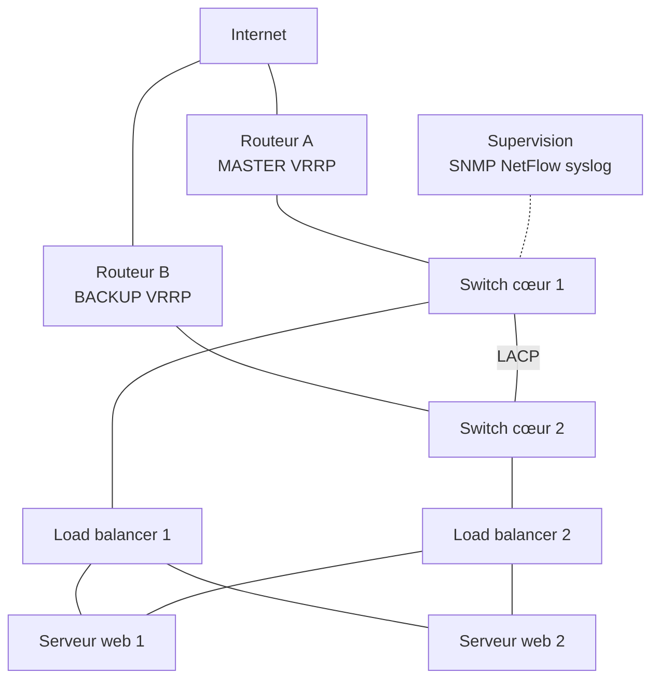
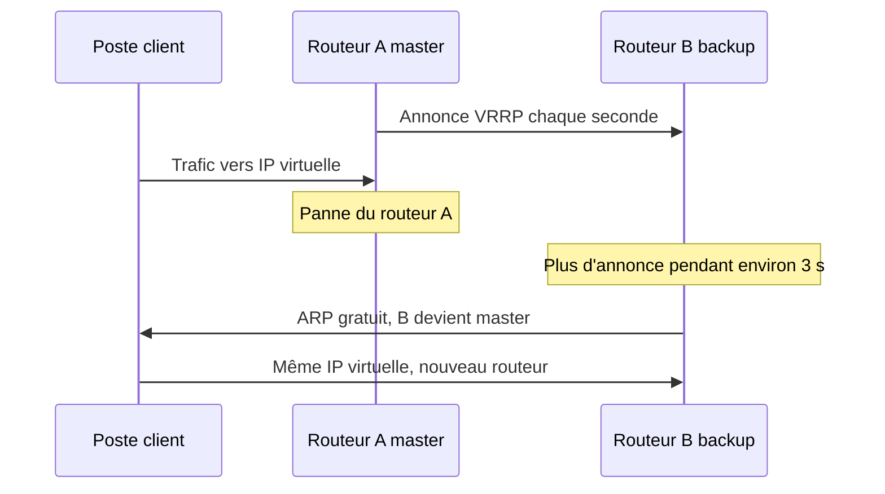

# Haute disponibilité, répartition de charge et supervision réseau

## Objectifs pédagogiques

À la fin de ce module, vous saurez :

- **Identifier** les points de défaillance uniques d'un réseau et **proposer** une redondance adaptée pour les liens, les équipements et la passerelle.
- **Expliquer** le rôle de LACP, de STP et de VRRP/HSRP, et ce qui se passe concrètement lors d'une bascule.
- **Choisir** entre une répartition de charge en couche 4 et en couche 7, puis **régler** un algorithme et des health checks.
- **Mettre en place** une supervision qui mesure disponibilité, débit, latence et erreurs, avec SNMP, NetFlow et syslog.
- **Tester** une redondance et **documenter** une panne de façon exploitable.

## Mise en situation

Lundi, 8 h 40. Dans une PME de distribution de 120 postes, plus personne ne peut passer de commande. L'application web interne ne répond plus, la téléphonie IP est coupée, et le support reçoit des appels en rafale. Après quarante minutes de recherche, le technicien trouve la cause : l'alimentation du switch cœur, le seul de l'entreprise, a lâché. Il faut aller chercher un équipement de remplacement, restaurer la configuration, puis vérifier chaque VLAN. L'incident dure près de trois heures.

Ce scénario est illustratif, mais il est très courant. Le matériel n'avait rien d'exotique. C'est l'architecture qui était fragile : tout passait par un seul équipement. Personne n'avait non plus été prévenu avant les utilisateurs, car rien ne surveillait ce switch.

Ce module répond à ces deux questions : comment faire pour qu'une panne ne se voie plus, et comment la voir quand même, nous, avant tout le monde.

## Le problème : un maillon unique suffit à tout arrêter

> 🧠 **Concept fondamental**
>
> Un point de défaillance unique (SPOF, Single Point of Failure) est un élément dont la panne arrête à elle seule un service entier. Ce peut être un switch, un routeur, un câble, une alimentation, un serveur, ou même une personne qui est la seule à connaître un mot de passe.
{: .callout .callout-important}

Les chiffres aident à ressentir l'effet. La disponibilité se mesure en pourcentage de temps de service sur une année :

| Disponibilité | Arrêt maximum par an |
|---|---|
| 99 % | environ 3,6 jours |
| 99,9 % | environ 8 h 45 |
| 99,99 % | environ 52 minutes |

Comment se combinent deux équipements ?

- **L'un après l'autre** (en série), ils font baisser le total : deux éléments à 99,9 % donnent environ 99,8 %.
- **Côte à côte** (en parallèle), ils le font monter : la probabilité que les deux tombent en même temps devient infime, de l'ordre de 99,9999 % si leurs pannes sont indépendantes.

Ce dernier point est la clé. Une redondance n'est utile que si les deux chemins ne partagent pas la même cause de panne : même prise électrique, même goulotte, même fournisseur d'accès, même mise à jour appliquée en même temps.

> 💡 **Point clé**
>
> La haute disponibilité ne supprime pas les pannes, elle les rend invisibles pour les utilisateurs. La durée d'interruption vue par les utilisateurs passe alors de « trois heures » à « quelques secondes », car la bascule est automatique. La réparation de l'élément en panne (MTTR, Mean Time To Repair) reste à faire, mais sans urgence.
{: .callout .callout-important}

Voici l'architecture que nous allons construire pas à pas. Les couches réseau et service y sont dédoublées ; le schéma est simplifié (la supervision, par exemple, n'y figure qu'une fois) :



## Dédoubler les liens et les équipements

### Agréger plusieurs câbles avec LACP

Quand une liaison entre deux switches sature ou qu'un câble est un SPOF, on peut en poser plusieurs et les faire passer pour un seul lien logique. LACP (Link Aggregation Control Protocol, norme IEEE 802.1AX) négocie cette agrégation entre les deux extrémités. Chaque côté vérifie que l'autre est bien configuré pareil, avant d'activer les ports. Si un câble tombe, le trafic se répartit sur les liens restants, souvent en moins d'une seconde.

> ⚠️ **Comportement contre-intuitif**
>
> Quatre liens de 1 Gbit/s ne donnent pas un lien de 4 Gbit/s pour une même conversation. Le switch choisit le lien de chaque flux en calculant un hachage sur les adresses MAC, les adresses IP ou les ports. Une même connexion TCP reste donc sur un seul câble, et ne dépasse jamais 1 Gbit/s. L'agrégation améliore le débit **cumulé** de nombreux flux, pas la vitesse d'un transfert unique.
{: .callout .callout-attention}

Autre limite : agréger deux câbles vers le **même** switch protège contre la panne d'un câble, pas contre celle du switch. Pour survivre à la perte d'un équipement, les liens doivent partir vers deux switches distincts. Cela demande que ces switches sachent se comporter comme un seul à l'autre bout (empilage, ou fonction de type MLAG selon les constructeurs, le nom varie).

Sous Linux, un serveur peut faire de même avec un « bond ». La vérification se fait ainsi :

```bash
cat /proc/net/bonding/bond0
```

On y lit le mode (802.3ad pour LACP), l'état de chaque interface esclave (`MII Status: up`) et le partenaire détecté. Si le partenaire est à `00:00:00:00:00:00`, la négociation n'a pas abouti.

### Éviter les boucles avec STP

Dès qu'on relie deux switches par deux chemins différents, on fabrique une boucle. Or une trame Ethernet n'a pas de durée de vie (pas d'équivalent du TTL d'IP). Un broadcast qui entre dans une boucle tourne indéfiniment et se multiplie à chaque switch. En quelques secondes, le réseau est saturé : c'est la tempête de broadcast.

STP (Spanning Tree Protocol) résout cela. Les switches échangent des messages appelés BPDU (Bridge Protocol Data Unit) pour élire un **pont racine**, celui dont l'identifiant (priorité + adresse MAC) est le plus bas. Chaque switch calcule alors le chemin le plus court vers la racine et **bloque** volontairement les ports qui créeraient une boucle. Si un lien actif tombe, un port bloqué se débloque.

Deux détails comptent beaucoup en pratique :

- Le STP classique met 30 à 50 secondes à converger. RSTP (Rapid Spanning Tree Protocol) ramène ça à quelques secondes ou moins ; c'est celui qu'on active aujourd'hui.
- Si vous ne fixez rien, la racine est le switch avec l'adresse MAC la plus basse, donc souvent le plus vieux, parfois un petit switch de bureau. Imposez votre choix en baissant la priorité du switch cœur (par exemple 4096) et d'un second candidat (8192).

On protège aussi les ports utilisateurs : un port « edge » ne doit jamais recevoir de BPDU. Les fonctions de type PortFast (passage immédiat en transmission) et BPDU guard (coupure du port si un BPDU arrive) évitent qu'un petit switch branché par erreur sous un bureau ne perturbe l'arbre. Les noms exacts varient selon les marques.

Pour visualiser l'état : `show spanning-tree` sur un équipement Cisco-like donne la racine, les rôles (root, designated, alternate) et les états des ports.

## Redondance de passerelle : VRRP et HSRP

Les postes clients ont une passerelle par défaut configurée, par exemple `10.10.10.1`. Elle ne change pas si le routeur tombe, car les postes ne savent pas qu'il en existe un autre. On ne va pas reconfigurer 120 machines en pleine panne.

L'idée de VRRP (Virtual Router Redundancy Protocol, standard ouvert) et de HSRP (Hot Standby Router Protocol, propriétaire Cisco) est de séparer l'adresse de la passerelle des routeurs physiques. Les deux routeurs partagent une **IP virtuelle** (`10.10.10.1`) et une adresse MAC virtuelle. Un seul répond à la fois : le master (VRRP) ou active (HSRP). L'autre écoute.



Le master envoie régulièrement des annonces (toutes les secondes par défaut en VRRP). Quand le backup n'en reçoit plus pendant environ trois intervalles, il se déclare master et envoie un ARP gratuit pour que les switches apprennent la nouvelle position de l'adresse MAC virtuelle. Côté client, rien n'a changé : même IP, même MAC.

| | VRRP | HSRP |
|---|---|---|
| Origine | Standard ouvert (RFC 5798 pour la v3) | Propriétaire Cisco |
| Délai de bascule par défaut | environ 3 s | environ 10 s (hello 3 s, hold 10 s) |
| Préemption | activée par défaut | désactivée par défaut |
| Choix du master | priorité la plus haute (défaut 100) | idem |

La **préemption** décide si un routeur de priorité supérieure reprend le rôle quand il revient. Elle est utile pour retrouver l'état nominal, mais elle provoque une seconde coupure brève au retour. Il faut en faire un choix conscient. Sur HSRP, n'oubliez pas de l'activer si vous la voulez.

Exemple HSRP minimal sur un routeur Cisco-like (la syntaxe dépend de la version) :

```text
interface Vlan10
 ip address 10.10.10.2 255.255.255.0
 standby version 2
 standby 10 ip 10.10.10.1
 standby 10 priority 110
 standby 10 preempt
```

Et l'équivalent VRRP sur deux serveurs Linux avec keepalived, très utilisé pour doubler un pare-feu ou un load balancer :

```text
vrrp_instance VI_1 {
    state MASTER
    interface eth0
    virtual_router_id 51
    priority 120
    advert_int 1
    virtual_ipaddress {
        10.10.10.1/24
    }
}
```

Sur le second nœud : `state BACKUP` et `priority 100`, tout le reste identique.

> ⚠️ **Piège classique : le routeur est vivant mais inutile**
>
> Si le master garde sa liaison vers les clients mais perd celle vers Internet, il continue d'envoyer ses annonces et reste master. Tout le trafic part donc vers un routeur qui ne sait plus sortir. La parade s'appelle le *tracking* : on lie la priorité à l'état d'un lien amont ou d'une route. Si Internet disparaît, la priorité baisse et le backup prend la main, à condition que la préemption soit active sur celui-ci (à activer explicitement en HSRP).
{: .callout .callout-attention}

Dernier piège : si les annonces entre les deux routeurs sont bloquées (VLAN non autorisé sur un trunk, pare-feu au milieu), chacun croit être seul. On se retrouve avec deux masters, des conflits d'adresse et des flapping de MAC. C'est la situation à reconnaître en cas de comportement erratique.

## Répartir la charge entre plusieurs serveurs

Deux serveurs web valent mieux qu'un, à condition que quelqu'un décide à qui envoyer chaque requête. C'est le travail du load balancer, qui présente une adresse unique aux clients et distribue le trafic derrière. Il apporte deux choses : de la capacité, et de la continuité si un serveur disparaît.

### Couche 4 ou couche 7

Quelle couche choisir ? C'est la décision la plus structurante du sujet.

Un **load balancer L4** raisonne sur ce qu'il voit au niveau transport : adresses IP, ports, protocole TCP ou UDP. Il ne lit pas le contenu. C'est rapide, simple, et ça marche pour n'importe quel protocole (base de données, messagerie, DNS, jeu en ligne).

Un **load balancer L7** comprend le protocole applicatif, le plus souvent HTTP. Il peut lire l'URL, l'en-tête `Host`, un cookie, et décider en conséquence :

- `/api` part vers un groupe de serveurs ;
- `/images` part vers un autre ;
- la session d'un utilisateur reste sur le même serveur.

Il peut aussi terminer la connexion HTTPS à la place des serveurs. En contrepartie, il consomme plus de ressources et ne traite que les protocoles qu'il comprend.

> 📮 **Analogie : l'enveloppe et la lettre**
>
> Un répartiteur L4 lit seulement l'enveloppe (adresse et port) pour orienter le courrier. Un répartiteur L7 ouvre la lettre et oriente selon la demande.
{: .callout .callout-analogie}

### Algorithmes

| Algorithme | Principe | Quand l'utiliser |
|---|---|---|
| Round robin | Chaque serveur à tour de rôle | Serveurs identiques, requêtes de coût similaire |
| Weighted round robin | Idem, avec des poids | Serveurs de puissances différentes |
| Least connections | Vers le serveur le moins chargé en connexions | Requêtes de durées très variables |
| Source hash | Hachage de l'IP du client | Garder un client sur le même serveur sans cookie |

Le round robin est un bon point de départ. Dès que certaines requêtes durent 20 ms et d'autres 20 secondes, passez à `least connections`, sinon un serveur peut s'engorger alors qu'un autre s'ennuie.

### Health checks : savoir qui est vivant

Un load balancer qui envoie du trafic vers un serveur mort ne sert à rien. Il teste donc régulièrement chaque serveur et le retire du groupe s'il échoue.

Un test TCP vérifie seulement que le port accepte une connexion. Il est insuffisant : un serveur web peut avoir son port ouvert et renvoyer des erreurs 500 sur toutes les pages. Un test HTTP interroge une URL dédiée (par exemple `/health`) et attend un code 200. Mieux vaut que cette page vérifie réellement les dépendances essentielles de l'application, comme la base de données.

Trois paramètres comptent :

- l'intervalle entre deux tests ;
- le nombre d'échecs consécutifs avant de retirer le serveur (*fall*) ;
- le nombre de succès avant de le réintégrer (*rise*).

Avec un test toutes les 3 s et 3 échecs, la détection prend environ 9 secondes. Des valeurs trop agressives créent des allers-retours inutiles au moindre ralentissement ; trop lâches, elles laissent des utilisateurs sur un serveur mort.

Exemple minimal avec HAProxy :

```text
frontend web_in
    bind *:80
    mode http
    default_backend web_pool

backend web_pool
    mode http
    balance roundrobin
    option httpchk GET /health
    http-check expect status 200
    server web1 10.10.20.11:8080 check inter 3s fall 3 rise 2
    server web2 10.10.20.12:8080 check inter 3s fall 3 rise 2
```

> 💡 **Point clé**
>
> Le load balancer est lui-même un SPOF. On le double, et c'est ici qu'on retrouve VRRP : deux instances HAProxy avec keepalived se partagent une IP virtuelle. La haute disponibilité se construit ainsi, par couches empilées.
{: .callout .callout-important}

Autre sujet à anticiper : la persistance de session. Si l'application garde l'état de l'utilisateur en mémoire du serveur, il faut le renvoyer au même serveur (cookie ou source hash). Sinon, mieux vaut stocker les sessions dans un composant partagé, pour que n'importe quel serveur puisse reprendre.

## Voir ce qui se passe : la supervision

Une redondance qui fonctionne silencieusement a un défaut : le jour où le second chemin tombe, plus rien ne protège et personne ne le sait. La supervision sert à transformer ces événements invisibles en informations.

Quatre signaux couvrent l'essentiel :

| Signal | Question posée | Exemple de mesure |
|---|---|---|
| Disponibilité | Est-ce que ça répond ? | Ping, test TCP, test HTTP toutes les 30 à 60 s |
| Débit | Le lien est-il saturé ? | Octets entrants et sortants, convertis en pourcentage de la capacité |
| Latence | Est-ce rapide ? | Temps aller-retour, et sa variation (gigue) |
| Erreurs d'interface | Le lien est-il sain ? | Erreurs CRC, paquets rejetés (*discards*) |

Les erreurs d'interface sont sous-estimées. Un lien peut être « up » et pourtant perdre 2 % des trames à cause d'un câble abîmé ou d'un duplex mal négocié. Les utilisateurs disent « c'est lent », et seul le compteur d'erreurs le dit clairement.

### SNMP : interroger les équipements

SNMP (Simple Network Management Protocol) permet à un serveur de supervision d'interroger un équipement. Celui-ci expose ses compteurs sous forme d'objets identifiés par un OID (Object Identifier), décrits dans une MIB (Management Information Base). Le superviseur interroge en UDP 161 ; l'équipement peut aussi envoyer spontanément une alerte, un *trap*, en UDP 162.

> 📖 **Définition**
>
> Une MIB est le dictionnaire qui associe chaque OID à un nom lisible et à une signification, par exemple `ifInErrors` pour les erreurs entrantes d'une interface.
{: .callout .callout-definition}

Pour tester à la main :

```bash
snmpwalk -v2c -c <COMMUNITY> <IP> IF-MIB::ifInErrors
```

Le résultat est une ligne par interface avec son compteur cumulé, par exemple `IF-MIB::ifInErrors.3 = Counter32: 1482`. Ce chiffre seul ne dit rien : c'est sa **variation** entre deux interrogations qui compte. Pour calculer un débit, on relève deux fois le compteur d'octets et on divise la différence par le temps écoulé. Sur les liens rapides, utilisez les compteurs 64 bits (`ifHCInOctets`), car un compteur 32 bits boucle en quelques dizaines de secondes à 1 Gbit/s et fausse les calculs.

La version 3 de SNMP ajoute authentification et chiffrement, alors que les versions 1 et 2c transmettent un simple mot de passe en clair. Préférez la v3 quand l'équipement la gère. Le sujet sera approfondi dans le module suivant.

### NetFlow : savoir qui consomme

SNMP dit que le lien est à 90 %. Mais pourquoi ? NetFlow (et son équivalent normalisé IPFIX) répond à cette question.

L'équipement résume le trafic en « flux » (IP source, IP destination, ports, protocole, nombre d'octets), puis les exporte vers un collecteur. Celui-ci permet de voir, par exemple, qu'une sauvegarde nocturne déplacée à 9 h écrase la bande passante du site. On ne lit pas le contenu des paquets, seulement leur description. C'est l'outil de choix pour diagnostiquer une saturation ou repérer un trafic inhabituel.

### Syslog : centraliser les journaux

Chaque équipement génère des messages : lien tombé, bascule VRRP, changement de root STP, échec de connexion. Gardés localement, ils disparaissent au redémarrage, souvent au pire moment. Syslog envoie ces messages vers un serveur central, en UDP 514 traditionnellement, ou en TCP quand on veut limiter les pertes.

Chaque message porte un niveau de gravité de 0 (urgence) à 7 (debug).

> 🔑 **Moyen mnémotechnique**
>
> Les huit niveaux, de 0 à 7, sont emergency, alert, critical, error, warning, notice, informational et debug. Une phrase anglaise classique aide à les retenir dans l'ordre : « **E**very **A**wesome **C**isco **E**ngineer **W**ill **N**eed **I**ce cream **D**aily ».
{: .callout .callout-memo}

On choisit un seuil d'envoi : en général, `warning` (4) et au-dessus. Exemple côté équipement Cisco-like :

```text
logging host 10.10.99.10
logging trap warnings
```

Et côté serveur Linux avec rsyslog, pour envoyer tous les messages en TCP :

```text
*.* @@10.10.99.10:514
```

Pour recouper des événements issus de plusieurs équipements, leurs horloges doivent être synchronisées en NTP. Sans cela, il est impossible de dire si la bascule VRRP a précédé ou suivi la chute du lien.

## Seuils d'alerte et documentation d'une panne

### Régler les seuils sans noyer l'équipe

Une alerte doit déclencher une action. Si elle sonne trop souvent, on finit par l'ignorer, y compris le jour où elle compte vraiment.

Quelques principes pratiques :

- Commencez par observer ce qui est normal pendant une à deux semaines (la *baseline*), puis fixez les seuils par rapport à cela, pas par intuition.
- Utilisez deux niveaux : *warning* (à regarder dans la journée) et *critical* (on agit maintenant).
- Ajoutez une durée : « utilisation du lien supérieure à 80 % pendant 5 minutes » ne se déclenche pas sur un pic d'une seconde.
- Alertez sur ce qui a un impact ou en aura un bientôt, pas sur chaque compteur.

Exemples de seuils, **purement illustratifs** à ajuster selon votre contexte :

| Mesure | Warning | Critical |
|---|---|---|
| Utilisation d'un lien | > 70 % pendant 10 min | > 90 % pendant 5 min |
| Perte de paquets | > 1 % sur 5 min | > 5 % sur 2 min |
| Erreurs d'interface | croissance continue sur 15 min | > 0,1 % des trames |
| Membre LACP absent | immédiat (redondance perdue) | tous les membres absents |

Notez la dernière ligne : perdre un membre d'agrégat ne coupe rien, mais ça mérite une alerte, parce que c'est précisément la perte de redondance qui prépare la vraie panne.

### Documenter une panne

Quand l'incident est clos, le travail n'est pas fini. Un compte rendu court, factuel et sans recherche de coupable évite de revivre la même panne. Un bon modèle tient en une page :

```markdown
## Incident : <TITRE COURT>
- Date et durée : début, détection, résolution
- Impact : qui, quels services, combien de temps
- Chronologie : horodatage de chaque événement (alertes, actions)
- Cause racine : ce qui a vraiment provoqué la panne
- Pourquoi la redondance n'a pas suffi (le cas échéant)
- Actions correctives : responsable et échéance pour chacune
```

La ligne sur la redondance est la plus précieuse. Elle transforme un incident en amélioration concrète de l'architecture.

## ⚠️ Une redondance jamais testée peut échouer au moment de la panne

Une redondance est une promesse faite à l'avance. Rien ne prouve qu'elle tienne tant qu'on ne l'a pas mise à l'épreuve, et les défauts invisibles s'accumulent avec le temps. Voici les causes qui reviennent le plus souvent :

- Le second chemin n'est pas configuré comme le premier : un VLAN n'est pas autorisé sur le trunk de secours, une route manque, une règle de pare-feu n'a jamais été dupliquée.
- La configuration a été modifiée sur un équipement et pas sur l'autre, donc elles ont divergé.
- Le lien de secours est trop petit : il fonctionne, mais il sature dès que tout le trafic y passe.
- Les deux chemins partagent en réalité un élément commun (même goulotte, même alimentation, même opérateur).
- La bascule fonctionne, mais l'alerte censée prévenir l'équipe n'a jamais été vérifiée.

La méthode de test est simple, à condition de la préparer :

1. **Écrire l'attendu avant** : « Si je débranche le lien A, je tolère au maximum 3 pings perdus, et une alerte arrive en moins de 2 minutes. »
2. **Mesurer en continu** pendant l'essai, par exemple avec `ping -i 0.2 <IP>` sous Linux (ou `ping -t` sous Windows) depuis un poste utilisateur, pour compter précisément les pertes.
3. **Provoquer la panne** pendant une fenêtre prévue : débrancher un câble, éteindre un routeur, arrêter un serveur web.
4. **Vérifier le retour à la normale**, car la rebascule est aussi une opération à risque.
5. **Contrôler que la supervision a vu l'événement** : alerte émise, message syslog reçu, graphique cohérent.
6. **Tester sur le chemin de secours seul**, pour confirmer qu'il tient la charge réelle.

Planifiez ces essais plusieurs fois par an et après chaque modification importante. Un test raté en journée prévue est un succès : c'est le défaut que vous avez trouvé avant qu'il ne coûte une nuit blanche.

## Construire par paliers et décider

On n'installe pas tout d'un coup. Chaque palier réduit un risque précis, et le coût suit :

| Palier | Ce qu'on ajoute | Risque couvert |
|---|---|---|
| 1. Surveiller | Supervision, syslog, sauvegardes de configuration | Panne non détectée, restauration lente |
| 2. Doubler les liens | LACP, RSTP bien paramétré | Panne d'un câble ou d'un port |
| 3. Doubler les équipements | Second switch cœur, second routeur avec VRRP/HSRP | Panne d'un équipement |
| 4. Doubler les services | Load balancers en paire, serveurs multiples avec health checks | Panne d'un serveur ou du load balancer |
| 5. Doubler les sites | Second site, second opérateur | Sinistre, coupure d'opérateur |

Le premier palier est le moins cher et le plus rentable, souvent négligé parce qu'il est peu spectaculaire. Le dernier répond à des besoins qu'une petite structure n'a pas forcément.

Pour arbitrer, posez la question à l'envers : combien coûte une heure d'arrêt à l'entreprise ? Si elle représente 200 € de gêne, un second routeur à 2 000 € n'est pas urgent. Si elle bloque l'encaissement de toute une journée, il devient évident. Et pour le choix du protocole de passerelle : en environnement mixte ou avec des équipements variés, VRRP s'impose parce qu'il est standard ; en parc 100 % Cisco, HSRP reste parfaitement légitime.

## Cas réel en entreprise (scénario illustratif)

Reprenons la PME du début. Après l'incident, elle décide de traiter ses SPOF dans l'ordre. **Les chiffres qui suivent sont fictifs et servent à illustrer la démarche.**

**Avant** : un switch cœur, un routeur, une application web sur un serveur, aucune supervision.

**Après trois mois** :

- Deux switches cœur reliés par un agrégat LACP de deux liens, avec le premier forcé comme racine RSTP (priorité 4096).
- Deux routeurs avec VRRP, tracking sur la liaison Internet.
- Deux serveurs web derrière une paire HAProxy avec IP virtuelle, health check HTTP sur `/health`, algorithme `leastconn`.
- Un serveur de supervision qui interroge les équipements en SNMP toutes les minutes, reçoit leurs journaux syslog et collecte les flux NetFlow.

**Journée de test**, un samedi matin, avec un ping continu (une requête par seconde) depuis un poste de test :

| Essai | Attendu | Observé |
|---|---|---|
| Débrancher un lien de l'agrégat LACP | 0 perte visible | 0 perte, alerte « membre absent » reçue |
| Éteindre le routeur master | ≤ 4 pings perdus | 3 pings perdus, bascule en environ 3 s |
| Arrêter un serveur web | Retrait du pool en moins de 15 s | Retrait en 9 s, aucun utilisateur impacté |
| Éteindre le switch cœur 1 | Reprise automatique | **Échec** : le VLAN téléphonie est coupé |

La dernière ligne est la plus intéressante. L'analyse montre que le VLAN de la téléphonie n'avait jamais été autorisé sur le trunk vers le second switch. Sans le test, cette lacune serait restée invisible jusqu'à la prochaine vraie panne. La correction tient en une ligne de configuration, et le test est rejoué la semaine suivante pour la valider.

Un mois plus tard, l'alimentation d'un switch d'étage tombe. Cette fois, la supervision l'a signalé en moins d'une minute, l'équipe est intervenue avant tout appel, et le compte rendu d'incident a tenu sur une page.

## Bonnes pratiques

- **Cherchez les SPOF par couche** : alimentation, câble, port, équipement, service, opérateur, site, et aussi les personnes. Dessinez le schéma, puis supprimez chaque élément mentalement.
- **Gardez les deux côtés identiques** : mêmes VLAN, mêmes routes, mêmes règles. Sauvegardez les configurations et comparez-les régulièrement.
- **Fixez vous-même la racine STP** et protégez les ports utilisateurs contre les BPDU parasites.
- **Réglez les timers à bon escient** : une bascule de 3 s peut être excellente pour une application web, et trop lente pour de la voix ou du temps réel.
- **Utilisez des health checks applicatifs** plutôt qu'un simple test de port ouvert.
- **Surveillez la perte de redondance** autant que la panne totale, avec une alerte dès qu'un membre d'agrégat ou un backup disparaît.
- **Établissez une baseline** avant de fixer des seuils, et revoyez-les après chaque changement d'architecture.
- **Synchronisez les horloges** de tous les équipements pour que les journaux soient exploitables.
- **Testez régulièrement**, avec un résultat attendu écrit à l'avance, et documentez chaque essai comme un incident.

## Résumé

| Concept | Rôle | Points clés |
|---|---|---|
| SPOF | Repérer ce dont la panne arrête tout | Redondance utile seulement si les chemins sont réellement indépendants |
| LACP | Agréger plusieurs liens en un lien logique | Un flux reste sur un seul câble ; deux switches distincts nécessitent empilage ou MLAG |
| STP / RSTP | Empêcher les boucles de couche 2 | Choisir la racine soi-même ; RSTP converge en secondes |
| VRRP / HSRP | Garder une passerelle unique pour les clients | IP et MAC virtuelles, priorité, préemption, tracking |
| Load balancer L4 / L7 | Répartir les connexions entre serveurs | L4 rapide et générique, L7 lit l'application ; à doubler lui aussi |
| Health checks | Retirer automatiquement un serveur défaillant | Test applicatif, intervalle et seuils fall/rise à régler |
| SNMP | Mesurer l'état et les compteurs des équipements | Raisonner sur les variations, préférer la v3 et les compteurs 64 bits |
| NetFlow | Identifier qui consomme la bande passante | Résumé des flux, pas du contenu |
| Syslog | Centraliser les journaux | Gravité 0 à 7, horloges synchronisées |
| Tests de bascule | Prouver que la redondance fonctionne | Attendu écrit avant, mesure continue, vérification de l'alerte |

Vous savez maintenant construire un réseau qui encaisse les pannes et vous prévient. Mais un réseau disponible n'est pas pour autant un réseau protégé. Le module suivant aborde les premières notions de sécurité et d'exploitation, c'est-à-dire ce qu'il faut garder en tête pour qu'une infrastructure robuste reste aussi maîtrisée.

<!-- snippet
id: reseau_ha_spof_serie_parallele
type: concept
tech: reseau
level: beginner
importance: high
format: knowledge
tags: spof,redondance,disponibilite,architecture
title: SPOF et calcul de disponibilité série/parallèle
content: Un SPOF est un élément dont la panne seule coupe le service. Deux éléments en série multiplient leurs disponibilités (2 × 99,9 % ≈ 99,8 %), donc le total baisse. Deux éléments en parallèle ne tombent ensemble que si les deux échouent (≈ 99,9999 %). Condition : les chemins doivent être indépendants (alimentation, goulotte, opérateur).
description: Montre pourquoi la redondance améliore la disponibilité, et pourquoi elle perd son effet si les deux chemins partagent une cause de panne commune.
-->

<!-- snippet
id: reseau_lacp_hash_par_flux
type: concept
tech: reseau
level: beginner
importance: high
format: knowledge
tags: lacp,agregation,debit,switch
title: LACP répartit par flux, pas par paquet
content: LACP calcule un hachage (MAC, IP, ports) pour choisir le lien de chaque flux. Une même connexion TCP reste sur un seul câble : avec 4 × 1 Gbit/s, un transfert unique plafonne à 1 Gbit/s. Le gain de 4 Gbit/s ne s'observe que sur de nombreux flux simultanés. Si un câble tombe, ses flux sont rehachés sur les liens restants.
description: Explique pourquoi l'agrégation augmente le débit cumulé mais pas la vitesse d'un transfert unique.
-->

<!-- snippet
id: reseau_bond_etat_linux
type: command
tech: reseau
level: beginner
importance: medium
format: knowledge
tags: lacp,linux,bonding,diagnostic
title: Vérifier l'état d'un bond LACP sous Linux
context: À exécuter sur le serveur qui porte l'agrégat
command: cat /proc/net/bonding/<BOND>
example: cat /proc/net/bonding/bond0
description: Affiche le mode (802.3ad), le MII Status de chaque interface et le partenaire LACP ; un partenaire à 00:00:00:00:00:00 signale une négociation échouée.
-->

<!-- snippet
id: reseau_stp_boucle_tempete
type: warning
tech: reseau
level: beginner
importance: high
format: knowledge
tags: stp,boucle,broadcast,switch
title: Boucle de couche 2 sans STP : tempête de broadcast
content: Piège : relier deux switches par deux câbles sans STP/RSTP actif. Conséquence : les trames n'ayant pas de TTL, un broadcast tourne indéfiniment et se multiplie, le réseau est saturé en quelques secondes. Correction : activer RSTP, fixer le switch cœur comme racine (priorité 4096) et protéger les ports utilisateurs avec BPDU guard.
description: Une boucle Ethernet n'a aucune limite de durée de vie ; seule l'activation de RSTP avec une racine choisie évite l'effondrement.
-->

<!-- snippet
id: reseau_stp_racine_choisie
type: tip
tech: reseau
level: beginner
importance: medium
format: knowledge
tags: stp,rstp,racine,switch
title: Imposer soi-même la racine STP
content: Sans réglage, la racine est le switch avec l'identifiant le plus bas, souvent le plus vieux (MAC faible). Mettre la priorité du switch cœur à 4096 et celle du second cœur à 8192 garantit une racine prévisible. Contrôle avec la commande show spanning-tree (syntaxe variable selon constructeur).
description: Évite qu'un petit switch d'accès devienne racine par hasard et déforme tout le chemin du trafic.
-->

<!-- snippet
id: reseau_vrrp_ip_virtuelle
type: concept
tech: reseau
level: beginner
importance: high
format: knowledge
tags: vrrp,hsrp,passerelle,redondance
title: VRRP : IP et MAC virtuelles partagées
content: Deux routeurs partagent une IP virtuelle (la passerelle des clients) et une MAC virtuelle. Le master (priorité la plus haute, défaut 100) répond et envoie une annonce chaque seconde. Sans annonce pendant environ 3 s, le backup devient master et envoie un ARP gratuit. Les clients gardent la même IP de passerelle. HSRP : même principe, environ 10 s par défaut.
description: Détaille le mécanisme de bascule qui rend la panne d'un routeur transparente pour des clients dont la passerelle ne change pas.
-->

<!-- snippet
id: reseau_vrrp_tracking_lien_amont
type: warning
tech: reseau
level: intermediate
importance: high
format: knowledge
tags: vrrp,hsrp,tracking,routeur
title: Master VRRP vivant mais sans Internet
content: Piège : le master perd son lien amont mais continue d'envoyer ses annonces. Conséquence : il reste master et tout le trafic part vers un routeur qui ne sait plus sortir. Correction : configurer le tracking pour baisser sa priorité (par exemple de 30) quand le lien amont ou la route par défaut disparaît, afin que le backup prenne la main (la préemption doit être active sur le backup, à activer explicitement en HSRP).
description: La bascule VRRP/HSRP surveille la vie du routeur, pas celle du chemin vers Internet, sauf si on ajoute explicitement le tracking.
-->

<!-- snippet
id: reseau_vrrp_double_master
type: error
tech: reseau
level: intermediate
importance: medium
format: knowledge
tags: vrrp,split-brain,diagnostic,vlan
title: Deux masters VRRP simultanés
content: Symptôme : conflits d'adresse, MAC qui oscille sur les switches, connexions erratiques. Cause : les annonces VRRP entre les deux routeurs n'arrivent pas (VLAN absent d'un trunk, pare-feu intermédiaire), chacun se croit seul. Correction : vérifier que le VLAN traverse le trunk et que le trafic multicast VRRP n'est pas filtré, puis contrôler l'état avec show standby brief (HSRP) ou les journaux keepalived.
description: Reconnaît le cas où l'absence d'annonces crée deux routeurs actifs au lieu d'une bascule propre.
-->

<!-- snippet
id: reseau_hsrp_etat_standby
type: command
tech: reseau
level: beginner
importance: medium
format: knowledge
tags: hsrp,cisco,diagnostic,passerelle
title: Voir l'état HSRP sur un routeur Cisco
context: Mode privilégié sur l'équipement ; la commande peut varier selon la version
command: show standby brief
description: Liste pour chaque interface le groupe, la priorité, la présence de P (preempt), l'état Active ou Standby et l'adresse virtuelle ; point de départ d'un diagnostic de bascule.
-->

<!-- snippet
id: reseau_loadbalancer_l4_l7
type: concept
tech: reseau
level: beginner
importance: high
format: knowledge
tags: load-balancing,l4,l7,haproxy
title: Load balancer L4 contre L7
content: Un L4 décide sur IP, port et protocole TCP/UDP sans lire le contenu : rapide, valable pour tout service. Un L7 lit le protocole applicatif (URL, en-tête Host, cookie) et peut router /api vers un groupe et /images vers un autre, ou maintenir une session sur un serveur. Le L7 coûte plus de ressources et ne gère que les protocoles qu'il comprend.
description: Distingue la couche d'information utilisée pour décider, qui détermine la finesse du routage et le coût de traitement.
-->

<!-- snippet
id: reseau_loadbalancer_healthcheck_http
type: tip
tech: reseau
level: beginner
importance: high
format: knowledge
tags: load-balancing,health-check,haproxy,disponibilite
title: Health check HTTP plutôt que simple test de port
content: Un test TCP valide seulement que le port est ouvert, pas que l'application marche. Exposer /health (qui contrôle la base de données) et configurer HAProxy avec option httpchk GET /health, http-check expect status 200, check inter 3s fall 3 rise 2. Détection d'une panne en environ 9 s, réintégration après 2 succès.
description: Un health check applicatif retire un serveur dont le port répond mais dont les pages échouent, ce qu'un test TCP ne voit pas.
-->

<!-- snippet
id: reseau_loadbalancer_algorithme_choix
type: tip
tech: reseau
level: beginner
importance: medium
format: knowledge
tags: load-balancing,algorithme,leastconn,haproxy
title: Choisir round robin ou least connections
content: Round robin convient si les serveurs sont identiques et les requêtes de coût similaire. Si les durées varient fortement (20 ms contre 20 s), passer à balance leastconn dans HAProxy pour éviter qu'un serveur s'engorge pendant qu'un autre est libre. Serveurs de puissances différentes : ajouter des poids (weight).
description: Le bon algorithme dépend de la régularité des requêtes ; leastconn est le réflexe quand les durées de connexion sont très inégales.
-->

<!-- snippet
id: reseau_redondance_test_non_teste
type: warning
tech: reseau
level: beginner
importance: high
format: knowledge
tags: redondance,test,bascule,haute-disponibilite
title: Une redondance non testée échoue au moment critique
content: Piège : supposer que le chemin de secours marche parce qu'il existe. Conséquence : VLAN absent du trunk de secours, config divergente, lien trop petit ou alerte muette, découverts pendant la vraie panne. Correction : fixer l'attendu par écrit (par exemple 3 pings perdus maximum), débrancher le lien en fenêtre prévue avec ping -i 0.2 en continu, vérifier le retour et l'alerte.
description: Seul un essai réel révèle les écarts de configuration entre chemin principal et chemin de secours.
-->

<!-- snippet
id: reseau_snmp_walk_erreurs_interface
type: command
tech: reseau
level: beginner
importance: medium
format: knowledge
tags: snmp,supervision,interface,diagnostic
title: Lire les erreurs d'interface en SNMP
context: Depuis un poste de supervision ; privilégier SNMPv3 quand l'équipement le gère
command: snmpwalk -v2c -c <COMMUNITY> <IP> IF-MIB::ifInErrors
example: snmpwalk -v2c -c supervision 10.10.99.2 IF-MIB::ifInErrors
description: Renvoie un compteur cumulé par interface ; comparer deux relevés espacés dans le temps pour savoir si les erreurs augmentent.
-->

<!-- snippet
id: reseau_snmp_compteurs_64bits
type: tip
tech: reseau
level: intermediate
importance: medium
format: knowledge
tags: snmp,debit,compteurs,supervision
title: Utiliser les compteurs 64 bits pour le débit
content: Le débit se calcule par différence entre deux relevés d'octets divisée par l'intervalle. Un compteur 32 bits (ifInOctets) boucle en environ 34 s à 1 Gbit/s et fausse les graphiques. Interroger ifHCInOctets et ifHCOutOctets (64 bits) sur tous les liens de 1 Gbit/s et plus.
description: Les compteurs 32 bits débordent trop vite sur les liens rapides ; la version HC évite des courbes aberrantes.
-->

<!-- snippet
id: reseau_netflow_vs_snmp
type: concept
tech: reseau
level: beginner
importance: medium
format: knowledge
tags: netflow,snmp,supervision,trafic
title: NetFlow explique ce que SNMP ne fait que mesurer
content: SNMP donne des compteurs (le lien est à 90 %). NetFlow/IPFIX résume le trafic en flux (IP source, IP destination, ports, protocole, octets) exportés vers un collecteur. Il répond à qui et quoi consomme la bande passante, sans lire le contenu des paquets. Exemple : repérer une sauvegarde lancée en pleine journée.
description: SNMP indique l'ampleur d'une saturation, NetFlow en désigne la cause en identifiant les flux responsables.
-->

<!-- snippet
id: reseau_syslog_centraliser_ntp
type: tip
tech: reseau
level: beginner
importance: medium
format: knowledge
tags: syslog,journaux,ntp,supervision
title: Centraliser syslog et synchroniser les horloges
content: Envoyer les journaux vers un serveur central (Cisco-like : logging host <IP> et logging trap warnings ; rsyslog : *.* @@<IP>:514 en TCP) pour ne pas les perdre au redémarrage d'un équipement. Synchroniser tous les équipements en NTP, sinon impossible d'ordonner une chute de lien et une bascule VRRP.
description: Un journal local disparaît avec l'équipement, et des horloges désynchronisées rendent la chronologie d'un incident illisible.
-->

<!-- snippet
id: reseau_supervision_seuils_baseline
type: tip
tech: reseau
level: beginner
importance: medium
format: knowledge
tags: supervision,alertes,seuils,baseline
title: Fixer des seuils à partir d'une baseline
content: Observer le trafic normal pendant 1 à 2 semaines avant de fixer les seuils. Utiliser deux niveaux (warning, critical) et une durée (par exemple lien supérieur à 80 % pendant 5 min) pour ignorer les pics brefs. Ajouter une alerte warning dès qu'un membre LACP ou un backup disparaît : c'est la perte de redondance qui précède la vraie panne.
description: Des seuils calés sur la réalité et assortis d'une durée évitent la fatigue d'alerte tout en signalant la perte de protection.
-->
